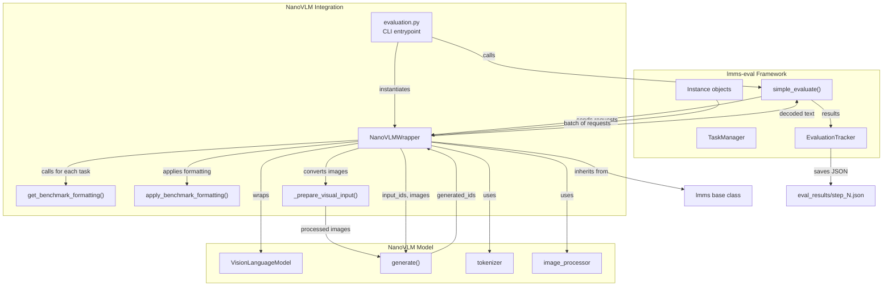
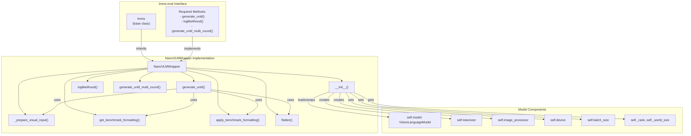
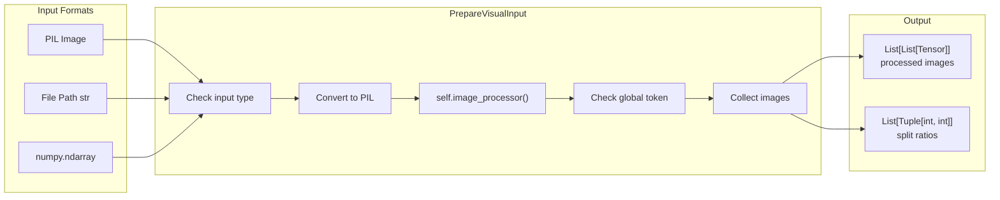
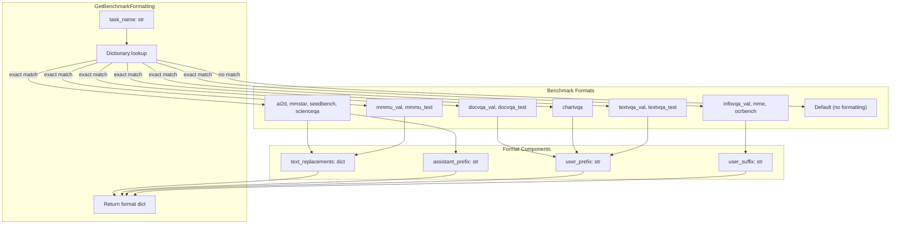
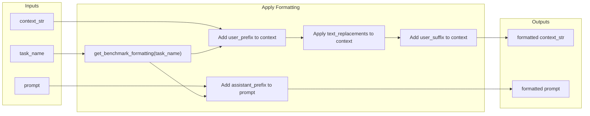
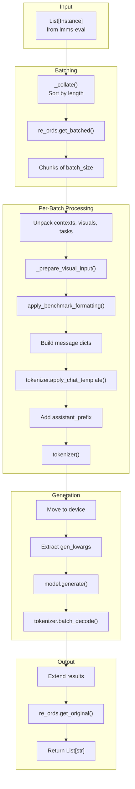
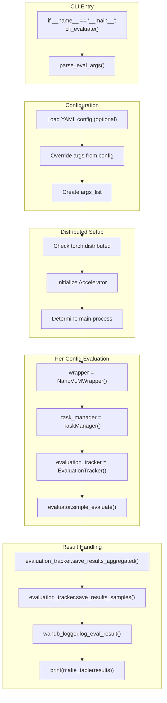

<!-- source: DeepWiki mcp.deepwiki.com · repo huggingface/nanoVLM · page 7.2 LMMS-Eval Integration · fetched 2026-10-26 -->

# LMMS-Eval Integration

<details>
<summary>Relevant source files</summary>

The following files were used as context for generating this wiki page:

- [eval/lmms_eval_wrapper.py](eval/lmms_eval_wrapper.py)
- [evaluation.py](evaluation.py)

</details>


## Purpose and Scope

This document details the integration between nanoVLM and the lmms-eval framework, which provides standardized evaluation across vision-language benchmarks. The integration is implemented through an adapter pattern using the `NanoVLMWrapper` class that bridges nanoVLM's model interface to lmms-eval's expected API.

For information about evaluation orchestration and checkpoint management, see [Evaluation Orchestration](#7.1). For interactive inference outside the evaluation framework, see [Inference and Generation](#8).

## Architecture Overview

The integration consists of two main components: the wrapper adapter and the evaluation CLI. The wrapper translates lmms-eval's request format into nanoVLM's expected inputs, while the CLI coordinates the evaluation process.

### Component Interaction Diagram



**Sources:** [evaluation.py:1-562](), [eval/lmms_eval_wrapper.py:1-346]()

## NanoVLMWrapper Class

The `NanoVLMWrapper` class implements the adapter pattern to make nanoVLM compatible with lmms-eval's `lmms` base class interface.

### Class Structure



**Sources:** [eval/lmms_eval_wrapper.py:23-56]()

### Initialization

The wrapper supports two initialization modes:

**Mode 1: Load from Hugging Face Hub**
```python
wrapper = NanoVLMWrapper(
    model="lusxvr/nanoVLM-450M",
    device="cuda",
    batch_size=32
)
```

**Mode 2: Wrap existing model instance**
```python
model = VisionLanguageModel.from_pretrained("path/to/checkpoint")
wrapper = NanoVLMWrapper(
    model=model,
    device="cuda", 
    batch_size=32
)
```

The initialization process [eval/lmms_eval_wrapper.py:26-55]():

| Step | Action | Code Location |
|------|--------|---------------|
| 1 | Load or wrap model | [eval/lmms_eval_wrapper.py:34-37]() |
| 2 | Move model to device | [eval/lmms_eval_wrapper.py:35-37]() |
| 3 | Check distributed setup | [eval/lmms_eval_wrapper.py:41-47]() |
| 4 | Initialize tokenizer | [eval/lmms_eval_wrapper.py:50]() |
| 5 | Initialize image processor | [eval/lmms_eval_wrapper.py:51-55]() |

**Sources:** [eval/lmms_eval_wrapper.py:26-55]()

## Visual Input Preparation

The `_prepare_visual_input()` method converts diverse visual input formats into the standardized format expected by nanoVLM.

### Visual Input Pipeline



**Sources:** [eval/lmms_eval_wrapper.py:57-87]()

### Processing Steps

The method handles three input types [eval/lmms_eval_wrapper.py:65-74]():

| Input Type | Handling |
|------------|----------|
| `PIL.Image.Image` | Use directly |
| `str` (path) | Load with `Image.open(visual).convert("RGB")` |
| `np.ndarray` | Convert with `Image.fromarray(visual)` |
| Other | Raise `ValueError` |

For each image:

1. **Process image** - Apply `self.image_processor(image)` to get processed tensors and split ratio [eval/lmms_eval_wrapper.py:77]()
2. **Check global token** - If tokenizer lacks `global_image_token` but processor generated it, remove it [eval/lmms_eval_wrapper.py:78-80]()
3. **Append results** - Collect processed images and ratios [eval/lmms_eval_wrapper.py:82-83]()

The method returns `(images, splitted_image_ratios)` or `(None, None)` if no valid images [eval/lmms_eval_wrapper.py:85-87]().

**Sources:** [eval/lmms_eval_wrapper.py:57-87]()

## Benchmark-Specific Formatting

Different benchmarks require specific prompt formatting. The wrapper implements a flexible formatting system through `get_benchmark_formatting()` and `apply_benchmark_formatting()`.

### Formatting Configuration



**Sources:** [eval/lmms_eval_wrapper.py:102-183]()

### Format Examples

**AI2D, MMStar, SeedBench, ScienceQA** [eval/lmms_eval_wrapper.py:105-115]():
```python
{
    "text_replacements": {
        "\nOptions:": "\nChoices:",
        "\nA. ": "\nChoices:\nA. ",
        "Please select the correct answer from the options above.": "Answer with the letter.",
        "Answer with the option's letter from the given choices directly": "Answer with the letter directly",
    },
    "assistant_prefix": "Answer:",
    "user_prefix": "",
    "user_suffix": ""
}
```

**DocVQA** [eval/lmms_eval_wrapper.py:116-123]():
```python
{
    "text_replacements": {},
    "assistant_prefix": "",
    "user_prefix": "Give a short and terse answer to the following question. "
                    + "Do not paraphrase or reformat the text you see in the image. "
                    + "Do not include any full stops. "
                    + "Just give the answer without additional explanation. Question: ",
    "user_suffix": ""
}
```

**ChartVQA** [eval/lmms_eval_wrapper.py:124-140]():
```python
{
    "text_replacements": {},
    "assistant_prefix": "",
    "user_prefix": "For the question below, follow the following instructions:\n"
                    + "-The answer should contain as few words as possible.\n"
                    + "-Don't paraphrase or reformat the text you see in the image.\n"
                    + "-Answer a binary question with Yes or No.\n"
                    # ... additional instructions
                    + "Question: ",
    "user_suffix": ""
}
```

**TextVQA** [eval/lmms_eval_wrapper.py:141-154]():
```python
{
    "text_replacements": {},
    "assistant_prefix": "",
    "user_prefix": "Answer the following question about the image using as few words as possible. "
                    + "Follow these additional instructions:\n"
                    + "-Always answer a binary question with Yes or No.\n"
                    # ... additional instructions
                    + "Question: ",
    "user_suffix": ""
}
```

**MMMU** [eval/lmms_eval_wrapper.py:155-164]():
```python
{
    "text_replacements": {
        "Question:": "",
        "Answer with the option's letter from the given choices directly.": "Answer with the letter directly.",
        "\nA. ": "\nChoices:\nA. "
    },
    "assistant_prefix": "Answer:",
    "user_prefix": "",
    "user_suffix": ""
}
```

**InfoVQA, MME, OCRBench** [eval/lmms_eval_wrapper.py:165-170]():
```python
{
    "text_replacements": {},
    "assistant_prefix": "",
    "user_prefix": "",
    "user_suffix": "\nGive a very brief answer."
}
```

### Format Application

The `apply_benchmark_formatting()` method applies these rules [eval/lmms_eval_wrapper.py:185-205]():



**Sources:** [eval/lmms_eval_wrapper.py:185-205]()

## Generation Pipeline

The `generate_until()` method is the core interface for evaluation, processing batches of evaluation requests.

### Request Processing Flow



**Sources:** [eval/lmms_eval_wrapper.py:207-333]()

### Detailed Processing Steps

**1. Collation and Batching** [eval/lmms_eval_wrapper.py:210-226]():
- Define `_collate()` function to sort requests by token length (descending)
- Use `utils.Collator` to group requests by `generation_kwargs`
- Create chunks of size `self.batch_size`

**2. Visual Processing** [eval/lmms_eval_wrapper.py:227-237]():
```python
contexts, all_gen_kwargs, doc_to_visual, doc_id, task, split = zip(*chunk)
visuals = [dtv(self.task_dict[t][s][i]) for dtv, i, t, s in zip(doc_to_visual, doc_id, task, split)]
images, splitted_image_ratio = self._prepare_visual_input(self.flatten(visuals))
```

**3. Message Construction** [eval/lmms_eval_wrapper.py:239-265]():

| Step | Action | Code Reference |
|------|--------|----------------|
| 1 | Apply benchmark formatting to context | [eval/lmms_eval_wrapper.py:245]() |
| 2 | Count images per sample | [eval/lmms_eval_wrapper.py:247-250]() |
| 3 | Generate image token strings | [eval/lmms_eval_wrapper.py:252-254]() |
| 4 | Combine image tokens + context | [eval/lmms_eval_wrapper.py:256]() |
| 5 | Create message dict | [eval/lmms_eval_wrapper.py:259]() |

**4. Template Application** [eval/lmms_eval_wrapper.py:266-279]():
```python
prompts = self.tokenizer.apply_chat_template(messages, tokenize=False, add_generation_prompt=True)

# Apply benchmark-specific assistant prefixes
for i in range(len(prompts)):
    _, prompts[i] = self.apply_benchmark_formatting("", prompts[i], task[i])
```

**5. Tokenization** [eval/lmms_eval_wrapper.py:281-291]():
```python
inputs = self.tokenizer(
    prompts,
    return_tensors="pt",
    padding="longest",
    padding_side="left",
    truncation=True,
    max_length=self.max_length
)

input_ids = inputs["input_ids"].to(self.device)
attention_mask = inputs["attention_mask"].to(self.device)
```

**6. Generation** [eval/lmms_eval_wrapper.py:294-316]():

Extract generation parameters:
```python
current_gen_kwargs = all_gen_kwargs[0] if all_gen_kwargs else {}
max_new_tokens = current_gen_kwargs.get("max_new_tokens", 50)
temperature = current_gen_kwargs.get("temperature", 0.0)
top_p = current_gen_kwargs.get("top_p", 1.0)
greedy = current_gen_kwargs.get("do_sample", False) is False or temperature == 0.0
```

Call model generation:
```python
generated_ids_batch = self.model.generate(
    input_ids,
    images,
    attention_mask,
    max_new_tokens=max_new_tokens,
    greedy=greedy,
    temperature=gen_temperature,
    top_p=gen_top_p,
)
```

**7. Decoding** [eval/lmms_eval_wrapper.py:319-327]():
```python
generated_texts = self.tokenizer.batch_decode(
    generated_ids_batch,
    skip_special_tokens=True
)
res.extend(generated_texts)
```

**8. Reordering** [eval/lmms_eval_wrapper.py:333]():
```python
return re_ords.get_original(res)
```

**Sources:** [eval/lmms_eval_wrapper.py:207-333]()

## Integration with lmms-eval

The evaluation CLI in `evaluation.py` coordinates the integration with lmms-eval's evaluation engine.

### CLI Evaluation Flow



**Sources:** [evaluation.py:286-384](), [evaluation.py:386-551]()

### Key CLI Arguments

| Argument | Type | Default | Purpose |
|----------|------|---------|---------|
| `--config` | str | "" | YAML config file path |
| `--model` | str | "hf" | Model name or path |
| `--tasks` | str | None | Comma-separated task names |
| `--batch_size` | str | 128 | Batch size for evaluation |
| `--device` | str | "cuda" | Device for evaluation |
| `--output_path` | str | "results/" | Output directory |
| `--checkpoint_path` | str | "" | Checkpoint directory path |
| `--global_step` | int | 0 | Training step number |
| `--eval_tasks` | str+ | None | List of evaluation tasks |
| `--eval_results_dir` | str | "eval_results" | Results directory |

**Sources:** [evaluation.py:89-283]()

### Wrapper Instantiation

The wrapper is instantiated in `cli_evaluate_single()` [evaluation.py:493-497]():

```python
wrapped_model = NanoVLMWrapper(
    model=args.model,
    device=args.device,
    batch_size=int(args.batch_size),
)
```

This wrapper is then passed to `evaluator.simple_evaluate()` [evaluation.py:499-528]():

```python
results = evaluator.simple_evaluate(
    model=wrapped_model,
    model_args=args.model_args,
    tasks=task_names,
    num_fewshot=args.num_fewshot,
    batch_size=args.batch_size,
    max_batch_size=args.max_batch_size,
    device=args.device,
    # ... additional arguments
)
```

**Sources:** [evaluation.py:493-528]()

## Unimplemented Methods

Two lmms-eval methods are not implemented for nanoVLM:

### loglikelihood()

```python
def loglikelihood(self, requests: List[Instance]) -> List[Tuple[float, bool]]:
    raise NotImplementedError("Loglikelihood is not implemented for nanoVLM")
```

This method would compute the log probability of continuations given contexts. It is not needed for generative evaluation tasks.

**Sources:** [eval/lmms_eval_wrapper.py:89-90]()

### generate_until_multi_round()

```python
def generate_until_multi_round(self, requests: List[Instance]) -> List[str]:
    raise NotImplementedError("Multi Round Generation is not implemented for nanoVLM")
```

This method would handle multi-turn conversations. Not required for single-turn benchmarks.

**Sources:** [eval/lmms_eval_wrapper.py:335-336]()

## Properties

The wrapper exposes two properties required by lmms-eval:

### max_length

```python
@property
def max_length(self):
    """Return the maximum sequence length."""
    return self.model.cfg.lm_max_position_embeddings
```

Returns the maximum position embeddings from the language model configuration.

**Sources:** [eval/lmms_eval_wrapper.py:338-341]()

### batch_size_per_gpu

```python
@property
def batch_size_per_gpu(self):
    """Return the batch size."""
    return self.batch_size
```

Returns the configured batch size for this GPU.

**Sources:** [eval/lmms_eval_wrapper.py:343-346]()

## Summary

The LMMS-Eval integration provides:

1. **Adapter Pattern** - `NanoVLMWrapper` implements the `lmms` interface to bridge nanoVLM and lmms-eval
2. **Visual Processing** - Flexible input handling for PIL Images, file paths, and numpy arrays
3. **Benchmark Formatting** - Task-specific prompt engineering for 11+ benchmarks
4. **Batched Generation** - Efficient batch processing with request collation and reordering
5. **CLI Interface** - `evaluation.py` provides command-line access to the evaluation pipeline
6. **Distributed Support** - Automatic detection and handling of distributed execution contexts

The integration enables standardized evaluation across vision-language benchmarks while maintaining compatibility with nanoVLM's architecture and training pipeline.

**Sources:** [evaluation.py:1-562](), [eval/lmms_eval_wrapper.py:1-346]()

---

