<!-- source: DeepWiki mcp.deepwiki.com · repo huggingface/nanoVLM · page 8 Inference and Generation · fetched 2026-10-26 -->

# Inference and Generation

<details>
<summary>Relevant source files</summary>

The following files were used as context for generating this wiki page:

- [generate.py](generate.py)
- [models/vision_language_model.py](models/vision_language_model.py)

</details>


## Purpose and Scope

This document covers the inference and interactive text generation capabilities of nanoVLM. It details how to load trained models, prepare inputs, and generate text from images using the `VisionLanguageModel.generate()` method and the `generate.py` CLI tool.

For information about model evaluation on benchmarks, see [Evaluation System](#7). For inline evaluation during training, see [Training Evaluation](#6.3).

---

## Overview

The inference system provides two primary interfaces for generating text from images:

1. **Programmatic API**: The `VisionLanguageModel.generate()` method for integration into other code
2. **Interactive CLI**: The `generate.py` script for command-line usage with immediate output

Both interfaces support:
- Loading models from local checkpoints or Hugging Face Hub
- Processing arbitrary images with automatic resizing and splitting
- Multiple generation strategies (greedy, top-k, top-p sampling)
- Optional VRAM profiling for hardware optimization

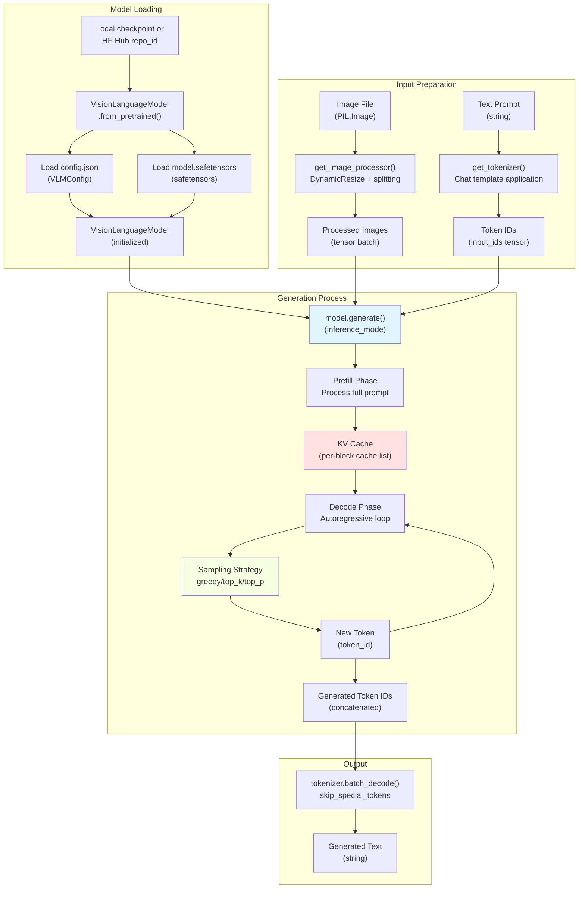

**Sources**: [models/vision_language_model.py:82-183](), [generate.py:37-98]()

---

## Model Loading

### Loading from Pretrained Weights

The `VisionLanguageModel.from_pretrained()` class method loads models from either local directories or Hugging Face Hub repositories. This method handles configuration parsing and weight loading automatically.

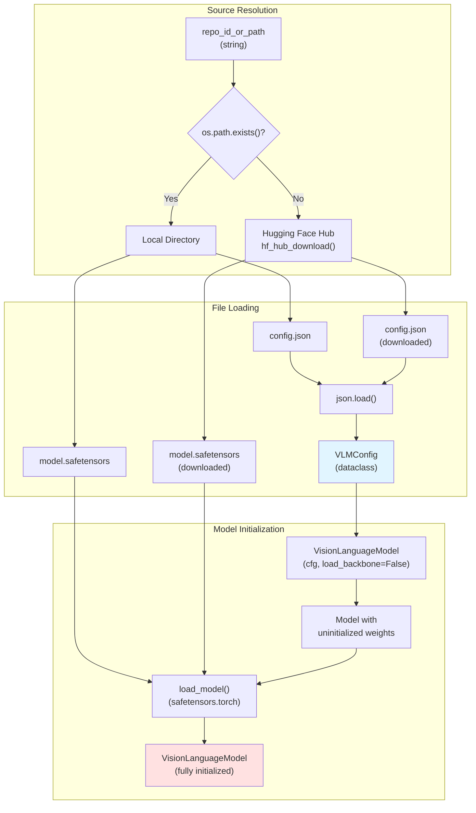

**Key Implementation Details**:

| Aspect | Implementation |
|--------|---------------|
| **Config Loading** | `json.load()` creates `VLMConfig` dataclass from `config.json` |
| **Weight Format** | SafeTensors format for fast, safe loading via `load_model()` |
| **Backbone Loading** | Set `load_backbone=False` to avoid loading pretrained ViT/LM weights twice |
| **Hub Integration** | Uses `hf_hub_download()` with optional revision parameter |
| **Tokenizer** | Loaded automatically in `__init__()` using config parameters |

**Sources**: [models/vision_language_model.py:185-233](), [generate.py:48-55]()

### Command-Line Model Loading

The `generate.py` script provides flexible model loading through CLI arguments:

```bash
# Load from Hugging Face Hub (default)
python generate.py --hf_model lusxvr/nanoVLM-230M-8k

# Load from local checkpoint directory
python generate.py --checkpoint ./checkpoints/step_10000

# Load from local safetensors file
python generate.py --checkpoint ./my_model.safetensors
```

**Device Selection**: Automatically detects and uses the best available device in priority order: CUDA > MPS (Apple Silicon) > CPU.

**Sources**: [generate.py:13-46]()

---

## Input Preparation

### Image Processing Pipeline

Images are processed through a multi-stage pipeline that handles resizing, splitting, and tensor conversion:

```mermaid
graph LR
    subgraph "Image Loading"
        FilePath["Image file path"]
        PILOpen["PIL.Image.open()<br/>.convert('RGB')"]
        FilePath --> PILOpen
        PILOpen --> RGBImage["RGB Image"]
    end
    
    subgraph "Dynamic Processing"
        RGBImage --> ImageProc["get_image_processor()<br/>(max_img_size, vit_img_size)"]
        ImageProc --> DynResize["DynamicResize<br/>preserve aspect ratio"]
        DynResize --> Splitting["Image splitting<br/>if > vit_img_size"]
        Splitting --> GlobalImg["Optional global<br/>thumbnail"]
    end
    
    subgraph "Tensor Conversion"
        GlobalImg --> BatchTensor["Batch of tensors<br/>[N, C, H, W]"]
        Splitting --> BatchTensor
        BatchTensor --> SplitRatio["Split ratio<br/>(rows, cols)"]
    end
    
    subgraph "Token String Generation"
        SplitRatio --> ImageString["get_image_string()<br/>(tokenizer, ratios, mp_length)"]
        ImageString --> TokenSeq["Image token sequence<br/><image> × mp_image_token_length"]
    end
    
    style DynResize fill:#e1f5ff
    style ImageString fill:#ffe1e1
```

**Key Parameters**:

| Parameter | Purpose | Default |
|-----------|---------|---------|
| `max_img_size` | Maximum side length before splitting | 2048 |
| `vit_img_size` | Target size for each image patch | 512 |
| `resize_to_max_side_len` | Preserve aspect ratio during resize | True |
| `mp_image_token_length` | Number of tokens per image patch | 64 |

The processor returns two values:
1. **Processed images**: Tensor batch `[N, C, H, W]` where `N` = number of splits (+ optional global)
2. **Split ratio**: Tuple `(rows, cols)` indicating the grid dimensions

**Sources**: [generate.py:63-76](), [data/processors.py]()

### Text Tokenization with Chat Templates

Text prompts are tokenized using chat templates that format the conversation structure:

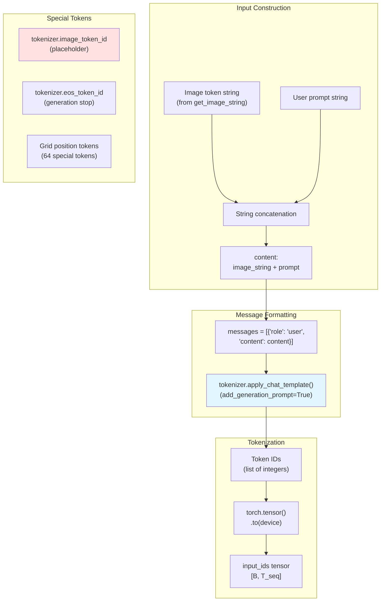

**Chat Template Application**:

The tokenizer applies the language model's chat template (e.g., SmolLM2-Instruct format) to structure the conversation. The `add_generation_prompt=True` flag appends the assistant prefix, cueing the model to generate a response.

**Image Token Placeholders**:

Image token IDs (e.g., `<image>`) in the tokenized sequence are replaced with actual image embeddings during the forward pass via `_replace_img_tokens_with_embd()`.

**Sources**: [generate.py:76-81](), [models/vision_language_model.py:36-49]()

---

## Generation Process

The `generate()` method implements a two-phase generation strategy optimized for multimodal inputs:

### Two-Phase Generation Architecture

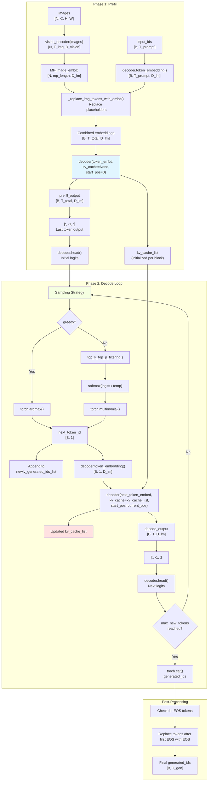

**Sources**: [models/vision_language_model.py:82-183]()

### Prefill Phase

The prefill phase processes the entire multimodal prompt (text + image embeddings) in a single forward pass:

| Step | Operation | Purpose |
|------|-----------|---------|
| 1. Token Embedding | `decoder.token_embedding(input_ids)` | Convert token IDs to embeddings |
| 2. Vision Encoding | `vision_encoder(images)` | Extract visual features |
| 3. Modality Projection | `MP(image_embd)` | Project vision features to LM dimension |
| 4. Token Replacement | `_replace_img_tokens_with_embd()` | Replace `<image>` placeholders with embeddings |
| 5. Forward Pass | `decoder(token_embd, kv_cache=None, start_pos=0)` | Process full prompt, initialize KV cache |
| 6. Logits Extraction | `decoder.head(prefill_output[:, -1, :])` | Get logits for next token prediction |

**Key Implementation**:
- `kv_cache=None` signals this is the prefill phase
- `start_pos=0` indicates processing from the beginning
- All key-value pairs are computed and cached for later reuse

**Sources**: [models/vision_language_model.py:84-110]()

### Decode Phase

The decode phase generates tokens autoregressively, reusing cached key-value pairs:

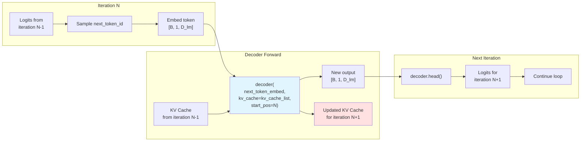

**Decode Loop Implementation**:
- **Per-token processing**: Only the newly generated token is embedded and processed
- **KV cache reuse**: Cached keys/values from previous tokens avoid recomputation
- **Position tracking**: `start_pos=current_total_seq_len` ensures correct positional encodings
- **Attention mask updates**: Extended by 1 each iteration to include the new token
- **Cache updates**: Each decoder block updates its entry in `kv_cache_list`

**Sources**: [models/vision_language_model.py:115-152]()

### EOS Token Handling

After generation completes, tokens following the first EOS token in each sequence are replaced with EOS:

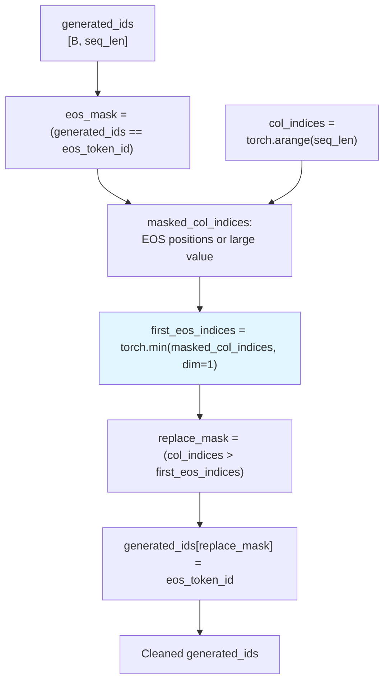

This ensures generation stops cleanly at the first EOS token, preventing the model from generating content after signaling completion.

**Sources**: [models/vision_language_model.py:158-182]()

---

## Sampling Strategies

The generation process supports multiple sampling strategies to control output diversity:

### Greedy Sampling

Selects the highest-probability token at each step:

```python
next_token_id = torch.argmax(current_logits, dim=-1, keepdim=True)
```

**Characteristics**:
- Deterministic output (same input always produces same output)
- Fast computation (single argmax operation)
- Lower diversity, potential for repetition
- Recommended for factual question answering

**Sources**: [models/vision_language_model.py:117-118]()

### Top-K and Top-P Filtering

Implements nucleus sampling for diverse outputs:

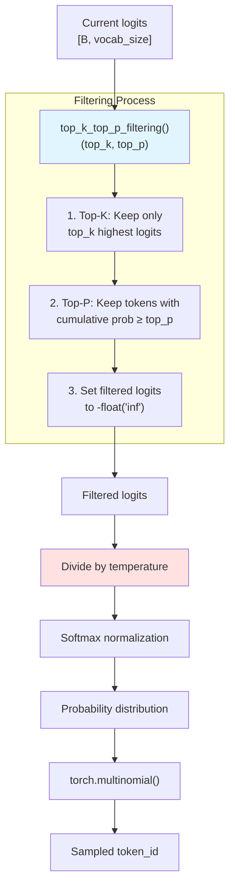

**Parameters**:

| Parameter | Default | Effect |
|-----------|---------|--------|
| `top_k` | 50 | Restricts sampling to K most likely tokens |
| `top_p` | 0.9 | Nucleus sampling: cumulative probability threshold |
| `temperature` | 0.5 | Lower = more deterministic, higher = more diverse |

**Implementation**:
- Top-K: Sets logits outside top-K to `-inf`
- Top-P: Dynamically adjusts cutoff based on cumulative probability
- Temperature: Scales logits before softmax, affecting distribution sharpness

**Sources**: [models/vision_language_model.py:120-122](), [models/utils.py]()

---

## Interactive CLI (generate.py)

### Command-Line Arguments

The `generate.py` script provides a user-friendly interface for inference:

| Argument | Type | Default | Description |
|----------|------|---------|-------------|
| `--checkpoint` | str | None | Path to local checkpoint directory or file |
| `--hf_model` | str | `lusxvr/nanoVLM-230M-8k` | Hugging Face Hub model ID (if no checkpoint) |
| `--image` | str | `assets/image.png` | Path to input image file |
| `--prompt` | str | `"What is this?"` | Text prompt for the model |
| `--generations` | int | 5 | Number of independent generations to produce |
| `--max_new_tokens` | int | 300 | Maximum tokens per generation |
| `--measure_vram` | flag | False | Enable VRAM usage measurement and reporting |

**Sources**: [generate.py:13-34]()

### Usage Examples

**Basic Usage**:
```bash
python generate.py \
  --image path/to/image.jpg \
  --prompt "Describe this image in detail"
```

**Custom Model and Generation Settings**:
```bash
python generate.py \
  --checkpoint ./checkpoints/step_8000 \
  --image photo.png \
  --prompt "What objects are visible?" \
  --generations 3 \
  --max_new_tokens 150
```

**With VRAM Profiling**:
```bash
python generate.py \
  --hf_model lusxvr/nanoVLM-230M-8k \
  --image chart.png \
  --prompt "Summarize this chart" \
  --measure_vram
```

**Output Format**:
```
Using device: cuda
Loading weights from: lusxvr/nanoVLM-230M-8k
VRAM used after loading model: 892.45 MB

Input:
  Describe this image in detail

Output:
  >> Generation 1: The image shows a cat sitting on a windowsill...
     VRAM - Peak: 1024.67 MB, Current: 893.12 MB
  >> Generation 2: This is a photograph of a domestic cat...
     VRAM - Peak: 1024.67 MB, Current: 893.12 MB
  ...
```

**Sources**: [generate.py:37-98]()

### VRAM Measurement

When `--measure_vram` is enabled, the script tracks GPU memory usage at key points:

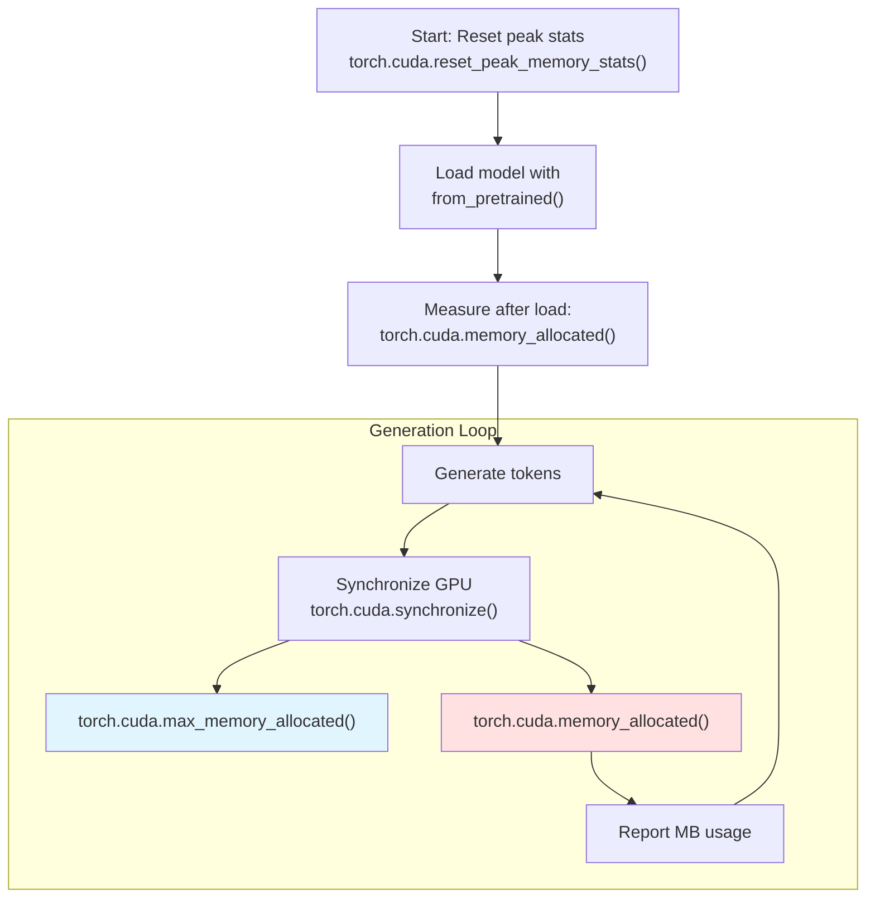

**Measured Metrics**:
- **Model VRAM**: Memory allocated immediately after loading (weights + buffers)
- **Peak VRAM**: Maximum allocation during generation (includes activations, KV cache)
- **Current VRAM**: Memory allocated after generation completes

This data helps users:
- Select appropriate GPU hardware
- Optimize batch sizes for training
- Understand memory requirements across model sizes

**Sources**: [generate.py:51-97]()

---

## Implementation Details

### KV Cache Management

The KV cache stores key and value tensors from previous tokens to avoid recomputation:

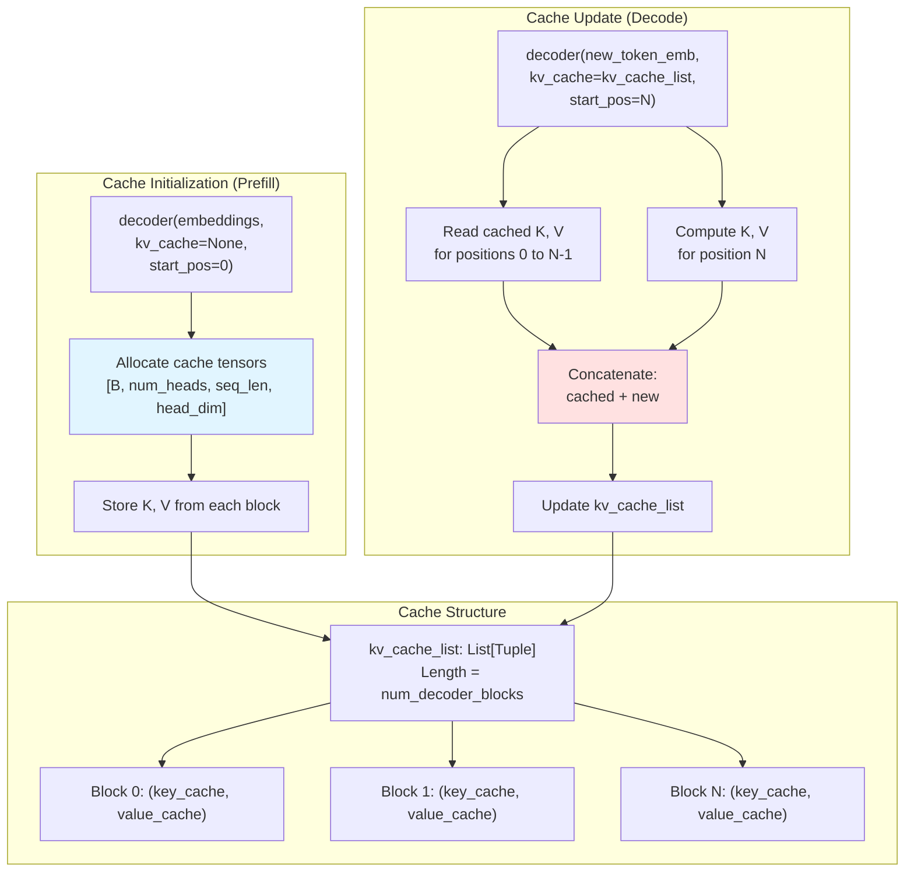

**Cache Tensor Shapes**:
- **Grouped Query Attention**: Cache shape is `[batch_size, num_kv_heads, seq_len, head_dim]`
- For nanoVLM-230M: 15 query heads, 5 KV heads → cache stores only 5 head pairs per block
- Memory savings: ~67% compared to Multi-Head Attention (5/15 heads cached)

**Sources**: [models/vision_language_model.py:98-143](), [models/language_model.py]()

### Attention Mask Updates

Attention masks prevent the model from attending to padding tokens and maintain causal masking:

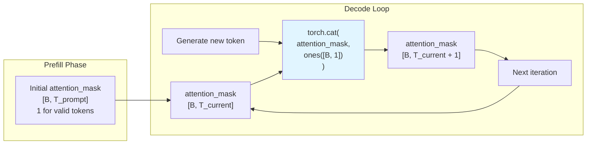

The mask is extended by 1 position each iteration, marking the new token as valid for attention. This ensures:
- Causal attention: Each token only attends to previous tokens
- Padding exclusion: Padded positions (if any) remain masked
- Correct context: Full sequence history is accessible

**Sources**: [models/vision_language_model.py:134-136]()

### Token Embedding Replacement

Image tokens in the input sequence are replaced with projected visual embeddings:

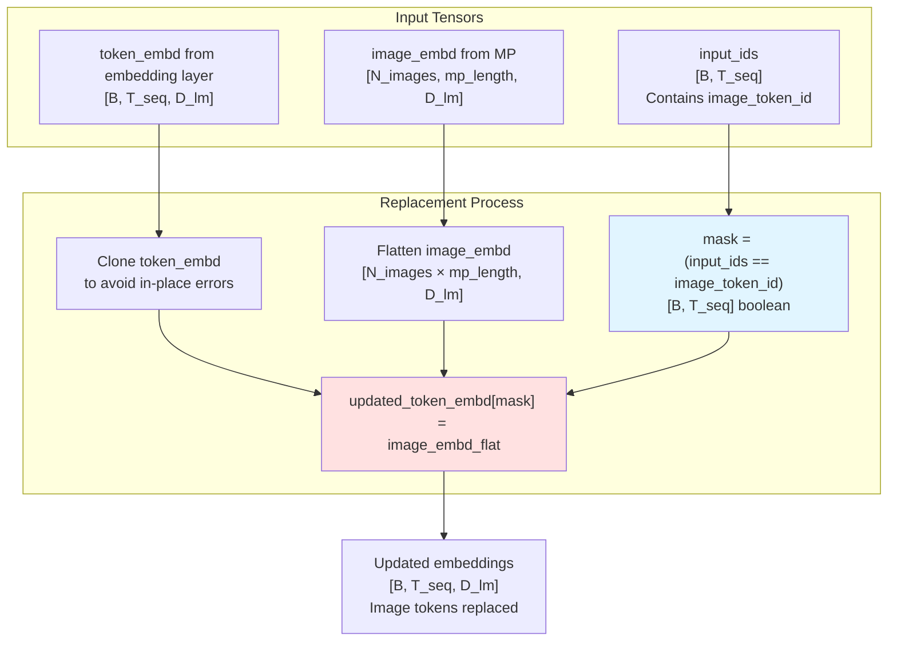

**Implementation Notes**:
- **Boolean masking**: PyTorch's advanced indexing handles arbitrary image counts per sample
- **Flattening**: `image_embd.view(-1, D_lm)` flattens spatial dimensions before assignment
- **Type casting**: `.to(updated_token_embd.dtype)` ensures dtype consistency
- **Cloning**: Prevents in-place modification errors during backpropagation

**Sources**: [models/vision_language_model.py:36-49]()

---

## Generation Pipeline Summary

The complete inference pipeline from image file to generated text:

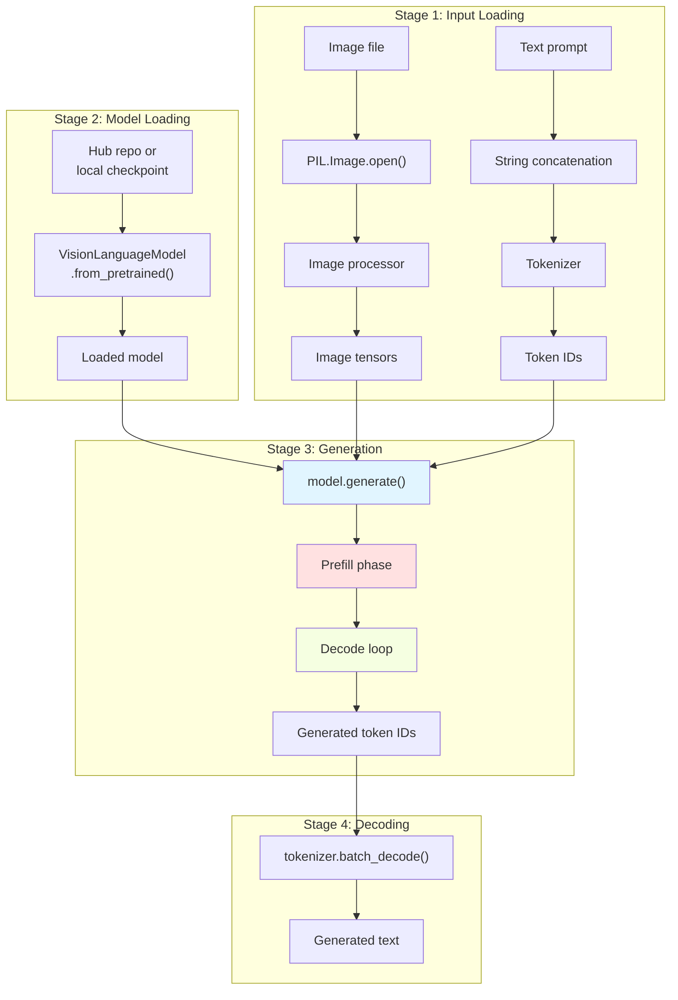

**Typical Latency Profile** (on NVIDIA A100):
- Model loading: 1-2 seconds (first time, cached thereafter)
- Image processing: 10-50ms
- Tokenization: 1-5ms
- Prefill phase: 50-200ms (depending on sequence length)
- Per-token decode: 10-30ms
- Total for 100 tokens: ~1.5-3.5 seconds

**Sources**: [generate.py:37-98](), [models/vision_language_model.py:82-183]()

---

