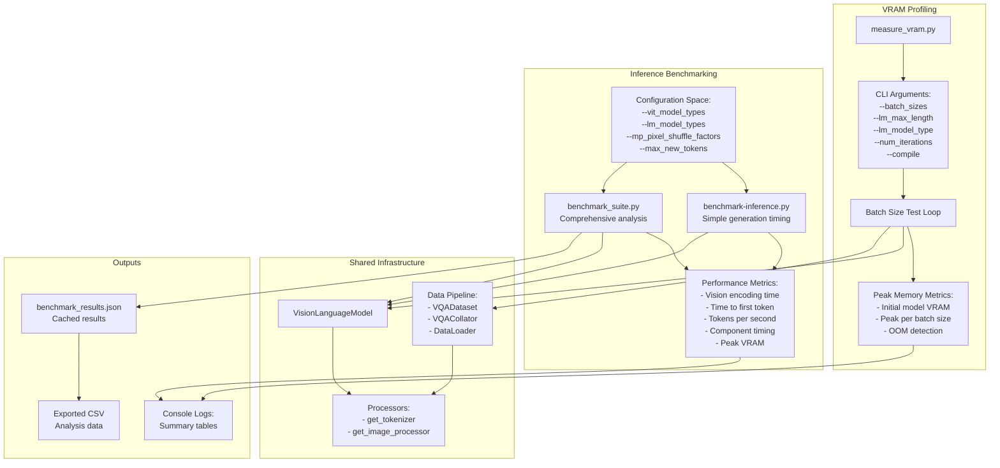
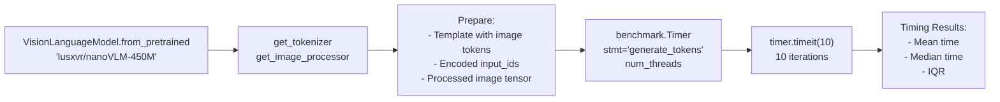

<!-- source: DeepWiki mcp.deepwiki.com · repo huggingface/nanoVLM · page 9 Performance Analysis · fetched 2026-10-26 -->

# Performance Analysis

<details>
<summary>Relevant source files</summary>

The following files were used as context for generating this wiki page:

- [assets/VRAM_Usage_vs_Batch_Size_nanoVLM.png](assets/VRAM_Usage_vs_Batch_Size_nanoVLM.png)
- [eval/benchmark-inference.py](eval/benchmark-inference.py)
- [eval/benchmark_suite.py](eval/benchmark_suite.py)
- [eval/measure_vram.py](eval/measure_vram.py)

</details>


## Purpose and Scope

This document describes the performance analysis tools in nanoVLM for profiling GPU memory usage and measuring inference speed. These tools enable hardware selection, batch size optimization, and architectural comparison. For model training workflows, see [Training](#6). For evaluation on benchmarks, see [Evaluation System](#7).

The performance analysis subsystem consists of:
- **VRAM profiling** via `measure_vram.py` to determine peak memory usage across batch sizes
- **Inference benchmarking** via `benchmark-inference.py` and `benchmark_suite.py` to measure generation speed and component-level timing

---

## Performance Analysis Tool Architecture



**Sources:** [eval/measure_vram.py:1-202](), [eval/benchmark-inference.py:1-44](), [eval/benchmark_suite.py:1-262]()

---

## VRAM Profiling

### Tool Overview

The `measure_vram.py` script simulates training workloads to measure peak GPU memory consumption. This enables:
- **Batch size selection**: Determine maximum viable batch size for available GPU memory
- **Hardware planning**: Estimate GPU requirements for scaled training
- **Memory optimization**: Identify memory bottlenecks in model architecture

The tool iterates through specified batch sizes, performs forward and backward passes with gradient computation, and reports peak memory allocation before encountering OOM (Out of Memory) errors.

**Sources:** [eval/measure_vram.py:20-174]()

### Measurement Methodology

```mermaid
graph LR
    subgraph "Initialization Phase"
        ResetStats["torch.cuda.reset_peak_memory_stats"]
        LoadModel["VisionLanguageModel<br/>from VLMConfig"]
        LoadToDevice["model.to(device)"]
        InitialMeasure["torch.cuda.memory_allocated<br/>Initial baseline"]
        
        ResetStats --> LoadModel
        LoadModel --> LoadToDevice
        LoadToDevice --> InitialMeasure
    end
    
    subgraph "Dataset Preparation"
        LoadDataset["load_dataset<br/>train split"]
        VQADataset["VQADataset<br/>tokenization + processing"]
        VQACollator["VQACollator<br/>padding"]
        CreateLoader["DataLoader<br/>batch_size=bs"]
        
        LoadDataset --> VQADataset
        VQADataset --> VQACollator
        VQACollator --> CreateLoader
    end
    
    subgraph "Batch Size Loop"
        ForEachBS["for bs in batch_sizes"]
        ResetForBS["reset_peak_memory_stats"]
        SetTrain["model.train()"]
        CreateOptim["AdamW optimizer"]
        
        ForEachBS --> ResetForBS
        ResetForBS --> SetTrain
        SetTrain --> CreateOptim
    end
    
    subgraph "Iteration Loop"
        LoadBatch["batch = next(dataloader)"]
        MoveToCUDA["images, input_ids, labels<br/>to device"]
        ZeroGrad["optimizer.zero_grad<br/>set_to_none=True"]
        Autocast["torch.autocast<br/>bfloat16/float16"]
        Forward["model(input_ids, images,<br/>attention_mask, targets)"]
        Backward["loss.backward()"]
        OptimizerStep["optimizer.step()"]
        
        LoadBatch --> MoveToCUDA
        MoveToCUDA --> ZeroGrad
        ZeroGrad --> Autocast
        Autocast --> Forward
        Forward --> Backward
        Backward --> OptimizerStep
    end
    
    subgraph "Measurement"
        Synchronize["torch.cuda.synchronize"]
        GetPeak["torch.cuda.max_memory_allocated"]
        RecordOrOOM["Record peak<br/>or catch OOM"]
        Cleanup["del loader, optimizer, tensors<br/>torch.cuda.empty_cache()"]
        
        OptimizerStep --> Synchronize
        Synchronize --> GetPeak
        GetPeak --> RecordOrOOM
        RecordOrOOM --> Cleanup
    end
    
    InitialMeasure --> CreateLoader
    CreateOptim --> LoadBatch
    OptimizerStep -.num_iterations.-> LoadBatch
    Cleanup --> ForEachBS
    
    RecordOrOOM --> Summary["Print Summary Table:<br/>Batch Size -> VRAM Usage"]
```



The measurement process closely simulates the actual training loop from `train.py`:

1. **Model initialization** with optional `torch.compile` support for realistic memory footprint
2. **Dataset loading** using `VQADataset` and `VQACollator` with the same processing pipeline as training
3. **Per-batch-size testing** with fresh memory statistics tracking
4. **Training simulation** including:
   - Autocast to bfloat16/float16 matching training configuration
   - Forward pass through the full VLM
   - Backward pass with gradient computation
   - Optimizer step with parameter updates
5. **Memory tracking** with `torch.cuda.max_memory_allocated()` after synchronization
6. **OOM handling** that catches out-of-memory errors and reports last known peak

**Sources:** [eval/measure_vram.py:26-174]()

### Configuration Parameters

| Parameter | Type | Default | Description |
|-----------|------|---------|-------------|
| `--batch_sizes` | str | `"1 2 4 8 16 32 64 128 256 512"` | Space-separated list of batch sizes to test |
| `--lm_max_length` | int | `128` | Maximum sequence length for language model |
| `--lm_model_type` | str | `'HuggingFaceTB/SmolLM2-135M-Instruct'` | Language model identifier |
| `--num_iterations` | int | `2` | Number of forward/backward passes per batch size |
| `--compile` | flag | `False` | Enable `torch.compile` for model optimization |

The tool automatically uses dataset configuration from `TrainConfig.train_dataset_path` and `TrainConfig.train_dataset_name`. For batch size `bs` and `num_iterations` iterations, the tool requires `bs * num_iterations` samples from the dataset.

**Sources:** [eval/measure_vram.py:176-199]()

### Usage Example

```bash
# Profile VRAM usage for SmolLM2-360M with standard batch sizes
python eval/measure_vram.py \
    --lm_model_type HuggingFaceTB/SmolLM2-360M-Instruct \
    --batch_sizes "1 2 4 8 16 32 64" \
    --num_iterations 3

# Test with torch.compile optimization
python eval/measure_vram.py \
    --compile \
    --batch_sizes "1 2 4 8 16"
```

Output format:
```
VRAM allocated after loading model to device: 1234.56 MB
Model initialized with 360,000,000 parameters

Testing Batch Size: 1
Peak VRAM allocated for batch size 1: 2345.67 MB

Testing Batch Size: 2
Peak VRAM allocated for batch size 2: 3456.78 MB

...

Testing Batch Size: 64
CUDA out of memory for batch size 64.
Peak VRAM allocated before OOM: 23456.78 MB (may be approximate)

--- Summary of VRAM Usage ---
Batch Size 1: 2345.67 MB
Batch Size 2: 3456.78 MB
...
Batch Size 64: OOM (Peak before OOM: 23456.78 MB)
```

**Sources:** [eval/measure_vram.py:87-174]()

---

## Inference Benchmarking

### Benchmark Tools Overview

nanoVLM provides two complementary benchmarking tools:

| Tool | Purpose | Metrics | Use Case |
|------|---------|---------|----------|
| `benchmark-inference.py` | Simple generation timing | Total generation time | Quick performance checks, CI/CD |
| `benchmark_suite.py` | Comprehensive analysis | Vision encoding, TTFT, TPS, component timing, VRAM | Architecture comparison, optimization |

**Sources:** [eval/benchmark-inference.py:1-44](), [eval/benchmark_suite.py:1-262]()

### Simple Benchmarking: benchmark-inference.py



This tool uses `torch.utils.benchmark.Timer` to measure end-to-end generation time for 1000 tokens. The setup:

1. Load pretrained model from Hugging Face Hub
2. Create prompt template with image tokens: `{image_tokens}Question: {text} Answer:`
3. Encode text and process image
4. Measure `model.generate()` execution over 10 iterations

**Sources:** [eval/benchmark-inference.py:16-43]()

### Comprehensive Benchmarking: benchmark_suite.py

The `benchmark_suite.py` tool explores the full configuration space of VLM architectures:

```mermaid
graph TB
    subgraph "Configuration Space"
        ViTModels["vit_model_types:<br/>- siglip2-base-patch16-256<br/>- siglip2-base-patch16-512<br/>- siglip2-so400m-patch16-512"]
        LMModels["lm_model_types:<br/>- SmolLM2-135M<br/>- SmolLM2-360M<br/>- SmolLM2-1.7B"]
        PSFactors["mp_pixel_shuffle_factors:<br/>- 1 (no compression)<br/>- 2 (4x reduction)<br/>- 4 (16x reduction)"]
        
        CartesianProduct["Cartesian Product<br/>All combinations"]
        
        ViTModels --> CartesianProduct
        LMModels --> CartesianProduct
        PSFactors --> CartesianProduct
    end
    
    subgraph "Benchmark Execution"
        CheckCache["Check cached_results<br/>key=(vit, psf, lm)"]
        BuildModel["VLMConfig + VisionLanguageModel<br/>load_backbone=True"]
        PrepareInputs["Prepare:<br/>- Tokenized prompt<br/>- Processed image"]
        
        CartesianProduct --> CheckCache
        CheckCache -->|cache miss| BuildModel
        CheckCache -->|cache hit| LoadCached["Load cached result"]
        BuildModel --> PrepareInputs
    end
    
    subgraph "Warmup Phase"
        WarmupLoop["for _ in range(warmup_runs)"]
        VisionEncode["vision_encoder(image)"]
        MPProj["MP(image_embd)"]
        TokenEmbed["token_embedding(input_ids)"]
        CombineEmbed["cat((image_embd, token_embd))"]
        DecodeLoop["Decode max_new_tokens"]
        
        WarmupLoop --> VisionEncode
        VisionEncode --> MPProj
        MPProj --> TokenEmbed
        TokenEmbed --> CombineEmbed
        CombineEmbed --> DecodeLoop
    end
    
    subgraph "Timed Benchmark"
        ResetStats["reset_peak_memory_stats"]
        TimedVision["Timed:<br/>vision_encoder + MP"]
        TimedFirstToken["Timed:<br/>decoder first pass"]
        TimedSubsequent["Timed:<br/>subsequent tokens"]
        MeasurePeak["max_memory_allocated"]
        
        ResetStats --> TimedVision
        TimedVision --> TimedFirstToken
        TimedFirstToken --> TimedSubsequent
        TimedSubsequent --> MeasurePeak
    end
    
    PrepareInputs --> WarmupLoop
    DecodeLoop --> ResetStats
    
    subgraph "Results Aggregation"
        ComputeAvg["Compute averages<br/>over num_runs"]
        ComputeTPS["Tokens per second:<br/>(max_new_tokens-1) / subsequent_time"]
        CreateRecord["Create result dict:<br/>vit, lm, psf, metrics"]
        UpdateCache["cached_results[key] = result"]
        
        MeasurePeak --> ComputeAvg
        ComputeAvg --> ComputeTPS
        ComputeTPS --> CreateRecord
        CreateRecord --> UpdateCache
    end
    
    subgraph "Persistence"
        SaveJSON["Save to<br/>benchmark_results.json"]
        CreateDataFrame["pd.DataFrame<br/>for analysis"]
        
        UpdateCache --> SaveJSON
        SaveJSON --> CreateDataFrame
    end
    
    LoadCached --> SaveJSON
```



**Sources:** [eval/benchmark_suite.py:19-176]()

### Benchmark Execution Flow

The `benchmark_vlm()` function implements component-level timing:

1. **Model Construction** [eval/benchmark_suite.py:40-49]()
   - Create `VLMConfig` with specified architecture parameters
   - Initialize `VisionLanguageModel` with `load_backbone=True`
   - Load tokenizer and image processor
   - Measure initial VRAM after model loading

2. **Warmup Runs** [eval/benchmark_suite.py:65-89]()
   - Perform `warmup_runs` complete generation cycles
   - Ensures GPU kernel compilation and cache warming
   - No timing measurements during warmup

3. **Component Timing** [eval/benchmark_suite.py:92-148]()
   
   For each of `num_runs` iterations:
   
   **Vision Encoding Time** (includes MP projection):
   ```python
   start = time.perf_counter()
   img_emb = model.vision_encoder(image_tensor)
   img_emb = model.MP(img_emb)
   torch.cuda.synchronize()
   vision_time = time.perf_counter() - start
   ```
   
   **Time to First Token** (includes vision encoding):
   ```python
   # Combine embeddings
   token_embd = model.decoder.token_embedding(input_ids)
   combined = torch.cat((img_emb, token_embd), dim=1)
   
   # First decoder pass
   start = time.perf_counter()
   out, _ = model.decoder(combined, mask)
   logits = out[:, -1, :]
   next_token = torch.multinomial(softmax(logits), 1)
   torch.cuda.synchronize()
   first_token_time = vision_time + (time.perf_counter() - start)
   ```
   
   **Subsequent Token Generation**:
   ```python
   start = time.perf_counter()
   for _ in range(1, max_new_tokens):
       # Append token embedding
       emb = model.decoder.token_embedding(next_token)
       seq = torch.cat((seq, emb), dim=1)
       # Decode
       out, _ = model.decoder(seq, mask)
       next_token = sample(out[:, -1, :])
   torch.cuda.synchronize()
   subsequent_time = time.perf_counter() - start
   ```

4. **Metric Computation** [eval/benchmark_suite.py:150-175]()
   - Average times across runs
   - Compute tokens per second: `TPS = (max_new_tokens - 1) / subsequent_time`
   - Record peak VRAM from `torch.cuda.max_memory_allocated()`

**Sources:** [eval/benchmark_suite.py:91-175]()

### Caching and Incremental Benchmarking

The benchmark suite implements result caching to avoid re-running expensive benchmarks:

1. **Cache Loading** [eval/benchmark_suite.py:204-220]()
   - Read `benchmark_results.json` if it exists
   - Build cache dictionary keyed by `(vit_model_type, mp_pixel_shuffle_factor, lm_model_type)`
   - Skip invalid entries with missing keys

2. **Cache Lookup** [eval/benchmark_suite.py:232-252]()
   - For each configuration, check if result exists in cache
   - If found, load cached result directly
   - If not found, run benchmark and add to cache

3. **Cache Persistence** [eval/benchmark_suite.py:254-257]()
   - Save all results (old + new) to `benchmark_results.json`
   - Enables incremental exploration of configuration space

This approach allows efficient exploration of large configuration spaces (e.g., 3 ViTs × 3 pixel shuffle factors × 3 LMs = 27 combinations) by only benchmarking new configurations.

**Sources:** [eval/benchmark_suite.py:204-257]()

---

## Performance Metrics Reference

### VRAM Metrics

| Metric | Unit | Description | Source |
|--------|------|-------------|--------|
| Initial Model VRAM | MB | Memory allocated after loading model to device | `torch.cuda.memory_allocated()` after `model.to(device)` |
| Peak Training VRAM | MB | Maximum memory during forward + backward pass | `torch.cuda.max_memory_allocated()` after `loss.backward()` |
| OOM Threshold | MB | Last measured peak before out-of-memory error | Captured in exception handler |

**Sources:** [eval/measure_vram.py:38-157]()

### Inference Timing Metrics

| Metric | Unit | Description | Formula |
|--------|------|-------------|---------|
| Vision Encoding Time | seconds | Time to encode image through ViT + MP | `t_ve = time(vision_encoder) + time(MP)` |
| Time to First Token (TTFT) | seconds | Latency from prompt to first generated token | `TTFT = t_ve + time(first_decoder_pass)` |
| LLM Processing Time | seconds | Total time for decoder across all tokens | `t_llm = time(first_pass) + time(subsequent_passes)` |
| Tokens Per Second (TPS) | tokens/sec | Throughput for subsequent token generation | `TPS = (N - 1) / (t_llm - t_first)` where N = max_new_tokens |
| Peak Inference VRAM | MB | Maximum memory during generation | `torch.cuda.max_memory_allocated()` during benchmark |

Note: TTFT includes vision encoding because it represents user-perceived latency. TPS measures only the autoregressive decoding speed after the first token.

**Sources:** [eval/benchmark_suite.py:150-172]()

### Usage Examples

**Comprehensive architecture comparison:**
```bash
python eval/benchmark_suite.py \
    --vit_model_types google/siglip2-base-patch16-256 google/siglip2-base-patch16-512 \
    --lm_model_types HuggingFaceTB/SmolLM2-135M HuggingFaceTB/SmolLM2-360M \
    --mp_pixel_shuffle_factors 1 2 4 \
    --max_new_tokens 50 \
    --num_runs 10 \
    --warmup_runs 3
```

This produces a JSON file and DataFrame summarizing performance across 12 configurations (2 ViTs × 2 LMs × 3 pixel shuffle factors).

**Quick performance check:**
```bash
python eval/benchmark-inference.py
```

Uses default model (`lusxvr/nanoVLM-450M`) and image (`assets/image.png`) for rapid iteration.

**Sources:** [eval/benchmark_suite.py:178-262](), [eval/benchmark-inference.py:19-43]()

---

