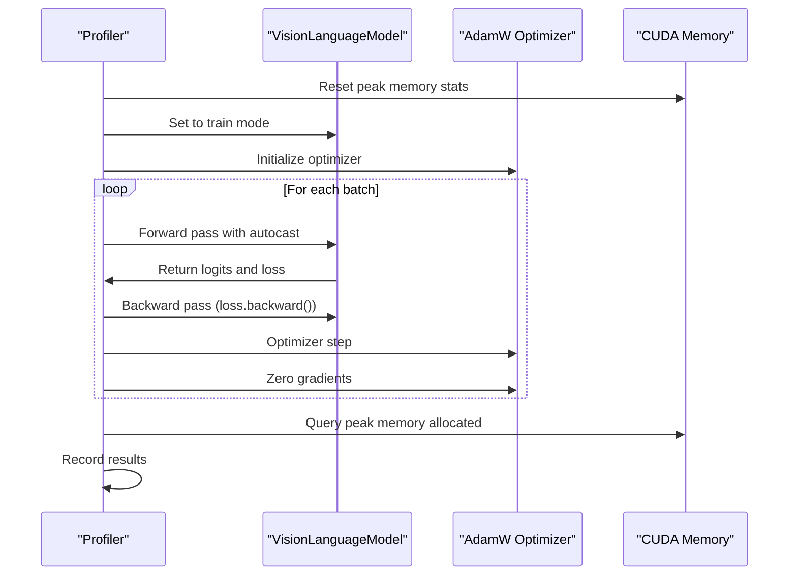
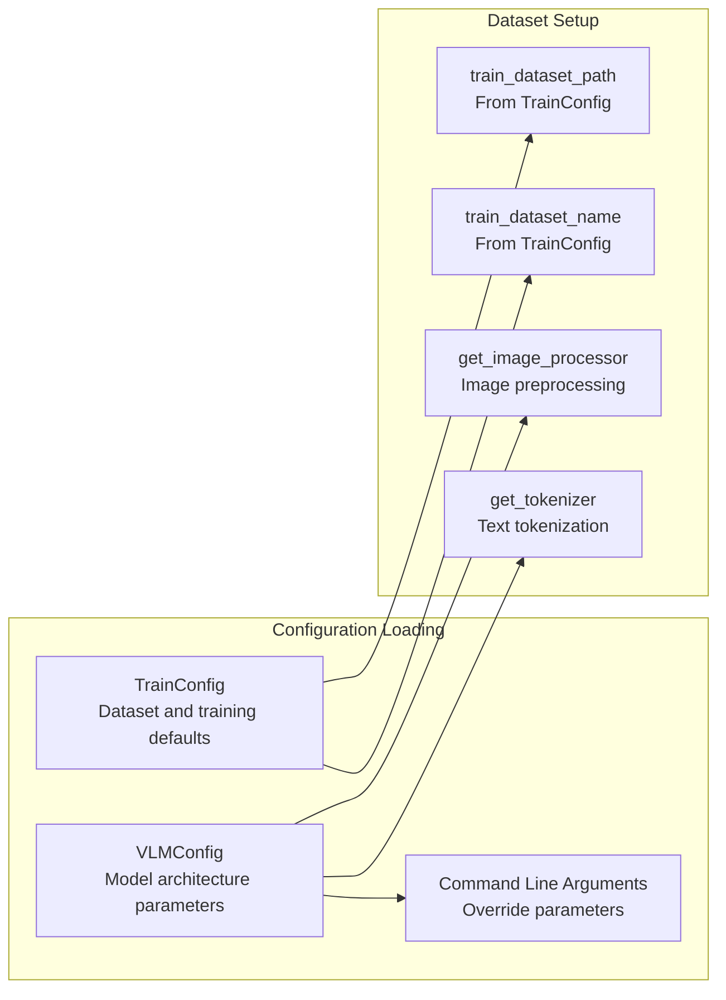
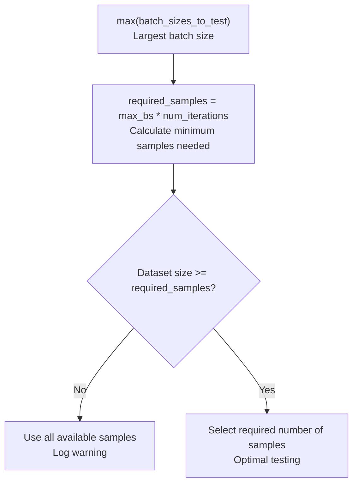
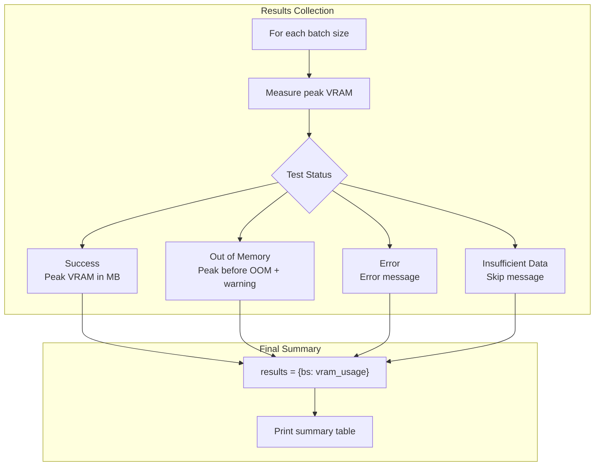

<!-- source: DeepWiki mcp.deepwiki.com · repo huggingface/nanoVLM · page 9.1 VRAM Profiling · fetched 2026-10-26 -->

# VRAM Profiling

Relevant source files

The following files were used as context for generating this wiki page:

- [assets/VRAM_Usage_vs_Batch_Size_nanoVLM.png](assets/VRAM_Usage_vs_Batch_Size_nanoVLM.png)
- [eval/benchmark-inference.py](eval/benchmark-inference.py)
- [eval/benchmark_suite.py](eval/benchmark_suite.py)
- [eval/measure_vram.py](eval/measure_vram.py)

This document covers the GPU memory profiling system in nanoVLM, which provides tools to measure and analyze VRAM usage during model training and inference. The profiling system helps determine optimal batch sizes and memory requirements for different hardware configurations.

For general performance benchmarking beyond memory analysis, see [Benchmarking Suite](#8.1). For training configuration and optimization, see [Training](#6).

## Purpose and Components

The VRAM profiling system consists of a single comprehensive tool that simulates realistic training scenarios to measure peak GPU memory consumption. The profiler tests multiple batch sizes systematically, providing detailed memory usage reports and identifying memory limits.

### Core Profiling Tool

The main profiling functionality is implemented in `measure_vram.py`, which provides automated VRAM measurement across different batch sizes and configurations.

## Profiling Architecture

```mermaid
flowchart TD
    subgraph "VRAM Profiling System"
        MEASURE_VRAM["measure_vram.py<br/>Main profiling script"]
        
        subgraph "Model Loading"
            VLM_INIT["VisionLanguageModel<br/>Model initialization"]
            TORCH_COMPILE["torch.compile<br/>Optional compilation"]
            MODEL_TO_DEVICE["model.to(device)<br/>GPU loading"]
        end
        
        subgraph "Dataset Preparation"
            DATASET_LOAD["VQADataset<br/>Data loading"]
            VQA_COLLATOR["VQACollator<br/>Batch preparation"]
            DATALOADER["DataLoader<br/>Batch iteration"]
        end
        
        subgraph "Memory Measurement"
            CUDA_RESET["torch.cuda.reset_peak_memory_stats<br/>Reset counters"]
            TRAINING_SIM["Training Simulation<br/>Forward + Backward + Optimizer"]
            PEAK_MEMORY["torch.cuda.max_memory_allocated<br/>Peak measurement"]
            OOM_DETECTION["Out of Memory Detection<br/>RuntimeError handling"]
        end
        
        subgraph "Batch Size Testing"
            BS_LOOP["Batch Size Loop<br/>Multiple configurations"]
            RESULTS_COLLECT["Results Collection<br/>Memory usage per batch size"]
        end
    end
    
    MEASURE_VRAM --> VLM_INIT
    VLM_INIT --> TORCH_COMPILE
    TORCH_COMPILE --> MODEL_TO_DEVICE
    
    MEASURE_VRAM --> DATASET_LOAD
    DATASET_LOAD --> VQA_COLLATOR
    VQA_COLLATOR --> DATALOADER
    
    MODEL_TO_DEVICE --> CUDA_RESET
    DATALOADER --> TRAINING_SIM
    CUDA_RESET --> TRAINING_SIM
    TRAINING_SIM --> PEAK_MEMORY
    TRAINING_SIM --> OOM_DETECTION
    
    PEAK_MEMORY --> BS_LOOP
    OOM_DETECTION --> BS_LOOP
    BS_LOOP --> RESULTS_COLLECT
```

Sources: [measure_vram.py:1-202]()

## Memory Measurement Methodology

### Training Simulation Process

The profiler simulates realistic training conditions by executing complete forward and backward passes with gradient computation and optimizer steps:

Sources: [measure_vram.py:121-145]()

### Memory Tracking Implementation

The system uses PyTorch's CUDA memory tracking to measure allocation patterns:

| Memory Function | Purpose | Usage Point |
|-----------------|---------|-------------|
| `torch.cuda.reset_peak_memory_stats()` | Reset peak counters | Before each batch size test |
| `torch.cuda.memory_allocated()` | Current allocation | After model loading |
| `torch.cuda.max_memory_allocated()` | Peak allocation | After training simulation |
| `torch.cuda.empty_cache()` | Clear cache | Between batch size tests |

Sources: [measure_vram.py:27-27](), [measure_vram.py:40-40](), [measure_vram.py:146-146](), [measure_vram.py:169-169]()

## Configuration and Usage

### Command Line Interface

The profiler accepts several configuration parameters:

| Parameter | Default | Description |
|-----------|---------|-------------|
| `--batch_sizes` | "1 2 4 8 16 32 64 128 256 512" | Space-separated batch sizes to test |
| `--num_iterations` | 2 | Forward/backward passes per batch size |
| `--lm_max_length` | 128 | Maximum sequence length |
| `--lm_model_type` | 'HuggingFaceTB/SmolLM2-135M-Instruct' | Language model type |
| `--compile` | False | Enable torch.compile optimization |

Sources: [measure_vram.py:177-187]()

### Model and Dataset Configuration

The profiler uses the standard nanoVLM configuration system:

Sources: [measure_vram.py:190-191](), [measure_vram.py:47-52]()

## Batch Size Testing Strategy

### Adaptive Sample Selection

The profiler dynamically adjusts dataset size based on testing requirements:

Sources: [measure_vram.py:59-78]()

### Error Handling and Recovery

The system implements robust error handling for memory-related issues:

| Error Type | Detection | Response |
|------------|-----------|-----------|
| Out of Memory | `"out of memory" in str(e).lower()` | Record peak before OOM, continue with next batch size |
| Insufficient Data | `len(processed_dataset) < bs` | Skip batch size, log warning |
| Empty DataLoader | `len(current_loader) == 0` | Skip batch size, mark as empty |
| General Runtime Error | Generic `RuntimeError` | Log error, optionally continue |

Sources: [measure_vram.py:151-161](), [measure_vram.py:93-97](), [measure_vram.py:112-115]()

## Results Interpretation

### Memory Usage Reporting

The profiler generates comprehensive reports showing memory consumption patterns:

Sources: [measure_vram.py:88-174]()

### Memory Optimization Features

The profiler includes several optimization features to ensure accurate measurements:

- **Mixed Precision**: Uses `torch.autocast` with bfloat16/float16 to match training conditions
- **Memory Cleanup**: Explicit deletion of tensors and cache clearing between tests
- **Gradient Management**: Uses `set_to_none=True` for efficient gradient clearing
- **Synchronization**: Ensures CUDA operations complete before measurement

Sources: [measure_vram.py:137-137](), [measure_vram.py:162-169](), [measure_vram.py:135-135](), [measure_vram.py:39-39]()

---

