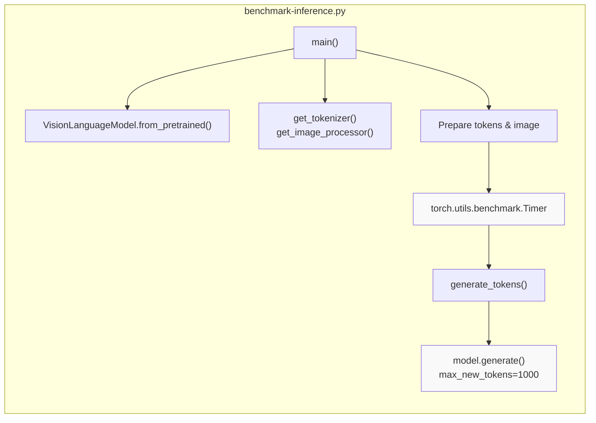
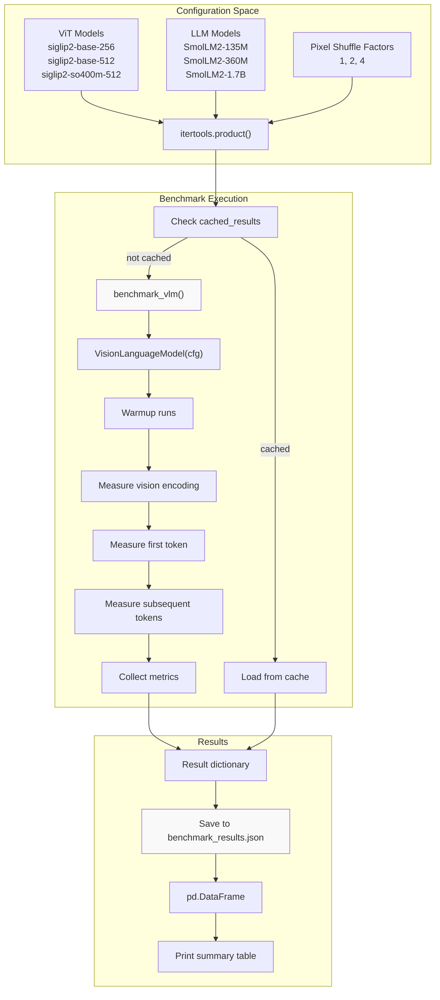
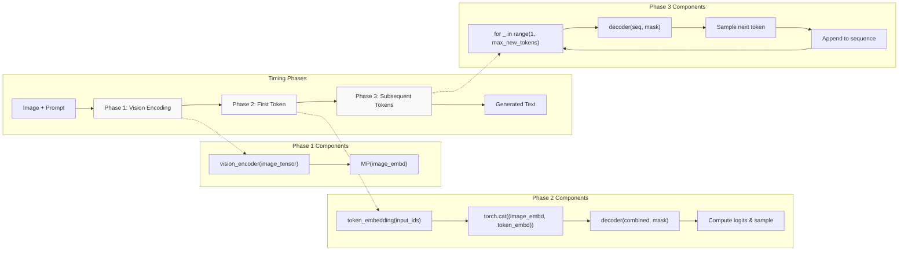
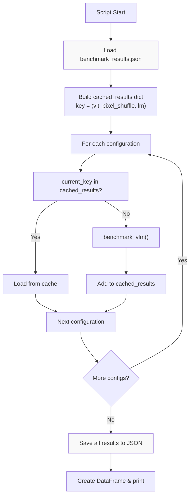

<!-- source: DeepWiki mcp.deepwiki.com · repo huggingface/nanoVLM · page 9.2 Benchmarking Suite · fetched 2026-10-26 -->

# Benchmarking Suite

<details>
<summary>Relevant source files</summary>

The following files were used as context for generating this wiki page:

- [eval/benchmark-inference.py](eval/benchmark-inference.py)
- [eval/benchmark_suite.py](eval/benchmark_suite.py)
- [eval/measure_vram.py](eval/measure_vram.py)

</details>


This document describes the inference speed benchmarking tools in nanoVLM. The benchmarking suite measures end-to-end generation speed, component-level timing (vision encoding, modality projection, language model decoding), and memory usage across different model configurations. For VRAM profiling during training workloads, see [VRAM Profiling](#9.1).

The suite consists of two complementary tools:
- **`benchmark-inference.py`**: Simple script for quick inference timing measurements
- **`benchmark_suite.py`**: Comprehensive tool for systematic performance analysis across model configurations

## Simple Inference Benchmark

The `benchmark-inference.py` script provides a lightweight tool for measuring generation throughput using PyTorch's built-in benchmarking utilities.

### Basic Usage

```python
# Load model and prepare inputs
model = VisionLanguageModel.from_pretrained("lusxvr/nanoVLM-450M").to(device)
tokenizer = get_tokenizer(model.cfg.lm_tokenizer, model.cfg.vlm_extra_tokens)
image_processor = get_image_processor(model.cfg.max_img_size, model.cfg.vit_img_size)

# Prepare prompt with image tokens
template = f"{tokenizer.image_token * model.cfg.mp_image_token_length}Question: {text} Answer:"
tokens = tokenizer.batch_encode_plus([template], return_tensors="pt")['input_ids'].to(device)

# Process image
image = Image.open('assets/image.png')
image = image_processor(image).unsqueeze(0).to(device)

# Benchmark with torch.utils.benchmark
timer = benchmark.Timer(
    stmt="generate_tokens(tokens, image)",
    setup='from __main__ import generate_tokens',
    globals={"tokens": tokens, "image": image},
    num_threads=torch.get_num_threads(),
)
print(timer.timeit(10))  # Run 10 iterations
```

The script uses [`torch.utils.benchmark.Timer`](https://pytorch.org/docs/stable/benchmark_utils.html) which handles warmup runs automatically and reports statistics including median, mean, and IQR.

**Sources:** [eval/benchmark-inference.py:1-44]()

### Benchmark Function



**Sources:** [eval/benchmark-inference.py:13-43]()

## Comprehensive Benchmarking Suite

The `benchmark_suite.py` script provides systematic performance analysis across multiple model configurations with component-level timing breakdowns, VRAM tracking, and result caching.

### Architecture Overview



**Sources:** [eval/benchmark_suite.py:1-262]()

### Measured Metrics

The `benchmark_vlm()` function returns a comprehensive dictionary of performance metrics:

| Metric | Description | Unit |
|--------|-------------|------|
| `vit_model_type` | Vision transformer identifier | string |
| `lm_model_type` | Language model identifier | string |
| `mp_pixel_shuffle_factor` | Modality projection downsampling factor | int |
| `avg_vision_encoding_time` | Time for vision encoder + MP projection | seconds |
| `avg_time_to_first_token` | Total time to generate first output token | seconds |
| `avg_llm_processing_time` | Total LLM forward passes (all tokens) | seconds |
| `avg_tokens_per_sec_after_first` | Throughput for tokens 2-N | tokens/sec |
| `initial_vram_model_mb` | VRAM after loading model to device | MB |
| `avg_peak_vram_inference_mb` | Peak VRAM during inference | MB |

**Sources:** [eval/benchmark_suite.py:162-172]()

### Component-Level Timing Breakdown

The benchmark measures three critical phases of inference:



**Sources:** [eval/benchmark_suite.py:98-142]()

### Timing Implementation

Each phase is timed separately using `torch.cuda.synchronize()` for accurate GPU measurements:

```python
# Phase 1: Vision encoding
torch.cuda.synchronize()
start = time.perf_counter()
img_emb = model.vision_encoder(image_tensor)
img_emb = model.MP(img_emb)
torch.cuda.synchronize()
vision_encoding_time = time.perf_counter() - start

# Phase 2: First token (includes vision encoding time)
torch.cuda.synchronize()
t0 = time.perf_counter()
out, _ = model.decoder(combined, mask)
# ... logits, sampling ...
torch.cuda.synchronize()
t1 = time.perf_counter()
time_to_first_token = vision_encoding_time + (t1 - t0)

# Phase 3: Subsequent tokens
start_sub = time.perf_counter()
for _ in range(1, max_new_tokens):
    # ... decoder forward passes ...
torch.cuda.synchronize()
subsequent_tokens_time = time.perf_counter() - start_sub
```

**Sources:** [eval/benchmark_suite.py:98-142]()

### Configuration Sweeping

The script tests all combinations of configurable parameters using `itertools.product()`:

```python
all_combinations = list(itertools.product(
    args.vit_model_types,           # ["siglip2-base-256", "siglip2-base-512", ...]
    args.mp_pixel_shuffle_factors,  # [1, 2, 4]
    args.lm_model_types             # ["SmolLM2-135M", "SmolLM2-360M", ...]
))
```

This generates a grid of configurations to benchmark systematically. For default arguments (3 ViT models × 3 pixel shuffle factors × 3 LLM models), this produces **27 configurations**.

**Sources:** [eval/benchmark_suite.py:223-228]()

### Result Caching

Results are cached in `benchmark_results.json` to avoid re-running expensive benchmarks. The caching mechanism:

1. **Load existing results** at startup, indexed by `(vit_model_type, mp_pixel_shuffle_factor, lm_model_type)` tuple
2. **Check cache** before running each configuration
3. **Add new results** to cache after each benchmark
4. **Save updated cache** to JSON file after all benchmarks complete



**Sources:** [eval/benchmark_suite.py:204-257]()

### Cache File Format

The `benchmark_results.json` file stores an array of result dictionaries:

```json
[
  {
    "vit_model_type": "google/siglip2-base-patch16-512",
    "lm_model_type": "HuggingFaceTB/SmolLM2-360M",
    "mp_pixel_shuffle_factor": 4,
    "avg_vision_encoding_time": 0.0234,
    "avg_time_to_first_token": 0.1456,
    "avg_llm_processing_time": 2.3421,
    "avg_tokens_per_sec_after_first": 21.45,
    "initial_vram_model_mb": 1024.32,
    "avg_peak_vram_inference_mb": 1456.78
  },
  ...
]
```

**Sources:** [eval/benchmark_suite.py:204-221](), [eval/benchmark_suite.py:254-257]()

### Running the Benchmark

Basic usage with default configurations:

```bash
python eval/benchmark_suite.py
```

Custom configuration sweep:

```bash
python eval/benchmark_suite.py \
    --vit_model_types google/siglip2-base-patch16-512 \
    --lm_model_types HuggingFaceTB/SmolLM2-360M HuggingFaceTB/SmolLM2-1.7B \
    --mp_pixel_shuffle_factors 2 4 \
    --image_path assets/my_image.png \
    --prompt "Describe this image in detail." \
    --max_new_tokens 100 \
    --num_runs 20 \
    --warmup_runs 5
```

Command-line arguments:

| Argument | Default | Description |
|----------|---------|-------------|
| `--vit_model_types` | `["siglip2-base-256", "siglip2-base-512", "siglip2-so400m-512"]` | List of ViT model identifiers |
| `--lm_model_types` | `["SmolLM2-135M", "SmolLM2-360M", "SmolLM2-1.7B"]` | List of LLM model identifiers |
| `--lm_tokenizer` | `"HuggingFaceTB/cosmo2-tokenizer"` | Tokenizer path |
| `--mp_pixel_shuffle_factors` | `[1, 2, 4]` | Spatial reduction factors |
| `--image_path` | `"assets/image.png"` | Input image for benchmarking |
| `--prompt` | `"What is in this image?"` | Input text prompt |
| `--max_new_tokens` | `50` | Number of tokens to generate |
| `--num_runs` | `10` | Number of benchmark iterations |
| `--warmup_runs` | `3` | Number of warmup runs |

**Sources:** [eval/benchmark_suite.py:178-199]()

## Benchmark Workflow

The complete benchmarking workflow from configuration to analysis:

```mermaid
graph TB
    subgraph "1. Configuration"
        CLI["Command-line Arguments"] --> ParseArgs["argparse"]
        ParseArgs --> ConfigSpace["Configuration Space<br/>ViT × LLM × PixelShuffle"]
    end
    
    subgraph "2. Initialization"
        ConfigSpace --> Device["torch.device('cuda')"]
        Device --> LoadCache["Load benchmark_results.json"]
        LoadCache --> CacheDict["cached_results dictionary"]
    end
    
    subgraph "3. Benchmark Loop"
        CacheDict --> ForEach["For each (vit, shuffle, lm)"]
        ForEach --> CheckCache{"In cache?"}
        
        CheckCache -->|"No"| CreateVLMConfig["VLMConfig(...)"]
        CreateVLMConfig --> InitModel["VisionLanguageModel(cfg)"]
        InitModel --> ToDevice["model.to(device).eval()"]
        ToDevice --> PrepInputs["Prepare image & prompt"]
        
        PrepInputs --> WarmupLoop["Warmup loop (3x)"]
        WarmupLoop --> ResetStats["torch.cuda.reset_peak_memory_stats()"]
        ResetStats --> BenchLoop["Benchmark loop (10x)"]
        
        BenchLoop --> TimerPhase1["Time vision encoding + MP"]
        TimerPhase1 --> TimerPhase2["Time first token generation"]
        TimerPhase2 --> TimerPhase3["Time subsequent tokens"]
        TimerPhase3 --> CollectPeak["Collect peak VRAM"]
        
        CollectPeak --> ComputeAvg["Compute averages"]
        ComputeAvg --> CalcTPS["Calculate tokens/sec"]
        CalcTPS --> BuildResult["Build result dictionary"]
        BuildResult --> AddCache["Add to cache"]
        
        CheckCache -->|"Yes"| AddCache
        AddCache --> MoreConfigs{"More configs?"}
        MoreConfigs -->|"Yes"| ForEach
    end
    
    subgraph "4. Results"
        MoreConfigs -->|"No"| SaveJSON["Save to benchmark_results.json"]
        SaveJSON --> CreateDF["pd.DataFrame(results)"]
        CreateDF --> PrintTable["Print summary table"]
    end
    
    style CreateVLMConfig fill:#f9f9f9
    style BenchLoop fill:#f9f9f9
    style SaveJSON fill:#f9f9f9
```



**Sources:** [eval/benchmark_suite.py:178-262]()

## Performance Metrics Reference

### Tokens Per Second Calculation

The tokens-per-second metric measures autoregressive decoding speed after the first token:

```python
if max_new_tokens > 1:
    subsequent_time = avg_llm_time - (avg_first_token_time - avg_vision_time)
    tokens_per_sec = (max_new_tokens - 1) / subsequent_time if subsequent_time > 0 else float('nan')
```

This excludes the first token (which includes KV cache population) to isolate steady-state decoding performance.

**Sources:** [eval/benchmark_suite.py:154-158]()

### Memory Tracking

VRAM usage is tracked at two points:

1. **Initial VRAM** (`initial_vram_model_mb`): Memory allocated immediately after loading model to device
2. **Peak VRAM** (`avg_peak_vram_inference_mb`): Maximum memory allocated during inference, averaged across runs

```python
# Track initial VRAM after model load
torch.cuda.synchronize()
initial_vram_bytes = torch.cuda.memory_allocated(device)
initial_vram_mb = initial_vram_bytes / (1024 ** 2)

# Track peak during each benchmark run
torch.cuda.reset_peak_memory_stats(device)
# ... inference ...
peak_vram_bytes = torch.cuda.max_memory_allocated(device)
peak_vram_mb = peak_vram_bytes / (1024 ** 2)
```

**Sources:** [eval/benchmark_suite.py:51-56](), [eval/benchmark_suite.py:144-148]()

### Model Cleanup

After each configuration is benchmarked, resources are released:

```python
del model, tokenizer, image_processor
if device.type == 'cuda':
    torch.cuda.empty_cache()
```

This ensures accurate memory measurements for subsequent configurations.

**Sources:** [eval/benchmark_suite.py:173-174]()

## Output Format

The script produces two outputs:

1. **JSON file** (`benchmark_results.json`): Machine-readable results for all configurations
2. **Pandas DataFrame**: Human-readable table printed to console

Example console output:

```
--- Summary Table ---
                      vit_model_type              lm_model_type  mp_pixel_shuffle_factor  avg_vision_encoding_time  avg_time_to_first_token  ...
0   google/siglip2-base-patch16-256  HuggingFaceTB/SmolLM2-135M                        1                  0.012345                 0.056789  ...
1   google/siglip2-base-patch16-256  HuggingFaceTB/SmolLM2-135M                        2                  0.011234                 0.054321  ...
...
```

**Sources:** [eval/benchmark_suite.py:259-262]()

---

