# Page: Overview

# Overview

<details>
<summary>Relevant source files</summary>

The following files were used as context for generating this wiki page:

- [README.md](README.md)
- [models/vision_language_model.py](models/vision_language_model.py)

</details>


nanoVLM is a minimal Vision-Language Model implementation in pure PyTorch designed for education and experimentation. The entire model definition and training logic fits in approximately 750 lines of code, making it highly accessible for researchers who want to understand VLMs without navigating complex frameworks.

## What is nanoVLM?

nanoVLM provides a complete pipeline for training, evaluating, and deploying small Vision-Language Models. Similar to Andrej Karpathy's nanoGPT, it focuses on simplicity and readability while delivering functional performance. The implementation uses pretrained backbones (SigLIP for vision, SmolLM for language) connected through a learned modality projection layer.

**Key Characteristics:**
- **Pure PyTorch**: No external training frameworks like `transformers.Trainer`, `accelerate`, or `deepspeed`
- **Minimal Dependencies**: `torch`, `numpy`, `torchvision`, `pillow`, `datasets`, `huggingface-hub`, `transformers`, `wandb`
- **Modular Architecture**: Clear separation between vision, language, and projection components
- **~750 Lines**: Model definition and training logic is compact and readable
- **Educational Focus**: Code is written for understanding, not production optimization

**nanoVLM Repository Structure**
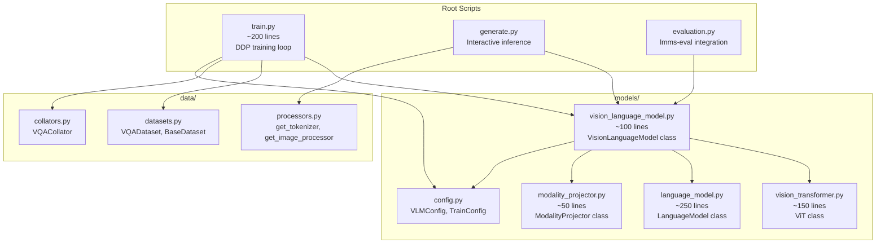

Sources: [README.md:26-28](), [README.md:244-247]()

## System Architecture

nanoVLM is organized into six major subsystems that handle model definition, training, evaluation, inference, data processing, and configuration.

**High-Level System Architecture**
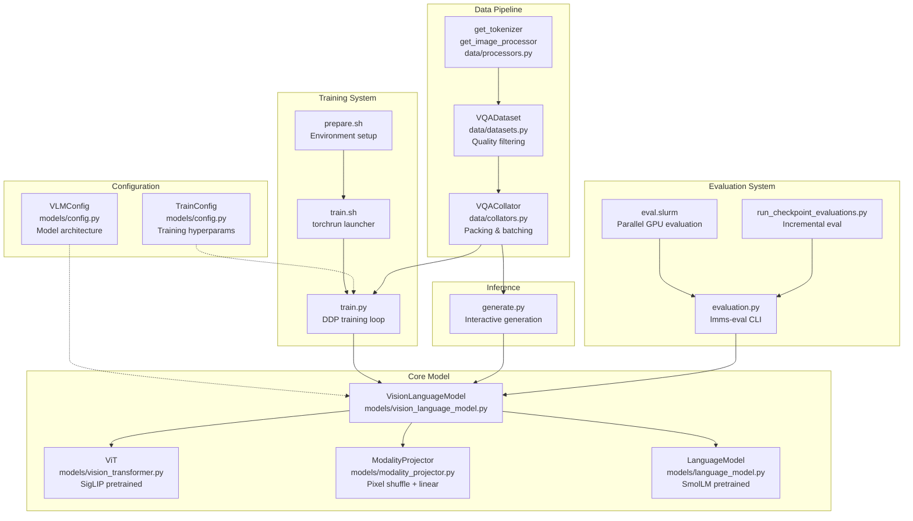

| Subsystem | Key Files | Purpose |
|-----------|-----------|---------|
| **Core Model** | `models/vision_language_model.py`, `models/vision_transformer.py`, `models/language_model.py`, `models/modality_projector.py` | Multimodal model architecture |
| **Training** | `train.py`, `train.sh`, `prepare.sh` | Distributed training with DDP |
| **Evaluation** | `evaluation.py`, `eval.slurm`, `run_checkpoint_evaluations.py` | Benchmark evaluation via lmms-eval |
| **Data Pipeline** | `data/datasets.py`, `data/processors.py`, `data/collators.py` | Data loading, filtering, and batching |
| **Configuration** | `models/config.py` | Model and training configuration |
| **Inference** | `generate.py` | Interactive text generation |

Sources: [README.md:26-28](), Diagram 1 from high-level architecture

## Core Model Components

The `VisionLanguageModel` class in [models/vision_language_model.py:21-81]() orchestrates three specialized components to process multimodal inputs and generate text.

**VisionLanguageModel Architecture**
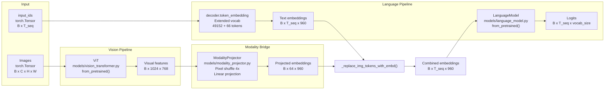

**Key Methods:**

| Method | File Location | Purpose |
|--------|---------------|---------|
| `VisionLanguageModel.forward()` | [models/vision_language_model.py:62-80]() | Training forward pass with loss calculation |
| `VisionLanguageModel.generate()` | [models/vision_language_model.py:82-183]() | Autoregressive generation with KV caching |
| `VisionLanguageModel.from_pretrained()` | [models/vision_language_model.py:185-233]() | Load model from Hub or local path |
| `VisionLanguageModel.push_to_hub()` | [models/vision_language_model.py:252-280]() | Upload model to Hugging Face Hub |
| `_replace_img_tokens_with_embd()` | [models/vision_language_model.py:36-49]() | Replace image token placeholders with visual embeddings |

**Component Details:**

1. **ViT** (`models/vision_transformer.py`): Processes images into 1024 visual tokens (32×32 grid) using pretrained SigLIP-B/16-512 weights
2. **ModalityProjector** (`models/modality_projector.py`): Reduces sequence length 16× via pixel shuffle (32×32→8×8), then projects 12,288→960 dimensions
3. **LanguageModel** (`models/language_model.py`): SmolLM2-360M with grouped query attention (15 Q heads, 5 KV heads) and RMSNorm

Sources: [models/vision_language_model.py:1-311](), Diagram 4 from high-level architecture

## Training and Evaluation Workflow

nanoVLM provides a complete workflow for training models on multimodal datasets and evaluating them on standardized benchmarks.

**Training Pipeline**
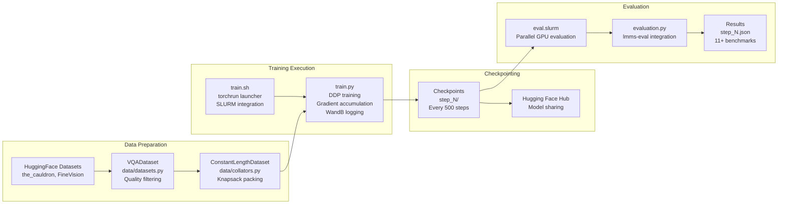

**Training Features:**
- **Distributed Training**: PyTorch DDP with NCCL backend, launched via `torchrun` in [train.sh]()
- **Data Quality Filtering**: Four quality metrics (relevance, image correspondence, visual dependency, formatting) in `VQADataset`
- **Efficient Packing**: Greedy knapsack algorithm in `ConstantLengthDataset` packs variable-length samples into fixed 4096-token sequences
- **Gradient Accumulation**: 8 accumulation steps for larger effective batch sizes
- **Differentiated Learning Rates**: MP layer trains at 0.00512, pretrained backbones at 5e-5

**Evaluation Features:**
- **lmms-eval Integration**: Standardized evaluation via `NanoVLMWrapper` adapter in [evaluation.py]()
- **11+ Benchmarks**: MME, MMMU, MMStar, DocVQA, TextVQA, OCRBench, ScienceQA, ChartQA, AI2D, InfoVQA, SeedBench
- **Incremental Evaluation**: `run_checkpoint_evaluations.py` discovers checkpoints and only evaluates missing tasks
- **Parallel Execution**: [eval.slurm]() launches one task per GPU for efficient benchmarking

Sources: [train.py](), [evaluation.py](), Diagram 2 and Diagram 3 from high-level architecture

## Model Variants and Performance

nanoVLM supports multiple model configurations with different performance characteristics.

| Model | Vision Backbone | Language Model | Total Params | Training Time | MMStar Accuracy |
|-------|----------------|----------------|--------------|---------------|-----------------|
| **nanoVLM-222M** | SigLIP-B/16-224 (85M) | SmolLM2-135M | 222M | ~6h on H100 | 35.3% |
| **nanoVLM-450M** | SigLIP2-B/16-512 (107M) | SmolLM2-360M | 450M | - | - |

**Training Configuration:**
- **Dataset**: ~1.7M samples from `the_cauldron` (HuggingFaceM4)
- **Sequence Length**: 4096 tokens with knapsack packing
- **Effective Batch Size**: `batch_size × gradient_accumulation_steps` (typically 8×8=64)
- **Training Steps**: Up to 40,000 steps
- **Hardware**: Single H100 GPU (nanoVLM-222M) or multi-node DDP (larger models)

**Benchmark Results (nanoVLM-222M):**
- MMStar: 35.3% accuracy on challenging multi-modal reasoning
- Training completes in ~6 hours on single H100 GPU
- Model can recognize objects, scenes, and answer visual questions

Sources: [README.md:33-38](), [README.md:193-214]()

## Key Features

**Simplicity and Accessibility**
- **~750 Lines**: Complete model and training implementation
- **Pure PyTorch**: No external training frameworks
- **Readable Code**: Educational focus with clear variable names and comments
- **Minimal Dependencies**: Only essential packages (torch, numpy, transformers, wandb)

**Training Capabilities**
- **Distributed Training**: PyTorch DDP with SLURM integration via [train.sh]() and [prepare.sh]()
- **Quality Filtering**: Four-metric quality assessment in `VQADataset` (relevance, image correspondence, visual dependency, formatting)
- **Efficient Packing**: Greedy knapsack algorithm in `ConstantLengthDataset` maximizes GPU utilization
- **Gradient Accumulation**: 8-step accumulation for larger effective batch sizes
- **WandB Integration**: Comprehensive experiment tracking and logging

**Evaluation System**
- **lmms-eval Integration**: Standardized evaluation framework via `NanoVLMWrapper`
- **11+ Benchmarks**: MME, MMMU, MMStar, DocVQA, TextVQA, OCRBench, and more
- **Incremental Evaluation**: Only evaluate missing checkpoints/tasks for efficiency
- **Parallel Execution**: One task per GPU via [eval.slurm]()

**Hub Integration**
- **Load from Hub**: `VisionLanguageModel.from_pretrained("lusxvr/nanoVLM-450M")`
- **Push to Hub**: `model.push_to_hub("my-awesome-nanovlm")` with automatic model card generation
- **Local Save/Load**: `save_pretrained()` and `from_pretrained()` for local storage

**Generation Features**
- **Interactive Inference**: [generate.py]() for quick testing
- **KV Caching**: Efficient autoregressive generation in `VisionLanguageModel.generate()`
- **Flexible Sampling**: Greedy, top-k, top-p sampling strategies
- **Chat Templates**: Built-in chat template support for instruction following

Sources: [README.md:26-28](), [README.md:140-168](), [README.md:244-247]()

## Getting Started

To use nanoVLM, you can:

1. **Clone the repository and set up environment**:
   ```bash
   git clone https://github.com/huggingface/nanoVLM.git
   cd nanoVLM
   # Install dependencies
   pip install torch numpy torchvision pillow datasets huggingface-hub transformers
   ```

2. **Train a model**:
   ```bash
   python train.py
   ```

3. **Generate text from images**:
   ```bash
   python generate.py
   ```

4. **Use the interactive notebook**:
   - Open the provided Colab notebook for a guided experience

For detailed setup instructions, see [Development and Environment Setup](#8).
For usage examples, see [Examples and Usage](#7).

Sources: [README.md:22-52](https://github.com/huggingface/nanoVLM/blob/main/README.md), [README.md:53-78](https://github.com/huggingface/nanoVLM/blob/main/README.md)

---

# Page: Getting Started

# Getting Started

<details>
<summary>Relevant source files</summary>

The following files were used as context for generating this wiki page:

- [.gitignore](.gitignore)
- [README.md](README.md)

</details>


This page provides step-by-step instructions for installing nanoVLM, configuring authentication, and running your first training and inference examples. For details on the model architecture, see [Architecture](#3). For comprehensive training configuration options, see [Configuration System](#4). For distributed training setup on SLURM clusters, see [Distributed Training Infrastructure](#6.2).

---

## Prerequisites

Before installing nanoVLM, ensure you have:

| Requirement | Minimum Version | Purpose |
|------------|----------------|---------|
| Python | 3.12 | Core runtime environment |
| CUDA | 11.8+ | GPU acceleration for training/inference |
| Git | Any | Repository cloning |
| GPU VRAM | 4.5 GB | Minimum for batch_size=1 training |

**Recommended Hardware:**
- Single H100 GPU (80GB VRAM) for full training runs
- 8GB+ VRAM for inference and small-scale experimentation
- For VRAM profiling guidance, see [VRAM Profiling](#9.1)

Sources: [README.md:193-219]()

---

## Installation

### Step 1: Clone the Repository

```bash
git clone https://github.com/huggingface/nanoVLM.git
cd nanoVLM
```

### Step 2: Choose Your Package Manager

nanoVLM supports two installation methods: **uv** (recommended for speed) and **pip** (standard).

#### Option A: Installation with uv (Recommended)

The `uv` package manager provides faster dependency resolution and improved reproducibility through `uv.lock`.

```bash
# Initialize uv environment with Python 3.12
uv init --bare --python 3.12

# Sync dependencies from uv.lock
uv sync --python 3.12

# Activate virtual environment
source .venv/bin/activate

# Install core dependencies
uv add torch numpy torchvision pillow datasets huggingface-hub transformers wandb
```

#### Option B: Installation with pip

```bash
# Create virtual environment
python3.12 -m venv .venv
source .venv/bin/activate

# Install core dependencies
pip install torch numpy torchvision pillow datasets huggingface-hub transformers wandb
```

### Core Dependencies

| Package | Purpose | Used By |
|---------|---------|---------|
| `torch` | Core deep learning framework | All model components |
| `numpy` | Numerical operations | Data processing |
| `torchvision` | Image preprocessing transforms | `processors/image_processor.py` |
| `pillow` | Image loading and manipulation | `datasets/base_dataset.py` |
| `datasets` | HuggingFace dataset loading | `train.py`, data pipeline |
| `huggingface-hub` | Model/dataset downloads | `VisionLanguageModel.from_pretrained()` |
| `transformers` | Pretrained backbone loading | Vision and language model initialization |
| `wandb` | Experiment tracking and logging | `train.py` metrics logging |

### Optional: lmms-eval Integration

For benchmark evaluation support, install `lmms-eval` from source:

```bash
# With uv
uv pip install git+https://github.com/EvolvingLMMs-Lab/lmms-eval.git

# With pip
pip install git+https://github.com/EvolvingLMMs-Lab/lmms-eval.git
```

This enables evaluation via `evaluation.py`. See [Evaluation System](#7) for details.

Sources: [README.md:45-78](), [README.md:113-119]()

---

## Environment Setup Diagram

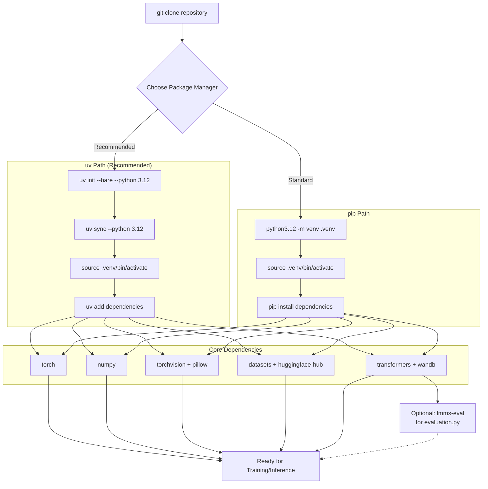

Sources: [README.md:45-78]()

---

## Authentication

nanoVLM requires authentication to two services for full functionality:

### WandB (Weights & Biases)

WandB is used for experiment tracking during training. The training script logs metrics, hyperparameters, and system statistics to WandB.

```bash
wandb login --relogin
```

You'll be prompted to enter your API key, which can be found at https://wandb.ai/authorize. The key is cached in `~/.netrc` for future sessions.

**Usage in code:**
- Training metrics logged via `wandb.log()` in [train.py:140-160]()
- Experiment configuration tracked in `wandb.init()` call
- Optional: disable with `WANDB_MODE=offline` environment variable

### Hugging Face Hub

The Hub is used for:
1. **Downloading pretrained backbones** (SigLIP vision encoder, SmolLM language model)
2. **Loading trained nanoVLM checkpoints** via `VisionLanguageModel.from_pretrained()`
3. **Uploading trained models** via `model.push_to_hub()`

```bash
huggingface-cli login
```

You'll be prompted to enter your token from https://huggingface.co/settings/tokens. The token is cached in `~/.huggingface/token`.

**Environment Variables:**

| Variable | Purpose | Default |
|----------|---------|---------|
| `HF_HOME` | Cache location for downloaded models/datasets | `~/.cache/huggingface` |
| `HF_TOKEN` | Alternative to `huggingface-cli login` | None |

Example with custom cache:
```bash
export HF_HOME="/scratch/user/hf_cache"
huggingface-cli login
```

Sources: [README.md:82-85](), [README.md:121-123]()

---

## Quick Start Examples

### Interactive Notebook (Fastest Start)

The quickest way to explore nanoVLM is through the provided Jupyter notebook:

```bash
# Launch notebook
jupyter notebook nanoVLM.ipynb

# Or open in Google Colab (no local setup required)
# Visit: https://colab.research.google.com/github/huggingface/nanoVLM/blob/main/nanoVLM.ipynb
```

The notebook includes:
- Pretrained model loading and inference examples
- Step-by-step architecture walkthrough
- Interactive generation with custom images

Sources: [README.md:42](), [README.md:5-7]()

---

### Training Your First Model

The training script [train.py]() implements distributed data parallel training with gradient accumulation and WandB logging.

#### Basic Training Command

```bash
python train.py
```

This uses the default configuration from [models/config.py]() with:
- `VLMConfig`: Model architecture parameters (SigLIP-B + SmolLM2-360M)
- `TrainConfig`: Training hyperparameters (learning rates, batch size, max steps)

#### Training with Custom Configuration

```bash
python train.py \
    --max_steps 10000 \
    --batch_size 16 \
    --gradient_accumulation_steps 4 \
    --eval_interval 500 \
    --checkpoint_dir "./my_checkpoints"
```

**Key Training Parameters:**

| Parameter | Default | Description |
|-----------|---------|-------------|
| `max_steps` | 40000 | Total training iterations |
| `batch_size` | 8 | Per-GPU batch size |
| `gradient_accumulation_steps` | 8 | Effective batch size = batch_size × this value |
| `learning_rate_mp` | 0.00512 | Modality projector LR (100× higher than backbones) |
| `learning_rate_vision` | 5e-5 | Vision encoder LR |
| `learning_rate_language` | 5e-5 | Language model LR |
| `eval_interval` | 500 | Steps between checkpoint saves |

For complete parameter documentation, see [Configuration System](#4).

#### Training Output

During training, you'll see:

1. **Console logs** with step number, loss, and learning rates
2. **WandB dashboard** with real-time metrics at https://wandb.ai
3. **Checkpoint saves** in `checkpoints/step_N/` every `eval_interval` steps
4. **Final model push** to Hugging Face Hub (if configured)

Example console output:
```
Step 100/40000 | Loss: 2.3451 | LR_MP: 0.00512 | LR_Vision: 5e-05 | LR_Language: 5e-05
Step 200/40000 | Loss: 2.1234 | LR_MP: 0.00498 | LR_Vision: 4.8e-05 | LR_Language: 4.8e-05
```

Sources: [README.md:79-87]()

---

### Running Inference

The generation script [generate.py]() provides interactive text generation from images.

#### Using Pretrained Model from Hub

```bash
python generate.py
```

This loads the default pretrained model `lusxvr/nanoVLM-450M` from the Hub.

#### Using Your Trained Checkpoint

```bash
python generate.py --checkpoint ./checkpoints/step_5000
```

#### Using a Specific Hub Model

```bash
python generate.py --checkpoint username/my-nanovlm-model
```

#### Example Interaction

When you run `generate.py`, it prompts for an image path and question:

```
Enter image path: assets/image.png
Enter question: What is this?

Generation 1: This is a cat sitting on the ground. I think this is a cat sitting on the ground.
Generation 2: This picture is clicked outside. In the center there is a brown color cat seems to be sitting on
Generation 3: This is a cat sitting on the ground, which is of white and brown in color. This cat
Generation 4: This is a cat sitting on the ground. I think this is a cat sitting on the ground.
Generation 5: This is a cat sitting on the ground, which is covered with a mat. I think this is
```

The script generates 5 completions by default. See [Inference and Generation](#8) for programmatic usage.

Sources: [README.md:89-111]()

---

### Evaluating Models

The evaluation system integrates with `lmms-eval` for standardized benchmarking.

#### Single Task Evaluation

```bash
python evaluation.py --model lusxvr/nanoVLM-450M --tasks mmstar
```

#### Multi-Task Evaluation

```bash
python evaluation.py \
    --model ./checkpoints/step_5000 \
    --tasks mmstar,mme,ocrbench \
    --batch_size 128
```

#### Supported Benchmark Tasks

The system supports 11+ vision-language benchmarks:

| Task | Description | Metric |
|------|-------------|--------|
| `mmstar` | Multi-modal reasoning | Accuracy |
| `mme` | Perception + cognition | Aggregate score |
| `mmmu_val`, `mmmu_test` | College-level QA | Accuracy |
| `docvqa_val`, `docvqa_test` | Document understanding | ANLS |
| `textvqa_val`, `textvqa_test` | Scene text reading | Accuracy |
| `ocrbench` | OCR capabilities | F1 score |
| `ai2d`, `chartqa`, `infovqa` | Domain-specific tasks | Various |

#### Evaluation Output

Results are saved in `eval_results/`:

```
eval_results/
├── step_5000.json          # Aggregated metrics
└── step_5000/              # Per-sample outputs
    ├── mmstar.json
    ├── mme.json
    └── ocrbench.json
```

For automated checkpoint evaluation and result visualization, see [Evaluation System](#7).

Sources: [README.md:113-138]()

---

## Quick Start Workflow Diagram

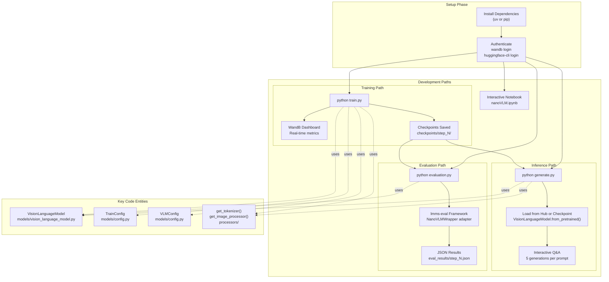

Sources: [README.md:40-189]()

---

## Hub Integration Examples

nanoVLM provides seamless integration with the Hugging Face Hub for model loading and sharing.

### Loading Pretrained Models

```python
from models.vision_language_model import VisionLanguageModel

# Load from Hub
model = VisionLanguageModel.from_pretrained("lusxvr/nanoVLM-450M")

# Load from local checkpoint
model = VisionLanguageModel.from_pretrained("./checkpoints/step_5000")
```

The `from_pretrained()` method:
1. Downloads `config.json` and `model.safetensors` from the Hub
2. Initializes model architecture from config
3. Loads weights with strict checking
4. Returns ready-to-use `VisionLanguageModel` instance

### Pushing Trained Models

```python
# After training
model.push_to_hub("my-awesome-nanovlm-model")

# With custom options
model.push_to_hub(
    "my-awesome-nanovlm-model",
    private=True,
    commit_message="Training run with FineVision dataset"
)
```

This creates a Hub repository containing:
- `config.json` - Model architecture configuration
- `model.safetensors` - Model weights in SafeTensors format
- `README.md` - Auto-generated model card

### Local Save/Load

For offline workflows:

```python
# Save locally
model.save_pretrained("./my_models/nanovlm_v1")

# Load from local path
model = VisionLanguageModel.from_pretrained("./my_models/nanovlm_v1")
```

For implementation details, see [Vision Language Model](#3.1).

Sources: [README.md:140-189]()

---

## File Structure Reference

After setup, your directory structure will look like:

```
nanoVLM/
├── .venv/                          # Virtual environment
├── models/
│   ├── vision_language_model.py   # VisionLanguageModel class
│   ├── vision_transformer.py      # ViT implementation
│   ├── language_model.py          # LM implementation
│   ├── modality_projection.py     # Projection layer
│   └── config.py                  # VLMConfig, TrainConfig
├── processors/
│   ├── image_processor.py         # Image preprocessing
│   └── tokenizer.py               # Text tokenization
├── datasets/
│   ├── base_dataset.py           # BaseDataset, VQADataset
│   └── constant_length_dataset.py # Packing algorithm
├── train.py                       # Training script
├── generate.py                    # Inference script
├── evaluation.py                  # lmms-eval integration
└── nanoVLM.ipynb                 # Interactive notebook
```

Sources: [README.md:26](), [.gitignore:1-32]()

---

## Next Steps

Now that you have nanoVLM installed and authenticated:

1. **Explore the Architecture**: Read [Architecture](#3) to understand how the vision, language, and projection components work together

2. **Understand the Data Pipeline**: See [Data Pipeline](#5) for details on dataset loading, quality filtering, and efficient packing

3. **Configure Your Training**: Review [Configuration System](#4) for complete parameter documentation and learning rate strategies

4. **Scale to Multiple GPUs**: See [Distributed Training Infrastructure](#6.2) for SLURM cluster setup with torchrun

5. **Run Comprehensive Evaluations**: Explore [Evaluation System](#7) for automated checkpoint evaluation and result visualization

6. **Profile Performance**: Use [Performance Analysis](#9) tools to measure VRAM usage and inference speed for your configuration

Sources: [README.md:1-274]()

---

# Page: Architecture

# Architecture

<details>
<summary>Relevant source files</summary>

The following files were used as context for generating this wiki page:

- [models/config.py](models/config.py)
- [models/language_model.py](models/language_model.py)
- [models/modality_projector.py](models/modality_projector.py)
- [models/vision_language_model.py](models/vision_language_model.py)
- [models/vision_transformer.py](models/vision_transformer.py)

</details>


This document provides a high-level overview of the nanoVLM system architecture, covering the core components and their relationships. The architecture implements a Vision-Language Model that combines a Vision Transformer for image processing with a decoder-only language model for text generation, connected through a modality projection layer.

For detailed implementation of individual components, see [Vision Language Model](#3.1), [Vision Transformer](#3.2), [Language Model](#3.3), and [Modality Projector](#3.4). For configuration details, see [Configuration System](#4).

## System Overview

The nanoVLM architecture follows a modular design with three primary components orchestrated by the `VisionLanguageModel` class defined in [models/vision_language_model.py:21-35](). The system processes multimodal inputs (images and text) through separate encoders and projects them into a shared embedding space for unified processing by the language model.

**Key Components:**
- **Vision Encoder**: `ViT` processes images up to 2048px, producing 768-dimensional features
- **Modality Projector**: `ModalityProjector` reduces spatial dimensions via pixel shuffle and projects to language model dimension (960)
- **Language Model**: `LanguageModel` (SmolLM2-360M) generates text with 960-dimensional hidden states
</thinking>

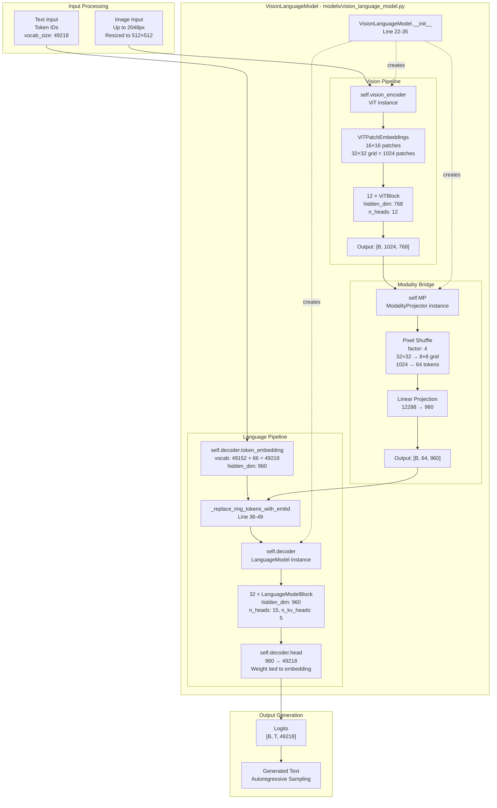

Sources: [models/vision_language_model.py:21-35](), [models/config.py:5-55](), [models/vision_transformer.py:131-169](), [models/language_model.py:390-418](), [models/modality_projector.py:4-45]()

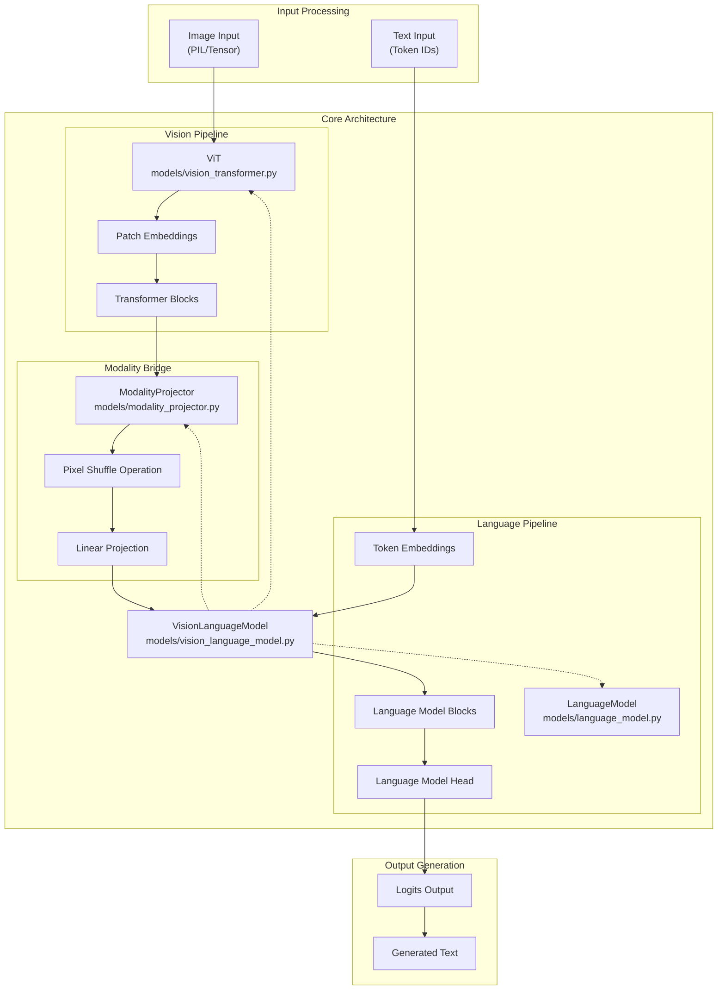

Sources: [models/vision_language_model.py:21-35](), [models/README.md:1-24]()

## Component Initialization and Integration

The `VisionLanguageModel.__init__` method in [models/vision_language_model.py:22-35]() orchestrates component initialization with conditional backbone loading.

**Initialization Flow:**

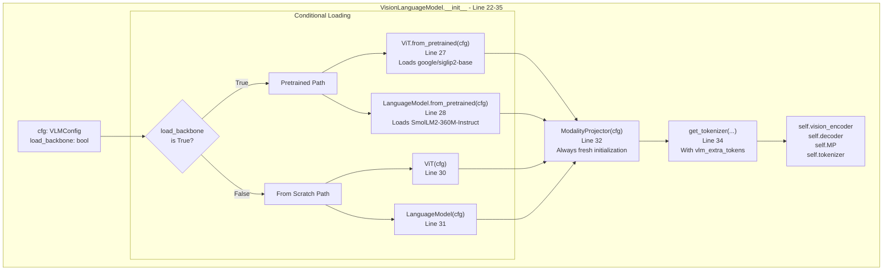

**Component Specifications:**

| Component | Initialization Method | Pretrained Source | Parameters |
|-----------|----------------------|-------------------|------------|
| `self.vision_encoder` | `ViT.from_pretrained(cfg)` or `ViT(cfg)` | `google/siglip2-base-patch16-512` | ~85M |
| `self.decoder` | `LanguageModel.from_pretrained(cfg)` or `LanguageModel(cfg)` | `SmolLM2-360M-Instruct` | ~360M |
| `self.MP` | `ModalityProjector(cfg)` | Always random init | ~11M |
| `self.tokenizer` | `get_tokenizer(...)` | Matches language model | Extended vocab: 49218 |

Sources: [models/vision_language_model.py:22-35](), [models/config.py:15](), [models/config.py:33]()

## Tensor Shape Transformations

The following table documents the tensor shape transformations through each component of the architecture:

| Stage | Component | Input Shape | Output Shape | Notes |
|-------|-----------|-------------|--------------|-------|
| **Vision Processing** |
| Patch Embedding | `ViTPatchEmbeddings` | `[B, 3, 512, 512]` | `[B, 1024, 768]` | 16×16 patches → 32×32 grid |
| Vision Blocks | `12 × ViTBlock` | `[B, 1024, 768]` | `[B, 1024, 768]` | Bidirectional attention |
| Layer Norm | `ViT.layer_norm` | `[B, 1024, 768]` | `[B, 1024, 768]` | Final normalization |
| **Modality Projection** |
| Pixel Shuffle | `ModalityProjector.pixel_shuffle` | `[B, 1024, 768]` | `[B, 64, 12288]` | 4× spatial reduction, 16× channel expansion |
| Linear Projection | `ModalityProjector.proj` | `[B, 64, 12288]` | `[B, 64, 960]` | Maps to language hidden dim |
| **Text Processing** |
| Token Embedding | `self.decoder.token_embedding` | `[B, T_seq]` | `[B, T_seq, 960]` | Vocab size: 49218 |
| Image Token Replace | `_replace_img_tokens_with_embd` | `[B, T_seq, 960]` + image embeddings | `[B, T_seq, 960]` | Replaces `<\|image\|>` tokens |
| **Language Generation** |
| Language Blocks | `32 × LanguageModelBlock` | `[B, T_seq, 960]` | `[B, T_seq, 960]` | Causal attention with KV cache |
| RMS Norm | `LanguageModel.norm` | `[B, T_seq, 960]` | `[B, T_seq, 960]` | Final normalization |
| LM Head | `self.decoder.head` | `[B, T_seq, 960]` | `[B, T_seq, 49218]` | Weight tied to embedding |

Sources: [models/vision_transformer.py:7-44](), [models/modality_projector.py:23-44](), [models/language_model.py:397-403](), [models/vision_language_model.py:36-49]()

## Data Flow Architecture

The system processes multimodal inputs through distinct pathways that converge at the modality projection layer, enabling unified processing in the language model's embedding space. The architecture supports two execution modes: training (forward pass with loss computation) and inference (autoregressive generation with KV caching).

### Training Forward Pass

The `VisionLanguageModel.forward` method in [models/vision_language_model.py:62-80]() processes batched multimodal inputs for training:

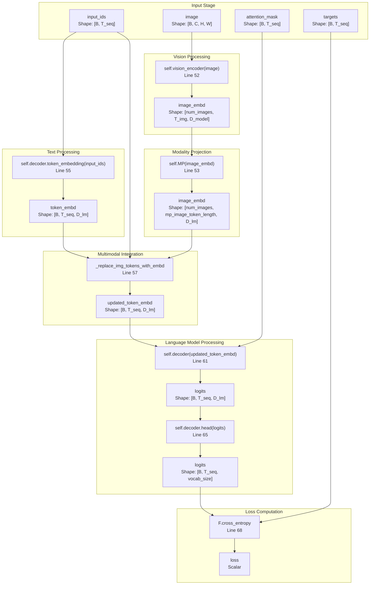

Sources: [models/vision_language_model.py:51-70]()

### Inference Generation Pipeline

The `VisionLanguageModel.generate` method in [models/vision_language_model.py:82-183]() implements two-phase generation: multimodal prefill followed by autoregressive decoding with KV caching.

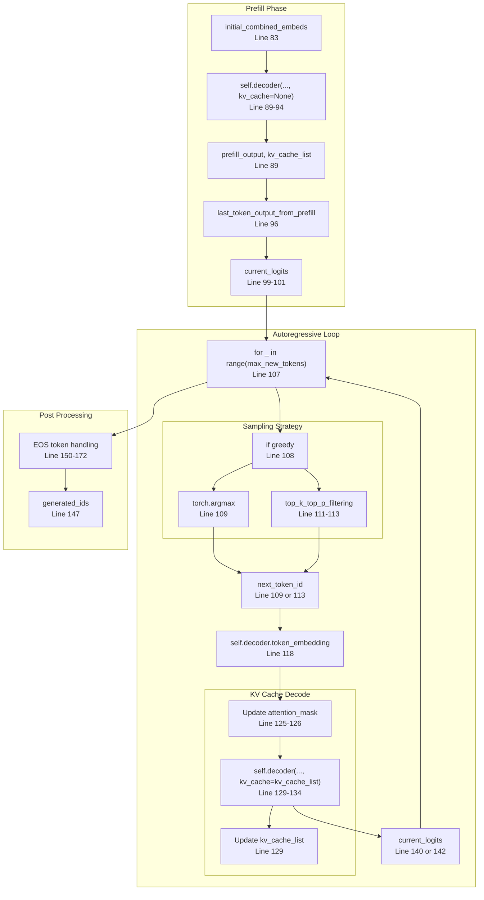

Sources: [models/vision_language_model.py:72-174]()

## Configuration System Integration

The system uses `VLMConfig` from [models/config.py:4-55]() to centralize all architectural parameters. This configuration drives component initialization and defines cross-component compatibility.

**Key Configuration Parameters:**

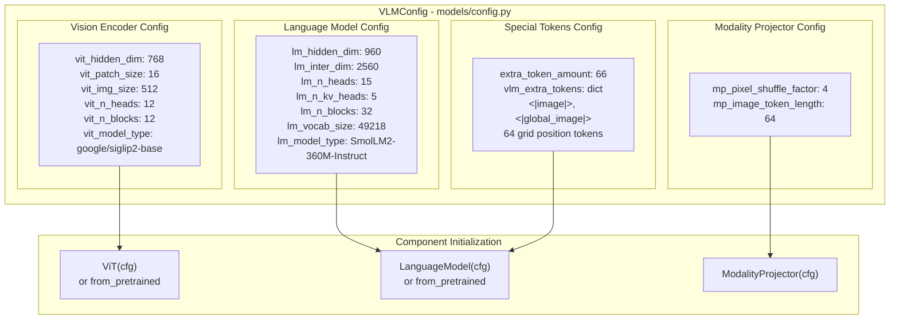

**Vocabulary Extension:**

The vocabulary is extended from the base language model to include vision-specific tokens:
- Base vocabulary: `lm_base_vocab_size = 49152` (from SmolLM2)
- Extra tokens: `extra_token_amount = 66`
  - 1 × `<|image|>` token (standard image placeholder)
  - 1 × `<|global_image|>` token (global image context)
  - 64 × grid position tokens (`<row_X_col_Y>`) for spatial reasoning
- Extended vocabulary: `lm_vocab_size = 49218`

The token embedding matrix and LM head are extended to accommodate these tokens in [models/language_model.py:538-682]().

Sources: [models/config.py:4-55](), [models/config.py:23-24](), [models/config.py:43-51]()

## Model Persistence and Distribution

The architecture includes built-in support for model serialization and distribution through standardized methods:

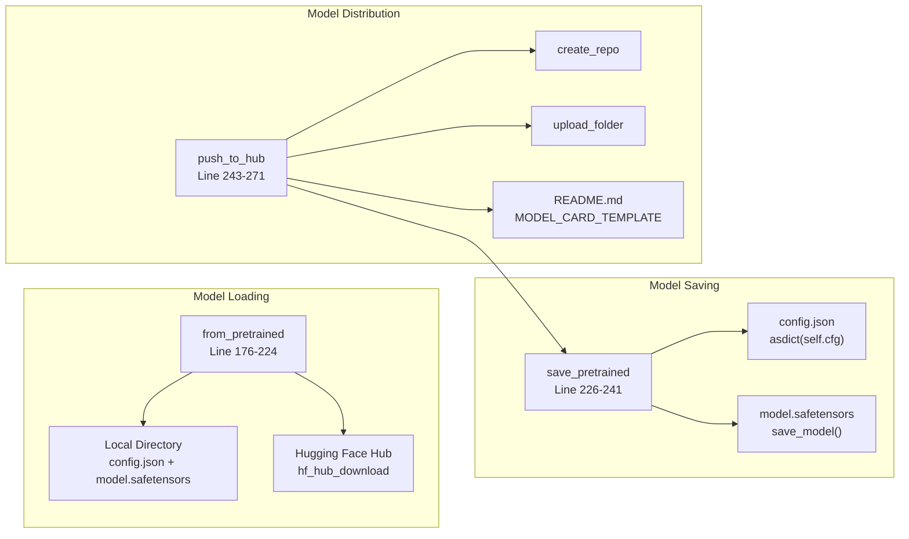

Sources: [models/vision_language_model.py:176-301]()

## Image Token Integration Strategy

The architecture implements a flexible image token replacement mechanism that supports variable numbers of images per sample through the `_replace_img_tokens_with_embd` method.

The system uses special image token placeholders (`self.tokenizer.image_token_id`) in the input sequence, which are dynamically replaced with projected image embeddings during forward pass. This approach enables:

- **Variable Image Count**: Different samples in a batch can contain different numbers of images
- **Flexible Positioning**: Image tokens can appear anywhere in the input sequence
- **Unified Processing**: Image and text embeddings are processed together in the language model

The replacement operation creates a boolean mask for image token positions and uses tensor indexing to substitute embeddings in-place, maintaining the original sequence structure while incorporating visual information.

Sources: [models/vision_language_model.py:36-49](), [models/vision_language_model.py:46-47]()

---

# Page: Vision Language Model

# Vision Language Model

<details>
<summary>Relevant source files</summary>

The following files were used as context for generating this wiki page:

- [models/vision_language_model.py](models/vision_language_model.py)

</details>


## Purpose and Scope

This document covers the `VisionLanguageModel` class, which serves as the main orchestrator for the nanoVLM multimodal architecture. The `VisionLanguageModel` integrates vision and language processing components to enable text generation conditioned on both images and text inputs.

For detailed information about the individual components, see [Vision Transformer](#3.2), [Language Model](#3.3), and [Modality Projector](#3.4). For configuration details, see [Configuration System](#4). For inference usage patterns, see [Inference and Generation](#7).

## Architecture Overview

The `VisionLanguageModel` class acts as the central coordinator that combines three specialized components into a unified multimodal system. It inherits from `nn.Module` and orchestrates the vision encoder, language decoder, and modality projector.

### VisionLanguageModel Class Structure

```mermaid
graph TB
    VLM["VisionLanguageModel(nn.Module)"]
    
    subgraph "Attributes"
        cfg["cfg: VLMConfig"]
        vision_encoder["vision_encoder: ViT"]
        decoder["decoder: LanguageModel"]
        MP["MP: ModalityProjector"]
        tokenizer["tokenizer: AutoTokenizer"]
        load_backbone["load_backbone: bool"]
    end
    
    subgraph "Public Methods"
        init["__init__(cfg, load_backbone=True)"]
        forward["forward(input_ids, images, attention_mask, targets)"]
        generate["generate(input_ids, images, attention_mask, max_new_tokens, ...)"]
        from_pretrained["from_pretrained(repo_id_or_path, revision)"]
        save_pretrained["save_pretrained(save_directory)"]
        push_to_hub["push_to_hub(repo_id, private)"]
    end
    
    subgraph "Private Methods"
        replace_img["_replace_img_tokens_with_embd(input_ids, token_embd, image_embd)"]
        process_images["_process_images(images, device)"]
    end
    
    VLM --> cfg
    VLM --> vision_encoder
    VLM --> decoder
    VLM --> MP
    VLM --> tokenizer
    VLM --> load_backbone
    
    VLM --> init
    VLM --> forward
    VLM --> generate
    VLM --> from_pretrained
    VLM --> save_pretrained
    VLM --> push_to_hub
    VLM --> replace_img
    VLM --> process_images
```

Sources: [models/vision_language_model.py:21-34]()
</thinking>

## Core Functionality

### Component Initialization

The `VisionLanguageModel` constructor handles the setup of all three core components and the tokenizer:

| Component | Type | Purpose | Loading Method |
|-----------|------|---------|----------------|
| `vision_encoder` | `ViT` | Image feature extraction | `ViT.from_pretrained(cfg)` or `ViT(cfg)` |
| `decoder` | `LanguageModel` | Text generation | `LanguageModel.from_pretrained(cfg)` or `LanguageModel(cfg)` |
| `MP` | `ModalityProjector` | Vision-language alignment | `ModalityProjector(cfg)` |
| `tokenizer` | `AutoTokenizer` | Text tokenization | `get_tokenizer()` |

The `load_backbone` parameter controls whether pretrained weights are loaded for the vision and language components.

Sources: [models/vision_language_model.py:22-34]()
</old_str>

<new_str>
## Core Functionality

### Component Initialization

The `VisionLanguageModel.__init__` method initializes all components based on the `load_backbone` flag:

| Component | Type | Purpose | Initialization Path |
|-----------|------|---------|---------------------|
| `self.vision_encoder` | `ViT` | Extracts visual features from images | `ViT.from_pretrained(cfg)` if `load_backbone=True`, else `ViT(cfg)` |
| `self.decoder` | `LanguageModel` | Generates text autoregressively | `LanguageModel.from_pretrained(cfg)` if `load_backbone=True`, else `LanguageModel(cfg)` |
| `self.MP` | `ModalityProjector` | Projects vision features to language space | `ModalityProjector(cfg)` (always initialized from scratch) |
| `self.tokenizer` | `AutoTokenizer` | Tokenizes text and manages special tokens | `get_tokenizer(cfg.lm_tokenizer, cfg.vlm_extra_tokens, cfg.lm_chat_template)` |

When `load_backbone=True`, the vision encoder loads pretrained SigLIP weights and the decoder loads pretrained SmolLM weights. When `False`, both components are initialized with random weights.

Sources: [models/vision_language_model.py:22-34]()

### Image Processing

The `_process_images` method normalizes image inputs to a consistent tensor format:

**Input handling:**
- **Nested lists**: Flattens `[[img1, img2], [img3]]` → `[img1, img2, img3]`
- **Empty lists**: Returns `None` when no images present
- **Tensors**: Returns input directly if already a tensor

**Output:** Single concatenated tensor on target device or `None`

This method ensures the forward pass and generation methods receive uniform image tensor format regardless of input structure.

Sources: [models/vision_language_model.py:51-60]()

### Data Flow During Forward Pass

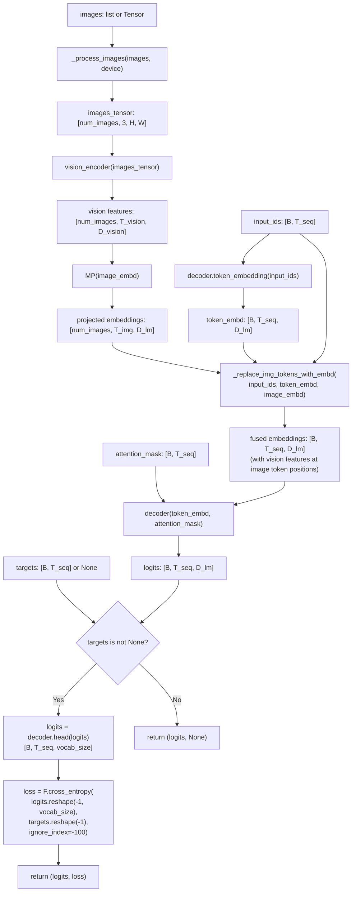

Sources: [models/vision_language_model.py:62-80]()

## Core Functionality

### Component Initialization

The `VisionLanguageModel` constructor handles the setup of all three core components and the tokenizer:

| Component | Type | Purpose | Loading Method |
|-----------|------|---------|----------------|
| `vision_encoder` | `ViT` | Image feature extraction | `ViT.from_pretrained(cfg)` or `ViT(cfg)` |
| `decoder` | `LanguageModel` | Text generation | `LanguageModel.from_pretrained(cfg)` or `LanguageModel(cfg)` |
| `MP` | `ModalityProjector` | Vision-language alignment | `ModalityProjector(cfg)` |
| `tokenizer` | `AutoTokenizer` | Text tokenization | `get_tokenizer()` |

The `load_backbone` parameter controls whether pretrained weights are loaded for the vision and language components.

Sources: [models/vision_language_model.py:22-34]()

### Image Token Replacement

The `_replace_img_tokens_with_embd` method performs multimodal fusion by substituting image token placeholders with vision embeddings:

#### Multimodal Embedding Fusion

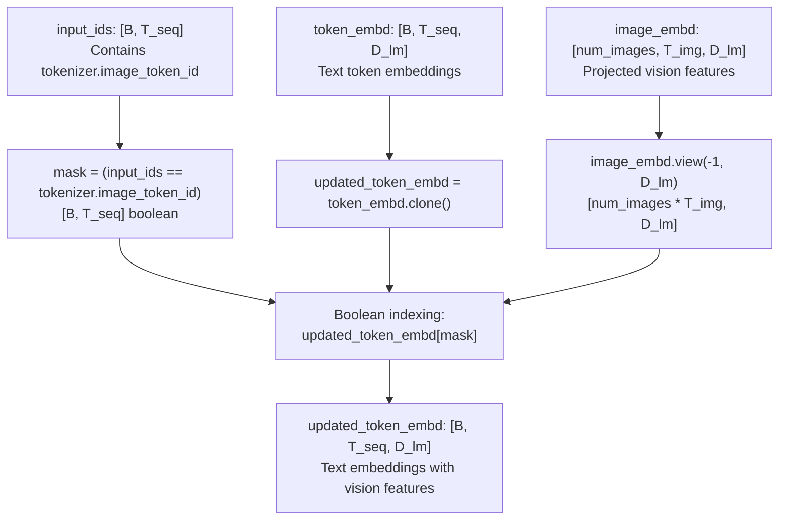

**Key behaviors:**
- **Clone operation**: Prevents in-place modification issues (line 43)
- **Automatic flattening**: PyTorch flattens `image_embd` before assignment to match the masked positions
- **Dtype casting**: Ensures vision features match language model dtype via `.to(updated_token_embd.dtype)`
- **Variable image counts**: Supports different numbers of images per batch sample

Sources: [models/vision_language_model.py:36-49]()

## Training vs Inference Modes

### Training Mode: Forward Pass

The `forward` method processes batched multimodal inputs and computes cross-entropy loss when targets are provided:

**Execution flow:**

1. **Image normalization**: `images_tensor = self._process_images(images, input_ids.device)`
2. **Text embedding**: `token_embd = self.decoder.token_embedding(input_ids)` → `[B, T_seq, D_lm]`
3. **Vision processing** (if images present):
   - `image_embd = self.vision_encoder(images_tensor)` → vision features
   - `image_embd = self.MP(image_embd)` → `[num_images, T_img, D_lm]`
   - `token_embd = self._replace_img_tokens_with_embd(input_ids, token_embd, image_embd)`
4. **Language forward**: `logits, _ = self.decoder(token_embd, attention_mask)` → `[B, T_seq, D_lm]`
5. **Loss computation** (if `targets` provided):
   - Apply language head: `logits = self.decoder.head(logits)` → `[B, T_seq, vocab_size]`
   - Compute loss: `loss = F.cross_entropy(logits.reshape(-1, vocab_size), targets.reshape(-1), ignore_index=-100)`

**Key details:**
- Returns `(logits, loss)` tuple
- Loss ignores positions with `targets=-100` (used for padding and non-answer tokens)
- Language head only applied when computing loss, not during intermediate representations

Sources: [models/vision_language_model.py:62-80]()

### Inference Mode: Generation

The `generate` method implements two-phase autoregressive generation with KV caching:

#### Two-Phase Generation Pipeline

```mermaid
graph TB
    subgraph "Setup Phase"
        process_img["images_tensor = _process_images(images, device)"]
        embed_text["token_embd = decoder.token_embedding(input_ids)"]
        process_vision["image_embd = vision_encoder(images_tensor)"]
        project["image_embd = MP(image_embd)"]
        fuse["token_embd = _replace_img_tokens_with_embd(...)"]
    end
    
    subgraph "Prefill Phase"
        prefill_call["prefill_output, kv_cache_list = decoder(<br/>token_embd, attention_mask, kv_cache=None, start_pos=0)"]
        extract_last["last_token_output = prefill_output[:, -1, :]"]
        apply_head["current_logits = decoder.head(last_token_output)<br/>if not decoder.lm_use_tokens"]
    end
    
    subgraph "Decode Loop (max_new_tokens iterations)"
        sample["next_token_id = argmax(logits) if greedy<br/>else multinomial(top_k_top_p_filtering(logits))"]
        append["newly_generated_ids_list.append(next_token_id)"]
        embed_new["next_token_embed = decoder.token_embedding(next_token_id)"]
        update_pos["current_token_start_pos = current_total_seq_len<br/>current_total_seq_len += 1"]
        update_mask["attention_mask = cat([attention_mask, ones([B, 1])])"]
        decode_call["decode_output, kv_cache_list = decoder(<br/>next_token_embed, attention_mask,<br/>kv_cache=kv_cache_list, start_pos=current_token_start_pos)"]
        get_logits["current_logits = decoder.head(decode_output[:, -1, :])"]
    end
    
    subgraph "Post-processing"
        concat["generated_ids = cat(newly_generated_ids_list, dim=1)"]
        eos_handling["Find first EOS token per sample<br/>Replace all tokens after EOS with EOS"]
        return_result["Return generated_ids: [B, num_generated]"]
    end
    
    process_img --> embed_text
    embed_text --> process_vision
    process_vision --> project
    project --> fuse
    fuse --> prefill_call
    prefill_call --> extract_last
    extract_last --> apply_head
    apply_head --> sample
    
    sample --> append
    append --> embed_new
    embed_new --> update_pos
    update_pos --> update_mask
    update_mask --> decode_call
    decode_call --> get_logits
    get_logits --> sample
    
    get_logits --> concat
    concat --> eos_handling
    eos_handling --> return_result
```

**Generation parameters:**

| Parameter | Type | Default | Purpose |
|-----------|------|---------|---------|
| `max_new_tokens` | int | 5 | Maximum tokens to generate |
| `top_k` | int | 50 | Top-k sampling parameter |
| `top_p` | float | 0.9 | Nucleus sampling threshold |
| `temperature` | float | 0.5 | Sampling temperature for diversity |
| `greedy` | bool | False | Use greedy decoding (argmax) |

**KV cache mechanics:**
- **Prefill phase** (line 98-103): Processes full multimodal prompt, returns initial `kv_cache_list` with keys/values for all transformer blocks
- **Decode phase** (lines 116-151): Each iteration processes one new token using cached keys/values
- **Cache structure**: List of tuples `[(key, value)]` per transformer block
- **Position tracking**: `start_pos` parameter tells each block where to insert new cache entries

**EOS token handling** (lines 159-181):
- Finds first EOS token position per sample using vectorized operations
- Replaces all tokens after first EOS with `tokenizer.eos_token_id`
- Uses masking approach to avoid loops over batch dimension

Sources: [models/vision_language_model.py:82-183]()

## Model Lifecycle Management

### Loading Models

The `from_pretrained` classmethod supports loading from both local directories and Hugging Face Hub:

#### Model Loading Flow

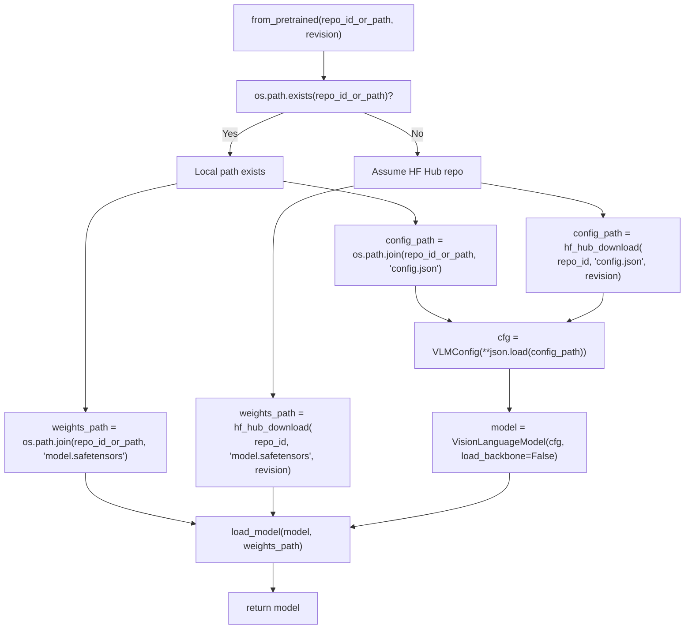

**Key implementation details:**
- **No backbone loading**: Initializes with `load_backbone=False` since weights are loaded from checkpoint
- **SafeTensors format**: Uses `safetensors.torch.load_model()` for efficient weight loading
- **Revision support**: Hub downloads support specific model revisions/commits
- **Error handling**: Raises `ValueError` if `config.json` or `model.safetensors` not found in local path

Sources: [models/vision_language_model.py:185-233]()

### Saving Models

The `save_pretrained` method persists the complete model state to disk:

**Checkpoint structure:**
```
save_directory/
├── config.json          # VLMConfig serialized as JSON
└── model.safetensors    # Model weights in SafeTensors format
```

**Implementation steps:**
1. Create directory: `os.makedirs(save_directory, exist_ok=True)`
2. Save configuration: `json.dumps(asdict(self.cfg), indent=4)` → `config.json`
3. Save weights: `save_model(self, "model.safetensors")` (SafeTensors format)

**Note:** The `asdict()` function converts the `VLMConfig` dataclass to a dictionary for JSON serialization.

Sources: [models/vision_language_model.py:235-250]()

### Hub Integration

The `push_to_hub` method uploads the model to Hugging Face Hub with automated model card generation:

#### Hub Upload Pipeline

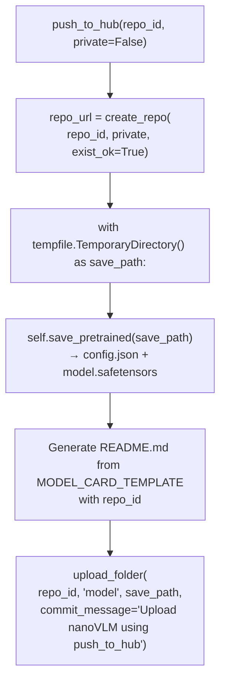

**Model card metadata** (lines 284-294):
- `library_name: nanovlm`
- `license: mit`
- `pipeline_tag: image-text-to-text`
- `tags: vision-language, multimodal, research`

**Model card contents** (lines 296-309):
- Description of nanoVLM architecture
- Parameter counts (222M total)
- Link to base model on Hub
- Usage instructions with code example

**Temporary directory usage:** Model is saved to a temporary directory, then entire directory is uploaded atomically and cleaned up automatically.

Sources: [models/vision_language_model.py:252-310]()

## Configuration Integration

The `VisionLanguageModel` uses `VLMConfig` to coordinate all component configurations:

| Component | Configuration Source |
|-----------|---------------------|
| Vision Encoder | `cfg.vision_*` parameters |
| Language Model | `cfg.lm_*` parameters |
| Modality Projector | `cfg.mp_*` parameters |
| Tokenizer | `cfg.lm_tokenizer`, `cfg.vlm_extra_tokens` |

This unified configuration approach ensures consistent parameter sharing across all components.

Sources: [models/vision_language_model.py:24-34]()

---

# Page: Vision Transformer

# Vision Transformer

<details>
<summary>Relevant source files</summary>

The following files were used as context for generating this wiki page:

- [models/language_model.py](models/language_model.py)
- [models/modality_projector.py](models/modality_projector.py)
- [models/vision_transformer.py](models/vision_transformer.py)

</details>


This document describes the Vision Transformer (ViT) implementation in nanoVLM, which serves as the visual encoder for processing images into feature representations. The ViT extracts patch-based embeddings from input images and processes them through bidirectional transformer blocks to produce visual features that are subsequently projected into the language model's embedding space.

For information about how these visual features are projected to the language model dimension, see [Modality Projector](#3.4). For the overall multimodal architecture, see [Vision Language Model](#3.1).

## Architecture Overview

The ViT implementation follows the standard Vision Transformer architecture with modifications from SigLIP, consisting of patch embeddings, positional encodings, and a stack of transformer blocks with bidirectional attention.

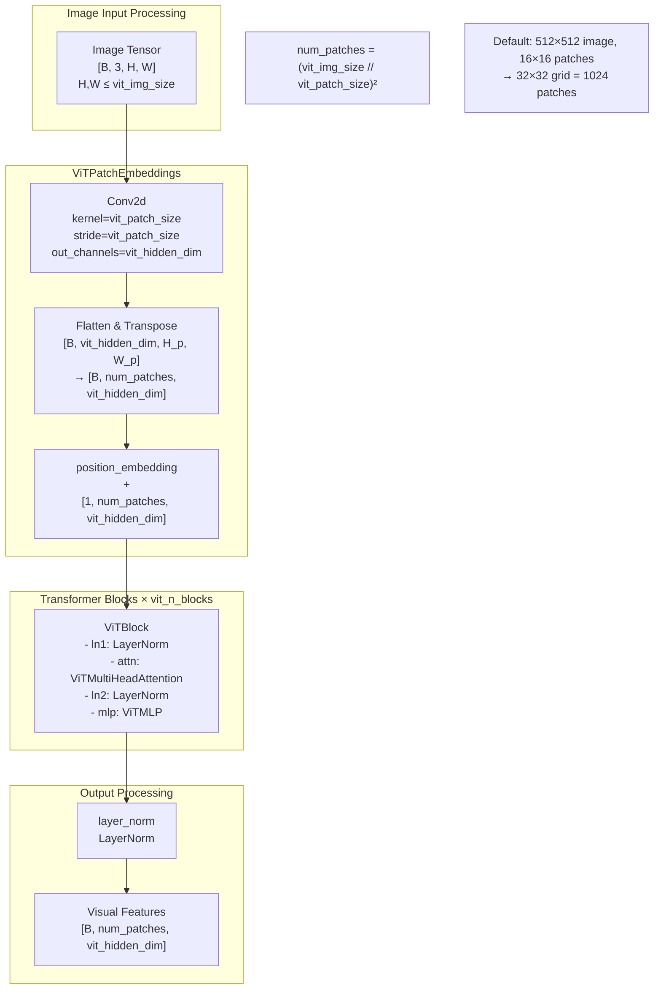

**Key Configuration Parameters:**

| Parameter | Default (SigLIP-B/16-512) | Description |
|-----------|---------------------------|-------------|
| `vit_img_size` | 512 | Maximum image dimension (height/width) |
| `vit_patch_size` | 16 | Size of each image patch |
| `vit_hidden_dim` | 768 | Hidden dimension of transformer |
| `vit_inter_dim` | 3072 | Intermediate MLP dimension (4× hidden) |
| `vit_n_heads` | 12 | Number of attention heads |
| `vit_n_blocks` | 12 | Number of transformer blocks |
| `vit_dropout` | 0.0 | Dropout rate |
| `vit_ln_eps` | 1e-6 | LayerNorm epsilon |
| `vit_cls_flag` | False | Whether to use CLS token |

Sources: [models/vision_transformer.py:131-169](), [models/vision_transformer.py:172-186]()

## Patch Embeddings

The `ViTPatchEmbeddings` class converts 2D images into sequences of patch embeddings using a convolutional layer. This effectively divides the image into non-overlapping patches and linearly projects each patch to the hidden dimension.

```mermaid
graph LR
    subgraph Process["Patch Embedding Process"]
        Input["Image<br/>[B, 3, 512, 512]"]
        Conv["conv<br/>Conv2d<br/>3→768 channels<br/>kernel=16, stride=16"]
        Flat["Flatten & Transpose"]
        Grid["Patch Grid<br/>[B, 1024, 768]<br/>32×32 spatial grid"]
        Pos["+ position_embedding<br/>[1, 1024, 768]"]
        Output["Embedded Patches<br/>[B, 1024, 768]"]
        
        Input --> Conv
        Conv --> Flat
        Flat --> Grid
        Grid --> Pos
        Pos --> Output
    end
    
    Note["Each 16×16 patch → 768-dim vector<br/>512÷16 = 32 patches per side<br/>32² = 1024 total patches"]
```

### Implementation Details

The patch embedding uses a `nn.Conv2d` layer with kernel size and stride equal to the patch size, effectively implementing non-overlapping patch extraction:

[models/vision_transformer.py:17-24]()

**Position Embeddings:** Learnable position embeddings are added to each patch embedding to inject spatial information:

[models/vision_transformer.py:29-30]()

**CLS Token (Optional):** When `vit_cls_flag=True`, a learnable CLS token is prepended to the sequence. However, the default SigLIP configuration does not use a CLS token:

[models/vision_transformer.py:26-28](), [models/vision_transformer.py:38-42]()

**Forward Pass:**

[models/vision_transformer.py:33-43]()

The convolution extracts patches, which are then flattened from `[B, C, H_p, W_p]` to `[B, num_patches, C]` and combined with position embeddings.

Sources: [models/vision_transformer.py:7-43]()

## Transformer Blocks

Each `ViTBlock` consists of LayerNorm, multi-head attention, and an MLP with residual connections. The architecture follows the "Pre-LN" variant where normalization occurs before each sub-layer.

```mermaid
graph TB
    subgraph ViTBlock["ViTBlock Structure"]
        Input["x<br/>[B, T, C]"]
        
        subgraph Branch1["Attention Branch"]
            LN1["ln1<br/>LayerNorm"]
            Attn["attn<br/>ViTMultiHeadAttention<br/>n_heads=12, bidirectional"]
            Res1["+"]
        end
        
        subgraph Branch2["MLP Branch"]
            LN2["ln2<br/>LayerNorm"]
            MLP["mlp<br/>ViTMLP<br/>GELU activation"]
            Res2["+"]
        end
        
        Output["x<br/>[B, T, C]"]
        
        Input --> LN1
        Input --> Res1
        LN1 --> Attn
        Attn --> Res1
        
        Res1 --> LN2
        Res1 --> Res2
        LN2 --> MLP
        MLP --> Res2
        
        Res2 --> Output
    end
```

### Block Components

**LayerNorm:** Standard LayerNorm with epsilon `vit_ln_eps=1e-6`:

[models/vision_transformer.py:120](), [models/vision_transformer.py:122]()

**Residual Connections:** Both attention and MLP outputs are added to their inputs:

[models/vision_transformer.py:125-128]()

**Block Forward Pass:**

The block applies the standard transformer architecture with pre-normalization:

[models/vision_transformer.py:125-128]()

Sources: [models/vision_transformer.py:117-128]()

## Multi-Head Attention Mechanism

The `ViTMultiHeadAttention` class implements bidirectional self-attention with multiple heads, using a combined QKV projection for efficiency.

```mermaid
graph TB
    subgraph Attention["ViTMultiHeadAttention"]
        Input["x [B, T, C]"]
        
        QKV["qkv_proj<br/>Linear: C → 3C<br/>Combined Q,K,V projection"]
        Split["Split into Q, K, V<br/>each [B, T, C]"]
        Reshape["Reshape & Transpose<br/>[B, T, n_heads, head_dim]<br/>→ [B, n_heads, T, head_dim]"]
        
        subgraph SDPA["Scaled Dot-Product Attention"]
            Scale["Q @ K^T / √head_dim"]
            Softmax["Softmax"]
            Value["@ V"]
            AttnOut["[B, n_heads, T, head_dim]"]
        end
        
        Concat["Transpose & Reshape<br/>→ [B, T, C]"]
        OutProj["out_proj<br/>Linear: C → C"]
        Dropout["resid_dropout"]
        Output["y [B, T, C]"]
        
        Input --> QKV
        QKV --> Split
        Split --> Reshape
        Reshape --> Scale
        Scale --> Softmax
        Softmax --> Value
        Value --> AttnOut
        AttnOut --> Concat
        Concat --> OutProj
        OutProj --> Dropout
        Dropout --> Output
    end
    
    Config["n_heads=12<br/>head_dim=768÷12=64<br/>is_causal=False<br/>bidirectional"]
```

### Key Differences from Language Model Attention

| Aspect | ViT Attention | Language Model Attention |
|--------|---------------|--------------------------|
| **Directionality** | Bidirectional (`is_causal=False`) | Causal/autoregressive |
| **QKV Projection** | Combined `qkv_proj` | Separate Q, K, V projections |
| **Attention Pattern** | All tokens attend to all | Tokens only attend to past |
| **KV Heads** | Same as Q heads (standard MHA) | Grouped Query Attention (GQA) |
| **Rotary Embeddings** | Not used | Applied to Q and K |
| **KV Cache** | Not used | Used during generation |

### Implementation Details

**Combined QKV Projection:**

[models/vision_transformer.py:58]()

The combined projection is more efficient than separate projections and is split into Q, K, V after projection:

[models/vision_transformer.py:73-74]()

**Scaled Dot-Product Attention:**

The implementation uses PyTorch's `scaled_dot_product_attention` when available for efficiency:

[models/vision_transformer.py:80-86]()

With fallback to manual computation:

[models/vision_transformer.py:88-91]()

**Bidirectional Attention:** Note that `is_causal=False` allows each token to attend to all other tokens, unlike the causal attention in the language model:

[models/vision_transformer.py:85]()

Sources: [models/vision_transformer.py:47-98]()

## MLP Block

The `ViTMLP` implements a two-layer feed-forward network with GELU activation. The intermediate dimension is typically 4× the hidden dimension.

```mermaid
graph LR
    Input["x<br/>[B, T, vit_hidden_dim]"]
    FC1["fc1<br/>Linear<br/>vit_hidden_dim → vit_inter_dim"]
    GELU["GELU<br/>approximate='tanh'"]
    FC2["fc2<br/>Linear<br/>vit_inter_dim → vit_hidden_dim"]
    Drop["dropout"]
    Output["x<br/>[B, T, vit_hidden_dim]"]
    
    Input --> FC1
    FC1 --> GELU
    GELU --> FC2
    FC2 --> Drop
    Drop --> Output
    
    Note["Default: 768 → 3072 → 768<br/>4× expansion ratio"]
```

**Forward Pass:**

[models/vision_transformer.py:109-114]()

The GELU activation with tanh approximation is used for compatibility with the pretrained SigLIP weights:

[models/vision_transformer.py:104]()

Sources: [models/vision_transformer.py:101-114]()

## ViT Main Class

The `ViT` class orchestrates the complete vision encoding pipeline, from patch embeddings through transformer blocks to final normalization.

### Architecture Flow

```mermaid
graph TB
    subgraph ViTForward["ViT.forward(x)"]
        Input["Image Tensor<br/>[B, 3, H, W]"]
        
        PatchEmb["patch_embedding<br/>ViTPatchEmbeddings"]
        Drop1["dropout"]
        
        Blocks["blocks<br/>ModuleList of ViTBlock<br/>× vit_n_blocks"]
        
        Choice{{"vit_cls_flag?"}}
        CLSOnly["Extract CLS token<br/>x = x[:, 0]"]
        AllTokens["Keep all tokens<br/>x = x"]
        
        FinalNorm["layer_norm<br/>LayerNorm"]
        
        Output["Visual Features<br/>[B, num_patches, vit_hidden_dim]<br/>or [B, vit_hidden_dim] if CLS"]
        
        Input --> PatchEmb
        PatchEmb --> Drop1
        Drop1 --> Blocks
        Blocks --> Choice
        Choice -->|True| CLSOnly
        Choice -->|False| AllTokens
        CLSOnly --> FinalNorm
        AllTokens --> FinalNorm
        FinalNorm --> Output
    end
```

### Forward Pass Implementation

[models/vision_transformer.py:156-168]()

**Key Points:**

1. **Patch Embedding:** Converts image to sequence of patch embeddings
2. **Dropout:** Applied after patch embedding
3. **Transformer Blocks:** Process embeddings through all blocks sequentially
4. **CLS Token Handling:** If `vit_cls_flag=True`, only the CLS token is extracted; otherwise all patch tokens are kept
5. **Final LayerNorm:** Applied to the output features

**In nanoVLM's default configuration:** `vit_cls_flag=False`, so all 1024 patch tokens are preserved and passed to the modality projector, which reduces them to 64 tokens via pixel shuffle.

Sources: [models/vision_transformer.py:131-168]()

## Loading Pretrained Weights

The `from_pretrained` class method loads pretrained SigLIP weights from Hugging Face Hub, mapping them to the nanoVLM ViT architecture.

### Weight Loading Process

```mermaid
graph TB
    subgraph LoadPretrained["ViT.from_pretrained(cfg)"]
        Config["cfg.vit_model_type<br/>'google/siglip-base-patch16-512'"]
        
        HFConfig["Load SiglipVisionConfig<br/>from HuggingFace"]
        UpdateCfg["Update cfg with HF params<br/>vit_hidden_dim, vit_n_blocks, etc."]
        
        CreateModel["Create ViT(cfg)<br/>with updated config"]
        
        Download["Download model.safetensors<br/>from HF Hub"]
        
        Mapping["Create weight mapping<br/>HF keys → nanoVLM keys"]
        
        subgraph WeightTransfer["Transfer Weights"]
            Direct["Direct copy for<br/>patch_embedding, layer_norm, MLP"]
            QKVCombine["Combine Q, K, V weights<br/>→ qkv_proj"]
        end
        
        LoadState["Load state dict<br/>into model"]
        
        Output["Pretrained ViT model"]
        
        Config --> HFConfig
        HFConfig --> UpdateCfg
        UpdateCfg --> CreateModel
        CreateModel --> Download
        Download --> Mapping
        Mapping --> Direct
        Mapping --> QKVCombine
        Direct --> LoadState
        QKVCombine --> LoadState
        LoadState --> Output
    end
```

### Configuration Mapping

The method first loads the SigLIP configuration and updates the nanoVLM config:

[models/vision_transformer.py:177-186]()

### Weight Mapping

A mapping dictionary translates HuggingFace weight names to nanoVLM's naming convention:

[models/vision_transformer.py:191-214]()

**Example mappings:**

| HuggingFace Key | nanoVLM Key |
|-----------------|-------------|
| `vision_model.embeddings.patch_embedding.weight` | `patch_embedding.conv.weight` |
| `vision_model.embeddings.position_embedding.weight` | `patch_embedding.position_embedding` |
| `vision_model.encoder.layers.{i}.layer_norm1.weight` | `blocks.{i}.ln1.weight` |
| `vision_model.encoder.layers.{i}.mlp.fc1.weight` | `blocks.{i}.mlp.fc1.weight` |
| `vision_model.post_layernorm.weight` | `layer_norm.weight` |

### QKV Weight Concatenation

Since nanoVLM uses a combined `qkv_proj` layer while SigLIP has separate Q, K, V projections, the weights must be concatenated:

[models/vision_transformer.py:234-247]()

This concatenation is performed for both weights and biases for each transformer block.

### Position Embedding Shape Handling

The position embedding in SigLIP may have a different shape, requiring reshaping:

[models/vision_transformer.py:223-224]()

Sources: [models/vision_transformer.py:171-251]()

## Integration with VisionLanguageModel

The ViT serves as the visual encoder in the multimodal pipeline. The integration flow is:

```mermaid
graph LR
    subgraph VLMPipeline["VisionLanguageModel Integration"]
        Image["Image Input<br/>PIL/Tensor<br/>max 2048px"]
        Processor["Image Processor<br/>Resize & Normalize"]
        ViTEncode["ViT.forward()<br/>→ [B, 1024, 768]"]
        PixelShuffle["ModalityProjector<br/>pixel_shuffle()<br/>1024→64 tokens"]
        MPProj["MP Linear Projection<br/>768×16 → 960"]
        LMEmbed["Combine with<br/>text embeddings"]
        Decoder["Language Model<br/>Decoder"]
        
        Image --> Processor
        Processor --> ViTEncode
        ViTEncode --> PixelShuffle
        PixelShuffle --> MPProj
        MPProj --> LMEmbed
        LMEmbed --> Decoder
    end
    
    Note["ViT output: 1024 patches × 768 dim<br/>After projection: 64 tokens × 960 dim<br/>16× spatial compression"]
```

**Key Integration Points:**

1. **Image Processing:** Images are resized and normalized before being fed to ViT (see [Data Processing](#5.2))
2. **Feature Extraction:** ViT produces 1024 patch features at 768 dimensions
3. **Modality Projection:** Features are compressed 16× spatially (1024→64) and projected to language dimension (768→960) (see [Modality Projector](#3.4))
4. **Sequence Construction:** Visual embeddings are inserted into text token sequences using special image tokens
5. **Frozen vs. Fine-tuned:** ViT weights can be frozen or fine-tuned with a low learning rate (`lr_vision=5e-5`)

The ViT's pretrained weights from SigLIP provide strong visual representations, which are then adapted to the language model's embedding space through the modality projector. This design allows the model to leverage both pretrained visual and language understanding.

Sources: [models/vision_transformer.py:1-251]()

---

# Page: Language Model

# Language Model

<details>
<summary>Relevant source files</summary>

The following files were used as context for generating this wiki page:

- [models/language_model.py](models/language_model.py)
- [models/modality_projector.py](models/modality_projector.py)
- [models/vision_transformer.py](models/vision_transformer.py)

</details>


This document covers the transformer-based language model component of nanoVLM, implemented in the `LanguageModel` class. This component handles text processing, autoregressive generation, and serves as the text backbone of the multimodal system.

For information about the overall vision-language integration, see [Vision Language Model](#3.1). For details about the vision processing component, see [Vision Transformer](#3.2).

## Architecture Overview

The language model implements a decoder-only transformer architecture with several modern optimizations including Grouped Query Attention (GQA), Rotary Position Embeddings (RoPE), and KV caching for efficient generation.

### Class Hierarchy

```mermaid
graph TD
    LanguageModel["LanguageModel<br/>Main orchestrator"]
    LanguageModelBlock["LanguageModelBlock<br/>Transformer layer"]
    LanguageModelGroupedQueryAttention["LanguageModelGroupedQueryAttention<br/>GQA attention"]
    LanguageModelMLP["LanguageModelMLP<br/>Feed-forward network"]
    RMSNorm["RMSNorm<br/>Layer normalization"]
    RotaryEmbedding["RotaryEmbedding<br/>Position embeddings"]
    
    LanguageModel --> LanguageModelBlock
    LanguageModel --> RotaryEmbedding
    LanguageModel --> RMSNorm
    LanguageModelBlock --> LanguageModelGroupedQueryAttention
    LanguageModelBlock --> LanguageModelMLP
    LanguageModelBlock --> RMSNorm
```

Sources: [models/language_model.py:390-481]()

## Core Components

### Grouped Query Attention

The `LanguageModelGroupedQueryAttention` class implements GQA, which reduces computational overhead by using fewer key-value heads than query heads. Multiple query heads share the same key-value heads, maintaining performance while improving efficiency.

| Parameter | Description | Configuration Field |
|-----------|-------------|-------------------|
| Query heads | Number of query attention heads | `lm_n_heads` |
| KV heads | Number of key-value heads | `lm_n_kv_heads` |
| Head dimension | Dimension per attention head | `lm_hidden_dim // lm_n_heads` |
| Groups | Query heads per KV head | `lm_n_heads // lm_n_kv_heads` |

The attention mechanism supports both prefill (initial forward pass) and decode (autoregressive generation) phases with KV caching.

Sources: [models/language_model.py:166-299]()

### Rotary Position Embeddings

The `RotaryEmbedding` class implements RoPE, which encodes positional information by rotating query and key vectors in the complex plane. This approach provides better length extrapolation compared to absolute positional embeddings.

Key features:
- Base frequency scaling via `lm_re_base` parameter
- Dynamic scaling for sequences longer than training length
- Attention scaling factor via `lm_attn_scaling`

The rotation is applied using the `apply_rotary_pos_embd` function, which combines cosine and sine embeddings with the `rotate_half` helper function.

Sources: [models/language_model.py:43-162]()

### Feed-Forward Network

The `LanguageModelMLP` implements a gated MLP architecture:

```mermaid
graph LR
    Input["Input<br/>[B, T, hidden_dim]"]
    GateProj["gate_proj<br/>Linear(hidden_dim, inter_dim)"]
    UpProj["up_proj<br/>Linear(hidden_dim, inter_dim)"]
    SiLU["SiLU Activation"]
    Multiply["Element-wise<br/>Multiplication"]
    DownProj["down_proj<br/>Linear(inter_dim, hidden_dim)"]
    Output["Output<br/>[B, T, hidden_dim]"]
    
    Input --> GateProj
    Input --> UpProj
    GateProj --> SiLU
    SiLU --> Multiply
    UpProj --> Multiply
    Multiply --> DownProj
    DownProj --> Output
```

Sources: [models/language_model.py:302-348]()

### RMS Normalization

`RMSNorm` provides a lightweight alternative to LayerNorm by normalizing using root mean square without subtracting the mean:

```
RMSNorm(x) = x * rsqrt(mean(x²) + ε) * weight
```

Sources: [models/language_model.py:7-39]()

## Model Structure and Data Flow

```mermaid
graph TD
    TokenInput["Token Input<br/>[batch_size, seq_len]"]
    TokenEmbedding["token_embedding<br/>nn.Embedding"]
    PositionIds["Position IDs<br/>torch.arange(start_pos, start_pos + T)"]
    RotaryEmbd["rotary_embd<br/>RotaryEmbedding.forward()"]
    
    subgraph "Transformer Blocks"
        Block0["blocks[0]<br/>LanguageModelBlock"]
        Block1["blocks[1]<br/>LanguageModelBlock"]
        BlockN["blocks[n-1]<br/>LanguageModelBlock"]
    end
    
    FinalNorm["norm<br/>RMSNorm"]
    Head["head<br/>Linear(hidden_dim, vocab_size)"]
    LogitsOutput["Logits Output<br/>[batch_size, seq_len, vocab_size]"]
    
    subgraph "KV Cache"
        Cache0["kv_cache[0]<br/>{'key': Tensor, 'value': Tensor}"]
        Cache1["kv_cache[1]<br/>{'key': Tensor, 'value': Tensor}"]
        CacheN["kv_cache[n-1]<br/>{'key': Tensor, 'value': Tensor}"]
    end
    
    TokenInput --> TokenEmbedding
    PositionIds --> RotaryEmbd
    TokenEmbedding --> Block0
    RotaryEmbd --> Block0
    Block0 --> Block1
    Block1 --> BlockN
    BlockN --> FinalNorm
    FinalNorm --> Head
    Head --> LogitsOutput
    
    Block0 -.-> Cache0
    Block1 -.-> Cache1
    BlockN -.-> CacheN
```

Sources: [models/language_model.py:419-480]()

## Key Features

### KV Caching

The model implements efficient KV caching for autoregressive generation. Each `LanguageModelBlock` maintains cached key and value tensors to avoid recomputing attention states for previous tokens.

Cache structure per block:
```python
block_kv_cache = {
    'key': torch.Tensor,    # [batch_size, n_kv_heads, seq_len, head_dim]
    'value': torch.Tensor   # [batch_size, n_kv_heads, seq_len, head_dim]
}
```

During generation, the cache is updated incrementally by concatenating new key-value pairs with existing cached states.

Sources: [models/language_model.py:238-252]()

### Pretrained Model Loading

The `from_pretrained` class method enables loading weights from HuggingFace transformer models while supporting vocabulary extension:

| HuggingFace Weight | nanoVLM Weight | Purpose |
|-------------------|----------------|---------|
| `model.embed_tokens.weight` | `token_embedding.weight` | Input embeddings |
| `model.layers.{i}.self_attn.q_proj.weight` | `blocks.{i}.attn.q_proj.weight` | Query projection |
| `model.layers.{i}.input_layernorm.weight` | `blocks.{i}.norm1.weight` | Pre-attention norm |
| `lm_head.weight` | `head.weight` | Output projection |

The method handles vocabulary extension by initializing new token embeddings with normal distribution when `lm_vocab_size` exceeds the pretrained model's vocabulary size.

Sources: [models/language_model.py:538-657]()

### Generation Process

The `generate` method implements autoregressive text generation with two phases:

1. **Prefill Phase**: Process the entire input prompt and initialize KV cache
2. **Decode Phase**: Generate tokens one by one using cached key-value states

```mermaid
graph TD
    Input["Input Tokens<br/>[batch_size, prompt_len]"]
    Prefill["Prefill Phase<br/>forward(inputs, kv_cache=None)"]
    InitCache["Initialize KV Cache<br/>kv_cache_list"]
    
    subgraph "Decode Loop"
        LastToken["Extract Last Token<br/>prompt_output[:, -1, :]"]
        Argmax["torch.argmax<br/>(if lm_use_tokens=True)"]
        NextToken["Next Token<br/>[batch_size, 1]"]
        Append["Concatenate<br/>torch.cat((generated, next), dim=1)"]
        DecodeForward["forward(next_token, kv_cache=cache_list,<br/>start_pos=current_pos)"]
        UpdateCache["Update KV Cache<br/>kv_cache_list"]
    end
    
    Output["Generated Sequence<br/>[batch_size, prompt_len + max_new_tokens]"]
    
    Input --> Prefill
    Prefill --> InitCache
    InitCache --> LastToken
    LastToken --> Argmax
    Argmax --> NextToken
    NextToken --> Append
    Append --> DecodeForward
    DecodeForward --> UpdateCache
    UpdateCache --> LastToken
    Append --> Output
```

Sources: [models/language_model.py:483-535]()

### Attention Masking

The model supports attention masking for handling variable-length sequences and padding tokens. The attention mask format is `[batch_size, total_kv_length]` with 1 for valid tokens and 0 for padding.

For causal attention during training, the model automatically applies causal masking when `T_curr == T_kv` and sequence length > 1.

Sources: [models/language_model.py:260-290]()

---

# Page: Modality Projector

# Modality Projector

<details>
<summary>Relevant source files</summary>

The following files were used as context for generating this wiki page:

- [models/language_model.py](models/language_model.py)
- [models/modality_projector.py](models/modality_projector.py)
- [models/vision_transformer.py](models/vision_transformer.py)

</details>


## Purpose and Scope

The Modality Projector is a learned cross-modal bridge that transforms visual feature representations from the Vision Transformer into embeddings compatible with the Language Model's representation space. This component addresses the semantic and dimensional mismatch between vision and language modalities while dramatically reducing the number of visual tokens to make multimodal processing computationally feasible.

For the overall VisionLanguageModel architecture and how components interact, see [Vision Language Model](#3.1). For details on the Vision Transformer that produces the input features, see [Vision Transformer](#3.2). For the Language Model that consumes the projected embeddings, see [Language Model](#3.3).

## Architecture Overview

The `ModalityProjector` consists of two sequential operations that together reduce spatial dimensions while preserving semantic information:

```mermaid
graph LR
    ViT["Vision Transformer<br/>Output"]
    PS["Pixel Shuffle<br/>Spatial Reduction"]
    LP["Linear Projection<br/>Dimensional Alignment"]
    LM["Language Model<br/>Input"]
    
    ViT -->|"1024 tokens × 768 dim"| PS
    PS -->|"64 tokens × 12,288 dim"| LP
    LP -->|"64 tokens × 960 dim"| LM
    
    ViT -.->|"32×32 spatial grid"| PS
    PS -.->|"8×8 spatial grid"| LP
```

**Sources**: [models/modality_projector.py:1-46](), Diagram 1 (Overall System Architecture), Diagram 4 (Model Component Architecture)

### Component Breakdown

| Component | Input Shape | Output Shape | Parameters | Operation |
|-----------|-------------|--------------|------------|-----------|
| Pixel Shuffle | `(B, 1024, 768)` | `(B, 64, 12288)` | 0 | Spatial rearrangement |
| Linear Projection | `(B, 64, 12288)` | `(B, 64, 960)` | 11.8M | Learned transformation |

The total parameter count is dominated by the linear projection layer: `12,288 × 960 = 11,796,480` parameters.

**Sources**: [models/modality_projector.py:4-14]()

## Class Implementation

The `ModalityProjector` class is defined in `models/modality_projector.py`:

```mermaid
classDiagram
    class ModalityProjector {
        +cfg: VLMConfig
        +input_dim: int
        +output_dim: int
        +scale_factor: int
        +proj: nn.Linear
        +__init__(cfg)
        +pixel_shuffle(x) Tensor
        +forward(x) Tensor
        +_init_weights(module)
    }
    
    ModalityProjector --> Linear: contains
    
    class Linear {
        +weight: (output_dim, input_dim)
        +bias: None
    }
    
    note for ModalityProjector "input_dim = vit_hidden_dim × scale_factor²<br/>output_dim = lm_hidden_dim<br/>scale_factor = mp_pixel_shuffle_factor"
```

**Sources**: [models/modality_projector.py:4-44]()

### Configuration Parameters

The projector's behavior is controlled by three configuration parameters from `VLMConfig`:

| Parameter | Typical Value | Purpose |
|-----------|---------------|---------|
| `vit_hidden_dim` | 768 | ViT output dimension |
| `lm_hidden_dim` | 960 | Language model hidden dimension |
| `mp_pixel_shuffle_factor` | 4 | Spatial compression ratio |

**Sources**: [models/modality_projector.py:7-10]()

## Pixel Shuffle Operation

The pixel shuffle operation performs spatial downsampling by rearranging spatial information into the channel dimension. This technique, borrowed from super-resolution architectures but applied in reverse, achieves a 16× reduction in sequence length (from 1024 to 64 tokens) without information loss.

### Mathematical Formulation

Given an input tensor of shape `(batch_size, height × width, channels)`:
- Input: `(B, H×W, C)` where `H = W = 32`, `C = 768`
- Output: `(B, H'×W', C')` where `H' = W' = 8`, `C' = 12,288`

The transformation satisfies: `H' × W' × C' = H × W × C` (preserves total information capacity)

### Implementation Details

```mermaid
graph TD
    Input["Input Tensor<br/>(B, 1024, 768)"]
    Reshape1["Reshape to 2D Grid<br/>(B, 32, 32, 768)"]
    Block["Group into Blocks<br/>(B, 8, 4, 8, 4, 768)"]
    Permute["Rearrange Dimensions<br/>(B, 8, 8, 4, 4, 768)"]
    Flatten["Flatten to Tokens<br/>(B, 64, 12288)"]
    
    Input --> Reshape1
    Reshape1 --> Block
    Block --> Permute
    Permute --> Flatten
    
    Note1["32 = 8 blocks × 4 pixels"]
    Note2["Each 4×4 patch → 16× channels"]
    Note3["Total tokens: 8×8 = 64"]
    
    Reshape1 -.-> Note1
    Permute -.-> Note2
    Flatten -.-> Note3
```

**Sources**: [models/modality_projector.py:23-38]()

### Step-by-Step Process

The `pixel_shuffle()` method at [models/modality_projector.py:23-38]() implements this transformation:

1. **Validate Input**: Assert that sequence length is a perfect square and divisible by scale factor
   - `seq_root = int(seq**0.5)` computes spatial dimension (32)
   - Ensures `seq_root % scale_factor == 0` for valid partitioning

2. **Reshape to 2D Grid**: `x.view(bsz, height, width, embed_dim)`
   - Converts flat sequence into spatial grid: `(B, 1024, 768) → (B, 32, 32, 768)`

3. **Partition into Blocks**: `x.reshape(bsz, h_out, scale_factor, w_out, scale_factor, embed_dim)`
   - Groups spatial dimensions: `(B, 32, 32, 768) → (B, 8, 4, 8, 4, 768)`
   - Creates `8×8` output grid with `4×4` blocks

4. **Rearrange Dimensions**: `x.permute(0, 1, 3, 2, 4, 5).contiguous()`
   - Moves block dimensions adjacent to channel dimension

5. **Collapse to Tokens**: `x.reshape(bsz, h_out * w_out, embed_dim * scale_factor**2)`
   - Final shape: `(B, 64, 12288)`

**Sources**: [models/modality_projector.py:23-38]()

### Visual Example

For a single 32×32 feature map being compressed to 8×8:

```mermaid
graph LR
    subgraph "Input: 32×32 Grid"
        A["Each cell: 768-dim"]
    end
    
    subgraph "Pixel Shuffle"
        B["Group into 4×4 blocks<br/>8×8 = 64 blocks"]
        C["Flatten each block<br/>4×4 = 16 pixels"]
        D["Expand channels<br/>768 × 16 = 12,288"]
    end
    
    subgraph "Output: 8×8 Grid"
        E["Each cell: 12,288-dim"]
    end
    
    A --> B --> C --> D --> E
```

**Sources**: [models/modality_projector.py:23-38]()

## Linear Projection

After pixel shuffle increases the channel dimension to accommodate spatial information, a linear projection maps these expanded features to the language model's hidden dimension.

### Projection Layer

The `proj` layer at [models/modality_projector.py:12]() is defined as:
```python
self.proj = nn.Linear(self.input_dim, self.output_dim, bias=False)
```

Where:
- `input_dim = cfg.vit_hidden_dim * (cfg.mp_pixel_shuffle_factor**2) = 768 * 16 = 12,288`
- `output_dim = cfg.lm_hidden_dim = 960`
- No bias term for simplicity

### Weight Initialization

Weights are initialized using normal distribution at [models/modality_projector.py:16-20]():
```python
nn.init.normal_(self.proj.weight, mean=0.0, std=0.02)
```

This initialization is critical because the modality projector is **randomly initialized** (not pretrained), unlike the Vision Transformer and Language Model which load pretrained weights.

**Sources**: [models/modality_projector.py:12-20]()

## Forward Pass

The complete forward pass is implemented at [models/modality_projector.py:40-44]():

```mermaid
sequenceDiagram
    participant Input as "Vision Features<br/>(B, 1024, 768)"
    participant PS as "pixel_shuffle()"
    participant Proj as "proj (Linear)"
    participant Output as "Language Embeddings<br/>(B, 64, 960)"
    
    Input->>PS: Apply spatial reduction
    PS->>Proj: (B, 64, 12288)
    Proj->>Output: Project to language dim
    
    Note over PS: 16× token reduction<br/>16× channel expansion
    Note over Proj: Learned alignment<br/>11.8M parameters
```

**Sources**: [models/modality_projector.py:40-44]()

## Training Strategy

The Modality Projector employs a specialized training strategy that differs significantly from the pretrained backbone components.

### Learning Rate Differential

From the training configuration and Diagram 2 (Training Pipeline Data Flow):

| Component | Learning Rate | Ratio | Rationale |
|-----------|---------------|-------|-----------|
| Modality Projector | 0.00512 | 100× | Randomly initialized, needs aggressive updates |
| Vision Transformer | 5e-5 | 1× | Pretrained, requires gentle fine-tuning |
| Language Model | 5e-5 | 1× | Pretrained, requires gentle fine-tuning |

The 100× higher learning rate for the projector reflects its role as the only randomly initialized component. It must learn the cross-modal alignment from scratch while the pretrained backbones adapt their existing representations.

**Sources**: Diagram 2 (Training Pipeline Data Flow), Diagram 4 (Model Component Architecture)

### Parameter Optimization

The projector's 11.8M parameters are optimized using:
- **Optimizer**: AdamW with weight decay
- **Learning Rate Schedule**: Cosine annealing with warmup
- **Gradient Accumulation**: 8 steps (shared with full model)

This aggressive learning rate enables rapid convergence of the cross-modal mapping while the pretrained components evolve slowly to maintain their learned representations.

**Sources**: Diagram 2 (Training Pipeline Data Flow)

## Integration with VisionLanguageModel

The `ModalityProjector` is instantiated and used within the `VisionLanguageModel` class:

```mermaid
graph TB
    subgraph VisionLanguageModel["VisionLanguageModel.forward()"]
        VE["vision_encoder(images)"]
        MP["modality_projector(visual_features)"]
        Replace["Replace image tokens<br/>in text embeddings"]
        LM["language_model(embeddings)"]
    end
    
    Input["Images + Text"] --> VE
    VE -->|"(B, 1024, 768)"| MP
    MP -->|"(B, 64, 960)"| Replace
    TextEmbed["Token Embeddings"] --> Replace
    Replace -->|"Multimodal sequence"| LM
    LM --> Output["Generated Text"]
    
    Note1["Vision features<br/>extracted per image"]
    Note2["Spatial compression<br/>+ dim alignment"]
    Note3["Visual tokens inserted<br/>at image markers"]
    
    VE -.-> Note1
    MP -.-> Note2
    Replace -.-> Note3
```

**Sources**: [models/modality_projector.py:1-46](), Diagram 1 (Overall System Architecture)

### Token Replacement Flow

1. **Vision Encoding**: Images processed through ViT producing `(B, N_images, 1024, 768)` features
2. **Modality Projection**: Each image's features compressed and projected to `(B, N_images, 64, 960)`
3. **Token Replacement**: 64 projected visual tokens replace special image marker tokens in the text sequence
4. **Language Processing**: Combined multimodal sequence fed to language model

The 64-token representation per image (down from 1024) is a key design choice that balances semantic richness with computational efficiency, enabling sequences with up to 18 images within the 4096-token context window.

**Sources**: Diagram 1 (Overall System Architecture), Diagram 2 (Training Pipeline Data Flow)

## Design Rationale

### Why Pixel Shuffle?

Alternative approaches for reducing visual tokens include:

| Approach | Token Count | Information Loss | Computational Cost |
|----------|-------------|------------------|-------------------|
| Pooling (avg/max) | 64 | High (irreversible) | Low |
| Strided Convolution | 64 | Medium | Medium |
| **Pixel Shuffle** | **64** | **None (lossless rearrangement)** | **Low** |
| Cross-Attention | Variable | Low | Very High |

Pixel shuffle is chosen for its **lossless** spatial compression property—all visual information is preserved in the channel dimension before projection, allowing the learned linear layer to decide what to preserve or discard.

### Why High Learning Rate?

The 100× learning rate differential reflects an asymmetric initialization strategy:
- **Pretrained components** (ViT, LM): Already encode useful representations, need preservation
- **Random projector**: Has no useful initial mapping, needs rapid learning

This strategy avoids catastrophic forgetting in pretrained models while enabling efficient learning of the cross-modal bridge.

**Sources**: [models/modality_projector.py:1-46](), Diagram 2 (Training Pipeline Data Flow), Diagram 4 (Model Component Architecture)

## Computational Characteristics

### Memory Footprint

| Tensor | Shape | Elements | Memory (FP32) |
|--------|-------|----------|---------------|
| Input Features | `(8, 1024, 768)` | 6.3M | 25 MB |
| After Pixel Shuffle | `(8, 64, 12288)` | 6.3M | 25 MB |
| Output Embeddings | `(8, 64, 960)` | 0.49M | 2 MB |
| Projection Weights | `(960, 12288)` | 11.8M | 47 MB |

The pixel shuffle operation is memory-neutral (pure rearrangement), while the projection reduces memory by 10× due to dimensionality reduction.

### Inference Speed

The modality projector adds minimal overhead to inference:
- **Pixel Shuffle**: O(N) with no learned parameters, ~0.1ms for typical batch
- **Linear Projection**: Single matrix multiplication, ~1-2ms for typical batch
- **Total Overhead**: < 2% of end-to-end latency

**Sources**: [models/modality_projector.py:1-46]()

## Configuration Examples

### Standard Configuration (SmolLM2-360M + SigLIP)

```python
cfg.vit_hidden_dim = 768           # SigLIP output dimension
cfg.lm_hidden_dim = 960            # SmolLM2 hidden dimension
cfg.mp_pixel_shuffle_factor = 4    # 32×32 → 8×8 compression
```

Result: `768 * 16 = 12,288` → `960` dimensions, 11.8M parameters

### Alternative Configuration (Larger Models)

For scaling to larger language models:
```python
cfg.vit_hidden_dim = 1024          # Larger ViT
cfg.lm_hidden_dim = 2048           # Larger LM
cfg.mp_pixel_shuffle_factor = 4    # Same compression
```

Result: `1024 * 16 = 16,384` → `2048` dimensions, 33.6M parameters

**Sources**: [models/modality_projector.py:7-10]()

---

# Page: Configuration System

# Configuration System

<details>
<summary>Relevant source files</summary>

The following files were used as context for generating this wiki page:

- [models/config.py](models/config.py)
- [train.py](train.py)

</details>


The Configuration System provides centralized parameter management for the nanoVLM architecture and training process through two main dataclasses: `VLMConfig` and `TrainConfig`. These classes define all configurable aspects of the vision-language model architecture, training hyperparameters, and system behavior.

For information about model architecture components, see [Architecture](#3). For training pipeline details, see [Training](#6).

## Overview

The configuration system separates architectural parameters from training parameters, enabling flexible model experimentation and deployment scenarios. The `VLMConfig` class defines the structure and behavior of the vision-language model components, while `TrainConfig` specifies training-specific parameters such as learning rates, batch sizes, and dataset configurations.

```mermaid
graph TB
    subgraph "Configuration System"
        VLMConfig["VLMConfig<br/>Architecture Parameters"]
        TrainConfig["TrainConfig<br/>Training Parameters"]
    end
    
    subgraph "Model Components"
        VisionTransformer["VisionTransformer<br/>Image Processing"]
        LanguageModel["LanguageModel<br/>Text Generation"]
        ModalityProjector["ModalityProjector<br/>Vision-Language Bridge"]
        VisionLanguageModel["VisionLanguageModel<br/>Main Orchestrator"]
    end
    
    subgraph "Training Infrastructure"
        TrainingLoop["Training Loop"]
        DataPipeline["Data Pipeline"]
        Optimizer["Optimizer"]
        WandBLogging["Weights & Biases"]
    end
    
    VLMConfig --> VisionTransformer
    VLMConfig --> LanguageModel
    VLMConfig --> ModalityProjector
    VLMConfig --> VisionLanguageModel
    
    TrainConfig --> TrainingLoop
    TrainConfig --> DataPipeline
    TrainConfig --> Optimizer
    TrainConfig --> WandBLogging
```

**Configuration System Architecture**

Sources: [models/config.py:1-67]()

## VLMConfig Class

The `VLMConfig` dataclass defines architectural parameters for all model components. It is organized into logical groups corresponding to the main model components.

### Vision Transformer Parameters

The ViT-related parameters control the image processing component:

| Parameter | Default | Description |
|-----------|---------|-------------|
| `vit_hidden_dim` | 768 | Hidden dimension size for ViT layers |
| `vit_inter_dim` | 3072 | Intermediate dimension in ViT MLP blocks |
| `vit_patch_size` | 16 | Size of image patches in pixels |
| `vit_img_size` | 256 | Input image resolution |
| `vit_n_heads` | 12 | Number of attention heads |
| `vit_dropout` | 0.0 | Dropout rate |
| `vit_n_blocks` | 12 | Number of transformer blocks |
| `vit_ln_eps` | 1e-6 | Layer normalization epsilon |
| `vit_cls_flag` | False | Whether to use CLS token |
| `vit_model_type` | 'google/siglip2-base-patch16-256' | Pretrained model identifier |

### Language Model Parameters

The LM-related parameters configure the text generation component:

| Parameter | Default | Description |
|-----------|---------|-------------|
| `lm_hidden_dim` | 576 | Hidden dimension size for LM layers |
| `lm_inter_dim` | 1536 | Intermediate dimension in LM MLP blocks |
| `lm_rms_eps` | 1e-5 | RMS normalization epsilon |
| `lm_re_base` | 100000 | RoPE base frequency |
| `lm_max_position_embeddings` | 8192 | Maximum sequence length |
| `lm_base_vocab_size` | 49152 | Base vocabulary size |
| `extra_token_amount` | 1 | Number of VLM-specific tokens |
| `lm_vocab_size` | 49153 | Total vocabulary size |
| `lm_n_heads` | 9 | Number of attention heads |
| `lm_n_kv_heads` | 3 | Number of key-value heads (GQA) |
| `lm_dropout` | 0.0 | Dropout rate |
| `lm_n_blocks` | 30 | Number of transformer blocks |
| `lm_attn_scaling` | 1.0 | Attention scaling factor |
| `lm_max_length` | 512 | Maximum generation length |
| `lm_use_tokens` | False | Whether LM expects tokens or embeddings |
| `lm_tie_weights` | True | Whether to tie embedding/output weights |
| `lm_model_type` | 'HuggingFaceTB/SmolLM2-360M-Instruct' | Pretrained model identifier |
| `lm_tokenizer` | 'HuggingFaceTB/SmolLM2-360M-Instruct' | Tokenizer identifier |
| `lm_chat_template` | ChatML format | Chat formatting template |
| `lm_eos_token_id` | 0 | End-of-sequence token ID |

### Modality Projector Parameters

The MP-related parameters control vision-language integration:

| Parameter | Default | Description |
|-----------|---------|-------------|
| `mp_pixel_shuffle_factor` | 2 | Pixel shuffle downsampling factor |
| `mp_image_token_length` | 64 | Number of image tokens after projection |

### VLM Integration Parameters

System-level parameters for model integration:

| Parameter | Default | Description |
|-----------|---------|-------------|
| `vlm_extra_tokens` | {"image_token": "<\|image\|>"} | Special token definitions |
| `vlm_load_backbone_weights` | True | Whether to load pretrained weights |
| `vlm_checkpoint_path` | 'checkpoints' | Local checkpoint directory |
| `hf_repo_name` | 'nanoVLM' | Hugging Face repository name |

Sources: [models/config.py:4-45]()

## TrainConfig Class

The `TrainConfig` dataclass specifies training-specific parameters and dataset configurations.

### Optimization Parameters

| Parameter | Default | Description |
|-----------|---------|-------------|
| `lr_mp` | 0.00512 | Learning rate for modality projector |
| `lr_backbones` | 5e-5 | Learning rate for backbone components |
| `max_grad_norm` | 1.0 | Gradient clipping threshold |

### Data Configuration

| Parameter | Default | Description |
|-----------|---------|-------------|
| `data_cutoff_idx` | None | Training data size limit |
| `val_ratio` | 0.025 | Validation split ratio |
| `batch_size` | 32 | Training batch size |
| `gradient_accumulation_steps` | 4 | Gradient accumulation steps |
| `mmstar_batch_size` | 32 | Evaluation batch size |

### Training Control

| Parameter | Default | Description |
|-----------|---------|-------------|
| `eval_in_epochs` | True | Whether to evaluate per epoch |
| `eval_interval` | 250 | Evaluation step interval |
| `epochs` | 5 | Number of training epochs |
| `compile` | False | Whether to use torch.compile |
| `resume_from_vlm_checkpoint` | False | Resume from VLM checkpoint |

### Dataset Specification

| Parameter | Default | Description |
|-----------|---------|-------------|
| `train_dataset_path` | 'HuggingFaceM4/the_cauldron' | Training dataset identifier |
| `train_dataset_name` | 42 dataset tuple | Specific dataset subset names |
| `test_dataset_path` | "Lin-Chen/MMStar" | Evaluation dataset identifier |

### Logging Configuration

| Parameter | Default | Description |
|-----------|---------|-------------|
| `wandb_entity` | "HuggingFace" | Weights & Biases entity |
| `log_wandb` | False | Enable W&B logging |

Sources: [models/config.py:47-67]()

## Parameter Relationships

The configuration parameters create dependencies between model components and training behavior:

```mermaid
graph TD
    subgraph "VLMConfig Parameter Groups"
        VitParams["ViT Parameters<br/>vit_hidden_dim<br/>vit_n_blocks<br/>vit_model_type"]
        LmParams["LM Parameters<br/>lm_hidden_dim<br/>lm_n_blocks<br/>lm_model_type"]
        MpParams["MP Parameters<br/>mp_pixel_shuffle_factor<br/>mp_image_token_length"]
        VlmParams["VLM Parameters<br/>vlm_extra_tokens<br/>vlm_load_backbone_weights"]
    end
    
    subgraph "TrainConfig Parameter Groups"
        OptimParams["Optimization<br/>lr_mp<br/>lr_backbones<br/>max_grad_norm"]
        DataParams["Data Configuration<br/>batch_size<br/>val_ratio<br/>gradient_accumulation_steps"]
        DatasetParams["Dataset Selection<br/>train_dataset_path<br/>train_dataset_name<br/>test_dataset_path"]
        LoggingParams["Logging Setup<br/>wandb_entity<br/>log_wandb"]
    end
    
    subgraph "Model Architecture Impact"
        VitParams --> VisionTransformerArch["Vision Transformer Architecture"]
        LmParams --> LanguageModelArch["Language Model Architecture"]
        MpParams --> ModalityProjectorArch["Modality Projector Architecture"]
        VlmParams --> VisionLanguageModelArch["VLM Integration"]
    end
    
    subgraph "Training Process Impact"
        OptimParams --> OptimizerSetup["Optimizer Configuration"]
        DataParams --> BatchProcessing["Batch Processing"]
        DatasetParams --> DataLoading["Dataset Loading"]
        LoggingParams --> ExperimentTracking["Experiment Tracking"]
    end
```

**Configuration Parameter Dependencies**

The dual learning rate configuration (`lr_mp` and `lr_backbones`) allows differential training of the modality projector versus pretrained backbone components. The `mp_image_token_length` parameter must align with the language model's expected input sequence length, while `vlm_extra_tokens` defines special tokens that must be added to the tokenizer vocabulary.

Sources: [models/config.py:23-24](), [models/config.py:49-50]()

## Configuration Usage Patterns

The configuration classes are typically instantiated with default values and modified for specific experiments:

```python
# Default configuration
vlm_config = VLMConfig()
train_config = TrainConfig()

# Architecture customization
vlm_config.lm_n_blocks = 20  # Smaller language model
vlm_config.vit_img_size = 224  # Different input resolution

# Training customization
train_config.batch_size = 16  # Smaller batch for memory constraints
train_config.lr_mp = 0.001  # Lower learning rate for projector
```

The `extra_token_amount` and `lm_vocab_size` parameters demonstrate a computed dependency where the vocabulary size automatically includes VLM-specific tokens defined in `vlm_extra_tokens`.

Sources: [models/config.py:23-24](), [models/config.py:41]()

---

# Page: Data Pipeline

# Data Pipeline

<details>
<summary>Relevant source files</summary>

The following files were used as context for generating this wiki page:

- [data/collators.py](data/collators.py)
- [data/custom_transforms.py](data/custom_transforms.py)
- [data/datasets.py](data/datasets.py)
- [data/processors.py](data/processors.py)

</details>


The data pipeline system handles data loading, preprocessing, and batch preparation for training and inference in nanoVLM. This system transforms raw multimodal datasets into properly formatted batches that can be consumed by the vision-language model during training and evaluation.

For information about the specific dataset implementations, see [Datasets](#5.1). For details about data processing utilities and collators, see [Data Processing](#5.2).

## Overview

The data pipeline consists of three main components that work together to prepare multimodal data for model consumption:

```mermaid
graph TD
    subgraph "Raw Data Sources"
        CAULDRON["The Cauldron Dataset<br/>42 VQA sub-datasets"]
        MMSTAR["MMStar Dataset<br/>Evaluation benchmark"]
    end
    
    subgraph "Data Processing Layer"
        GET_TOK["get_tokenizer()<br/>processors.py"]
        GET_IMG["get_image_processor()<br/>processors.py"]
        TOKENIZER["AutoTokenizer<br/>Text tokenization"]
        IMG_PROC["Image Transforms<br/>Resize + ToTensor"]
    end
    
    subgraph "Dataset Classes"
        VQA_DS["VQADataset<br/>datasets.py:8-53"]
        MMSTAR_DS["MMStarDataset<br/>datasets.py:56-89"]
    end
    
    subgraph "Batch Preparation"
        BASE_COL["BaseCollator<br/>collators.py:4-61"]
        VQA_COL["VQACollator<br/>collators.py:62-88"]
        MMSTAR_COL["MMStarCollator<br/>collators.py:90-112"]
    end
    
    subgraph "Training Input"
        BATCHED_DATA["Batched Tensors<br/>input_ids, attention_mask, labels, images"]
    end
    
    CAULDRON --> VQA_DS
    MMSTAR --> MMSTAR_DS
    
    GET_TOK --> TOKENIZER
    GET_IMG --> IMG_PROC
    
    TOKENIZER --> VQA_DS
    TOKENIZER --> MMSTAR_DS
    IMG_PROC --> VQA_DS
    IMG_PROC --> MMSTAR_DS
    
    VQA_DS --> VQA_COL
    MMSTAR_DS --> MMSTAR_COL
    BASE_COL --> VQA_COL
    BASE_COL --> MMSTAR_COL
    
    VQA_COL --> BATCHED_DATA
    MMSTAR_COL --> BATCHED_DATA
```

**Sources:** [data/processors.py:1-23](), [data/datasets.py:1-90](), [data/collators.py:1-112]()

## Data Processing Components

The data processing layer provides utilities for initializing tokenizers and image processors that are shared across dataset implementations:

| Component | Function | Purpose |
|-----------|----------|---------|
| `get_tokenizer()` | Tokenizer initialization | Handles caching and special token configuration |
| `get_image_processor()` | Image preprocessing | Creates transform pipeline for image normalization |
| `TOKENIZERS_CACHE` | Tokenizer caching | Prevents redundant tokenizer loading |

The `get_tokenizer()` function supports extra special tokens and chat templates, which are essential for multimodal conversation formatting. The image processor applies standard transformations including resizing to a fixed size and tensor conversion.

**Sources:** [data/processors.py:4-16](), [data/processors.py:18-22]()

## Dataset Processing Flow

The dataset classes handle the conversion from raw data samples to processed multimodal inputs:

```mermaid
flowchart TD
    subgraph "VQADataset Processing"
        VQA_RAW["Raw VQA Sample<br/>images: List[PIL.Image]<br/>texts: List[dict]"]
        VQA_IMG["Image Processing<br/>RGB conversion<br/>image_processor()"]
        VQA_TEXT["Text Processing<br/>User/Assistant messages<br/>Image token injection"]
        VQA_OUT["VQA Output<br/>images: List[Tensor]<br/>text_data: List[dict]"]
    end
    
    subgraph "MMStarDataset Processing"
        MM_RAW["Raw MMStar Sample<br/>image: PIL.Image<br/>question: str<br/>answer: str"]
        MM_IMG["Image Processing<br/>RGB conversion<br/>image_processor()"]
        MM_TEXT["Text Processing<br/>Question formatting<br/>Answer extraction"]
        MM_OUT["MMStar Output<br/>image: Tensor<br/>text_data: List[dict]"]
    end
    
    VQA_RAW --> VQA_IMG
    VQA_RAW --> VQA_TEXT
    VQA_IMG --> VQA_OUT
    VQA_TEXT --> VQA_OUT
    
    MM_RAW --> MM_IMG
    MM_RAW --> MM_TEXT
    MM_IMG --> MM_OUT
    MM_TEXT --> MM_OUT
```

**Sources:** [data/datasets.py:18-53](), [data/datasets.py:66-89]()

### Image Token Injection

Both dataset classes inject special image tokens into the text content to indicate where visual features should be integrated. The number of image tokens is determined by `mp_image_token_length`, which corresponds to the modality projector's output sequence length:

- **VQADataset**: Multiplies image tokens by the number of images in the sample [data/datasets.py:48]()
- **MMStarDataset**: Uses a fixed number of image tokens for single-image samples [data/datasets.py:84]()

## Batch Preparation Architecture

The collator system transforms individual dataset samples into properly formatted training batches:

```mermaid
graph TD
    subgraph "BaseCollator Core Logic"
        PREFIX["prefix_len Calculation<br/>Chat template analysis<br/>collators.py:7-11"]
        CHAT_TEMPLATE["apply_chat_template()<br/>Message formatting<br/>collators.py:19-24"]
        MASK_LOGIC["Loss Mask Creation<br/>Assistant token masking<br/>collators.py:25-41"]
        PADDING["Sequence Padding<br/>Max length alignment<br/>collators.py:51-60"]
    end
    
    subgraph "VQACollator Specialization"
        VQA_BATCH["VQA Batch Input<br/>images: List[List[Tensor]]<br/>text_data: List[List[dict]]"]
        VQA_IMG_STACK["Image Stacking<br/>Flatten and stack<br/>collators.py:72-73"]
        VQA_LABELS["Label Creation<br/>Causal LM shifting<br/>collators.py:79-81"]
        VQA_OUTPUT["VQA Batch Output<br/>image, input_ids, attention_mask, labels"]
    end
    
    subgraph "MMStarCollator Specialization"
        MM_BATCH["MMStar Batch Input<br/>image: List[Tensor]<br/>text_data: List[List[dict]]"]
        MM_IMG_STACK["Image Stacking<br/>Direct stacking<br/>collators.py:99"]
        MM_MASK["Input Masking<br/>Evaluation format<br/>collators.py:103-105"]
        MM_OUTPUT["MMStar Batch Output<br/>images, input_ids, attention_mask, labels"]
    end
    
    PREFIX --> CHAT_TEMPLATE
    CHAT_TEMPLATE --> MASK_LOGIC
    MASK_LOGIC --> PADDING
    
    VQA_BATCH --> VQA_IMG_STACK
    VQA_BATCH --> PADDING
    PADDING --> VQA_LABELS
    VQA_IMG_STACK --> VQA_OUTPUT
    VQA_LABELS --> VQA_OUTPUT
    
    MM_BATCH --> MM_IMG_STACK
    MM_BATCH --> PADDING
    PADDING --> MM_MASK
    MM_IMG_STACK --> MM_OUTPUT
    MM_MASK --> MM_OUTPUT
```

**Sources:** [data/collators.py:4-61](), [data/collators.py:62-88](), [data/collators.py:90-112]()

### Loss Masking Strategy

The `BaseCollator` implements sophisticated loss masking to ensure only assistant tokens contribute to training loss:

1. **Prefix Length Calculation**: Determines the number of tokens before assistant content in chat templates [data/collators.py:7-11]()
2. **Assistant Token Identification**: Locates assistant responses in the conversation flow [data/collators.py:35-38]()
3. **Mask Application**: Sets mask values to 1 for assistant tokens, 0 for all other tokens [data/collators.py:25-41]()

### Batch Output Formats

The collators produce different output formats optimized for their specific use cases:

| Collator | Output Keys | Purpose |
|----------|-------------|---------|
| `VQACollator` | `image`, `input_ids`, `attention_mask`, `labels` | Training with causal language modeling loss |
| `MMStarCollator` | `images`, `input_ids`, `attention_mask`, `labels` | Evaluation with masked inputs |

**Sources:** [data/collators.py:83-88](), [data/collators.py:107-112]()

## Integration Points

The data pipeline integrates with other system components through well-defined interfaces:

- **Training Loop**: Consumes batched tensors from collators for model forward passes
- **Model Architecture**: Receives properly formatted image tensors and tokenized text sequences
- **Configuration System**: Uses parameters like `mp_image_token_length` to coordinate with model components
- **Evaluation Framework**: Provides formatted batches for benchmark testing

**Sources:** [data/datasets.py:9-13](), [data/datasets.py:57-61](), [data/collators.py:63-65](), [data/collators.py:91-92]()

---

# Page: Datasets

# Datasets

<details>
<summary>Relevant source files</summary>

The following files were used as context for generating this wiki page:

- [data/datasets.py](data/datasets.py)

</details>


## Purpose and Scope

This page documents the dataset classes that load and process raw data samples for training and evaluation. The datasets handle quality filtering, image processing, tokenization, and loss mask generation. For information about image processors and tokenizers, see [Data Processing](#5.2). For information about batching and packing into fixed-length sequences, see [Data Processing](#5.2).

The dataset layer sits between raw data sources and the collator/dataloader, transforming individual samples into model-ready tensors with appropriate attention masks and training labels.

---

## Class Architecture

The dataset system uses a two-tier class hierarchy with `BaseDataset` providing core functionality and `VQADataset` implementing task-specific logic for Visual Question Answering datasets.

### Class Hierarchy Diagram

```mermaid
classDiagram
    class BaseDataset {
        +dataset
        +tokenizer
        +image_processor
        +mp_image_token_length: int
        +relevance_min_rating: int
        +image_correspondence_min_rating: int
        +visual_dependency_min_rating: int
        +formatting_min_rating: int
        +prefix_len: int
        +__init__(dataset, tokenizer, image_processor, mp_image_token_length, filters)
        +__len__() int
        #_get_prefix_len() int
        #_get_messages(item, splitted_image_counts) list
        #_process_images(images) tuple
        #_prepare_inputs_and_loss_mask(messages) tuple
    }
    
    class VQADataset {
        +iter_for_worker() generator
        +__getitem__(idx) dict
        #_process_data(item) dict
        #_get_labels(input_ids, mask) Tensor
    }
    
    BaseDataset <|-- VQADataset
    
    note for BaseDataset "Provides quality filtering,\nimage processing,\nand loss mask creation"
    note for VQADataset "Implements VQA-specific\ndata loading and iteration"
```

**Sources:** [data/datasets.py:8-105]()

---

## BaseDataset Class

`BaseDataset` provides the foundational functionality for all dataset types, including quality filtering, image processing, and tokenization.

### Initialization Parameters

| Parameter | Type | Default | Description |
|-----------|------|---------|-------------|
| `dataset` | Dataset | - | Raw dataset (HuggingFace or iterable) |
| `tokenizer` | Tokenizer | - | Text tokenizer with chat template |
| `image_processor` | ImageProcessor | - | Processes PIL images into tensors |
| `mp_image_token_length` | int | - | Number of tokens per image after modality projection |
| `relevance_min_rating` | int | 1 | Minimum relevance score threshold |
| `image_correspondence_min_rating` | int | 1 | Minimum image-text correspondence threshold |
| `visual_dependency_min_rating` | int | 1 | Minimum visual dependency threshold |
| `formatting_min_rating` | int | 1 | Minimum formatting quality threshold |

**Sources:** [data/datasets.py:8-18]()

### Quality Filtering System

The dataset applies four independent quality filters to each conversation turn, skipping turns that fall below the configured thresholds. This ensures training data meets minimum quality standards.

#### Quality Filter Flow

```mermaid
graph TB
    Input["item['texts'][index]"]
    
    CheckRelevance{"relevance_ratings[index]\n>= relevance_min_rating?"}
    CheckCorrespondence{"image_correspondence_ratings[index]\n>= image_correspondence_min_rating?"}
    CheckVisualDep{"visual_dependency_ratings[index]\n>= visual_dependency_min_rating?"}
    CheckFormatting{"formatting_ratings[index]\n>= formatting_min_rating?"}
    
    AddToMessages["Add turn to messages"]
    Skip["Skip turn (continue)"]
    
    Input --> CheckRelevance
    CheckRelevance -->|No| Skip
    CheckRelevance -->|Yes| CheckCorrespondence
    CheckCorrespondence -->|No| Skip
    CheckCorrespondence -->|Yes| CheckVisualDep
    CheckVisualDep -->|No| Skip
    CheckVisualDep -->|Yes| CheckFormatting
    CheckFormatting -->|No| Skip
    CheckFormatting -->|Yes| AddToMessages
```

#### Filter Descriptions

| Filter | Field | Purpose |
|--------|-------|---------|
| **Relevance** | `relevance_ratings` | Filters out off-topic or irrelevant responses |
| **Image Correspondence** | `image_correspondence_ratings` | Ensures text accurately describes the image |
| **Visual Dependency** | `visual_dependency_ratings` | Requires answers that depend on visual information |
| **Formatting** | `formatting_ratings` | Enforces proper formatting and structure |

**Sources:** [data/datasets.py:33-40]()

---

## Message Construction and Image Token Insertion

The `_get_messages` method constructs chat-formatted messages from raw data, applying quality filters and inserting image tokens at the beginning of the first user turn.

### Message Construction Flow

```mermaid
graph TB
    Start["_get_messages(item, splitted_image_counts)"]
    InitMessages["messages = []"]
    
    IterateTexts["For each text in item['texts']"]
    ApplyFilters["Apply quality filters"]
    FilterPass{"Pass all\nfilters?"}
    
    AppendUser["messages.append({'role': 'user', 'content': text['user']})"]
    AppendAssistant["messages.append({'role': 'assistant', 'content': text['assistant']})"]
    
    CheckEmpty{"len(messages) == 0?"}
    ReturnEmpty["Return []"]
    
    SafetyCheck["Safety check: Remove any existing image tokens"]
    CheckImages{"len(splitted_image_counts) > 0?"}
    
    GetImageString["image_string = get_image_string(tokenizer, splitted_image_counts, mp_image_token_length)"]
    PrependImages["messages[0]['content'] = image_string + messages[0]['content']"]
    
    ReturnMessages["Return messages"]
    
    Start --> InitMessages
    InitMessages --> IterateTexts
    IterateTexts --> ApplyFilters
    ApplyFilters --> FilterPass
    FilterPass -->|No| IterateTexts
    FilterPass -->|Yes| AppendUser
    AppendUser --> AppendAssistant
    AppendAssistant --> IterateTexts
    
    IterateTexts --> CheckEmpty
    CheckEmpty -->|Yes| ReturnEmpty
    CheckEmpty -->|No| SafetyCheck
    
    SafetyCheck --> CheckImages
    CheckImages -->|No| ReturnMessages
    CheckImages -->|Yes| GetImageString
    GetImageString --> PrependImages
    PrependImages --> ReturnMessages
```

**Key Implementation Details:**

1. **Filter Application**: Each conversation turn is evaluated against all four quality thresholds [data/datasets.py:33-40]()
2. **Role Structure**: User and assistant messages alternate [data/datasets.py:44-45]()
3. **Safety Check**: Removes any pre-existing image tokens to prevent duplication [data/datasets.py:51-54]()
4. **Image Token Insertion**: Image tokens are prepended to the first user message [data/datasets.py:56-58]()
5. **Empty Handling**: Returns empty list if all turns are filtered out [data/datasets.py:47-48]()

**Sources:** [data/datasets.py:29-60]()

---

## Image Processing Pipeline

The `_process_images` method converts PIL images into processor-ready tensors and tracks image split counts for token generation.

### Image Processing Steps

```mermaid
graph LR
    Input["images: List[PIL.Image]"]
    
    Loop["For each image"]
    CheckRGB{"image.mode == 'RGB'?"}
    Convert["image.convert('RGB')"]
    
    ProcessImage["processed_image, splitted_image_count = image_processor(image)"]
    
    CheckGlobalToken{"Has global_image_token?\nSplit count matches?"}
    RemoveGlobal["Remove first element (global token)"]
    
    Append["Append to processed_images and splitted_image_counts"]
    
    Return["Return (processed_images, splitted_image_counts)"]
    
    Input --> Loop
    Loop --> CheckRGB
    CheckRGB -->|No| Convert
    CheckRGB -->|Yes| ProcessImage
    Convert --> ProcessImage
    
    ProcessImage --> CheckGlobalToken
    CheckGlobalToken -->|Yes, remove it| RemoveGlobal
    CheckGlobalToken -->|No| Append
    RemoveGlobal --> Append
    
    Append --> Loop
    Loop --> Return
```

**Key Features:**

- **RGB Conversion**: Ensures all images are in RGB mode [data/datasets.py:67-68]()
- **Image Processing**: Delegates to `image_processor` which handles dynamic resizing and splitting [data/datasets.py:69]()
- **Global Token Handling**: Conditionally removes global image tokens based on tokenizer configuration [data/datasets.py:70-72]()
- **Split Tracking**: Returns split counts (e.g., `[2, 3]` for a 2×3 grid) used for generating position-aware tokens [data/datasets.py:74]()

**Sources:** [data/datasets.py:62-77]()

---

## Input Preparation and Loss Masking

The `_prepare_inputs_and_loss_mask` method tokenizes messages and creates binary masks indicating which tokens should contribute to the training loss.

### Loss Mask Generation Logic

```mermaid
graph TB
    Input["messages: List[dict]"]
    
    Tokenize["conv_ids = tokenizer.apply_chat_template(messages, tokenize=True)"]
    InitMask["mask = [0] * len(conv_ids['input_ids'])"]
    InitCursor["cursor = 0"]
    
    Loop["For each message in messages"]
    TokenizeSegment["segment_ids = tokenizer.apply_chat_template([msg], tokenize=True)"]
    GetLength["seg_len = len(segment_ids)"]
    
    CheckRole{"msg['role'] == 'assistant'?"}
    
    CalcRange["start = cursor + prefix_len<br/>end = cursor + seg_len"]
    SetMask["mask[start:end] = [1] * (end - start)"]
    
    UpdateCursor["cursor += seg_len"]
    
    Return["Return (input_ids, mask, attention_mask)"]
    
    Input --> Tokenize
    Tokenize --> InitMask
    InitMask --> InitCursor
    InitCursor --> Loop
    
    Loop --> TokenizeSegment
    TokenizeSegment --> GetLength
    GetLength --> CheckRole
    
    CheckRole -->|Yes| CalcRange
    CheckRole -->|No| UpdateCursor
    CalcRange --> SetMask
    SetMask --> UpdateCursor
    
    UpdateCursor --> Loop
    Loop --> Return
```

**Masking Strategy:**

1. **Default to Ignore**: All tokens initially masked out (`mask[i] = 0`) [data/datasets.py:87]()
2. **Assistant Prefix Exclusion**: Skips the chat template prefix (e.g., `"<|im_start|>assistant\n"`) using `prefix_len` [data/datasets.py:18](), [data/datasets.py:23-27](), [data/datasets.py:98]()
3. **Assistant Content Inclusion**: Only assistant response content is marked for training (`mask[i] = 1`) [data/datasets.py:97-100]()
4. **Segmented Processing**: Each message is tokenized separately to locate role boundaries [data/datasets.py:92-95]()

**Sources:** [data/datasets.py:80-104]()

---

## VQADataset Class

`VQADataset` extends `BaseDataset` for Visual Question Answering tasks, implementing data loading and label generation.

### Data Processing Method Mapping

```mermaid
graph TB
    subgraph "Public Interface"
        GetItem["__getitem__(idx)"]
        IterWorker["iter_for_worker()"]
    end
    
    subgraph "Internal Processing"
        ProcessData["_process_data(item)"]
        ProcessImages["_process_images(images_data)<br/>(inherited)"]
        GetMessages["_get_messages(item, splitted_image_counts)<br/>(inherited)"]
        PrepareInputs["_prepare_inputs_and_loss_mask(messages)<br/>(inherited)"]
        GetLabels["_get_labels(input_ids, mask)"]
    end
    
    subgraph "Output"
        OutputDict["{'images': processed_images,<br/>'input_ids': input_ids,<br/>'attention_mask': attention_mask,<br/>'labels': labels}"]
    end
    
    GetItem --> ProcessData
    IterWorker --> ProcessData
    
    ProcessData --> ProcessImages
    ProcessImages --> GetMessages
    GetMessages --> PrepareInputs
    PrepareInputs --> GetLabels
    
    GetLabels --> OutputDict
```

**Sources:** [data/datasets.py:107-150]()

### Data Access Patterns

`VQADataset` supports two data access patterns for different training scenarios:

| Method | Use Case | Description |
|--------|----------|-------------|
| `__getitem__(idx)` | Map-style datasets | Direct indexing for shuffled training with `DataLoader` [data/datasets.py:112-114]() |
| `iter_for_worker()` | Iterable datasets | Worker-based iteration for distributed streaming [data/datasets.py:108-110]() |

Both methods delegate to `_process_data(item)` for unified processing logic [data/datasets.py:116-143]().

### Label Generation

The `_get_labels` method transforms input IDs into training labels using causal language modeling conventions:

```mermaid
graph LR
    InputIDs["input_ids: [t0, t1, t2, t3, t4]"]
    Mask["mask: [0, 0, 1, 1, 0]"]
    
    Clone["labels = input_ids.clone()"]
    MaskFill["labels.masked_fill(~mask, -100)"]
    Result1["labels: [-100, -100, t2, t3, -100]"]
    
    Shift["labels.roll(-1)"]
    Result2["labels: [-100, t2, t3, -100, t4]"]
    
    SetLast["labels[-1] = -100"]
    Final["labels: [-100, t2, t3, -100, -100]"]
    
    InputIDs --> Clone
    Mask --> MaskFill
    Clone --> MaskFill
    MaskFill --> Result1
    Result1 --> Shift
    Shift --> Result2
    Result2 --> SetLast
    SetLast --> Final
```

**Label Transformation Steps:**

1. **Clone Input**: Start with a copy of input IDs [data/datasets.py:146]()
2. **Apply Mask**: Set non-assistant tokens to `-100` (ignored by cross-entropy loss) [data/datasets.py:146]()
3. **Shift Left**: Roll labels by -1 for next-token prediction [data/datasets.py:147]()
4. **Terminal Padding**: Set final token to `-100` (no prediction target) [data/datasets.py:148]()

**Sources:** [data/datasets.py:145-150]()

---

## Output Format

Each dataset sample returns a dictionary with the following structure:

| Key | Type | Shape | Description |
|-----|------|-------|-------------|
| `images` | `List[List[Tensor]]` | Variable | List of processed images, each potentially split into sub-images |
| `input_ids` | `Tensor` | `[seq_len]` | Tokenized conversation with image tokens |
| `attention_mask` | `Tensor` | `[seq_len]` | Binary mask for valid tokens (vs. padding) |
| `labels` | `Tensor` | `[seq_len]` | Training targets with `-100` for ignored positions |

**Sources:** [data/datasets.py:138-143]()

---

## Integration with Data Pipeline

The dataset classes integrate with the broader data pipeline as shown below:

```mermaid
graph LR
    HFDatasets["HuggingFace Datasets<br/>(the_cauldron, etc.)"]
    
    LoadData["load_dataset() or<br/>load_from_disk()"]
    
    VQADataset["VQADataset<br/>Quality filtering<br/>Image processing<br/>Tokenization"]
    
    ConstantLength["ConstantLengthDataset<br/>Knapsack packing"]
    
    Collator["VQACollator<br/>Batching & padding"]
    
    DataLoader["DataLoader<br/>Distributed sharding"]
    
    HFDatasets --> LoadData
    LoadData --> VQADataset
    VQADataset --> ConstantLength
    ConstantLength --> Collator
    Collator --> DataLoader
```

**Upstream:** Raw datasets from HuggingFace Hub or local storage
**Downstream:** `ConstantLengthDataset` for sequence packing (see [Data Processing](#5.2))

**Sources:** [data/datasets.py:1-151]()

---

# Page: Data Processing

# Data Processing

<details>
<summary>Relevant source files</summary>

The following files were used as context for generating this wiki page:

- [data/advanced_datasets.py](data/advanced_datasets.py)
- [data/collators.py](data/collators.py)
- [data/custom_transforms.py](data/custom_transforms.py)
- [data/processors.py](data/processors.py)

</details>


This page documents the data processing pipeline that transforms raw images and text into batched tensor inputs for model training and inference. It covers image preprocessing with dynamic resizing and splitting, tokenization with special tokens, batching with padding, and efficient sequence packing using knapsack algorithms.

For information about dataset classes and quality filtering, see [Datasets](#5.1). For the complete training data flow, see [Training Pipeline](#6.1).

---

## Overview

The data processing pipeline consists of four main stages:

1. **Image Processing**: Resizing images to maintain aspect ratio while ensuring dimensions are divisible by patch size, then splitting into patches
2. **Tokenization**: Converting text to token IDs with special tokens for images and chat formatting
3. **Collation**: Batching samples with padding and label masking
4. **Sequence Packing**: Efficiently packing variable-length samples into fixed-length sequences using greedy knapsack algorithms

```mermaid
graph LR
    subgraph "Stage 1: Image Processing"
        RawImg["Raw Image<br/>(PIL/numpy)"]
        DynResize["DynamicResize<br/>Max 2048px<br/>Divisible by patch_size"]
        ToTensor["ToTensor<br/>Normalize to [0,1]"]
        Split["GlobalAndSplitImages<br/>Split into patches<br/>Add global view"]
        
        RawImg --> DynResize
        DynResize --> ToTensor
        ToTensor --> Split
    end
    
    subgraph "Stage 2: Tokenization"
        RawText["Raw Text<br/>(conversations)"]
        ChatTemplate["Apply Chat Template<br/>Format with roles"]
        ImgTokens["Insert Image Tokens<br/><image>, <r1c1>, etc."]
        Tokenize["Tokenizer.encode<br/>text → token IDs"]
        
        RawText --> ChatTemplate
        ChatTemplate --> ImgTokens
        ImgTokens --> Tokenize
    end
    
    subgraph "Stage 3: Collation"
        Samples["List of Samples<br/>{input_ids, labels,<br/>attention_mask, images}"]
        Filter["Filter Long Samples<br/>len(ids) <= max_length"]
        Pad["Pad to Uniform Length<br/>labels: -100<br/>input_ids: pad_token_id<br/>attention: 0"]
        Stack["Stack to Tensors<br/>Create batch"]
        
        Samples --> Filter
        Filter --> Pad
        Pad --> Stack
    end
    
    subgraph "Stage 4: Sequence Packing"
        Buffer["Buffer Samples<br/>Until max_length tokens"]
        Knapsack["Greedy Knapsack<br/>Pack by length + images"]
        PackGroup["Pack Groups<br/>Concatenate sequences"]
        
        Buffer --> Knapsack
        Knapsack --> PackGroup
    end
    
    Split --> Samples
    Tokenize --> Samples
    Stack --> Output["Batched Tensors<br/>(B, seq_len)"]
    PackGroup --> PackedSeq["Packed Sequences<br/>(seq_length=4096)"]
```

**Sources**: [data/processors.py:1-43](), [data/custom_transforms.py:1-121](), [data/collators.py:1-72](), [data/advanced_datasets.py:1-238]()

---

## Image Processing Pipeline

### DynamicResize Transform

The `DynamicResize` class resizes images while maintaining aspect ratio and ensuring dimensions are divisible by the patch size (typically 512px). This is critical for the Vision Transformer which operates on fixed-size patches.

**Key Features**:
- Resizes longer side to ≤ `max_side_len` (default 2048px)
- Ensures both dimensions divisible by `patch_size` (default 512px)
- Maintains aspect ratio by scaling shorter side proportionally
- Optional: Prevents upscaling small images when `resize_to_max_side_len=False`
- Supports PIL Images, `(C, H, W)` tensors, and `(B, C, H, W)` tensors

**Implementation Details** [data/custom_transforms.py:9-78]():

| Parameter | Default | Description |
|-----------|---------|-------------|
| `patch_size` | 512 | Images must be divisible by this value |
| `max_side_len` | 2048 | Maximum dimension for longer side |
| `resize_to_max_side_len` | `False` | If `False`, prevents upscaling |
| `interpolation` | `BICUBIC` | Interpolation mode for resize |

The resize logic computes new dimensions as:
1. Identify longer and shorter sides
2. Scale longer side to target: `target_long = min(max_side_len, ceil(long / patch_size) * patch_size)`
3. Compute scale factor: `scale = target_long / long`
4. Scale shorter side with ceiling rounding: `target_short = ceil(short * scale / patch_size) * patch_size`

**Sources**: [data/custom_transforms.py:9-78]()

### Image Splitting Strategy

After resizing, images are split into patches and combined with a global view using `GlobalAndSplitImages`.

```mermaid
graph TB
    subgraph "GlobalAndSplitImages Process"
        Input["Input Tensor<br/>(B, C, H, W)"]
        SplitCheck{"Grid == (1,1)?"}
        GlobalResize["Resize to (patch_size, patch_size)<br/>Create global patch"]
        SplitPatches["SplitImage<br/>rearrange('b c (nh ph) (nw pw) -> (b nh nw) c ph pw')"]
        Concat["torch.cat([global_patch, patches], dim=0)"]
        SinglePatch["Return single patch<br/>No global view"]
        MultiPatch["Return [global, p1, p2, ..., pN]<br/>Grid (n_h, n_w)"]
        
        Input --> SplitPatches
        SplitPatches --> SplitCheck
        SplitCheck -->|Yes| SinglePatch
        SplitCheck -->|No| GlobalResize
        GlobalResize --> Concat
        SplitPatches --> Concat
        Concat --> MultiPatch
    end
```

**Example**: A 1024×1024 image with `patch_size=512`:
- Split into 2×2 = 4 patches
- Create 1 global patch (resized to 512×512)
- Output: 5 patches total (1 global + 4 splits)
- Grid metadata: `(2, 2)`

**Special Case**: If image is already ≤ `patch_size`, returns single patch without global view to avoid duplication [data/custom_transforms.py:117-118]().

**Sources**: [data/custom_transforms.py:80-121]()

### Image Processor Construction

The `get_image_processor` function composes these transforms into a pipeline:

```python
# From data/processors.py:20-25
transforms.Compose([
    DynamicResize(splitted_image_size, max_img_size, resize_to_max_side_len),
    transforms.ToTensor(),  # PIL → tensor, normalize to [0,1]
    GlobalAndSplitImages(splitted_image_size),
])
```

**Common Configuration**:
- `splitted_image_size` (patch_size): 512
- `max_img_size`: 2048
- `resize_to_max_side_len`: False (no upscaling)

**Sources**: [data/processors.py:20-26]()

---

## Tokenization

### Tokenizer Setup

The `get_tokenizer` function initializes tokenizers with caching and special token extension:

```mermaid
graph TB
    GetTok["get_tokenizer(name, extra_special_tokens, chat_template)"]
    CheckCache{"name in<br/>TOKENIZERS_CACHE?"}
    ReturnCached["Return cached tokenizer"]
    LoadNew["AutoTokenizer.from_pretrained(name)"]
    AddSpecial["Add extra_special_tokens<br/>66 image tokens:<br/>&lt;image&gt;, &lt;r1c1&gt;, ..., &lt;r8c8&gt;"]
    SetChat["Set chat_template<br/>Format conversations"]
    SetPad["tokenizer.pad_token = tokenizer.eos_token"]
    Cache["Store in TOKENIZERS_CACHE"]
    
    GetTok --> CheckCache
    CheckCache -->|Yes| ReturnCached
    CheckCache -->|No| LoadNew
    LoadNew --> AddSpecial
    AddSpecial --> SetChat
    SetChat --> SetPad
    SetPad --> Cache
    Cache --> ReturnCached
```

**Key Implementation Details** [data/processors.py:8-18]():

1. **Global Cache**: `TOKENIZERS_CACHE` dict prevents reloading same tokenizer
2. **Fast Tokenizers**: Uses `use_fast=True` for Rust-based tokenizers (10-100× faster)
3. **Padding Token**: Sets `pad_token = eos_token` since base LMs don't have pad tokens
4. **Extended Vocabulary**: Base vocab (49,152) + 66 special tokens = 49,218 total

**Special Tokens** (typical configuration):
- `<image>`: Global image token
- `<r{i}c{j}>`: Grid position tokens (r1c1, r1c2, ..., r8c8) for 8×8 max grid

**Sources**: [data/processors.py:6-18]()

### Image String Construction

The `get_image_string` function generates the text representation of images with positional tokens:

```mermaid
graph TB
    Start["get_image_string(tokenizer, splitted_image_counts, mp_image_token_length)"]
    LoopImgs["for idx, (n_h, n_w) in enumerate(splitted_image_counts)"]
    MultiImg{"len(counts) > 1?"}
    AddImgIdx["Add '&lt;image: idx&gt;'"]
    HasGlobal{"hasattr(tokenizer,<br/>'global_image_token')?"}
    AddGlobal["Add global_image_token<br/>+ image_token × mp_image_token_length"]
    CheckSingle{"n_h == 1 and<br/>n_w == 1?"}
    Continue["continue (skip grid)"]
    LoopGrid["for i in range(n_h):<br/>  for j in range(n_w):"]
    AddGridTok["Add tokenizer.r{i+1}c{j+1}<br/>+ image_token × mp_image_token_length"]
    ReturnStr["Return image_string"]
    
    Start --> LoopImgs
    LoopImgs --> MultiImg
    MultiImg -->|Yes| AddImgIdx
    MultiImg -->|No| HasGlobal
    AddImgIdx --> HasGlobal
    HasGlobal -->|Yes| AddGlobal
    HasGlobal -->|No| LoopGrid
    AddGlobal --> CheckSingle
    CheckSingle -->|Yes| Continue
    CheckSingle -->|No| LoopGrid
    LoopGrid --> AddGridTok
    AddGridTok --> LoopImgs
    LoopImgs --> ReturnStr
```

**Example Output** (for 2×2 grid with `mp_image_token_length=64`):
```
<global_image><image><image>...<image><r1c1><image><image>...<image><r1c2><image>...<r2c1>...<r2c2>...
```
- Global image: 1 `<global_image>` + 64 `<image>` tokens
- Grid patches: 4 position tokens (r1c1, r1c2, r2c1, r2c2) each followed by 64 `<image>` tokens
- Total: 1 + 64 + 4×(1+64) = 325 tokens

**Sources**: [data/processors.py:27-42]()

---

## Batching and Collation

### BaseCollator

The `BaseCollator` class provides core batching functionality with padding and filtering [data/collators.py:4-57]().

```mermaid
graph TB
    subgraph "BaseCollator.prepare_batch(batch, max_length)"
        Input["List of sample dicts<br/>{input_ids, labels, attention_mask, images}"]
        CheckEmpty{"batch empty or<br/>all None?"}
        ReturnEmpty["Return empty dict"]
        DropNone["Filter out None samples"]
        DictToList["Convert list of dicts → dict of lists"]
        HasMaxLen{"max_length<br/>specified?"}
        DiscardLong["_discard_samples_that_are_too_long<br/>Keep only len(ids) <= max_length"]
        CheckEmptyAfter{"Any samples<br/>remaining?"}
        CalcMaxLen["max_len = max(map(len, input_ids))<br/>or max_length"]
        PadBatch["_pad_batch(batch, max_len)"]
        StackTensors["Stack all tensors<br/>Return batched dict"]
        
        Input --> CheckEmpty
        CheckEmpty -->|Yes| ReturnEmpty
        CheckEmpty -->|No| DropNone
        DropNone --> DictToList
        DictToList --> HasMaxLen
        HasMaxLen -->|Yes| DiscardLong
        HasMaxLen -->|No| CalcMaxLen
        DiscardLong --> CheckEmptyAfter
        CheckEmptyAfter -->|No| ReturnEmpty
        CheckEmptyAfter -->|Yes| CalcMaxLen
        CalcMaxLen --> PadBatch
        PadBatch --> StackTensors
    end
```

**Padding Implementation** [data/collators.py:8-11]():
| Field | Pad Value | Purpose |
|-------|-----------|---------|
| `input_ids` | `tokenizer.pad_token_id` | Typically EOS token |
| `labels` | `tokenizer.pad_token_id` | Overridden to -100 in VQACollator |
| `attention_mask` | `0` | Padded positions ignored |

**Note**: Padding is **left-padded** using `torch.nn.functional.pad` with syntax `(left, right)` where `left = max_length - len(ids)` and `right = 0`.

**Sources**: [data/collators.py:4-57]()

### VQACollator

The `VQACollator` extends `BaseCollator` with label masking for Visual Question Answering tasks [data/collators.py:59-72]().

**Key Difference**: Labels are padded with `-100` instead of `pad_token_id` [data/collators.py:64-67]():

```python
def _pad_batch(self, batch, max_length):
    batch["input_ids"] = [torch.nn.functional.pad(ids, (max_length - len(ids), 0), 
                         value=self.tokenizer.pad_token_id) for ids in batch["input_ids"]]
    batch["labels"] = [torch.nn.functional.pad(labels, (max_length - len(labels), 0), 
                       value=-100) for labels in batch["labels"]]  # Loss ignores -100
    batch["attention_mask"] = [torch.nn.functional.pad(attention_mask, 
                               (max_length - len(attention_mask), 0), value=0) 
                               for attention_mask in batch["attention_mask"]]
```

**Why -100?** PyTorch's `CrossEntropyLoss` uses `ignore_index=-100` by default, so padded positions don't contribute to gradient computation.

**Usage** [data/collators.py:69-71]():
```python
def __call__(self, batch):
    batch = self.prepare_batch(batch, max_length=self.max_length)
    return batch
```

**Sources**: [data/collators.py:59-72]()

---

## Sequence Packing with ConstantLengthDataset

The `ConstantLengthDataset` class implements efficient sequence packing using a greedy knapsack algorithm to maximize GPU utilization [data/advanced_datasets.py:11-238]().

### Design Pattern: Producer-Consumer

```mermaid
graph TB
    subgraph "Main Thread (Consumer)"
        IterCall["__iter__() called"]
        CreateQueue["Create Queue(maxsize=queue_size)"]
        StartProd["Start producer thread (daemon)"]
        ConsumeLoop["while True:<br/>  batch = queue.get()"]
        CheckSentinel{"batch is<br/>_sentinel?"}
        YieldBatch["yield batch"]
        Break["break"]
        
        IterCall --> CreateQueue
        CreateQueue --> StartProd
        StartProd --> ConsumeLoop
        ConsumeLoop --> CheckSentinel
        CheckSentinel -->|No| YieldBatch
        YieldBatch --> ConsumeLoop
        CheckSentinel -->|Yes| Break
    end
    
    subgraph "Background Thread (Producer)"
        ProdStart["_producer(make_iterator, queue)"]
        BufferLoop["Buffer samples until<br/>buffer_len >= max_length"]
        NextSample["sample = next(iterator)"]
        CheckStop{"StopIteration?"}
        Infinite{"self.infinite?"}
        Restart["iterator = make_iterator()<br/>self.epoch += 1"]
        StopProd["more_examples = False<br/>break"]
        FilterSample["Skip if:<br/>- sample is None<br/>- len(ids) >= max_sample_length<br/>- len(images) > max_images_per_example"]
        AddPadding["Append pad_token_id, mask=0, label=-100"]
        AppendBuffer["buffer.append(sample)<br/>buffer_len += len(ids)"]
        Knapsack["_balanced_greedy_knapsack<br/>Pack buffer into groups"]
        PackGroups["_pack_one_group<br/>Concatenate sequences"]
        PutQueue["queue.put(packed_group)"]
        CheckDone{"more_examples?"}
        PutSentinel["queue.put(_sentinel)"]
        
        ProdStart --> BufferLoop
        BufferLoop --> NextSample
        NextSample --> CheckStop
        CheckStop -->|Yes| Infinite
        Infinite -->|Yes| Restart
        Restart --> BufferLoop
        Infinite -->|No| StopProd
        CheckStop -->|No| FilterSample
        FilterSample --> AddPadding
        AddPadding --> AppendBuffer
        AppendBuffer --> BufferLoop
        BufferLoop --> Knapsack
        Knapsack --> PackGroups
        PackGroups --> PutQueue
        PutQueue --> CheckDone
        CheckDone -->|Yes| BufferLoop
        CheckDone -->|No| PutSentinel
    end
    
    PutQueue -.->|async| ConsumeLoop
```

**Configuration Parameters** [data/advanced_datasets.py:12-36]():

| Parameter | Default | Description |
|-----------|---------|-------------|
| `seq_length` | 4096 | Target sequence length (tokens) |
| `num_of_sequences` | 1024 | Buffer size = `seq_length * num_of_sequences` |
| `max_sample_length` | 1024 | Skip samples longer than this |
| `max_images_per_example` | 4 | Skip samples with more images |
| `max_images_per_knapsack` | 18 | Max images per packed sequence |
| `queue_size` | 2 | Producer-consumer queue depth |
| `infinite` | False | Whether to loop dataset indefinitely |

**Sources**: [data/advanced_datasets.py:42-98]()

### Greedy Knapsack Packing Algorithm

The `_balanced_greedy_knapsack` method packs variable-length samples into fixed-length knapsacks while respecting both token length and image count constraints [data/advanced_datasets.py:173-222]().

```mermaid
graph TB
    Start["_balanced_greedy_knapsack(buffer, L, delta, max_images_per_knapsack)"]
    Extract["Extract lengths and image_counts from buffer"]
    Sort["Sort items by length (descending)<br/>Keep original indices"]
    CalcMin["min_knapsacks = (sum(lengths) + L - 1) // L + delta"]
    InitKS["Initialize min_knapsacks empty knapsacks"]
    LoopItems["for idx, (item_len, item_image_count) in items:"]
    FindKS["Find suitable knapsack<br/>sorted by current load"]
    CheckFit{"knapsack_load[ks] + item_len <= L<br/>AND<br/>knapsack_images[ks] + item_images <= max?"}
    AssignKS["Assign to knapsack ks"]
    CreateNew["Create new knapsack"]
    UpdateKS["Update knapsack_load and knapsack_image_counts"]
    CheckMore{"More items?"}
    Shuffle["random.shuffle(knapsack_groups)"]
    FilterEmpty["Remove empty knapsacks"]
    ReturnGroups["Return list of groups (each group = list of indices)"]
    
    Start --> Extract
    Extract --> Sort
    Sort --> CalcMin
    CalcMin --> InitKS
    InitKS --> LoopItems
    LoopItems --> FindKS
    FindKS --> CheckFit
    CheckFit -->|Yes| AssignKS
    CheckFit -->|No (all full)| CreateNew
    AssignKS --> UpdateKS
    CreateNew --> UpdateKS
    UpdateKS --> CheckMore
    CheckMore -->|Yes| LoopItems
    CheckMore -->|No| Shuffle
    Shuffle --> FilterEmpty
    FilterEmpty --> ReturnGroups
```

**Algorithm Details**:

1. **Sorting**: Items sorted by length in descending order (largest first) for better packing efficiency
2. **Greedy Assignment**: For each item, find the knapsack with minimum load that satisfies constraints:
   - `knapsack_load + item_len <= L` (token length constraint)
   - `knapsack_image_count + item_image_count <= max_images_per_knapsack` (image constraint)
3. **Dynamic Creation**: If no existing knapsack fits, create a new one [data/advanced_datasets.py:209-214]()
4. **Shuffling**: Randomize knapsack order to avoid semi-sorted patterns [data/advanced_datasets.py:221]()
5. **Delta Heuristic**: `+delta` creates extra empty knapsacks initially for better load balancing

**Example Packing**:
```
Inputs: [600, 550, 500, 400, 300, 200, 100] tokens, L=1024

Pack 1: [600, 400] = 1000 tokens (97.7% utilization)
Pack 2: [550, 300, 100] = 950 tokens (92.8% utilization)
Pack 3: [500, 200] = 700 tokens (68.4% utilization)
```

**Sources**: [data/advanced_datasets.py:173-222]()

### Sequence Packing Implementation

After knapsack assignment, `_pack_one_group` concatenates samples within each group [data/advanced_datasets.py:224-237]():

```python
def _pack_one_group(self, group_indices, batch, max_len):
    ids, lbl, am, ims = [], [], [], []
    
    for i in group_indices:
        ids.extend(batch[i]["input_ids"])
        lbl.extend(batch[i]["labels"])
        am.extend(batch[i]["attention_mask"])
        ims.extend(batch[i]["images"])
    
    # Safety check
    if len(ids) > max_len:
        raise ValueError(f"Packed length {len(ids)} > max_len {max_len}")
    
    return torch.stack(ids), torch.stack(lbl), torch.stack(am), ims
```

**Key Points**:
- Samples concatenated **without** separator tokens (pad token already appended [data/advanced_datasets.py:132-141]())
- Images from all samples combined into single list
- Packed sequence typically < `seq_length` (padded later by collator)
- Safety assertion prevents overflow (should never trigger with correct knapsack)

**Sources**: [data/advanced_datasets.py:224-237]()

### Worker Sharding

For distributed training with multiple DataLoader workers, the dataset automatically shards data [data/advanced_datasets.py:59-83]():

```mermaid
graph TB
    GetWorker["worker_info = get_worker_info()"]
    CheckInfo{"worker_info<br/>is None?"}
    SingleWorker["worker_id = 0<br/>num_workers = 1"]
    MultiWorker["worker_id = worker_info.id<br/>num_workers = worker_info.num_workers"]
    CheckIterable{"Dataset has<br/>__len__?"}
    UseIterShards["dataset.iter_for_worker()<br/>(IterableDataset sharding)"]
    GetAllIndices["all_indices = range(len(dataset))"]
    CheckMulti{"num_workers > 1?"}
    ShardIndices["worker_indices = itertools.islice<br/>(all_indices, worker_id, None, num_workers)"]
    AllIndices["worker_indices = all_indices"]
    CreateIter["Yield dataset[idx]<br/>for idx in worker_indices"]
    
    GetWorker --> CheckInfo
    CheckInfo -->|Yes| SingleWorker
    CheckInfo -->|No| MultiWorker
    SingleWorker --> CheckIterable
    MultiWorker --> CheckIterable
    CheckIterable -->|No| UseIterShards
    CheckIterable -->|Yes| GetAllIndices
    GetAllIndices --> CheckMulti
    CheckMulti -->|Yes| ShardIndices
    CheckMulti -->|No| AllIndices
    ShardIndices --> CreateIter
    AllIndices --> CreateIter
```

**Sharding Strategy**:
- **Map-style datasets**: Shard indices using stride pattern: `indices[worker_id::num_workers]`
- **Iterable datasets**: Use built-in `iter_for_worker()` method for proper sharding
- **Single worker**: Process all data in order

**Example** (4 workers, 8 samples):
```
Worker 0: [0, 4]
Worker 1: [1, 5]
Worker 2: [2, 6]
Worker 3: [3, 7]
```

**Sources**: [data/advanced_datasets.py:59-83]()

---

## Processing Flow Summary

The complete data processing pipeline from raw inputs to batched tensors:

```mermaid
graph TB
    subgraph "Input Stage"
        RawImg["Raw PIL Image<br/>Variable size"]
        RawText["Raw Text<br/>Conversations"]
    end
    
    subgraph "Processing Stage"
        DynRes["DynamicResize<br/>→ (H', W')<br/>divisible by 512"]
        ToTens["ToTensor<br/>→ (3, H', W')"]
        GlobalSplit["GlobalAndSplitImages<br/>→ (N_patches, 3, 512, 512)<br/>+ grid metadata"]
        
        GetImgStr["get_image_string<br/>→ '&lt;global_image&gt;&lt;image&gt;...&lt;r1c1&gt;...'"]
        ApplyChat["Apply chat_template<br/>→ formatted conversation"]
        Tokenize["tokenizer.encode<br/>→ input_ids, labels"]
        
        RawImg --> DynRes
        DynRes --> ToTens
        ToTens --> GlobalSplit
        
        GlobalSplit --> GetImgStr
        RawText --> ApplyChat
        GetImgStr --> ApplyChat
        ApplyChat --> Tokenize
    end
    
    subgraph "Packing Stage"
        BufferSamples["Buffer until buffer_len >= max_length"]
        Knapsack["Greedy Knapsack Packing<br/>Token + image constraints"]
        PackGroups["Pack groups by concatenation"]
        
        Tokenize --> BufferSamples
        GlobalSplit --> BufferSamples
        BufferSamples --> Knapsack
        Knapsack --> PackGroups
    end
    
    subgraph "Batching Stage"
        FilterLong["Discard samples > max_length"]
        PadToMax["Pad to max(lengths)<br/>labels: -100<br/>input_ids: pad_token_id<br/>attention: 0"]
        StackBatch["Stack to batch tensors<br/>(B, seq_len)"]
        
        PackGroups --> FilterLong
        FilterLong --> PadToMax
        PadToMax --> StackBatch
    end
    
    subgraph "Output Stage"
        BatchDict["Batch Dict:<br/>- input_ids: (B, L)<br/>- labels: (B, L)<br/>- attention_mask: (B, L)<br/>- images: List[Tensor]"]
        
        StackBatch --> BatchDict
    end
```

**Typical Token Counts** (for 512×512 image with 2×2 split, `mp_image_token_length=64`):
- Global image: 1 + 64 = 65 tokens
- Grid patches: 4 × (1 + 64) = 260 tokens
- Total image tokens: **325 tokens**
- Text tokens: Variable (50-500 typical)
- **Total per sample: 375-825 tokens**

**Packing Efficiency**:
- Target `seq_length`: 4096 tokens
- Typical packing: 5-10 samples per sequence
- Utilization: 85-95% with greedy knapsack

**Sources**: All files in this section

---

# Page: Training

# Training

<details>
<summary>Relevant source files</summary>

The following files were used as context for generating this wiki page:

- [models/config.py](models/config.py)
- [train.py](train.py)

</details>


This document provides an overview of the nanoVLM training system. It covers the core training loop, distributed training with PyTorch DistributedDataParallel (DDP), gradient accumulation strategies, differentiated learning rates for model components, checkpointing mechanisms, and experiment tracking with Weights & Biases.

For detailed information about the training pipeline execution flow, see [Training Pipeline](#6.1). For SLURM and distributed infrastructure setup, see [Distributed Training Infrastructure](#6.2). For validation and checkpoint-triggered evaluation, see [Training Evaluation](#6.3). For data loading and processing details, see [Data Pipeline](#5).

## Training System Architecture

The training system is orchestrated by [train.py:1-703]() and configured through the `TrainConfig` dataclass in [models/config.py:57-88](). The system integrates data loading, model training, distributed execution, and experiment tracking into a unified pipeline.

```mermaid
graph TB
    subgraph "Configuration Layer"
        VLMConfig["VLMConfig<br/>(models/config.py:4-55)"]
        TrainConfig["TrainConfig<br/>(models/config.py:57-88)"]
    end
    
    subgraph "Data Loading"
        get_dataloaders["get_dataloaders()<br/>(train.py:114-245)"]
        VQADataset["VQADataset<br/>Quality filtering"]
        ConstantLengthDataset["ConstantLengthDataset<br/>Knapsack packing"]
        VQACollator["VQACollator<br/>Padding & masking"]
        DataLoader["DataLoader<br/>Workers & sharding"]
    end
    
    subgraph "Model & Optimization"
        VisionLanguageModel["VisionLanguageModel<br/>from_pretrained() or __init__"]
        ParameterGroups["Parameter Groups<br/>MP, vision, language<br/>(train.py:306-325)"]
        AdamW["AdamW Optimizer<br/>(train.py:326)"]
        LRSchedule["Cosine LR Schedule<br/>get_lr()<br/>(train.py:249-262)"]
    end
    
    subgraph "Training Loop"
        train_function["train()<br/>(train.py:264-634)"]
        ForwardPass["Forward Pass<br/>Loss computation<br/>(train.py:400)"]
        Backward["Backward<br/>Gradient accumulation<br/>(train.py:405)"]
        OptimizerStep["Optimizer Step<br/>Grad clipping<br/>(train.py:410-429)"]
    end
    
    subgraph "Distributed Execution"
        init_dist["init_dist()<br/>(train.py:54-58)"]
        DDP["DistributedDataParallel<br/>wrap_model()<br/>(train.py:98-100)"]
        SyncOps["dist.barrier()<br/>dist.all_reduce()<br/>dist.all_gather_object()"]
    end
    
    subgraph "Checkpointing"
        save_pretrained["model.save_pretrained()<br/>(train.py:485)"]
        CheckpointDir["checkpoints/{run_name}/step_N/"]
        push_to_hub["model.push_to_hub()<br/>(train.py:629)"]
    end
    
    subgraph "Logging & Monitoring"
        WandB["wandb.init()<br/>(train.py:277-288)"]
        LogMetrics["run.log()<br/>Batch loss, stats, eval<br/>(train.py:501-586)"]
        EvalSubmission["sbatch eval.slurm<br/>(train.py:489-491)"]
    end
    
    TrainConfig --> get_dataloaders
    VLMConfig --> get_dataloaders
    VLMConfig --> VisionLanguageModel
    
    get_dataloaders --> VQADataset
    VQADataset --> ConstantLengthDataset
    ConstantLengthDataset --> VQACollator
    VQACollator --> DataLoader
    
    VisionLanguageModel --> ParameterGroups
    ParameterGroups --> AdamW
    LRSchedule --> AdamW
    
    DataLoader --> train_function
    VisionLanguageModel --> train_function
    AdamW --> train_function
    
    train_function --> ForwardPass
    ForwardPass --> Backward
    Backward --> OptimizerStep
    OptimizerStep --> ForwardPass
    
    init_dist --> DDP
    DDP --> VisionLanguageModel
    train_function --> SyncOps
    
    train_function --> save_pretrained
    save_pretrained --> CheckpointDir
    CheckpointDir --> push_to_hub
    
    WandB --> train_function
    train_function --> LogMetrics
    save_pretrained --> EvalSubmission
    
    style train_function fill:#f9f9f9
    style DDP fill:#f9f9f9
    style AdamW fill:#f9f9f9
```

**Sources:** [train.py:1-703](), [models/config.py:57-88]()

## Distributed Training Setup

The training system supports single-GPU and multi-GPU/multi-node execution via PyTorch Distributed Data Parallel (DDP). Distributed initialization occurs when environment variables `RANK` and `WORLD_SIZE` are set, typically by the `torchrun` launcher.

### Initialization and Utilities

The distributed backend is initialized with NCCL for GPU communication and a timeout of 30 minutes:

```python
# train.py:54-58
def init_dist():
    dist.init_process_group(backend='nccl', timeout=timedelta(minutes=30))
    local_rank = int(os.environ["LOCAL_RANK"])
    torch.cuda.set_device(local_rank)
```

A global CPU process group `PG_CPU` is created using the Gloo backend for host-RAM operations that don't require GPU allocation [train.py:26](), [train.py:688]().

Key distributed utility functions:

| Function | Purpose | Location |
|----------|---------|----------|
| `is_dist()` | Check if distributed is initialized | [train.py:63-64]() |
| `is_master()` | Check if current rank is 0 | [train.py:66-67]() |
| `get_world_size()` | Return total number of processes | [train.py:69-70]() |
| `get_rank()` | Return current process rank | [train.py:72-73]() |
| `dist_gather(obj)` | Gather picklable objects from all ranks | [train.py:75-87]() |
| `dist_mean_scalar(x)` | Compute mean of scalar across ranks | [train.py:89-96]() |
| `wrap_model(model)` | Wrap model with DDP | [train.py:98-100]() |

The model is wrapped with `DistributedDataParallel` after being moved to the GPU device [train.py:343-346]():

```python
if is_dist():
    print("Wrapping model for DDP")
    model = wrap_model(model)
```

**Sources:** [train.py:54-100](), [train.py:343-346](), [train.py:686-688]()

## Training Configuration

Training behavior is controlled by the `TrainConfig` dataclass, which can be overridden via command-line arguments.

### Key Training Parameters

| Parameter | Default | Description |
|-----------|---------|-------------|
| `lr_mp` | 0.00512 | Learning rate for modality projection layer |
| `lr_vision_backbone` | 5e-5 | Learning rate for vision transformer |
| `lr_language_backbone` | 5e-5 | Learning rate for language model |
| `batch_size` | 2 | Per-device batch size |
| `gradient_accumulation_steps` | 8 | Number of steps to accumulate gradients |
| `max_grad_norm` | 1.0 | Maximum gradient norm for clipping |
| `max_training_steps` | 40000 | Total training steps |
| `eval_interval` | 500 | Steps between validation runs |
| `stats_log_interval` | 100 | Steps between logging statistics |

The effective global batch size is computed as: `batch_size × world_size × gradient_accumulation_steps` [train.py:103](), [train.py:619]().

### Data Filtering Parameters

| Parameter | Default | Description |
|-----------|---------|-------------|
| `relevance_min_rating` | 1 | Minimum relevance score (1-5) |
| `image_correspondence_min_rating` | 1 | Minimum image-text correspondence (1-5) |
| `visual_dependency_min_rating` | 1 | Minimum visual dependency (1-5) |
| `formatting_min_rating` | 1 | Minimum formatting quality (1-5) |
| `max_images_per_example` | 4 | Maximum images per training sample |
| `max_images_per_knapsack` | 18 | Maximum images per packed sequence |

These parameters control the quality filtering in `VQADataset` [train.py:178-197]().

### Experiment Tracking Parameters

| Parameter | Default | Description |
|-----------|---------|-------------|
| `log_wandb` | True | Enable Weights & Biases logging |
| `wandb_entity` | "HuggingFace" | WandB entity name |
| `use_lmms_eval` | True | Submit SLURM jobs for lmms-eval |
| `lmms_eval_tasks` | (see below) | Comma-separated evaluation tasks |
| `lmms_eval_batch_size` | 64 | Batch size for evaluation |

Default evaluation tasks: `'mmstar,mmmu_val,ocrbench,textvqa_val,docvqa_val,scienceqa,mme,infovqa_val,chartqa'` [models/config.py:85]().

**Sources:** [models/config.py:57-88](), [train.py:102-112](), [train.py:636-682]()

## Training Loop Structure

The main training loop in the `train()` function [train.py:264-634]() implements the following flow:

```mermaid
graph TD
    Start["Start Training Loop<br/>global_step = 0"]
    LoadData["Load Batch<br/>synchronized_dataloader_step()<br/>(train.py:374)"]
    MoveDevice["Move tensors to device<br/>(train.py:378-380)"]
    
    CheckSync{"Gradient sync needed?<br/>is_update_step<br/>(train.py:375, 386-391)"}
    NoSync["model.no_sync()<br/>Skip gradient sync"]
    NormalSync["Normal forward/backward<br/>Sync gradients"]
    
    Forward["Forward Pass<br/>model(input_ids, images, ...)<br/>(train.py:400)"]
    ScaleLoss["Scale loss by<br/>gradient_accumulation_steps<br/>(train.py:402-403)"]
    Backward["loss.backward()<br/>(train.py:405)"]
    
    CheckUpdate{"Is update step?<br/>(i+1) % grad_accum == 0<br/>(train.py:409)"}
    
    ClipGrad["Clip Gradients<br/>clip_grad_norm_()<br/>(train.py:410-411)"]
    UpdateLR["Update Learning Rates<br/>get_lr() for each group<br/>(train.py:414-426)"]
    OptimStep["optimizer.step()<br/>optimizer.zero_grad()<br/>(train.py:428-429)"]
    IncrStep["global_step += 1<br/>(train.py:589)"]
    
    CheckEval{"Eval interval?<br/>step % eval_interval == 0<br/>(train.py:453)"}
    RunEval["Run Validation<br/>Save checkpoint<br/>Submit eval.slurm<br/>(train.py:454-502)"]
    
    CheckLog{"Log interval?<br/>step % stats_log_interval == 0<br/>(train.py:506)"}
    LogStats["Gather & log stats<br/>wandb.log()<br/>(train.py:507-571)"]
    
    CheckMaxSteps{"global_step >= max_steps?<br/>(train.py:590)"}
    End["End Training<br/>Push to Hub<br/>(train.py:626-629)"]
    
    Start --> LoadData
    LoadData --> MoveDevice
    MoveDevice --> CheckSync
    CheckSync -->|No| NoSync
    CheckSync -->|Yes| NormalSync
    NoSync --> Forward
    NormalSync --> Forward
    Forward --> ScaleLoss
    ScaleLoss --> Backward
    Backward --> CheckUpdate
    
    CheckUpdate -->|Yes| ClipGrad
    CheckUpdate -->|No| LoadData
    ClipGrad --> UpdateLR
    UpdateLR --> OptimStep
    OptimStep --> IncrStep
    IncrStep --> CheckEval
    
    CheckEval -->|Yes| RunEval
    CheckEval -->|No| CheckLog
    RunEval --> CheckLog
    
    CheckLog -->|Yes| LogStats
    CheckLog -->|No| CheckMaxSteps
    LogStats --> CheckMaxSteps
    
    CheckMaxSteps -->|Yes| End
    CheckMaxSteps -->|No| LoadData
```

**Sources:** [train.py:264-634]()

### Gradient Accumulation with DDP

When using gradient accumulation with DDP, gradient synchronization is skipped on intermediate steps to avoid unnecessary communication overhead. The `model.no_sync()` context manager disables gradient synchronization [train.py:386-391]():

```python
if (is_dist()
    and train_cfg.gradient_accumulation_steps > 1
    and not is_update_step):
    context = model.no_sync()
else:
    context = contextlib.nullcontext()
```

This pattern ensures gradients are only synchronized once per effective batch (every `gradient_accumulation_steps` iterations), significantly reducing communication costs in multi-GPU training.

**Sources:** [train.py:383-405]()

## Differentiated Learning Rates

The training system uses separate learning rates for different model components, reflecting their initialization states:

- **Modality Projection (MP)**: Randomly initialized → high learning rate (default: 0.00512)
- **Vision Transformer**: Pretrained from SigLIP → low learning rate (default: 5e-5)
- **Language Model**: Pretrained from SmolLM2 → low learning rate (default: 5e-5)

Parameter groups are constructed based on non-zero learning rates [train.py:306-325]():

```python
param_groups = []
if train_cfg.lr_mp > 0:
    param_groups.append({'params': list(model.MP.parameters()), 'lr': train_cfg.lr_mp})
else:
    for p in list(model.MP.parameters()):
        p.requires_grad = False
# Similar logic for vision_encoder and decoder
```

This design allows selective freezing by setting learning rates to 0, which also sets `requires_grad=False` to save memory.

### Learning Rate Schedule

Each parameter group uses a cosine annealing schedule with linear warmup, implemented in `get_lr()` [train.py:249-262]():

1. **Warmup Phase** (first 3% of steps): Linear increase from 0 to `max_lr`
2. **Cosine Decay**: Smooth decrease from `max_lr` to `min_lr` (10% of `max_lr`)
3. **Minimum Phase**: Constant at `min_lr` after `max_steps`

Learning rates are updated at each optimizer step [train.py:414-426]():

```python
if train_cfg.lr_mp > 0:
    adj_lr_mp = get_lr(global_step, train_cfg.lr_mp, train_cfg.max_training_steps)
    optimizer.param_groups[param_group_idx]['lr'] = adj_lr_mp
```

**Sources:** [train.py:249-262](), [train.py:306-327](), [train.py:414-426]()

## Model Checkpointing

Checkpoints are saved every `eval_interval` steps (default: 500) on the master rank [train.py:480-486]():

```python
checkpoint_path_step = os.path.join(vlm_cfg.vlm_checkpoint_path, run_name, f"step_{global_step}")
save_model = model.module if is_dist() else model  # Unwrap DDP
save_model.save_pretrained(save_directory=checkpoint_path_step)
```

The checkpoint directory structure follows:
```
checkpoints/
└── {run_name}/
    ├── step_500/
    │   ├── config.json
    │   └── model.safetensors
    ├── step_1000/
    │   ├── config.json
    │   └── model.safetensors
    └── ...
```

### Run Name Generation

The run name encodes key training configuration parameters [train.py:102-112]():

```
nanoVLM_{vit}_{mp}_{llm}_{num_gpus}_{batch_size}_{max_steps}_{learning_rate}_{timestamp}
```

Example: `nanoVLM_siglip2-base-patch16-512_2048_mp4_SmolLM2-360M-Instruct_8xGPU_bs128_40000_lr_vision_5e-05-language_5e-05-0.00512_1201-143022`

### Best Model Selection and Hub Upload

The best model based on validation loss is tracked [train.py:349-350](), [train.py:493-496](). After training completes, the best checkpoint is pushed to the Hugging Face Hub [train.py:626-629]():

```python
if vlm_cfg.hf_repo_name is not None and best_model_path:
    print(f"Training complete. Pushing best model from {best_model_path} to Hugging Face Hub...")
    hf_model = VisionLanguageModel.from_pretrained(best_model_path)
    hf_model.push_to_hub(vlm_cfg.hf_repo_name)
```

**Sources:** [train.py:102-112](), [train.py:349-350](), [train.py:480-496](), [train.py:626-629]()

## Logging and Monitoring

### Weights & Biases Integration

WandB is initialized on the master rank with comprehensive configuration logging [train.py:276-288]():

```python
run = wandb.init(
    entity=train_cfg.wandb_entity,
    project="nanoVLM",
    config={
        "VLMConfig": asdict(vlm_cfg),
        "TrainConfig": asdict(train_cfg)
    },
    name=run_name,
)
```

A custom x-axis metric `<lmms-eval-step>` is defined for evaluation results [train.py:287-288]().

### Training Metrics

The following metrics are logged during training:

**Batch Metrics** (every update step) [train.py:582-586]():
- `batch_loss`: Cross-entropy loss (gathered across ranks if DDP)
- `grad_norm`: Gradient norm after clipping (if enabled)

**Training Statistics** (every `stats_log_interval` steps) [train.py:506-571]():
- `avg_tokens_per_second`: Average throughput across ranks
- `avg_data_load_time`: Average time spent loading data
- `avg_fw_bw_time`: Average forward/backward pass time
- `avg_post_process_time`: Average optimizer step time
- `avg_images_per_sample`: Average images per training sample
- `max_*`: Maximum values for timing metrics across ranks
- `min_images_per_sample`: Minimum images per sample

**Epoch Metrics** [train.py:608-611]():
- `epoch_loss`: Average loss for the epoch
- `epoch_duration`: Total epoch time
- `epoch_tokens_per_second`: Epoch-level throughput

**Validation Metrics** [train.py:501]():
- `val_loss`: Validation loss computed over 64 batches

### LMMS-Eval Results Logging

Evaluation results from checkpoint-triggered SLURM jobs are automatically discovered and logged to WandB [train.py:538-567]():

1. Check `eval_results/{run_name}/` directory for new JSON files
2. Match files with pattern `step_\d+.json` (exact pattern, no extra text)
3. Parse results and log to WandB with custom x-axis
4. Track logged steps to avoid duplicate logging

This integration enables monitoring of benchmark performance alongside training metrics in a unified WandB dashboard.

**Sources:** [train.py:276-288](), [train.py:501-502](), [train.py:506-571](), [train.py:582-586](), [train.py:608-611]()

## Training Statistics and Performance

The training loop tracks detailed performance statistics using accumulators that are reset every logging interval [train.py:356-362](), [train.py:569-571]():

```python
accumulated_stats = {
    'tokens_per_second': [],
    'data_load_time': [],
    'fw_bw_time': [],
    'post_process_time': [],
    'images_per_sample': [],
}
```

Statistics are gathered across all ranks using collective operations [train.py:508-530]():

```python
for key in ['tokens_per_second', 'data_load_time', 'fw_bw_time', 'post_process_time', 'images_per_sample']:
    if is_dist():
        all_values = dist_gather(accumulated_stats[key])
        all_values_flat = [item for sublist in all_values for item in sublist]
        stats[f'avg_{key}'] = mean(all_values_flat)
    else:
        stats[f'avg_{key}'] = mean(accumulated_stats[key])
```

### Training Summary

After training completes, summary statistics are computed and logged [train.py:616-634]():

- `avg_epoch_time`: Average duration per epoch
- `avg_time_per_sample`: Average time per training sample
- Total training time
- Total samples processed

**Sources:** [train.py:356-362](), [train.py:436-451](), [train.py:506-571](), [train.py:616-634]()

## Command-Line Interface

The training script accepts command-line arguments to override configuration defaults [train.py:636-682]():

| Argument | Type | Purpose |
|----------|------|---------|
| `--lr_mp` | float | Override MP learning rate |
| `--lr_vision_backbone` | float | Override vision encoder learning rate |
| `--lr_language_backbone` | float | Override language model learning rate |
| `--vlm_checkpoint_path` | str | Path for saving/loading checkpoints |
| `--compile` | bool | Enable torch.compile optimization |
| `--log_wandb` | bool | Enable WandB logging |
| `--no_log_wandb` | flag | Disable WandB logging |
| `--resume_from_vlm_checkpoint` | bool | Resume from full VLM checkpoint |
| `--train_dataset_path` | str | Path to training dataset |
| `--relevance_min_rating` | int | Minimum relevance filter threshold |
| `--image_correspondence_min_rating` | int | Minimum image correspondence threshold |
| `--visual_dependency_min_rating` | int | Minimum visual dependency threshold |
| `--formatting_min_rating` | int | Minimum formatting quality threshold |

Example usage:
```bash
python train.py --lr_mp 0.01 --train_dataset_path "path/to/dataset" --no_log_wandb
```

For distributed training, the script is typically launched via `torchrun`. See [Distributed Training Infrastructure](#6.2) for details.

**Sources:** [train.py:636-682]()

## Mixed Precision Training

The training loop uses automatic mixed precision (AMP) with bfloat16 on CUDA/CPU and float16 on other devices [train.py:394-398]():

```python
autocast_context = torch.autocast(
    device_type=device.type,
    dtype=torch.bfloat16 if device.type in ['cuda', 'cpu'] else torch.float16
)
```

This reduces memory usage and accelerates training on hardware with Tensor Cores (e.g., NVIDIA A100, H100) while maintaining numerical stability through bfloat16's larger dynamic range compared to float16.

**Sources:** [train.py:394-398]()

## Reproducibility

Random seeds are set for reproducibility [train.py:22-24](), [train.py:208-209](), [train.py:221-222]():

```python
torch.manual_seed(0)
if torch.cuda.is_available():
    torch.cuda.manual_seed_all(0)

# DataLoader with seeded generator
g = torch.Generator()
g.manual_seed(0)
DataLoader(..., generator=g, worker_init_fn=seed_worker)
```

Worker processes are also seeded via `seed_worker()` [train.py:49-52]() to ensure deterministic data loading.

**Sources:** [train.py:22-24](), [train.py:49-52](), [train.py:208-209](), [train.py:221-222]()

---

# Page: Training Pipeline

# Training Pipeline

<details>
<summary>Relevant source files</summary>

The following files were used as context for generating this wiki page:

- [train.py](train.py)

</details>


This document covers the main training pipeline implementation for nanoVLM, focusing on the distributed training system, data loading, optimization, and evaluation workflows. The training pipeline is primarily implemented in `train.py`, which serves as the main entry point for training vision-language models.

For information about interactive training using Jupyter notebooks, see [Interactive Training](#6.2). For evaluation methodologies and metrics, see [Evaluation](#6.3).

## Overview

The training pipeline implements a comprehensive system for training vision-language models with support for distributed training, gradient accumulation, mixed precision, and continuous evaluation. The pipeline handles multi-dataset training, dual learning rate optimization, and integration with external monitoring tools.

```mermaid
flowchart TD
    subgraph "Entry Point"
        MAIN["main()"]
        ARGS["Argument Parser"]
        CONFIG_INIT["VLMConfig + TrainConfig"]
    end
    
    subgraph "Distributed Setup"
        DIST_CHECK["Environment Check<br/>RANK, WORLD_SIZE"]
        INIT_DIST["init_dist()"]
        NCCL["NCCL Backend"]
    end
    
    subgraph "Core Training Function"
        TRAIN_FUNC["train(train_cfg, vlm_cfg)"]
        GET_DATALOADERS["get_dataloaders()"]
        MODEL_INIT["VisionLanguageModel init"]
        OPTIMIZER_SETUP["Dual LR Optimizer"]
    end
    
    subgraph "Training Loop"
        EPOCH_LOOP["Epoch Loop"]
        BATCH_LOOP["Batch Processing"]
        GRAD_ACC["Gradient Accumulation"]
        EVAL_STEP["Evaluation Step"]
    end
    
    subgraph "Monitoring & Saving"
        WANDB_LOG["wandb logging"]
        CHECKPOINT["Model Checkpointing"]
        HF_PUSH["Hugging Face Push"]
    end
    
    MAIN --> ARGS
    ARGS --> CONFIG_INIT
    CONFIG_INIT --> DIST_CHECK
    DIST_CHECK --> INIT_DIST
    INIT_DIST --> NCCL
    DIST_CHECK --> TRAIN_FUNC
    
    TRAIN_FUNC --> GET_DATALOADERS
    TRAIN_FUNC --> MODEL_INIT
    TRAIN_FUNC --> OPTIMIZER_SETUP
    TRAIN_FUNC --> EPOCH_LOOP
    
    EPOCH_LOOP --> BATCH_LOOP
    BATCH_LOOP --> GRAD_ACC
    BATCH_LOOP --> EVAL_STEP
    
    EVAL_STEP --> WANDB_LOG
    EVAL_STEP --> CHECKPOINT
    CHECKPOINT --> HF_PUSH
```

**Sources:** [train.py:422-467](), [train.py:201-421]()

## Distributed Training Infrastructure

The training pipeline includes comprehensive distributed training support using PyTorch's DistributedDataParallel (DDP) with NCCL backend for multi-GPU training.

### Distributed Setup Functions

| Function | Purpose | Key Implementation |
|----------|---------|-------------------|
| `init_dist()` | Initialize distributed process group | Uses NCCL backend, sets CUDA device |
| `is_dist()` | Check if distributed training is active | Checks `dist.is_available()` and `dist.is_initialized()` |
| `is_master()` | Determine if current process is rank 0 | Returns `dist.get_rank() == 0` |
| `wrap_model()` | Wrap model for DDP | Creates `DistributedDataParallel` instance |

```mermaid
graph TD
    subgraph "Process Initialization"
        ENV_CHECK["Environment Variables<br/>RANK, WORLD_SIZE"]
        INIT_DIST_FUNC["init_dist()"]
        NCCL_BACKEND["NCCL Backend"]
        SET_DEVICE["torch.cuda.set_device(rank)"]
    end
    
    subgraph "Model Wrapping"
        MODEL_INIT["VisionLanguageModel"]
        COMPILE_CHECK["torch.compile check"]
        DDP_WRAP["DistributedDataParallel"]
        DEVICE_IDS["device_ids=[rank]"]
    end
    
    subgraph "Data Distribution"
        DIST_SAMPLER["DistributedSampler"]
        TRAIN_SAMPLER["train_sampler"]
        VAL_SAMPLER["val_sampler"]
        NO_SHUFFLE["shuffle=False for val"]
    end
    
    subgraph "Gradient Synchronization"
        GRAD_ACC_CHECK["gradient_accumulation_steps > 1"]
        NO_SYNC["model.no_sync()"]
        SYNC_GRADS["Gradient Synchronization"]
    end
    
    ENV_CHECK --> INIT_DIST_FUNC
    INIT_DIST_FUNC --> NCCL_BACKEND
    NCCL_BACKEND --> SET_DEVICE
    
    MODEL_INIT --> COMPILE_CHECK
    COMPILE_CHECK --> DDP_WRAP
    DDP_WRAP --> DEVICE_IDS
    
    DIST_SAMPLER --> TRAIN_SAMPLER
    DIST_SAMPLER --> VAL_SAMPLER
    VAL_SAMPLER --> NO_SHUFFLE
    
    GRAD_ACC_CHECK --> NO_SYNC
    NO_SYNC --> SYNC_GRADS
```

**Sources:** [train.py:37-63](), [train.py:113-117](), [train.py:131-136](), [train.py:257-258](), [train.py:282-287]()

## Data Loading Pipeline

The training pipeline supports multi-dataset training with sophisticated data loading, processing, and batching capabilities.

### Dataset Loading and Preparation

The `get_dataloaders()` function orchestrates the complete data pipeline:

1. **Multi-dataset Loading**: Concatenates multiple training datasets from The Cauldron
2. **Train/Validation Split**: Applies configurable validation ratio
3. **Test Dataset**: Loads MMStar dataset for evaluation
4. **Distributed Sampling**: Creates appropriate samplers for multi-GPU training

```mermaid
flowchart TD
    subgraph "Dataset Sources"
        CAULDRON["The Cauldron Datasets<br/>train_cfg.train_dataset_name"]
        MMSTAR["MMStar Dataset<br/>train_cfg.test_dataset_path"]
    end
    
    subgraph "Data Loading"
        LOAD_DATASET["load_dataset()"]
        CONCATENATE["concatenate_datasets()"]
        SHUFFLE["train_ds.shuffle(seed=0)"]
        CUTOFF["data_cutoff_idx check"]
    end
    
    subgraph "Dataset Splitting"
        VAL_SIZE["val_size = total * val_ratio"]
        TRAIN_SIZE["train_size = total - val_size"]
        TRAIN_SELECT["train_ds.select(range(train_size))"]
        VAL_SELECT["train_ds.select(range(train_size, total))"]
    end
    
    subgraph "Dataset Wrapping"
        VQA_DATASET_TRAIN["VQADataset(train_split)"]
        VQA_DATASET_VAL["VQADataset(val_split)"]
        MMSTAR_DATASET["MMStarDataset(test_split)"]
        PROCESSORS["tokenizer + image_processor"]
    end
    
    subgraph "DataLoader Creation"
        DIST_SAMPLER_TRAIN["DistributedSampler(train)"]
        DIST_SAMPLER_VAL["DistributedSampler(val)"]
        VQA_COLLATOR["VQACollator"]
        MMSTAR_COLLATOR["MMStarCollator"]
        DATALOADER_TRAIN["DataLoader(train)"]
        DATALOADER_VAL["DataLoader(val)"]
        DATALOADER_TEST["DataLoader(test)"]
    end
    
    CAULDRON --> LOAD_DATASET
    MMSTAR --> LOAD_DATASET
    LOAD_DATASET --> CONCATENATE
    CONCATENATE --> SHUFFLE
    SHUFFLE --> CUTOFF
    
    CUTOFF --> VAL_SIZE
    VAL_SIZE --> TRAIN_SIZE
    TRAIN_SIZE --> TRAIN_SELECT
    TRAIN_SELECT --> VQA_DATASET_TRAIN
    VAL_SIZE --> VAL_SELECT
    VAL_SELECT --> VQA_DATASET_VAL
    LOAD_DATASET --> MMSTAR_DATASET
    
    PROCESSORS --> VQA_DATASET_TRAIN
    PROCESSORS --> VQA_DATASET_VAL
    PROCESSORS --> MMSTAR_DATASET
    
    VQA_DATASET_TRAIN --> DIST_SAMPLER_TRAIN
    VQA_DATASET_VAL --> DIST_SAMPLER_VAL
    DIST_SAMPLER_TRAIN --> DATALOADER_TRAIN
    DIST_SAMPLER_VAL --> DATALOADER_VAL
    MMSTAR_DATASET --> DATALOADER_TEST
    
    VQA_COLLATOR --> DATALOADER_TRAIN
    VQA_COLLATOR --> DATALOADER_VAL
    MMSTAR_COLLATOR --> DATALOADER_TEST
```

**Sources:** [train.py:77-160](), [train.py:82-103](), [train.py:113-158]()

## Model and Optimizer Initialization

The training pipeline implements a sophisticated dual learning rate optimization strategy to handle the different components of the vision-language model.

### Parameter Grouping Strategy

The optimizer groups parameters into two categories with different learning rates:
- **Modality Projector**: Higher learning rate (`lr_mp`) for newly initialized parameters
- **Backbone Networks**: Lower learning rate (`lr_backbones`) for pretrained Vision Transformer and Language Model

```mermaid
graph TD
    subgraph "Model Initialization"
        RESUME_CHECK["resume_from_vlm_checkpoint"]
        FROM_PRETRAINED["VisionLanguageModel.from_pretrained()"]
        NEW_MODEL["VisionLanguageModel(vlm_cfg)"]
        LOAD_BACKBONE["load_backbone=vlm_cfg.vlm_load_backbone_weights"]
    end
    
    subgraph "Parameter Grouping"
        MP_PARAMS["model.MP.parameters()"]
        DECODER_PARAMS["model.decoder.parameters()"]
        VISION_PARAMS["model.vision_encoder.parameters()"]
        BACKBONE_PARAMS["DECODER_PARAMS + VISION_PARAMS"]
    end
    
    subgraph "Optimizer Configuration"
        PARAM_GROUPS["param_groups = [<br/>{params: MP_PARAMS, lr: lr_mp},<br/>{params: BACKBONE_PARAMS, lr: lr_backbones}<br/>]"]
        ADAMW["optim.AdamW(param_groups)"]
        ALL_PARAMS["all_params for grad clipping"]
    end
    
    subgraph "Learning Rate Scheduling"
        GET_LR_FUNC["get_lr(step, max_lr, max_steps)"]
        COSINE_SCHEDULE["Cosine decay with warmup"]
        LR_UPDATE["optimizer.param_groups[i]['lr']"]
    end
    
    RESUME_CHECK --> FROM_PRETRAINED
    RESUME_CHECK --> NEW_MODEL
    NEW_MODEL --> LOAD_BACKBONE
    
    FROM_PRETRAINED --> MP_PARAMS
    NEW_MODEL --> MP_PARAMS
    MP_PARAMS --> PARAM_GROUPS
    DECODER_PARAMS --> BACKBONE_PARAMS
    VISION_PARAMS --> BACKBONE_PARAMS
    BACKBONE_PARAMS --> PARAM_GROUPS
    
    PARAM_GROUPS --> ADAMW
    ADAMW --> ALL_PARAMS
    
    GET_LR_FUNC --> COSINE_SCHEDULE
    COSINE_SCHEDULE --> LR_UPDATE
```

**Sources:** [train.py:221-241](), [train.py:235-241](), [train.py:184-199](), [train.py:307-312]()

## Training Loop Implementation

The training loop implements gradient accumulation, mixed precision training, and periodic evaluation with comprehensive logging.

### Core Training Mechanics

| Component | Implementation | Purpose |
|-----------|----------------|---------|
| Gradient Accumulation | `gradient_accumulation_steps` | Scale effective batch size |
| Mixed Precision | `torch.autocast()` | Memory efficiency and speed |
| Gradient Clipping | `torch.nn.utils.clip_grad_norm_()` | Training stability |
| DDP Synchronization | `model.no_sync()` context | Optimize gradient sync timing |

```mermaid
flowchart TD
    subgraph "Epoch Loop"
        EPOCH_START["epoch in range(epochs)"]
        MODEL_TRAIN["model.train()"]
        ZERO_GRAD["optimizer.zero_grad()"]
        BATCH_LOOP["for batch in train_loader"]
    end
    
    subgraph "Batch Processing"
        BATCH_START["batch_start_time"]
        TO_DEVICE["batch tensors .to(device)"]
        UPDATE_CHECK["is_update_step calculation"]
        SYNC_CONTEXT["DDP sync context check"]
    end
    
    subgraph "Forward Pass"
        AUTOCAST["torch.autocast() context"]
        MODEL_FORWARD["model(input_ids, images, ...)"]
        LOSS_CALC["loss calculation"]
        LOSS_SCALE["loss / gradient_accumulation_steps"]
    end
    
    subgraph "Backward Pass"
        LOSS_BACKWARD["loss.backward()"]
        GRAD_CLIP_CHECK["max_grad_norm check"]
        GRAD_NORM["clip_grad_norm_()"]
        LR_SCHEDULE["get_lr() and update"]
        OPTIMIZER_STEP["optimizer.step()"]
    end
    
    subgraph "Logging & Metrics"
        TOKEN_COUNT["torch.sum(attention_mask)"]
        TOKENS_PER_SEC["tokens / batch_duration"]
        DIST_GATHER["dist_gather() for metrics"]
        WANDB_LOG["wandb logging"]
    end
    
    subgraph "Evaluation"
        EVAL_INTERVAL_CHECK["global_step % eval_interval"]
        MODEL_EVAL["model.eval()"]
        VAL_LOOP["validation loop"]
        MMSTAR_TEST["test_mmstar()"]
        CHECKPOINT_SAVE["save_pretrained()"]
    end
    
    EPOCH_START --> MODEL_TRAIN
    MODEL_TRAIN --> ZERO_GRAD
    ZERO_GRAD --> BATCH_LOOP
    
    BATCH_LOOP --> BATCH_START
    BATCH_START --> TO_DEVICE
    TO_DEVICE --> UPDATE_CHECK
    UPDATE_CHECK --> SYNC_CONTEXT
    
    SYNC_CONTEXT --> AUTOCAST
    AUTOCAST --> MODEL_FORWARD
    MODEL_FORWARD --> LOSS_CALC
    LOSS_CALC --> LOSS_SCALE
    
    LOSS_SCALE --> LOSS_BACKWARD
    LOSS_BACKWARD --> GRAD_CLIP_CHECK
    GRAD_CLIP_CHECK --> GRAD_NORM
    GRAD_NORM --> LR_SCHEDULE
    LR_SCHEDULE --> OPTIMIZER_STEP
    
    OPTIMIZER_STEP --> TOKEN_COUNT
    TOKEN_COUNT --> TOKENS_PER_SEC
    TOKENS_PER_SEC --> DIST_GATHER
    DIST_GATHER --> WANDB_LOG
    
    WANDB_LOG --> EVAL_INTERVAL_CHECK
    EVAL_INTERVAL_CHECK --> MODEL_EVAL
    MODEL_EVAL --> VAL_LOOP
    VAL_LOOP --> MMSTAR_TEST
    MMSTAR_TEST --> CHECKPOINT_SAVE
```

**Sources:** [train.py:264-380](), [train.py:271-329](), [train.py:330-369](), [train.py:289-296]()

## Evaluation and Checkpointing

The training pipeline includes continuous evaluation on validation and test sets with intelligent checkpointing based on performance metrics.

### Evaluation Strategy

The evaluation system runs at configurable intervals during training:
- **Validation Loss**: Computed on validation split of training data
- **MMStar Accuracy**: Multiple-choice question answering evaluation
- **Best Model Tracking**: Saves checkpoints when validation loss improves or accuracy increases

```mermaid
graph TD
    subgraph "Evaluation Triggers"
        EVAL_IN_EPOCHS["train_cfg.eval_in_epochs"]
        EVAL_INTERVAL["global_step % eval_interval == 0"]
        UPDATE_STEP_CHECK["is_update_step"]
    end
    
    subgraph "Validation Loop"
        MODEL_EVAL_MODE["model.eval()"]
        CUDA_CACHE_CLEAR["torch.cuda.empty_cache()"]
        VAL_BATCH_LOOP["for batch in val_loader"]
        AUTOCAST_VAL["autocast context"]
        VAL_FORWARD["model forward pass"]
        VAL_LOSS_ACCUM["total_val_loss += loss.item()"]
        AVG_VAL_LOSS["avg_val_loss = total / len(loader)"]
    end
    
    subgraph "MMStar Testing"
        MMSTAR_INTERVAL["global_step % (eval_interval*2) == 0"]
        UNWRAP_MODEL["model.module if DDP else model"]
        TEST_MMSTAR_FUNC["test_mmstar(model, tokenizer, ...)"]
        REGEX_CHECK["check_multiple_choice_with_regex()"]
        ACCURACY_CALC["correct_predictions / total_examples"]
    end
    
    subgraph "Checkpoint Management"
        BEST_VAL_LOSS["avg_val_loss < best_val_loss"]
        BEST_ACCURACY["epoch_accuracy > best_accuracy"]
        SAVE_FLAG["save = True"]
        SAVE_PRETRAINED["model.save_pretrained()"]
        RUN_NAME_DIR["os.path.join(checkpoint_path, run_name)"]
    end
    
    subgraph "Logging"
        WANDB_VAL_LOG["wandb.log({val_loss: ...})"]
        WANDB_ACC_LOG["wandb.log({accuracy: ...})"]
        CONSOLE_PRINT["print(Step, Loss, Tokens/s, Accuracy)"]
    end
    
    EVAL_IN_EPOCHS --> EVAL_INTERVAL
    EVAL_INTERVAL --> UPDATE_STEP_CHECK
    UPDATE_STEP_CHECK --> MODEL_EVAL_MODE
    
    MODEL_EVAL_MODE --> CUDA_CACHE_CLEAR
    CUDA_CACHE_CLEAR --> VAL_BATCH_LOOP
    VAL_BATCH_LOOP --> AUTOCAST_VAL
    AUTOCAST_VAL --> VAL_FORWARD
    VAL_FORWARD --> VAL_LOSS_ACCUM
    VAL_LOSS_ACCUM --> AVG_VAL_LOSS
    
    AVG_VAL_LOSS --> MMSTAR_INTERVAL
    MMSTAR_INTERVAL --> UNWRAP_MODEL
    UNWRAP_MODEL --> TEST_MMSTAR_FUNC
    TEST_MMSTAR_FUNC --> REGEX_CHECK
    REGEX_CHECK --> ACCURACY_CALC
    
    AVG_VAL_LOSS --> BEST_VAL_LOSS
    ACCURACY_CALC --> BEST_ACCURACY
    BEST_VAL_LOSS --> SAVE_FLAG
    BEST_ACCURACY --> SAVE_FLAG
    SAVE_FLAG --> SAVE_PRETRAINED
    SAVE_PRETRAINED --> RUN_NAME_DIR
    
    AVG_VAL_LOSS --> WANDB_VAL_LOG
    ACCURACY_CALC --> WANDB_ACC_LOG
    ACCURACY_CALC --> CONSOLE_PRINT
```

**Sources:** [train.py:330-369](), [train.py:162-182](), [train.py:355-364](), [train.py:410-420]()

## Command Line Interface

The training script provides a command line interface for overriding key configuration parameters without modifying config files.

### Available Arguments

| Argument | Type | Purpose |
|----------|------|---------|
| `--lr_mp` | float | Learning rate for modality projector |
| `--lr_backbones` | float | Learning rate for backbone networks |
| `--vlm_checkpoint_path` | str | Path for loading/saving checkpoints |
| `--compile` | bool | Enable `torch.compile` optimization |
| `--resume_from_vlm_checkpoint` | bool | Resume from existing checkpoint |
| `--log_wandb` | bool | Enable Weights & Biases logging |

The script automatically detects distributed training environment through `RANK` and `WORLD_SIZE` environment variables and initializes the distributed process group accordingly.

**Sources:** [train.py:422-467](), [train.py:452-453](), [train.py:436-450]()

---

# Page: Distributed Training Infrastructure

# Interactive Training

<details>
<summary>Relevant source files</summary>

The following files were used as context for generating this wiki page:

- [prepare.sh](prepare.sh)
- [train.py](train.py)
- [train.sh](train.sh)
- [utils/plot_eval_results.py](utils/plot_eval_results.py)
- [utils/plot_experiments.sh](utils/plot_experiments.sh)
- [utils/run_checkpoint_evaluations.py](utils/run_checkpoint_evaluations.py)

</details>


This document covers the interactive training system provided by the nanoVLM Jupyter notebook, which enables experimentation and model training in environments like Google Colab. For information about the main training pipeline used for production training, see [Training Pipeline](#6.1). For details about the underlying model architecture, see [Vision Language Model](#3.1).

## Purpose and Scope

The interactive training system provides a user-friendly notebook interface for training nanoVLM models with configurable parameters, real-time visualization, and integrated evaluation. It is designed for educational purposes, experimentation, and rapid prototyping in resource-constrained environments like Google Colab.

## System Overview

The interactive training system is implemented as a comprehensive Jupyter notebook that encapsulates the entire training workflow from environment setup to model deployment.

```mermaid
graph TD
    NB["nanoVLM.ipynb<br/>Main Notebook"]
    
    subgraph "Configuration"
        VLMC["VLMConfig<br/>Model Architecture"]
        TRAINC["TrainConfig<br/>Training Parameters"]
    end
    
    subgraph "Data Pipeline"
        GETDL["get_dataloaders()<br/>Data Setup"]
        VQA_DS["VQADataset"]
        MMSTAR_DS["MMStarDataset"]
        VQA_COL["VQACollator"]
        MMSTAR_COL["MMStarCollator"]
    end
    
    subgraph "Training System"
        TRAIN_FN["train()<br/>Main Training Loop"]
        GET_LR["get_lr()<br/>Learning Rate Schedule"]
        TEST_FN["test_mmstar()<br/>Evaluation Function"]
    end
    
    subgraph "Model Components"
        VLM["VisionLanguageModel"]
        OPTIM["AdamW Optimizer"]
        DEVICE["Device Management"]
    end
    
    NB --> VLMC
    NB --> TRAINC
    NB --> GETDL
    
    GETDL --> VQA_DS
    GETDL --> MMSTAR_DS
    GETDL --> VQA_COL
    GETDL --> MMSTAR_COL
    
    TRAIN_FN --> VLM
    TRAIN_FN --> OPTIM
    TRAIN_FN --> GET_LR
    TRAIN_FN --> TEST_FN
    TRAIN_FN --> DEVICE
    
    VLMC --> VLM
    TRAINC --> TRAIN_FN
```

Sources: [nanoVLM.ipynb:1-757]()

## Configuration System

The interactive training uses inline configuration classes that override the main repository's configuration system for easier experimentation.

### VLMConfig Class

The `VLMConfig` dataclass defines model architecture parameters with defaults optimized for Colab environments:

| Parameter Category | Key Parameters | Purpose |
|-------------------|----------------|---------|
| Vision Transformer | `vit_hidden_dim: 768`, `vit_n_blocks: 12` | Controls vision encoder size |
| Language Model | `lm_hidden_dim: 576`, `lm_n_blocks: 30` | Defines language decoder architecture |
| Modality Projection | `mp_pixel_shuffle_factor: 2`, `mp_image_token_length: 49` | Vision-language integration |
| Tokenization | `vlm_extra_tokens: {"image_token": "<\|image\|>"}` | Special token definitions |

### TrainConfig Class

The `TrainConfig` dataclass specifies training hyperparameters with conservative defaults:

```mermaid
graph LR
    TC["TrainConfig"]
    
    subgraph "Learning Rates"
        LR_MP["lr_mp: 1e-3<br/>Modality Projector"]
        LR_BB["lr_backbones: 5e-5<br/>Vision & Language"]
    end
    
    subgraph "Data Configuration"
        DC["data_cutoff_idx: 1024<br/>Sample Limit"]
        VR["val_ratio: 0.2<br/>Validation Split"]
        BS["batch_size: 12<br/>Training Batch Size"]
    end
    
    subgraph "Training Control"
        EP["epochs: 5<br/>Training Epochs"]
        EVAL["eval_in_epochs: false<br/>Skip Evaluation"]
        COMP["compile: false<br/>PyTorch Compilation"]
    end
    
    TC --> LR_MP
    TC --> LR_BB
    TC --> DC
    TC --> VR
    TC --> BS
    TC --> EP
    TC --> EVAL
    TC --> COMP
```

Sources: [nanoVLM.ipynb:470-527]()

## Data Pipeline Setup

The `get_dataloaders()` function orchestrates the complete data pipeline setup, handling dataset loading, processing, and collation.

### Dataset Loading and Processing

```mermaid
flowchart TD
    GDL["get_dataloaders(train_cfg, vlm_cfg)"]
    
    subgraph "Processors"
        IMG_PROC["get_image_processor(vlm_cfg.vit_img_size)"]
        TOK["get_tokenizer(vlm_cfg.lm_tokenizer, ...)"]
    end
    
    subgraph "Dataset Creation"
        LOAD_TRAIN["load_dataset(train_cfg.train_dataset_path, dataset_name)"]
        LOAD_TEST["load_dataset(train_cfg.test_dataset_path)"]
        CONCAT["concatenate_datasets(combined_train_data)"]
        SHUFFLE["train_ds.shuffle(seed=0)"]
    end
    
    subgraph "Dataset Splitting"
        SPLIT["Train/Val Split<br/>Based on val_ratio"]
        TRAIN_DS["VQADataset(train_subset, ...)"]
        VAL_DS["VQADataset(val_subset, ...)"]
        TEST_DS["MMStarDataset(test_ds['val'], ...)"]
    end
    
    subgraph "Collators"
        VQA_COL["VQACollator(tokenizer, vlm_cfg.lm_max_length)"]
        MMSTAR_COL["MMStarCollator(tokenizer)"]
    end
    
    subgraph "DataLoaders"
        TRAIN_LOADER["DataLoader(train_dataset, batch_size, shuffle=True, ...)"]
        VAL_LOADER["DataLoader(val_dataset, batch_size, shuffle=False, ...)"]
        TEST_LOADER["DataLoader(test_dataset, mmstar_batch_size, ...)"]
    end
    
    GDL --> IMG_PROC
    GDL --> TOK
    GDL --> LOAD_TRAIN
    GDL --> LOAD_TEST
    
    LOAD_TRAIN --> CONCAT
    CONCAT --> SHUFFLE
    SHUFFLE --> SPLIT
    
    SPLIT --> TRAIN_DS
    SPLIT --> VAL_DS
    LOAD_TEST --> TEST_DS
    
    TOK --> VQA_COL
    TOK --> MMSTAR_COL
    
    TRAIN_DS --> TRAIN_LOADER
    VAL_DS --> VAL_LOADER
    TEST_DS --> TEST_LOADER
    
    VQA_COL --> TRAIN_LOADER
    VQA_COL --> VAL_LOADER
    MMSTAR_COL --> TEST_LOADER
```

The function supports multiple training datasets from The Cauldron collection, with configurable data cutoffs for faster experimentation.

Sources: [nanoVLM.ipynb:170-232]()

## Training Loop Implementation

The `train()` function implements a comprehensive training loop with mixed precision, learning rate scheduling, and periodic validation.

### Learning Rate Scheduling

The `get_lr()` function implements a cosine decay schedule with linear warmup:

1. **Warmup Phase**: Linear increase for first 3% of steps
2. **Decay Phase**: Cosine decay to 10% of max learning rate
3. **Minimum Phase**: Constant minimum learning rate after decay

### Training Process Flow

```mermaid
sequenceDiagram
    participant Main as "train()"
    participant Model as "VisionLanguageModel"
    participant Optim as "AdamW Optimizer"
    participant Data as "DataLoader"
    participant Eval as "test_mmstar()"
    
    Main->>Model: Initialize or load from checkpoint
    Main->>Optim: Setup dual learning rates (MP + backbones)
    Main->>Data: Get training batches
    
    loop Training Epochs
        loop Training Batches
            Data->>Main: Batch (images, input_ids, labels, attention_mask)
            Main->>Model: Forward pass with mixed precision
            Model->>Main: Loss value
            Main->>Optim: Backward pass and optimization
            Main->>Main: Update learning rates via get_lr()
            
            alt Every 5 steps
                Main->>Data: Validation batch
                Main->>Model: Validation forward pass
                Main->>Eval: MMStar evaluation (if enabled)
                Main->>Main: Log metrics and plot loss curves
            end
        end
    end
    
    Main->>Model: Save best model checkpoint
    Main->>Main: Push to Hugging Face Hub
```

### Optimization Strategy

The training uses dual learning rates optimized for different model components:

| Component | Learning Rate | Rationale |
|-----------|---------------|-----------|
| Modality Projector | `1e-3` | New component requiring faster adaptation |
| Vision & Language Backbones | `5e-5` | Pre-trained components needing fine-tuning |

Sources: [nanoVLM.ipynb:299-448]()

## Evaluation and Testing

The `test_mmstar()` function provides automated evaluation on the MMStar benchmark during training.

### Evaluation Process

```mermaid
graph TD
    TEST["test_mmstar(model, tokenizer, test_loader, device)"]
    
    subgraph "Evaluation Loop"
        BATCH["Get Test Batch"]
        FORWARD["model.generate(input_ids, image, attention_mask, greedy=True)"]
        DECODE["tokenizer.batch_decode(gen, skip_special_tokens=True)"]
        CHECK["utils.check_multiple_choice_with_regex(model_output, correct_answer)"]
    end
    
    subgraph "Metrics"
        COUNT["Count Correct Predictions"]
        ACC["Calculate Accuracy"]
        RETURN["Return Final Accuracy"]
    end
    
    TEST --> BATCH
    BATCH --> FORWARD
    FORWARD --> DECODE
    DECODE --> CHECK
    CHECK --> COUNT
    COUNT --> ACC
    ACC --> RETURN
    
    BATCH --> BATCH
```

The evaluation uses greedy generation and regex-based answer matching for multiple-choice questions, providing reliable accuracy metrics for model performance tracking.

Sources: [nanoVLM.ipynb:253-278]()

## Model Persistence and Sharing

The interactive training system includes integrated model saving and sharing capabilities.

### Checkpoint Management

The system automatically saves the best-performing model based on validation accuracy:

1. **Local Saving**: `model.save_pretrained(save_directory=vlm_cfg.vlm_checkpoint_path)`
2. **Hub Upload**: `model.push_to_hub(hf_model_name)` for sharing via Hugging Face Hub
3. **Resume Support**: `VisionLanguageModel.from_pretrained()` for continuing training

### Visualization and Monitoring

The notebook provides real-time training visualization through matplotlib plots showing:

- Training loss curves
- Validation loss tracking
- Performance metrics (tokens/second, accuracy)
- Training time statistics

Sources: [nanoVLM.ipynb:422-447]()

## Environment Setup and Dependencies

The notebook includes comprehensive environment setup for Google Colab:

| Component | Purpose | Installation |
|-----------|---------|--------------|
| PyTorch | Deep learning framework | `pip install torch` |
| Datasets | Data loading | `pip install datasets==3.5.0` |
| Hugging Face Hub | Model sharing | `pip install huggingface_hub` |
| Authentication | Hub access | `notebook_login()` |

The system automatically detects available hardware (CUDA, MPS, CPU) and configures training accordingly.

Sources: [nanoVLM.ipynb:67-148]()

---

# Page: Training Evaluation

# Training Evaluation

<details>
<summary>Relevant source files</summary>

The following files were used as context for generating this wiki page:

- [evaluation.py](evaluation.py)
- [train.py](train.py)

</details>


This page documents the inline evaluation mechanisms integrated into the training loop in nanoVLM. Training evaluation serves two purposes: tracking model performance through validation loss during training, and triggering comprehensive benchmark evaluations at checkpoint intervals. For detailed information about the comprehensive evaluation system using lmms-eval, see page 7.

## 1. Overview of Training Evaluation

Training evaluation in nanoVLM operates on two levels:

1. **Inline Validation Loss**: Computed at regular intervals during training to monitor convergence and select the best checkpoint
2. **Checkpoint-Triggered Benchmarking**: Submits SLURM jobs for comprehensive lmms-eval benchmarking when checkpoints are saved

```mermaid
flowchart TD
    TrainingLoop["Training Loop<br/>(train.py:364-614)"] --> EvalCheck{"global_step %<br/>eval_interval == 0?"}
    EvalCheck -->|"No"| Continue["Continue Training"]
    EvalCheck -->|"Yes"| SetEval["model.eval()"]
    
    SetEval --> ValLoop["Validation Loop<br/>(train.py:458-476)"]
    ValLoop --> CalcLoss["Calculate avg_val_loss<br/>(train.py:477-478)"]
    CalcLoss --> SaveCkpt["Save Checkpoint<br/>train.py:481-485"]
    
    SaveCkpt --> CheckBest{"avg_val_loss <<br/>best_val_loss?"}
    CheckBest -->|"Yes"| UpdateBest["Update best_model_path<br/>(train.py:493-496)"]
    CheckBest -->|"No"| CheckSlurm{"use_lmms_eval &&<br/>step % (eval_interval*2) == 0?"}
    UpdateBest --> CheckSlurm
    
    CheckSlurm -->|"Yes"| SubmitJob["Submit eval.slurm<br/>(train.py:487-491)"]
    CheckSlurm -->|"No"| LogWandB["Log to WandB<br/>(train.py:500-501)"]
    SubmitJob --> LogWandB
    
    LogWandB --> SetTrain["model.train()"]
    SetTrain --> Continue
```

Sources: [train.py:453-503]()

## 2. Validation Data Pipeline

The validation data pipeline mirrors the training data pipeline but uses a separate validation split. The validation set is created by taking the first `val_size` samples from each shard of the training data.

### Validation Data Creation

```mermaid
flowchart LR
    CombinedDS["concatenate_datasets<br/>(train.py:157)"] --> Shard["Shard by world_size<br/>(train.py:163-164)"]
    Shard --> Split["Split into val/train<br/>(train.py:168-176)"]
    Split --> ValDS["val_ds"]
    Split --> TrainDS["train_ds"]
    
    ValDS --> VQAVal["VQADataset(val_ds)<br/>(train.py:188-197)"]
    VQAVal --> ConstLenVal["ConstantLengthDataset<br/>(train.py:202-203)"]
    ConstLenVal --> ValLoader["val_loader<br/>(train.py:225-235)"]
```

The validation dataset uses the same quality filters and packing algorithm as the training dataset:

| Component | Configuration |
|-----------|---------------|
| `VQADataset` | Applies relevance, image correspondence, visual dependency, and formatting filters |
| `ConstantLengthDataset` | Packs samples into `seq_length=4096` sequences with knapsack algorithm |
| `VQACollator` | Pads to uniform length, masks labels with -100 |
| `DataLoader` | `batch_size=train_cfg.batch_size`, 1 worker, persistent workers disabled |

Sources: [train.py:168-235]()

## 3. Inline Validation Loop

The inline validation loop executes when `train_cfg.eval_in_epochs=True` and `global_step % train_cfg.eval_interval == 0`. This provides regular feedback on model generalization during training.

### Validation Execution Flow

```mermaid
flowchart TD
    EvalTrigger["Evaluation Triggered<br/>(train.py:453)"] --> ModelEval["model.eval()<br/>(train.py:455)"]
    ModelEval --> ClearCache["torch.cuda.empty_cache()<br/>(train.py:456-457)"]
    
    ClearCache --> InitStats["total_val_loss = 0<br/>val_batches = 0<br/>(train.py:459-460)"]
    InitStats --> ValBatch["for batch in<br/>synchronized_dataloader_step"]
    
    ValBatch --> CheckLimit{"val_batches > 64?"}
    CheckLimit -->|"Yes"| Break["Break Loop<br/>(train.py:462-464)"]
    CheckLimit -->|"No"| MoveDevice["Move batch to device<br/>(train.py:465-468)"]
    
    MoveDevice --> Forward["Forward pass with autocast<br/>(train.py:470-471)"]
    Forward --> AccumLoss["total_val_loss += loss.item()<br/>(train.py:473)"]
    AccumLoss --> IncBatch["val_batches += 1<br/>(train.py:474)"]
    IncBatch --> ValBatch
    
    Break --> ResetIter["iter_val_loader = iter(val_loader)<br/>(train.py:476)"]
    ResetIter --> CalcAvg["avg_val_loss = total_val_loss / val_batches<br/>(train.py:477)"]
    CalcAvg --> GatherLoss["dist_gather avg_val_loss<br/>(train.py:478)"]
```

Key implementation details:

- **Batch Limit**: Validation is limited to 64 batches to avoid excessive evaluation time [train.py:462-464]()
- **No Gradient Computation**: All validation happens inside `torch.no_grad()` context [train.py:458]()
- **Mixed Precision**: Uses the same `autocast_context` as training for consistency [train.py:470]()
- **Distributed Averaging**: Validation loss is averaged across all ranks using `dist_gather` [train.py:478]()

Sources: [train.py:453-478]()

## 4. Checkpoint Saving and Best Model Tracking

After validation completes, checkpoints are saved and the best model is tracked based on validation loss.

### Checkpoint Management

```mermaid
flowchart TD
    ValComplete["Validation Complete<br/>avg_val_loss calculated"] --> CheckMaster{"is_master()?"}
    CheckMaster -->|"No"| WaitBarrier["Wait at barrier"]
    CheckMaster -->|"Yes"| BuildPath["checkpoint_path_step =<br/>vlm_cfg.vlm_checkpoint_path/<br/>run_name/step_{global_step}<br/>(train.py:483)"]
    
    BuildPath --> Unwrap["save_model = model.module<br/>if is_dist() else model<br/>(train.py:484)"]
    Unwrap --> Save["save_model.save_pretrained<br/>(checkpoint_path_step)<br/>(train.py:485)"]
    
    Save --> CheckBest{"avg_val_loss <<br/>best_val_loss?"}
    CheckBest -->|"Yes"| UpdateBest["best_val_loss = avg_val_loss<br/>best_model_path = checkpoint_path_step<br/>(train.py:493-496)"]
    CheckBest -->|"No"| LogVal["Log val_loss to WandB<br/>(train.py:500-501)"]
    UpdateBest --> LogVal
```

**Checkpoint Directory Structure:**
```
{vlm_cfg.vlm_checkpoint_path}/
└── {run_name}/
    ├── step_500/
    │   ├── config.json
    │   ├── model.safetensors
    │   └── ...
    ├── step_1000/
    └── step_1500/
```

The `best_model_path` is used at the end of training to push the best checkpoint to Hugging Face Hub [train.py:626-629]().

Sources: [train.py:481-501]()

## 5. Checkpoint-Triggered lmms-eval Submission

When comprehensive benchmarking is enabled (`train_cfg.use_lmms_eval=True`), the training script submits SLURM jobs for full lmms-eval evaluation at checkpoint intervals.

### SLURM Job Submission

```mermaid
flowchart TD
    CheckEnable{"train_cfg.use_lmms_eval<br/>&& global_step %<br/>(eval_interval*2) == 0?<br/>(train.py:487)"} -->|"No"| Skip["Skip Submission"]
    CheckEnable -->|"Yes"| BuildCmd["Build Command:<br/>sbatch eval.slurm<br/>{checkpoint_path_step}<br/>{global_step}<br/>{run_name}<br/>{lmms_eval_limit}<br/>{lmms_eval_tasks}<br/>{lmms_eval_batch_size}<br/>(train.py:489)"]
    
    BuildCmd --> Print["print(f'Submitting evaluation job: {cmd}')<br/>(train.py:490)"]
    Print --> Submit["subprocess.run(cmd, shell=True)<br/>(train.py:491)"]
    Submit --> SlurmQueue["Job Queued in SLURM"]
    
    SlurmQueue --> EvalScript["eval.slurm launches<br/>evaluation.py"]
    EvalScript --> Results["Results saved to<br/>eval_results/{run_name}/step_{global_step}.json"]
```

**Command Example:**
```bash
sbatch eval.slurm \
  /path/to/checkpoint/step_1000 \
  1000 \
  nanoVLM_siglip_mp4_SmolLM2-360M_8xGPU_bs32_40000_lr... \
  500 \
  "mmstar,mme,mmmu_val" \
  4
```

The evaluation job runs independently from training, allowing training to continue while comprehensive benchmarks execute on separate GPU resources. See page 7 for details on the evaluation system.

Sources: [train.py:487-491]()

## 6. Logging lmms-eval Results to WandB

As lmms-eval jobs complete, their results are automatically detected and logged to WandB during subsequent training steps.

### Result Detection and Logging

```mermaid
flowchart TD
    StatsLog["Training Stats Logging<br/>(train.py:506)"} --> CheckDir{"eval_results/{run_name}/<br/>exists?<br/>(train.py:539-540)"}
    CheckDir -->|"No"| SkipLog["Skip lmms-eval logging"]
    CheckDir -->|"Yes"| ListFiles["List files in directory<br/>(train.py:542)"]
    
    ListFiles --> MatchFile["Match step_N.json pattern<br/>(train.py:544-546)"]
    MatchFile --> CheckLogged{"step in<br/>logged_eval_steps?<br/>(train.py:550)"}
    CheckLogged -->|"Yes"| NextFile["Next file"]
    CheckLogged -->|"No"| ReadFile["Read JSON file<br/>(train.py:551-552)"]
    
    ReadFile --> ExtractResults["Extract results dict<br/>(train.py:554)"]
    ExtractResults --> BuildMetrics["metrics = {<br/>  f'lmms_eval/{key}': value<br/>  for key, value in results.items()<br/>}<br/>(train.py:556)"]
    BuildMetrics --> AddStep["metrics[lmms_eval_step] =<br/>eval_data['global_step']<br/>(train.py:557)"]
    
    AddStep --> LogWandB["run.log(metrics, step=global_step)<br/>(train.py:560)"]
    LogWandB --> MarkLogged["logged_eval_steps.add(step)<br/>(train.py:564)"]
    MarkLogged --> NextFile
```

**Result File Format** (`eval_results/{run_name}/step_{N}.json`):
```json
{
  "global_step": 1000,
  "results": {
    "mmstar": 0.3530,
    "mme": 1245.67,
    "mmmu_val": 0.4123,
    "average_score": 0.3891
  },
  "config": { ... }
}
```

The custom WandB metric `lmms_eval_step` allows lmms-eval results from different training steps to be plotted correctly in WandB, even if they arrive out of order [train.py:286-288]().

Sources: [train.py:538-567]()

## 7. Configuration Parameters

Training evaluation behavior is controlled by parameters in `TrainConfig`:

| Parameter | Type | Default | Purpose |
|-----------|------|---------|---------|
| `eval_in_epochs` | bool | True | Enable inline validation during training |
| `eval_interval` | int | 500 | Number of steps between validation runs |
| `val_size` | int | 1000 | Number of validation samples per rank |
| `use_lmms_eval` | bool | True | Submit SLURM jobs for comprehensive evaluation |
| `lmms_eval_tasks` | str | "mmstar,mme,..." | Comma-separated list of benchmark tasks |
| `lmms_eval_limit` | int | 500 | Limit samples per task (for faster testing) |
| `lmms_eval_batch_size` | int | 4 | Batch size for lmms-eval jobs |

**Validation Frequency:**
- Validation loss: Every `eval_interval` steps
- lmms-eval submission: Every `eval_interval * 2` steps (to reduce SLURM queue load)

Sources: [models/config.py](), [train.py:453](), [train.py:487]()

## 7. Evaluating Your Own Models

To evaluate a model on the MMStar dataset, you can use the provided testing function:

```python
# Load your model
model = VisionLanguageModel(vlm_cfg)
model.load_checkpoint(checkpoint_path)

# Get the tokenizer
tokenizer = get_tokenizer(vlm_cfg.lm_tokenizer)

# Create test loader
test_loader = create_test_loader()  # See get_dataloaders function

# Run evaluation
accuracy = test_mmstar(model, tokenizer, test_loader, device)
print(f"MMStar Accuracy: {accuracy:.4f}")
```

The resulting accuracy score represents the proportion of multiple-choice questions the model answered correctly.

Sources: [train.py:162-182](), [nanoVLM.ipynb:253-277]()

## 8. Performance Metrics and Interpretation

The primary metric used to evaluate nanoVLM is accuracy on multiple-choice questions. This metric provides a straightforward interpretation: the percentage of questions the model answers correctly.

During model development, consider:
- Tracking accuracy over training epochs to identify overfitting
- Comparing accuracy across model configurations to select optimal architectures
- Using accuracy as a criterion for early stopping or model selection

The `test_mmstar` function is designed to be efficient and can process the entire validation set quickly to provide an overall accuracy score.

Sources: [train.py:81-105](), [nanoVLM.ipynb:202-227]()

---

# Page: Evaluation System

# Evaluation System

<details>
<summary>Relevant source files</summary>

The following files were used as context for generating this wiki page:

- [eval/lmms_eval_wrapper.py](eval/lmms_eval_wrapper.py)
- [evaluation.py](evaluation.py)
- [prepare.sh](prepare.sh)
- [train.sh](train.sh)
- [utils/plot_eval_results.py](utils/plot_eval_results.py)
- [utils/plot_experiments.sh](utils/plot_experiments.sh)
- [utils/run_checkpoint_evaluations.py](utils/run_checkpoint_evaluations.py)

</details>


## Purpose and Scope

This document describes the evaluation infrastructure for nanoVLM, which integrates with the [lmms-eval framework](https://github.com/EvolvingLMMs-Lab/lmms-eval) to benchmark models across standardized vision-language tasks. The evaluation system provides checkpoint discovery, incremental evaluation, benchmark-specific formatting, distributed execution, and result visualization.

For information about training-time evaluation, see [Training Evaluation](#6.3). For interactive inference, see [Inference and Generation](#8).

---

## Architecture Overview

The evaluation system consists of four major components: a CLI interface that handles argument parsing and orchestration, a wrapper layer that adapts nanoVLM to the lmms-eval API, the lmms-eval framework itself which executes benchmarks, and a results pipeline that saves and visualizes metrics.

```mermaid
graph TB
    subgraph "Entry Points"
        CLI["evaluation.py<br/>cli_evaluate()"]
        Orchestrator["run_checkpoint_evaluations.py<br/>orchestrate_evaluations()"]
    end
    
    subgraph "Model Adapter"
        Wrapper["NanoVLMWrapper<br/>lmms.py base class"]
        FormatBench["get_benchmark_formatting()<br/>apply_benchmark_formatting()"]
        PrepVisual["_prepare_visual_input()"]
        GenUntil["generate_until()"]
    end
    
    subgraph "lmms-eval Framework"
        TaskMgr["TaskManager<br/>match_tasks()"]
        SimpleEval["simple_evaluate()<br/>Core evaluation loop"]
        EvalTracker["EvaluationTracker<br/>save_results_aggregated()"]
    end
    
    subgraph "Benchmarks"
        MME["MME<br/>perception + cognition"]
        MMMU["MMMU<br/>val/test splits"]
        MMStar["MMStar<br/>35.3% baseline"]
        DocVQA["DocVQA<br/>val/test"]
        TextVQA["TextVQA<br/>val/test"]
        OCRBench["OCRBench"]
        Others["AI2D, ChartQA<br/>InfoVQA, ScienceQA<br/>SeedBench"]
    end
    
    subgraph "Results Pipeline"
        JSON["step_N.json<br/>global_step + results"]
        Plotter["plot_eval_results.py<br/>load_eval_results()"]
        CompareScript["plot_experiments.sh<br/>Multi-config comparison"]
    end
    
    CLI --> Wrapper
    Orchestrator --> CLI
    Wrapper --> FormatBench
    Wrapper --> PrepVisual
    Wrapper --> GenUntil
    
    CLI --> TaskMgr
    CLI --> SimpleEval
    TaskMgr --> SimpleEval
    
    SimpleEval --> MME
    SimpleEval --> MMMU
    SimpleEval --> MMStar
    SimpleEval --> DocVQA
    SimpleEval --> TextVQA
    SimpleEval --> OCRBench
    SimpleEval --> Others
    
    SimpleEval --> EvalTracker
    EvalTracker --> JSON
    
    JSON --> Plotter
    Plotter --> CompareScript
```

**Sources:** [evaluation.py:1-562](), [eval/lmms_eval_wrapper.py:1-346](), [utils/run_checkpoint_evaluations.py:1-399](), [utils/plot_eval_results.py:1-598]()

---

## CLI Interface

### evaluation.py

The `evaluation.py` script serves as the main entrypoint for running evaluations. It provides a comprehensive CLI interface with support for YAML configuration files, distributed execution, and WandB logging.

#### Key Functions

| Function | Purpose | Location |
|----------|---------|----------|
| `parse_eval_args()` | Parse command-line arguments | [evaluation.py:89-284]() |
| `cli_evaluate()` | Main orchestration function | [evaluation.py:286-384]() |
| `cli_evaluate_single()` | Single evaluation execution | [evaluation.py:386-551]() |

#### Command-Line Arguments

```python
# Core arguments
--model: str              # Model name or path (default: "hf")
--tasks: str              # Comma-separated task list or "list"
--model_args: str         # Model initialization arguments
--checkpoint_path: str    # Path to checkpoint directory
--global_step: int        # Global step number

# Execution control
--batch_size: str         # Batch size (auto|auto:N|N)
--limit: float            # Limit examples per task (<1 = percentage)
--device: str             # Device (cuda, cuda:0, cpu)
--num_fewshot: int        # Number of few-shot examples

# Output control
--output_path: str        # Output directory for results
--log_samples: bool       # Save per-sample outputs
--predict_only: bool      # Skip metric computation

# Distributed execution (nanoVLM-specific)
--checkpoints_dir: str    # Checkpoints directory
--steps: List[int]        # Specific steps to evaluate
--eval_tasks: List[str]   # Evaluation tasks
--eval_results_dir: str   # Results directory
--force: bool             # Force re-run evaluations
```

#### Configuration File Support

The system supports YAML configuration files for batch evaluation:

```yaml
# Example config.yaml
model: "lusxvr/nanoVLM-450M"
tasks: "mmstar,docvqa_val,textvqa_val"
batch_size: 32
limit: null
output_path: "results/"
log_samples: true
```

The config is loaded and merged with CLI arguments at [evaluation.py:319-333]().

#### Evaluation Flow

```mermaid
graph TD
    Start["cli_evaluate()"] --> ParseArgs["parse_eval_args()"]
    ParseArgs --> CheckConfig{"Config file<br/>provided?"}
    CheckConfig -->|Yes| LoadYAML["Load YAML config<br/>Create args_list"]
    CheckConfig -->|No| SingleArgs["Single args object"]
    LoadYAML --> InitAccel["Initialize Accelerator<br/>or use existing DDP"]
    SingleArgs --> InitAccel
    
    InitAccel --> LoopArgs["For each args in args_list"]
    LoopArgs --> SingleEval["cli_evaluate_single()"]
    
    SingleEval --> TaskMgr["TaskManager.match_tasks()"]
    TaskMgr --> CreateWrapper["NanoVLMWrapper()"]
    CreateWrapper --> SimpleEval["simple_evaluate()"]
    SimpleEval --> SaveResults["EvaluationTracker.save_results_aggregated()"]
    
    SaveResults --> CheckWandB{"WandB<br/>enabled?"}
    CheckWandB -->|Yes| LogWandB["wandb_logger.log_eval_result()"]
    CheckWandB -->|No| NextArgs
    LogWandB --> NextArgs["Next args or done"]
    NextArgs --> LoopArgs
```

**Sources:** [evaluation.py:89-551]()

---

## Model Wrapper

### NanoVLMWrapper

The `NanoVLMWrapper` class adapts nanoVLM to the lmms-eval API by implementing the `lmms` base class interface. It handles model loading, visual input preparation, benchmark-specific formatting, and text generation.

#### Class Structure

```python
class NanoVLMWrapper(lmms):
    def __init__(self, model, device, batch_size, **kwargs)
    def _prepare_visual_input(self, visual_list) -> (images, ratios)
    def get_benchmark_formatting(self, task_name) -> dict
    def apply_benchmark_formatting(self, context, prompt, task) -> (str, str)
    def generate_until(self, requests) -> List[str]
    def loglikelihood(self, requests) -> NotImplementedError
    def generate_until_multi_round(self, requests) -> NotImplementedError
```

#### Initialization and Model Loading

The wrapper supports both string paths and model objects:

```python
# From Hub or checkpoint path
wrapper = NanoVLMWrapper(model="lusxvr/nanoVLM-450M", device="cuda", batch_size=32)

# From existing model object
model = VisionLanguageModel.from_pretrained(checkpoint_path)
wrapper = NanoVLMWrapper(model=model, device="cuda", batch_size=32)
```

The initialization at [eval/lmms_eval_wrapper.py:26-55]() handles distributed setup, tokenizer loading, and image processor configuration.

#### Visual Input Preparation

The `_prepare_visual_input()` method handles diverse input formats:

| Input Type | Handling | Location |
|------------|----------|----------|
| `PIL.Image` | Direct processing | [eval/lmms_eval_wrapper.py:66-68]() |
| `str` (path) | Load and convert to PIL | [eval/lmms_eval_wrapper.py:69]() |
| `np.ndarray` | Convert to PIL | [eval/lmms_eval_wrapper.py:70-71]() |

The method returns processed image tensors and splitting ratios for multi-image inputs.

#### Benchmark-Specific Formatting

Different benchmarks require specific text formatting. The `get_benchmark_formatting()` method at [eval/lmms_eval_wrapper.py:102-183]() returns formatting rules:

```python
{
    "text_replacements": dict,  # String replacements
    "assistant_prefix": str,    # Prefix for model output
    "user_prefix": str,         # Prefix for user input
    "user_suffix": str          # Suffix for user input
}
```

**Benchmark Formatting Rules:**

| Benchmark(s) | Key Modifications | Rationale |
|--------------|-------------------|-----------|
| `ai2d`, `mmstar`, `seedbench`, `scienceqa` | Replace "Options:" with "Choices:", add "Answer with the letter" | Standardize multiple-choice format |
| `docvqa_val`, `docvqa_test` | Add OCR-specific instructions: "Do not paraphrase or reformat" | Prevent text reformatting in answers |
| `chartvqa` | Detailed formatting rules: no units, binary Yes/No, decimal ratios | Match expected answer format |
| `textvqa_val`, `textvqa_test` | "As few words as possible", "Do not apply common sense" | Encourage concise, image-based answers |
| `mmmu_val`, `mmmu_test` | Simplify prompt, move choices marker | Clean up verbose instructions |
| `infovqa_val`, `mme`, `ocrbench` | Add "Give a very brief answer" | Reduce verbosity |

**Sources:** [eval/lmms_eval_wrapper.py:102-206]()

#### Generation Pipeline

The `generate_until()` method implements the core evaluation loop:

```mermaid
graph TD
    Start["generate_until(requests)"] --> Collate["Collate requests by<br/>generation kwargs"]
    Collate --> Batch["Get batched chunks<br/>batch_size=32"]
    
    Batch --> ForChunk["For each chunk"]
    ForChunk --> ExtractData["Extract contexts,<br/>visuals, tasks"]
    ExtractData --> PrepVisual["_prepare_visual_input()"]
    PrepVisual --> FormatLoop["For each context"]
    
    FormatLoop --> ApplyFormat["apply_benchmark_formatting()"]
    ApplyFormat --> AddImages["Add image tokens<br/>get_image_string()"]
    AddImages --> BuildMsg["Build message dict<br/>[{'role': 'user', 'content': ...}]"]
    BuildMsg --> NextCtx["Next context"]
    NextCtx -->|More| FormatLoop
    NextCtx -->|Done| ApplyTemplate["tokenizer.apply_chat_template()"]
    
    ApplyTemplate --> AddPrefix["Add assistant prefixes"]
    AddPrefix --> Tokenize["Tokenize with padding"]
    Tokenize --> ExtractGenKwargs["Extract gen_kwargs<br/>max_new_tokens,<br/>temperature, top_p"]
    ExtractGenKwargs --> Generate["model.generate()"]
    Generate --> Decode["tokenizer.batch_decode()"]
    Decode --> StoreRes["Store results"]
    StoreRes --> NextChunk["Next chunk"]
    NextChunk -->|More| ForChunk
    NextChunk -->|Done| Reorder["Reorder to original<br/>request order"]
```

**Sources:** [eval/lmms_eval_wrapper.py:207-333]()

---

## Benchmark Tasks

The evaluation system supports 11+ standardized vision-language benchmarks covering diverse capabilities:

### Supported Benchmarks

| Task | Full Name | Metrics | Description |
|------|-----------|---------|-------------|
| `mme` | MME | `perception_score`, `cognition_score`, `total_score` | Perception and cognition benchmark |
| `mmmu_val`, `mmmu_test` | MMMU | `mmmu_acc` | College-level multimodal understanding |
| `mmstar` | MMStar | `average` | Challenging VQA (35.3% baseline) |
| `docvqa_val`, `docvqa_test` | DocVQA | `anls` | Document understanding |
| `textvqa_val`, `textvqa_test` | TextVQA | `exact_match` | Scene text reading |
| `ocrbench` | OCRBench | `ocrbench_accuracy` | OCR capabilities |
| `infovqa_val` | InfoVQA | `anls` | Infographic understanding |
| `chartqa` | ChartQA | `relaxed_overall` | Chart comprehension |
| `ai2d` | AI2D | `exact_match` | Diagram understanding |
| `scienceqa` | ScienceQA | `exact_match` | Science question answering |
| `seedbench` | SeedBench | `seed_all` | General vision-language |

### Task Discovery

The `TaskManager` discovers and loads tasks at [evaluation.py:391]():

```python
task_manager = TaskManager(verbosity, include_path, model_name)
task_names = task_manager.match_tasks(task_list)  # Supports wildcards
```

**Sources:** [evaluation.py:386-488](), [eval/lmms_eval_wrapper.py:102-171]()

---

## Orchestration System

### run_checkpoint_evaluations.py

This script orchestrates large-scale evaluation campaigns across multiple checkpoints and tasks. It implements incremental evaluation by detecting missing results and running only what's needed.

#### Core Functions

```mermaid
graph TB
    Main["orchestrate_evaluations()"] --> Discover["discover_checkpoints()<br/>Find step_* directories"]
    Discover --> GetExisting["get_existing_eval_results()<br/>Load step_N.json files"]
    GetExisting --> Identify["identify_missing_evaluations()<br/>Compare available vs existing"]
    
    Identify --> CheckForce{"force flag?"}
    CheckForce -->|Yes| RunAll["Run all tasks<br/>for all steps"]
    CheckForce -->|No| RunMissing["Run only missing<br/>task-step combinations"]
    
    RunAll --> Broadcast["Broadcast to all ranks<br/>dist.broadcast_object_list()"]
    RunMissing --> Broadcast
    
    Broadcast --> LoopEval["For each (step, tasks)"]
    LoopEval --> RunEval["run_evaluation()<br/>Load model, call cli_evaluate()"]
    RunEval --> SaveRes["save_evaluation_results()<br/>Merge with existing JSON"]
    SaveRes --> NextEval["Next evaluation"]
    NextEval --> LoopEval
```

#### Checkpoint Discovery

The `discover_checkpoints()` function scans for checkpoint directories:

```python
def discover_checkpoints(checkpoints_dir: str) -> Dict[str, List[int]]:
    """
    Discover all checkpoint steps in a directory.
    Returns: Dict mapping run_name to list of step numbers
    """
    # Scans for step_* subdirectories
    # Extracts step numbers from directory names
    # Returns sorted list per run
```

**Sources:** [utils/run_checkpoint_evaluations.py:82-114]()

#### Missing Evaluation Detection

The `identify_missing_evaluations()` function compares available checkpoints with existing results:

```python
def identify_missing_evaluations(
    run_steps: Dict[str, List[int]], 
    existing_results: Dict[int, Dict[str, Set[str]]], 
    tasks: List[str],
    specific_steps: Optional[List[int]] = None,
    force: bool = False
) -> List[Tuple[int, str]]:
    """
    Returns list of (step_number, missing_tasks_string) tuples
    """
    # For each step in run_steps:
    #   - If specific_steps provided, check if step in list
    #   - If force=True, run all tasks
    #   - Otherwise, check which tasks are missing from existing_results
```

**Example output:**
```python
[
    (1000, "mmstar,docvqa_val"),  # Step 1000 missing these tasks
    (2000, "textvqa_val"),        # Step 2000 missing this task
    (3000, "mmstar,docvqa_val,textvqa_val")  # Step 3000 missing all
]
```

**Sources:** [utils/run_checkpoint_evaluations.py:163-211]()

#### Result Merging

The `save_evaluation_results()` function merges new results with existing:

```python
# Load existing step_N.json if it exists
if result_file.exists():
    existing_data = json.load(f)
else:
    existing_data = {'global_step': step, 'results': {}}

# Merge new results
existing_data['results'].update(new_results['results'])
existing_data['global_step'] = step

# Save updated results
json.dump(existing_data, f, indent=4)
```

This allows incremental evaluation where each task's results are added independently.

**Sources:** [utils/run_checkpoint_evaluations.py:214-251]()

#### Distributed Execution

The orchestrator supports distributed execution across multiple GPUs:

```python
if "RANK" in os.environ and "WORLD_SIZE" in os.environ:
    init_dist()  # Initialize PyTorch DDP

# Broadcast missing evaluations from rank 0 to all ranks
if is_dist():
    object_list = [missing_evaluations]
    dist.broadcast_object_list(object_list, src=0)
    missing_evaluations = object_list[0]

# Each rank runs evaluations
for step, tasks_to_run in missing_evaluations:
    results = run_evaluation(checkpoint_path, step, tasks_to_run, limit, batch_size)
    if is_master():
        save_evaluation_results(eval_results_dir, run_name, step, results)
```

**Sources:** [utils/run_checkpoint_evaluations.py:253-396]()

---

## Results Management

### JSON Format

Evaluation results are saved in a standardized JSON format at `eval_results/{run_name}/step_{N}.json`:

```json
{
    "global_step": 1000,
    "results": {
        "mmstar_average": 35.7,
        "mmstar_average_stderr": 0.5,
        "docvqa_val_anls": 42.3,
        "docvqa_val_anls_stderr": 0.8,
        "textvqa_val_exact_match": 38.9,
        "textvqa_val_exact_match_stderr": 0.6,
        "mme_mme_perception_score": 1245.0,
        "mme_mme_cognition_score": 325.5,
        "mme_total_score": 1570.5
    }
}
```

### EvaluationTracker

The lmms-eval `EvaluationTracker` handles result persistence:

```python
evaluation_tracker = EvaluationTracker(
    output_path=args.output_path,
    token=os.environ.get('HF_TOKEN')
)

# After evaluation
evaluation_tracker.save_results_aggregated(
    results=results, 
    samples=samples if args.log_samples else None,
    datetime_str=datetime_str
)

# Per-task sample saving
for task_name, config in results["configs"].items():
    evaluation_tracker.save_results_samples(
        task_name=task_name, 
        samples=samples[task_name]
    )
```

**Sources:** [evaluation.py:399-548]()

---

## Visualization Pipeline

### plot_eval_results.py

The plotting script generates publication-quality visualizations comparing multiple experimental runs.

#### Loading Results

```python
def load_eval_results(eval_folder, tasks_to_plot=None):
    """Load all step_*.json files and extract metrics"""
    json_files = glob.glob(os.path.join(eval_folder, "step_*.json"))
    
    results = []
    for json_file in json_files:
        data = json.load(f)
        result = {'step': data['global_step']}
        result.update(data['results'])
        
        # Compute derived metrics
        if 'mme_total_score' in tasks_to_plot:
            result['mme_total_score'] = (
                result['mme_mme_perception_score'] + 
                result['mme_mme_cognition_score']
            )
        
        if 'average' in tasks_to_plot:
            # Average across specified tasks, normalize MME by 2800
            metrics_to_average = [...]
            result['average'] = sum(metrics_to_average) / len(metrics_to_average)
        
        results.append(result)
    
    return sorted(results, key=lambda x: x['step'])
```

**Sources:** [utils/plot_eval_results.py:108-157]()

#### Ranking Summary

The `compute_ranking_summary()` function computes average rank across tasks:

```python
# For each step:
#   1. Get all runs that have this step
#   2. For each metric, rank runs (higher value = better rank)
#   3. Compute average rank for each run
#   4. Add 'average_rank' to results

# Example: If 3 runs have scores [35.7, 42.1, 38.9] on MMStar:
#   Ranks: [3, 1, 2]  (42.1 is best, so rank 1)
```

This enables fair comparison across diverse benchmarks with different scales.

**Sources:** [utils/plot_eval_results.py:26-106]()

#### Plot Generation

```mermaid
graph TD
    Start["plot_results()"] --> SetStyle["Set academic style<br/>serif font, 12pt"]
    SetStyle --> FilterMetrics["Filter metrics by<br/>tasks_to_plot"]
    FilterMetrics --> CreateSubplots["Create subplots<br/>3 columns, N rows"]
    
    CreateSubplots --> LoopMetrics["For each metric"]
    LoopMetrics --> LoopRuns["For each run"]
    LoopRuns --> ExtractValues["Extract values and steps<br/>Filter by steps_to_plot"]
    ExtractValues --> CheckStderr{"Stderr<br/>available?"}
    
    CheckStderr -->|Yes| PlotWithErr["Plot line with<br/>error corridor"]
    CheckStderr -->|No| PlotLine["Plot line only"]
    PlotWithErr --> NextRun
    PlotLine --> NextRun["Next run"]
    
    NextRun --> ConfigPlot["Configure plot<br/>title, labels, grid"]
    ConfigPlot --> CheckRank{"Rank<br/>metric?"}
    CheckRank -->|Yes| InvertY["Invert y-axis"]
    CheckRank -->|No| NextMetric
    InvertY --> NextMetric["Next metric"]
    
    NextMetric --> SavePDF["Save as PDF<br/>600 DPI"]
    SavePDF --> SaveIndividual["Save individual plots<br/>for average_rank, average"]
    SaveIndividual --> SaveCSV["Save CSV data"]
```

The script generates three outputs:
1. **Combined plot**: All metrics in subplots (`plots_final/{output}.pdf`)
2. **Individual plots**: High-resolution PDFs for key metrics (`plots_final/{output}_{metric}.pdf`)
3. **CSV data**: Raw data for further analysis (`plots_final/{output}.csv`)

**Sources:** [utils/plot_eval_results.py:166-501]()

#### Multi-Experiment Comparison

The `plot_experiments.sh` script orchestrates batch plotting for systematic comparisons:

```bash
# Example: Compare data quality filtering levels
python plot_eval_results.py \
    Baseline:'/path/to/unfiltered' \
    '≥2':'/path/to/rating_2' \
    '≥3':'/path/to/rating_3' \
    '≥4':'/path/to/rating_4' \
    '≥5':'/path/to/rating_5' \
    --tasks 'mmstar_average' 'docvqa_val_anls' 'average_rank' 'average' \
    --output all_ratings/all_ratings \
    --steps 1000 2000 3000 4000 5000
```

The script at [utils/plot_experiments.sh:1-234]() contains pre-configured comparisons for:
- Global image token ablations
- LM head tying experiments
- Dataset comparisons (FineVision, Cauldron, Cambrian, LLaVa)
- Data quality filters (relevance, image correspondence, visual dependency, formatting)
- Multi-stage training strategies

**Sources:** [utils/plot_experiments.sh:1-234]()

---

## Usage Examples

### Basic Evaluation

Evaluate a model on specific tasks:

```bash
python evaluation.py \
    --model lusxvr/nanoVLM-450M \
    --tasks mmstar,docvqa_val,textvqa_val \
    --batch_size 32 \
    --device cuda \
    --output_path results/
```

### Checkpoint Evaluation

Evaluate a specific checkpoint:

```bash
python evaluation.py \
    --checkpoint_path checkpoints/step_5000 \
    --global_step 5000 \
    --tasks mmstar,docvqa_val \
    --batch_size 32 \
    --output_path results/
```

### Orchestrated Evaluation

Run evaluations across all checkpoints:

```bash
torchrun --nproc_per_node=8 utils/run_checkpoint_evaluations.py \
    --checkpoints_dir checkpoints/run_name \
    --eval_tasks "mmstar,docvqa_val,textvqa_val,mme,mmmu_val,ocrbench" \
    --eval_results_dir eval_results \
    --batch_size 64
```

With specific steps:

```bash
python utils/run_checkpoint_evaluations.py \
    --checkpoints_dir checkpoints/run_name \
    --eval_tasks "mmstar,docvqa_val" \
    --steps 1000 2000 5000 10000 \
    --eval_results_dir eval_results
```

Force re-evaluation:

```bash
python utils/run_checkpoint_evaluations.py \
    --checkpoints_dir checkpoints/run_name \
    --eval_tasks "mmstar,docvqa_val" \
    --force \
    --eval_results_dir eval_results
```

### Visualization

Plot results from a single run:

```bash
python utils/plot_eval_results.py \
    eval_results/run_name \
    --tasks mmstar_average docvqa_val_anls textvqa_val_exact_match average \
    --output run_name_results
```

Compare multiple runs:

```bash
python utils/plot_eval_results.py \
    Baseline:eval_results/baseline \
    'Filtered ≥3':eval_results/filtered_3 \
    'Filtered ≥5':eval_results/filtered_5 \
    --tasks mmstar_average docvqa_val_anls average_rank average \
    --steps 1000 2000 3000 5000 10000 \
    --output comparison/quality_filters
```

### YAML Configuration

Create a config file for batch evaluation:

```yaml
# eval_config.yaml
model: "lusxvr/nanoVLM-450M"
tasks: "mmstar,docvqa_val,textvqa_val,mme"
batch_size: 32
limit: null
output_path: "results/batch_eval"
log_samples: true
device: "cuda"
```

Run with config:

```bash
python evaluation.py --config eval_config.yaml
```

### Distributed Evaluation with SLURM

Example SLURM script for parallel evaluation:

```bash
#!/bin/bash
#SBATCH --job-name=eval_nanoVLM
#SBATCH --nodes=1
#SBATCH --gpus-per-node=8
#SBATCH --time=4:00:00

# Launch evaluation across 8 GPUs, one task per GPU
srun --ntasks-per-node=8 python utils/run_checkpoint_evaluations.py \
    --checkpoints_dir checkpoints/run_name \
    --eval_tasks "mmstar,docvqa_val,textvqa_val,mme,mmmu_val,ocrbench,chartqa,ai2d" \
    --eval_results_dir eval_results \
    --batch_size 64
```

**Sources:** [evaluation.py:1-562](), [utils/run_checkpoint_evaluations.py:253-399](), [utils/plot_eval_results.py:502-598]()

---

## Integration with Training

The evaluation system integrates with the training pipeline through checkpoint-triggered evaluation jobs. After saving a checkpoint, the training script can submit an evaluation job:

```python
# In train.py (conceptual - actual implementation may vary)
if global_step % eval_interval == 0:
    checkpoint_path = save_checkpoint(model, global_step)
    
    # Submit evaluation job
    submit_eval_job(
        checkpoint_path=checkpoint_path,
        global_step=global_step,
        tasks=eval_tasks
    )
```

This enables continuous monitoring of model performance throughout training. For details on the training loop, see [Training Pipeline](#6.1).

**Sources:** [evaluation.py:1-562](), [utils/run_checkpoint_evaluations.py:1-399]()

---

# Page: Evaluation Orchestration

# Evaluation Orchestration

<details>
<summary>Relevant source files</summary>

The following files were used as context for generating this wiki page:

- [eval.slurm](eval.slurm)
- [evaluation.py](evaluation.py)
- [prepare.sh](prepare.sh)
- [train.sh](train.sh)
- [utils/plot_eval_results.py](utils/plot_eval_results.py)
- [utils/plot_experiments.sh](utils/plot_experiments.sh)
- [utils/run_checkpoint_evaluations.py](utils/run_checkpoint_evaluations.py)

</details>


## Purpose and Scope

This document describes the evaluation orchestration system in nanoVLM, which manages the automated discovery, scheduling, and execution of evaluation tasks across multiple checkpoints. The orchestration layer handles checkpoint discovery, incremental evaluation (running only missing tasks), parallel GPU allocation, and result aggregation.

For details about the actual integration with the lmms-eval framework and model wrapping, see [LMMS-Eval Integration](#7.2). For information about inline evaluation during training, see [Training Evaluation](#6.3).

**Sources:** [eval.slurm:1-100](), [utils/run_checkpoint_evaluations.py:1-399]()

## System Architecture

The evaluation orchestration system consists of three main components that work together to automate benchmark evaluation:

```mermaid
graph TB
    subgraph "Orchestration Layer"
        Discovery["discover_checkpoints()<br/>Find step_* directories"]
        Missing["identify_missing_evaluations()<br/>Compare with existing results"]
        Schedule["Parallel Task Scheduler<br/>One task per GPU"]
    end
    
    subgraph "Execution Layer"
        SLURM["eval.slurm<br/>SLURM job script"]
        Srun["srun --gres=gpu:1<br/>Per-task allocation"]
        EvalPy["evaluation.py<br/>CLI entrypoint"]
    end
    
    subgraph "Storage Layer"
        Checkpoints["checkpoints/<br/>step_N/"]
        Results["eval_results/<run_name>/<br/>step_N.json"]
        Merged["Merged Results<br/>All tasks per step"]
    end
    
    subgraph "Analysis Layer"
        Plot["plot_eval_results.py<br/>Metric visualization"]
        Compare["plot_experiments.sh<br/>Multi-config comparison"]
    end
    
    Discovery --> Missing
    Missing --> Schedule
    Schedule --> SLURM
    SLURM --> Srun
    Srun --> EvalPy
    
    Checkpoints --> Discovery
    Results --> Missing
    EvalPy --> Results
    Results --> Merged
    
    Merged --> Plot
    Plot --> Compare
    
    style Discovery fill:#f9f9f9
    style Missing fill:#f9f9f9
    style SLURM fill:#f9f9f9
```

**Key Components:**

| Component | File | Purpose |
|-----------|------|---------|
| Checkpoint Discovery | `run_checkpoint_evaluations.py` | Find all `step_*` directories in checkpoint folder |
| Missing Task Detection | `run_checkpoint_evaluations.py` | Compare requested tasks against existing results |
| SLURM Orchestrator | `eval.slurm` | Manage parallel GPU allocation and task execution |
| Evaluation Runner | `evaluation.py` | Execute single evaluation task via lmms-eval |
| Result Aggregation | `merge_eval_results.py` | Combine per-task results into unified JSON |
| Visualization | `plot_eval_results.py` | Generate plots with error corridors |

**Sources:** [eval.slurm:1-100](), [utils/run_checkpoint_evaluations.py:82-399]()

## Checkpoint Discovery and Management

### Discovery Process

The `discover_checkpoints()` function scans a checkpoint directory to identify all available training steps:

```mermaid
graph LR
    CheckpointDir["checkpoints/<run_name>/"]
    Scan["Scan for step_* dirs"]
    Parse["Parse step numbers"]
    Sort["Sort by step"]
    Dict["Dict[run_name → List[int]]"]
    
    CheckpointDir --> Scan
    Scan --> Parse
    Parse --> Sort
    Sort --> Dict
```

**Implementation details:**
- Searches for directories matching pattern `step_*` [utils/run_checkpoint_evaluations.py:100]()
- Extracts step numbers using `int(step_dir.name.split('_')[1])` [utils/run_checkpoint_evaluations.py:105]()
- Returns sorted list of step numbers per run [utils/run_checkpoint_evaluations.py:112]()
- Handles parsing errors gracefully with warnings [utils/run_checkpoint_evaluations.py:108]()

### Existing Results Detection

The `get_existing_eval_results()` function checks which evaluations have already been completed:

```mermaid
graph TB
    EvalDir["eval_results/<run_name>/"]
    FindJSON["Find step_*.json files"]
    ParseJSON["Parse JSON content"]
    ExtractTasks["Extract task names<br/>from metric keys"]
    BuildMap["Build Map:<br/>step → tasks → metrics"]
    
    EvalDir --> FindJSON
    FindJSON --> ParseJSON
    ParseJSON --> ExtractTasks
    ExtractTasks --> BuildMap
```

**Key features:**
- Locates result files using glob pattern `step_*.json` [utils/run_checkpoint_evaluations.py:135]()
- Parses task names from metric keys (e.g., `"mmmu_val_mmmu_acc"` → `"mmmu"`) [utils/run_checkpoint_evaluations.py:149]()
- Returns `Dict[int, Dict[str, Set[str]]]` mapping steps to tasks and their metrics [utils/run_checkpoint_evaluations.py:154]()
- Handles malformed JSON with error messages [utils/run_checkpoint_evaluations.py:156-158]()

**Sources:** [utils/run_checkpoint_evaluations.py:82-160]()

## Task Scheduling and Parallelization

### Missing Evaluation Identification

The `identify_missing_evaluations()` function determines which evaluations need to be run:

| Mode | Behavior | Use Case |
|------|----------|----------|
| **Normal** | Run only missing tasks | Incremental evaluation during training |
| **Force** | Re-run all tasks regardless | Debugging, parameter changes |
| **Filtered Steps** | Only specified steps | Selective re-evaluation |

**Algorithm:**
1. For each checkpoint step:
   - Check if step is in `specific_steps` filter (if provided) [utils/run_checkpoint_evaluations.py:189]()
   - If `force=True`: schedule all tasks [utils/run_checkpoint_evaluations.py:192-194]()
   - If `force=False`: compare requested tasks against existing results [utils/run_checkpoint_evaluations.py:196-209]()
2. Return list of `(step_number, comma_separated_tasks)` tuples [utils/run_checkpoint_evaluations.py:209]()

**Sources:** [utils/run_checkpoint_evaluations.py:163-211]()

### SLURM-Based Parallel Execution

The `eval.slurm` script orchestrates parallel evaluation across multiple GPUs:

```mermaid
graph TB
    SlurmJob["SLURM Job<br/>#SBATCH --gpus-per-node=4"]
    DiscoverGPU["Discover GPU count<br/>SLURM_GPUS_ON_NODE"]
    ComputeCPU["Compute CPU share<br/>CPUS_PER_WORKER = TOTAL / NUM_GPUS"]
    ParseTasks["Parse comma-separated tasks<br/>IFS=',' read -r -a TASK_ARR"]
    
    subgraph "Parallel Launch Loop"
        LaunchTask["For each task:<br/>srun --gres=gpu:1 -c CPUS_PER_WORKER"]
        Concurrency["Gate: wait if inflight >= NUM_GPUS"]
    end
    
    WaitAll["Wait for all tasks"]
    Merge["python merge_eval_results.py"]
    
    SlurmJob --> DiscoverGPU
    DiscoverGPU --> ComputeCPU
    ComputeCPU --> ParseTasks
    ParseTasks --> LaunchTask
    LaunchTask --> Concurrency
    Concurrency --> WaitAll
    WaitAll --> Merge
```

**Resource Allocation:**

```bash
# eval.slurm configuration
#SBATCH --gpus-per-node=4      # Request 4 GPUs
#SBATCH --cpus-per-task=44     # Total CPUs for allocation
```

**Key mechanisms:**

1. **GPU Discovery** [eval.slurm:39-44]():
   ```bash
   NUM_GPUS=${SLURM_GPUS_ON_NODE:-$(nvidia-smi -L | wc -l)}
   ```

2. **CPU Distribution** [eval.slurm:47-50]():
   ```bash
   TOTAL_CPUS=${SLURM_CPUS_PER_TASK:-$(nproc)}
   CPUS_PER_WORKER=$(( TOTAL_CPUS / NUM_GPUS ))
   ```

3. **Task Parallelization** [eval.slurm:69-88]():
   - One `srun` process per task
   - Each gets exclusive access to 1 GPU
   - CPU binding ensures core affinity
   - Concurrency gate limits to `NUM_GPUS` simultaneous tasks

4. **Distributed Variables Cleanup** [eval.slurm:17]():
   ```bash
   unset RANK LOCAL_RANK WORLD_SIZE MASTER_ADDR MASTER_PORT
   ```
   This prevents confusion with training-time distributed environment variables.

**Sources:** [eval.slurm:1-100]()

## Evaluation Execution Flow

### Single Task Execution

Each evaluation task executes through this pipeline:

```mermaid
sequenceDiagram
    participant SLURM as eval.slurm
    participant Srun as srun process
    participant Eval as evaluation.py
    participant Wrapper as NanoVLMWrapper
    participant LmmsEval as lmms_eval.simple_evaluate
    participant Storage as File System
    
    SLURM->>Srun: srun --gres=gpu:1 python run_evaluation.py
    Srun->>Eval: cli_evaluate(args)
    Eval->>Wrapper: NanoVLMWrapper(model, device, batch_size)
    Eval->>LmmsEval: simple_evaluate(wrapped_model, tasks, ...)
    LmmsEval-->>Eval: results dict
    Eval->>Storage: Save to eval_results/<run>/<task>.json
    Storage-->>SLURM: Task complete
```

**Arguments passed per task:**

| Argument | Source | Example |
|----------|--------|---------|
| `checkpoint_path` | Discovered by orchestrator | `checkpoints/run_name/step_5000` |
| `global_step` | Extracted from checkpoint path | `5000` |
| `run_name` | Parent directory name | `nanoVLM_siglip2-base_...` |
| `tasks` | Single task from comma-separated list | `mmstar` |
| `batch_size` | SLURM argument | `64` |
| `limit` | Optional test limit | `None` or `100` |

**Sources:** [eval.slurm:54-79](), [evaluation.py:386-551]()

### Orchestrate Evaluations Main Loop

The `orchestrate_evaluations()` function coordinates the entire process:

```python
def orchestrate_evaluations(
    checkpoints_dir: str,
    tasks: str,                    # Comma-separated task list
    eval_results_dir: str,
    specific_steps: Optional[List[int]],
    limit: Optional[int],
    batch_size: int,
    force: bool
) -> None
```

**Execution phases:**

1. **Discovery Phase** [utils/run_checkpoint_evaluations.py:282-292]():
   - Call `discover_checkpoints(checkpoints_dir)`
   - Print found steps

2. **Comparison Phase** [utils/run_checkpoint_evaluations.py:299-301]():
   - Call `get_existing_eval_results()` (skipped if `force=True`)
   - Identify missing evaluations

3. **Execution Phase** [utils/run_checkpoint_evaluations.py:336-358]():
   - For each missing evaluation:
     - Build checkpoint path
     - Call `run_evaluation(checkpoint_path, step, tasks, limit, batch_size)`
     - Save results via `save_evaluation_results()`

4. **Distributed Coordination** [utils/run_checkpoint_evaluations.py:322-333]():
   - Master rank performs discovery and planning
   - Results broadcast to all ranks via `dist.broadcast_object_list()`
   - Barrier synchronization ensures coordination

**Sources:** [utils/run_checkpoint_evaluations.py:253-362]()

## Result Persistence and Aggregation

### Individual Task Results

Each evaluation task saves results to a separate JSON file:

**File structure:**
```
eval_results/
├── <run_name>/
│   ├── step_1000.json        # Aggregated results for step 1000
│   ├── step_2000.json
│   └── ...
```

**JSON format:**
```json
{
    "global_step": 5000,
    "results": {
        "mmstar_average": 0.353,
        "mmstar_average_stderr": 0.012,
        "mmmu_val_mmmu_acc": 0.294,
        "docvqa_val_anls": 0.145,
        ...
    }
}
```

### Result Merging

The `save_evaluation_results()` function handles incremental result updates:

```mermaid
graph TB
    NewResults["New evaluation results"]
    CheckFile["Check if step_N.json exists"]
    LoadExisting["Load existing JSON"]
    CreateNew["Create new structure:<br/>{global_step, results: {}}"]
    Merge["Update existing_data['results']<br/>with new_results['results']"]
    Save["Save merged JSON"]
    
    NewResults --> CheckFile
    CheckFile -->|Exists| LoadExisting
    CheckFile -->|Not exists| CreateNew
    LoadExisting --> Merge
    CreateNew --> Merge
    Merge --> Save
```

**Key features:**
- Non-destructive merging: existing metrics are preserved [utils/run_checkpoint_evaluations.py:244-245]()
- Atomic updates: new results are merged into existing data
- Creates parent directories automatically [utils/run_checkpoint_evaluations.py:230]()

**Sources:** [utils/run_checkpoint_evaluations.py:214-251]()

### Merge Script

The `merge_eval_results.py` script (referenced in [eval.slurm:97]()) consolidates per-task results after parallel execution:

**Typical usage in eval.slurm:**
```bash
# After all parallel tasks complete
python merge_eval_results.py --run_name "$RUN_NAME" --global_step "$GLOBAL_STEP"
```

This ensures that all task results for a given checkpoint step are combined into a single comprehensive JSON file.

**Sources:** [eval.slurm:96-97]()

## Incremental Evaluation Strategy

The system implements intelligent incremental evaluation to avoid redundant computation:

### Incremental Logic

```mermaid
graph TB
    Request["Requested: tasks=['mmstar', 'mmmu', 'docvqa']<br/>steps=[1000, 2000, 3000]"]
    CheckStep["For each step:"]
    LoadExisting["Load step_N.json"]
    CompareTasks["Compare requested vs existing"]
    
    subgraph "Decision Matrix"
        AllMissing["No results file<br/>→ Run all tasks"]
        PartialMissing["Some tasks missing<br/>→ Run missing only"]
        AllPresent["All tasks present<br/>→ Skip (unless --force)"]
    end
    
    Schedule["Schedule missing tasks"]
    
    Request --> CheckStep
    CheckStep --> LoadExisting
    LoadExisting --> CompareTasks
    CompareTasks --> AllMissing
    CompareTasks --> PartialMissing
    CompareTasks --> AllPresent
    AllMissing --> Schedule
    PartialMissing --> Schedule
```

**Example scenarios:**

| Scenario | Existing Results | Requested Tasks | Action |
|----------|-----------------|-----------------|--------|
| **First run** | None | `mmstar,mmmu,docvqa` | Run all 3 tasks |
| **Add new task** | `mmstar,mmmu` | `mmstar,mmmu,docvqa` | Run only `docvqa` |
| **Re-run specific** | `mmstar,mmmu,docvqa` | `mmstar,mmmu,docvqa` + `--force` | Run all 3 tasks |
| **Subset evaluation** | `mmstar,mmmu,docvqa` | `mmstar` + `--steps 5000` | Skip (already complete) |

**Implementation:** [utils/run_checkpoint_evaluations.py:163-211]()

**Sources:** [utils/run_checkpoint_evaluations.py:163-211]()

## Command Line Usage

### Direct Evaluation (Single Checkpoint)

```bash
# Evaluate a specific checkpoint on specific tasks
python evaluation.py \
    --checkpoint_path checkpoints/run_name/step_5000 \
    --global_step 5000 \
    --tasks mmstar,mmmu,docvqa \
    --batch_size 64 \
    --limit 100  # Optional: test with subset
```

**Arguments:** [evaluation.py:275-282]()

### SLURM Batch Evaluation

```bash
# Submit evaluation job to SLURM
sbatch eval.slurm \
    checkpoints/run_name/step_5000 \
    5000 \
    run_name \
    None \
    "mmstar,mmmu,docvqa,textvqa" \
    64
```

**Positional arguments:**
1. Checkpoint path
2. Global step number  
3. Run name
4. Limit (or `None`)
5. Comma-separated task list
6. Batch size

**Sources:** [eval.slurm:23-33]()

### Orchestrated Multi-Checkpoint Evaluation

```bash
# Evaluate all checkpoints in a directory
python utils/run_checkpoint_evaluations.py \
    --checkpoints_dir checkpoints/run_name \
    --eval_tasks "mmstar,mmmu,docvqa,textvqa,ocrbench" \
    --eval_results_dir eval_results \
    --batch_size 64
```

**Optional arguments:**

| Flag | Purpose | Example |
|------|---------|---------|
| `--steps` | Evaluate specific steps only | `--steps 5000 10000 15000` |
| `--force` | Re-run existing evaluations | `--force` |
| `--limit` | Test with data subset | `--limit 100` |

**Sources:** [utils/run_checkpoint_evaluations.py:364-389]()

## Result Visualization

### Single Configuration Plotting

The `plot_eval_results.py` script generates comprehensive visualizations:

```bash
# Plot results from one training run
python utils/plot_eval_results.py \
    /path/to/eval_results/run_name \
    --tasks mmstar_average mmmu_val_mmmu_acc docvqa_val_anls \
    --output my_experiment \
    --steps 1000 2000 3000 4000 5000
```

**Generated outputs:**
- `plots_final/my_experiment.pdf` - Grid of all metrics
- `plots_final/my_experiment_average.pdf` - Individual average metric plot
- `plots_final/my_experiment_average_rank.pdf` - Individual ranking plot
- `plots_final/my_experiment.csv` - Raw data export

**Features:**
- Error corridors if stderr available [utils/plot_eval_results.py:260-264]()
- Academic styling with serif fonts [utils/plot_eval_results.py:172-174]()
- Automatic y-axis inversion for ranking metrics [utils/plot_eval_results.py:289-290]()
- 600 DPI PDF export [utils/plot_eval_results.py:327]()

**Sources:** [utils/plot_eval_results.py:166-340]()

### Multi-Configuration Comparison

The `plot_experiments.sh` script coordinates comparative analysis:

```bash
# Compare multiple experimental configurations
python plot_eval_results.py \
    Baseline:/path/to/baseline \
    Experiment_A:/path/to/exp_a \
    Experiment_B:/path/to/exp_b \
    --tasks mmstar_average mmmu_val_mmmu_acc average_rank \
    --output comparison_plot
```

**Naming convention:** Use `Name:path` syntax to provide custom legend names [utils/plot_eval_results.py:529-535]()

**Ranking summary:** The special `average_rank` metric computes cross-run rankings:
1. For each step, rank all configurations by performance on each task [utils/plot_eval_results.py:64-89]()
2. Average ranks across tasks to get overall ranking [utils/plot_eval_results.py:92-96]()
3. Lower rank = better performance (rank 1 is best) [utils/plot_eval_results.py:420-424]()

**Sources:** [utils/plot_eval_results.py:1-501](), [utils/plot_experiments.sh:1-234]()

### Metric Title Mapping

Display names are standardized via `METRIC_TITLE_MAPPING`:

| Internal Metric Key | Display Title |
|---------------------|---------------|
| `docvqa_val_anls` | DocVQA |
| `infovqa_val_anls` | InfoVQA |
| `mme_total_score` | MME Total |
| `mmmu_val_mmmu_acc` | MMMU |
| `mmstar_average` | MMStar |
| `ocrbench_ocrbench_accuracy` | OCRBench |
| `scienceqa_exact_match` | ScienceQA |
| `textvqa_val_exact_match` | TextVQA |
| `ai2d_exact_match` | AI2D |
| `chartqa_relaxed_overall` | ChartQA |
| `seedbench_seed_all` | SeedBench |
| `average` | Average |
| `average_rank` | Average Rank |

**Sources:** [utils/plot_eval_results.py:10-24]()

## Integration with Training Pipeline

The evaluation orchestration integrates with the training system:

```mermaid
graph LR
    Train["train.py<br/>Training loop"]
    Checkpoint["Save checkpoint<br/>Every 500 steps"]
    Submit["Submit eval.slurm<br/>(optional)"]
    Eval["Parallel evaluation"]
    Results["eval_results/<run>/"]
    WandB["Log to WandB<br/>(optional)"]
    
    Train --> Checkpoint
    Checkpoint --> Submit
    Submit --> Eval
    Eval --> Results
    Results --> WandB
```

**Automatic evaluation:** Training scripts can optionally submit evaluation jobs after checkpointing. This is referenced in the high-level diagrams but implementation depends on specific training configurations.

**Manual evaluation:** Alternatively, use `run_checkpoint_evaluations.py` to batch-evaluate all checkpoints after training completes.

**Sources:** [eval.slurm:1-100](), [utils/run_checkpoint_evaluations.py:253-362]()

---

# Page: LMMS-Eval Integration

# LMMS-Eval Integration

<details>
<summary>Relevant source files</summary>

The following files were used as context for generating this wiki page:

- [eval/lmms_eval_wrapper.py](eval/lmms_eval_wrapper.py)
- [evaluation.py](evaluation.py)

</details>


## Purpose and Scope

This document details the integration between nanoVLM and the lmms-eval framework, which provides standardized evaluation across vision-language benchmarks. The integration is implemented through an adapter pattern using the `NanoVLMWrapper` class that bridges nanoVLM's model interface to lmms-eval's expected API.

For information about evaluation orchestration and checkpoint management, see [Evaluation Orchestration](#7.1). For interactive inference outside the evaluation framework, see [Inference and Generation](#8).

## Architecture Overview

The integration consists of two main components: the wrapper adapter and the evaluation CLI. The wrapper translates lmms-eval's request format into nanoVLM's expected inputs, while the CLI coordinates the evaluation process.

### Component Interaction Diagram

```mermaid
graph TB
    subgraph "lmms-eval Framework"
        SimpleEval["simple_evaluate()"]
        TaskManager["TaskManager"]
        Instance["Instance objects"]
        EvalTracker["EvaluationTracker"]
    end
    
    subgraph "NanoVLM Integration"
        EvalPy["evaluation.py<br/>CLI entrypoint"]
        Wrapper["NanoVLMWrapper"]
        BenchFormat["get_benchmark_formatting()"]
        ApplyFormat["apply_benchmark_formatting()"]
        PrepVisual["_prepare_visual_input()"]
    end
    
    subgraph "NanoVLM Model"
        VLM["VisionLanguageModel"]
        Generate["generate()"]
        Tokenizer["tokenizer"]
        ImageProc["image_processor"]
    end
    
    EvalPy -->|"instantiates"| Wrapper
    EvalPy -->|"calls"| SimpleEval
    SimpleEval -->|"sends requests"| Wrapper
    
    Wrapper -->|"inherits from"| lmms["lmms base class"]
    Wrapper -->|"wraps"| VLM
    Wrapper -->|"uses"| Tokenizer
    Wrapper -->|"uses"| ImageProc
    
    Instance -->|"batch of requests"| Wrapper
    Wrapper -->|"calls for each task"| BenchFormat
    Wrapper -->|"applies formatting"| ApplyFormat
    Wrapper -->|"converts images"| PrepVisual
    
    PrepVisual -->|"processed images"| Generate
    Wrapper -->|"input_ids, images"| Generate
    Generate -->|"generated_ids"| Wrapper
    Wrapper -->|"decoded text"| SimpleEval
    
    SimpleEval -->|"results"| EvalTracker
    EvalTracker -->|"saves JSON"| Results["eval_results/step_N.json"]
```

**Sources:** [evaluation.py:1-562](), [eval/lmms_eval_wrapper.py:1-346]()

## NanoVLMWrapper Class

The `NanoVLMWrapper` class implements the adapter pattern to make nanoVLM compatible with lmms-eval's `lmms` base class interface.

### Class Structure

```mermaid
graph TB
    subgraph "lmms-eval Interface"
        lmms_base["lmms<br/>(base class)"]
        methods["Required Methods:<br/>- generate_until()<br/>- loglikelihood()<br/>- generate_until_multi_round()"]
    end
    
    subgraph "NanoVLMWrapper Implementation"
        Wrapper["NanoVLMWrapper"]
        Init["__init__()"]
        GenUntil["generate_until()"]
        LogLike["loglikelihood()"]
        MultiRound["generate_until_multi_round()"]
        PrepVisual["_prepare_visual_input()"]
        GetFormat["get_benchmark_formatting()"]
        ApplyFormat["apply_benchmark_formatting()"]
        Flatten["flatten()"]
    end
    
    subgraph "Model Components"
        Model["self.model: VisionLanguageModel"]
        Tok["self.tokenizer"]
        ImgProc["self.image_processor"]
        Device["self.device"]
        BatchSize["self.batch_size"]
        Rank["self._rank, self._world_size"]
    end
    
    lmms_base -->|"inherits"| Wrapper
    methods -->|"implements"| Wrapper
    
    Wrapper --> Init
    Wrapper --> GenUntil
    Wrapper --> LogLike
    Wrapper --> MultiRound
    Wrapper --> PrepVisual
    Wrapper --> GetFormat
    Wrapper --> ApplyFormat
    Wrapper --> Flatten
    
    Init -->|"loads/wraps"| Model
    Init -->|"creates"| Tok
    Init -->|"creates"| ImgProc
    Init -->|"sets"| Device
    Init -->|"sets"| BatchSize
    Init -->|"gets"| Rank
    
    GenUntil -->|"uses"| PrepVisual
    GenUntil -->|"uses"| GetFormat
    GenUntil -->|"uses"| ApplyFormat
    GenUntil -->|"uses"| Flatten
```

**Sources:** [eval/lmms_eval_wrapper.py:23-56]()

### Initialization

The wrapper supports two initialization modes:

**Mode 1: Load from Hugging Face Hub**
```python
wrapper = NanoVLMWrapper(
    model="lusxvr/nanoVLM-450M",
    device="cuda",
    batch_size=32
)
```

**Mode 2: Wrap existing model instance**
```python
model = VisionLanguageModel.from_pretrained("path/to/checkpoint")
wrapper = NanoVLMWrapper(
    model=model,
    device="cuda", 
    batch_size=32
)
```

The initialization process [eval/lmms_eval_wrapper.py:26-55]():

| Step | Action | Code Location |
|------|--------|---------------|
| 1 | Load or wrap model | [eval/lmms_eval_wrapper.py:34-37]() |
| 2 | Move model to device | [eval/lmms_eval_wrapper.py:35-37]() |
| 3 | Check distributed setup | [eval/lmms_eval_wrapper.py:41-47]() |
| 4 | Initialize tokenizer | [eval/lmms_eval_wrapper.py:50]() |
| 5 | Initialize image processor | [eval/lmms_eval_wrapper.py:51-55]() |

**Sources:** [eval/lmms_eval_wrapper.py:26-55]()

## Visual Input Preparation

The `_prepare_visual_input()` method converts diverse visual input formats into the standardized format expected by nanoVLM.

### Visual Input Pipeline

```mermaid
graph LR
    subgraph "Input Formats"
        PIL["PIL Image"]
        Path["File Path str"]
        Numpy["numpy.ndarray"]
    end
    
    subgraph "PrepareVisualInput"
        Check["Check input type"]
        Convert["Convert to PIL"]
        Process["self.image_processor()"]
        GlobalCheck["Check global token"]
        Stack["Collect images"]
    end
    
    subgraph "Output"
        Images["List[List[Tensor]]<br/>processed images"]
        Ratios["List[Tuple[int, int]]<br/>split ratios"]
    end
    
    PIL --> Check
    Path --> Check
    Numpy --> Check
    
    Check --> Convert
    Convert --> Process
    Process --> GlobalCheck
    GlobalCheck --> Stack
    Stack --> Images
    Stack --> Ratios
```

**Sources:** [eval/lmms_eval_wrapper.py:57-87]()

### Processing Steps

The method handles three input types [eval/lmms_eval_wrapper.py:65-74]():

| Input Type | Handling |
|------------|----------|
| `PIL.Image.Image` | Use directly |
| `str` (path) | Load with `Image.open(visual).convert("RGB")` |
| `np.ndarray` | Convert with `Image.fromarray(visual)` |
| Other | Raise `ValueError` |

For each image:

1. **Process image** - Apply `self.image_processor(image)` to get processed tensors and split ratio [eval/lmms_eval_wrapper.py:77]()
2. **Check global token** - If tokenizer lacks `global_image_token` but processor generated it, remove it [eval/lmms_eval_wrapper.py:78-80]()
3. **Append results** - Collect processed images and ratios [eval/lmms_eval_wrapper.py:82-83]()

The method returns `(images, splitted_image_ratios)` or `(None, None)` if no valid images [eval/lmms_eval_wrapper.py:85-87]().

**Sources:** [eval/lmms_eval_wrapper.py:57-87]()

## Benchmark-Specific Formatting

Different benchmarks require specific prompt formatting. The wrapper implements a flexible formatting system through `get_benchmark_formatting()` and `apply_benchmark_formatting()`.

### Formatting Configuration

```mermaid
graph TB
    subgraph "Benchmark Formats"
        AI2D["ai2d, mmstar, seedbench, scienceqa"]
        DocVQA["docvqa_val, docvqa_test"]
        ChartVQA["chartvqa"]
        TextVQA["textvqa_val, textvqa_test"]
        MMMU["mmmu_val, mmmu_test"]
        InfoVQA["infovqa_val, mme, ocrbench"]
        Default["Default (no formatting)"]
    end
    
    subgraph "Format Components"
        TextRepl["text_replacements: dict"]
        AssistPrefix["assistant_prefix: str"]
        UserPrefix["user_prefix: str"]
        UserSuffix["user_suffix: str"]
    end
    
    subgraph "GetBenchmarkFormatting"
        TaskName["task_name: str"]
        Lookup["Dictionary lookup"]
        Return["Return format dict"]
    end
    
    TaskName --> Lookup
    Lookup -->|"exact match"| AI2D
    Lookup -->|"exact match"| DocVQA
    Lookup -->|"exact match"| ChartVQA
    Lookup -->|"exact match"| TextVQA
    Lookup -->|"exact match"| MMMU
    Lookup -->|"exact match"| InfoVQA
    Lookup -->|"no match"| Default
    
    AI2D --> TextRepl
    AI2D --> AssistPrefix
    DocVQA --> UserPrefix
    ChartVQA --> UserPrefix
    TextVQA --> UserPrefix
    MMMU --> TextRepl
    InfoVQA --> UserSuffix
    
    TextRepl --> Return
    AssistPrefix --> Return
    UserPrefix --> Return
    UserSuffix --> Return
```

**Sources:** [eval/lmms_eval_wrapper.py:102-183]()

### Format Examples

**AI2D, MMStar, SeedBench, ScienceQA** [eval/lmms_eval_wrapper.py:105-115]():
```python
{
    "text_replacements": {
        "\nOptions:": "\nChoices:",
        "\nA. ": "\nChoices:\nA. ",
        "Please select the correct answer from the options above.": "Answer with the letter.",
        "Answer with the option's letter from the given choices directly": "Answer with the letter directly",
    },
    "assistant_prefix": "Answer:",
    "user_prefix": "",
    "user_suffix": ""
}
```

**DocVQA** [eval/lmms_eval_wrapper.py:116-123]():
```python
{
    "text_replacements": {},
    "assistant_prefix": "",
    "user_prefix": "Give a short and terse answer to the following question. "
                    + "Do not paraphrase or reformat the text you see in the image. "
                    + "Do not include any full stops. "
                    + "Just give the answer without additional explanation. Question: ",
    "user_suffix": ""
}
```

**ChartVQA** [eval/lmms_eval_wrapper.py:124-140]():
```python
{
    "text_replacements": {},
    "assistant_prefix": "",
    "user_prefix": "For the question below, follow the following instructions:\n"
                    + "-The answer should contain as few words as possible.\n"
                    + "-Don't paraphrase or reformat the text you see in the image.\n"
                    + "-Answer a binary question with Yes or No.\n"
                    # ... additional instructions
                    + "Question: ",
    "user_suffix": ""
}
```

**TextVQA** [eval/lmms_eval_wrapper.py:141-154]():
```python
{
    "text_replacements": {},
    "assistant_prefix": "",
    "user_prefix": "Answer the following question about the image using as few words as possible. "
                    + "Follow these additional instructions:\n"
                    + "-Always answer a binary question with Yes or No.\n"
                    # ... additional instructions
                    + "Question: ",
    "user_suffix": ""
}
```

**MMMU** [eval/lmms_eval_wrapper.py:155-164]():
```python
{
    "text_replacements": {
        "Question:": "",
        "Answer with the option's letter from the given choices directly.": "Answer with the letter directly.",
        "\nA. ": "\nChoices:\nA. "
    },
    "assistant_prefix": "Answer:",
    "user_prefix": "",
    "user_suffix": ""
}
```

**InfoVQA, MME, OCRBench** [eval/lmms_eval_wrapper.py:165-170]():
```python
{
    "text_replacements": {},
    "assistant_prefix": "",
    "user_prefix": "",
    "user_suffix": "\nGive a very brief answer."
}
```

### Format Application

The `apply_benchmark_formatting()` method applies these rules [eval/lmms_eval_wrapper.py:185-205]():

```mermaid
graph LR
    subgraph "Inputs"
        Context["context_str"]
        Prompt["prompt"]
        Task["task_name"]
    end
    
    subgraph "Apply Formatting"
        GetFmt["get_benchmark_formatting(task_name)"]
        AddPrefix["Add user_prefix to context"]
        Replace["Apply text_replacements to context"]
        AddSuffix["Add user_suffix to context"]
        AddAssist["Add assistant_prefix to prompt"]
    end
    
    subgraph "Outputs"
        OutContext["formatted context_str"]
        OutPrompt["formatted prompt"]
    end
    
    Context --> AddPrefix
    Task --> GetFmt
    GetFmt --> AddPrefix
    AddPrefix --> Replace
    Replace --> AddSuffix
    AddSuffix --> OutContext
    
    Prompt --> AddAssist
    GetFmt --> AddAssist
    AddAssist --> OutPrompt
```

**Sources:** [eval/lmms_eval_wrapper.py:185-205]()

## Generation Pipeline

The `generate_until()` method is the core interface for evaluation, processing batches of evaluation requests.

### Request Processing Flow

```mermaid
graph TB
    subgraph "Input"
        Requests["List[Instance]<br/>from lmms-eval"]
    end
    
    subgraph "Batching"
        Collate["_collate()<br/>Sort by length"]
        Reorder["re_ords.get_batched()"]
        Chunks["Chunks of batch_size"]
    end
    
    subgraph "Per-Batch Processing"
        Unpack["Unpack contexts, visuals, tasks"]
        PrepVis["_prepare_visual_input()"]
        ApplyFmt["apply_benchmark_formatting()"]
        BuildMsg["Build message dicts"]
        Template["tokenizer.apply_chat_template()"]
        AddPrefix["Add assistant_prefix"]
        Tokenize["tokenizer()"]
    end
    
    subgraph "Generation"
        ToDevice["Move to device"]
        ExtractKwargs["Extract gen_kwargs"]
        ModelGen["model.generate()"]
        Decode["tokenizer.batch_decode()"]
    end
    
    subgraph "Output"
        Extend["Extend results"]
        Revert["re_ords.get_original()"]
        Return["Return List[str]"]
    end
    
    Requests --> Collate
    Collate --> Reorder
    Reorder --> Chunks
    
    Chunks --> Unpack
    Unpack --> PrepVis
    PrepVis --> ApplyFmt
    ApplyFmt --> BuildMsg
    BuildMsg --> Template
    Template --> AddPrefix
    AddPrefix --> Tokenize
    
    Tokenize --> ToDevice
    ToDevice --> ExtractKwargs
    ExtractKwargs --> ModelGen
    ModelGen --> Decode
    
    Decode --> Extend
    Extend --> Revert
    Revert --> Return
```

**Sources:** [eval/lmms_eval_wrapper.py:207-333]()

### Detailed Processing Steps

**1. Collation and Batching** [eval/lmms_eval_wrapper.py:210-226]():
- Define `_collate()` function to sort requests by token length (descending)
- Use `utils.Collator` to group requests by `generation_kwargs`
- Create chunks of size `self.batch_size`

**2. Visual Processing** [eval/lmms_eval_wrapper.py:227-237]():
```python
contexts, all_gen_kwargs, doc_to_visual, doc_id, task, split = zip(*chunk)
visuals = [dtv(self.task_dict[t][s][i]) for dtv, i, t, s in zip(doc_to_visual, doc_id, task, split)]
images, splitted_image_ratio = self._prepare_visual_input(self.flatten(visuals))
```

**3. Message Construction** [eval/lmms_eval_wrapper.py:239-265]():

| Step | Action | Code Reference |
|------|--------|----------------|
| 1 | Apply benchmark formatting to context | [eval/lmms_eval_wrapper.py:245]() |
| 2 | Count images per sample | [eval/lmms_eval_wrapper.py:247-250]() |
| 3 | Generate image token strings | [eval/lmms_eval_wrapper.py:252-254]() |
| 4 | Combine image tokens + context | [eval/lmms_eval_wrapper.py:256]() |
| 5 | Create message dict | [eval/lmms_eval_wrapper.py:259]() |

**4. Template Application** [eval/lmms_eval_wrapper.py:266-279]():
```python
prompts = self.tokenizer.apply_chat_template(messages, tokenize=False, add_generation_prompt=True)

# Apply benchmark-specific assistant prefixes
for i in range(len(prompts)):
    _, prompts[i] = self.apply_benchmark_formatting("", prompts[i], task[i])
```

**5. Tokenization** [eval/lmms_eval_wrapper.py:281-291]():
```python
inputs = self.tokenizer(
    prompts,
    return_tensors="pt",
    padding="longest",
    padding_side="left",
    truncation=True,
    max_length=self.max_length
)

input_ids = inputs["input_ids"].to(self.device)
attention_mask = inputs["attention_mask"].to(self.device)
```

**6. Generation** [eval/lmms_eval_wrapper.py:294-316]():

Extract generation parameters:
```python
current_gen_kwargs = all_gen_kwargs[0] if all_gen_kwargs else {}
max_new_tokens = current_gen_kwargs.get("max_new_tokens", 50)
temperature = current_gen_kwargs.get("temperature", 0.0)
top_p = current_gen_kwargs.get("top_p", 1.0)
greedy = current_gen_kwargs.get("do_sample", False) is False or temperature == 0.0
```

Call model generation:
```python
generated_ids_batch = self.model.generate(
    input_ids,
    images,
    attention_mask,
    max_new_tokens=max_new_tokens,
    greedy=greedy,
    temperature=gen_temperature,
    top_p=gen_top_p,
)
```

**7. Decoding** [eval/lmms_eval_wrapper.py:319-327]():
```python
generated_texts = self.tokenizer.batch_decode(
    generated_ids_batch,
    skip_special_tokens=True
)
res.extend(generated_texts)
```

**8. Reordering** [eval/lmms_eval_wrapper.py:333]():
```python
return re_ords.get_original(res)
```

**Sources:** [eval/lmms_eval_wrapper.py:207-333]()

## Integration with lmms-eval

The evaluation CLI in `evaluation.py` coordinates the integration with lmms-eval's evaluation engine.

### CLI Evaluation Flow

```mermaid
graph TB
    subgraph "CLI Entry"
        Main["if __name__ == '__main__':<br/>cli_evaluate()"]
        ParseArgs["parse_eval_args()"]
    end
    
    subgraph "Configuration"
        LoadConfig["Load YAML config (optional)"]
        ArgsOverride["Override args from config"]
        ArgsList["Create args_list"]
    end
    
    subgraph "Distributed Setup"
        CheckDist["Check torch.distributed"]
        InitAccel["Initialize Accelerator"]
        GetRank["Determine main process"]
    end
    
    subgraph "Per-Config Evaluation"
        CreateWrapper["wrapper = NanoVLMWrapper()"]
        CreateTM["task_manager = TaskManager()"]
        CreateTracker["evaluation_tracker = EvaluationTracker()"]
        CallSimple["evaluator.simple_evaluate()"]
    end
    
    subgraph "Result Handling"
        SaveAgg["evaluation_tracker.save_results_aggregated()"]
        SaveSamp["evaluation_tracker.save_results_samples()"]
        LogWandb["wandb_logger.log_eval_result()"]
        PrintTable["print(make_table(results))"]
    end
    
    Main --> ParseArgs
    ParseArgs --> LoadConfig
    LoadConfig --> ArgsOverride
    ArgsOverride --> ArgsList
    
    ArgsList --> CheckDist
    CheckDist --> InitAccel
    InitAccel --> GetRank
    
    GetRank --> CreateWrapper
    CreateWrapper --> CreateTM
    CreateTM --> CreateTracker
    CreateTracker --> CallSimple
    
    CallSimple --> SaveAgg
    SaveAgg --> SaveSamp
    SaveSamp --> LogWandb
    LogWandb --> PrintTable
```

**Sources:** [evaluation.py:286-384](), [evaluation.py:386-551]()

### Key CLI Arguments

| Argument | Type | Default | Purpose |
|----------|------|---------|---------|
| `--config` | str | "" | YAML config file path |
| `--model` | str | "hf" | Model name or path |
| `--tasks` | str | None | Comma-separated task names |
| `--batch_size` | str | 128 | Batch size for evaluation |
| `--device` | str | "cuda" | Device for evaluation |
| `--output_path` | str | "results/" | Output directory |
| `--checkpoint_path` | str | "" | Checkpoint directory path |
| `--global_step` | int | 0 | Training step number |
| `--eval_tasks` | str+ | None | List of evaluation tasks |
| `--eval_results_dir` | str | "eval_results" | Results directory |

**Sources:** [evaluation.py:89-283]()

### Wrapper Instantiation

The wrapper is instantiated in `cli_evaluate_single()` [evaluation.py:493-497]():

```python
wrapped_model = NanoVLMWrapper(
    model=args.model,
    device=args.device,
    batch_size=int(args.batch_size),
)
```

This wrapper is then passed to `evaluator.simple_evaluate()` [evaluation.py:499-528]():

```python
results = evaluator.simple_evaluate(
    model=wrapped_model,
    model_args=args.model_args,
    tasks=task_names,
    num_fewshot=args.num_fewshot,
    batch_size=args.batch_size,
    max_batch_size=args.max_batch_size,
    device=args.device,
    # ... additional arguments
)
```

**Sources:** [evaluation.py:493-528]()

## Unimplemented Methods

Two lmms-eval methods are not implemented for nanoVLM:

### loglikelihood()

```python
def loglikelihood(self, requests: List[Instance]) -> List[Tuple[float, bool]]:
    raise NotImplementedError("Loglikelihood is not implemented for nanoVLM")
```

This method would compute the log probability of continuations given contexts. It is not needed for generative evaluation tasks.

**Sources:** [eval/lmms_eval_wrapper.py:89-90]()

### generate_until_multi_round()

```python
def generate_until_multi_round(self, requests: List[Instance]) -> List[str]:
    raise NotImplementedError("Multi Round Generation is not implemented for nanoVLM")
```

This method would handle multi-turn conversations. Not required for single-turn benchmarks.

**Sources:** [eval/lmms_eval_wrapper.py:335-336]()

## Properties

The wrapper exposes two properties required by lmms-eval:

### max_length

```python
@property
def max_length(self):
    """Return the maximum sequence length."""
    return self.model.cfg.lm_max_position_embeddings
```

Returns the maximum position embeddings from the language model configuration.

**Sources:** [eval/lmms_eval_wrapper.py:338-341]()

### batch_size_per_gpu

```python
@property
def batch_size_per_gpu(self):
    """Return the batch size."""
    return self.batch_size
```

Returns the configured batch size for this GPU.

**Sources:** [eval/lmms_eval_wrapper.py:343-346]()

## Summary

The LMMS-Eval integration provides:

1. **Adapter Pattern** - `NanoVLMWrapper` implements the `lmms` interface to bridge nanoVLM and lmms-eval
2. **Visual Processing** - Flexible input handling for PIL Images, file paths, and numpy arrays
3. **Benchmark Formatting** - Task-specific prompt engineering for 11+ benchmarks
4. **Batched Generation** - Efficient batch processing with request collation and reordering
5. **CLI Interface** - `evaluation.py` provides command-line access to the evaluation pipeline
6. **Distributed Support** - Automatic detection and handling of distributed execution contexts

The integration enables standardized evaluation across vision-language benchmarks while maintaining compatibility with nanoVLM's architecture and training pipeline.

**Sources:** [evaluation.py:1-562](), [eval/lmms_eval_wrapper.py:1-346]()

---

# Page: Inference and Generation

# Inference and Generation

<details>
<summary>Relevant source files</summary>

The following files were used as context for generating this wiki page:

- [generate.py](generate.py)
- [models/vision_language_model.py](models/vision_language_model.py)

</details>


## Purpose and Scope

This document covers the inference and interactive text generation capabilities of nanoVLM. It details how to load trained models, prepare inputs, and generate text from images using the `VisionLanguageModel.generate()` method and the `generate.py` CLI tool.

For information about model evaluation on benchmarks, see [Evaluation System](#7). For inline evaluation during training, see [Training Evaluation](#6.3).

---

## Overview

The inference system provides two primary interfaces for generating text from images:

1. **Programmatic API**: The `VisionLanguageModel.generate()` method for integration into other code
2. **Interactive CLI**: The `generate.py` script for command-line usage with immediate output

Both interfaces support:
- Loading models from local checkpoints or Hugging Face Hub
- Processing arbitrary images with automatic resizing and splitting
- Multiple generation strategies (greedy, top-k, top-p sampling)
- Optional VRAM profiling for hardware optimization

```mermaid
graph TB
    subgraph "Input Preparation"
        ImageFile["Image File<br/>(PIL.Image)"]
        TextPrompt["Text Prompt<br/>(string)"]
        ImageProc["get_image_processor()<br/>DynamicResize + splitting"]
        Tokenizer["get_tokenizer()<br/>Chat template application"]
        
        ImageFile --> ImageProc
        TextPrompt --> Tokenizer
        ImageProc --> ProcessedImg["Processed Images<br/>(tensor batch)"]
        Tokenizer --> TokenIDs["Token IDs<br/>(input_ids tensor)"]
    end
    
    subgraph "Model Loading"
        Source["Local checkpoint or<br/>HF Hub repo_id"]
        FromPretrained["VisionLanguageModel<br/>.from_pretrained()"]
        ConfigLoad["Load config.json<br/>(VLMConfig)"]
        WeightsLoad["Load model.safetensors<br/>(safetensors)"]
        
        Source --> FromPretrained
        FromPretrained --> ConfigLoad
        FromPretrained --> WeightsLoad
        ConfigLoad --> Model["VisionLanguageModel<br/>(initialized)"]
        WeightsLoad --> Model
    end
    
    subgraph "Generation Process"
        Model --> Generate["model.generate()<br/>(inference_mode)"]
        ProcessedImg --> Generate
        TokenIDs --> Generate
        Generate --> PrefillPhase["Prefill Phase<br/>Process full prompt"]
        PrefillPhase --> KVCache["KV Cache<br/>(per-block cache list)"]
        KVCache --> DecodePhase["Decode Phase<br/>Autoregressive loop"]
        DecodePhase --> Sampling["Sampling Strategy<br/>greedy/top_k/top_p"]
        Sampling --> NewToken["New Token<br/>(token_id)"]
        NewToken --> DecodePhase
        NewToken --> GeneratedIDs["Generated Token IDs<br/>(concatenated)"]
    end
    
    subgraph "Output"
        GeneratedIDs --> Decode["tokenizer.batch_decode()<br/>skip_special_tokens"]
        Decode --> TextOutput["Generated Text<br/>(string)"]
    end
    
    style Generate fill:#e1f5ff
    style KVCache fill:#ffe1e1
    style Sampling fill:#f5ffe1
```

**Sources**: [models/vision_language_model.py:82-183](), [generate.py:37-98]()

---

## Model Loading

### Loading from Pretrained Weights

The `VisionLanguageModel.from_pretrained()` class method loads models from either local directories or Hugging Face Hub repositories. This method handles configuration parsing and weight loading automatically.

```mermaid
graph TB
    subgraph "Source Resolution"
        Input["repo_id_or_path<br/>(string)"]
        CheckLocal{"os.path.exists()?"}
        
        Input --> CheckLocal
        CheckLocal -->|"Yes"| LocalPath["Local Directory"]
        CheckLocal -->|"No"| HFHub["Hugging Face Hub<br/>hf_hub_download()"]
    end
    
    subgraph "File Loading"
        LocalPath --> ConfigFile["config.json"]
        LocalPath --> WeightsFile["model.safetensors"]
        HFHub --> ConfigFileHF["config.json<br/>(downloaded)"]
        HFHub --> WeightsFileHF["model.safetensors<br/>(downloaded)"]
        
        ConfigFile --> ParseConfig["json.load()"]
        ConfigFileHF --> ParseConfig
        ParseConfig --> VLMConfig["VLMConfig<br/>(dataclass)"]
    end
    
    subgraph "Model Initialization"
        VLMConfig --> InitModel["VisionLanguageModel<br/>(cfg, load_backbone=False)"]
        InitModel --> EmptyModel["Model with<br/>uninitialized weights"]
        
        WeightsFile --> LoadWeights["load_model()<br/>(safetensors.torch)"]
        WeightsFileHF --> LoadWeights
        EmptyModel --> LoadWeights
        LoadWeights --> LoadedModel["VisionLanguageModel<br/>(fully initialized)"]
    end
    
    style VLMConfig fill:#e1f5ff
    style LoadedModel fill:#ffe1e1
```

**Key Implementation Details**:

| Aspect | Implementation |
|--------|---------------|
| **Config Loading** | `json.load()` creates `VLMConfig` dataclass from `config.json` |
| **Weight Format** | SafeTensors format for fast, safe loading via `load_model()` |
| **Backbone Loading** | Set `load_backbone=False` to avoid loading pretrained ViT/LM weights twice |
| **Hub Integration** | Uses `hf_hub_download()` with optional revision parameter |
| **Tokenizer** | Loaded automatically in `__init__()` using config parameters |

**Sources**: [models/vision_language_model.py:185-233](), [generate.py:48-55]()

### Command-Line Model Loading

The `generate.py` script provides flexible model loading through CLI arguments:

```bash
# Load from Hugging Face Hub (default)
python generate.py --hf_model lusxvr/nanoVLM-230M-8k

# Load from local checkpoint directory
python generate.py --checkpoint ./checkpoints/step_10000

# Load from local safetensors file
python generate.py --checkpoint ./my_model.safetensors
```

**Device Selection**: Automatically detects and uses the best available device in priority order: CUDA > MPS (Apple Silicon) > CPU.

**Sources**: [generate.py:13-46]()

---

## Input Preparation

### Image Processing Pipeline

Images are processed through a multi-stage pipeline that handles resizing, splitting, and tensor conversion:

```mermaid
graph LR
    subgraph "Image Loading"
        FilePath["Image file path"]
        PILOpen["PIL.Image.open()<br/>.convert('RGB')"]
        FilePath --> PILOpen
        PILOpen --> RGBImage["RGB Image"]
    end
    
    subgraph "Dynamic Processing"
        RGBImage --> ImageProc["get_image_processor()<br/>(max_img_size, vit_img_size)"]
        ImageProc --> DynResize["DynamicResize<br/>preserve aspect ratio"]
        DynResize --> Splitting["Image splitting<br/>if > vit_img_size"]
        Splitting --> GlobalImg["Optional global<br/>thumbnail"]
    end
    
    subgraph "Tensor Conversion"
        GlobalImg --> BatchTensor["Batch of tensors<br/>[N, C, H, W]"]
        Splitting --> BatchTensor
        BatchTensor --> SplitRatio["Split ratio<br/>(rows, cols)"]
    end
    
    subgraph "Token String Generation"
        SplitRatio --> ImageString["get_image_string()<br/>(tokenizer, ratios, mp_length)"]
        ImageString --> TokenSeq["Image token sequence<br/><image> × mp_image_token_length"]
    end
    
    style DynResize fill:#e1f5ff
    style ImageString fill:#ffe1e1
```

**Key Parameters**:

| Parameter | Purpose | Default |
|-----------|---------|---------|
| `max_img_size` | Maximum side length before splitting | 2048 |
| `vit_img_size` | Target size for each image patch | 512 |
| `resize_to_max_side_len` | Preserve aspect ratio during resize | True |
| `mp_image_token_length` | Number of tokens per image patch | 64 |

The processor returns two values:
1. **Processed images**: Tensor batch `[N, C, H, W]` where `N` = number of splits (+ optional global)
2. **Split ratio**: Tuple `(rows, cols)` indicating the grid dimensions

**Sources**: [generate.py:63-76](), [data/processors.py]()

### Text Tokenization with Chat Templates

Text prompts are tokenized using chat templates that format the conversation structure:

```mermaid
graph TB
    subgraph "Input Construction"
        UserPrompt["User prompt string"]
        ImageStr["Image token string<br/>(from get_image_string)"]
        
        ImageStr --> Concat["String concatenation"]
        UserPrompt --> Concat
        Concat --> Content["content:<br/>image_string + prompt"]
    end
    
    subgraph "Message Formatting"
        Content --> Message["messages = [{'role': 'user',<br/>'content': content}]"]
        Message --> ChatTemplate["tokenizer.apply_chat_template()<br/>(add_generation_prompt=True)"]
    end
    
    subgraph "Tokenization"
        ChatTemplate --> TokenIDs["Token IDs<br/>(list of integers)"]
        TokenIDs --> Tensor["torch.tensor()<br/>.to(device)"]
        Tensor --> InputTensor["input_ids tensor<br/>[B, T_seq]"]
    end
    
    subgraph "Special Tokens"
        ImageToken["tokenizer.image_token_id<br/>(placeholder)"]
        EOSToken["tokenizer.eos_token_id<br/>(generation stop)"]
        GridTokens["Grid position tokens<br/>(64 special tokens)"]
    end
    
    style ChatTemplate fill:#e1f5ff
    style ImageToken fill:#ffe1e1
```

**Chat Template Application**:

The tokenizer applies the language model's chat template (e.g., SmolLM2-Instruct format) to structure the conversation. The `add_generation_prompt=True` flag appends the assistant prefix, cueing the model to generate a response.

**Image Token Placeholders**:

Image token IDs (e.g., `<image>`) in the tokenized sequence are replaced with actual image embeddings during the forward pass via `_replace_img_tokens_with_embd()`.

**Sources**: [generate.py:76-81](), [models/vision_language_model.py:36-49]()

---

## Generation Process

The `generate()` method implements a two-phase generation strategy optimized for multimodal inputs:

### Two-Phase Generation Architecture

```mermaid
graph TB
    subgraph "Phase 1: Prefill"
        InputIDs["input_ids<br/>[B, T_prompt]"]
        Images["images<br/>[N, C, H, W]"]
        
        InputIDs --> TokenEmbed["decoder.token_embedding()<br/>[B, T_prompt, D_lm]"]
        Images --> VisionEnc["vision_encoder(images)<br/>[N, T_img, D_vision]"]
        VisionEnc --> MP["MP(image_embd)<br/>[N, mp_length, D_lm]"]
        MP --> ReplaceTokens["_replace_img_tokens_with_embd()<br/>Replace <image> placeholders"]
        TokenEmbed --> ReplaceTokens
        
        ReplaceTokens --> CombinedEmbed["Combined embeddings<br/>[B, T_total, D_lm]"]
        CombinedEmbed --> DecoderPrefill["decoder(token_embd,<br/>kv_cache=None,<br/>start_pos=0)"]
        DecoderPrefill --> PrefillOutput["prefill_output<br/>[B, T_total, D_lm]"]
        DecoderPrefill --> InitKVCache["kv_cache_list<br/>(initialized per block)"]
        
        PrefillOutput --> LastToken["[:, -1, :]<br/>Last token output"]
        LastToken --> FirstLogits["decoder.head()<br/>Initial logits"]
    end
    
    subgraph "Phase 2: Decode Loop"
        FirstLogits --> Sampling["Sampling Strategy"]
        Sampling --> GreedyCheck{"greedy?"}
        GreedyCheck -->|"Yes"| Greedy["torch.argmax()"]
        GreedyCheck -->|"No"| TopKP["top_k_top_p_filtering()"]
        TopKP --> Softmax["softmax(logits / temp)"]
        Softmax --> Multinomial["torch.multinomial()"]
        
        Greedy --> NextTokenID["next_token_id<br/>[B, 1]"]
        Multinomial --> NextTokenID
        
        NextTokenID --> AppendList["Append to<br/>newly_generated_ids_list"]
        NextTokenID --> EmbedNext["decoder.token_embedding()<br/>[B, 1, D_lm]"]
        
        EmbedNext --> DecoderDecode["decoder(next_token_embed,<br/>kv_cache=kv_cache_list,<br/>start_pos=current_pos)"]
        InitKVCache --> DecoderDecode
        DecoderDecode --> UpdateKVCache["Updated kv_cache_list"]
        DecoderDecode --> DecodeOutput["decode_output<br/>[B, 1, D_lm]"]
        
        DecodeOutput --> DecodeLastToken["[:, -1, :]"]
        DecodeLastToken --> DecodeLogits["decoder.head()<br/>Next logits"]
        DecodeLogits --> LoopCheck{"max_new_tokens<br/>reached?"}
        LoopCheck -->|"No"| Sampling
        LoopCheck -->|"Yes"| ConcatIDs["torch.cat()<br/>generated_ids"]
    end
    
    subgraph "Post-Processing"
        ConcatIDs --> EOSCheck["Check for EOS tokens"]
        EOSCheck --> EOSMask["Replace tokens after<br/>first EOS with EOS"]
        EOSMask --> FinalIDs["Final generated_ids<br/>[B, T_gen]"]
    end
    
    style DecoderPrefill fill:#e1f5ff
    style UpdateKVCache fill:#ffe1e1
    style Sampling fill:#f5ffe1
```

**Sources**: [models/vision_language_model.py:82-183]()

### Prefill Phase

The prefill phase processes the entire multimodal prompt (text + image embeddings) in a single forward pass:

| Step | Operation | Purpose |
|------|-----------|---------|
| 1. Token Embedding | `decoder.token_embedding(input_ids)` | Convert token IDs to embeddings |
| 2. Vision Encoding | `vision_encoder(images)` | Extract visual features |
| 3. Modality Projection | `MP(image_embd)` | Project vision features to LM dimension |
| 4. Token Replacement | `_replace_img_tokens_with_embd()` | Replace `<image>` placeholders with embeddings |
| 5. Forward Pass | `decoder(token_embd, kv_cache=None, start_pos=0)` | Process full prompt, initialize KV cache |
| 6. Logits Extraction | `decoder.head(prefill_output[:, -1, :])` | Get logits for next token prediction |

**Key Implementation**:
- `kv_cache=None` signals this is the prefill phase
- `start_pos=0` indicates processing from the beginning
- All key-value pairs are computed and cached for later reuse

**Sources**: [models/vision_language_model.py:84-110]()

### Decode Phase

The decode phase generates tokens autoregressively, reusing cached key-value pairs:

```mermaid
graph LR
    subgraph "Iteration N"
        PrevLogits["Logits from<br/>iteration N-1"]
        Sample["Sample next_token_id"]
        Embed["Embed token<br/>[B, 1, D_lm]"]
        
        PrevLogits --> Sample
        Sample --> Embed
    end
    
    subgraph "Decoder Forward"
        Embed --> DecoderCall["decoder(<br/>next_token_embed,<br/>kv_cache=kv_cache_list,<br/>start_pos=N)"]
        KVCacheIn["KV Cache<br/>from iteration N-1"]
        KVCacheIn --> DecoderCall
        
        DecoderCall --> NewOutput["New output<br/>[B, 1, D_lm]"]
        DecoderCall --> KVCacheOut["Updated KV Cache<br/>for iteration N+1"]
    end
    
    subgraph "Next Iteration"
        NewOutput --> Head["decoder.head()"]
        Head --> NextLogits["Logits for<br/>iteration N+1"]
        NextLogits --> Sample2["Continue loop"]
    end
    
    style DecoderCall fill:#e1f5ff
    style KVCacheOut fill:#ffe1e1
```

**Decode Loop Implementation**:
- **Per-token processing**: Only the newly generated token is embedded and processed
- **KV cache reuse**: Cached keys/values from previous tokens avoid recomputation
- **Position tracking**: `start_pos=current_total_seq_len` ensures correct positional encodings
- **Attention mask updates**: Extended by 1 each iteration to include the new token
- **Cache updates**: Each decoder block updates its entry in `kv_cache_list`

**Sources**: [models/vision_language_model.py:115-152]()

### EOS Token Handling

After generation completes, tokens following the first EOS token in each sequence are replaced with EOS:

```mermaid
graph TB
    GenIDs["generated_ids<br/>[B, seq_len]"]
    EOSMask["eos_mask = <br/>(generated_ids == eos_token_id)"]
    ColIndices["col_indices = <br/>torch.arange(seq_len)"]
    
    GenIDs --> EOSMask
    EOSMask --> MaskedIndices["masked_col_indices:<br/>EOS positions or large value"]
    ColIndices --> MaskedIndices
    
    MaskedIndices --> FirstEOS["first_eos_indices = <br/>torch.min(masked_col_indices, dim=1)"]
    FirstEOS --> ReplaceMask["replace_mask = <br/>(col_indices > first_eos_indices)"]
    ReplaceMask --> Replace["generated_ids[replace_mask] = <br/>eos_token_id"]
    Replace --> CleanedIDs["Cleaned generated_ids"]
    
    style FirstEOS fill:#e1f5ff
```

This ensures generation stops cleanly at the first EOS token, preventing the model from generating content after signaling completion.

**Sources**: [models/vision_language_model.py:158-182]()

---

## Sampling Strategies

The generation process supports multiple sampling strategies to control output diversity:

### Greedy Sampling

Selects the highest-probability token at each step:

```python
next_token_id = torch.argmax(current_logits, dim=-1, keepdim=True)
```

**Characteristics**:
- Deterministic output (same input always produces same output)
- Fast computation (single argmax operation)
- Lower diversity, potential for repetition
- Recommended for factual question answering

**Sources**: [models/vision_language_model.py:117-118]()

### Top-K and Top-P Filtering

Implements nucleus sampling for diverse outputs:

```mermaid
graph TB
    Logits["Current logits<br/>[B, vocab_size]"]
    Filter["top_k_top_p_filtering()<br/>(top_k, top_p)"]
    
    Logits --> Filter
    
    subgraph "Filtering Process"
        Filter --> TopK["1. Top-K: Keep only<br/>top_k highest logits"]
        TopK --> TopP["2. Top-P: Keep tokens with<br/>cumulative prob ≥ top_p"]
        TopP --> MaskRest["3. Set filtered logits<br/>to -float('inf')"]
    end
    
    MaskRest --> FilteredLogits["Filtered logits"]
    FilteredLogits --> TempScale["Divide by temperature"]
    TempScale --> Softmax["Softmax normalization"]
    Softmax --> Probs["Probability distribution"]
    Probs --> Multinomial["torch.multinomial()"]
    Multinomial --> SampledToken["Sampled token_id"]
    
    style Filter fill:#e1f5ff
    style TempScale fill:#ffe1e1
```

**Parameters**:

| Parameter | Default | Effect |
|-----------|---------|--------|
| `top_k` | 50 | Restricts sampling to K most likely tokens |
| `top_p` | 0.9 | Nucleus sampling: cumulative probability threshold |
| `temperature` | 0.5 | Lower = more deterministic, higher = more diverse |

**Implementation**:
- Top-K: Sets logits outside top-K to `-inf`
- Top-P: Dynamically adjusts cutoff based on cumulative probability
- Temperature: Scales logits before softmax, affecting distribution sharpness

**Sources**: [models/vision_language_model.py:120-122](), [models/utils.py]()

---

## Interactive CLI (generate.py)

### Command-Line Arguments

The `generate.py` script provides a user-friendly interface for inference:

| Argument | Type | Default | Description |
|----------|------|---------|-------------|
| `--checkpoint` | str | None | Path to local checkpoint directory or file |
| `--hf_model` | str | `lusxvr/nanoVLM-230M-8k` | Hugging Face Hub model ID (if no checkpoint) |
| `--image` | str | `assets/image.png` | Path to input image file |
| `--prompt` | str | `"What is this?"` | Text prompt for the model |
| `--generations` | int | 5 | Number of independent generations to produce |
| `--max_new_tokens` | int | 300 | Maximum tokens per generation |
| `--measure_vram` | flag | False | Enable VRAM usage measurement and reporting |

**Sources**: [generate.py:13-34]()

### Usage Examples

**Basic Usage**:
```bash
python generate.py \
  --image path/to/image.jpg \
  --prompt "Describe this image in detail"
```

**Custom Model and Generation Settings**:
```bash
python generate.py \
  --checkpoint ./checkpoints/step_8000 \
  --image photo.png \
  --prompt "What objects are visible?" \
  --generations 3 \
  --max_new_tokens 150
```

**With VRAM Profiling**:
```bash
python generate.py \
  --hf_model lusxvr/nanoVLM-230M-8k \
  --image chart.png \
  --prompt "Summarize this chart" \
  --measure_vram
```

**Output Format**:
```
Using device: cuda
Loading weights from: lusxvr/nanoVLM-230M-8k
VRAM used after loading model: 892.45 MB

Input:
  Describe this image in detail

Output:
  >> Generation 1: The image shows a cat sitting on a windowsill...
     VRAM - Peak: 1024.67 MB, Current: 893.12 MB
  >> Generation 2: This is a photograph of a domestic cat...
     VRAM - Peak: 1024.67 MB, Current: 893.12 MB
  ...
```

**Sources**: [generate.py:37-98]()

### VRAM Measurement

When `--measure_vram` is enabled, the script tracks GPU memory usage at key points:

```mermaid
graph TB
    Start["Start: Reset peak stats<br/>torch.cuda.reset_peak_memory_stats()"]
    LoadModel["Load model with<br/>from_pretrained()"]
    MeasureLoad["Measure after load:<br/>torch.cuda.memory_allocated()"]
    
    Start --> LoadModel
    LoadModel --> MeasureLoad
    
    subgraph "Generation Loop"
        GenIteration["Generate tokens"]
        Sync["Synchronize GPU<br/>torch.cuda.synchronize()"]
        MeasurePeak["torch.cuda.max_memory_allocated()"]
        MeasureCurrent["torch.cuda.memory_allocated()"]
        
        GenIteration --> Sync
        Sync --> MeasurePeak
        Sync --> MeasureCurrent
        MeasureCurrent --> Report["Report MB usage"]
        Report --> GenIteration
    end
    
    MeasureLoad --> GenIteration
    
    style MeasurePeak fill:#e1f5ff
    style MeasureCurrent fill:#ffe1e1
```

**Measured Metrics**:
- **Model VRAM**: Memory allocated immediately after loading (weights + buffers)
- **Peak VRAM**: Maximum allocation during generation (includes activations, KV cache)
- **Current VRAM**: Memory allocated after generation completes

This data helps users:
- Select appropriate GPU hardware
- Optimize batch sizes for training
- Understand memory requirements across model sizes

**Sources**: [generate.py:51-97]()

---

## Implementation Details

### KV Cache Management

The KV cache stores key and value tensors from previous tokens to avoid recomputation:

```mermaid
graph TB
    subgraph "Cache Structure"
        CacheList["kv_cache_list: List[Tuple]<br/>Length = num_decoder_blocks"]
        Block0["Block 0: (key_cache, value_cache)"]
        Block1["Block 1: (key_cache, value_cache)"]
        BlockN["Block N: (key_cache, value_cache)"]
        
        CacheList --> Block0
        CacheList --> Block1
        CacheList --> BlockN
    end
    
    subgraph "Cache Initialization (Prefill)"
        PrefillFwd["decoder(embeddings,<br/>kv_cache=None,<br/>start_pos=0)"]
        InitCache["Allocate cache tensors<br/>[B, num_heads, seq_len, head_dim]"]
        StoreKV["Store K, V from each block"]
        
        PrefillFwd --> InitCache
        InitCache --> StoreKV
        StoreKV --> CacheList
    end
    
    subgraph "Cache Update (Decode)"
        DecodeFwd["decoder(new_token_emb,<br/>kv_cache=kv_cache_list,<br/>start_pos=N)"]
        ReadCache["Read cached K, V<br/>for positions 0 to N-1"]
        ComputeNew["Compute K, V<br/>for position N"]
        Concat["Concatenate:<br/>cached + new"]
        UpdateList["Update kv_cache_list"]
        
        DecodeFwd --> ReadCache
        DecodeFwd --> ComputeNew
        ReadCache --> Concat
        ComputeNew --> Concat
        Concat --> UpdateList
        UpdateList --> CacheList
    end
    
    style InitCache fill:#e1f5ff
    style Concat fill:#ffe1e1
```

**Cache Tensor Shapes**:
- **Grouped Query Attention**: Cache shape is `[batch_size, num_kv_heads, seq_len, head_dim]`
- For nanoVLM-230M: 15 query heads, 5 KV heads → cache stores only 5 head pairs per block
- Memory savings: ~67% compared to Multi-Head Attention (5/15 heads cached)

**Sources**: [models/vision_language_model.py:98-143](), [models/language_model.py]()

### Attention Mask Updates

Attention masks prevent the model from attending to padding tokens and maintain causal masking:

```mermaid
graph LR
    subgraph "Prefill Phase"
        InitMask["Initial attention_mask<br/>[B, T_prompt]<br/>1 for valid tokens"]
    end
    
    subgraph "Decode Loop"
        CurrentMask["attention_mask<br/>[B, T_current]"]
        NewToken["Generate new token"]
        Extend["torch.cat(<br/>attention_mask,<br/>ones([B, 1])<br/>)"]
        
        NewToken --> Extend
        CurrentMask --> Extend
        Extend --> UpdatedMask["attention_mask<br/>[B, T_current + 1]"]
        UpdatedMask --> NextIter["Next iteration"]
        NextIter --> CurrentMask
    end
    
    InitMask --> CurrentMask
    
    style Extend fill:#e1f5ff
```

The mask is extended by 1 position each iteration, marking the new token as valid for attention. This ensures:
- Causal attention: Each token only attends to previous tokens
- Padding exclusion: Padded positions (if any) remain masked
- Correct context: Full sequence history is accessible

**Sources**: [models/vision_language_model.py:134-136]()

### Token Embedding Replacement

Image tokens in the input sequence are replaced with projected visual embeddings:

```mermaid
graph TB
    subgraph "Input Tensors"
        InputIDs["input_ids<br/>[B, T_seq]<br/>Contains image_token_id"]
        TokenEmbed["token_embd from embedding layer<br/>[B, T_seq, D_lm]"]
        ImageEmbed["image_embd from MP<br/>[N_images, mp_length, D_lm]"]
    end
    
    subgraph "Replacement Process"
        CreateMask["mask = <br/>(input_ids == image_token_id)<br/>[B, T_seq] boolean"]
        Clone["Clone token_embd<br/>to avoid in-place errors"]
        Flatten["Flatten image_embd<br/>[N_images × mp_length, D_lm]"]
        Assign["updated_token_embd[mask] = <br/>image_embd_flat"]
    end
    
    InputIDs --> CreateMask
    TokenEmbed --> Clone
    Clone --> Assign
    ImageEmbed --> Flatten
    Flatten --> Assign
    CreateMask --> Assign
    
    Assign --> Output["Updated embeddings<br/>[B, T_seq, D_lm]<br/>Image tokens replaced"]
    
    style CreateMask fill:#e1f5ff
    style Assign fill:#ffe1e1
```

**Implementation Notes**:
- **Boolean masking**: PyTorch's advanced indexing handles arbitrary image counts per sample
- **Flattening**: `image_embd.view(-1, D_lm)` flattens spatial dimensions before assignment
- **Type casting**: `.to(updated_token_embd.dtype)` ensures dtype consistency
- **Cloning**: Prevents in-place modification errors during backpropagation

**Sources**: [models/vision_language_model.py:36-49]()

---

## Generation Pipeline Summary

The complete inference pipeline from image file to generated text:

```mermaid
graph TB
    subgraph "Stage 1: Input Loading"
        ImageFile["Image file"] --> PILLoad["PIL.Image.open()"]
        TextPrompt["Text prompt"] --> StrConcat["String concatenation"]
        
        PILLoad --> ImgProc["Image processor"]
        ImgProc --> ImgTensor["Image tensors"]
        StrConcat --> Tokenizer["Tokenizer"]
        Tokenizer --> TokenIDs["Token IDs"]
    end
    
    subgraph "Stage 2: Model Loading"
        HubOrLocal["Hub repo or<br/>local checkpoint"] --> FromPretrained["VisionLanguageModel<br/>.from_pretrained()"]
        FromPretrained --> LoadedModel["Loaded model"]
    end
    
    subgraph "Stage 3: Generation"
        LoadedModel --> GenMethod["model.generate()"]
        ImgTensor --> GenMethod
        TokenIDs --> GenMethod
        
        GenMethod --> PrefillSub["Prefill phase"]
        PrefillSub --> DecodeSub["Decode loop"]
        DecodeSub --> GenIDs["Generated token IDs"]
    end
    
    subgraph "Stage 4: Decoding"
        GenIDs --> BatchDecode["tokenizer.batch_decode()"]
        BatchDecode --> OutputText["Generated text"]
    end
    
    style GenMethod fill:#e1f5ff
    style PrefillSub fill:#ffe1e1
    style DecodeSub fill:#f5ffe1
```

**Typical Latency Profile** (on NVIDIA A100):
- Model loading: 1-2 seconds (first time, cached thereafter)
- Image processing: 10-50ms
- Tokenization: 1-5ms
- Prefill phase: 50-200ms (depending on sequence length)
- Per-token decode: 10-30ms
- Total for 100 tokens: ~1.5-3.5 seconds

**Sources**: [generate.py:37-98](), [models/vision_language_model.py:82-183]()

---

# Page: Performance Analysis

# Performance Analysis

<details>
<summary>Relevant source files</summary>

The following files were used as context for generating this wiki page:

- [assets/VRAM_Usage_vs_Batch_Size_nanoVLM.png](assets/VRAM_Usage_vs_Batch_Size_nanoVLM.png)
- [eval/benchmark-inference.py](eval/benchmark-inference.py)
- [eval/benchmark_suite.py](eval/benchmark_suite.py)
- [eval/measure_vram.py](eval/measure_vram.py)

</details>


## Purpose and Scope

This document describes the performance analysis tools in nanoVLM for profiling GPU memory usage and measuring inference speed. These tools enable hardware selection, batch size optimization, and architectural comparison. For model training workflows, see [Training](#6). For evaluation on benchmarks, see [Evaluation System](#7).

The performance analysis subsystem consists of:
- **VRAM profiling** via `measure_vram.py` to determine peak memory usage across batch sizes
- **Inference benchmarking** via `benchmark-inference.py` and `benchmark_suite.py` to measure generation speed and component-level timing

---

## Performance Analysis Tool Architecture

```mermaid
graph TB
    subgraph "VRAM Profiling"
        MeasureVRAM["measure_vram.py"]
        VRAMConfig["CLI Arguments:<br/>--batch_sizes<br/>--lm_max_length<br/>--lm_model_type<br/>--num_iterations<br/>--compile"]
        VRAMLoop["Batch Size Test Loop"]
        VRAMMetrics["Peak Memory Metrics:<br/>- Initial model VRAM<br/>- Peak per batch size<br/>- OOM detection"]
        
        MeasureVRAM --> VRAMConfig
        VRAMConfig --> VRAMLoop
        VRAMLoop --> VRAMMetrics
    end
    
    subgraph "Inference Benchmarking"
        BenchSimple["benchmark-inference.py<br/>Simple generation timing"]
        BenchSuite["benchmark_suite.py<br/>Comprehensive analysis"]
        BenchConfig["Configuration Space:<br/>--vit_model_types<br/>--lm_model_types<br/>--mp_pixel_shuffle_factors<br/>--max_new_tokens"]
        BenchMetrics["Performance Metrics:<br/>- Vision encoding time<br/>- Time to first token<br/>- Tokens per second<br/>- Component timing<br/>- Peak VRAM"]
        
        BenchConfig --> BenchSimple
        BenchConfig --> BenchSuite
        BenchSimple --> BenchMetrics
        BenchSuite --> BenchMetrics
    end
    
    subgraph "Shared Infrastructure"
        VLMModel["VisionLanguageModel"]
        DataPipeline["Data Pipeline:<br/>- VQADataset<br/>- VQACollator<br/>- DataLoader"]
        Processors["Processors:<br/>- get_tokenizer<br/>- get_image_processor"]
    end
    
    VRAMLoop --> VLMModel
    VRAMLoop --> DataPipeline
    BenchSimple --> VLMModel
    BenchSuite --> VLMModel
    
    VLMModel --> Processors
    DataPipeline --> Processors
    
    subgraph "Outputs"
        Console["Console Logs:<br/>Summary tables"]
        JSON["benchmark_results.json<br/>Cached results"]
        CSV["Exported CSV<br/>Analysis data"]
    end
    
    VRAMMetrics --> Console
    BenchMetrics --> Console
    BenchSuite --> JSON
    JSON --> CSV
```

**Sources:** [eval/measure_vram.py:1-202](), [eval/benchmark-inference.py:1-44](), [eval/benchmark_suite.py:1-262]()

---

## VRAM Profiling

### Tool Overview

The `measure_vram.py` script simulates training workloads to measure peak GPU memory consumption. This enables:
- **Batch size selection**: Determine maximum viable batch size for available GPU memory
- **Hardware planning**: Estimate GPU requirements for scaled training
- **Memory optimization**: Identify memory bottlenecks in model architecture

The tool iterates through specified batch sizes, performs forward and backward passes with gradient computation, and reports peak memory allocation before encountering OOM (Out of Memory) errors.

**Sources:** [eval/measure_vram.py:20-174]()

### Measurement Methodology

```mermaid
graph LR
    subgraph "Initialization Phase"
        ResetStats["torch.cuda.reset_peak_memory_stats"]
        LoadModel["VisionLanguageModel<br/>from VLMConfig"]
        LoadToDevice["model.to(device)"]
        InitialMeasure["torch.cuda.memory_allocated<br/>Initial baseline"]
        
        ResetStats --> LoadModel
        LoadModel --> LoadToDevice
        LoadToDevice --> InitialMeasure
    end
    
    subgraph "Dataset Preparation"
        LoadDataset["load_dataset<br/>train split"]
        VQADataset["VQADataset<br/>tokenization + processing"]
        VQACollator["VQACollator<br/>padding"]
        CreateLoader["DataLoader<br/>batch_size=bs"]
        
        LoadDataset --> VQADataset
        VQADataset --> VQACollator
        VQACollator --> CreateLoader
    end
    
    subgraph "Batch Size Loop"
        ForEachBS["for bs in batch_sizes"]
        ResetForBS["reset_peak_memory_stats"]
        SetTrain["model.train()"]
        CreateOptim["AdamW optimizer"]
        
        ForEachBS --> ResetForBS
        ResetForBS --> SetTrain
        SetTrain --> CreateOptim
    end
    
    subgraph "Iteration Loop"
        LoadBatch["batch = next(dataloader)"]
        MoveToCUDA["images, input_ids, labels<br/>to device"]
        ZeroGrad["optimizer.zero_grad<br/>set_to_none=True"]
        Autocast["torch.autocast<br/>bfloat16/float16"]
        Forward["model(input_ids, images,<br/>attention_mask, targets)"]
        Backward["loss.backward()"]
        OptimizerStep["optimizer.step()"]
        
        LoadBatch --> MoveToCUDA
        MoveToCUDA --> ZeroGrad
        ZeroGrad --> Autocast
        Autocast --> Forward
        Forward --> Backward
        Backward --> OptimizerStep
    end
    
    subgraph "Measurement"
        Synchronize["torch.cuda.synchronize"]
        GetPeak["torch.cuda.max_memory_allocated"]
        RecordOrOOM["Record peak<br/>or catch OOM"]
        Cleanup["del loader, optimizer, tensors<br/>torch.cuda.empty_cache()"]
        
        OptimizerStep --> Synchronize
        Synchronize --> GetPeak
        GetPeak --> RecordOrOOM
        RecordOrOOM --> Cleanup
    end
    
    InitialMeasure --> CreateLoader
    CreateOptim --> LoadBatch
    OptimizerStep -.num_iterations.-> LoadBatch
    Cleanup --> ForEachBS
    
    RecordOrOOM --> Summary["Print Summary Table:<br/>Batch Size -> VRAM Usage"]
```

The measurement process closely simulates the actual training loop from `train.py`:

1. **Model initialization** with optional `torch.compile` support for realistic memory footprint
2. **Dataset loading** using `VQADataset` and `VQACollator` with the same processing pipeline as training
3. **Per-batch-size testing** with fresh memory statistics tracking
4. **Training simulation** including:
   - Autocast to bfloat16/float16 matching training configuration
   - Forward pass through the full VLM
   - Backward pass with gradient computation
   - Optimizer step with parameter updates
5. **Memory tracking** with `torch.cuda.max_memory_allocated()` after synchronization
6. **OOM handling** that catches out-of-memory errors and reports last known peak

**Sources:** [eval/measure_vram.py:26-174]()

### Configuration Parameters

| Parameter | Type | Default | Description |
|-----------|------|---------|-------------|
| `--batch_sizes` | str | `"1 2 4 8 16 32 64 128 256 512"` | Space-separated list of batch sizes to test |
| `--lm_max_length` | int | `128` | Maximum sequence length for language model |
| `--lm_model_type` | str | `'HuggingFaceTB/SmolLM2-135M-Instruct'` | Language model identifier |
| `--num_iterations` | int | `2` | Number of forward/backward passes per batch size |
| `--compile` | flag | `False` | Enable `torch.compile` for model optimization |

The tool automatically uses dataset configuration from `TrainConfig.train_dataset_path` and `TrainConfig.train_dataset_name`. For batch size `bs` and `num_iterations` iterations, the tool requires `bs * num_iterations` samples from the dataset.

**Sources:** [eval/measure_vram.py:176-199]()

### Usage Example

```bash
# Profile VRAM usage for SmolLM2-360M with standard batch sizes
python eval/measure_vram.py \
    --lm_model_type HuggingFaceTB/SmolLM2-360M-Instruct \
    --batch_sizes "1 2 4 8 16 32 64" \
    --num_iterations 3

# Test with torch.compile optimization
python eval/measure_vram.py \
    --compile \
    --batch_sizes "1 2 4 8 16"
```

Output format:
```
VRAM allocated after loading model to device: 1234.56 MB
Model initialized with 360,000,000 parameters

Testing Batch Size: 1
Peak VRAM allocated for batch size 1: 2345.67 MB

Testing Batch Size: 2
Peak VRAM allocated for batch size 2: 3456.78 MB

...

Testing Batch Size: 64
CUDA out of memory for batch size 64.
Peak VRAM allocated before OOM: 23456.78 MB (may be approximate)

--- Summary of VRAM Usage ---
Batch Size 1: 2345.67 MB
Batch Size 2: 3456.78 MB
...
Batch Size 64: OOM (Peak before OOM: 23456.78 MB)
```

**Sources:** [eval/measure_vram.py:87-174]()

---

## Inference Benchmarking

### Benchmark Tools Overview

nanoVLM provides two complementary benchmarking tools:

| Tool | Purpose | Metrics | Use Case |
|------|---------|---------|----------|
| `benchmark-inference.py` | Simple generation timing | Total generation time | Quick performance checks, CI/CD |
| `benchmark_suite.py` | Comprehensive analysis | Vision encoding, TTFT, TPS, component timing, VRAM | Architecture comparison, optimization |

**Sources:** [eval/benchmark-inference.py:1-44](), [eval/benchmark_suite.py:1-262]()

### Simple Benchmarking: benchmark-inference.py

```mermaid
graph LR
    LoadModel["VisionLanguageModel.from_pretrained<br/>'lusxvr/nanoVLM-450M'"]
    LoadProcessors["get_tokenizer<br/>get_image_processor"]
    PrepareInputs["Prepare:<br/>- Template with image tokens<br/>- Encoded input_ids<br/>- Processed image tensor"]
    CreateTimer["benchmark.Timer<br/>stmt='generate_tokens'<br/>num_threads"]
    RunBench["timer.timeit(10)<br/>10 iterations"]
    
    LoadModel --> LoadProcessors
    LoadProcessors --> PrepareInputs
    PrepareInputs --> CreateTimer
    CreateTimer --> RunBench
    
    RunBench --> Results["Timing Results:<br/>- Mean time<br/>- Median time<br/>- IQR"]
```

This tool uses `torch.utils.benchmark.Timer` to measure end-to-end generation time for 1000 tokens. The setup:

1. Load pretrained model from Hugging Face Hub
2. Create prompt template with image tokens: `{image_tokens}Question: {text} Answer:`
3. Encode text and process image
4. Measure `model.generate()` execution over 10 iterations

**Sources:** [eval/benchmark-inference.py:16-43]()

### Comprehensive Benchmarking: benchmark_suite.py

The `benchmark_suite.py` tool explores the full configuration space of VLM architectures:

```mermaid
graph TB
    subgraph "Configuration Space"
        ViTModels["vit_model_types:<br/>- siglip2-base-patch16-256<br/>- siglip2-base-patch16-512<br/>- siglip2-so400m-patch16-512"]
        LMModels["lm_model_types:<br/>- SmolLM2-135M<br/>- SmolLM2-360M<br/>- SmolLM2-1.7B"]
        PSFactors["mp_pixel_shuffle_factors:<br/>- 1 (no compression)<br/>- 2 (4x reduction)<br/>- 4 (16x reduction)"]
        
        CartesianProduct["Cartesian Product<br/>All combinations"]
        
        ViTModels --> CartesianProduct
        LMModels --> CartesianProduct
        PSFactors --> CartesianProduct
    end
    
    subgraph "Benchmark Execution"
        CheckCache["Check cached_results<br/>key=(vit, psf, lm)"]
        BuildModel["VLMConfig + VisionLanguageModel<br/>load_backbone=True"]
        PrepareInputs["Prepare:<br/>- Tokenized prompt<br/>- Processed image"]
        
        CartesianProduct --> CheckCache
        CheckCache -->|cache miss| BuildModel
        CheckCache -->|cache hit| LoadCached["Load cached result"]
        BuildModel --> PrepareInputs
    end
    
    subgraph "Warmup Phase"
        WarmupLoop["for _ in range(warmup_runs)"]
        VisionEncode["vision_encoder(image)"]
        MPProj["MP(image_embd)"]
        TokenEmbed["token_embedding(input_ids)"]
        CombineEmbed["cat((image_embd, token_embd))"]
        DecodeLoop["Decode max_new_tokens"]
        
        WarmupLoop --> VisionEncode
        VisionEncode --> MPProj
        MPProj --> TokenEmbed
        TokenEmbed --> CombineEmbed
        CombineEmbed --> DecodeLoop
    end
    
    subgraph "Timed Benchmark"
        ResetStats["reset_peak_memory_stats"]
        TimedVision["Timed:<br/>vision_encoder + MP"]
        TimedFirstToken["Timed:<br/>decoder first pass"]
        TimedSubsequent["Timed:<br/>subsequent tokens"]
        MeasurePeak["max_memory_allocated"]
        
        ResetStats --> TimedVision
        TimedVision --> TimedFirstToken
        TimedFirstToken --> TimedSubsequent
        TimedSubsequent --> MeasurePeak
    end
    
    PrepareInputs --> WarmupLoop
    DecodeLoop --> ResetStats
    
    subgraph "Results Aggregation"
        ComputeAvg["Compute averages<br/>over num_runs"]
        ComputeTPS["Tokens per second:<br/>(max_new_tokens-1) / subsequent_time"]
        CreateRecord["Create result dict:<br/>vit, lm, psf, metrics"]
        UpdateCache["cached_results[key] = result"]
        
        MeasurePeak --> ComputeAvg
        ComputeAvg --> ComputeTPS
        ComputeTPS --> CreateRecord
        CreateRecord --> UpdateCache
    end
    
    subgraph "Persistence"
        SaveJSON["Save to<br/>benchmark_results.json"]
        CreateDataFrame["pd.DataFrame<br/>for analysis"]
        
        UpdateCache --> SaveJSON
        SaveJSON --> CreateDataFrame
    end
    
    LoadCached --> SaveJSON
```

**Sources:** [eval/benchmark_suite.py:19-176]()

### Benchmark Execution Flow

The `benchmark_vlm()` function implements component-level timing:

1. **Model Construction** [eval/benchmark_suite.py:40-49]()
   - Create `VLMConfig` with specified architecture parameters
   - Initialize `VisionLanguageModel` with `load_backbone=True`
   - Load tokenizer and image processor
   - Measure initial VRAM after model loading

2. **Warmup Runs** [eval/benchmark_suite.py:65-89]()
   - Perform `warmup_runs` complete generation cycles
   - Ensures GPU kernel compilation and cache warming
   - No timing measurements during warmup

3. **Component Timing** [eval/benchmark_suite.py:92-148]()
   
   For each of `num_runs` iterations:
   
   **Vision Encoding Time** (includes MP projection):
   ```python
   start = time.perf_counter()
   img_emb = model.vision_encoder(image_tensor)
   img_emb = model.MP(img_emb)
   torch.cuda.synchronize()
   vision_time = time.perf_counter() - start
   ```
   
   **Time to First Token** (includes vision encoding):
   ```python
   # Combine embeddings
   token_embd = model.decoder.token_embedding(input_ids)
   combined = torch.cat((img_emb, token_embd), dim=1)
   
   # First decoder pass
   start = time.perf_counter()
   out, _ = model.decoder(combined, mask)
   logits = out[:, -1, :]
   next_token = torch.multinomial(softmax(logits), 1)
   torch.cuda.synchronize()
   first_token_time = vision_time + (time.perf_counter() - start)
   ```
   
   **Subsequent Token Generation**:
   ```python
   start = time.perf_counter()
   for _ in range(1, max_new_tokens):
       # Append token embedding
       emb = model.decoder.token_embedding(next_token)
       seq = torch.cat((seq, emb), dim=1)
       # Decode
       out, _ = model.decoder(seq, mask)
       next_token = sample(out[:, -1, :])
   torch.cuda.synchronize()
   subsequent_time = time.perf_counter() - start
   ```

4. **Metric Computation** [eval/benchmark_suite.py:150-175]()
   - Average times across runs
   - Compute tokens per second: `TPS = (max_new_tokens - 1) / subsequent_time`
   - Record peak VRAM from `torch.cuda.max_memory_allocated()`

**Sources:** [eval/benchmark_suite.py:91-175]()

### Caching and Incremental Benchmarking

The benchmark suite implements result caching to avoid re-running expensive benchmarks:

1. **Cache Loading** [eval/benchmark_suite.py:204-220]()
   - Read `benchmark_results.json` if it exists
   - Build cache dictionary keyed by `(vit_model_type, mp_pixel_shuffle_factor, lm_model_type)`
   - Skip invalid entries with missing keys

2. **Cache Lookup** [eval/benchmark_suite.py:232-252]()
   - For each configuration, check if result exists in cache
   - If found, load cached result directly
   - If not found, run benchmark and add to cache

3. **Cache Persistence** [eval/benchmark_suite.py:254-257]()
   - Save all results (old + new) to `benchmark_results.json`
   - Enables incremental exploration of configuration space

This approach allows efficient exploration of large configuration spaces (e.g., 3 ViTs × 3 pixel shuffle factors × 3 LMs = 27 combinations) by only benchmarking new configurations.

**Sources:** [eval/benchmark_suite.py:204-257]()

---

## Performance Metrics Reference

### VRAM Metrics

| Metric | Unit | Description | Source |
|--------|------|-------------|--------|
| Initial Model VRAM | MB | Memory allocated after loading model to device | `torch.cuda.memory_allocated()` after `model.to(device)` |
| Peak Training VRAM | MB | Maximum memory during forward + backward pass | `torch.cuda.max_memory_allocated()` after `loss.backward()` |
| OOM Threshold | MB | Last measured peak before out-of-memory error | Captured in exception handler |

**Sources:** [eval/measure_vram.py:38-157]()

### Inference Timing Metrics

| Metric | Unit | Description | Formula |
|--------|------|-------------|---------|
| Vision Encoding Time | seconds | Time to encode image through ViT + MP | `t_ve = time(vision_encoder) + time(MP)` |
| Time to First Token (TTFT) | seconds | Latency from prompt to first generated token | `TTFT = t_ve + time(first_decoder_pass)` |
| LLM Processing Time | seconds | Total time for decoder across all tokens | `t_llm = time(first_pass) + time(subsequent_passes)` |
| Tokens Per Second (TPS) | tokens/sec | Throughput for subsequent token generation | `TPS = (N - 1) / (t_llm - t_first)` where N = max_new_tokens |
| Peak Inference VRAM | MB | Maximum memory during generation | `torch.cuda.max_memory_allocated()` during benchmark |

Note: TTFT includes vision encoding because it represents user-perceived latency. TPS measures only the autoregressive decoding speed after the first token.

**Sources:** [eval/benchmark_suite.py:150-172]()

### Usage Examples

**Comprehensive architecture comparison:**
```bash
python eval/benchmark_suite.py \
    --vit_model_types google/siglip2-base-patch16-256 google/siglip2-base-patch16-512 \
    --lm_model_types HuggingFaceTB/SmolLM2-135M HuggingFaceTB/SmolLM2-360M \
    --mp_pixel_shuffle_factors 1 2 4 \
    --max_new_tokens 50 \
    --num_runs 10 \
    --warmup_runs 3
```

This produces a JSON file and DataFrame summarizing performance across 12 configurations (2 ViTs × 2 LMs × 3 pixel shuffle factors).

**Quick performance check:**
```bash
python eval/benchmark-inference.py
```

Uses default model (`lusxvr/nanoVLM-450M`) and image (`assets/image.png`) for rapid iteration.

**Sources:** [eval/benchmark_suite.py:178-262](), [eval/benchmark-inference.py:19-43]()

---

# Page: VRAM Profiling

# VRAM Profiling

<details>
<summary>Relevant source files</summary>

The following files were used as context for generating this wiki page:

- [assets/VRAM_Usage_vs_Batch_Size_nanoVLM.png](assets/VRAM_Usage_vs_Batch_Size_nanoVLM.png)
- [eval/benchmark-inference.py](eval/benchmark-inference.py)
- [eval/benchmark_suite.py](eval/benchmark_suite.py)
- [eval/measure_vram.py](eval/measure_vram.py)

</details>


This document covers the GPU memory profiling system in nanoVLM, which provides tools to measure and analyze VRAM usage during model training and inference. The profiling system helps determine optimal batch sizes and memory requirements for different hardware configurations.

For general performance benchmarking beyond memory analysis, see [Benchmarking Suite](#8.1). For training configuration and optimization, see [Training](#6).

## Purpose and Components

The VRAM profiling system consists of a single comprehensive tool that simulates realistic training scenarios to measure peak GPU memory consumption. The profiler tests multiple batch sizes systematically, providing detailed memory usage reports and identifying memory limits.

### Core Profiling Tool

The main profiling functionality is implemented in `measure_vram.py`, which provides automated VRAM measurement across different batch sizes and configurations.

## Profiling Architecture

```mermaid
flowchart TD
    subgraph "VRAM Profiling System"
        MEASURE_VRAM["measure_vram.py<br/>Main profiling script"]
        
        subgraph "Model Loading"
            VLM_INIT["VisionLanguageModel<br/>Model initialization"]
            TORCH_COMPILE["torch.compile<br/>Optional compilation"]
            MODEL_TO_DEVICE["model.to(device)<br/>GPU loading"]
        end
        
        subgraph "Dataset Preparation"
            DATASET_LOAD["VQADataset<br/>Data loading"]
            VQA_COLLATOR["VQACollator<br/>Batch preparation"]
            DATALOADER["DataLoader<br/>Batch iteration"]
        end
        
        subgraph "Memory Measurement"
            CUDA_RESET["torch.cuda.reset_peak_memory_stats<br/>Reset counters"]
            TRAINING_SIM["Training Simulation<br/>Forward + Backward + Optimizer"]
            PEAK_MEMORY["torch.cuda.max_memory_allocated<br/>Peak measurement"]
            OOM_DETECTION["Out of Memory Detection<br/>RuntimeError handling"]
        end
        
        subgraph "Batch Size Testing"
            BS_LOOP["Batch Size Loop<br/>Multiple configurations"]
            RESULTS_COLLECT["Results Collection<br/>Memory usage per batch size"]
        end
    end
    
    MEASURE_VRAM --> VLM_INIT
    VLM_INIT --> TORCH_COMPILE
    TORCH_COMPILE --> MODEL_TO_DEVICE
    
    MEASURE_VRAM --> DATASET_LOAD
    DATASET_LOAD --> VQA_COLLATOR
    VQA_COLLATOR --> DATALOADER
    
    MODEL_TO_DEVICE --> CUDA_RESET
    DATALOADER --> TRAINING_SIM
    CUDA_RESET --> TRAINING_SIM
    TRAINING_SIM --> PEAK_MEMORY
    TRAINING_SIM --> OOM_DETECTION
    
    PEAK_MEMORY --> BS_LOOP
    OOM_DETECTION --> BS_LOOP
    BS_LOOP --> RESULTS_COLLECT
```

Sources: [measure_vram.py:1-202]()

## Memory Measurement Methodology

### Training Simulation Process

The profiler simulates realistic training conditions by executing complete forward and backward passes with gradient computation and optimizer steps:

```mermaid
sequenceDiagram
    participant PROF as "Profiler"
    participant MODEL as "VisionLanguageModel"
    participant OPTIM as "AdamW Optimizer"
    participant CUDA as "CUDA Memory"
    
    PROF->>CUDA: Reset peak memory stats
    PROF->>MODEL: Set to train mode
    PROF->>OPTIM: Initialize optimizer
    
    loop For each batch
        PROF->>MODEL: Forward pass with autocast
        MODEL->>PROF: Return logits and loss
        PROF->>MODEL: Backward pass (loss.backward())
        PROF->>OPTIM: Optimizer step
        PROF->>OPTIM: Zero gradients
    end
    
    PROF->>CUDA: Query peak memory allocated
    PROF->>PROF: Record results
```

Sources: [measure_vram.py:121-145]()

### Memory Tracking Implementation

The system uses PyTorch's CUDA memory tracking to measure allocation patterns:

| Memory Function | Purpose | Usage Point |
|-----------------|---------|-------------|
| `torch.cuda.reset_peak_memory_stats()` | Reset peak counters | Before each batch size test |
| `torch.cuda.memory_allocated()` | Current allocation | After model loading |
| `torch.cuda.max_memory_allocated()` | Peak allocation | After training simulation |
| `torch.cuda.empty_cache()` | Clear cache | Between batch size tests |

Sources: [measure_vram.py:27-27](), [measure_vram.py:40-40](), [measure_vram.py:146-146](), [measure_vram.py:169-169]()

## Configuration and Usage

### Command Line Interface

The profiler accepts several configuration parameters:

| Parameter | Default | Description |
|-----------|---------|-------------|
| `--batch_sizes` | "1 2 4 8 16 32 64 128 256 512" | Space-separated batch sizes to test |
| `--num_iterations` | 2 | Forward/backward passes per batch size |
| `--lm_max_length` | 128 | Maximum sequence length |
| `--lm_model_type` | 'HuggingFaceTB/SmolLM2-135M-Instruct' | Language model type |
| `--compile` | False | Enable torch.compile optimization |

Sources: [measure_vram.py:177-187]()

### Model and Dataset Configuration

The profiler uses the standard nanoVLM configuration system:

```mermaid
graph LR
    subgraph "Configuration Loading"
        VLM_CONFIG["VLMConfig<br/>Model architecture parameters"]
        TRAIN_CONFIG["TrainConfig<br/>Dataset and training defaults"]
        CLI_ARGS["Command Line Arguments<br/>Override parameters"]
    end
    
    subgraph "Dataset Setup"
        DATASET_PATH["train_dataset_path<br/>From TrainConfig"]
        DATASET_NAME["train_dataset_name<br/>From TrainConfig"]
        IMAGE_PROC["get_image_processor<br/>Image preprocessing"]
        TOKENIZER["get_tokenizer<br/>Text tokenization"]
    end
    
    VLM_CONFIG --> CLI_ARGS
    TRAIN_CONFIG --> DATASET_PATH
    TRAIN_CONFIG --> DATASET_NAME
    VLM_CONFIG --> IMAGE_PROC
    VLM_CONFIG --> TOKENIZER
```

Sources: [measure_vram.py:190-191](), [measure_vram.py:47-52]()

## Batch Size Testing Strategy

### Adaptive Sample Selection

The profiler dynamically adjusts dataset size based on testing requirements:

```mermaid
flowchart TD
    MAX_BS["max(batch_sizes_to_test)<br/>Largest batch size"]
    REQUIRED_SAMPLES["required_samples = max_bs * num_iterations<br/>Calculate minimum samples needed"]
    
    DATASET_SIZE{"Dataset size >= required_samples?"}
    USE_ALL["Use all available samples<br/>Log warning"]
    SELECT_SUBSET["Select required number of samples<br/>Optimal testing"]
    
    MAX_BS --> REQUIRED_SAMPLES
    REQUIRED_SAMPLES --> DATASET_SIZE
    DATASET_SIZE -->|No| USE_ALL
    DATASET_SIZE -->|Yes| SELECT_SUBSET
```

Sources: [measure_vram.py:59-78]()

### Error Handling and Recovery

The system implements robust error handling for memory-related issues:

| Error Type | Detection | Response |
|------------|-----------|-----------|
| Out of Memory | `"out of memory" in str(e).lower()` | Record peak before OOM, continue with next batch size |
| Insufficient Data | `len(processed_dataset) < bs` | Skip batch size, log warning |
| Empty DataLoader | `len(current_loader) == 0` | Skip batch size, mark as empty |
| General Runtime Error | Generic `RuntimeError` | Log error, optionally continue |

Sources: [measure_vram.py:151-161](), [measure_vram.py:93-97](), [measure_vram.py:112-115]()

## Results Interpretation

### Memory Usage Reporting

The profiler generates comprehensive reports showing memory consumption patterns:

```mermaid
graph TD
    subgraph "Results Collection"
        BS_TEST["For each batch size"]
        PEAK_MEASURE["Measure peak VRAM"]
        STATUS_CHECK{"Test Status"}
        
        SUCCESS["Success<br/>Peak VRAM in MB"]
        OOM["Out of Memory<br/>Peak before OOM + warning"]
        ERROR["Error<br/>Error message"]
        INSUFFICIENT["Insufficient Data<br/>Skip message"]
    end
    
    subgraph "Final Summary"
        RESULTS_DICT["results = {bs: vram_usage}"]
        SUMMARY_PRINT["Print summary table"]
    end
    
    BS_TEST --> PEAK_MEASURE
    PEAK_MEASURE --> STATUS_CHECK
    STATUS_CHECK --> SUCCESS
    STATUS_CHECK --> OOM
    STATUS_CHECK --> ERROR
    STATUS_CHECK --> INSUFFICIENT
    
    SUCCESS --> RESULTS_DICT
    OOM --> RESULTS_DICT
    ERROR --> RESULTS_DICT
    INSUFFICIENT --> RESULTS_DICT
    
    RESULTS_DICT --> SUMMARY_PRINT
```

Sources: [measure_vram.py:88-174]()

### Memory Optimization Features

The profiler includes several optimization features to ensure accurate measurements:

- **Mixed Precision**: Uses `torch.autocast` with bfloat16/float16 to match training conditions
- **Memory Cleanup**: Explicit deletion of tensors and cache clearing between tests
- **Gradient Management**: Uses `set_to_none=True` for efficient gradient clearing
- **Synchronization**: Ensures CUDA operations complete before measurement

Sources: [measure_vram.py:137-137](), [measure_vram.py:162-169](), [measure_vram.py:135-135](), [measure_vram.py:39-39]()

---

# Page: Benchmarking Suite

# Benchmarking Suite

<details>
<summary>Relevant source files</summary>

The following files were used as context for generating this wiki page:

- [eval/benchmark-inference.py](eval/benchmark-inference.py)
- [eval/benchmark_suite.py](eval/benchmark_suite.py)
- [eval/measure_vram.py](eval/measure_vram.py)

</details>


This document describes the inference speed benchmarking tools in nanoVLM. The benchmarking suite measures end-to-end generation speed, component-level timing (vision encoding, modality projection, language model decoding), and memory usage across different model configurations. For VRAM profiling during training workloads, see [VRAM Profiling](#9.1).

The suite consists of two complementary tools:
- **`benchmark-inference.py`**: Simple script for quick inference timing measurements
- **`benchmark_suite.py`**: Comprehensive tool for systematic performance analysis across model configurations

## Simple Inference Benchmark

The `benchmark-inference.py` script provides a lightweight tool for measuring generation throughput using PyTorch's built-in benchmarking utilities.

### Basic Usage

```python
# Load model and prepare inputs
model = VisionLanguageModel.from_pretrained("lusxvr/nanoVLM-450M").to(device)
tokenizer = get_tokenizer(model.cfg.lm_tokenizer, model.cfg.vlm_extra_tokens)
image_processor = get_image_processor(model.cfg.max_img_size, model.cfg.vit_img_size)

# Prepare prompt with image tokens
template = f"{tokenizer.image_token * model.cfg.mp_image_token_length}Question: {text} Answer:"
tokens = tokenizer.batch_encode_plus([template], return_tensors="pt")['input_ids'].to(device)

# Process image
image = Image.open('assets/image.png')
image = image_processor(image).unsqueeze(0).to(device)

# Benchmark with torch.utils.benchmark
timer = benchmark.Timer(
    stmt="generate_tokens(tokens, image)",
    setup='from __main__ import generate_tokens',
    globals={"tokens": tokens, "image": image},
    num_threads=torch.get_num_threads(),
)
print(timer.timeit(10))  # Run 10 iterations
```

The script uses [`torch.utils.benchmark.Timer`](https://pytorch.org/docs/stable/benchmark_utils.html) which handles warmup runs automatically and reports statistics including median, mean, and IQR.

**Sources:** [eval/benchmark-inference.py:1-44]()

### Benchmark Function

```mermaid
graph LR
    subgraph "benchmark-inference.py"
        Main["main()"] --> LoadModel["VisionLanguageModel.from_pretrained()"]
        Main --> GetProc["get_tokenizer()<br/>get_image_processor()"]
        Main --> PrepInput["Prepare tokens & image"]
        PrepInput --> Timer["torch.utils.benchmark.Timer"]
        Timer --> GenTokens["generate_tokens()"]
        GenTokens --> Generate["model.generate()<br/>max_new_tokens=1000"]
    end
    
    style Timer fill:#f9f9f9
    style Generate fill:#f9f9f9
```

**Sources:** [eval/benchmark-inference.py:13-43]()

## Comprehensive Benchmarking Suite

The `benchmark_suite.py` script provides systematic performance analysis across multiple model configurations with component-level timing breakdowns, VRAM tracking, and result caching.

### Architecture Overview

```mermaid
graph TB
    subgraph "Configuration Space"
        VitModels["ViT Models<br/>siglip2-base-256<br/>siglip2-base-512<br/>siglip2-so400m-512"]
        LMModels["LLM Models<br/>SmolLM2-135M<br/>SmolLM2-360M<br/>SmolLM2-1.7B"]
        PixelShuffle["Pixel Shuffle Factors<br/>1, 2, 4"]
        
        VitModels --> Combos["itertools.product()"]
        LMModels --> Combos
        PixelShuffle --> Combos
    end
    
    subgraph "Benchmark Execution"
        Combos --> CheckCache["Check cached_results"]
        CheckCache -->|"not cached"| RunBench["benchmark_vlm()"]
        CheckCache -->|"cached"| LoadCache["Load from cache"]
        
        RunBench --> InitModel["VisionLanguageModel(cfg)"]
        InitModel --> Warmup["Warmup runs"]
        Warmup --> MeasureVision["Measure vision encoding"]
        MeasureVision --> MeasureFirst["Measure first token"]
        MeasureFirst --> MeasureSub["Measure subsequent tokens"]
        MeasureSub --> CollectMetrics["Collect metrics"]
    end
    
    subgraph "Results"
        CollectMetrics --> ResultDict["Result dictionary"]
        LoadCache --> ResultDict
        ResultDict --> SaveJSON["Save to benchmark_results.json"]
        SaveJSON --> DataFrame["pd.DataFrame"]
        DataFrame --> Display["Print summary table"]
    end
    
    style RunBench fill:#f9f9f9
    style SaveJSON fill:#f9f9f9
```

**Sources:** [eval/benchmark_suite.py:1-262]()

### Measured Metrics

The `benchmark_vlm()` function returns a comprehensive dictionary of performance metrics:

| Metric | Description | Unit |
|--------|-------------|------|
| `vit_model_type` | Vision transformer identifier | string |
| `lm_model_type` | Language model identifier | string |
| `mp_pixel_shuffle_factor` | Modality projection downsampling factor | int |
| `avg_vision_encoding_time` | Time for vision encoder + MP projection | seconds |
| `avg_time_to_first_token` | Total time to generate first output token | seconds |
| `avg_llm_processing_time` | Total LLM forward passes (all tokens) | seconds |
| `avg_tokens_per_sec_after_first` | Throughput for tokens 2-N | tokens/sec |
| `initial_vram_model_mb` | VRAM after loading model to device | MB |
| `avg_peak_vram_inference_mb` | Peak VRAM during inference | MB |

**Sources:** [eval/benchmark_suite.py:162-172]()

### Component-Level Timing Breakdown

The benchmark measures three critical phases of inference:

```mermaid
graph LR
    subgraph "Timing Phases"
        Input["Image + Prompt"] --> Phase1["Phase 1: Vision Encoding"]
        Phase1 --> Phase2["Phase 2: First Token"]
        Phase2 --> Phase3["Phase 3: Subsequent Tokens"]
        Phase3 --> Output["Generated Text"]
    end
    
    subgraph "Phase 1 Components"
        VE["vision_encoder(image_tensor)"] --> MP["MP(image_embd)"]
    end
    
    subgraph "Phase 2 Components"
        TokenEmb["token_embedding(input_ids)"] --> Cat1["torch.cat((image_embd, token_embd))"]
        Cat1 --> FirstDecode["decoder(combined, mask)"]
        FirstDecode --> FirstLogits["Compute logits & sample"]
    end
    
    subgraph "Phase 3 Components"
        Loop["for _ in range(1, max_new_tokens)"] --> DecodeStep["decoder(seq, mask)"]
        DecodeStep --> SampleNext["Sample next token"]
        SampleNext --> AppendSeq["Append to sequence"]
        AppendSeq --> Loop
    end
    
    Phase1 -.-> VE
    Phase2 -.-> TokenEmb
    Phase3 -.-> Loop
    
    style Phase1 fill:#f9f9f9
    style Phase2 fill:#f9f9f9
    style Phase3 fill:#f9f9f9
```

**Sources:** [eval/benchmark_suite.py:98-142]()

### Timing Implementation

Each phase is timed separately using `torch.cuda.synchronize()` for accurate GPU measurements:

```python
# Phase 1: Vision encoding
torch.cuda.synchronize()
start = time.perf_counter()
img_emb = model.vision_encoder(image_tensor)
img_emb = model.MP(img_emb)
torch.cuda.synchronize()
vision_encoding_time = time.perf_counter() - start

# Phase 2: First token (includes vision encoding time)
torch.cuda.synchronize()
t0 = time.perf_counter()
out, _ = model.decoder(combined, mask)
# ... logits, sampling ...
torch.cuda.synchronize()
t1 = time.perf_counter()
time_to_first_token = vision_encoding_time + (t1 - t0)

# Phase 3: Subsequent tokens
start_sub = time.perf_counter()
for _ in range(1, max_new_tokens):
    # ... decoder forward passes ...
torch.cuda.synchronize()
subsequent_tokens_time = time.perf_counter() - start_sub
```

**Sources:** [eval/benchmark_suite.py:98-142]()

### Configuration Sweeping

The script tests all combinations of configurable parameters using `itertools.product()`:

```python
all_combinations = list(itertools.product(
    args.vit_model_types,           # ["siglip2-base-256", "siglip2-base-512", ...]
    args.mp_pixel_shuffle_factors,  # [1, 2, 4]
    args.lm_model_types             # ["SmolLM2-135M", "SmolLM2-360M", ...]
))
```

This generates a grid of configurations to benchmark systematically. For default arguments (3 ViT models × 3 pixel shuffle factors × 3 LLM models), this produces **27 configurations**.

**Sources:** [eval/benchmark_suite.py:223-228]()

### Result Caching

Results are cached in `benchmark_results.json` to avoid re-running expensive benchmarks. The caching mechanism:

1. **Load existing results** at startup, indexed by `(vit_model_type, mp_pixel_shuffle_factor, lm_model_type)` tuple
2. **Check cache** before running each configuration
3. **Add new results** to cache after each benchmark
4. **Save updated cache** to JSON file after all benchmarks complete

```mermaid
graph TB
    Start["Script Start"] --> LoadJSON["Load benchmark_results.json"]
    LoadJSON --> BuildCache["Build cached_results dict<br/>key = (vit, pixel_shuffle, lm)"]
    
    BuildCache --> IterCombos["For each configuration"]
    IterCombos --> CheckKey["current_key in cached_results?"]
    
    CheckKey -->|"Yes"| LoadCached["Load from cache"]
    CheckKey -->|"No"| RunNew["benchmark_vlm()"]
    
    RunNew --> UpdateCache["Add to cached_results"]
    LoadCached --> NextCombo["Next configuration"]
    UpdateCache --> NextCombo
    
    NextCombo --> MoreCombos{"More configs?"}
    MoreCombos -->|"Yes"| IterCombos
    MoreCombos -->|"No"| SaveAll["Save all results to JSON"]
    SaveAll --> CreateDF["Create DataFrame & print"]
    
    style LoadJSON fill:#f9f9f9
    style SaveAll fill:#f9f9f9
```

**Sources:** [eval/benchmark_suite.py:204-257]()

### Cache File Format

The `benchmark_results.json` file stores an array of result dictionaries:

```json
[
  {
    "vit_model_type": "google/siglip2-base-patch16-512",
    "lm_model_type": "HuggingFaceTB/SmolLM2-360M",
    "mp_pixel_shuffle_factor": 4,
    "avg_vision_encoding_time": 0.0234,
    "avg_time_to_first_token": 0.1456,
    "avg_llm_processing_time": 2.3421,
    "avg_tokens_per_sec_after_first": 21.45,
    "initial_vram_model_mb": 1024.32,
    "avg_peak_vram_inference_mb": 1456.78
  },
  ...
]
```

**Sources:** [eval/benchmark_suite.py:204-221](), [eval/benchmark_suite.py:254-257]()

### Running the Benchmark

Basic usage with default configurations:

```bash
python eval/benchmark_suite.py
```

Custom configuration sweep:

```bash
python eval/benchmark_suite.py \
    --vit_model_types google/siglip2-base-patch16-512 \
    --lm_model_types HuggingFaceTB/SmolLM2-360M HuggingFaceTB/SmolLM2-1.7B \
    --mp_pixel_shuffle_factors 2 4 \
    --image_path assets/my_image.png \
    --prompt "Describe this image in detail." \
    --max_new_tokens 100 \
    --num_runs 20 \
    --warmup_runs 5
```

Command-line arguments:

| Argument | Default | Description |
|----------|---------|-------------|
| `--vit_model_types` | `["siglip2-base-256", "siglip2-base-512", "siglip2-so400m-512"]` | List of ViT model identifiers |
| `--lm_model_types` | `["SmolLM2-135M", "SmolLM2-360M", "SmolLM2-1.7B"]` | List of LLM model identifiers |
| `--lm_tokenizer` | `"HuggingFaceTB/cosmo2-tokenizer"` | Tokenizer path |
| `--mp_pixel_shuffle_factors` | `[1, 2, 4]` | Spatial reduction factors |
| `--image_path` | `"assets/image.png"` | Input image for benchmarking |
| `--prompt` | `"What is in this image?"` | Input text prompt |
| `--max_new_tokens` | `50` | Number of tokens to generate |
| `--num_runs` | `10` | Number of benchmark iterations |
| `--warmup_runs` | `3` | Number of warmup runs |

**Sources:** [eval/benchmark_suite.py:178-199]()

## Benchmark Workflow

The complete benchmarking workflow from configuration to analysis:

```mermaid
graph TB
    subgraph "1. Configuration"
        CLI["Command-line Arguments"] --> ParseArgs["argparse"]
        ParseArgs --> ConfigSpace["Configuration Space<br/>ViT × LLM × PixelShuffle"]
    end
    
    subgraph "2. Initialization"
        ConfigSpace --> Device["torch.device('cuda')"]
        Device --> LoadCache["Load benchmark_results.json"]
        LoadCache --> CacheDict["cached_results dictionary"]
    end
    
    subgraph "3. Benchmark Loop"
        CacheDict --> ForEach["For each (vit, shuffle, lm)"]
        ForEach --> CheckCache{"In cache?"}
        
        CheckCache -->|"No"| CreateVLMConfig["VLMConfig(...)"]
        CreateVLMConfig --> InitModel["VisionLanguageModel(cfg)"]
        InitModel --> ToDevice["model.to(device).eval()"]
        ToDevice --> PrepInputs["Prepare image & prompt"]
        
        PrepInputs --> WarmupLoop["Warmup loop (3x)"]
        WarmupLoop --> ResetStats["torch.cuda.reset_peak_memory_stats()"]
        ResetStats --> BenchLoop["Benchmark loop (10x)"]
        
        BenchLoop --> TimerPhase1["Time vision encoding + MP"]
        TimerPhase1 --> TimerPhase2["Time first token generation"]
        TimerPhase2 --> TimerPhase3["Time subsequent tokens"]
        TimerPhase3 --> CollectPeak["Collect peak VRAM"]
        
        CollectPeak --> ComputeAvg["Compute averages"]
        ComputeAvg --> CalcTPS["Calculate tokens/sec"]
        CalcTPS --> BuildResult["Build result dictionary"]
        BuildResult --> AddCache["Add to cache"]
        
        CheckCache -->|"Yes"| AddCache
        AddCache --> MoreConfigs{"More configs?"}
        MoreConfigs -->|"Yes"| ForEach
    end
    
    subgraph "4. Results"
        MoreConfigs -->|"No"| SaveJSON["Save to benchmark_results.json"]
        SaveJSON --> CreateDF["pd.DataFrame(results)"]
        CreateDF --> PrintTable["Print summary table"]
    end
    
    style CreateVLMConfig fill:#f9f9f9
    style BenchLoop fill:#f9f9f9
    style SaveJSON fill:#f9f9f9
```

**Sources:** [eval/benchmark_suite.py:178-262]()

## Performance Metrics Reference

### Tokens Per Second Calculation

The tokens-per-second metric measures autoregressive decoding speed after the first token:

```python
if max_new_tokens > 1:
    subsequent_time = avg_llm_time - (avg_first_token_time - avg_vision_time)
    tokens_per_sec = (max_new_tokens - 1) / subsequent_time if subsequent_time > 0 else float('nan')
```

This excludes the first token (which includes KV cache population) to isolate steady-state decoding performance.

**Sources:** [eval/benchmark_suite.py:154-158]()

### Memory Tracking

VRAM usage is tracked at two points:

1. **Initial VRAM** (`initial_vram_model_mb`): Memory allocated immediately after loading model to device
2. **Peak VRAM** (`avg_peak_vram_inference_mb`): Maximum memory allocated during inference, averaged across runs

```python
# Track initial VRAM after model load
torch.cuda.synchronize()
initial_vram_bytes = torch.cuda.memory_allocated(device)
initial_vram_mb = initial_vram_bytes / (1024 ** 2)

# Track peak during each benchmark run
torch.cuda.reset_peak_memory_stats(device)
# ... inference ...
peak_vram_bytes = torch.cuda.max_memory_allocated(device)
peak_vram_mb = peak_vram_bytes / (1024 ** 2)
```

**Sources:** [eval/benchmark_suite.py:51-56](), [eval/benchmark_suite.py:144-148]()

### Model Cleanup

After each configuration is benchmarked, resources are released:

```python
del model, tokenizer, image_processor
if device.type == 'cuda':
    torch.cuda.empty_cache()
```

This ensures accurate memory measurements for subsequent configurations.

**Sources:** [eval/benchmark_suite.py:173-174]()

## Output Format

The script produces two outputs:

1. **JSON file** (`benchmark_results.json`): Machine-readable results for all configurations
2. **Pandas DataFrame**: Human-readable table printed to console

Example console output:

```
--- Summary Table ---
                      vit_model_type              lm_model_type  mp_pixel_shuffle_factor  avg_vision_encoding_time  avg_time_to_first_token  ...
0   google/siglip2-base-patch16-256  HuggingFaceTB/SmolLM2-135M                        1                  0.012345                 0.056789  ...
1   google/siglip2-base-patch16-256  HuggingFaceTB/SmolLM2-135M                        2                  0.011234                 0.054321  ...
...
```

**Sources:** [eval/benchmark_suite.py:259-262]()

---

# Page: Development Environment

# Development Environment

<details>
<summary>Relevant source files</summary>

The following files were used as context for generating this wiki page:

- [.gitignore](.gitignore)
- [README.md](README.md)

</details>


## Purpose and Scope

This document describes the development environment setup, tooling, and workflows for contributing to nanoVLM. It covers package management, virtual environment configuration, code quality tools, authentication requirements, and typical development workflows. For information about the training infrastructure and distributed execution, see [Distributed Training Infrastructure](#6.2). For deployment and model sharing, see [Inference and Generation](#8).

---

## Package Management and Dependencies

nanoVLM supports two package management approaches: `uv` (recommended) and standard `pip`. The `uv` package manager offers faster dependency resolution and reproducible builds through lock files.

### Core Dependencies

The project requires the following core packages:

| Package | Purpose |
|---------|---------|
| `torch` | Deep learning framework |
| `numpy` | Numerical computations |
| `torchvision` | Image preprocessing utilities |
| `pillow` | Image loading and manipulation |
| `datasets` | HuggingFace datasets integration |
| `huggingface-hub` | Model storage and sharing |
| `transformers` | Pretrained backbone loading |
| `wandb` | Experiment tracking and logging |

### Optional Dependencies

| Package | Purpose | Installation |
|---------|---------|--------------|
| `lmms-eval` | Comprehensive evaluation framework | `uv pip install git+https://github.com/EvolvingLMMs-Lab/lmms-eval.git` |

**Diagram: Dependency Management Flow**

```mermaid
graph TB
    subgraph "Package Managers"
        UV["uv<br/>Fast resolver<br/>Lock file support"]
        PIP["pip<br/>Standard manager"]
    end
    
    subgraph "Configuration Files"
        PyProject["pyproject.toml<br/>Project metadata<br/>Dependencies<br/>Tool configurations"]
        UVLock["uv.lock<br/>Exact dependency versions<br/>Reproducible builds"]
    end
    
    subgraph "Virtual Environment"
        VEnv[".venv/<br/>Isolated Python environment<br/>Python 3.12"]
        SitePackages[".venv/lib/python3.12/site-packages/<br/>Installed packages"]
    end
    
    subgraph "Core Packages"
        Torch["torch<br/>Core ML framework"]
        Vision["torchvision<br/>Image processors"]
        HF["huggingface-hub<br/>transformers<br/>datasets"]
        Utils["numpy<br/>pillow<br/>wandb"]
    end
    
    PyProject -->|"uv sync"| UV
    PyProject -->|"pip install"| PIP
    
    UV -->|generates| UVLock
    UV -->|installs to| VEnv
    PIP -->|installs to| VEnv
    
    VEnv --> SitePackages
    SitePackages --> Torch
    SitePackages --> Vision
    SitePackages --> HF
    SitePackages --> Utils
```

Sources: [README.md:45-78]()

---

## Environment Setup Process

### Using uv (Recommended)

The `uv` package manager provides faster dependency resolution and reproducible environments through lock files.

**Setup Steps:**

```bash
# Clone repository
git clone https://github.com/huggingface/nanoVLM.git
cd nanoVLM

# Initialize uv environment
uv init --bare --python 3.12
uv sync --python 3.12

# Activate virtual environment
source .venv/bin/activate

# Install core dependencies
uv add torch numpy torchvision pillow datasets huggingface-hub transformers wandb
```

### Using pip (Alternative)

```bash
# Clone repository
git clone https://github.com/huggingface/nanoVLM.git
cd nanoVLM

# Create virtual environment
python3.12 -m venv .venv
source .venv/bin/activate

# Install dependencies
pip install torch numpy torchvision pillow datasets huggingface-hub transformers wandb
```

### Virtual Environment Isolation

The `.venv/` directory contains an isolated Python environment with project-specific packages. This directory is excluded from version control via [.gitignore:11]().

**Diagram: Environment Setup Workflow**

```mermaid
graph LR
    subgraph "Repository Clone"
        Clone["git clone<br/>huggingface/nanoVLM"]
        Repo["nanoVLM/<br/>Source code"]
        Clone --> Repo
    end
    
    subgraph "Environment Initialization"
        Init["uv init --bare<br/>--python 3.12"]
        Sync["uv sync<br/>--python 3.12"]
        Init --> Sync
    end
    
    subgraph "Virtual Environment"
        VEnvDir[".venv/<br/>Python 3.12<br/>Isolated packages"]
        Activate["source .venv/bin/activate"]
        VEnvDir --> Activate
    end
    
    subgraph "Dependency Installation"
        UVAdd["uv add torch numpy<br/>torchvision pillow<br/>datasets huggingface-hub<br/>transformers wandb"]
        Installed["Packages installed<br/>in .venv/"]
        UVAdd --> Installed
    end
    
    Repo --> Init
    Sync --> VEnvDir
    Activate --> UVAdd
```

Sources: [README.md:49-62]()

---

## Project Configuration

### Configuration Files

The project uses standard Python configuration files for managing metadata, dependencies, and tool settings:

| File | Purpose | Version Control |
|------|---------|-----------------|
| `pyproject.toml` | Project metadata, dependencies, tool configurations | Excluded ([.gitignore:20]()) |
| `uv.lock` | Exact dependency versions for reproducible builds | Excluded ([.gitignore:21]()) |
| `.gitignore` | Files to exclude from version control | Tracked |
| `.python-version` | Python version specification | Excluded ([.gitignore:19]()) |

### Excluded Directories and Files

The following are excluded from version control to maintain a clean repository:

**Python Artifacts:**
- `__pycache__/` - Compiled Python bytecode
- `*.py[oc]` - Compiled modules
- `build/`, `dist/`, `wheels/` - Distribution artifacts
- `*.egg-info` - Package metadata

**Development Artifacts:**
- `.venv/` - Virtual environment
- `.ruff_cache/` - Linter cache
- `wandb/` - WandB logging data
- `logs/` - Training logs
- `.vscode/` - Editor configuration

**Training Artifacts:**
- `checkpoints/` - Model checkpoints
- `eval_results*/` - Evaluation results
- `results/` - Experiment results
- `plots*/` - Generated plots
- `shards/*` - Data shards

Sources: [.gitignore:1-32]()

---

## Code Quality Tools

### Ruff Linter

nanoVLM uses Ruff for fast Python linting and code formatting. Ruff is configured via `pyproject.toml` (though the file is excluded from version control, the `.ruff_cache/` directory shows it's in use).

**Ruff Cache:**
The `.ruff_cache/` directory ([.gitignore:13]()) stores linter state for faster subsequent runs. This cache is excluded from version control.

**Typical Usage:**

```bash
# Run linter on entire codebase
ruff check .

# Auto-fix issues where possible
ruff check --fix .

# Format code
ruff format .
```

**Diagram: Code Quality Workflow**

```mermaid
graph TB
    subgraph "Source Code"
        Models["models/<br/>vision_transformer.py<br/>language_model.py<br/>modality_projection.py<br/>vision_language_model.py"]
        Training["train.py<br/>evaluation.py<br/>generate.py"]
        Data["data/<br/>datasets.py<br/>processors.py"]
    end
    
    subgraph "Quality Tools"
        Ruff["Ruff<br/>Fast Python linter<br/>Code formatter"]
        RuffCache[".ruff_cache/<br/>Cached lint results"]
    end
    
    subgraph "Configuration"
        PyProject["pyproject.toml<br/>Ruff settings<br/>Line length<br/>Exclude patterns"]
    end
    
    subgraph "Development Actions"
        Check["ruff check .<br/>Identify issues"]
        Fix["ruff check --fix .<br/>Auto-fix issues"]
        Format["ruff format .<br/>Format code"]
    end
    
    PyProject -->|configures| Ruff
    Models --> Check
    Training --> Check
    Data --> Check
    
    Check -->|stores state| RuffCache
    Check --> Fix
    Fix --> Format
    
    Ruff -->|runs| Check
```

Sources: [.gitignore:13](), [README.md:244-249]()

---

## Authentication and API Keys

### Required Authentication

nanoVLM requires authentication with two external services:

#### WandB (Weights & Biases)

Used for experiment tracking, metrics logging, and training visualization.

```bash
wandb login --relogin
```

This command prompts for a WandB API key, which is stored locally. The `wandb/` directory ([.gitignore:14]()) contains local logging data and is excluded from version control.

#### HuggingFace Hub

Used for loading pretrained backbones, pushing trained models, and accessing datasets.

```bash
huggingface-cli login
```

This command prompts for a HuggingFace API token. The token is stored in the HuggingFace cache directory (specified via `HF_HOME` environment variable).

### Environment Variables

| Variable | Purpose | Example |
|----------|---------|---------|
| `HF_HOME` | HuggingFace cache directory | `export HF_HOME="/path/to/cache"` |
| `WANDB_PROJECT` | WandB project name | Set in training scripts |
| `WANDB_ENTITY` | WandB entity/team | Set in training scripts |

Sources: [README.md:83-84](), [README.md:122-123]()

---

## Development Workflow

### Typical Development Cycle

**Diagram: Developer Workflow**

```mermaid
graph TB
    subgraph "Setup Phase"
        Clone["Clone Repository<br/>git clone"]
        EnvSetup["Environment Setup<br/>uv sync or pip install"]
        Auth["Authentication<br/>wandb login<br/>huggingface-cli login"]
        
        Clone --> EnvSetup
        EnvSetup --> Auth
    end
    
    subgraph "Development Phase"
        EditCode["Edit Source Files<br/>models/*.py<br/>data/*.py<br/>train.py"]
        Lint["Code Quality Check<br/>ruff check ."]
        Test["Local Testing<br/>python train.py<br/>python generate.py"]
        
        EditCode --> Lint
        Lint --> Test
    end
    
    subgraph "Training Phase"
        PrepData["Data Preparation<br/>prepare.sh"]
        TrainLocal["Local Training<br/>python train.py"]
        TrainDist["Distributed Training<br/>train.sh on SLURM"]
        
        PrepData --> TrainLocal
        TrainLocal --> TrainDist
    end
    
    subgraph "Evaluation Phase"
        EvalLocal["Local Evaluation<br/>python evaluation.py"]
        EvalDist["Distributed Evaluation<br/>eval.slurm"]
        PlotResults["Visualization<br/>plot_eval_results.py"]
        
        EvalLocal --> EvalDist
        EvalDist --> PlotResults
    end
    
    subgraph "Deployment Phase"
        Checkpoint["Local Checkpoint<br/>checkpoints/step_N/"]
        PushHub["Push to Hub<br/>model.push_to_hub()"]
        GenTest["Interactive Testing<br/>python generate.py"]
        
        Checkpoint --> PushHub
        PushHub --> GenTest
    end
    
    Auth --> EditCode
    Test --> PrepData
    TrainDist --> EvalLocal
    PlotResults --> Checkpoint
```

### Common Development Tasks

#### 1. Code Modification and Testing

```bash
# Edit model code
vim models/vision_language_model.py

# Check code quality
ruff check .

# Test changes locally
python train.py --max_steps 100  # Quick test run
```

#### 2. Experiment Iteration

```bash
# Modify configuration
vim models/config.py

# Run training with WandB tracking
python train.py

# Evaluate checkpoint
python evaluation.py --model checkpoints/step_500 --tasks mmstar
```

#### 3. Interactive Development

```bash
# Launch Jupyter notebook for exploration
jupyter notebook nanoVLM.ipynb

# Interactive generation testing
python generate.py --checkpoint checkpoints/step_1000
```

#### 4. Performance Analysis

```bash
# Measure VRAM usage for different batch sizes
python measure_vram.py --batch_sizes "1 2 4 8 16"

# Benchmark inference speed
python benchmark_suite.py
```

Sources: [README.md:79-98](), [README.md:221-239]()

---

## Contribution Guidelines

### Contribution Philosophy

nanoVLM maintains a focus on **simplicity** and **pure PyTorch implementation**. The codebase intentionally avoids dependencies like `transformers.Trainer`, `accelerate`, or `deepspeed` to maintain educational clarity.

### Contribution Process

#### 1. Before Contributing

**For New Features:**
- Open an issue to discuss scope and implementation
- Ensure alignment with project goals (simplicity, pure PyTorch)
- Get maintainer feedback before implementation

**For Bug Fixes:**
- Submit pull requests directly
- Include clear description of the bug and fix

#### 2. Code Standards

```bash
# Ensure code quality before submitting
ruff check .
ruff format .
```

#### 3. Testing

```bash
# Test training pipeline
python train.py --max_steps 10

# Test inference
python generate.py

# Test evaluation (if applicable)
python evaluation.py --model lusxvr/nanoVLM-450M --tasks mmstar
```

### Project Roadmap

The following areas are prioritized for contributions:

| Area | Priority | Description |
|------|----------|-------------|
| Evaluations | High | More benchmarks or improved implementations |
| Data Packing | Medium | Optimize training with better packing |
| Multi-GPU Training | Medium | Efficient distributed training |
| Multi-Image Support | Medium | Training with multiple images per sample |
| Image Splitting | Medium | Higher resolution support |
| VLMEvalKit | Low | Integration with additional evaluation framework |

**Note:** Several items from this roadmap have been implemented (multi-GPU, image splitting) as noted in [README.md:16-18]().

### Restrictions

The following will **not be accepted**:

- Dependencies on `transformers.Trainer`
- Dependencies on `accelerate`
- Dependencies on `deepspeed`
- Contributions that significantly increase code complexity
- Features that deviate from pure PyTorch implementation

Sources: [README.md:242-260]()

---

## Development Tools and Scripts

### Memory Profiling

**Script:** `measure_vram.py`

Measures peak GPU memory usage across different batch sizes to guide hardware selection and training configuration.

```bash
# Test default model with various batch sizes
python measure_vram.py --batch_sizes "1 2 4 8 16 32"

# Test specific checkpoint
python measure_vram.py --vlm_checkpoint_path checkpoints/step_1000 --batch_sizes "8 16 32"
```

**Output:** Peak VRAM allocation for each batch size, helping determine feasible configurations for available hardware.

### Inference Benchmarking

**Scripts:** `benchmark_suite.py`, `benchmark-inference.py`

Measure inference speed, time to first token, and component-level timing.

```bash
# Run comprehensive benchmark
python benchmark_suite.py

# Benchmark specific model
python benchmark-inference.py --model lusxvr/nanoVLM-450M
```

### Jupyter Notebooks

**Location:** `notebooks/` (excluded from version control via [.gitignore:26]())

Interactive Jupyter notebooks for:
- Exploratory data analysis
- Model architecture visualization
- Quick prototyping
- Result analysis

```bash
# Launch notebook interface
jupyter notebook nanoVLM.ipynb
```

**Diagram: Development Tools Integration**

```mermaid
graph TB
    subgraph "Profiling Tools"
        MeasureVRAM["measure_vram.py<br/>Peak memory usage<br/>Batch size testing"]
        BenchSuite["benchmark_suite.py<br/>Inference speed<br/>Component timing"]
    end
    
    subgraph "Interactive Tools"
        Notebook["nanoVLM.ipynb<br/>Colab compatible<br/>Experimentation"]
        Generate["generate.py<br/>Interactive inference<br/>5 generations/prompt"]
    end
    
    subgraph "Model Checkpoints"
        Checkpoints["checkpoints/<br/>step_N/<br/>config.json<br/>model.safetensors"]
    end
    
    subgraph "Results and Outputs"
        VRAMChart["VRAM_Usage_vs_Batch_Size.png<br/>Memory profile"]
        BenchResults["benchmark_results.json<br/>Speed metrics"]
        GenOutput["Generated text<br/>Console output"]
        NotebookPlots["Inline visualizations<br/>Analysis results"]
    end
    
    Checkpoints --> MeasureVRAM
    Checkpoints --> BenchSuite
    Checkpoints --> Generate
    Checkpoints --> Notebook
    
    MeasureVRAM --> VRAMChart
    BenchSuite --> BenchResults
    Generate --> GenOutput
    Notebook --> NotebookPlots
```

Sources: [README.md:192-239](), [.gitignore:26]()

---

## Summary

The nanoVLM development environment emphasizes simplicity and reproducibility:

- **Package Management:** `uv` recommended for fast resolution and lock files, `pip` supported as alternative
- **Virtual Environment:** Isolated `.venv/` with Python 3.12
- **Code Quality:** Ruff linter for consistent code style
- **Authentication:** WandB and HuggingFace Hub integration
- **Development Workflow:** Iterative development with local testing and distributed training
- **Contribution Guidelines:** Focus on simplicity, pure PyTorch, and educational value
- **Development Tools:** Memory profiling, benchmarking, and interactive notebooks

For training infrastructure details, see [Distributed Training Infrastructure](#6.2). For evaluation workflows, see [Evaluation System](#7).