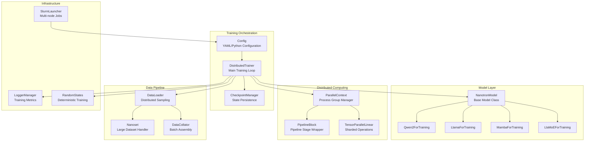
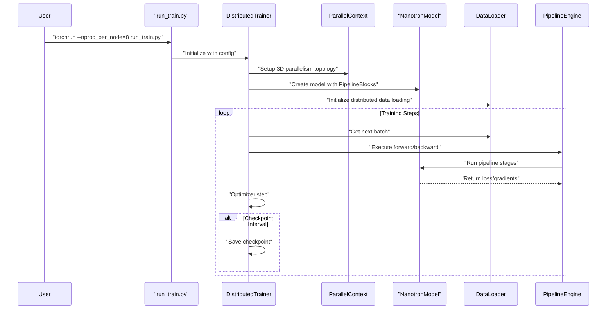
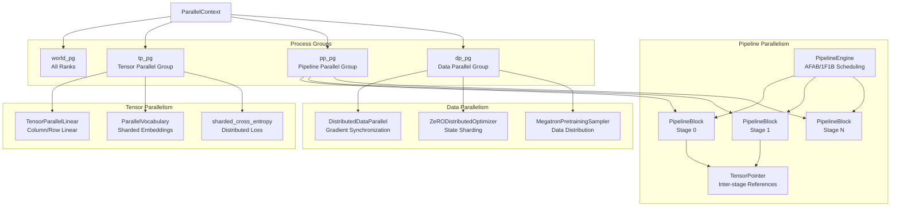
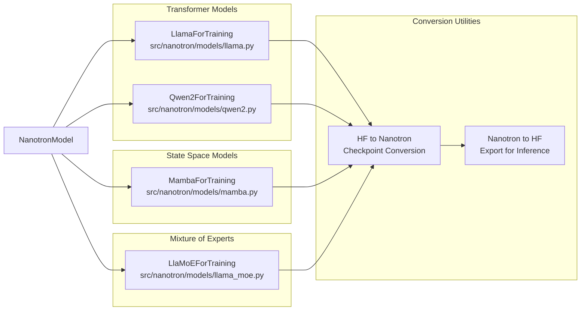

<!-- source: DeepWiki mcp.deepwiki.com · repo huggingface/nanotron · page 1 Overview · fetched 2026-10-26 -->

# Overview

Relevant source files

The following files were used as context for generating this wiki page:

- [README.md](README.md)
- [docs/3d_parallelism.md](docs/3d_parallelism.md)
- [docs/docs.md](docs/docs.md)
- [pyproject.toml](pyproject.toml)
- [src/nanotron/__init__.py](src/nanotron/__init__.py)

## Purpose and Scope

Nanotron is a distributed training framework designed for pretraining large language models with advanced parallelism strategies. It provides a comprehensive system for training transformer-based models across multiple GPUs and nodes, supporting 3D parallelism (data parallel, tensor parallel, and pipeline parallel), multiple model architectures, and performance optimizations for large-scale training workloads.

This document provides a high-level overview of the Nanotron framework architecture, core components, and supported features. For specific implementation details of distributed training strategies, see [Distributed Training](#4). For model architecture specifics, see [Supported Models](#3). For configuration and workflow details, see [Training Configuration](#6).

## Core Architecture

Nanotron is built around a modular architecture that separates concerns between training orchestration, model implementations, data pipelines, and distributed communication. The framework enables efficient scaling from single-GPU training to multi-node clusters with thousands of GPUs.

### System Architecture Overview

**Sources:** [README.md:29-33](), [src/nanotron/__init__.py](), [docs/docs.md:14-35]()

### Training Execution Flow

**Sources:** [README.md:94-98](), [docs/3d_parallelism.md:355-361]()

## Key Components

### DistributedTrainer

The `DistributedTrainer` class serves as the central orchestrator for training execution, managing the training loop, checkpointing, logging, and coordination between all system components. It handles the lifecycle from initialization through training completion.

**Sources:** [docs/3d_parallelism.md:302-326]()

### ParallelContext

The `ParallelContext` manages distributed process groups for 3D parallelism, providing access to tensor parallel (`tp_pg`), pipeline parallel (`pp_pg`), and data parallel (`dp_pg`) process groups. It maintains a 5D rank matrix that maps between local 3D coordinates and global ranks.

**Sources:** [docs/docs.md:14-35]()

### NanotronModel

The `NanotronModel` base class defines the interface for all model implementations, providing methods for parameter initialization, tied parameter management, and pipeline stage assignment. All supported model architectures inherit from this base class.

**Sources:** [docs/3d_parallelism.md:74-76]()

### PipelineBlock

`PipelineBlock` encapsulates computation stages for pipeline parallelism, handling lazy module instantiation, inter-stage communication via `TensorPointer` objects, and device-specific execution. It enables transparent distribution of model layers across multiple devices.

**Sources:** [docs/docs.md:144-191]()

## 3D Parallelism Implementation

**Sources:** [docs/3d_parallelism.md:3-48](), [docs/docs.md:121-143](), [docs/3d_parallelism.md:99-205]()

## Supported Features

Nanotron provides comprehensive support for large-scale distributed training with the following key capabilities:

| Feature Category | Supported Components |
|------------------|---------------------|
| **Parallelism** | 3D Parallelism (DP+TP+PP), Expert Parallelism for MoEs |
| **Pipeline Scheduling** | AFAB (All Forward All Backward), 1F1B (One Forward One Backward) |
| **Model Architectures** | Llama, Qwen2, Mamba (State Space Models), Mixture of Experts |
| **Optimization** | ZeRO-1 Optimizer, FP32 Gradient Accumulation, Custom Optimizers |
| **Memory Management** | Parameter Tying/Sharding, Custom Module Checkpointing |
| **Performance** | FP8 Quantization, Flash Attention, Custom CUDA Kernels |
| **Data Pipeline** | Nanoset (Pre-tokenized), Custom DataLoaders, DoReMi Domain Reweighting |
| **Infrastructure** | SLURM Integration, S3 Checkpointing, Comprehensive Logging |

**Sources:** [README.md:166-185](), [pyproject.toml:16-26]()

### Model Support Matrix

**Sources:** [README.md:144-153]()

## Getting Started

The framework provides multiple entry points for different use cases:

- **Training**: Use `run_train.py` with YAML or Python configuration files
- **Generation**: Use `run_generate.py` for inference from checkpoints  
- **Multi-node**: SLURM integration for cluster-scale training
- **Custom Data**: Extensible data pipeline for custom datasets

For detailed setup instructions, see [Getting Started](#1.1). For training your first model, see [Training Workflow](#6.1).

**Sources:** [README.md:90-105](), [README.md:38-89]()

---

