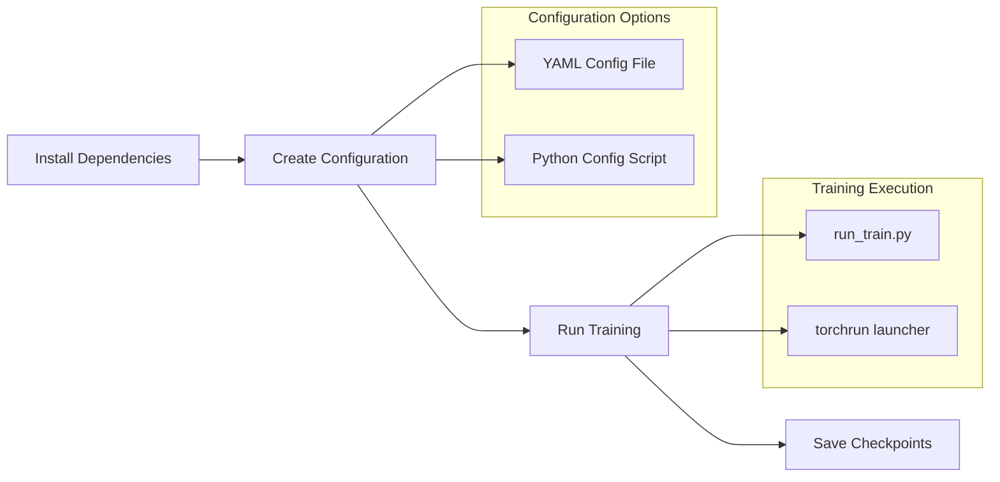
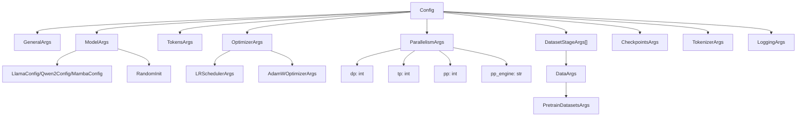
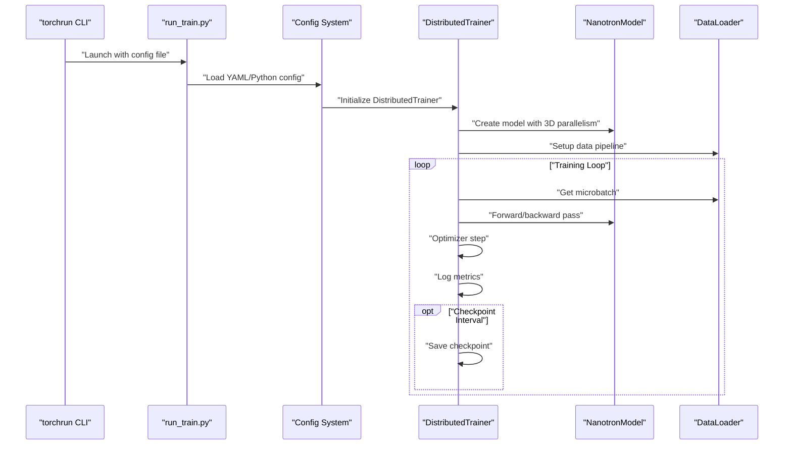

<!-- source: DeepWiki mcp.deepwiki.com · repo huggingface/nanotron · page 1.1 Getting Started · fetched 2026-10-26 -->

# Getting Started

<details>
<summary>Relevant source files</summary>

The following files were used as context for generating this wiki page:

- [README.md](README.md)
- [docs/3d_parallelism.md](docs/3d_parallelism.md)
- [docs/docs.md](docs/docs.md)
- [examples/config_tiny_llama.py](examples/config_tiny_llama.py)
- [examples/config_tiny_llama.yaml](examples/config_tiny_llama.yaml)
- [examples/train_tiny_llama.sh](examples/train_tiny_llama.sh)
- [pyproject.toml](pyproject.toml)
- [src/nanotron/__init__.py](src/nanotron/__init__.py)

</details>


This document provides a quick start guide for training your first model with Nanotron. It covers installation, basic configuration setup, and running a training job. For detailed information about specific model architectures, see [Supported Models](#3). For advanced distributed training strategies, see [Distributed Training](#4).

## Overview

Nanotron is a distributed training framework for large language models that supports 3D parallelism (tensor, pipeline, and data parallelism). The getting started workflow involves three main steps: installation, configuration, and training execution.

### Training Workflow



Sources: [README.md:90-105](), [examples/config_tiny_llama.py:1-128](), [examples/config_tiny_llama.yaml:1-93]()

## Installation

### Environment Setup

Create a Python virtual environment using `uv`:

```bash
uv venv nanotron --python 3.11 && source nanotron/bin/activate && uv pip install --upgrade pip
```

For Hugging Face cluster users, add `export UV_LINK_MODE=copy` to your `.bashrc` to suppress cache warnings.

### Core Dependencies

Install PyTorch with CUDA support:

```bash
uv pip install torch --index-url https://download.pytorch.org/whl/cu124
```

Install Nanotron core dependencies:

```bash
uv pip install -e .
```

### Optional Dependencies

For example scripts and advanced features:

```bash
uv pip install datasets transformers datatrove[io] numba wandb
# Fused kernels for performance optimization
uv pip install ninja triton "flash-attn>=2.5.0" --no-build-isolation
```

### Authentication Setup

Configure access to Hugging Face Hub and Weights & Biases:

```bash
huggingface-cli login
wandb login
```

Ensure Git LFS is installed for model/dataset handling:

```bash
git-lfs --version
# If not installed: sudo apt-get install git-lfs
```

Sources: [README.md:38-88](), [pyproject.toml:16-26](), [pyproject.toml:37-62]()

## Configuration System

Nanotron uses a hierarchical configuration system built around the `Config` class. Training parameters can be specified via YAML files or Python scripts.

### Configuration Architecture



Sources: [src/nanotron/config/__init__.py](), [examples/config_tiny_llama.py:4-21]()

### Basic Configuration Example

Create a simple training configuration using Python:

```python
# Based on examples/config_tiny_llama.py
from nanotron.config import (
    Config, GeneralArgs, ModelArgs, LlamaConfig, 
    ParallelismArgs, TokensArgs, OptimizerArgs
)

# Define model architecture
model_config = LlamaConfig(
    hidden_size=2048,
    num_hidden_layers=28, 
    num_attention_heads=16,
    vocab_size=128256,
    max_position_embeddings=128256
)

# Configure 3D parallelism
parallelism = ParallelismArgs(
    dp=4,  # Data parallel size
    pp=1,  # Pipeline parallel size  
    tp=2,  # Tensor parallel size
    pp_engine="1f1b"
)

# Set training parameters
tokens = TokensArgs(
    sequence_length=4096,
    train_steps=2000,
    micro_batch_size=3
)
```

Sources: [examples/config_tiny_llama.py:24-84](), [examples/config_tiny_llama.yaml:27-92]()

### YAML Configuration

Alternatively, use YAML for configuration:

```yaml
# Key sections from examples/config_tiny_llama.yaml
model:
  model_config:
    hidden_size: 2048
    num_hidden_layers: 28
    num_attention_heads: 16
    vocab_size: 128256

parallelism:
  dp: 4
  pp: 1 
  tp: 2
  pp_engine: 1f1b

tokens:
  sequence_length: 4096
  train_steps: 2000
  micro_batch_size: 3
```

Sources: [examples/config_tiny_llama.yaml:27-92]()

## Running Your First Training Job

### Quick Start Training

Train a tiny Llama model on a single node with 8 H100s:

```bash
CUDA_DEVICE_MAX_CONNECTIONS=1 torchrun --nproc_per_node=8 run_train.py --config-file examples/config_tiny_llama.yaml
```

This command:
- Sets `CUDA_DEVICE_MAX_CONNECTIONS=1` for optimal performance
- Uses `torchrun` for distributed execution across 8 GPUs
- Executes `run_train.py` with the provided configuration file

The training process will:
1. Initialize the distributed environment
2. Load the model configuration and create the model
3. Set up 3D parallelism according to config specifications
4. Begin training with automatic checkpointing

Sources: [README.md:94-105](), [examples/train_tiny_llama.sh:15-24]()

### Training Execution Flow



Sources: [README.md:94-105](), [docs/docs.md:355-361]()

### Generated Outputs

Training produces several outputs:

| Output Type | Location | Description |
|-------------|----------|-------------|
| Checkpoints | `checkpoints/` | Model weights, optimizer state, metadata |
| Logs | Console/wandb | Training metrics, loss curves, performance stats |
| Config | `examples/config_tiny_llama.yaml` | Generated/used configuration file |

The model is automatically saved in the `checkpoints` directory as specified in the configuration.

Sources: [examples/config_tiny_llama.yaml:1-6](), [README.md:100-101]()

## Generation and Inference

After training, run generation from your checkpoint:

```bash
torchrun --nproc_per_node=1 run_generate.py --ckpt-path checkpoints/{checkpoint_number}/ --tp 1 --pp 1
```

Scale generation performance by adjusting parallelism parameters:
- Increase `--tp` (tensor parallel) for multiple GPU acceleration
- Increase `--pp` (pipeline parallel) for very large models

Sources: [README.md:107-114]()

## Debugging Setup

For development and debugging with VSCode, configure `launch.json`:

```json
{
    "name": "run_train.py",
    "type": "python", 
    "request": "launch",
    "program": "torchrun",
    "args": [
        "--nproc_per_node=2",
        "run_train.py", 
        "--config-file=examples/config_tiny_llama.yaml"
    ],
    "env": {
        "CUDA_DEVICE_MAX_CONNECTIONS": "1",
        "WANDB_MODE": "disabled"
    }
}
```

Sources: [README.md:115-140]()

## Next Steps

Once you have successfully run your first training job, explore:

- **Model Architectures**: See [Supported Models](#3) for Llama, Qwen2, Mamba, and MoE implementations
- **Advanced Parallelism**: See [3D Parallelism](#4.2) for scaling to larger models and clusters  
- **Custom Data**: See [Data Pipeline](#5) for using your own datasets
- **Multi-Node Training**: See [Multi-Node Training](#4.5) for SLURM-based cluster training
- **Example Configurations**: Explore the `/examples` directory for specialized use cases

| Example Type | Description | Location |
|--------------|-------------|----------|
| Custom DataLoader | Plug custom data pipeline | `/examples/custom-dataloader` |
| Datatrove Integration | Use datatrove library | `/examples/datatrove` |
| DoReMi Training | Domain reweighting | `/examples/doremi` |
| Mamba Models | State space models | `/examples/mamba` |
| Mixture of Experts | MoE architecture | `/examples/moe` |

Sources: [README.md:141-154]()

---

