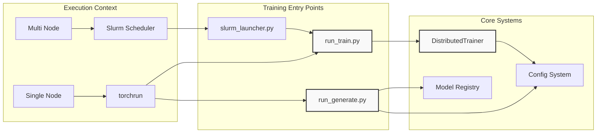

<!-- source: DeepWiki mcp.deepwiki.com · repo huggingface/nanotron · page 1.2 Project Structure · fetched 2026-10-26 -->

# Project Structure

<details>
<summary>Relevant source files</summary>

The following files were used as context for generating this wiki page:

- [README.md](README.md)
- [docs/3d_parallelism.md](docs/3d_parallelism.md)
- [docs/docs.md](docs/docs.md)
- [pyproject.toml](pyproject.toml)
- [src/nanotron/__init__.py](src/nanotron/__init__.py)

</details>


This document provides an overview of the Nanotron repository structure, explaining the organization of key directories, entry points, and configuration files. For information about specific architectural components, see [Core Architecture](#2). For details about model implementations, see [Supported Models](#3).

## Repository Overview

Nanotron follows a standard Python package structure with the core library located under `src/nanotron/` and supporting materials organized in dedicated directories. The repository is designed to support distributed training workflows while maintaining clear separation between core functionality, examples, and generated artifacts.

```mermaid
graph TB
    subgraph "Repository Root"
        ROOT["/"]
        README["README.md"]
        PYPROJECT["pyproject.toml"]
        LICENSE["LICENSE"]
        GITIGNORE[".gitignore"]
    end
    
    subgraph "Entry Points"
        RUN_TRAIN["run_train.py"]
        RUN_GEN["run_generate.py"]  
        SLURM["slurm_launcher.py"]
    end
    
    subgraph "Core Package"
        SRC_DIR["src/"]
        NANOTRON_PKG["src/nanotron/"]
        INIT["src/nanotron/__init__.py"]
    end
    
    subgraph "Configuration & Examples" 
        EXAMPLES["examples/"]
        CONFIG_YAML["examples/config_*.yaml"]
        CONFIG_PY["examples/config_*.py"]
    end
    
    subgraph "Documentation & Scripts"
        DOCS["docs/"]
        SCRIPTS["scripts/"]
        LOG_SCRIPT["scripts/log_lighteval_to_wandb.py"]
    end
    
    subgraph "Testing"
        TESTS["tests/"]
    end
    
    subgraph "Generated/Runtime (gitignored)"
        CHECKPOINTS["checkpoints/"]
        WANDB["wandb/"]
        LOGS["logs/"]
        CACHE[".nanoset_cache/"]
    end
    
    ROOT --> README
    ROOT --> PYPROJECT
    ROOT --> LICENSE
    ROOT --> GITIGNORE
    ROOT --> RUN_TRAIN
    ROOT --> RUN_GEN
    ROOT --> SLURM
    ROOT --> SRC_DIR
    ROOT --> EXAMPLES
    ROOT --> DOCS
    ROOT --> SCRIPTS
    ROOT --> TESTS
    
    SRC_DIR --> NANOTRON_PKG
    NANOTRON_PKG --> INIT
    EXAMPLES --> CONFIG_YAML
    EXAMPLES --> CONFIG_PY
    SCRIPTS --> LOG_SCRIPT
    
    ROOT --> CHECKPOINTS
    ROOT --> WANDB
    ROOT --> LOGS
    ROOT --> CACHE
    
    style NANOTRON_PKG fill:#f9f9f9,stroke:#333,stroke-width:2px
    style RUN_TRAIN fill:#f9f9f9,stroke:#333,stroke-width:2px
    style EXAMPLES fill:#f9f9f9,stroke:#333,stroke-width:2px
```



**Sources:** [README.md:1-188](), [pyproject.toml:1-70](), [.gitignore:1-173](), [src/nanotron/__init__.py:1-2]()

## Core Package Structure

The main Nanotron library is organized under `src/nanotron/` with the package version defined in [src/nanotron/__init__.py:1]() as version `"0.4"`. The codebase is structured around major functional systems that implement distributed training capabilities.

### System-to-Code Mapping

```mermaid
graph TB
    subgraph "Core Training System"
        DT["DistributedTrainer"]
        Config["Config Classes"]
        NM["NanotronModel"]
        Checkpoint["Checkpoint System"]
    end
    
    subgraph "src/nanotron/ Structure"
        TRAINER["trainer/"]
        CONFIG_DIR["config/"]
        MODELS["models/"]
        SERIALIZE["serialize/"]
        PARALLEL["parallel/"]
        DATA["data/"]
        OPTIM["optim/"]
        LOGGING["logging/"]
    end
    
    subgraph "Model Implementations"
        LLAMA["LlamaForTraining"]
        QWEN2["Qwen2ForTraining"] 
        MAMBA["MambaForTraining"]
        MOE["LlaMoEForTraining"]
    end
    
    subgraph "Distributed Systems"
        PC["ParallelContext"]
        TP["TensorParallelLinear"]
        PP["PipelineBlock"]
        DP["DistributedDataParallel"]
    end
    
    DT --> TRAINER
    Config --> CONFIG_DIR
    NM --> MODELS
    Checkpoint --> SERIALIZE
    
    LLAMA --> MODELS
    QWEN2 --> MODELS
    MAMBA --> MODELS
    MOE --> MODELS
    
    PC --> PARALLEL
    TP --> PARALLEL
    PP --> PARALLEL
    DP --> PARALLEL
    
    TRAINER --> OPTIM
    TRAINER --> LOGGING
    TRAINER --> DATA
    
    style TRAINER fill:#f9f9f9,stroke:#333,stroke-width:2px
    style MODELS fill:#f9f9f9,stroke:#333,stroke-width:2px
    style PARALLEL fill:#f9f9f9,stroke:#333,stroke-width:2px
    style CONFIG_DIR fill:#f9f9f9,stroke:#333,stroke-width:2px
```



### Directory Structure and Components

| Directory | Core Classes | Purpose |
|-----------|-------------|---------|
| `trainer/` | `DistributedTrainer` | Main training orchestration and lifecycle management |
| `config/` | `Config`, `ModelConfig`, `ParallelismArgs` | Type-safe configuration system with YAML support |
| `models/` | `NanotronModel`, `LlamaForTraining`, `Qwen2ForTraining` | Model architectures and implementations |
| `parallel/` | `ParallelContext`, `TensorParallelLinear`, `PipelineBlock` | 3D parallelism implementation |
| `data/` | `Nanoset`, `NanosetDataloder`, `build_nanoset_dataloader` | Large-scale dataset handling and loading |
| `serialize/` | `Serializer`, `save_weights`, `load_weights` | Checkpoint management and distributed serialization |
| `optim/` | `NamedOptimizer`, `ZeroDistributedOptimizer` | Custom optimizers and ZeRO-1 implementation |
| `logging/` | `LogItem`, `HuggingFaceLogger`, `TensorBoardLogger` | Unified logging interface |

The package structure is configured in [pyproject.toml:27-28]() where the build system looks for packages under the `src/` directory.

**Sources:** [src/nanotron/__init__.py:1-2](), [pyproject.toml:27-28]()

## Entry Points and Execution

Nanotron provides three main entry points located at the repository root, each serving different aspects of the training workflow:



### Training Entry Point
`run_train.py` is the primary entry point that instantiates `DistributedTrainer` and orchestrates the full training workflow. As shown in [README.md:97](), it's designed to work with PyTorch's distributed launcher:
```bash
CUDA_DEVICE_MAX_CONNECTIONS=1 torchrun --nproc_per_node=8 run_train.py --config-file examples/config_tiny_llama.yaml
```

The script handles:
- Configuration loading via the `Config` system
- `ParallelContext` initialization for distributed setup
- Model instantiation using the appropriate `*ForTraining` classes
- Training loop execution through `DistributedTrainer.train()`

### Generation Entry Point  
`run_generate.py` handles model inference and text generation from saved checkpoints using the serialization system. The README shows it's used as [README.md:110]():
```bash
torchrun --nproc_per_node=1 run_generate.py --ckpt-path checkpoints/{checkpoint_number}/ --tp 1 --pp 1
```

This script leverages:
- Checkpoint loading via `load_weights()` functions
- Model reconstruction with specified tensor/pipeline parallel configurations
- Generation utilities for text sampling and inference

### Multi-Node Launcher
`slurm_launcher.py` provides integration with Slurm schedulers for multi-node distributed training, generating SLURM job scripts that wrap the main training script with cluster-specific configuration and environment setup.

**Sources:** [README.md:94-114]()

## Configuration System

Nanotron supports both YAML and Python-based configuration systems, with examples provided in the `examples/` directory. The configuration system is designed to handle complex distributed training setups with multiple parallelism strategies.

### Configuration Files
The examples directory contains various configuration templates:

| Configuration Type | Purpose | Example Files |
|-------------------|---------|---------------|
| YAML configs | Declarative training setup | `config_tiny_llama.yaml` |
| Python configs | Programmatic configuration | `config_tiny_llama.py` |
| S3 integration | Automatic checkpoint upload | `config_tiny_llama_with_s3_upload.yaml` |

As noted in [README.md:103](), Python configuration files can be used to generate YAML configs programmatically, providing flexibility for complex setups.

### Example Categories
The examples directory is organized by use case, as shown in the README table [README.md:144-152]():

- `custom-dataloader`: Custom data loading integration
- `datatrove`: Data preprocessing with datatrove library  
- `doremi`: DoReMi domain reweighting
- `mamba`: Mamba model training
- `moe`: Mixture of Experts training
- `mup`: Spectral μTransfer scaling

**Sources:** [README.md:103](), [README.md:144-152]()

## Dependency Management

The project uses modern Python packaging with dependencies organized by feature set in [pyproject.toml:16-61]():

### Core Dependencies
- `torch>=1.13.1`: PyTorch framework
- `datasets`: Dataset loading and processing
- `safetensors`: Safe tensor serialization
- `dacite`: Configuration parsing
- `tqdm`: Progress bars

### Optional Dependencies
- `fast-modeling`: Flash attention kernels (`flash-attn>=2.5.0`)
- `nanosets`: Data preprocessing (`datatrove`, `transformers`, `numba`)
- `s3`: Cloud storage integration (`boto3`, `s3fs`, `s5cmd`)
- `dev`: Development tools (`pre-commit`, `pylint`)
- `test`: Testing framework (`pytest`, `pytest-xdist`)

**Sources:** [pyproject.toml:16-61]()

## Generated and Runtime Directories

Several directories are created during training and operation, as specified in [.gitignore:164-172]():

| Directory | Purpose | Persistence |
|-----------|---------|-------------|
| `checkpoints/` | Model checkpoints and training state | Persistent |
| `wandb/` | Weights & Biases logging data | Local cache |
| `logs/` | Training logs and metrics | Local cache |
| `.nanoset_cache/` | Cached dataset indices | Cache |
| `eval_results/` | Evaluation results from lighteval | Results |
| `tb_logs/` | TensorBoard logs | Local cache |

These directories are excluded from version control but represent important runtime artifacts for training workflows.

**Sources:** [.gitignore:164-172]()

## Utility Scripts

The `scripts/` directory contains utility tools for training workflows. A key example is [scripts/log_lighteval_to_wandb.py:1-112](), which processes evaluation results and logs them to Weights & Biases. This script demonstrates the integration between Nanotron's evaluation system and external monitoring tools.

The script expects evaluation results in a structured format with directories named by training steps (e.g., `5000/`, `10000/`) containing JSON results files, as documented in [scripts/log_lighteval_to_wandb.py:7-12]().

**Sources:** [scripts/log_lighteval_to_wandb.py:1-112]()

---

