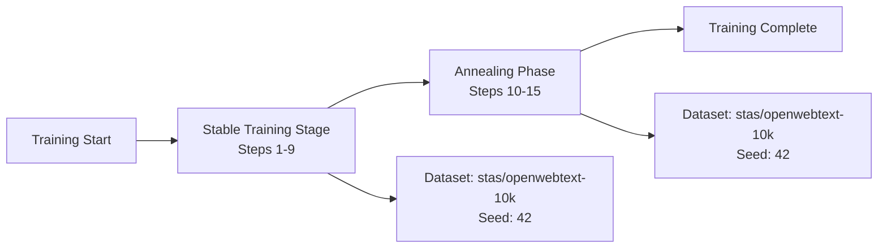
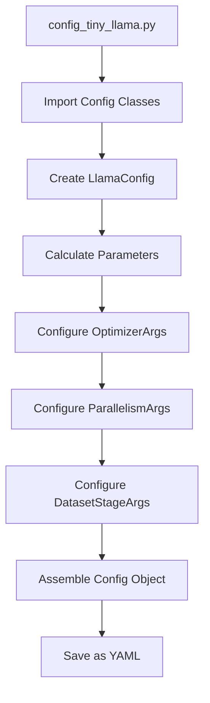
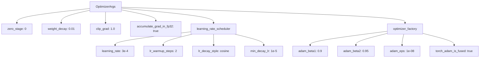
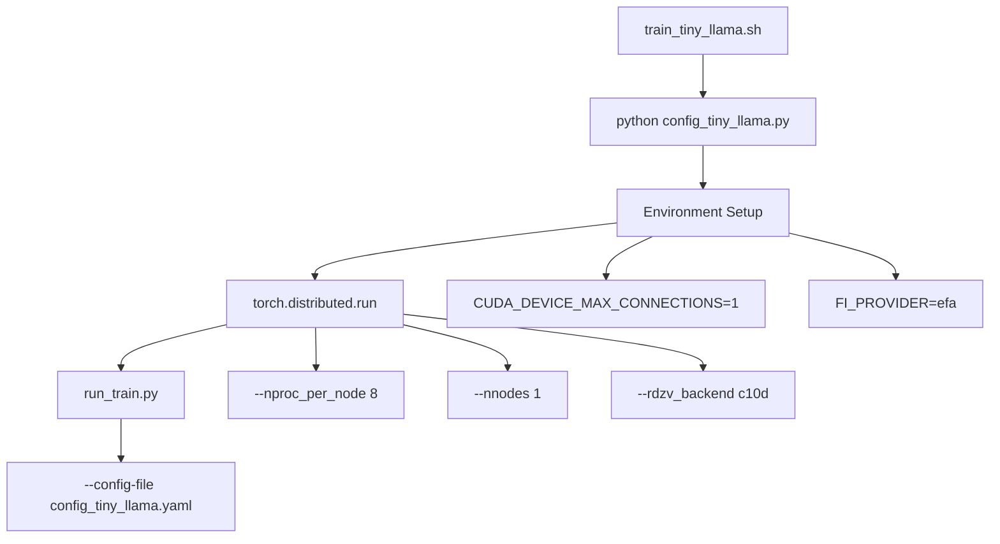

<!-- source: DeepWiki mcp.deepwiki.com · repo huggingface/nanotron · page 10 Examples and Configuration Templates · fetched 2026-10-26 -->

# Examples and Configuration Templates

<details>
<summary>Relevant source files</summary>

The following files were used as context for generating this wiki page:

- [examples/config_tiny_llama.py](examples/config_tiny_llama.py)
- [examples/config_tiny_llama.yaml](examples/config_tiny_llama.yaml)
- [examples/train_tiny_llama.sh](examples/train_tiny_llama.sh)

</details>


This document provides practical examples and configuration templates for training models with nanotron. It covers the complete workflow from configuration generation to training execution, with ready-to-use examples that demonstrate key features and best practices.

For detailed information about the configuration system internals, see [Configuration System](#2.2). For model-specific configuration details, see [Supported Models](#3).

## Purpose and Scope

This page focuses on practical, executable examples that demonstrate how to:
- Create and structure configuration files for different training scenarios
- Generate configurations programmatically using Python
- Execute training runs with proper distributed setup
- Configure key training parameters for optimal performance

The examples use the tiny Llama model as a reference implementation that can be easily modified for other architectures and training scenarios.

## Configuration File Structure Overview

Nanotron uses a hierarchical configuration structure that can be defined in YAML format or generated programmatically in Python. The configuration encompasses all aspects of distributed training.

**Configuration Structure Diagram**

```mermaid
graph TB
    Config["Config (Root)"]
    
    Config --> General["general: GeneralArgs"]
    Config --> Model["model: ModelArgs"]
    Config --> Tokens["tokens: TokensArgs"]
    Config --> Optimizer["optimizer: OptimizerArgs"]
    Config --> Parallelism["parallelism: ParallelismArgs"]
    Config --> DataStages["data_stages: List[DatasetStageArgs]"]
    Config --> Checkpoints["checkpoints: CheckpointsArgs"]
    Config --> Logging["logging: LoggingArgs"]
    Config --> Tokenizer["tokenizer: TokenizerArgs"]
    Config --> Profiler["profiler: ProfilerArgs"]
    
    Model --> ModelConfig["model_config: LlamaConfig"]
    Model --> InitMethod["init_method: RandomInit"]
    Model --> DType["dtype: bfloat16"]
    
    Optimizer --> LRScheduler["learning_rate_scheduler: LRSchedulerArgs"]
    Optimizer --> OptimizerFactory["optimizer_factory: AdamWOptimizerArgs"]
    Optimizer --> ZeroStage["zero_stage: int"]
    
    Parallelism --> DP["dp: int"]
    Parallelism --> PP["pp: int"]  
    Parallelism --> TP["tp: int"]
    Parallelism --> PPEngine["pp_engine: str"]
    
    DataStages --> DataStage1["DatasetStageArgs"]
    DataStages --> DataStage2["DatasetStageArgs"]
    DataStage1 --> DataArgs1["data: DataArgs"]
    DataStage2 --> DataArgs2["data: DataArgs"]
```


Sources: [examples/config_tiny_llama.yaml:1-93](), [examples/config_tiny_llama.py:4-21]()

## Tiny Llama Example Walkthrough

The tiny Llama example demonstrates a complete training configuration with minimal parameters suitable for development and testing. This example showcases multi-stage training and 3D parallelism configuration.

### Model Architecture Configuration

The tiny Llama model uses a compact architecture for demonstration purposes:

| Parameter | Value | Description |
|-----------|-------|-------------|
| `hidden_size` | 16 | Transformer hidden dimension |
| `num_hidden_layers` | 2 | Number of transformer layers |
| `num_attention_heads` | 4 | Multi-head attention heads |
| `intermediate_size` | 64 | Feed-forward network size |
| `vocab_size` | 256 | Vocabulary size |
| `max_position_embeddings` | 256 | Maximum sequence length |

**Python Model Configuration**
```python
model_config = LlamaConfig(
    bos_token_id=1,
    eos_token_id=2,
    hidden_act="silu",
    hidden_size=16,
    intermediate_size=64,
    max_position_embeddings=256,
    num_attention_heads=4,
    num_hidden_layers=2,
    vocab_size=256,
)
```

Sources: [examples/config_tiny_llama.py:24-42]()

### Parallelism Configuration

The example demonstrates 3D parallelism with conservative settings suitable for development:

| Parallelism Type | Value | Purpose |
|-----------------|--------|---------|
| Data Parallel (`dp`) | 2 | Distribute data across 2 replicas |
| Pipeline Parallel (`pp`) | 2 | Split model across 2 pipeline stages |
| Tensor Parallel (`tp`) | 2 | Shard tensors across 2 devices |
| PP Engine | `1f1b` | Use 1F1B pipeline scheduling |
| TP Mode | `REDUCE_SCATTER` | Tensor parallel communication strategy |

Sources: [examples/config_tiny_llama.py:75-82](), [examples/config_tiny_llama.yaml:71-78]()

### Multi-Stage Data Configuration

The example demonstrates curriculum learning with two training stages:

**Training Stages Flow**


Sources: [examples/config_tiny_llama.py:86-103]()

## Configuration Generation Methods

Nanotron supports two primary methods for creating configurations: YAML files and Python generation scripts.

### YAML Configuration Files

Direct YAML configuration provides a declarative approach suitable for production deployments and CI/CD pipelines. The YAML structure mirrors the Python configuration classes:

```yaml
general:
  project: debug
  run: tiny_llama_%date_%jobid
  seed: 42

model:
  dtype: bfloat16
  model_config:
    hidden_size: 2048
    num_hidden_layers: 28
    num_attention_heads: 16
```

Sources: [examples/config_tiny_llama.yaml:14-51]()

### Python Configuration Generation

Python scripts enable programmatic configuration generation with parameter calculations and validation:

**Configuration Generation Workflow**


The Python approach enables parameter validation and automatic calculations:

```python
num_params = human_format(
    model_config.vocab_size * model_config.hidden_size * 2
    + model_config.num_hidden_layers * (
        3 * model_config.hidden_size * model_config.intermediate_size
        + 4 * model_config.hidden_size * model_config.hidden_size
    )
)
```

Sources: [examples/config_tiny_llama.py:44-51](), [examples/config_tiny_llama.py:121-128]()

## Key Configuration Sections

### Optimization Configuration

The optimizer configuration combines learning rate scheduling with gradient management:

| Component | Configuration | Purpose |
|-----------|---------------|---------|
| `OptimizerArgs` | Main optimizer container | Orchestrates optimization strategy |
| `LRSchedulerArgs` | Learning rate scheduling | Implements warmup and decay |
| `AdamWOptimizerArgs` | AdamW-specific parameters | Configures AdamW optimizer |
| `zero_stage` | ZeRO optimization level | Memory optimization strategy |

**Optimizer Configuration Structure**


Sources: [examples/config_tiny_llama.py:57-73](), [examples/config_tiny_llama.yaml:52-70]()

### Token and Batch Configuration

Training token management balances memory efficiency with training throughput:

| Parameter | Value | Impact |
|-----------|--------|--------|
| `sequence_length` | 4096 | Maximum sequence length per sample |
| `micro_batch_size` | 3 | Batch size per GPU before accumulation |
| `batch_accumulation_per_replica` | 1 | Gradient accumulation steps |
| `train_steps` | 2000 | Total training steps |

Sources: [examples/config_tiny_llama.yaml:85-91](), [examples/config_tiny_llama.py:84]()

### Checkpointing Configuration

Checkpoint management ensures training persistence and recovery:

```yaml
checkpoints:
  checkpoint_interval: 1000
  checkpoints_path: checkpoints
  checkpoints_path_is_shared_file_system: false
  resume_checkpoint_path: null
  save_initial_state: false
```

Sources: [examples/config_tiny_llama.yaml:1-6]()

## Training Execution Examples

### Shell Script Execution

The training shell script demonstrates the complete execution workflow from configuration generation to distributed training:

**Training Execution Flow**


### Distributed Training Parameters

The `torch.distributed.run` command configures the distributed training environment:

| Parameter | Value | Purpose |
|-----------|--------|---------|
| `--nproc_per_node` | 8 | Number of processes per node |
| `--nnodes` | 1 | Number of nodes in the cluster |
| `--rdzv_backend` | c10d | Rendezvous backend for coordination |
| `--max_restarts` | 0 | Maximum restart attempts |
| `--tee` | 3 | Output redirection level |

Sources: [examples/train_tiny_llama.sh:1-25]()

### Environment Configuration

Critical environment variables for optimal training performance:

```bash
export CUDA_DEVICE_MAX_CONNECTIONS=1
export FI_PROVIDER="efa"
```

These settings optimize CUDA device management and network fabric communication for distributed training scenarios.

Sources: [examples/train_tiny_llama.sh:15-16]()