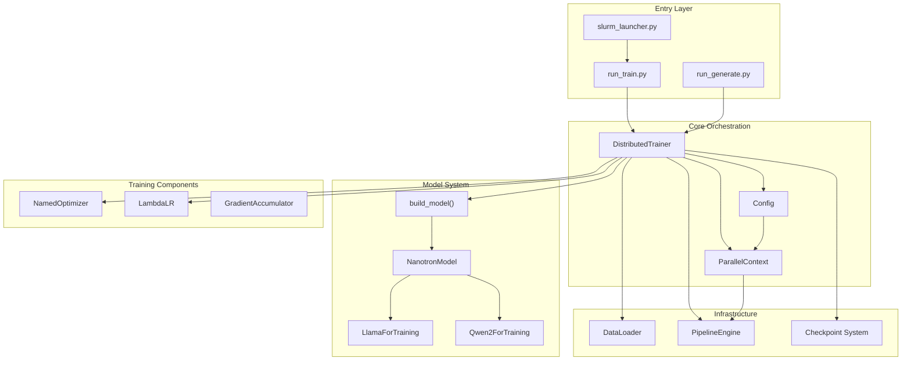
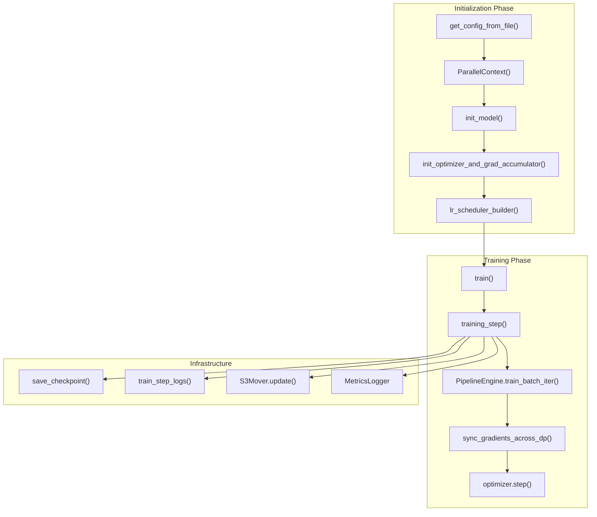
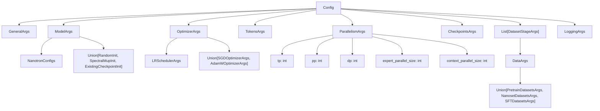
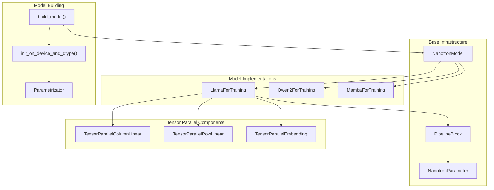
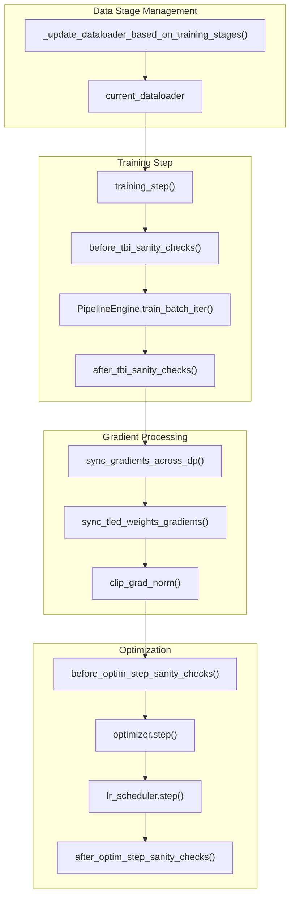

<!-- source: DeepWiki mcp.deepwiki.com · repo huggingface/nanotron · page 2 Core Architecture · fetched 2026-10-26 -->

# Core Architecture

Relevant source files

The following files were used as context for generating this wiki page:

- [src/nanotron/config/config.py](src/nanotron/config/config.py)
- [src/nanotron/helpers.py](src/nanotron/helpers.py)
- [src/nanotron/models/base.py](src/nanotron/models/base.py)
- [src/nanotron/models/llama.py](src/nanotron/models/llama.py)
- [src/nanotron/s3_checkpoints/s3_mover.py](src/nanotron/s3_checkpoints/s3_mover.py)
- [src/nanotron/serialize/main.py](src/nanotron/serialize/main.py)
- [src/nanotron/trainer.py](src/nanotron/trainer.py)

This page provides an overview of Nanotron's core architectural components and design patterns. It covers the main orchestrating classes, system boundaries, and how the major subsystems integrate to enable large-scale distributed training of language models.

For details about specific model implementations, see [Supported Models](#3). For distributed training strategies, see [Distributed Training](#4). For data pipeline implementation, see [Data Pipeline](#5).

## System Overview

Nanotron is built around a modular architecture that separates concerns into distinct subsystems while maintaining tight integration for distributed training. The core design follows a centralized orchestration pattern with the `DistributedTrainer` class serving as the main coordinator.

### High-Level Architecture

**Sources:** [src/nanotron/trainer.py:132-148](), [src/nanotron/config/config.py:438-454](), [src/nanotron/models/base.py:186-239]()

## Central Orchestrator: DistributedTrainer

The `DistributedTrainer` class serves as the primary orchestrator that coordinates all training subsystems. It manages the complete training lifecycle from initialization through execution to checkpointing.

### DistributedTrainer Architecture

The `DistributedTrainer` constructor performs comprehensive system initialization including process group setup, model building, optimizer configuration, and learning rate scheduler creation. Key responsibilities include:

- **Configuration Management**: Loads and validates training configurations from YAML or Python files
- **Process Group Coordination**: Initializes `ParallelContext` for distributed communication
- **Model Instantiation**: Coordinates model building across pipeline parallel ranks
- **Training State Management**: Manages iteration counting, metadata tracking, and resume logic
- **Checkpointing**: Orchestrates model, optimizer, and scheduler state persistence

**Sources:** [src/nanotron/trainer.py:132-297](), [src/nanotron/trainer.py:530-612]()

## Configuration System Architecture

Nanotron uses a hierarchical configuration system built around dataclasses that provide type safety and validation. The `Config` class serves as the root configuration container.

### Configuration Hierarchy

The configuration system enforces constraints across subsystems through post-initialization validation. For example, it ensures attention heads are divisible by tensor parallel size and validates pipeline parallel stage consistency.

**Sources:** [src/nanotron/config/config.py:438-597](), [src/nanotron/config/config.py:599-675]()

## Model Architecture System

Nanotron's model system is built around the abstract `NanotronModel` base class, which provides common functionality for distributed training while allowing concrete implementations for different architectures.

### Model System Components

Key architectural features:

- **Pipeline Parallel Integration**: Models are automatically partitioned across pipeline parallel ranks using `PipelineBlock` components
- **Tensor Parallel Support**: Built-in support for tensor parallel layers that handle sharding and communication
- **Parameter Management**: Custom `NanotronParameter` class supports advanced features like parameter tying
- **Device/Dtype Management**: Centralized device and dtype initialization through context managers

**Sources:** [src/nanotron/models/base.py:23-133](), [src/nanotron/models/base.py:186-239](), [src/nanotron/models/llama.py:1-50]()

## Training Pipeline Flow

The training pipeline implements a sophisticated execution flow that coordinates data loading, forward/backward passes, gradient synchronization, and optimization across distributed processes.

### Training Execution Flow

The training pipeline supports:

- **Multi-Stage Data Loading**: Dynamic dataloader switching based on training progress
- **Gradient Accumulation**: Micro-batch accumulation with optional FP32 gradient storage
- **Advanced Gradient Synchronization**: Support for tied parameters and various parallelism modes
- **Comprehensive Validation**: Extensive sanity checks before and after critical operations

**Sources:** [src/nanotron/trainer.py:613-735](), [src/nanotron/trainer.py:432-529](), [src/nanotron/helpers.py:316-465]()

## Parametrization and Initialization

Nanotron supports multiple parameter initialization strategies through a pluggable parametrization system. This enables advanced techniques like spectral µTransfer while maintaining compatibility with standard initialization.

### Parametrization Architecture

| Component | Standard Parametrization | Spectral µTransfer |
|-----------|-------------------------|-------------------|
| Linear Layers | `std` for all weights | Fan-in/fan-out dependent scaling |
| Learning Rates | Global learning rate | Per-parameter custom rates |
| Initialization | `StandardParametrizator` | `SpectralMupParametrizator` |
| LR Mapping | `LearningRateForSP` | `LearningRateForSpectralMup` |

The parametrization system integrates with the optimizer builder to create parameter groups with custom learning rates and weight decay settings. This enables sophisticated training regimes that scale effectively to large model sizes.

**Sources:** [src/nanotron/scaling/parametrization.py:18-222](), [src/nanotron/helpers.py:241-313]()

## Integration Points

The core architecture maintains clean separation of concerns while providing integration points for extensibility:

- **Model Registration**: New model architectures register through `CONFIG_TO_MODEL_CLASS` mapping
- **Optimizer Integration**: Pluggable optimizer factories support different optimization algorithms
- **Parallelism Modes**: Configurable parallelism strategies through `ParallelismArgs`
- **Checkpoint Compatibility**: Standardized serialization format across model types
- **Configuration Validation**: Cross-system constraint validation in config post-init

This modular design enables researchers to extend individual components without requiring changes to the core orchestration logic.

**Sources:** [src/nanotron/trainer.py:112-116](), [src/nanotron/config/config.py:460-545]()

---

