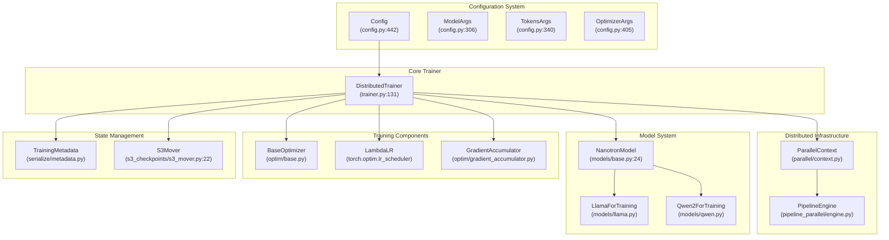
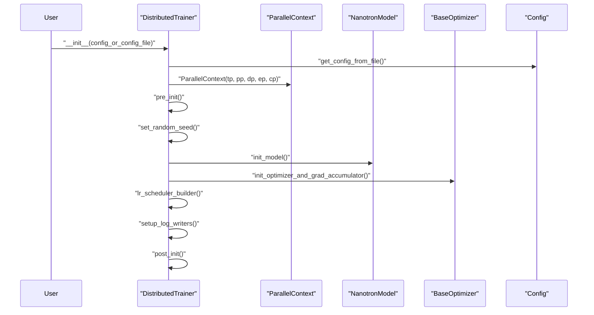
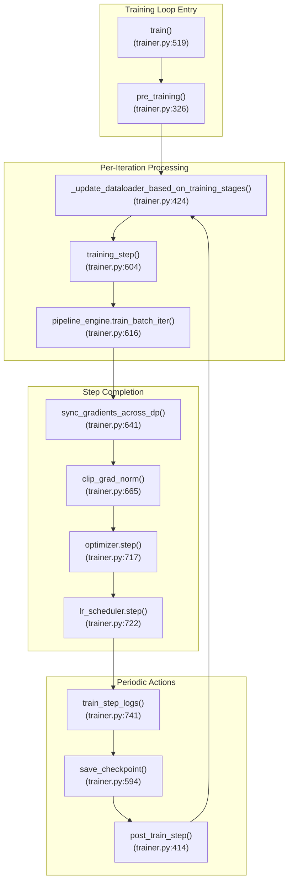
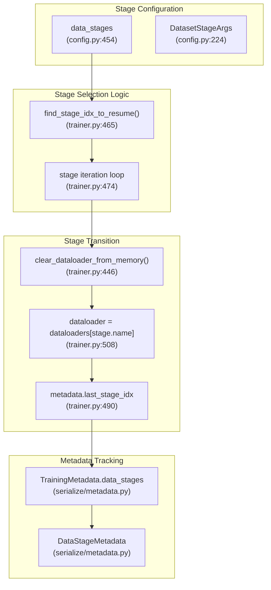
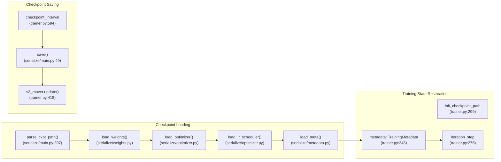
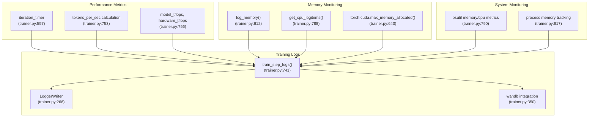

<!-- source: DeepWiki mcp.deepwiki.com · repo huggingface/nanotron · page 2.1 Distributed Trainer · fetched 2026-10-26 -->

# Distributed Trainer

Relevant source files

The following files were used as context for generating this wiki page:

- [src/nanotron/config/config.py](src/nanotron/config/config.py)
- [src/nanotron/helpers.py](src/nanotron/helpers.py)
- [src/nanotron/models/base.py](src/nanotron/models/base.py)
- [src/nanotron/models/llama.py](src/nanotron/models/llama.py)
- [src/nanotron/s3_checkpoints/s3_mover.py](src/nanotron/s3_checkpoints/s3_mover.py)
- [src/nanotron/serialize/main.py](src/nanotron/serialize/main.py)
- [src/nanotron/trainer.py](src/nanotron/trainer.py)

The `DistributedTrainer` class serves as the central orchestrator for distributed training in Nanotron. It coordinates all aspects of the training process including model initialization, optimizer setup, data loading, the training loop execution, and checkpoint management across distributed environments with 3D parallelism support.

For information about the underlying parallel computation strategies, see [3D Parallelism](#4.2). For details about data pipeline configuration and management, see [Data Pipeline](#5). For checkpoint serialization mechanics, see [Checkpointing and Serialization](#7).

## Core Architecture

The `DistributedTrainer` follows a centralized orchestration pattern where a single class manages the entire distributed training lifecycle. It integrates with multiple subsystems through dependency injection and configuration-driven initialization.

### Class Structure and Dependencies

Sources: [src/nanotron/trainer.py:131-296](), [src/nanotron/config/config.py:442-585](), [src/nanotron/models/base.py:24-86]()

## Initialization Process

The `DistributedTrainer` initialization follows a multi-phase process that establishes the distributed environment, builds the model, and configures all training components.

### Initialization Sequence

The initialization process occurs in [src/nanotron/trainer.py:132-296]() and involves several critical steps:

1. **Configuration Loading**: The trainer accepts either a `Config` object or a YAML file path and loads the configuration using `get_config_from_file()`
2. **Parallel Context Setup**: Creates a `ParallelContext` with tensor parallel (tp), pipeline parallel (pp), data parallel (dp), expert parallel (ep), and context parallel (cp) dimensions
3. **Random State Initialization**: Sets different random seeds per TP rank to ensure diversity during weight initialization
4. **Model Construction**: Builds the model using the configured architecture (Llama, Qwen2, etc.)
5. **Optimizer Setup**: Initializes the optimizer and gradient accumulator with proper parameter grouping
6. **Learning Rate Scheduler**: Configures the learning rate scheduler with custom lambda functions per parameter group

Sources: [src/nanotron/trainer.py:132-296](), [src/nanotron/helpers.py:315-464]()

## Training Loop Architecture

The core training loop is implemented in the `train()` method and orchestrates the execution of training steps across the distributed system.

### Training Flow Control

The training loop executes the following sequence for each iteration:

1. **Dataloader Management**: Updates the current dataloader based on training stages using `_update_dataloader_based_on_training_stages()`
2. **Forward/Backward Pass**: Executes the training step via `training_step()` which delegates to `pipeline_engine.train_batch_iter()`
3. **Gradient Synchronization**: Syncs gradients across data parallel groups and tied parameters
4. **Gradient Clipping**: Applies gradient clipping if configured via `clip_grad_norm()`
5. **Optimizer Step**: Updates model parameters using `optimizer.step()` and zeros gradients
6. **Learning Rate Update**: Steps the learning rate scheduler
7. **Logging and Checkpointing**: Performs periodic logging and checkpoint saving

Sources: [src/nanotron/trainer.py:519-602](), [src/nanotron/trainer.py:604-731]()

## Multi-Stage Training Support

The trainer supports multi-stage training where different stages can use different datasets, sequence lengths, and training configurations. This enables curriculum learning and progressive training strategies.

### Stage Management System

The stage management system works as follows:

1. **Stage Definition**: Stages are defined in the configuration with `start_training_step`, `name`, and `data` specifications
2. **Stage Detection**: The `find_stage_idx_to_resume()` function determines which stage to use based on the current training step
3. **Memory Management**: When transitioning stages, `clear_dataloader_from_memory()` releases the previous stage's dataloader and datasets
4. **Dataloader Instantiation**: New dataloaders are created (or called if they're lazy functions) for the new stage
5. **Metadata Updates**: The `TrainingMetadata` tracks the current stage index and consumption statistics per stage

Sources: [src/nanotron/trainer.py:424-518](), [src/nanotron/config/config.py:224-235]()

## Checkpoint Management Integration

The trainer integrates closely with the checkpoint system to provide fault tolerance and training resumption capabilities.

### Checkpoint Lifecycle

The checkpoint management handles:

1. **Initialization from Checkpoint**: During initialization, `parse_ckpt_path()` determines if there's a checkpoint to resume from
2. **State Loading**: Loads model weights, optimizer state, learning rate scheduler state, and training metadata
3. **Training Resumption**: Sets the iteration step and metadata to continue from the saved state
4. **Periodic Saving**: Saves checkpoints at configured intervals during training
5. **S3 Integration**: Optionally uploads checkpoints to S3 storage using the `S3Mover` component

Sources: [src/nanotron/trainer.py:299-300](), [src/nanotron/trainer.py:215-261](), [src/nanotron/serialize/main.py:49-205]()

## Distributed Coordination

The trainer coordinates training across multiple processes and devices through the `ParallelContext` and handles various aspects of distributed execution.

### Process Group Management

| Component | Purpose | Process Group |
|-----------|---------|---------------|
| **Tensor Parallel** | Shard tensors across devices | `tp_pg` |
| **Pipeline Parallel** | Stage model layers | `pp_pg` |
| **Data Parallel** | Replicate model across data | `dp_pg` |
| **Expert Parallel** | Distribute MoE experts | `expert_pg` |
| **Context Parallel** | Split sequence length | `cp_pg` |

The trainer uses different process groups for:

- **Gradient Synchronization**: Uses `dp_pg` for data parallel gradient reduction
- **Tied Parameter Sync**: Coordinates tied weights across relevant process groups
- **Loss Averaging**: Synchronizes loss values across `dp_cp_pg` for logging
- **Checkpoint Coordination**: Ensures all processes complete checkpoint operations

Sources: [src/nanotron/trainer.py:169-176](), [src/nanotron/trainer.py:641-662](), [src/nanotron/trainer.py:694-695]()

## Performance Monitoring and Logging

The trainer includes comprehensive monitoring and logging capabilities that track training performance, memory usage, and system metrics.

### Metrics Collection

The monitoring system tracks:

1. **Training Performance**: Iteration time, tokens per second, model and hardware TFLOPs
2. **Memory Usage**: GPU memory allocation/reservation, CPU memory, swap usage
3. **Process Metrics**: RSS, shared memory, virtual memory for main and worker processes
4. **Training Progress**: Consumed tokens, remaining steps, learning rate, loss values

Sources: [src/nanotron/trainer.py:741-896](), [src/nanotron/logging/timers.py]()

## Configuration System Integration

The trainer seamlessly integrates with Nanotron's type-safe configuration system, allowing all training parameters to be specified declaratively.

### Configuration Flow

The trainer accepts configuration through multiple pathways:
- **YAML Files**: Loaded via `get_config_from_file()` with automatic type validation
- **Config Objects**: Direct instantiation with `Config` dataclass instances
- **Environment Integration**: Supports SLURM job ID and other environment variables in run names

Key configuration sections used by the trainer:
- `general`: Project name, run name, seed, sanity checks
- `parallelism`: TP/PP/DP/EP/CP sizes and modes
- `model`: Architecture, initialization method, dtype
- `tokens`: Batch sizes, sequence length, training steps
- `optimizer`: Optimizer type, learning rate, weight decay
- `checkpoints`: Save/load paths, intervals, S3 configuration
- `data_stages`: Multi-stage training configuration

Sources: [src/nanotron/trainer.py:150-163](), [src/nanotron/config/config.py:442-607]()

---

