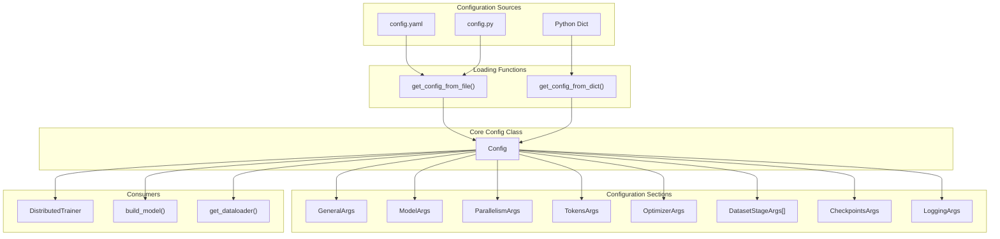
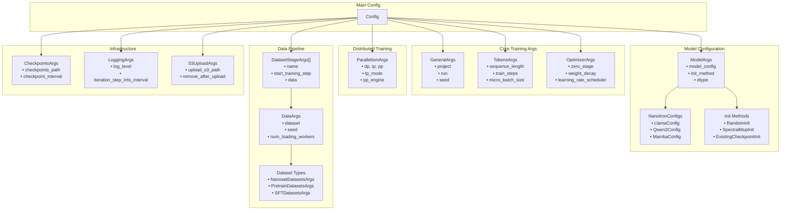
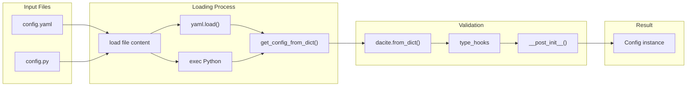
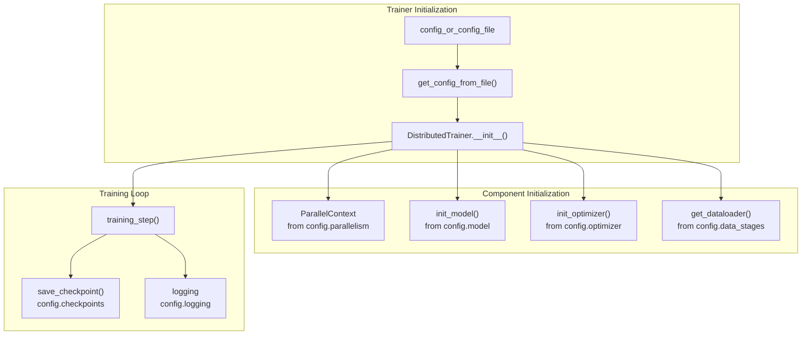

<!-- source: DeepWiki mcp.deepwiki.com · repo huggingface/nanotron · page 2.2 Configuration System · fetched 2026-10-26 -->

# Configuration System

<details>
<summary>Relevant source files</summary>

The following files were used as context for generating this wiki page:

- [examples/config_qwen.py](examples/config_qwen.py)
- [examples/config_qwen.yaml](examples/config_qwen.yaml)
- [run_train.py](run_train.py)
- [src/nanotron/config/config.py](src/nanotron/config/config.py)
- [src/nanotron/data/clm_collator.py](src/nanotron/data/clm_collator.py)
- [src/nanotron/data/dataloader.py](src/nanotron/data/dataloader.py)
- [src/nanotron/data/dataloader_builder.py](src/nanotron/data/dataloader_builder.py)
- [src/nanotron/data/nanoset.py](src/nanotron/data/nanoset.py)
- [src/nanotron/helpers.py](src/nanotron/helpers.py)
- [src/nanotron/models/base.py](src/nanotron/models/base.py)
- [src/nanotron/models/llama.py](src/nanotron/models/llama.py)
- [src/nanotron/s3_checkpoints/s3_mover.py](src/nanotron/s3_checkpoints/s3_mover.py)
- [src/nanotron/serialize/main.py](src/nanotron/serialize/main.py)
- [src/nanotron/trainer.py](src/nanotron/trainer.py)

</details>


The Configuration System in Nanotron provides a comprehensive, type-safe framework for managing all training parameters, from model architecture to distributed training settings. This system supports both YAML and Python configuration files, with automatic validation and serialization capabilities.

For information about specific model configurations, see [Supported Models](#3). For distributed training parameter details, see [Distributed Training](#4).

## Configuration Architecture Overview

The configuration system is built around a hierarchical dataclass structure that organizes all training parameters into logical sections.



Sources: [src/nanotron/config/config.py:438-454](), [src/nanotron/config/config.py:641-674](), [src/nanotron/trainer.py:132-161]()

## Configuration Class Hierarchy

The configuration system uses a nested dataclass structure where each section manages related parameters with built-in validation.



Sources: [src/nanotron/config/config.py:438-454](), [src/nanotron/config/config.py:259-286](), [src/nanotron/config/config.py:305-324](), [src/nanotron/config/config.py:159-205]()

## Configuration Loading Process

Nanotron supports multiple ways to load and validate configurations, with automatic type checking and post-initialization validation.

### Loading from Files

The `get_config_from_file()` function handles both YAML and Python configuration files:



The loading process includes several type conversion hooks for complex types:

- `torch.dtype`: [src/nanotron/config/utils_config.py:cast_str_to_torch_dtype]()
- `PipelineEngine`: [src/nanotron/config/utils_config.py:cast_str_to_pipeline_engine]()
- `TensorParallelLinearMode`: Enum conversion from string
- `SamplerType`: Enum conversion for generation

Sources: [src/nanotron/config/config.py:641-674](), [src/nanotron/config/config.py:599-638](), [src/nanotron/config/config.py:622-637]()

### Configuration Validation

Each configuration class implements `__post_init__()` methods that perform cross-field validation and set defaults:

| Validation Type | Example Checks | Implementation |
|-----------------|----------------|----------------|
| **Model Constraints** | `num_attention_heads % tp == 0` | [src/nanotron/config/config.py:532-543]() |
| **Parallelism Limits** | `num_key_value_heads >= tp` | [src/nanotron/config/config.py:538-540]() |
| **Data Stage Order** | Stages sorted by `start_training_step` | [src/nanotron/config/config.py:486-525]() |
| **Vocab Size Matching** | Dataset vocab matches model vocab | [src/nanotron/config/config.py:509-511]() |

Sources: [src/nanotron/config/config.py:460-544]()

## Configuration File Formats

### YAML Configuration

YAML configurations provide a human-readable format with hierarchical structure:

```yaml
# Key sections from examples/config_qwen.yaml
general:
  project: "debug"
  run: "qwen_experiment"
  seed: 42

model:
  model_config:
    hidden_size: 256
    num_hidden_layers: 12
    num_attention_heads: 4
  dtype: "bfloat16"
  init_method:
    std: 0.025

parallelism:
  dp: 2
  tp: 1
  pp: 1
  tp_mode: "REDUCE_SCATTER"

tokens:
  sequence_length: 4096
  train_steps: 32000
  micro_batch_size: 3
```

Sources: [examples/config_qwen.yaml:30-127]()

### Python Configuration

Python configurations enable programmatic generation and complex logic:

```python
# From examples/config_qwen.py
def create_config(model_config: Qwen2Config, args: argparse.Namespace) -> Config:
    return Config(
        general=GeneralArgs(
            project="debug", 
            run=args.run, 
            seed=seed
        ),
        model=ModelArgs(
            init_method=RandomInit(std=0.025), 
            model_config=model_config
        ),
        parallelism=ParallelismArgs(
            dp=args.dp,
            tp=args.tp,
            pp=args.pp,
            tp_mode="REDUCE_SCATTER"
        ),
        # ... other sections
    )
```

Sources: [examples/config_qwen.py:155-204]()

## Key Configuration Sections

### ModelArgs and Model Configurations

The `ModelArgs` section defines model architecture and initialization:

- **`model_config`**: Architecture-specific configuration (LlamaConfig, Qwen2Config, etc.)
- **`init_method`**: Weight initialization strategy (RandomInit, SpectralMupInit, ExistingCheckpointInit)
- **`dtype`**: Model precision (torch.float16, torch.bfloat16, etc.)
- **`make_vocab_size_divisible_by`**: Vocabulary padding for tensor parallelism

Sources: [src/nanotron/config/config.py:304-324]()

### ParallelismArgs

Configures distributed training strategies:

| Parameter | Description | Constraint |
|-----------|-------------|------------|
| **`dp`** | Data parallel size | `dp * tp * pp * ep * cp = total_gpus` |
| **`tp`** | Tensor parallel size | Must divide attention heads |
| **`pp`** | Pipeline parallel size | Determines model sharding |
| **`tp_mode`** | ALL_REDUCE or REDUCE_SCATTER | Affects communication pattern |
| **`pp_engine`** | Pipeline execution engine | 1f1b, afab, etc. |

Sources: [src/nanotron/config/parallelism_config.py](), [src/nanotron/config/config.py:532-543]()

### DatasetStageArgs

Supports multi-stage training with different datasets:

```python
data_stages = [
    DatasetStageArgs(
        name="pretraining",
        start_training_step=1,
        data=DataArgs(
            dataset=NanosetDatasetsArgs(
                dataset_folder=["/path/to/tokenized/data"]
            )
        )
    ),
    DatasetStageArgs(
        name="finetuning", 
        start_training_step=1000,
        data=DataArgs(
            dataset=SFTDatasetsArgs(
                hf_dataset_or_datasets="instruction_dataset"
            )
        )
    )
]
```

Sources: [src/nanotron/config/config.py:222-233](), [src/nanotron/config/config.py:486-525]()

## Configuration Usage in Training

### DistributedTrainer Integration

The `DistributedTrainer` consumes configuration throughout the training lifecycle:



### Key Usage Patterns

1. **Model Building**: [src/nanotron/trainer.py:197]() uses `self.config.model` to initialize model architecture
2. **Parallelism Setup**: [src/nanotron/trainer.py:171-177]() creates `ParallelContext` from `self.config.parallelism`
3. **Data Loading**: [run_train.py:305-358]() uses `trainer.config.data_stages` for multi-stage data pipeline
4. **Checkpointing**: [src/nanotron/trainer.py:603-604]() uses `self.config.checkpoints.checkpoint_interval`

Sources: [src/nanotron/trainer.py:132-297](), [run_train.py:305-382]()

### Configuration Serialization

The system supports bidirectional serialization for reproducibility:

- **`save_as_yaml()`**: [src/nanotron/config/config.py:553-561]() saves current config to YAML
- **`as_dict()`**: [src/nanotron/config/config.py:572-573]() converts to dictionary format
- **`get_yaml()`**: [src/nanotron/config/config.py:563-565]() returns YAML string representation

This enables experiment tracking and configuration sharing across training runs.

Sources: [src/nanotron/config/config.py:553-573]()

---

