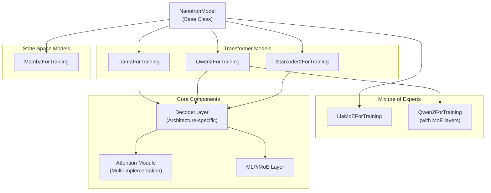
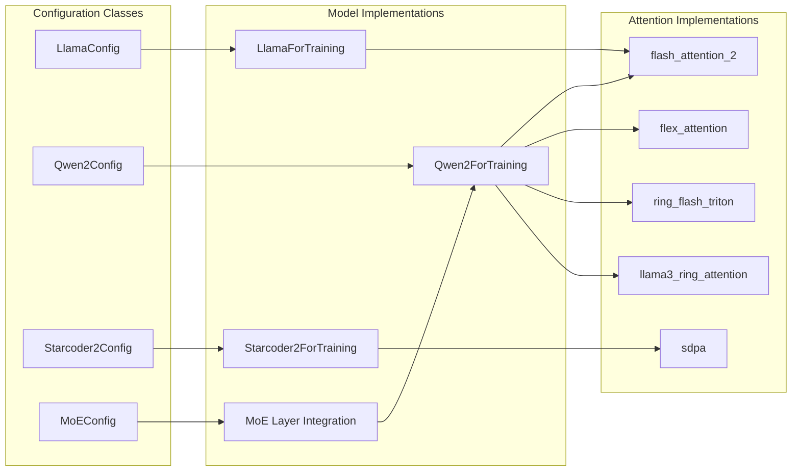
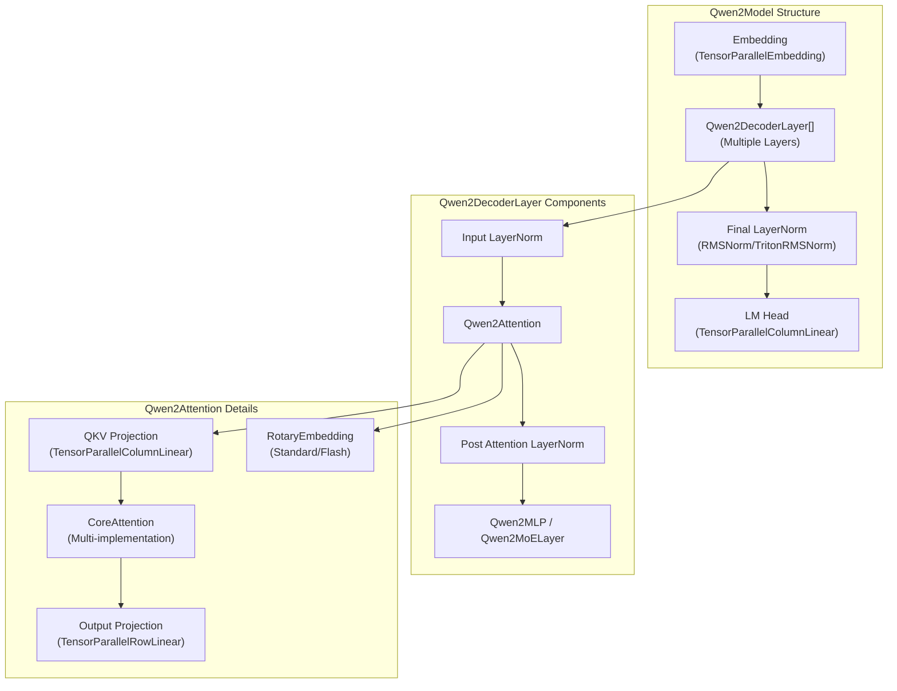
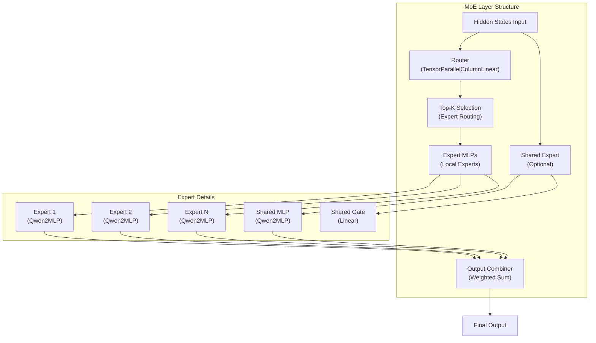
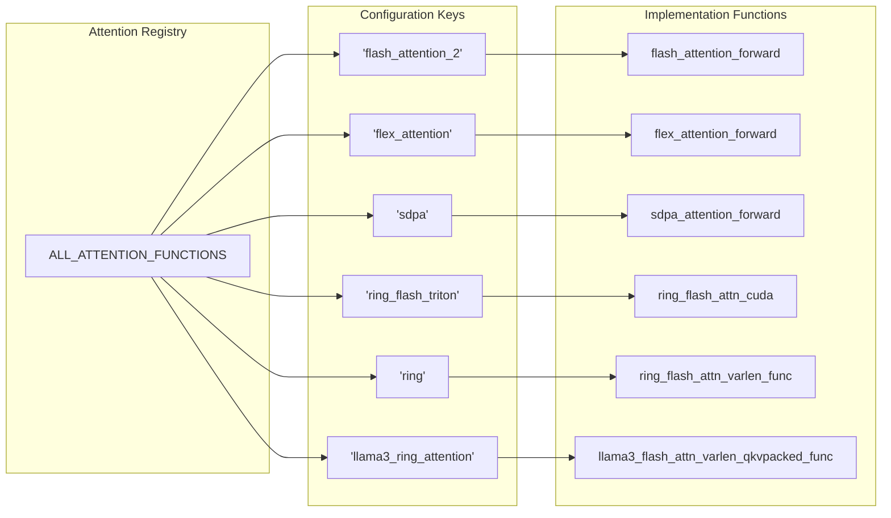

<!-- source: DeepWiki mcp.deepwiki.com · repo huggingface/nanotron · page 3 Supported Models · fetched 2026-10-26 -->

# Supported Models

<details>
<summary>Relevant source files</summary>

The following files were used as context for generating this wiki page:

- [src/nanotron/config/models_config.py](src/nanotron/config/models_config.py)
- [src/nanotron/models/qwen.py](src/nanotron/models/qwen.py)
- [src/nanotron/nn/attention.py](src/nanotron/nn/attention.py)
- [src/nanotron/nn/flex_attention.py](src/nanotron/nn/flex_attention.py)
- [src/nanotron/nn/rotary.py](src/nanotron/nn/rotary.py)

</details>


This document provides a comprehensive overview of all model architectures supported by the Nanotron distributed training framework. It covers the implementation details, configuration options, and architectural components for each supported model type.

For model conversion utilities between Nanotron and HuggingFace formats, see [Model Conversion](#3.5). For detailed configuration management, see [Configuration System](#2.2).

## Model Architecture Overview

Nanotron supports multiple transformer-based architectures through a unified base class hierarchy. All models inherit from `NanotronModel` and implement standardized interfaces for distributed training, pipeline parallelism, and optimization.

### Model Hierarchy



**Sources:** [src/nanotron/models/qwen.py:680-812](), [src/nanotron/config/models_config.py:62-293]()

### Configuration Mapping



**Sources:** [src/nanotron/config/models_config.py:8-293](), [src/nanotron/nn/attention.py:214-223]()

## Llama Models

The Llama model implementation supports the standard transformer architecture with RMSNorm, SwiGLU activation, and RoPE positional embeddings. Nanotron supports both Llama 2 and Llama 3 variants through configuration parameters.

### Key Features
- **Architecture**: Standard decoder-only transformer
- **Normalization**: RMSNorm with configurable epsilon
- **Activation**: SiLU (Swish) activation function
- **Positional Encoding**: Rotary Position Embedding (RoPE)
- **Attention**: Multi-head attention with optional grouped query attention (GQA)

### Configuration Options

| Parameter | Description | Default |
|-----------|-------------|---------|
| `hidden_size` | Model dimension | 4096 |
| `num_attention_heads` | Number of attention heads | 32 |
| `num_key_value_heads` | Number of KV heads for GQA | `num_attention_heads` |
| `intermediate_size` | FFN intermediate dimension | 11008 |
| `max_position_embeddings` | Maximum sequence length | 2048 |
| `rope_theta` | RoPE frequency base | 10000.0 |
| `rope_interleaved` | RoPE interleaving mode | False |

**Sources:** [src/nanotron/config/models_config.py:62-115]()

## Qwen2 Models

Qwen2 extends the Llama architecture with additional features including sliding window attention, flexible attention implementations, and MoE layer support. The implementation provides comprehensive attention mechanism options and optimized kernels.

### Architecture Components



**Sources:** [src/nanotron/models/qwen.py:680-812](), [src/nanotron/models/qwen.py:569-660](), [src/nanotron/models/qwen.py:135-265]()

### Attention Implementations

Qwen2 supports multiple attention backends through the `CoreAttention` module:

| Implementation | Description | Use Case |
|----------------|-------------|----------|
| `flash_attention_2` | Optimized FlashAttention | Standard training |
| `flex_attention` | PyTorch FlexAttention | Advanced masking patterns |
| `ring_flash_triton` | Ring attention with Triton | Long sequences |
| `ring` | Varlen ring attention | Variable-length sequences |
| `llama3_ring_attention` | Llama3-style ring attention | Specific optimization patterns |

### Special Features

#### Sliding Window Attention
Qwen2 supports sliding window attention for efficient processing of long sequences:

```python
sliding_window_size: Optional[int] = None  # Window size for local attention
```

#### No-RoPE Layers
Selective RoPE application for certain layers:

```python
no_rope_layer: Optional[int] = None  # Skip RoPE every N layers
```

#### Packed QKV Optimization
Optimized QKV computation for better performance:

```python
_use_qkv_packed: bool = True  # Use packed QKV for efficiency
```

**Sources:** [src/nanotron/models/qwen.py:37-134](), [src/nanotron/config/models_config.py:117-217]()

## Mamba Models

Mamba implements state space models with selective scan mechanisms, providing an alternative to transformer architectures for sequence modeling. The implementation focuses on efficient long-range dependencies through structured state spaces.

### Key Features
- **Architecture**: State space model with selective scan
- **Efficiency**: Linear complexity in sequence length
- **Generation**: Specialized inference and generation capabilities
- **Memory**: Optimized memory usage for long sequences

**Sources:** Based on diagram references and model architecture overview

## Starcoder2 Models

Starcoder2 is optimized for code generation tasks with specialized attention patterns and tokenization strategies suitable for programming languages.

### Configuration Parameters

| Parameter | Description | Default |
|-----------|-------------|---------|
| `activation_function` | Activation function | "gelu_pytorch_tanh" |
| `grouped_query` | Enable grouped query attention | False |
| `multi_query` | Enable multi-query attention | False |
| `sliding_window_size` | Local attention window | None |
| `use_rotary_embeddings` | Enable RoPE | True |

**Sources:** [src/nanotron/config/models_config.py:220-291]()

## Mixture of Experts (MoE)

Nanotron provides comprehensive MoE support that can be integrated into existing model architectures, particularly Qwen2. The MoE implementation includes routing, expert parallelism, and load balancing.

### MoE Architecture



**Sources:** [src/nanotron/models/qwen.py:392-567](), [src/nanotron/config/models_config.py:36-59]()

### MoE Configuration

The `MoEConfig` class provides comprehensive configuration for MoE layers:

```python
@dataclass
class MoEConfig:
    num_experts: int = 8                    # Total number of experts
    top_k: int = 2                         # Experts per token
    moe_intermediate_size: int = 1408       # Expert FFN size
    shared_expert_intermediate_size: int = 5632  # Shared expert size
    router_aux_loss_coef: float = 0.01     # Router loss coefficient
    layers: List[int] = [-1]               # MoE layer indices
    enable_shared_expert: bool = False     # Shared expert usage
    token_dispatcher_type: str = "alltoall" # Communication pattern
```

### Expert Parallelism
- **Distribution**: Experts distributed across devices
- **Communication**: AllToAll or AllGather patterns
- **Load Balancing**: Router auxiliary loss for balanced expert usage
- **Memory Efficiency**: Gradient checkpointing support

**Sources:** [src/nanotron/config/models_config.py:36-59](), [src/nanotron/models/qwen.py:392-567]()

## Attention Implementation System

All models share a unified attention system that supports multiple backends through the `ALL_ATTENTION_FUNCTIONS` registry. This allows seamless switching between different attention implementations based on requirements.

### Attention Backend Registry



**Sources:** [src/nanotron/nn/attention.py:214-223](), [src/nanotron/nn/attention.py:42-178]()

### Advanced Attention Features

#### FlexAttention Masking
The FlexAttention implementation supports sophisticated masking patterns:

- **Document Masking**: Prevent attention across document boundaries
- **Sliding Window**: Local attention patterns for efficiency
- **Custom Masks**: User-defined attention patterns

#### Ring Attention
For ultra-long sequences, ring attention distributes computation across devices:

- **Memory Efficiency**: Reduces peak memory usage
- **Scalability**: Supports sequences longer than single-device memory
- **Communication Optimization**: Overlapped computation and communication

**Sources:** [src/nanotron/nn/flex_attention.py:220-404](), [src/nanotron/nn/attention.py:42-138]()

## Performance and Optimization Features

### Fused Operations
- **Fused RMSNorm**: `TritonRMSNorm` for optimized layer normalization
- **Fused RoPE**: `FlashRotaryEmbedding` for efficient positional encoding
- **Packed QKV**: Combined query, key, value computation

### Memory Optimization
- **Gradient Checkpointing**: Configurable per layer via `recompute_layer`
- **Tensor Parallelism**: Automatic sharding across devices
- **ZeRO Integration**: Memory-efficient optimizer states

### Communication Optimization
- **Async Communication**: `tp_linear_async_communication` for overlapped compute
- **AllGather Recomputation**: `tp_recompute_allgather` for memory-compute tradeoff

**Sources:** [src/nanotron/models/qwen.py:580-584](), [src/nanotron/models/qwen.py:196-213](), [src/nanotron/models/qwen.py:168-187]()

---

