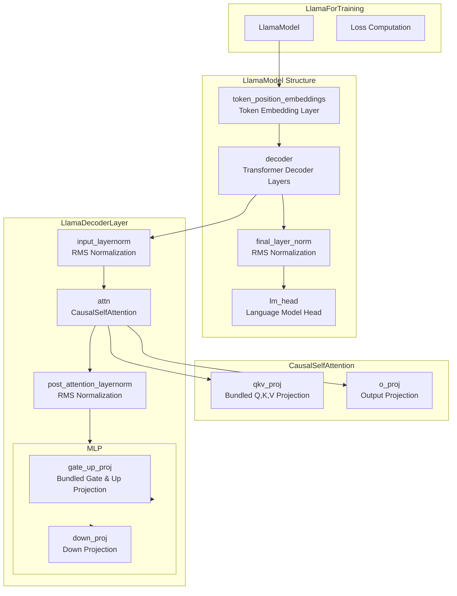
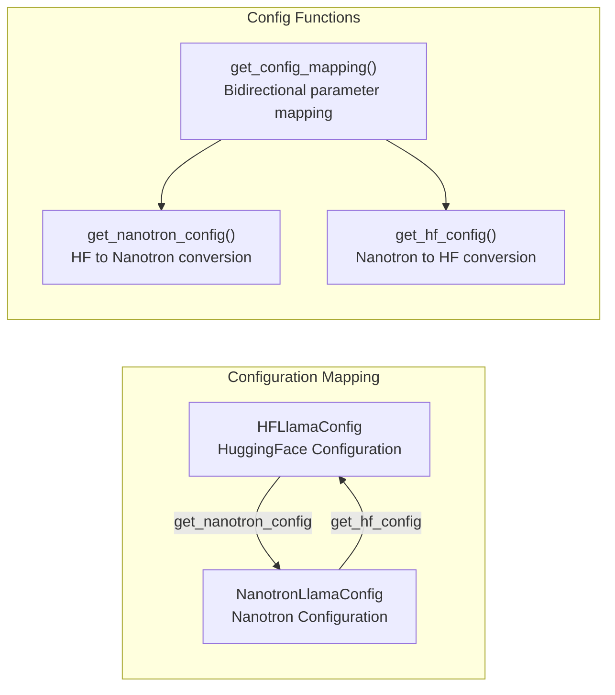
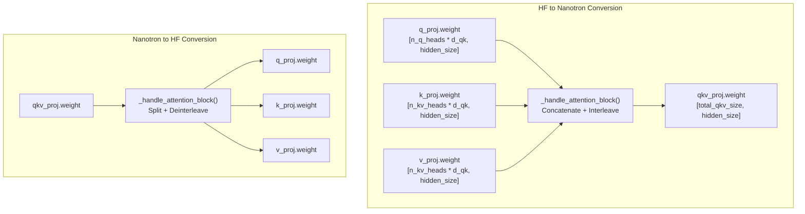
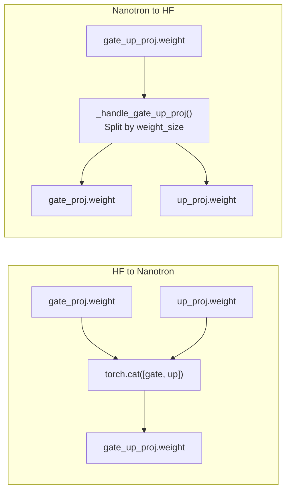
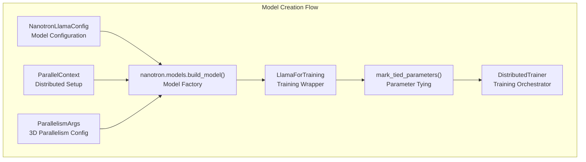

<!-- source: DeepWiki mcp.deepwiki.com · repo huggingface/nanotron · page 3.1 Llama Models · fetched 2026-10-26 -->

# Llama Models

<details>
<summary>Relevant source files</summary>

The following files were used as context for generating this wiki page:

- [examples/llama/README.md](examples/llama/README.md)
- [examples/llama/__init__.py](examples/llama/__init__.py)
- [examples/llama/convert_hf_to_nanotron.py](examples/llama/convert_hf_to_nanotron.py)
- [examples/llama/convert_nanotron_to_hf.py](examples/llama/convert_nanotron_to_hf.py)
- [examples/llama/convert_weights.py](examples/llama/convert_weights.py)
- [examples/llama/tests/test_conversion.py](examples/llama/tests/test_conversion.py)
- [examples/llama/tests/test_conversion.py.orig](examples/llama/tests/test_conversion.py.orig)
- [examples/llama/tests/utils.py](examples/llama/tests/utils.py)

</details>


This document covers the Llama model implementation in Nanotron, including the core architecture, configuration system, and conversion utilities for interoperating with HuggingFace models. For information about other model architectures, see [Qwen Models](#3.2), [Mamba Models](#3.3), and [Mixture of Experts (MoE)](#3.4). For general model conversion utilities, see [Model Conversion](#3.5).

## Overview

The Llama model implementation in Nanotron provides a distributed training-optimized version of the Llama architecture with full compatibility for converting weights between Nanotron and HuggingFace formats. The implementation supports tensor parallelism, pipeline parallelism, and maintains mathematical equivalence with reference implementations.

## Model Architecture

The Nanotron Llama implementation follows the standard transformer decoder architecture with the following key components:



**Sources:** [examples/llama/convert_weights.py:20-60](), [examples/llama/tests/test_conversion.py:94-112]()

## Configuration System

The Llama model uses `NanotronLlamaConfig` for configuration, which maintains compatibility with HuggingFace's `LlamaConfig` through mapping functions:

| Nanotron Parameter | HuggingFace Parameter | Description |
|---|---|---|
| `hidden_size` | `hidden_size` | Model dimension |
| `num_attention_heads` | `num_attention_heads` | Number of attention heads |
| `num_key_value_heads` | `num_key_value_heads` | Number of KV heads (for GQA) |
| `intermediate_size` | `intermediate_size` | MLP hidden dimension |
| `num_hidden_layers` | `num_hidden_layers` | Number of transformer layers |
| `vocab_size` | `vocab_size` | Vocabulary size |
| `max_position_embeddings` | `max_position_embeddings` | Maximum sequence length |
| `rms_norm_eps` | `rms_norm_eps` | RMS normalization epsilon |



**Sources:** [examples/llama/convert_weights.py:63-91](), [examples/llama/convert_hf_to_nanotron.py:94-98](), [examples/llama/convert_nanotron_to_hf.py:109-113]()

## Weight Conversion System

The weight conversion system handles the structural differences between Nanotron and HuggingFace implementations, particularly for attention and MLP projections:

### Parameter Mapping

```mermaid
graph TB
    subgraph "HuggingFace Format"
        HFEmbed["model.embed_tokens.weight"]
        HFNorm["model.norm.weight"]
        HFQProj["layers.{i}.self_attn.q_proj.weight"]
        HFKProj["layers.{i}.self_attn.k_proj.weight"]  
        HFVProj["layers.{i}.self_attn.v_proj.weight"]
        HFOProj["layers.{i}.self_attn.o_proj.weight"]
        HFGateProj["layers.{i}.mlp.gate_proj.weight"]
        HFUpProj["layers.{i}.mlp.up_proj.weight"]
        HFDownProj["layers.{i}.mlp.down_proj.weight"]
        HFLMHead["lm_head.weight"]
    end
    
    subgraph "Nanotron Format"
        NTEmbed["token_position_embeddings.pp_block.token_embedding.weight"]
        NTNorm["final_layer_norm.pp_block.weight"]
        NTQKVProj["decoder.{i}.pp_block.attn.qkv_proj.weight"]
        NTOProj["decoder.{i}.pp_block.attn.o_proj.weight"]
        NTGateUpProj["decoder.{i}.pp_block.mlp.gate_up_proj.weight"]
        NTDownProj["decoder.{i}.pp_block.mlp.down_proj.weight"]
        NTLMHead["lm_head.pp_block.weight"]
    end
    
    HFEmbed --> NTEmbed
    HFNorm --> NTNorm
    HFQProj --> NTQKVProj
    HFKProj --> NTQKVProj
    HFVProj --> NTQKVProj
    HFOProj --> NTOProj
    HFGateProj --> NTGateUpProj
    HFUpProj --> NTGateUpProj
    HFDownProj --> NTDownProj
    HFLMHead --> NTLMHead
```



**Sources:** [examples/llama/convert_weights.py:20-60]()

### Attention Block Conversion

The attention conversion handles the bundling/unbundling of Q, K, V projections and rotary embedding dimension reordering:



**Sources:** [examples/llama/convert_hf_to_nanotron.py:23-49](), [examples/llama/convert_nanotron_to_hf.py:25-58]()

### MLP Conversion

The MLP conversion handles the bundling/unbundling of gate and up projections:



**Sources:** [examples/llama/convert_hf_to_nanotron.py:79-84](), [examples/llama/convert_nanotron_to_hf.py:60-69]()

## Conversion Utilities

The conversion system provides both programmatic APIs and command-line tools:

### Core Conversion Functions

| Function | Purpose | Input | Output |
|---|---|---|---|
| `convert_hf_to_nt()` | In-memory HF to Nanotron conversion | `LlamaForCausalLM`, `LlamaForTraining` | Modified Nanotron model |
| `convert_nt_to_hf()` | In-memory Nanotron to HF conversion | `LlamaForTraining`, `LlamaForCausalLM` | Modified HF model |
| `convert_checkpoint_and_save()` | File-based conversion with serialization | Checkpoint path | Saved model directory |
| `load_nanotron_model()` | Load Nanotron model from checkpoint | Config + checkpoint path | `LlamaForTraining` |

### Command-Line Interface

```bash
# Convert HF to Nanotron
torchrun --nproc_per_node=1 examples/llama/convert_hf_to_nanotron.py \
    --checkpoint_path=hf_weights --save_path=nanotron_weights

# Convert Nanotron to HF  
torchrun --nproc_per_node=1 examples/llama/convert_nanotron_to_hf.py \
    --checkpoint_path=nanotron_weights --save_path=hf_weights \
    --tokenizer_name=meta-llama/Llama-2-7b-chat-hf
```

**Sources:** [examples/llama/convert_hf_to_nanotron.py:123-131](), [examples/llama/convert_nanotron_to_hf.py:160-183]()

## Model Creation and Integration

The Llama model integrates with the broader Nanotron training system through standardized interfaces:



**Sources:** [examples/llama/tests/test_conversion.py:94-112](), [examples/llama/convert_weights.py:112-167]()

## Testing Framework

The testing framework validates conversion correctness through multiple test scenarios:

### Test Categories

| Test Function | Purpose | Validation Method |
|---|---|---|---|
| `test_nt_to_hf()` | In-memory Nanotron to HF conversion | Logits comparison with tolerance |
| `test_hf_to_nt()` | In-memory HF to Nanotron conversion | Logits comparison with tolerance |
| `test_nt_to_hf_with_files()` | File-based Nanotron to HF conversion | End-to-end checkpoint conversion |
| `test_hf_to_nt_with_files()` | File-based HF to Nanotron conversion | End-to-end checkpoint conversion |
| `test_composed_conversion()` | Bidirectional conversion stability | State dict preservation |
| `test_tensor_parallel_conversion()` | Tensor parallel model conversion | Distributed logits comparison |

### Validation Parameters

```python
BATCH_SIZE = 6
SEQUENCE_LENGTH = 5  
ATOL = 0.03  # Absolute tolerance for logits comparison
```

The tests validate mathematical equivalence by comparing forward pass outputs between converted models using random input tensors and ensuring differences remain within acceptable tolerance bounds.

**Sources:** [examples/llama/tests/test_conversion.py:36-40](), [examples/llama/tests/test_conversion.py:154-268]()

---

