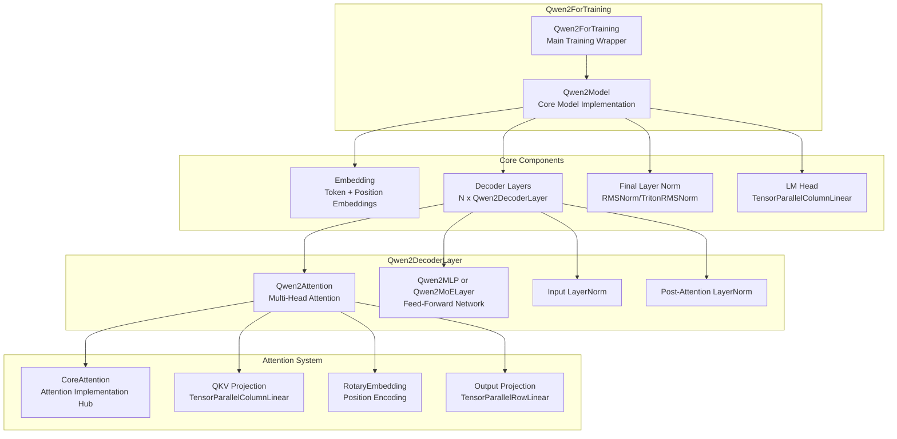
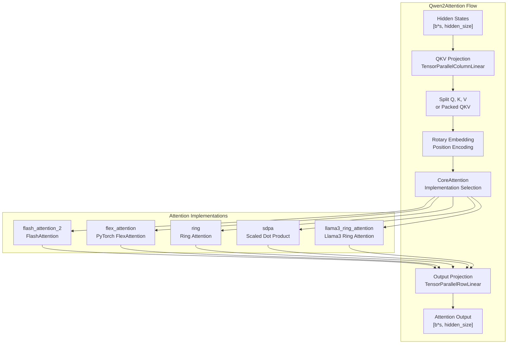
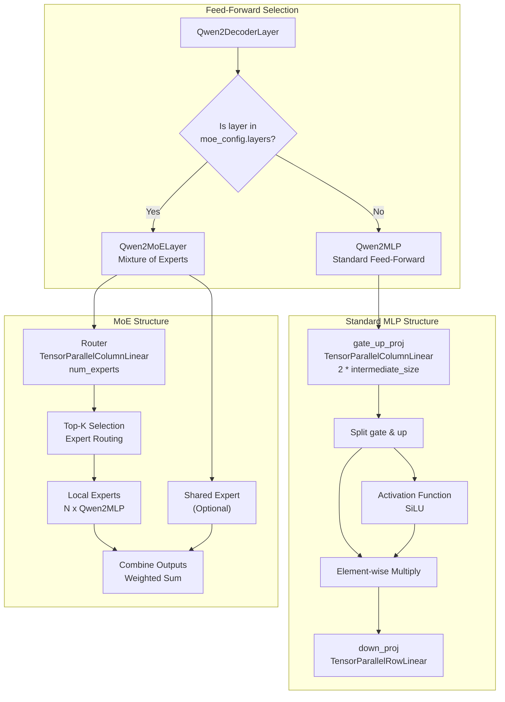
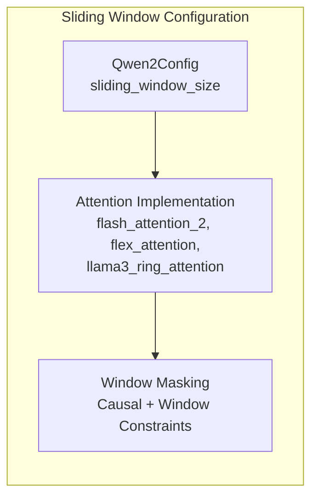
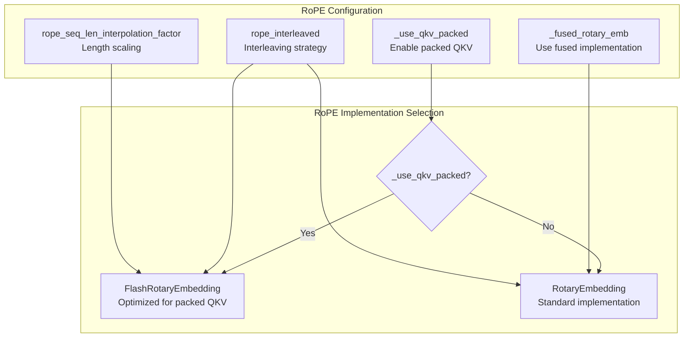

<!-- source: DeepWiki mcp.deepwiki.com · repo huggingface/nanotron · page 3.2 Qwen Models · fetched 2026-10-26 -->

# Qwen Models

Relevant source files

The following files were used as context for generating this wiki page:

- [src/nanotron/config/models_config.py](src/nanotron/config/models_config.py)
- [src/nanotron/models/qwen.py](src/nanotron/models/qwen.py)
- [src/nanotron/nn/attention.py](src/nanotron/nn/attention.py)
- [src/nanotron/nn/flex_attention.py](src/nanotron/nn/flex_attention.py)
- [src/nanotron/nn/rotary.py](src/nanotron/nn/rotary.py)

This document covers the implementation of Qwen2 transformer models in Nanotron, including the core architecture, attention mechanisms, MLP layers, and advanced features like Mixture of Experts (MoE). The Qwen implementation provides a comprehensive transformer model with support for various attention implementations, sliding window attention, and distributed training optimizations.

For information about model conversion between Nanotron and HuggingFace formats, see [Model Conversion](#3.5). For details about distributed training strategies, see [3D Parallelism](#4.2).

## Architecture Overview

The Qwen2 model implementation follows a standard transformer decoder architecture with several key components that work together to provide efficient training and inference capabilities.

### Overall Model Structure

Sources: [src/nanotron/models/qwen.py:680-826](), [src/nanotron/models/qwen.py:569-660](), [src/nanotron/models/qwen.py:135-331]()

### Configuration System

The Qwen2 model is configured through the `Qwen2Config` class, which provides comprehensive control over model architecture and behavior:

| Configuration Category | Key Parameters | Description |
|------------------------|---------------|-------------|
| **Model Architecture** | `hidden_size`, `num_hidden_layers`, `num_attention_heads` | Core model dimensions |
| **Attention** | `num_key_value_heads`, `attention_bias`, `_attn_implementation` | Attention mechanism configuration |
| **Positional Encoding** | `rope_theta`, `rope_interleaved`, `max_position_embeddings` | RoPE settings |
| **Advanced Features** | `sliding_window_size`, `flex_attention_mask`, `moe_config` | Sliding window and MoE |
| **Optimization** | `_fused_rms_norm`, `_use_qkv_packed`, `_fused_rotary_emb` | Performance optimizations |

Sources: [src/nanotron/config/models_config.py:117-217]()

## Core Components

### Attention Mechanism

The Qwen2 attention system is built around a modular design that supports multiple attention implementations through the `CoreAttention` class:

The `CoreAttention` class serves as a hub that routes to different attention implementations based on the `_attn_implementation` configuration:

- **Flash Attention 2**: Optimized attention for training efficiency
- **Flex Attention**: PyTorch's flexible attention with custom masking
- **Ring Attention**: Distributed attention for very long sequences
- **Scaled Dot Product Attention**: PyTorch's built-in SDPA
- **Llama3 Ring Attention**: Specialized ring attention variant

Sources: [src/nanotron/models/qwen.py:37-134](), [src/nanotron/models/qwen.py:135-331](), [src/nanotron/nn/attention.py:214-221]()

### MLP and MoE Architecture

The feed-forward component can be either a standard MLP or a Mixture of Experts (MoE) layer based on configuration:

Sources: [src/nanotron/models/qwen.py:333-390](), [src/nanotron/models/qwen.py:392-567](), [src/nanotron/models/qwen.py:594-610]()

## Advanced Features

### Sliding Window Attention

Qwen2 supports sliding window attention for efficient processing of long sequences. This feature limits attention to a local window around each token while maintaining causal masking:

The sliding window is implemented differently across attention mechanisms:
- **Flash Attention 2**: Uses `window_size` parameter in `flash_attn_func`
- **Flex Attention**: Custom block mask with sliding window logic
- **Llama3 Ring Attention**: Distributed sliding window across devices

Sources: [src/nanotron/models/qwen.py:161-189](), [src/nanotron/nn/attention.py:161-164](), [src/nanotron/nn/flex_attention.py:213-217]()

### Mixture of Experts (MoE)

The MoE implementation provides scalable model capacity through expert routing:

| MoE Component | Implementation | Purpose |
|---------------|----------------|---------|
| **Router** | `TensorParallelColumnLinear` | Routes tokens to experts |
| **Expert Selection** | Top-K routing with softmax | Selects active experts per token |
| **Local Experts** | Multiple `Qwen2MLP` instances | Specialized feed-forward networks |
| **Shared Expert** | Optional `Qwen2MLP` | Global knowledge across all tokens |
| **Token Dispatcher** | AllToAll or AllGather | Distributes tokens to expert devices |

Key MoE configuration parameters:
- `num_experts`: Total number of experts
- `top_k`: Number of experts activated per token
- `layers`: Which decoder layers use MoE
- `enable_shared_expert`: Whether to include a shared expert
- `token_dispatcher_type`: Communication pattern for expert parallelism

Sources: [src/nanotron/models/qwen.py:392-567](), [src/nanotron/config/models_config.py:36-59]()

### Positional Encoding

Qwen2 uses Rotary Position Embedding (RoPE) with several optimization options:

Sources: [src/nanotron/models/qwen.py:196-212](), [src/nanotron/nn/rotary.py:11-148](), [src/nanotron/nn/rotary.py:149-221]()

## Integration with Distributed Training

The Qwen2 implementation is designed for distributed training with full support for 3D parallelism:

### Tensor Parallelism Integration

All linear layers use tensor parallel implementations:
- `TensorParallelColumnLinear` for QKV projections and MLP gate/up projections
- `TensorParallelRowLinear` for attention output and MLP down projections
- `TensorParallelEmbedding` for token embeddings

### Pipeline Parallelism Support

The model is structured using `PipelineBlock` wrappers that enable automatic pipeline parallelism:
- Each component (embeddings, decoder layers, final norm, LM head) is wrapped in `PipelineBlock`
- Supports automatic stage assignment and inter-stage communication
- Handles `TensorPointer` objects for pipeline communication

### Context Parallelism

Qwen2 supports context parallelism for processing very long sequences:
- Ring attention implementations distribute attention computation across devices
- Sequence length is automatically divided across context parallel groups
- Position IDs and cumulative sequence lengths are handled appropriately

Sources: [src/nanotron/models/qwen.py:701-756](), [src/nanotron/models/qwen.py:232-233](), [src/nanotron/models/qwen.py:273-276]()

## Performance Optimizations

The Qwen2 implementation includes several performance optimizations:

| Optimization | Configuration | Impact |
|-------------|---------------|---------|
| **Fused RMSNorm** | `_fused_rms_norm` | Reduced memory bandwidth for normalization |
| **Packed QKV** | `_use_qkv_packed` | Optimized attention computation |
| **Fused Rotary** | `_fused_rotary_emb` | Efficient positional encoding |
| **Gradient Checkpointing** | `recompute_layer` | Memory-efficient training |
| **Async Communication** | `tp_linear_async_communication` | Overlapped computation and communication |

These optimizations are automatically applied based on configuration and can significantly improve training throughput and memory efficiency.

Sources: [src/nanotron/models/qwen.py:581-584](), [src/nanotron/models/qwen.py:196-216](), [src/nanotron/models/qwen.py:168-171]()

---

