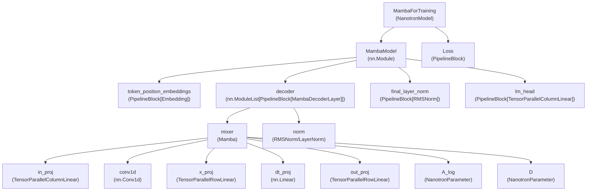

<!-- source: DeepWiki mcp.deepwiki.com · repo huggingface/nanotron · page 3.3 Mamba Models · fetched 2026-10-26 -->

# Mamba Models

<details>
<summary>Relevant source files</summary>

The following files were used as context for generating this wiki page:

- [examples/mamba/config.py](examples/mamba/config.py)
- [examples/mamba/convert_hf_to_nanotron.py](examples/mamba/convert_hf_to_nanotron.py)
- [examples/mamba/convert_nanotron_to_hf.py](examples/mamba/convert_nanotron_to_hf.py)
- [examples/mamba/mamba.py](examples/mamba/mamba.py)
- [examples/mamba/run_generate.py](examples/mamba/run_generate.py)
- [examples/mamba/selective_scan_interface.py](examples/mamba/selective_scan_interface.py)
- [run_generate.py](run_generate.py)
- [src/nanotron/generation/decode.py](src/nanotron/generation/decode.py)
- [src/nanotron/generation/generate_store.py](src/nanotron/generation/generate_store.py)

</details>


This document covers Nanotron's implementation of Mamba models, which are state-space sequence models that use selective scan mechanisms for efficient long-sequence modeling. Mamba models provide an alternative to transformer architectures by replacing attention mechanisms with structured state-space models (SSMs) that scale linearly with sequence length.

For information about other model architectures supported by Nanotron, see [Supported Models](#3). For details on distributed training strategies that apply to Mamba models, see [Distributed Training](#4).

## Architecture Overview

Nanotron's Mamba implementation follows a hierarchical structure where the top-level `MambaForTraining` class wraps the core `MambaModel`, which consists of multiple `MambaDecoderLayer` blocks, each containing a `Mamba` SSM block.

**Mamba Model Component Hierarchy**



Sources: [examples/mamba/mamba.py:757-789](), [examples/mamba/mamba.py:515-598](), [examples/mamba/mamba.py:438-512](), [examples/mamba/mamba.py:67-202]()

**Mamba Forward Pass Data Flow**

```mermaid
graph LR
    InputIds["input_ids<br/>[B, L]"]
    InputMask["input_mask<br/>[B, L]"]
    TokenEmb["self.token_embedding(input_ids)<br/>[B, L, D]"]
    Hidden["hidden_states<br/>[B, L, D]"]
    
    InProj["self.in_proj(hidden_states)<br/>[B, L, 2*d_inner]"]
    XZ["xz.transpose(1,2)<br/>[B, 2*d_inner, L]"]
    XZSplit["x, z = xz.chunk(2, dim=2)<br/>[B, d_inner, L]"]
    Conv["self.conv1d(x)<br/>[B, d_inner, L]"]
    XProj["self.x_proj(x)<br/>[B, L, dt_rank+2*d_state]"]
    DtProj["self.dt_proj(dt)<br/>[B, d_inner, L]"]
    SelectiveScan["selective_scan_fn(x,dt,A,B,C,D,z)<br/>[B, d_inner, L]"]
    OutProj["self.out_proj(y)<br/>[B, L, D]"]
    
    InputIds --> TokenEmb
    InputMask --> TokenEmb
    TokenEmb --> Hidden
    Hidden --> InProj
    InProj --> XZ
    XZ --> XZSplit
    XZSplit --> Conv
    Conv --> XProj
    XProj --> DtProj
    DtProj --> SelectiveScan
    SelectiveScan --> OutProj
    OutProj --> Hidden
```



Sources: [examples/mamba/mamba.py:203-303](), [examples/mamba/mamba.py:229-302](), [examples/mamba/selective_scan_interface.py:103-119]()

## Core Components

### MambaForTraining

The `MambaForTraining` class serves as the top-level model interface, inheriting from `NanotronModel`. It wraps the core model and adds loss computation for training.

| Component | Type | Purpose |
|-----------|------|---------|
| `model` | `MambaModel` | Core Mamba model implementation |
| `loss` | `PipelineBlock[Loss]` | Sharded cross-entropy loss computation |

**Key Methods:**

| Method | Signature | Purpose |
|--------|-----------|---------|
| `forward()` | `(input_ids, input_mask, label_ids, label_mask) -> Dict[str, Tensor]` | Computes model output and loss |
| `get_named_params_without_weight_decay()` | `() -> List[str]` | Returns SSM parameters (`A_log`, `D`) that shouldn't use weight decay |
| `init_model_randomly()` | `(config) -> None` | Initializes model parameters using Mamba-specific initialization |

The loss computation uses `sharded_cross_entropy` from `nanotron.parallel.tensor_parallel.functional` and applies `masked_mean` for proper sequence-level normalization.

Sources: [examples/mamba/mamba.py:757-815](), [examples/mamba/mamba.py:790-806](), [examples/mamba/mamba.py:808-814](), [examples/mamba/mamba.py:816-923]()

### Mamba Block

The `Mamba` class implements the core state-space model block. It performs the selective scan operation that is central to Mamba's efficiency.

**Initialization Parameters:**

| Parameter | Type | Default | Description |
|-----------|------|---------|-------------|
| `d_model` | `int` | - | Model dimension |
| `d_state` | `int` | 16 | State dimension for SSM |
| `d_conv` | `int` | 4 | Convolution kernel size |
| `expand` | `int` | 2 | Expansion factor for inner dimension |
| `dt_rank` | `str` | "auto" | Rank of the delta projection |
| `dt_min` | `float` | 0.001 | Minimum delta value |
| `dt_max` | `float` | 0.1 | Maximum delta value |
| `use_fast_path` | `bool` | True | Use fused kernel implementation |

**Core Components:**

| Component | Type | Shape | Purpose |
|-----------|------|-------|---------|
| `in_proj` | `TensorParallelColumnLinear` | `[d_model, d_inner*2]` | Expands input to x and z branches |
| `conv1d` | `nn.Conv1d` | `[d_inner//tp_size, d_conv]` | Causal 1D convolution for local dependencies |
| `x_proj` | `TensorParallelRowLinear` | `[d_inner, dt_rank+2*d_state]` | Projects to dt, B, and C parameters |
| `dt_proj` | `nn.Linear` | `[dt_rank, d_inner//tp_size]` | Projects delta rank to inner dimension |
| `A_log` | `NanotronParameter` | `[d_inner//tp_size, d_state]` | Log of A matrix (learnable) |
| `D` | `NanotronParameter` | `[d_inner//tp_size]` | Skip connection parameter |
| `out_proj` | `TensorParallelRowLinear` | `[d_inner, d_model]` | Projects back to model dimension |

Sources: [examples/mamba/mamba.py:67-202](), [examples/mamba/mamba.py:112-201](), [examples/mamba/mamba.py:174-190]()

### Selective Scan Mechanism

The selective scan is implemented through optimized CUDA kernels in `selective_scan_interface.py`. The mechanism allows the model to selectively focus on relevant parts of the input sequence.

**Core Functions:**

| Function | Signature | Purpose |
|----------|-----------|---------|
| `selective_scan_fn()` | `(u, delta, A, B, C, D, z, delta_bias, delta_softplus, return_last_state)` | Main selective scan function with optional state return |
| `mamba_inner_fn()` | `(d_inner, tp_pg, xz, conv1d_weight, conv1d_bias, x_proj_weight, delta_proj_weight, A, B, C, D, delta_bias, delta_softplus)` | Fused implementation combining convolution and selective scan |
| `SelectiveScanFn.apply()` | Auto-differentiable function | Custom forward/backward passes with CUDA kernel integration |

**Selective Scan Recurrence:**

The core SSM operation follows the discretized recurrence:
```
h_t = A_discrete * h_{t-1} + B_discrete * x_t
y_t = C * h_t + D * x_t
```

Where:
- `A_discrete = exp(delta * A)` (discretized A matrix)
- `B_discrete = delta * B` (discretized B matrix)  
- `delta`, `B`, `C` are input-dependent (selective)
- `A`, `D` are learned parameters

**Fast Path Implementation:**

When `use_fast_path=True` and not in generation mode, the model uses `mamba_inner_fn()` which fuses:
1. Causal convolution (`causal_conv1d_cuda.causal_conv1d_fwd`)
2. Linear projections for `delta`, `B`, `C`
3. Selective scan operation (`selective_scan_cuda.fwd`)

Sources: [examples/mamba/selective_scan_interface.py:103-119](), [examples/mamba/selective_scan_interface.py:434-467](), [examples/mamba/selective_scan_interface.py:12-101](), [examples/mamba/mamba.py:234-250]()

## Configuration

### MambaModelConfig

The `MambaModelConfig` dataclass defines the model architecture parameters:

| Parameter | Type | Default | Description |
|-----------|------|---------|-------------|
| `d_model` | `int` | 2560 | Model dimension |
| `num_hidden_layers` | `int` | 64 | Number of decoder layers |
| `vocab_size` | `int` | 50277 | Vocabulary size |
| `ssm_cfg` | `Optional[dict]` | None | SSM-specific configuration |
| `rms_norm` | `bool` | True | Use RMS normalization |
| `fused_add_norm` | `bool` | True | Use fused add+norm operations |
| `residual_in_fp32` | `bool` | True | Keep residuals in FP32 |

The `ssm_cfg` dictionary can contain additional SSM parameters like `d_state`, `d_conv`, `expand`, `dt_rank`, etc.

Sources: [examples/mamba/config.py:43-63]()

### Training Configuration

Mamba models use specialized initialization that differs from transformer models:

- **A_log and D parameters**: No weight decay applied
- **dt_proj initialization**: Special initialization for time step parameters
- **Residual scaling**: Prenorm residual rescaling for deeper models

Sources: [examples/mamba/mamba.py:808-814](), [examples/mamba/mamba.py:899-910]()

## Distributed Training Support

Mamba models in Nanotron support distributed training with specific considerations:

**Tensor Parallelism**: Only `ALL_REDUCE` mode is supported. The model implements custom tensor parallel layers:
- `TensorParallelColumnLinear` for input/output projections
- `TensorParallelRowLinear` for dimension reduction
- Custom sharding for Conv1D weights and SSM parameters

**Pipeline Parallelism**: Supported through `PipelineBlock` wrappers around each component.

**Memory Optimization**: Custom handling of SSM states and optimized kernel usage for reduced memory footprint.

Sources: [examples/mamba/mamba.py:100-102](), [examples/mamba/mamba.py:134-172]()

## Generation and Inference

Mamba models support efficient text generation through the standard Nanotron generation interface. The implementation includes:

**Stateful Generation**: Maintains convolution and SSM states between generation steps for efficiency.

**Store Mechanism**: Uses `AttachableStore` to cache states during generation:

| State | Type | Shape | Purpose |
|-------|------|-------|---------|
| `conv_state` | `torch.Tensor` | `[B, d_inner//tp_size, d_conv]` | Convolution state for causal conv1d |
| `ssm_state` | `torch.Tensor` | `[B, d_inner//tp_size, d_state]` | SSM hidden state |
| `seqlen_offset` | `int` | - | Tracks generation progress |

**Generation Methods:**

| Method | Purpose | State Updates |
|--------|---------|---------------|
| `forward()` | Full sequence processing | Initializes states if store attached |
| `step()` | Single-token generation | Updates `conv_state` and `ssm_state` in-place |
| `_get_states_from_cache()` | State management | Allocates or retrieves cached states |

**Generation Flow:**
1. First call: Process full prompt with `forward()`, cache states
2. Subsequent calls: Use `step()` with cached states for efficient generation
3. States automatically managed through `Store` and `AttachableStore` interfaces

The generation system integrates with `decode_text()` and `decode_tokenized()` functions in the decode module for batched inference.

Sources: [examples/mamba/mamba.py:305-400](), [examples/mamba/mamba.py:373-400](), [examples/mamba/mamba.py:212-228](), [examples/mamba/run_generate.py:172-184](), [src/nanotron/generation/generate_store.py:21-36]()

## Model Conversion

Nanotron provides bidirectional conversion between HuggingFace and Nanotron Mamba formats:

### HuggingFace to Nanotron

The conversion handles weight reshaping for tensor parallelism compatibility, particularly for the `in_proj` weights which require interleaving to match Nanotron's tensor parallel implementation.

**Key Conversion Steps**:
1. Load HuggingFace model and configuration
2. Create equivalent Nanotron model structure
3. Apply interleaving pattern to `in_proj` weights
4. Copy remaining weights with appropriate tensor parallel sharding

Sources: [examples/mamba/convert_hf_to_nanotron.py:49-95](), [examples/mamba/convert_hf_to_nanotron.py:196-255]()

### Nanotron to HuggingFace

The reverse conversion undoes the interleaving and creates a standard HuggingFace model:

**Key Conversion Steps**:
1. Load Nanotron checkpoint and configuration
2. Create HuggingFace model structure
3. Reverse interleaving pattern for `in_proj` weights
4. Copy weights to HuggingFace format

Sources: [examples/mamba/convert_nanotron_to_hf.py:30-175](), [examples/mamba/convert_nanotron_to_hf.py:133-158]()

## Performance Considerations

Mamba models offer several performance advantages:

**Linear Scaling**: Computational complexity scales linearly with sequence length, unlike quadratic attention mechanisms.

**Optimized Kernels**: Uses custom CUDA kernels for selective scan operations (`selective_scan_cuda`, `causal_conv1d_cuda`).

**Memory Efficiency**: Reduced memory usage compared to attention-based models for long sequences.

**FLOPS Calculation**: Custom FLOPS computation accounting for selective scan operations and linear projections.

Sources: [examples/mamba/mamba.py:662-721](), [examples/mamba/selective_scan_interface.py:283-285]()

---

