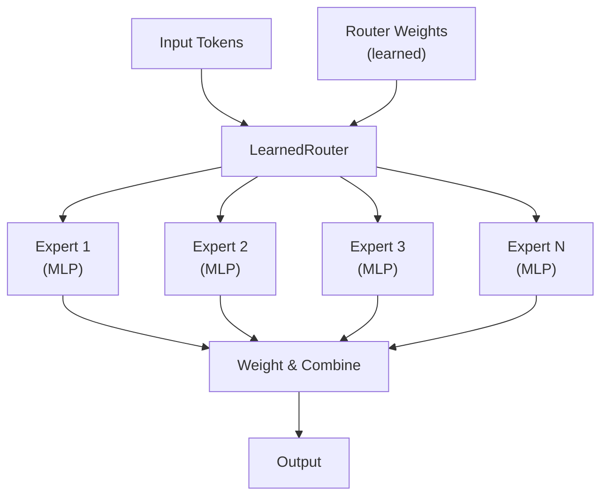
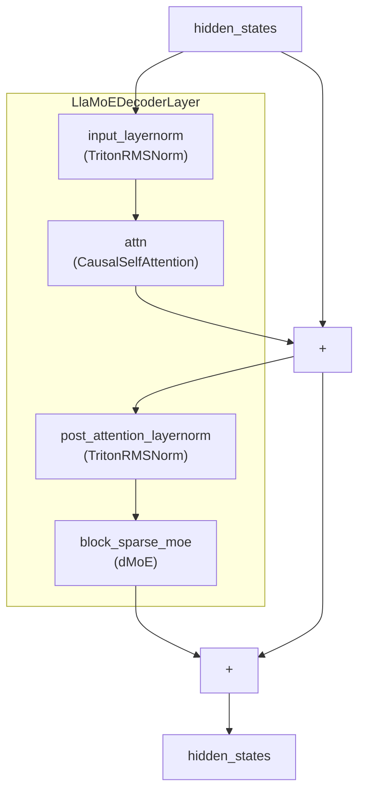
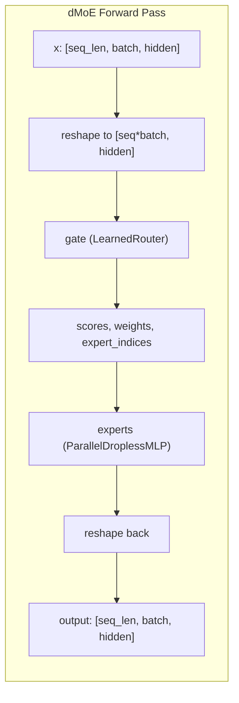
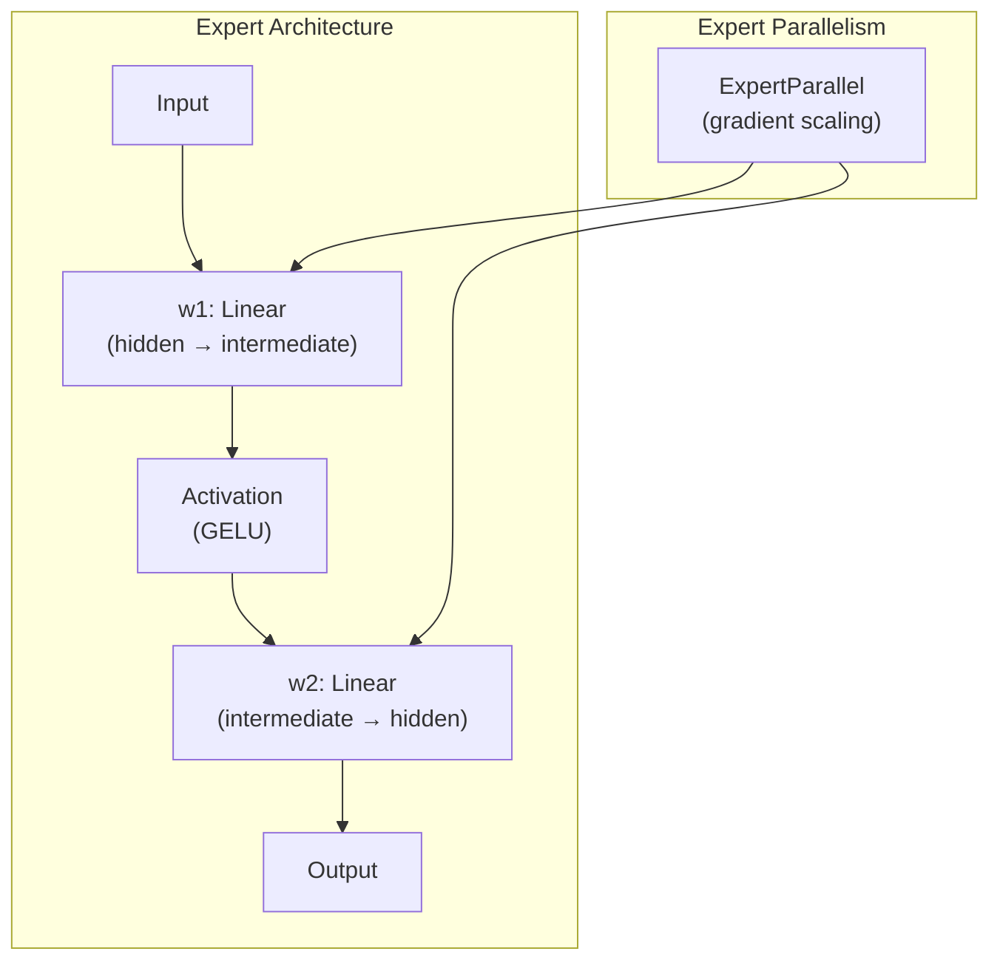
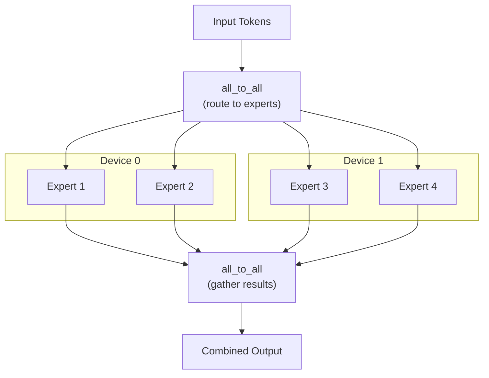

<!-- source: DeepWiki mcp.deepwiki.com · repo huggingface/nanotron · page 3.4 Mixture of Experts (MoE) · fetched 2026-10-26 -->

# Mixture of Experts (MoE)

<details>
<summary>Relevant source files</summary>

The following files were used as context for generating this wiki page:

- [examples/moe/README.md](examples/moe/README.md)
- [examples/moe/config_llamoe.py](examples/moe/config_llamoe.py)
- [examples/moe/config_llamoe.yaml](examples/moe/config_llamoe.yaml)
- [examples/moe/llamoe.py](examples/moe/llamoe.py)
- [examples/moe/moe.py](examples/moe/moe.py)
- [examples/moe/requirements.txt](examples/moe/requirements.txt)
- [examples/moe/train_moe.py](examples/moe/train_moe.py)
- [src/nanotron/models/starcoder2.py](src/nanotron/models/starcoder2.py)

</details>


This document covers the Mixture of Experts (MoE) implementation in Nanotron, which enables scaling model capacity while maintaining computational efficiency through sparse expert routing. The MoE system allows training large models where only a subset of parameters (experts) are activated for each token, reducing the computational cost per forward pass.

For information about general model architectures, see [Supported Models](#3). For distributed training strategies, see [Distributed Training](#4).

## Overview

The MoE implementation in Nanotron replaces traditional feed-forward network (FFN) layers with a sparse MoE block that routes tokens to a subset of expert networks. This approach allows models to scale to much larger parameter counts while keeping computational costs manageable.

The system consists of three main components:
- **Router**: Determines which experts should process each token
- **Experts**: Individual FFN networks that specialize in different aspects of the data
- **Expert Parallelism**: Distributed execution strategy for scaling across multiple devices



**Sources:** [examples/moe/moe.py:35-77](), [examples/moe/llamoe.py:548-553]()

## Core Architecture

The MoE system integrates into the standard transformer architecture by replacing MLP layers with `dMoE` modules. Each decoder layer contains both attention and MoE components.



**Sources:** [examples/moe/llamoe.py:528-575]()

## Key Components

### dMoE Module

The `dMoE` class is the central MoE implementation that coordinates token routing and expert computation.

| Component | Class | Purpose |
|-----------|-------|---------|
| Router | `LearnedRouter` | Routes tokens to appropriate experts |
| Expert Computer | `ParallelDroplessMLP` | Handles distributed expert computation |
| Gate | `torch.nn.Linear` | Learned routing weights |



**Sources:** [examples/moe/moe.py:35-77]()

### LearnedRouter

The router determines which experts should process each token using a learned linear transformation followed by softmax scoring.

```python
# Key parameters from LlaMoEConfig
moe_num_experts: int = 4        # Total number of experts
num_experts_per_tok: int = 1    # How many experts process each token
```

The router supports both top-1 and top-k routing strategies:
- **Top-1**: Each token is processed by the highest-scoring expert
- **Top-k**: Each token is processed by the k highest-scoring experts

**Sources:** [examples/moe/moe.py:80-97](), [examples/moe/config_llamoe.py:52-57]()

### Expert Networks

Expert computation is handled by the `ParallelDroplessMLP` class, which supports two modes:

| Mode | Class | Use Case |
|------|-------|----------|
| Single Expert | `MLP` | One expert per device rank |
| Multiple Experts | `SparseMLP` | Multiple experts per device rank |



**Sources:** [examples/moe/moe.py:459-509](), [examples/moe/moe.py:412-457]()

## Configuration

MoE models are configured using the `LlaMoEConfig` class, which extends the base Llama configuration with MoE-specific parameters.

### Core MoE Parameters

| Parameter | Type | Description | Default |
|-----------|------|-------------|---------|
| `moe_num_experts` | `int` | Total number of expert networks | 1 |
| `num_experts_per_tok` | `int` | Number of experts activated per token | 1 |
| `moe_capacity_factor` | `int` | Controls expert load balancing | 1 |

### Expert Parallelism Configuration

Expert parallelism is configured through the `ParallelismArgs`:

```yaml
parallelism:
  dp: 1                    # Data parallelism
  pp: 1                    # Pipeline parallelism  
  tp: 2                    # Tensor parallelism
  expert_parallel_size: 2  # Expert parallelism degree
```

The number of experts must be divisible by `expert_parallel_size` to ensure proper load distribution.

**Sources:** [examples/moe/config_llamoe.py:26-67](), [examples/moe/config_llamoe.yaml:92-99]()

## Expert Parallelism

Expert parallelism distributes experts across multiple devices to enable scaling beyond single-device memory limits. The system supports two execution modes:

### Local Execution (Single Device)

When `expert_parallel_size = 1`, all experts reside on a single device and computation is purely local.

### Distributed Execution (Multi-Device)

When `expert_parallel_size > 1`, experts are distributed across devices with coordinated communication:



### Gradient Scaling

The `ExpertParallel` wrapper ensures proper gradient scaling for expert parameters, as gradients are not automatically averaged across the expert parallel group like in data parallelism.

**Sources:** [examples/moe/moe.py:202-293](), [examples/moe/moe.py:394-410]()

## Training and Usage

### Dependencies

MoE training requires additional dependencies:

```txt
stanford-stk>=0.0.6    # Sparse tensor operations
megablocks==0.5.1      # MoE building blocks
```

### Training Script

The training process uses the standard Nanotron training pipeline with MoE-specific model classes:

```python
# Key classes for MoE training
trainer = DistributedTrainer(
    config_file, 
    model_config_class=LlaMoEConfig,
    model_class=LlaMoEForTraining
)
```

### Environment Setup

MoE training requires specific environment configuration:

```bash
export CUDA_DEVICE_MAX_CONNECTIONS=1  # Required for distributed operations
```

**Sources:** [examples/moe/train_moe.py:36](), [examples/moe/requirements.txt:1-3](), [examples/moe/README.md:19]()

## Performance Considerations

### Memory Efficiency

MoE achieves memory efficiency through:
- **Sparse Activation**: Only `num_experts_per_tok` experts are active per token
- **Parameter Sharing**: Expert parameters can be distributed across devices
- **Gradient Scaling**: Proper handling of gradients in expert parallel groups

### Load Balancing

The router learns to balance load across experts, though additional load balancing mechanisms may be needed for optimal performance in production scenarios.

**Sources:** [examples/moe/moe.py:115-117](), [examples/moe/moe.py:421-423]()

---

