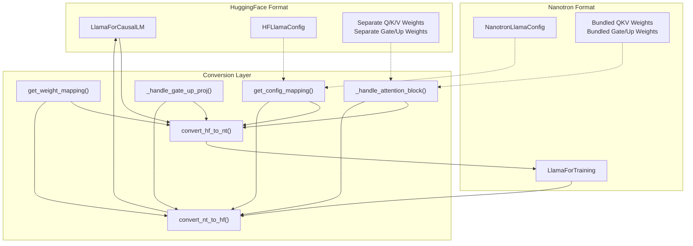
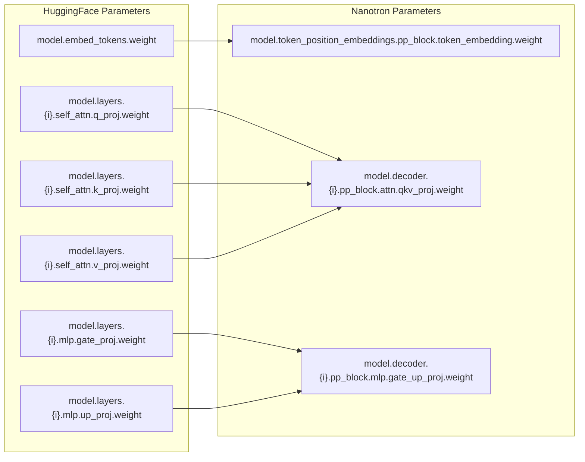
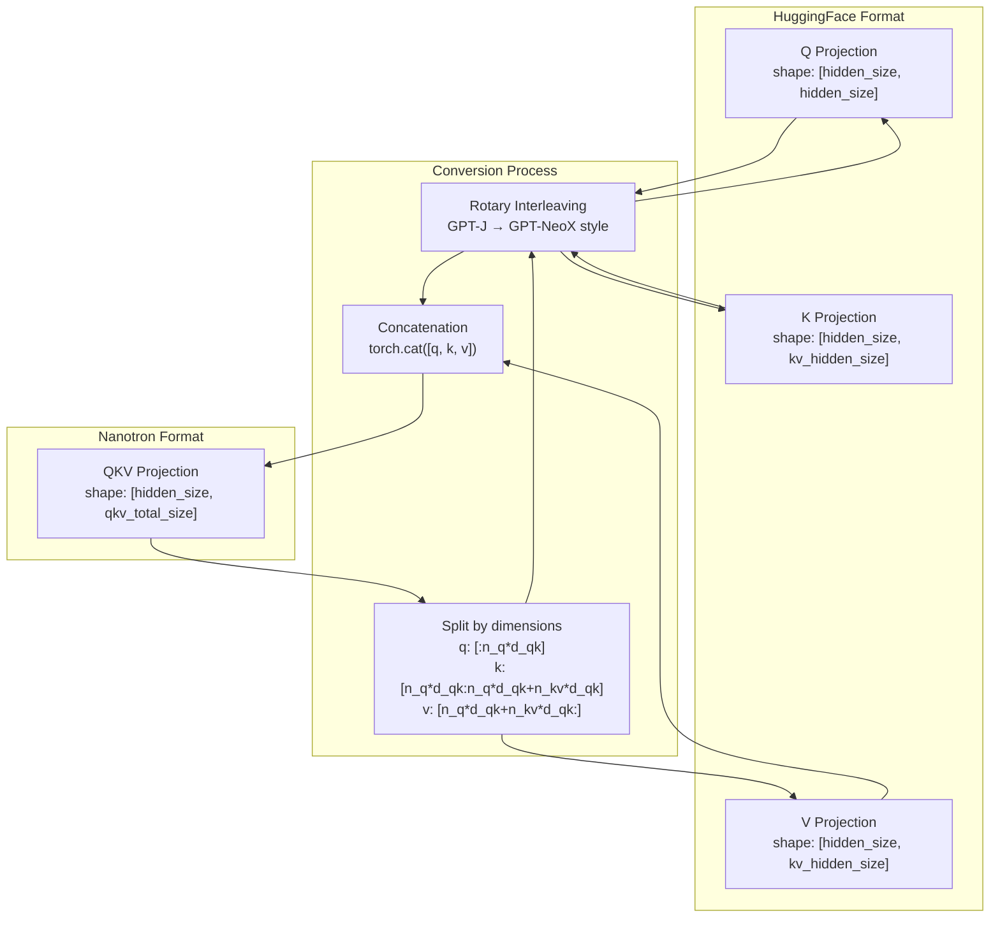
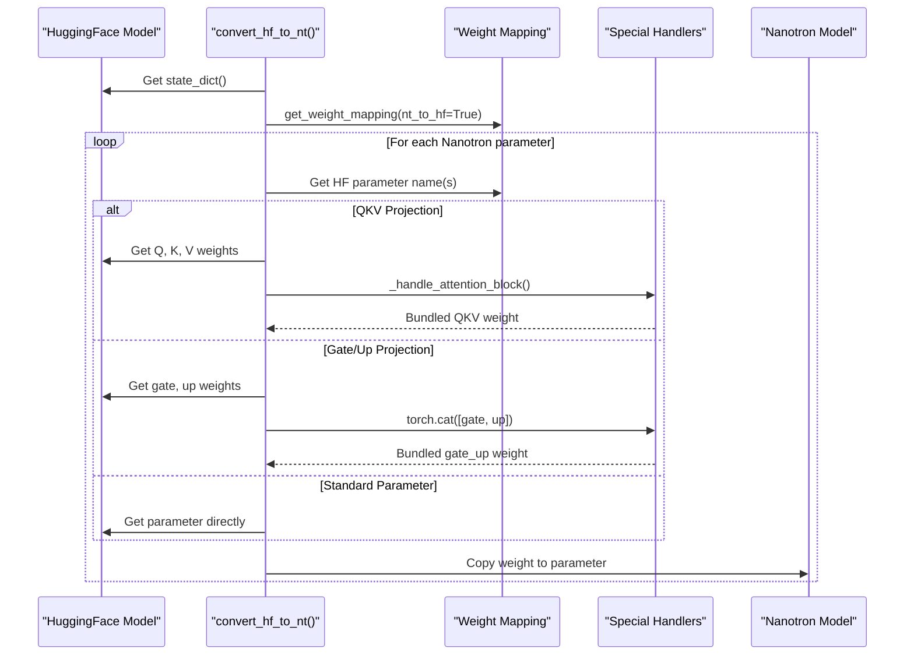
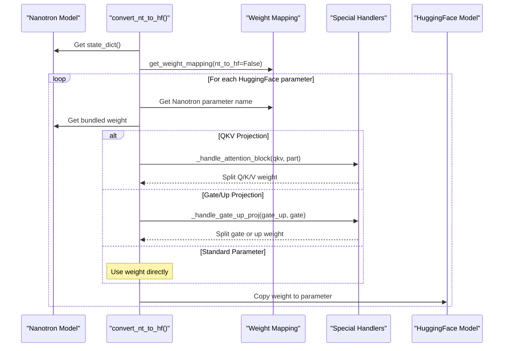
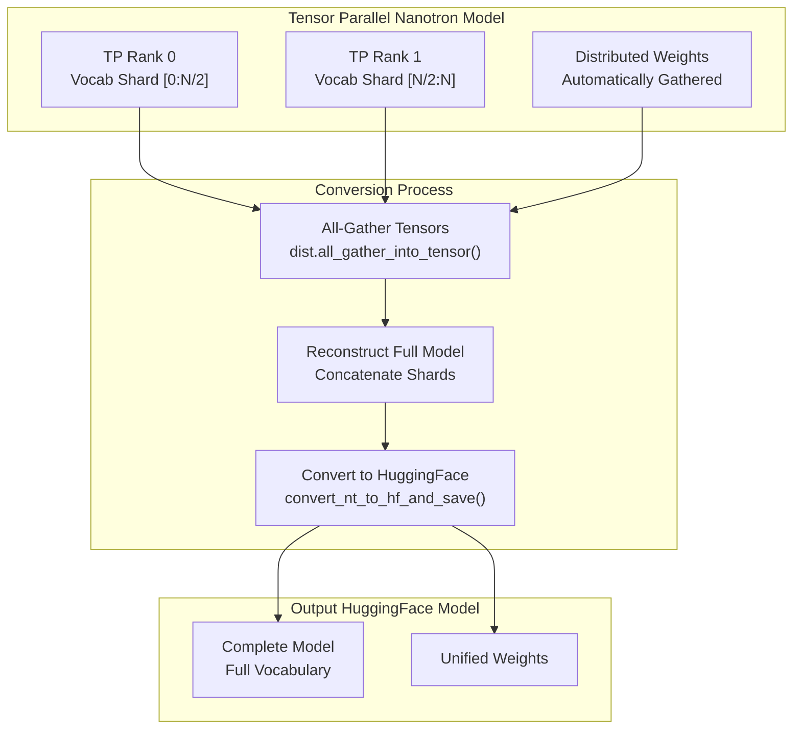
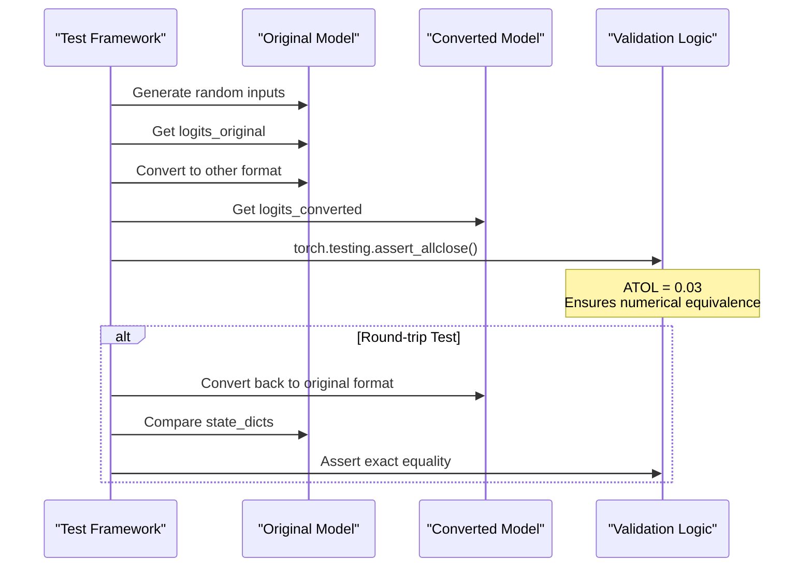

<!-- source: DeepWiki mcp.deepwiki.com · repo huggingface/nanotron · page 3.5 Model Conversion · fetched 2026-10-26 -->

# Model Conversion

Relevant source files

The following files were used as context for generating this wiki page:

- [examples/llama/README.md](examples/llama/README.md)
- [examples/llama/__init__.py](examples/llama/__init__.py)
- [examples/llama/convert_hf_to_nanotron.py](examples/llama/convert_hf_to_nanotron.py)
- [examples/llama/convert_nanotron_to_hf.py](examples/llama/convert_nanotron_to_hf.py)
- [examples/llama/convert_weights.py](examples/llama/convert_weights.py)
- [examples/llama/tests/test_conversion.py](examples/llama/tests/test_conversion.py)
- [examples/llama/tests/test_conversion.py.orig](examples/llama/tests/test_conversion.py.orig)
- [examples/llama/tests/utils.py](examples/llama/tests/utils.py)

This document covers the model conversion utilities that enable bidirectional conversion between Nanotron and HuggingFace model formats. The conversion system handles weight transformations, configuration mapping, and preserves model functionality across different distributed training setups.

For information about the specific model architectures that can be converted, see [Llama Models](#3.1), [Qwen Models](#3.2), and [Mamba Models](#3.3). For details about checkpoint management and serialization, see [Checkpoint Management](#7.1).

## Overview

The model conversion system provides utilities to transform models between Nanotron's distributed training format and HuggingFace's standard format. This enables users to:

- Convert pre-trained HuggingFace models for use in Nanotron training
- Export Nanotron-trained models back to HuggingFace format for inference or deployment
- Maintain numerical equivalence between model formats
- Handle complex weight transformations like QKV bundling and attention interleaving

## Core Conversion Architecture

Sources: [examples/llama/convert_hf_to_nanotron.py:52-92](), [examples/llama/convert_nanotron_to_hf.py:71-107](), [examples/llama/convert_weights.py:20-91]()

## Weight Mapping System

The conversion system uses a comprehensive mapping between HuggingFace and Nanotron parameter names to handle the different weight organization schemes.

### Parameter Name Mapping

### Key Mapping Functions

| Function | Purpose | Location |
|----------|---------|----------|
| `get_weight_mapping()` | Maps parameter names between formats | [examples/llama/convert_weights.py:20-60]() |
| `get_config_mapping()` | Maps configuration attributes | [examples/llama/convert_weights.py:63-90]() |
| `_handle_attention_block()` | Processes QKV weight bundling/unbundling | [examples/llama/convert_nanotron_to_hf.py:25-58]() |
| `_handle_gate_up_proj()` | Processes gate/up projection bundling | [examples/llama/convert_nanotron_to_hf.py:60-68]() |

Sources: [examples/llama/convert_weights.py:20-91](), [examples/llama/convert_nanotron_to_hf.py:25-68]()

## Attention Weight Transformation

One of the most complex aspects of conversion is handling attention weights, which are organized differently between formats and require rotary embedding interleaving adjustments.

### QKV Weight Bundling

Sources: [examples/llama/convert_hf_to_nanotron.py:23-49](), [examples/llama/convert_nanotron_to_hf.py:25-58]()

## Conversion Functions

### HuggingFace to Nanotron Conversion

The `convert_hf_to_nt()` function transfers weights from a HuggingFace model to a Nanotron model:

### Nanotron to HuggingFace Conversion

The `convert_nt_to_hf()` function performs the reverse transformation:

Sources: [examples/llama/convert_hf_to_nanotron.py:52-92](), [examples/llama/convert_nanotron_to_hf.py:71-107]()

## File-Based Conversion

The system provides command-line utilities for converting saved models:

### Conversion Scripts

| Script | Purpose | Key Function |
|--------|---------|--------------|
| `convert_hf_to_nanotron.py` | HF checkpoint → Nanotron format | `convert_checkpoint_and_save()` |
| `convert_nanotron_to_hf.py` | Nanotron checkpoint → HF format | `convert_checkpoint_and_save()` |

### Conversion Workflow

```mermaid
flowchart TD
    subgraph "HF to Nanotron"
        HF_Load["Load HuggingFace Model<br/>LlamaForCausalLM.from_pretrained()"]
        HF_Config["Extract Configuration<br/>get_nanotron_config()"]
        NT_Create["Create Nanotron Model<br/>load_nanotron_model()"]
        HF_Convert["Convert Weights<br/>convert_hf_to_nt()"]
        NT_Save["Save Nanotron Checkpoint<br/>nanotron.serialize.save_weights()"]
    end
    
    subgraph "Nanotron to HF"
        NT_Load["Load Nanotron Model<br/>load_nanotron_model()"]
        NT_Config["Extract Configuration<br/>get_hf_config()"]
        HF_Create["Create HuggingFace Model<br/>LlamaForCausalLM._from_config()"]
        NT_Convert["Convert Weights<br/>convert_nt_to_hf()"]
        HF_Save["Save HuggingFace Model<br/>model.save_pretrained()"]
    end
    
    HF_Load --> HF_Config
    HF_Config --> NT_Create
    NT_Create --> HF_Convert
    HF_Convert --> NT_Save
    
    NT_Load --> NT_Config
    NT_Config --> HF_Create
    HF_Create --> NT_Convert
    NT_Convert --> HF_Save
```

Sources: [examples/llama/convert_hf_to_nanotron.py:100-121](), [examples/llama/convert_nanotron_to_hf.py:115-144]()

## Tensor Parallel Conversion Support

The conversion system handles models trained with tensor parallelism, automatically reconstructing the full model from distributed shards.

### Parallel Model Handling

Sources: [examples/llama/tests/test_conversion.py:271-333](), [nanotron/serialize.py]()

## Testing and Validation

The conversion system includes comprehensive tests to ensure correctness:

### Test Categories

| Test Type | Purpose | Key Functions |
|-----------|---------|---------------|
| Bidirectional | Tests both conversion directions | `test_nt_to_hf()`, `test_hf_to_nt()` |
| File-based | Tests checkpoint conversion | `test_nt_to_hf_with_files()`, `test_hf_to_nt_with_files()` |
| Round-trip | Tests conversion reversibility | `test_composed_conversion()` |
| Tensor Parallel | Tests distributed model conversion | `test_tensor_parallel_conversion()` |

### Validation Process

Sources: [examples/llama/tests/test_conversion.py:136-333]()

## Supported Model Types

The conversion system currently supports:

- **Llama models**: Full conversion support with all architectural features
- **Qwen2 models**: Complete support including attention mechanisms
- **Configuration classes**: `NanotronLlamaConfig`, `NanotronQwen2Config`

### Model-Specific Considerations

| Model Type | Special Handling | Configuration Class |
|------------|------------------|-------------------|
| Llama | Standard QKV bundling, RMSNorm | `NanotronLlamaConfig` |
| Qwen2 | Position IDs handling, SDPA attention | `NanotronQwen2Config` |

Sources: [examples/llama/tests/test_conversion.py:41-92](), [nanotron/config.py]()

---

