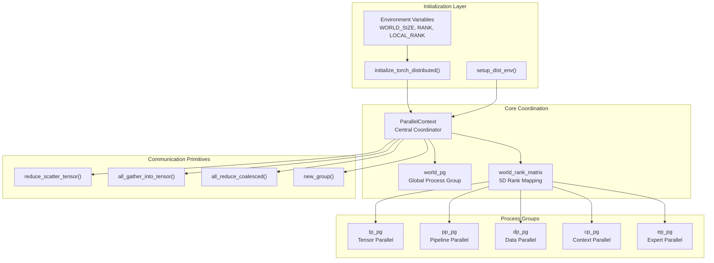
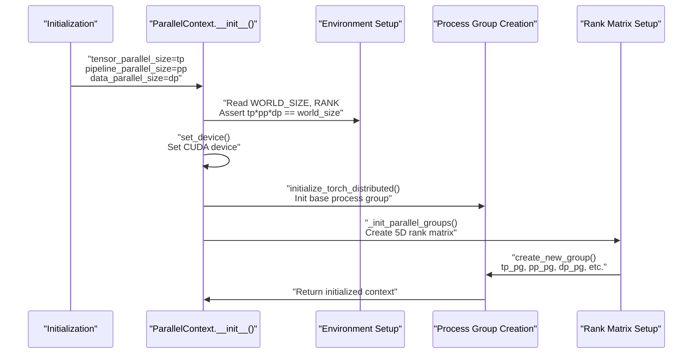
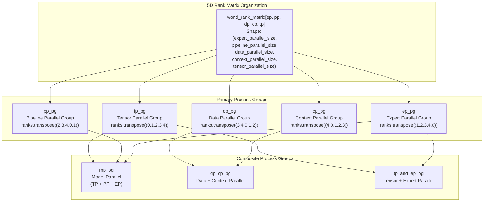
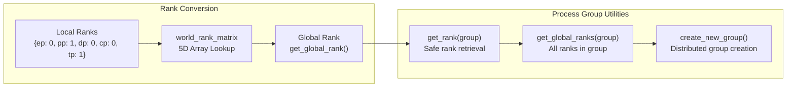
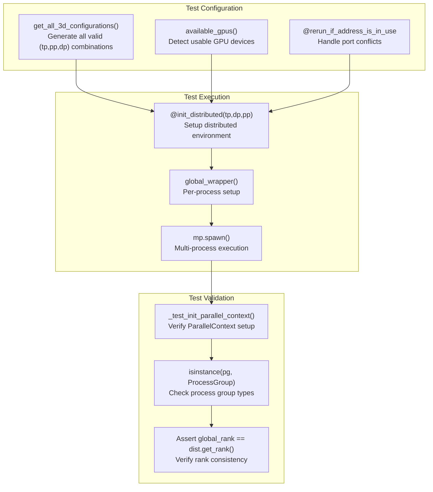

<!-- source: DeepWiki mcp.deepwiki.com · repo huggingface/nanotron · page 4 Distributed Training · fetched 2026-10-26 -->

# Distributed Training

Relevant source files

The following files were used as context for generating this wiki page:

- [src/nanotron/distributed.py](src/nanotron/distributed.py)
- [src/nanotron/parallel/context.py](src/nanotron/parallel/context.py)
- [tests/helpers/utils.py](tests/helpers/utils.py)
- [tests/test_distributed.py](tests/test_distributed.py)

This document covers Nanotron's distributed training architecture, which enables efficient large-scale model training across multiple GPUs and nodes using 3D parallelism (tensor, pipeline, and data parallelism). The distributed training system manages process groups, communication patterns, and coordination between different parallelism strategies.

For specific parallelism implementation details, see [Tensor Parallelism](#4.3), [Pipeline Parallelism](#4.4), and [3D Parallelism](#4.2). For cluster deployment, see [Multi-Node Training](#4.5). For process group management, see [Parallel Context](#4.1).

## Architecture Overview

Nanotron's distributed training system is built around the `ParallelContext` class, which acts as the central coordinator for all distributed operations. The system supports multiple forms of parallelism simultaneously and manages the complex process group topology required for efficient communication.

### Distributed Training System Architecture

Sources: [src/nanotron/parallel/context.py:12-183](), [src/nanotron/distributed.py:249-279](), [tests/helpers/utils.py:246-276]()

## ParallelContext Core Components

The `ParallelContext` class manages the initialization and coordination of all distributed training components. It creates and maintains process groups for different parallelism strategies and provides utilities for rank mapping and communication.

### ParallelContext Initialization Flow

Sources: [src/nanotron/parallel/context.py:13-58](), [src/nanotron/parallel/context.py:59-122]()

## Process Group Management

The distributed training system uses a 5-dimensional rank matrix to organize processes across different parallelism dimensions. This matrix enables efficient creation of process groups for various communication patterns.

### Process Group Topology

Sources: [src/nanotron/parallel/context.py:62-122](), [src/nanotron/parallel/context.py:123-141]()

## Communication Primitives

Nanotron provides optimized communication primitives that wrap PyTorch's distributed operations with additional functionality for version compatibility and error handling.

| Function | Purpose | Key Features |
|----------|---------|--------------|
| `reduce_scatter_tensor()` | Reduce and scatter tensors | PyTorch 1.12+ compatibility |
| `all_gather_into_tensor()` | Gather tensors from all ranks | Memory-efficient gathering |
| `reduce_scatter_coalesced()` | Batch reduce-scatter operations | Coalesced for efficiency |
| `all_gather_coalesced()` | Batch all-gather operations | NCCL-compatible implementation |
| `all_reduce_coalesced()` | Batch all-reduce operations | Single-rank optimization |
| `new_group()` | Create process groups | Timeout and validation |

Sources: [src/nanotron/distributed.py:21-153](), [src/nanotron/distributed.py:225-247]()

## Rank Management and Utilities

The system provides utilities for converting between local ranks in different parallelism dimensions and global ranks, enabling flexible communication patterns.

### Rank Conversion System

Sources: [src/nanotron/parallel/context.py:151-182](), [src/nanotron/distributed.py:225-247]()

## Testing and Development Support

The distributed training system includes comprehensive testing utilities that support various GPU configurations and automatically handle common distributed training issues.

### Testing Infrastructure

Sources: [tests/helpers/utils.py:110-276](), [tests/test_distributed.py:14-46]()

## Environment Setup Requirements

Distributed training requires specific environment variables to be set for proper initialization:

| Environment Variable | Purpose | Example |
|---------------------|---------|---------|
| `WORLD_SIZE` | Total number of processes | `8` |
| `RANK` | Global rank of current process | `0-7` |
| `LOCAL_RANK` | Local rank on current node | `0-7` |
| `LOCAL_WORLD_SIZE` | Processes per node | `8` |
| `MASTER_ADDR` | Master node address | `"localhost"` |
| `MASTER_PORT` | Master node port | `29500` |

The system automatically validates that the parallelism configuration matches the available world size: `tensor_parallel_size * pipeline_parallel_size * data_parallel_size * context_parallel_size * expert_parallel_size == WORLD_SIZE`.

Sources: [src/nanotron/parallel/context.py:23-28](), [src/nanotron/distributed.py:249-279](), [tests/helpers/utils.py:247-258]()

---

