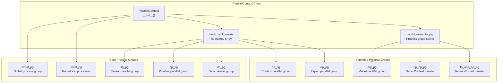
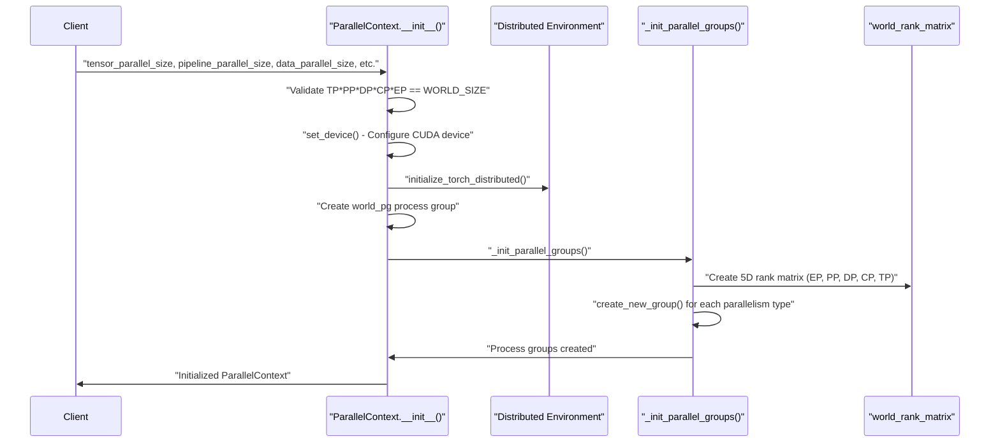
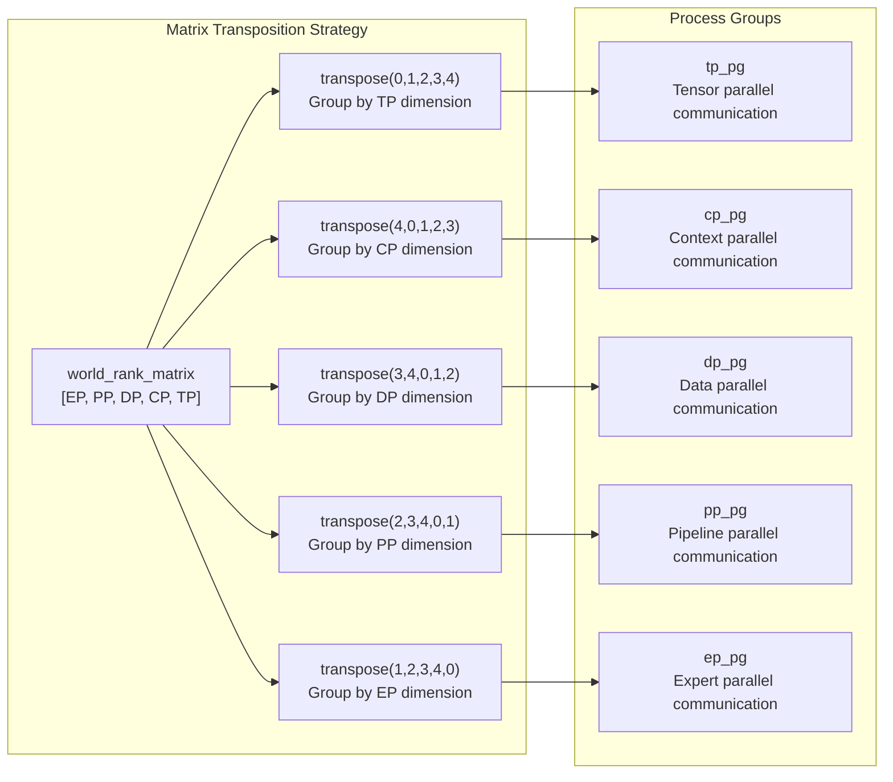

<!-- source: DeepWiki mcp.deepwiki.com · repo huggingface/nanotron · page 4.1 Parallel Context · fetched 2026-10-26 -->

# Parallel Context

<details>
<summary>Relevant source files</summary>

The following files were used as context for generating this wiki page:

- [src/nanotron/distributed.py](src/nanotron/distributed.py)
- [src/nanotron/parallel/context.py](src/nanotron/parallel/context.py)
- [tests/helpers/utils.py](tests/helpers/utils.py)
- [tests/test_distributed.py](tests/test_distributed.py)

</details>


The Parallel Context system provides the foundational distributed computing infrastructure for Nanotron's 3D parallelism architecture. It manages process group creation, rank mapping, and distributed environment setup across tensor parallel (TP), pipeline parallel (PP), data parallel (DP), context parallel (CP), and expert parallel (EP) dimensions.

For information about how these parallelism strategies work together, see [3D Parallelism](#4.2). For specific implementation details of individual parallelism types, see [Tensor Parallelism](#4.3) and [Pipeline Parallelism](#4.4).

## System Architecture

The `ParallelContext` class serves as the central coordinator for all distributed process groups in Nanotron. It establishes a 5-dimensional rank matrix that maps global ranks to their positions across all parallelism dimensions and creates the necessary process groups for efficient communication patterns.

### Process Group Hierarchy



Sources: [src/nanotron/parallel/context.py:12-183](), [src/nanotron/parallel/context.py:59-122]()

## Initialization Process

The `ParallelContext` initialization follows a structured sequence that validates parallelism configuration, sets up the distributed environment, and creates all necessary process groups.

### Initialization Flow



Sources: [src/nanotron/parallel/context.py:13-57](), [src/nanotron/parallel/context.py:59-122]()

## Rank Matrix and Coordinate System

The core innovation of `ParallelContext` is its 5-dimensional rank matrix that provides a systematic way to map between global ranks and local coordinates across all parallelism dimensions.

### Rank Matrix Structure

| Dimension | Index | Purpose | Size Variable |
|-----------|-------|---------|---------------|
| 0 | EP | Expert Parallel | `expert_parallel_size` |
| 1 | PP | Pipeline Parallel | `pipeline_parallel_size` |
| 2 | DP | Data Parallel | `data_parallel_size` |  
| 3 | CP | Context Parallel | `context_parallel_size` |
| 4 | TP | Tensor Parallel | `tensor_parallel_size` |

The matrix is constructed using numpy reshaping: `ranks.reshape((expert_parallel_size, pipeline_parallel_size, data_parallel_size, context_parallel_size, tensor_parallel_size))`.

Sources: [src/nanotron/parallel/context.py:62-70](), [src/nanotron/parallel/context.py:120-121]()

### Key Methods

- **`get_global_rank(ep_rank, pp_rank, dp_rank, cp_rank, tp_rank)`**: Converts 5D coordinates to global rank using `world_rank_matrix[ep_rank, pp_rank, dp_rank, cp_rank, tp_rank]`
- **`get_local_ranks(world_rank)`**: Converts global rank to 5D coordinates using `np.where(world_rank_matrix == world_rank)`
- **`create_new_group(all_groups_ranks)`**: Creates process groups with caching via `world_ranks_to_pg` dictionary

Sources: [src/nanotron/parallel/context.py:163-183](), [src/nanotron/parallel/context.py:151-155](), [src/nanotron/parallel/context.py:123-141]()

## Process Group Creation Patterns

Each parallelism type requires specific communication patterns, implemented through targeted process group creation using matrix transpositions.

### Process Group Creation Logic



Sources: [src/nanotron/parallel/context.py:76-82]()

## Device Management

The `ParallelContext` handles CUDA device assignment automatically based on the local rank within each node.

### Device Setup Process

```python
def set_device(self):
    local_rank = int(os.getenv("LOCAL_RANK", "0"))
    device_id = local_rank
    torch.cuda.set_device(torch.cuda.device(device_id))
```

The system assumes homogeneous nodes (same number of GPUs per node) and maps `LOCAL_RANK` directly to CUDA device ID. This coordination happens before distributed initialization to ensure each process binds to the correct GPU.

Sources: [src/nanotron/parallel/context.py:142-149]()

## Usage Patterns

### Basic Initialization

```python
parallel_context = ParallelContext(
    tensor_parallel_size=2,
    pipeline_parallel_size=2, 
    data_parallel_size=4,
    context_parallel_size=1,
    expert_parallel_size=1
)
```

### Accessing Process Groups

Process groups are accessed as attributes:
- `parallel_context.tp_pg` - Tensor parallel group
- `parallel_context.pp_pg` - Pipeline parallel group  
- `parallel_context.dp_pg` - Data parallel group
- `parallel_context.world_pg` - Global process group

### Cleanup

The `destroy()` method properly tears down all process groups:
```python
parallel_context.destroy()
```

Sources: [src/nanotron/parallel/context.py:156-161](), [tests/helpers/utils.py:258-259]()

## Integration with Distributed Training

The `ParallelContext` is typically initialized early in the training process and passed to other components that need distributed coordination. The testing infrastructure in [tests/helpers/utils.py:246-276]() demonstrates the standard initialization pattern used throughout the framework.

Sources: [src/nanotron/parallel/context.py:12-183](), [tests/helpers/utils.py:246-276](), [tests/test_distributed.py:14-34]()

---

