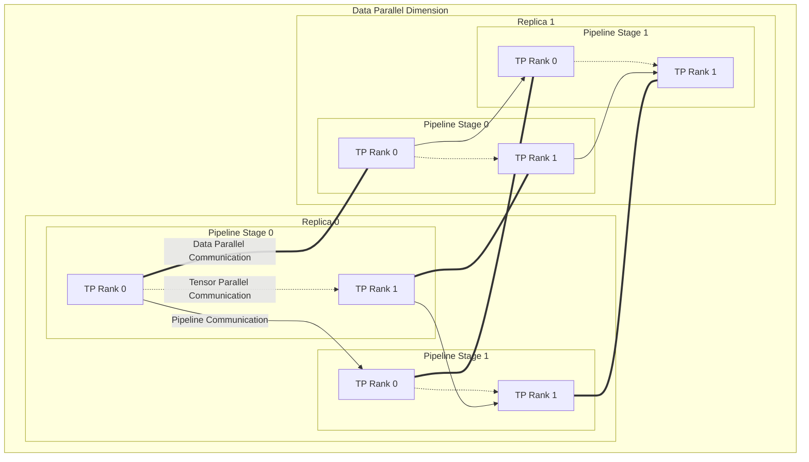
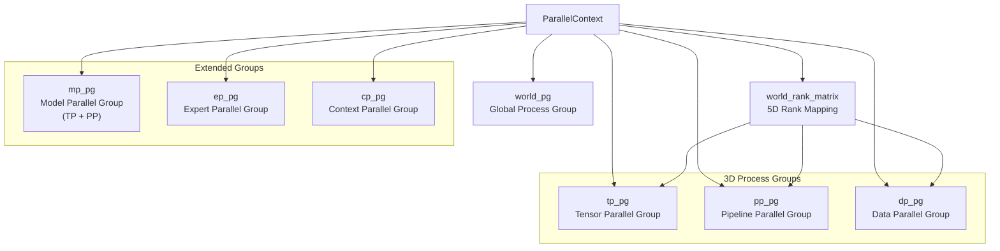
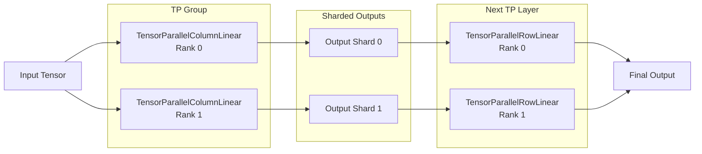
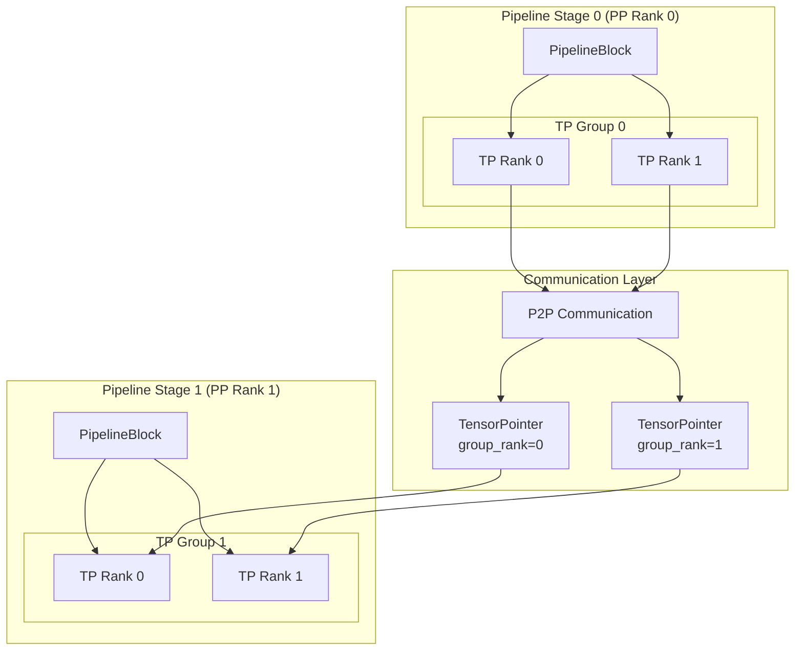
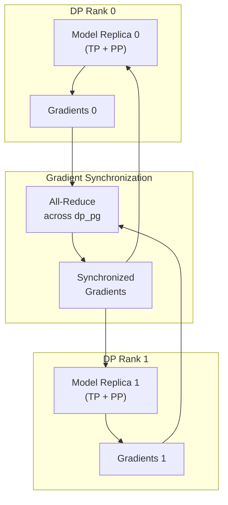
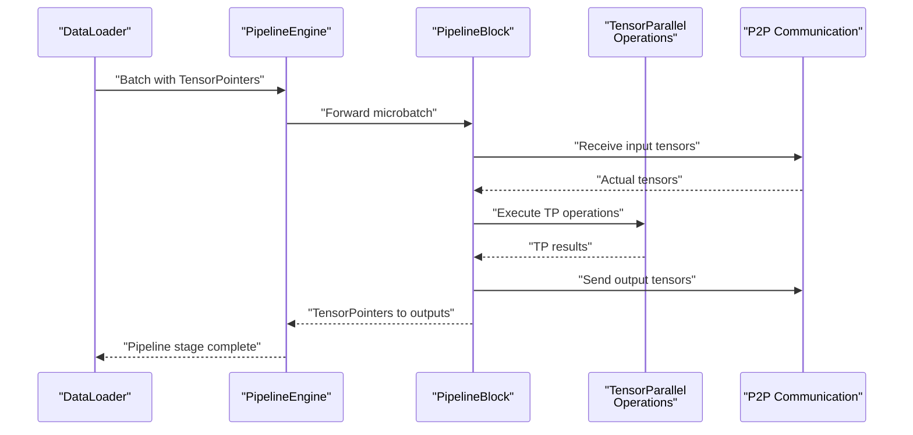
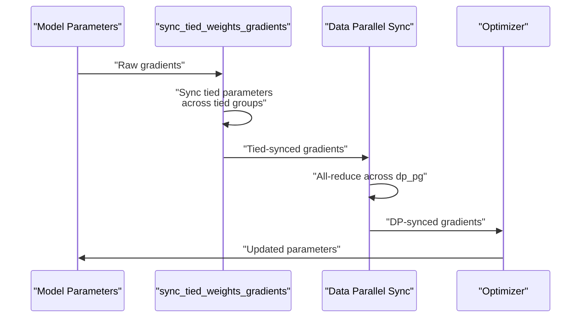

<!-- source: DeepWiki mcp.deepwiki.com · repo huggingface/nanotron · page 4.2 3D Parallelism · fetched 2026-10-26 -->

# 3D Parallelism

Relevant source files

The following files were used as context for generating this wiki page:

- [README.md](README.md)
- [docs/3d_parallelism.md](docs/3d_parallelism.md)
- [docs/docs.md](docs/docs.md)
- [pyproject.toml](pyproject.toml)
- [src/nanotron/__init__.py](src/nanotron/__init__.py)
- [tests/test_clip_grads.py](tests/test_clip_grads.py)
- [tests/test_data_parallel.py](tests/test_data_parallel.py)
- [tests/test_p2p.py](tests/test_p2p.py)
- [tests/test_parameters_accumulate_gradient_in_fp32.py](tests/test_parameters_accumulate_gradient_in_fp32.py)
- [tests/test_pipeline_parallel.py](tests/test_pipeline_parallel.py)
- [tests/test_random_state.py](tests/test_random_state.py)
- [tests/test_serialize.py](tests/test_serialize.py)
- [tests/test_tensor_parallel.py](tests/test_tensor_parallel.py)
- [tests/test_tie_weights.py](tests/test_tie_weights.py)
- [tests/test_zero.py](tests/test_zero.py)

This document explains how Nanotron implements 3D parallelism by combining tensor parallelism (TP), pipeline parallelism (PP), and data parallelism (DP) to enable training of large language models across multiple GPUs and nodes. 

For details on individual parallelism strategies, see [Tensor Parallelism](#4.3), [Pipeline Parallelism](#4.4), and [Parameter Management](#4.6). For the central coordination system, see [Parallel Context](#4.1).

## Overview

3D parallelism allows scaling model training across three orthogonal dimensions simultaneously. Each dimension addresses different bottlenecks:

- **Tensor Parallelism (TP)**: Shards individual operations (like matrix multiplications) across multiple devices
- **Pipeline Parallelism (PP)**: Splits the model into sequential stages across different devices  
- **Data Parallelism (DP)**: Replicates the model across multiple devices, each processing different data

### 3D Parallelism Architecture

Sources: [README.md:168](), [docs/3d_parallelism.md:1-400]()

## ParallelContext: Central Coordination

The `ParallelContext` class serves as the central coordinator for all three parallelism dimensions, managing the process groups required for distributed communication.

### Process Group Management

The `ParallelContext` provides process groups for each parallelism dimension:

| Process Group | Purpose | Communication Pattern |
|---------------|---------|----------------------|
| `tp_pg` | Tensor parallel operations | All-reduce, All-gather, Reduce-scatter |
| `pp_pg` | Pipeline stage communication | Point-to-point send/recv |
| `dp_pg` | Data parallel gradient sync | All-reduce |
| `mp_pg` | Combined model parallel (TP+PP) | Mixed patterns |

Sources: [tests/test_clip_grads.py:14](), [tests/test_tensor_parallel.py:8](), [tests/test_pipeline_parallel.py:9]()

## Tensor Parallelism Integration

Tensor parallelism in 3D parallelism shards individual operations across the `tp_pg` process group while maintaining consistency with pipeline and data parallelism.

### Tensor Parallel Operations

Key tensor parallel components:
- `TensorParallelColumnLinear`: Shards output features across TP ranks
- `TensorParallelRowLinear`: Shards input features across TP ranks  
- `TensorParallelEmbedding`: Shards vocabulary across TP ranks

Sources: [tests/test_tensor_parallel.py:10-14](), [tests/test_clip_grads.py:20-24]()

## Pipeline Parallelism Integration

Pipeline parallelism divides the model into sequential stages across the `pp_pg` process group, with each stage potentially using tensor parallelism internally.

### Pipeline Stage Communication

Pipeline parallelism uses:
- `PipelineBlock`: Wraps model layers for pipeline execution
- `TensorPointer`: References tensors on other pipeline ranks
- `P2P`: Handles point-to-point communication between pipeline stages
- `PipelineEngine`: Orchestrates forward/backward scheduling (AFAB, 1F1B)

Sources: [tests/test_pipeline_parallel.py:10-17](), [docs/3d_parallelism.md:99-243]()

## Data Parallelism Integration

Data parallelism replicates the entire model (including its TP and PP structure) across multiple `dp_pg` groups, with each replica processing different data.

### Gradient Synchronization

Data parallelism features:
- Standard DDP-style gradient synchronization
- ZeRO-1 optimizer for memory efficiency
- Support for gradient accumulation with FP32 precision

Sources: [tests/test_parameters_accumulate_gradient_in_fp32.py:140-301](), [tests/test_zero.py:25-198]()

## Training Workflow

The complete 3D parallelism training workflow coordinates all three dimensions:

### Forward Pass Flow

### Gradient Synchronization Flow

Key integration points:
1. `ParallelContext` coordinates all process groups
2. `PipelineEngine` manages scheduling across pipeline stages
3. Tensor parallel operations execute within each pipeline stage
4. Data parallel synchronization happens after backward pass
5. Tied parameters are synchronized across their specific groups

Sources: [tests/test_clip_grads.py:36-192](), [tests/test_serialize.py:312-614](), [docs/3d_parallelism.md:182-400]()

## Memory and Communication Optimization

3D parallelism enables several memory and communication optimizations:

- **FP32 Gradient Accumulation**: Higher precision gradients stored separately from FP16 model weights
- **ZeRO-1 Optimizer**: Shards optimizer states across data parallel ranks
- **Asynchronous Communication**: Overlaps computation with communication in tensor parallel operations
- **Gradient Clipping**: Coordinated across all parallelism dimensions

The combination of these three parallelism strategies allows Nanotron to scale efficiently across large GPU clusters while maintaining training stability and convergence properties.

Sources: [tests/test_parameters_accumulate_gradient_in_fp32.py:36-138](), [pyproject.toml:1-71](), [README.md:166-185]()

---

