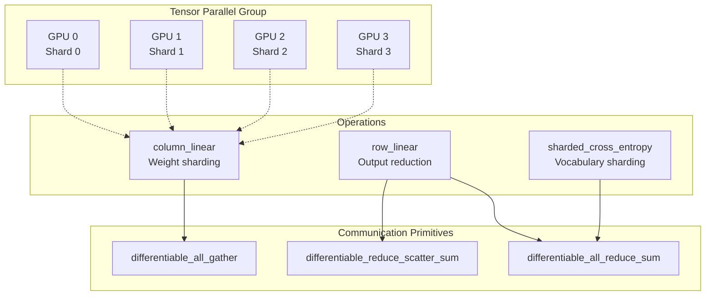
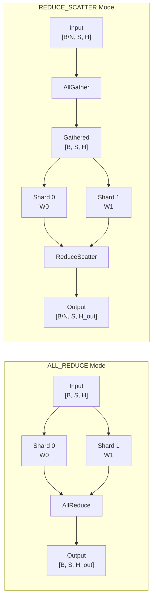
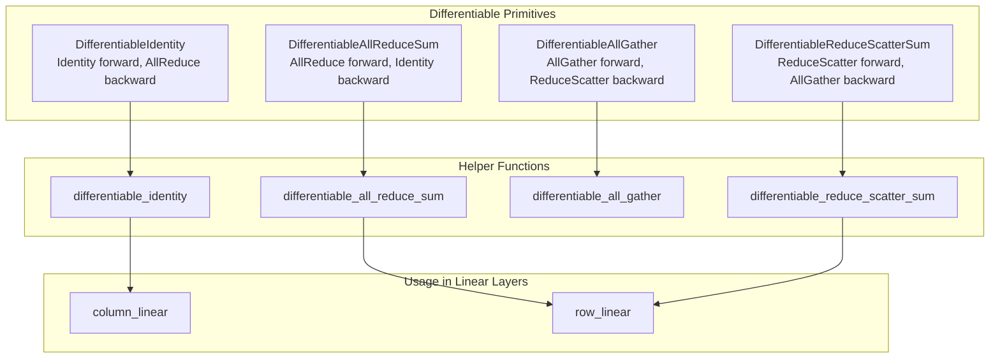
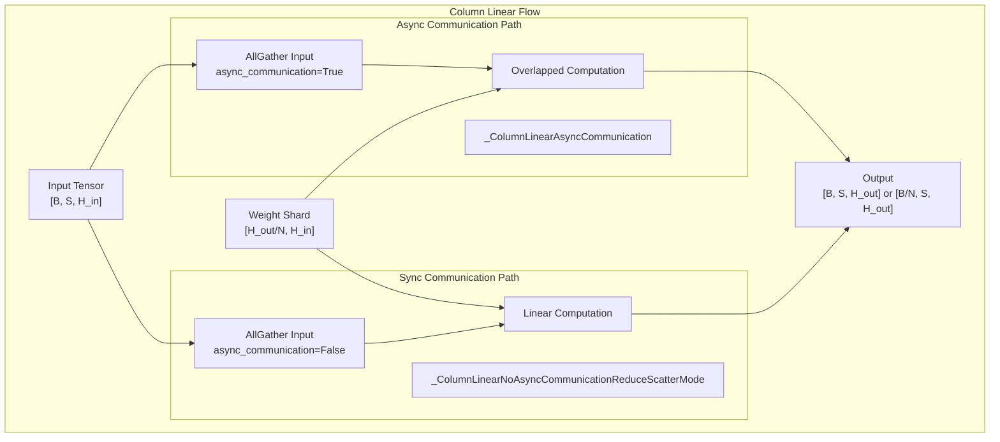
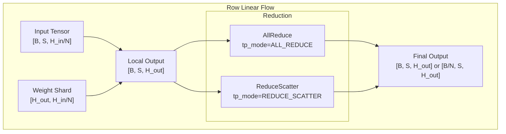
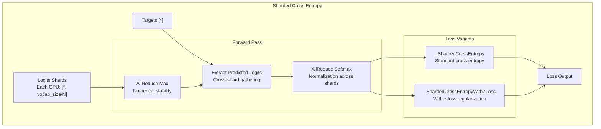
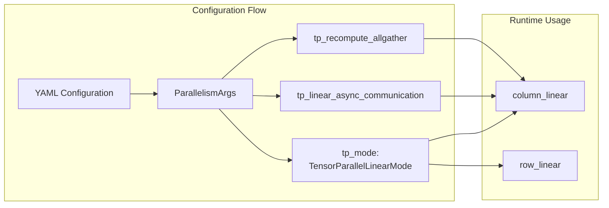
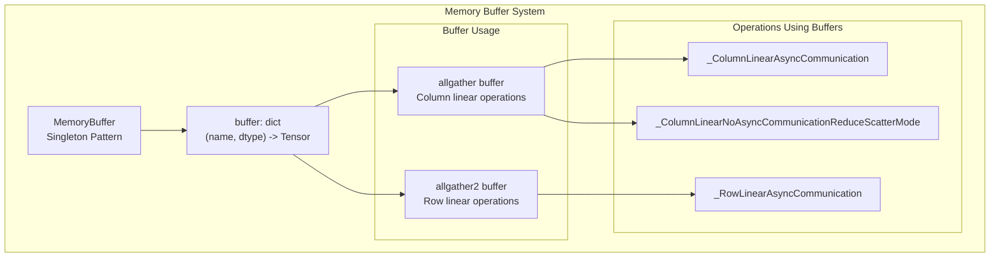
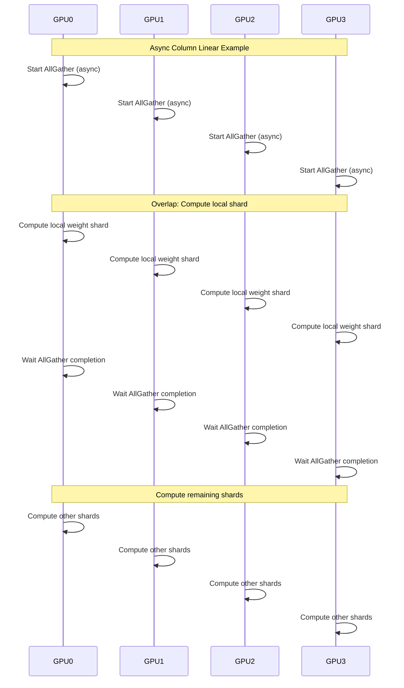

<!-- source: DeepWiki mcp.deepwiki.com · repo huggingface/nanotron · page 4.3 Tensor Parallelism · fetched 2026-10-26 -->

# Tensor Parallelism

Relevant source files

The following files were used as context for generating this wiki page:

- [src/nanotron/config/parallelism_config.py](src/nanotron/config/parallelism_config.py)
- [src/nanotron/parallel/tensor_parallel/distributed_differentiable_primitives.py](src/nanotron/parallel/tensor_parallel/distributed_differentiable_primitives.py)
- [src/nanotron/parallel/tensor_parallel/functional.py](src/nanotron/parallel/tensor_parallel/functional.py)
- [src/nanotron/parallel/utils.py](src/nanotron/parallel/utils.py)
- [src/nanotron/utils.py](src/nanotron/utils.py)

This page covers the tensor parallelism implementation in Nanotron, including sharded linear operations, cross-entropy computation, and distributed communication primitives. Tensor parallelism enables splitting model parameters across multiple devices to handle larger models than would fit on a single device.

For information about pipeline parallelism, see [Pipeline Parallelism](#4.4). For the overall 3D parallelism strategy, see [3D Parallelism](#4.2). For parallel context management, see [Parallel Context](#4.1).

## Overview

Nanotron implements tensor parallelism (TP) by sharding model parameters across multiple devices within the same pipeline stage. The framework supports two primary modes of operation and provides optimized implementations for both column-wise and row-wise linear layer sharding.

**Sources:** [src/nanotron/parallel/tensor_parallel/functional.py:1-719](), [src/nanotron/parallel/tensor_parallel/distributed_differentiable_primitives.py:1-147]()

## Tensor Parallel Modes

Nanotron supports two tensor parallel modes defined in `TensorParallelLinearMode`:

| Mode | Description | Communication Pattern | Use Case |
|------|-------------|----------------------|----------|
| `ALL_REDUCE` | Standard tensor parallelism | AllReduce on outputs | Normal TP without sequence parallelism |
| `REDUCE_SCATTER` | Sequence parallelism enabled | ReduceScatter/AllGather | Memory-efficient long sequences |

**Sources:** [src/nanotron/parallel/tensor_parallel/enum.py](), [src/nanotron/config/parallelism_config.py:11-54]()

## Core Distributed Primitives

The tensor parallel operations rely on differentiable distributed primitives that maintain gradient flow during backpropagation:

**Sources:** [src/nanotron/parallel/tensor_parallel/distributed_differentiable_primitives.py:24-147]()

## Linear Layer Operations

### Column Linear Operations

Column linear operations shard the weight matrix along the output dimension. The `column_linear` function supports both synchronous and asynchronous communication:

**Sources:** [src/nanotron/parallel/tensor_parallel/functional.py:237-566]()

### Row Linear Operations

Row linear operations shard the weight matrix along the input dimension and require output reduction:

**Sources:** [src/nanotron/parallel/tensor_parallel/functional.py:569-719]()

## Sharded Cross Entropy

The framework provides optimized cross-entropy computation for sharded vocabularies, supporting both standard and z-loss regularized versions:

**Sources:** [src/nanotron/parallel/tensor_parallel/functional.py:31-235]()

## Configuration

Tensor parallelism configuration is managed through `ParallelismArgs`:

| Parameter | Type | Description |
|-----------|------|-------------|
| `tp` | `int` | Number of tensor parallel replicas |
| `tp_mode` | `TensorParallelLinearMode` | TP mode (ALL_REDUCE or REDUCE_SCATTER) |
| `tp_linear_async_communication` | `bool` | Enable async communication in linear layers |
| `tp_recompute_allgather` | `bool` | Recompute allgather in backward pass for memory |

**Sources:** [src/nanotron/config/parallelism_config.py:14-54]()

## Memory Management

Nanotron uses a global memory buffer system to optimize memory usage during tensor parallel operations:

**Sources:** [src/nanotron/parallel/utils.py:13-28](), [src/nanotron/parallel/tensor_parallel/functional.py:272-274](), [src/nanotron/parallel/tensor_parallel/functional.py:605-607]()

## Asynchronous Communication Patterns

For performance optimization, tensor parallel operations can overlap communication with computation:

**Sources:** [src/nanotron/parallel/tensor_parallel/functional.py:285-380](), [src/nanotron/parallel/tensor_parallel/functional.py:615-678]()

---

