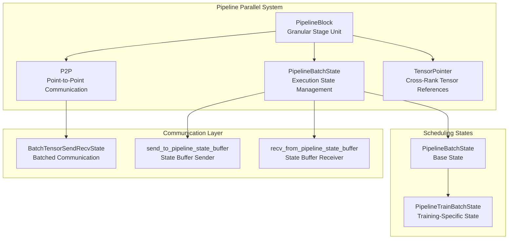
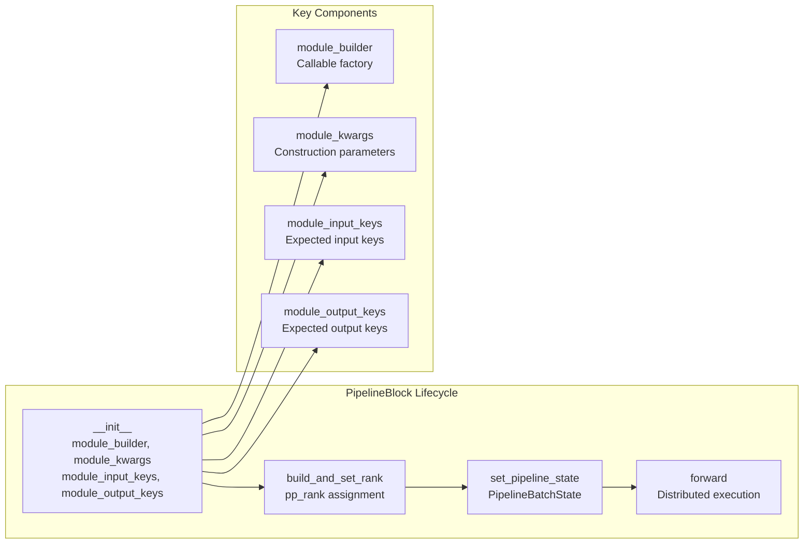
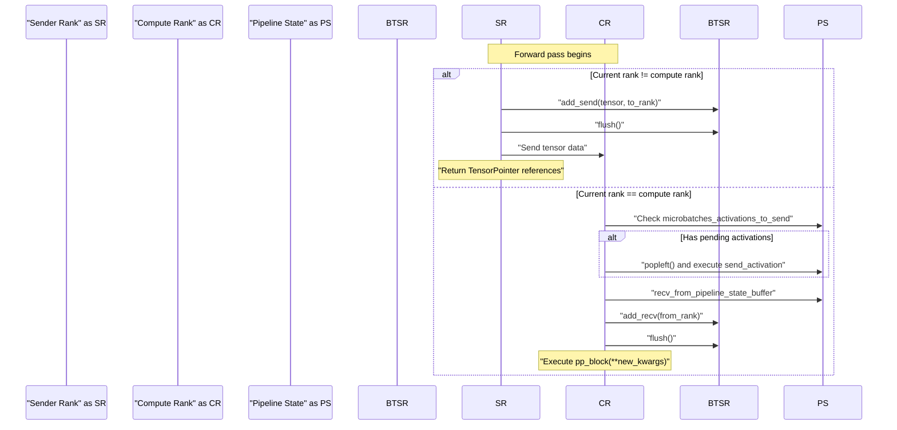
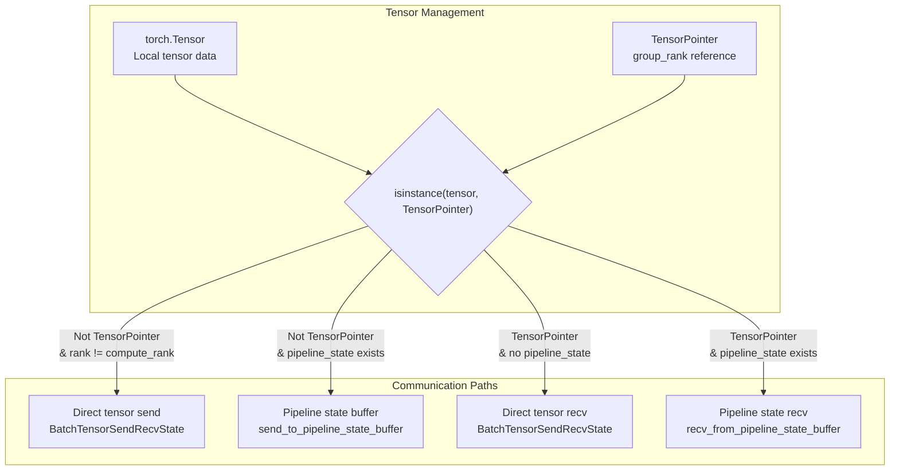
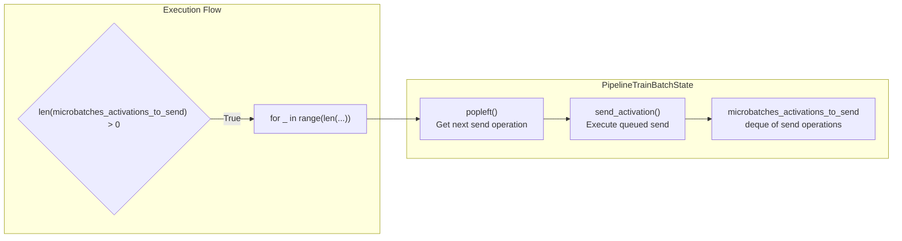
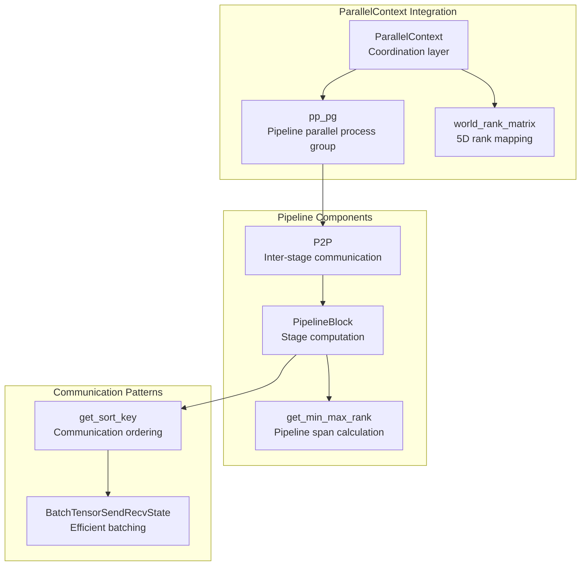
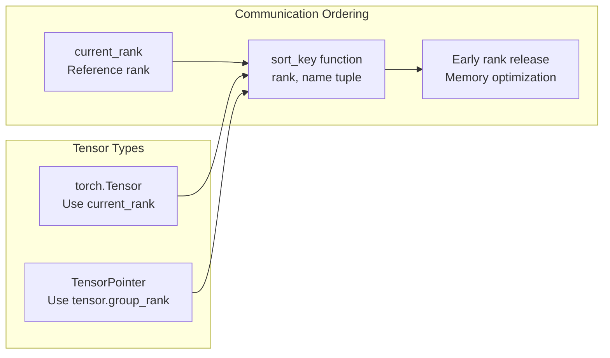

<!-- source: DeepWiki mcp.deepwiki.com · repo huggingface/nanotron · page 4.4 Pipeline Parallelism · fetched 2026-10-26 -->

# Pipeline Parallelism

<details>
<summary>Relevant source files</summary>

The following files were used as context for generating this wiki page:

- [.github/workflows/3d_parallelism_unit_tests.yaml](.github/workflows/3d_parallelism_unit_tests.yaml)
- [.github/workflows/code_quality.yaml](.github/workflows/code_quality.yaml)
- [.github/workflows/fa2_unit_tests.yaml](.github/workflows/fa2_unit_tests.yaml)
- [src/nanotron/parallel/pipeline_parallel/block.py](src/nanotron/parallel/pipeline_parallel/block.py)
- [tests/nanoset/test_build_nanoset_dataloader.py](tests/nanoset/test_build_nanoset_dataloader.py)
- [tests/pytest.ini](tests/pytest.ini)

</details>


Pipeline parallelism is one of the three core parallelization strategies in Nanotron's 3D parallelism system, enabling efficient training of large models by partitioning them across multiple pipeline stages. This document covers the implementation of pipeline blocks, inter-stage communication mechanisms, and scheduling strategies.

For information about the broader 3D parallelism coordination, see [3D Parallelism](#4.2). For tensor-level parallelization within stages, see [Tensor Parallelism](#4.3). For parallel process group management, see [Parallel Context](#4.1).

## Core Architecture

Pipeline parallelism in Nanotron is built around the concept of `PipelineBlock` - the most granular unit of pipeline computation. Each block encapsulates a module that executes on a specific pipeline rank, with sophisticated communication mechanisms to pass activations between stages.



Sources: [src/nanotron/parallel/pipeline_parallel/block.py:1-185]()

## PipelineBlock Implementation

The `PipelineBlock` class serves as the fundamental building block for pipeline parallelism, wrapping modules with distributed execution capabilities.

### Block Construction and Rank Assignment



Sources: [src/nanotron/parallel/pipeline_parallel/block.py:27-58]()

### Forward Pass Communication Protocol

The forward pass implements a sophisticated protocol for handling tensors and tensor pointers across pipeline ranks:



Sources: [src/nanotron/parallel/pipeline_parallel/block.py:60-163]()

## Tensor Pointer System

The `TensorPointer` mechanism enables efficient cross-rank tensor referencing without copying data until needed.



Sources: [src/nanotron/parallel/pipeline_parallel/block.py:112-149]()

## State Management

Pipeline execution state is managed through specialized state classes that coordinate micro-batch scheduling and activation buffering.

### State Class Hierarchy

| State Class | Purpose | Key Features |
|-------------|---------|--------------|
| `PipelineBatchState` | Base execution state | Buffer management, basic coordination |
| `PipelineTrainBatchState` | Training-specific state | Micro-batch scheduling, activation queuing |

### Activation Scheduling

For interleaved pipeline schedules, the system manages activation sending through queued operations:



Sources: [src/nanotron/parallel/pipeline_parallel/block.py:119-124]()

## Integration with 3D Parallelism

Pipeline parallelism coordinates with tensor and data parallelism through the parallel context system:



Sources: [src/nanotron/parallel/pipeline_parallel/block.py:166-184]()

## Error Handling and Validation

The pipeline system includes comprehensive validation to ensure correct configuration and execution:

### Input/Output Key Validation

The system enforces strict contracts on module interfaces:

```python
# Input validation
assert self.module_input_keys == set(kwargs.keys())

# Output validation  
assert self.module_output_keys == set(output.keys())
```

### Gradient Requirement Checks

When pipeline engines are not configured, the system prevents invalid gradient flows:

```python
if tensor.requires_grad is True:
    raise ValueError(
        f"Pipeline engine is None and tensor requires grad. "
        f"Usually that means that your model is pipeline sharded "
        f"and you haven't chosen a specific pipeline engine."
    )
```

Sources: [src/nanotron/parallel/pipeline_parallel/block.py:69-71](), [src/nanotron/parallel/pipeline_parallel/block.py:96-99](), [src/nanotron/parallel/pipeline_parallel/block.py:145-148](), [src/nanotron/parallel/pipeline_parallel/block.py:158-161]()

## Communication Optimization

The system optimizes communication through several mechanisms:

### Batched Communication

`BatchTensorSendRecvState` aggregates multiple tensor operations to reduce communication overhead.

### Early Rank Release

The `get_sort_key` function implements a strategy to free earlier ranks first, optimizing memory usage:



Sources: [src/nanotron/parallel/pipeline_parallel/block.py:172-184]()

## Testing and Validation

Pipeline parallelism is extensively tested across different configurations and scenarios:

### Multi-Configuration Testing

The test suite validates pipeline parallelism across various 3D parallelism configurations:

```python
@pytest.mark.parametrize("tp,dp,pp", [
    pytest.param(*all_3d_configs)
    for gpus in range(1, min(available_gpus(), 4) + 1)
    for all_3d_configs in get_all_3d_configurations(gpus)
])
```

### Recovery and Fault Tolerance

Tests validate dataloader recovery with pipeline parallelism, ensuring consistent behavior across failures.

Sources: [tests/nanoset/test_build_nanoset_dataloader.py:29-42](), [tests/nanoset/test_build_nanoset_dataloader.py:158-189]()

---

