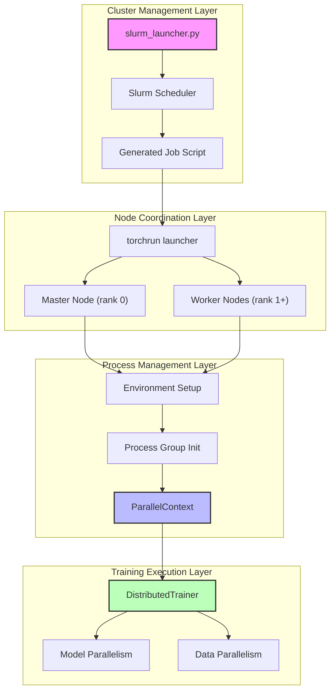
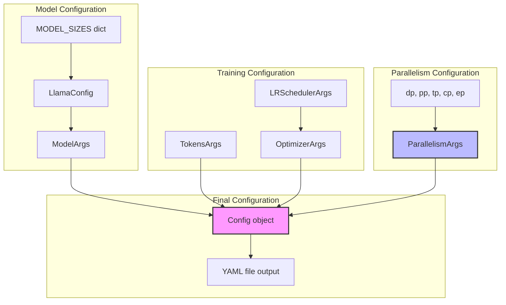
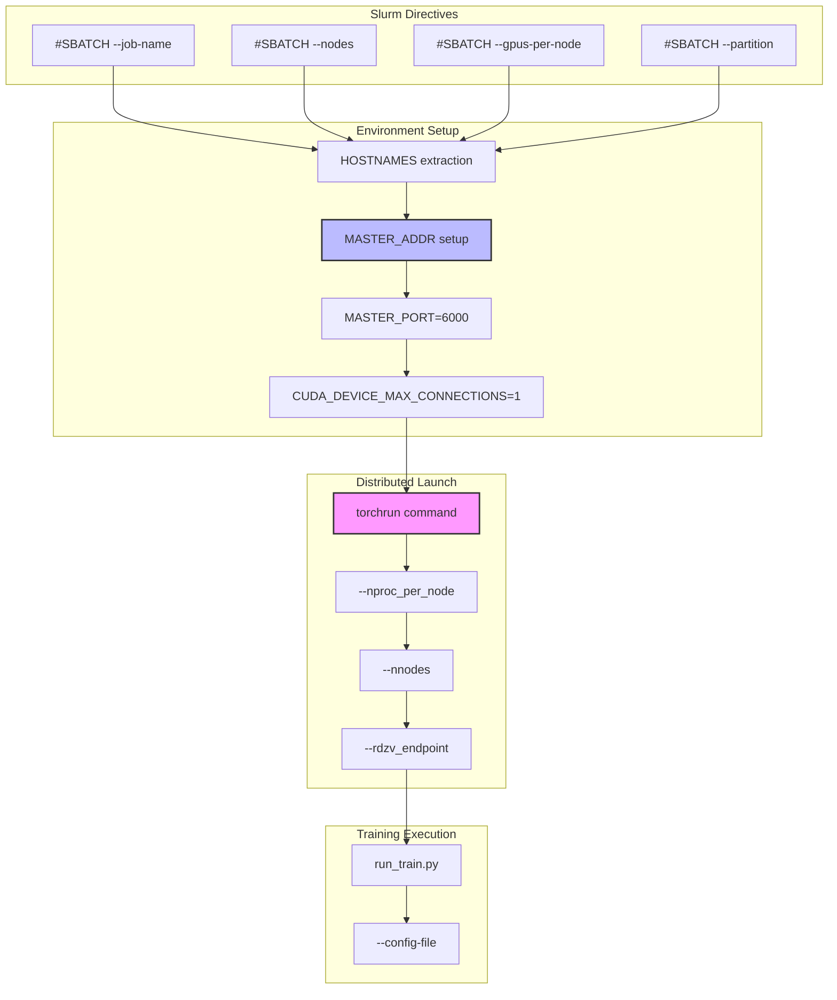
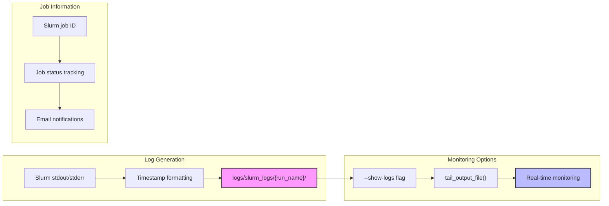

<!-- source: DeepWiki mcp.deepwiki.com · repo huggingface/nanotron · page 4.5 Multi-Node Training · fetched 2026-10-26 -->

# Multi-Node Training

<details>
<summary>Relevant source files</summary>

The following files were used as context for generating this wiki page:

- [docs/multi-node-training.md](docs/multi-node-training.md)
- [slurm_launcher.py](slurm_launcher.py)
- [src/nanotron/config/__init__.py](src/nanotron/config/__init__.py)
- [src/nanotron/metrics_logging.py](src/nanotron/metrics_logging.py)

</details>


This page covers Nanotron's multi-node training orchestration system, which manages the setup and execution of distributed training jobs across multiple compute nodes using Slurm workload manager. This includes job submission, resource allocation, environment configuration, and process coordination.

For information about the underlying parallelism strategies (data, tensor, pipeline), see [3D Parallelism](#4.2), [Tensor Parallelism](#4.3), and [Pipeline Parallelism](#4.4). For the core distributed training concepts and ParallelContext, see [Parallel Context](#4.1).

## Architecture Overview

Multi-node training in Nanotron follows a hierarchical orchestration pattern where the Slurm launcher manages cluster-level resources and process coordination, while the underlying parallelism engines handle the actual distributed computation.

### Multi-Node Training Architecture



Sources: [slurm_launcher.py:1-667]()

## Slurm Launcher System

The `slurm_launcher.py` script serves as the primary entry point for multi-node training, providing a unified interface for configuration generation, resource allocation, and job submission.

### Core Components

```mermaid
graph LR
    subgraph "Input Processing"
        ARGS["parse_args()"]
        MODEL_CONFIG["generate_model_config()"]
        NANO_CONFIG["create_nanotron_config()"]
    end
    
    subgraph "Script Generation"
        SLURM_SCRIPT["create_slurm_script()"]
        JOB_SUBMISSION["launch_slurm_job()"]
    end
    
    subgraph "Resource Calculation"
        PARALLELISM["ParallelismArgs"]
        GPU_ALLOCATION["GPU per Node Calculation"]
        NODE_COUNT["Node Count Calculation"]
    end
    
    ARGS --> MODEL_CONFIG
    MODEL_CONFIG --> NANO_CONFIG
    NANO_CONFIG --> PARALLELISM
    PARALLELISM --> GPU_ALLOCATION
    GPU_ALLOCATION --> NODE_COUNT
    NODE_COUNT --> SLURM_SCRIPT
    SLURM_SCRIPT --> JOB_SUBMISSION
    
    style NANO_CONFIG fill:#f9f,stroke:#333,stroke-width:2px
    style SLURM_SCRIPT fill:#bbf,stroke:#333,stroke-width:2px
```



The launcher handles three main responsibilities:

1. **Configuration Generation**: Creates Nanotron `Config` objects from command-line arguments
2. **Resource Planning**: Calculates node and GPU requirements based on parallelism settings
3. **Job Orchestration**: Generates and submits Slurm batch scripts

Sources: [slurm_launcher.py:82-204](), [slurm_launcher.py:441-591]()

### Resource Allocation Logic

The launcher calculates resource requirements using the parallelism constraint:

```
total_gpus = dp × pp × tp × cp × ep
nodes = total_gpus ÷ gpus_per_node
```

This calculation is implemented in the `create_slurm_script()` function:

| Parameter | Description | Code Reference |
|-----------|-------------|----------------|
| `dp` | Data parallelism degree | [slurm_launcher.py:327-337]() |
| `pp` | Pipeline parallelism degree | [slurm_launcher.py:327-337]() |
| `tp` | Tensor parallelism degree | [slurm_launcher.py:327-337]() |
| `cp` | Context parallelism degree | [slurm_launcher.py:331]() |
| `ep` | Expert parallelism degree | [slurm_launcher.py:332]() |

Sources: [slurm_launcher.py:465-467](), [slurm_launcher.py:327-337]()

## Configuration Management

The launcher generates comprehensive Nanotron configurations through the `create_nanotron_config()` function, which assembles multiple configuration components.

### Configuration Flow



### Predefined Model Configurations

The launcher includes predefined model architectures in the `MODEL_SIZES` dictionary:

| Model Size | Layers | Hidden Size | Attention Heads | KV Heads | FFN Size |
|------------|--------|-------------|-----------------|----------|----------|
| `160m` | 12 | 768 | 12 | 12 | 3072 |
| `1b` | 16 | 2048 | 16 | 16 | 5632 |
| `7b` | 32 | 4096 | 32 | 32 | 11008 |
| `70b` | 80 | 8192 | 64 | 8 | 28672 |

Sources: [slurm_launcher.py:64-79](), [slurm_launcher.py:292-438]()

## Job Submission and Execution

The Slurm job execution follows a structured process involving environment setup, process coordination, and distributed launch.

### Slurm Job Script Structure



### Environment Variables

The job script sets up critical environment variables for distributed coordination:

| Variable | Purpose | Value Source |
|----------|---------|--------------|
| `HOSTNAMES` | List of allocated nodes | `scontrol show hostnames` |
| `MASTER_ADDR` | Primary node for coordination | First hostname |
| `MASTER_PORT` | Communication port | Fixed at 6000 |
| `CUDA_DEVICE_MAX_CONNECTIONS` | GPU connection limit | Set to 1 |
| `WORLD_SIZE` | Total number of processes | `NNODES × GPUS_PER_NODE` |

Sources: [slurm_launcher.py:506-521](), [slurm_launcher.py:571-582]()

### Torchrun Integration

The distributed launch uses `torchrun` with specific parameters for multi-node coordination:

```bash
torchrun \
    --nproc_per_node {gpus_per_node} \
    --nnodes $COUNT_NODE \
    --rdzv_backend c10d \
    --rdzv_endpoint $MASTER_ADDR:$MASTER_PORT \
    --max_restarts 0 \
    --tee 3 \
    run_train.py --config-file {config_path}
```

Sources: [slurm_launcher.py:571-582]()

## Monitoring and Management

The launcher provides several mechanisms for job monitoring and management during execution.

### Logging and Output Management



### System Information Logging

The job script includes comprehensive system information logging for debugging:

- CUDA version verification
- PyTorch version and configuration
- Environment variables
- GPU status via `nvidia-smi`
- Python package inventory

Sources: [slurm_launcher.py:539-568](), [slurm_launcher.py:593-599]()

### Job Control Features

| Feature | Command Line Flag | Description |
|---------|------------------|-------------|
| Dry Run | `--dry-run` | Generate configs without submission |
| Log Monitoring | `--show-logs` | Real-time output display |
| Email Notifications | `--email` | Job status email alerts |
| Script Saving | `--slurm-scripts-dir` | Save generated Slurm scripts |

Sources: [slurm_launcher.py:202-203](), [slurm_launcher.py:487-490](), [slurm_launcher.py:639-644]()

---

