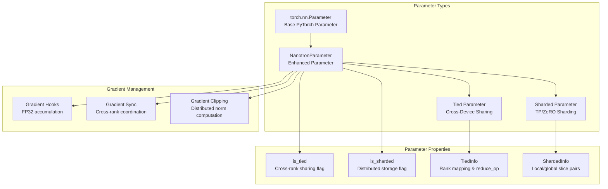
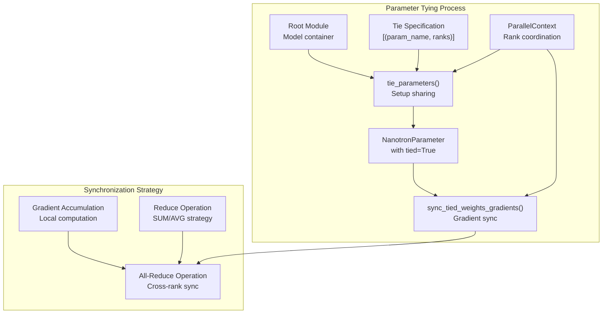
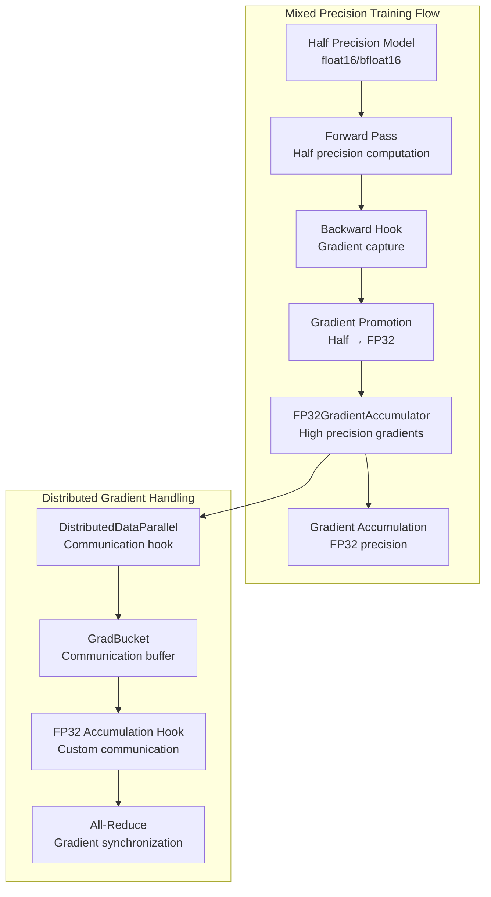
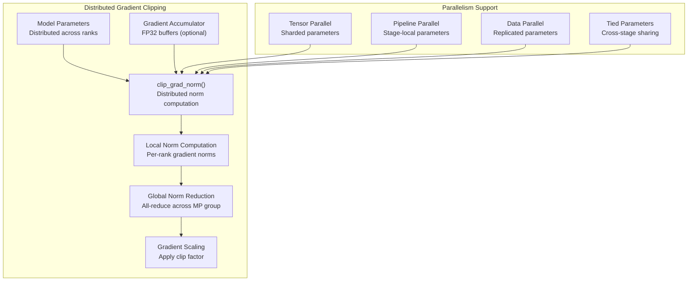
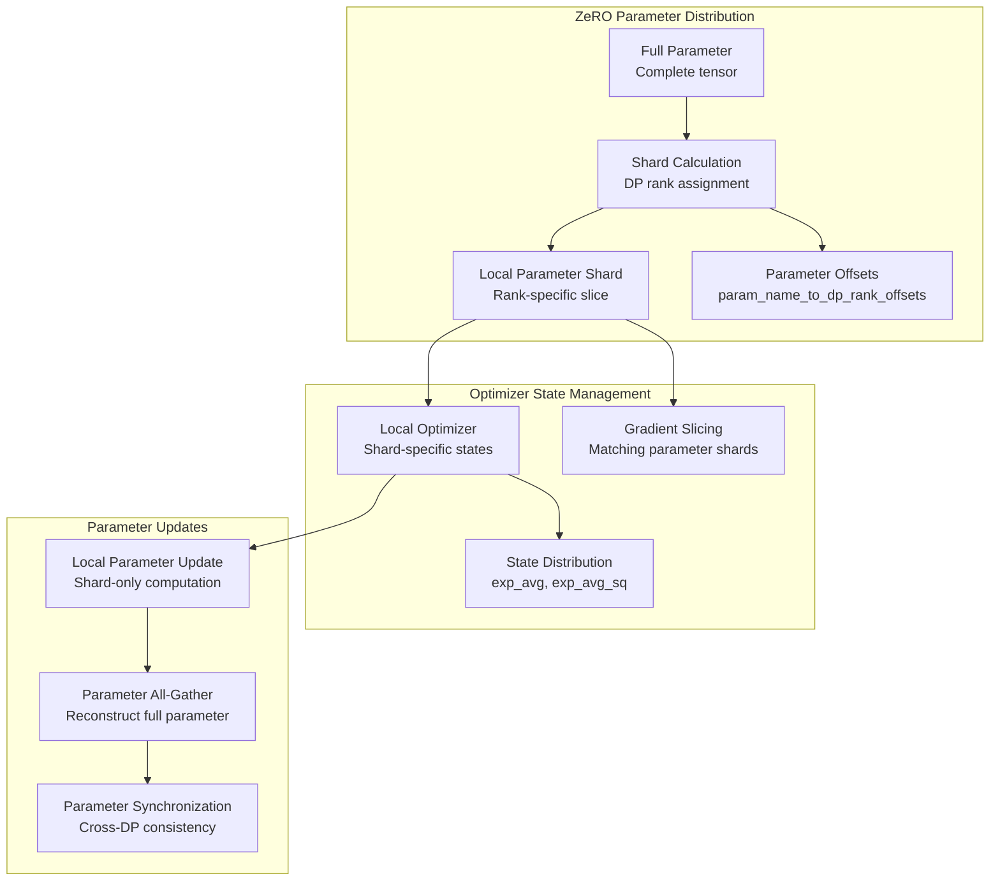
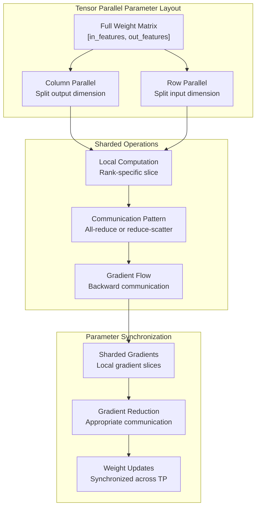
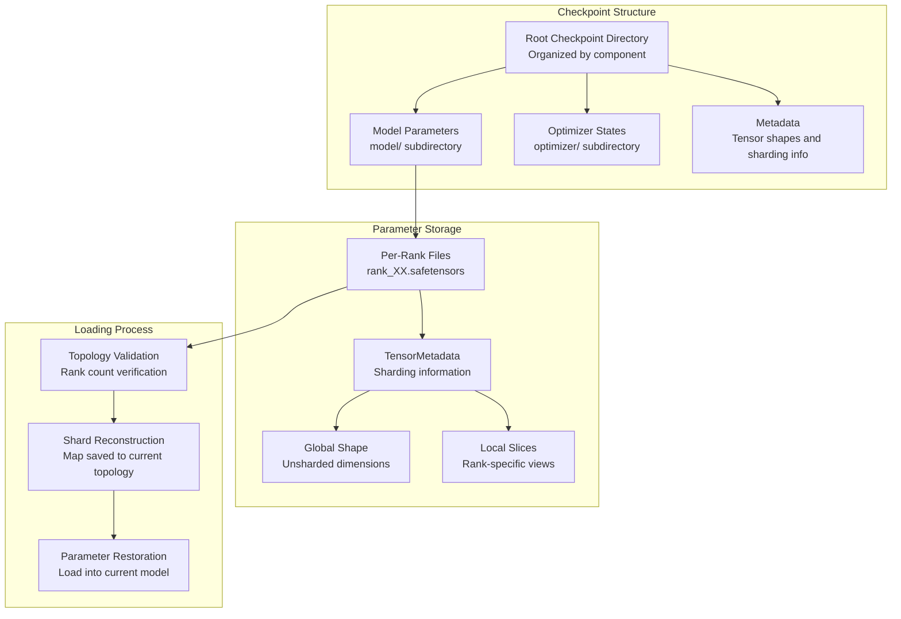
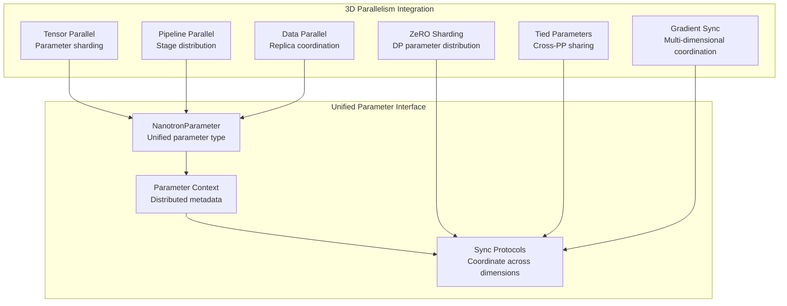

<!-- source: DeepWiki mcp.deepwiki.com · repo huggingface/nanotron · page 4.6 Parameter Management · fetched 2026-10-26 -->

# Parameter Management

Relevant source files

The following files were used as context for generating this wiki page:

- [tests/test_clip_grads.py](tests/test_clip_grads.py)
- [tests/test_data_parallel.py](tests/test_data_parallel.py)
- [tests/test_p2p.py](tests/test_p2p.py)
- [tests/test_parameters_accumulate_gradient_in_fp32.py](tests/test_parameters_accumulate_gradient_in_fp32.py)
- [tests/test_pipeline_parallel.py](tests/test_pipeline_parallel.py)
- [tests/test_random_state.py](tests/test_random_state.py)
- [tests/test_serialize.py](tests/test_serialize.py)
- [tests/test_tensor_parallel.py](tests/test_tensor_parallel.py)
- [tests/test_tie_weights.py](tests/test_tie_weights.py)
- [tests/test_zero.py](tests/test_zero.py)

Parameter Management in Nanotron handles the complex requirements of distributed training at scale, including parameter sharing across devices, gradient accumulation in mixed precision, parameter sharding strategies, and synchronization protocols. This system ensures efficient memory usage and correct gradient computation across tensor parallel, pipeline parallel, and data parallel configurations.

For information about the distributed training context and parallel strategies, see [Distributed Training](#4). For optimizer implementations that work with these parameter management features, see [Optimization and Schedulers](#6.2).

## NanotronParameter System

The `NanotronParameter` class extends PyTorch's standard `Parameter` to support distributed training requirements including parameter tying, sharding, and gradient accumulation hooks.

**Core Parameter Features:**
- **Tied Parameters**: Parameters shared across multiple devices with automatic synchronization
- **Sharded Parameters**: Parameters split across ranks for memory efficiency
- **Gradient Hooks**: Custom backward hooks for FP32 accumulation and synchronization
- **Metadata Tracking**: Rich information about parameter distribution and sharing

Sources: [tests/test_clip_grads.py:69-71](), [tests/test_tie_weights.py:94-97](), [tests/test_zero.py:272](), [tests/test_parameters_accumulate_gradient_in_fp32.py:41]()

## Tied Parameters

Tied parameters enable weight sharing across different devices and pipeline stages, crucial for embeddings and output layers that need to remain synchronized.

### Tied Parameter Configuration

**Tied Parameter Workflow:**
1. **Setup Phase**: `tie_parameters()` creates parameter sharing relationships
2. **Forward Pass**: Each rank computes with its local copy
3. **Backward Pass**: Gradients accumulate locally
4. **Synchronization**: `sync_tied_weights_gradients()` synchronizes gradients across tied ranks
5. **Update**: All tied copies receive the same parameter updates

Sources: [tests/test_tie_weights.py:25-36](), [tests/test_tie_weights.py:179-190](), [tests/test_tie_weights.py:221-222]()

### Tied Parameter Constraints

The system enforces important constraints on parameter tying:
- **Same DP Group**: Tied parameters must be within the same data parallel group
- **Cross-PP Allowed**: Parameters can be tied across pipeline parallel stages
- **Gradient Synchronization**: Automatic gradient sync ensures consistency

Sources: [tests/test_tie_weights.py:141-147](), [tests/test_tie_weights.py:164-232]()

## Gradient Management

The gradient management system handles mixed precision training, accumulation, and distributed synchronization with specialized components for different precision requirements.

### FP32 Gradient Accumulation

**FP32 Accumulation Benefits:**
- **Numerical Stability**: Prevents gradient underflow in half precision
- **Accurate Accumulation**: Maintains precision across multiple micro-batches
- **Memory Efficiency**: Only promotes gradients, not activations
- **Distributed Compatibility**: Works with DDP communication hooks

Sources: [tests/test_parameters_accumulate_gradient_in_fp32.py:37-58](), [tests/test_parameters_accumulate_gradient_in_fp32.py:145-301]()

### Gradient Clipping

The distributed gradient clipping system computes norms across all model parameters regardless of their distribution strategy.

**Clipping Process:**
1. **Local Norm**: Each rank computes norm of its local parameters
2. **Global Reduction**: Norms are reduced across the model parallel group
3. **Clip Factor**: Global norm determines scaling factor
4. **Application**: All gradients scaled by the same factor
5. **Consistency**: Ensures identical clipping across all parallelism dimensions

Sources: [tests/test_clip_grads.py:140-146](), [tests/test_clip_grads.py:310-316](), [tests/test_clip_grads.py:417-423]()

## Parameter Sharding Strategies

Parameter sharding distributes model parameters across multiple devices to reduce memory requirements and enable larger model training.

### ZeRO Optimizer Sharding

**ZeRO Sharding Features:**
- **Memory Efficiency**: Only store 1/DP_SIZE of parameters per rank
- **Gradient Alignment**: Gradients automatically sliced to match parameter shards
- **State Partitioning**: Optimizer states distributed alongside parameters
- **Reconstruction**: Parameters gathered when needed for computation

Sources: [tests/test_zero.py:112-140](), [tests/test_zero.py:240-246](), [tests/test_zero.py:378-414]()

### Tensor Parallel Sharding

Tensor parallel sharding distributes individual tensors across ranks within layers for computational parallelism.

**Tensor Parallel Features:**
- **Layer-Level Sharding**: Individual layers split across TP ranks
- **Communication Optimization**: Minimal communication with overlapped compute
- **Gradient Correctness**: Automatic gradient routing for sharded parameters
- **Memory Scaling**: Linear memory reduction with TP size

Sources: [tests/test_tensor_parallel.py:53-61](), [tests/test_tensor_parallel.py:200-207](), [tests/test_tensor_parallel.py:326-332]()

## Parameter Serialization

The serialization system handles saving and loading of distributed parameters with support for topology changes and metadata preservation.

### Distributed Checkpoint Format

**Serialization Features:**
- **Topology Independence**: Support for different save/load configurations
- **Metadata Preservation**: Complete sharding information stored
- **Efficient Storage**: Only save local parameter shards
- **Recovery Support**: Robust loading with validation

Sources: [tests/test_serialize.py:63-64](), [tests/test_serialize.py:125-126](), [tests/test_serialize.py:564-576]()

## Integration with Distributed Training

Parameter management integrates seamlessly with Nanotron's 3D parallelism, providing a unified interface for complex distributed training scenarios.

### Multi-Dimensional Parameter Handling

**Integration Benefits:**
- **Unified Interface**: Single parameter type handles all parallelism strategies
- **Automatic Coordination**: Parameters self-manage their distributed properties
- **Flexible Composition**: Mix and match different parallelism strategies
- **Transparent Operation**: Complex distributed logic hidden behind simple interface

Sources: [tests/test_parameters_accumulate_gradient_in_fp32.py:318-543](), [tests/test_zero.py:215-498](), [tests/test_clip_grads.py:351-434]()

---

