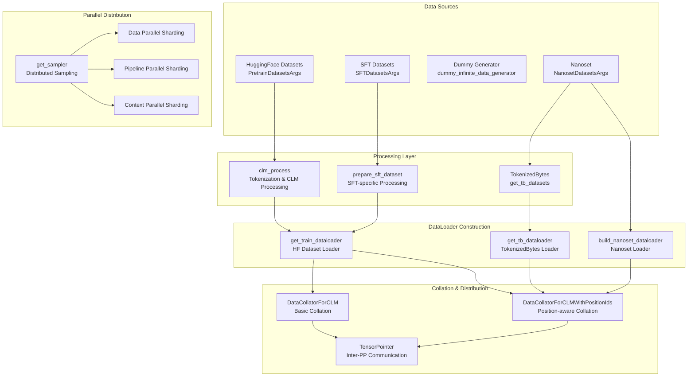
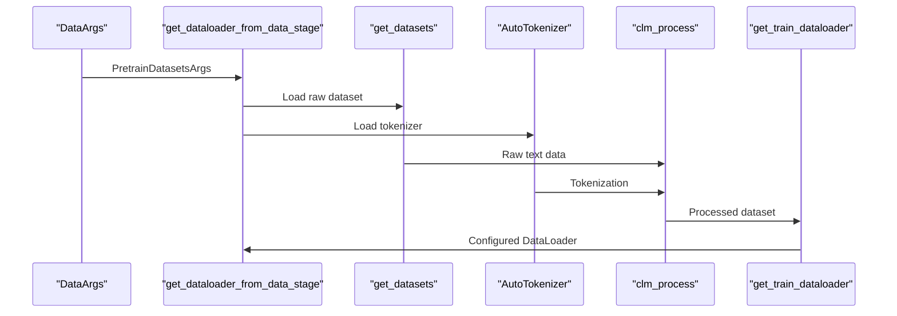
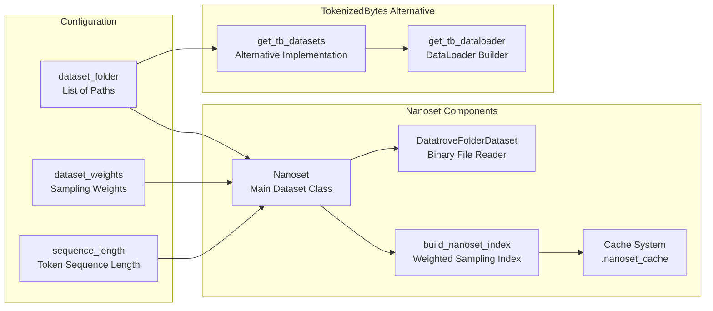
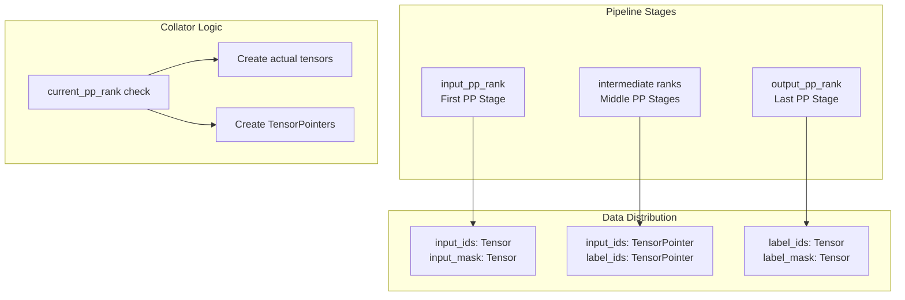
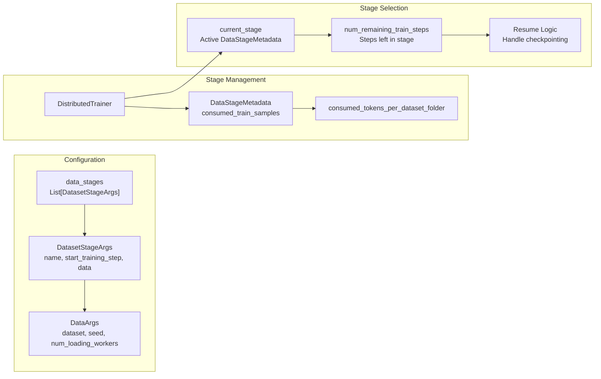
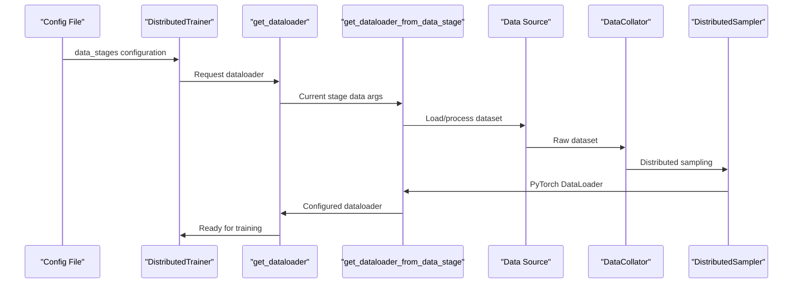

<!-- source: DeepWiki mcp.deepwiki.com · repo huggingface/nanotron · page 5 Data Pipeline · fetched 2026-10-26 -->

# Data Pipeline

<details>
<summary>Relevant source files</summary>

The following files were used as context for generating this wiki page:

- [examples/config_qwen.py](examples/config_qwen.py)
- [examples/config_qwen.yaml](examples/config_qwen.yaml)
- [run_train.py](run_train.py)
- [src/nanotron/data/clm_collator.py](src/nanotron/data/clm_collator.py)
- [src/nanotron/data/dataloader.py](src/nanotron/data/dataloader.py)
- [src/nanotron/data/dataloader_builder.py](src/nanotron/data/dataloader_builder.py)
- [src/nanotron/data/nanoset.py](src/nanotron/data/nanoset.py)

</details>


The Data Pipeline system manages data loading, preprocessing, and distribution for large-scale distributed training in nanotron. It handles multiple data sources including HuggingFace datasets, pre-tokenized Nanosets, and custom data generators, while ensuring efficient distribution across tensor, pipeline, and data parallel processes.

For information about specific dataset implementations like Nanoset, see [Nanoset](#5.1). For custom data loading patterns, see [Custom Data Loading](#5.2). For multi-stage training workflows, see [Training Workflow](#6.1).

## Architecture Overview

The data pipeline operates as a multi-layered system that transforms raw data into distributed training batches. The architecture supports three primary data sources and handles the complexity of 3D parallelism through specialized collators and samplers.



**Sources:** [run_train.py:61-309](), [src/nanotron/data/dataloader.py:269-376](), [src/nanotron/data/dataloader_builder.py:20-82]()

## Data Source Types

The pipeline supports four distinct data source types, each with specific use cases and processing requirements:

| Data Source Type | Configuration Class | Primary Use Case | Processing Method |
|------------------|-------------------|------------------|-------------------|
| HuggingFace Pretraining | `PretrainDatasetsArgs` | General pretraining from text | `clm_process` tokenization |
| SFT Training | `SFTDatasetsArgs` | Supervised fine-tuning | `prepare_sft_dataset` |
| Nanoset | `NanosetDatasetsArgs` | Large-scale pre-tokenized data | Direct binary loading |
| Dummy Generator | `None` | Testing and benchmarking | Runtime random generation |

### HuggingFace Dataset Loading

For HuggingFace datasets, the pipeline performs tokenization and causal language modeling preparation:



**Sources:** [run_train.py:102-176](), [src/nanotron/data/processing.py](), [src/nanotron/data/dataloader.py:269-376]()

### Nanoset Integration

Nanoset provides optimized access to pre-tokenized datasets stored in binary format:



**Sources:** [src/nanotron/data/nanoset.py:20-262](), [run_train.py:189-246]()

## Data Collation and Distribution

Data collators handle the transformation of dataset samples into distributed training batches, managing the complexity of pipeline parallelism through `TensorPointer` objects.

### Pipeline Parallel Distribution

The collators distribute data across pipeline parallel ranks using `TensorPointer` objects for efficient inter-stage communication:



**Sources:** [src/nanotron/data/clm_collator.py:29-134](), [src/nanotron/data/clm_collator.py:154-282]()

### Context Parallel Slicing

When context parallelism is enabled, sequences are divided across context parallel ranks:

```python
# Context parallel slicing logic from DataCollatorForCLMWithPositionIds
cp_rank, cp_size = dist.get_rank(self.parallel_context.cp_pg), self.parallel_context.context_parallel_size
local_slice = slice(
    cp_rank * self.sequence_length // cp_size, (cp_rank + 1) * self.sequence_length // cp_size
)
result["input_ids"] = result["input_ids"][:, local_slice]  # (b, s/cp_size)
```

**Sources:** [src/nanotron/data/clm_collator.py:216-223](), [src/nanotron/data/clm_collator.py:100-105]()

## Multi-Stage Training Support

The data pipeline supports multi-stage training where different stages can use different datasets, allowing for curriculum learning and dataset transitions:



**Sources:** [run_train.py:312-391](), [examples/config_qwen.yaml:10-29]()

## Data Loading Workflow

The complete data loading workflow integrates all components from configuration to distributed batch creation:



**Sources:** [run_train.py:61-309](), [run_train.py:312-391]()

## Configuration Examples

### Nanoset Configuration

```yaml
data_stages:
- data:
    dataset:
      dataset_folder:
      - /path/to/tokenized/dataset
      dataset_weights: null
      return_positions: true
      shuffle_files: false
      token_size_in_bytes: 4
      tokenizer_name: meta-llama/Llama-3.2-1B
      vocab_size: 128256
    num_loading_workers: 1
    seed: 42
  name: Stable Training Stage
  start_training_step: 1
```

**Sources:** [examples/config_qwen.yaml:10-29](), [examples/config_qwen.py:130-156]()

### HuggingFace Dataset Configuration

```python
# PretrainDatasetsArgs example
dataset=PretrainDatasetsArgs(
    hf_dataset_or_datasets="trl-lib/tldr",
    text_column_name="text",
)

# SFTDatasetsArgs example  
dataset=SFTDatasetsArgs(
    hf_dataset_or_datasets="trl-lib/tldr",
    hf_dataset_splits="train", 
    debug_max_samples=1000,
)
```

**Sources:** [examples/config_qwen.py:136-152](), [run_train.py:102-151]()

---

