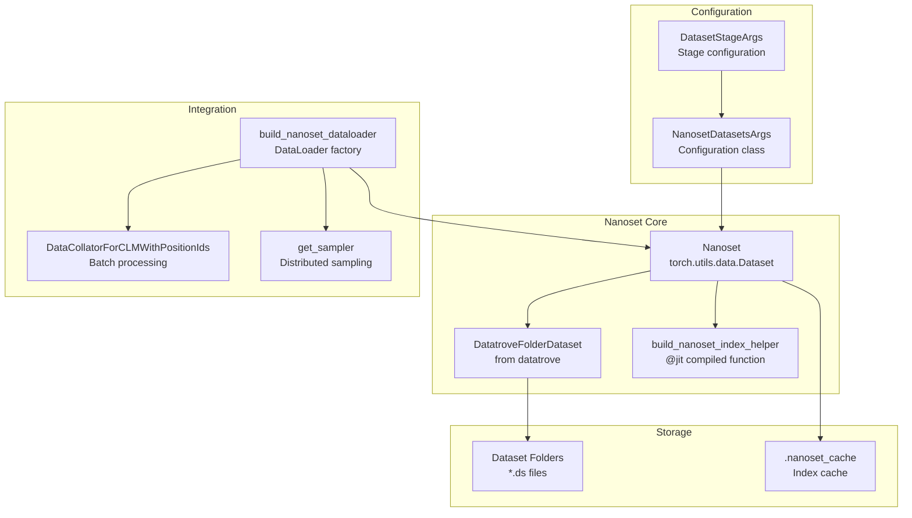
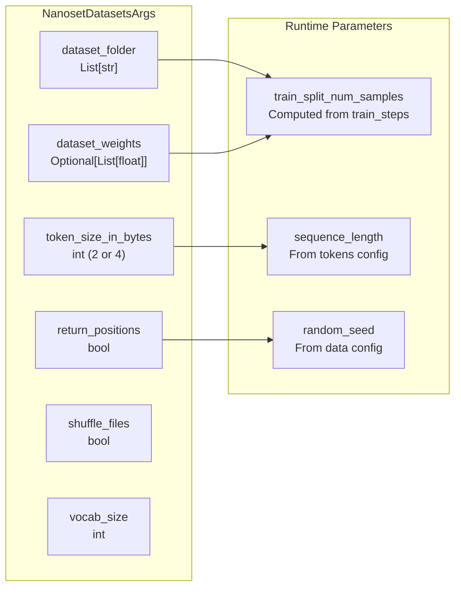
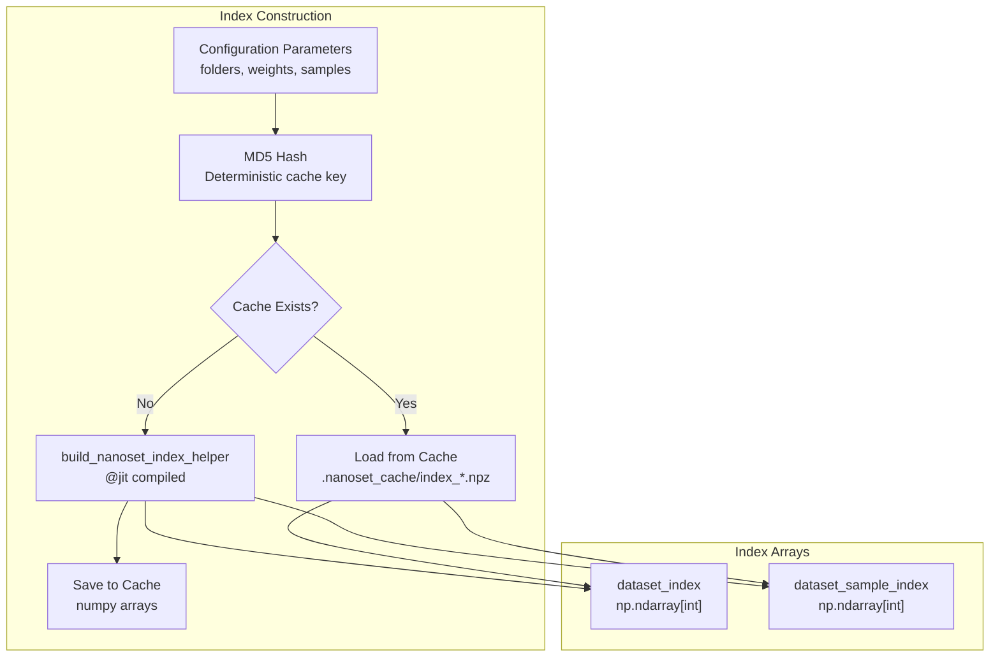
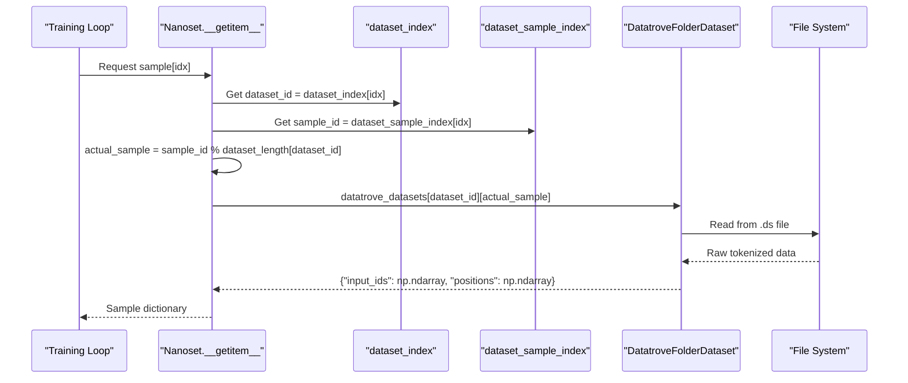
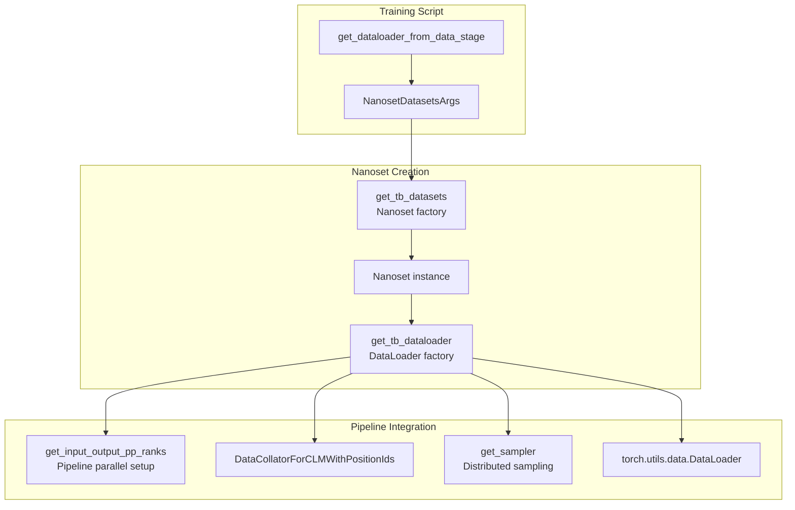

<!-- source: DeepWiki mcp.deepwiki.com · repo huggingface/nanotron · page 5.1 Nanoset · fetched 2026-10-26 -->

# Nanoset

Relevant source files

The following files were used as context for generating this wiki page:

- [examples/config_qwen.py](examples/config_qwen.py)
- [examples/config_qwen.yaml](examples/config_qwen.yaml)
- [run_train.py](run_train.py)
- [src/nanotron/data/clm_collator.py](src/nanotron/data/clm_collator.py)
- [src/nanotron/data/dataloader.py](src/nanotron/data/dataloader.py)
- [src/nanotron/data/dataloader_builder.py](src/nanotron/data/dataloader_builder.py)
- [src/nanotron/data/nanoset.py](src/nanotron/data/nanoset.py)

## Purpose and Scope

Nanoset is a specialized dataset implementation designed for efficient loading of large-scale pre-tokenized datasets in distributed training environments. It provides optimized data access patterns, weighted dataset blending, and advanced caching mechanisms to support high-throughput training of large language models.

This document covers the Nanoset dataset class, its configuration, indexing strategies, and integration with the broader training pipeline. For information about other data loading approaches, see [Custom Data Loading](#5.2). For details about the overall data pipeline architecture, see [Data Pipeline](#5).

## Overview

Nanoset is a PyTorch `Dataset` implementation that specializes in handling pre-tokenized datasets stored in the DataTrove format. It is designed to efficiently serve data for large-scale distributed training by providing deterministic sampling, dataset blending with configurable weights, and sophisticated caching mechanisms.

### Key Features

| Feature | Description |
|---------|-------------|
| **Pre-tokenized Data** | Works with datasets already processed and tokenized using DataTrove format |
| **Weighted Blending** | Supports mixing multiple datasets with configurable weights |
| **Distributed Sampling** | Deterministic data access across distributed training processes |
| **Advanced Caching** | Index caching for faster initialization on repeated runs |
| **Memory Efficient** | Sequential access patterns optimized for large datasets |

Sources: [src/nanotron/data/nanoset.py:20-97]()

## Core Architecture

The Nanoset system consists of several key components working together to provide efficient data access:

### Class Structure

Sources: [src/nanotron/data/nanoset.py:20-97](), [src/nanotron/data/dataloader_builder.py:20-82](), [src/nanotron/config.py]()

## Configuration

Nanoset is configured through the `NanosetDatasetsArgs` class, which is typically embedded within dataset stage configurations:

### Configuration Parameters

### Example Configuration

The configuration is typically defined in YAML format and processed through the config system:

| Parameter | Purpose | Example |
|-----------|---------|---------|
| `dataset_folder` | List of paths containing tokenized datasets | `["/path/to/dataset1", "/path/to/dataset2"]` |
| `dataset_weights` | Relative sampling weights for each dataset | `[0.7, 0.3]` or `null` for equal weighting |
| `token_size_in_bytes` | Bytes per token (2 for vocab < 65535, 4 otherwise) | `4` |
| `return_positions` | Whether to include position IDs for document boundaries | `true` |
| `shuffle_files` | Whether to shuffle files within datasets | `false` |

Sources: [examples/config_qwen.yaml:12-26](), [examples/config_qwen.py:141-146]()

## Index Building and Caching

Nanoset uses a sophisticated indexing system to provide deterministic access to samples across multiple datasets while respecting dataset weights:

### Index Building Process

### Index Algorithm

The index building algorithm ensures proper dataset weighting while maintaining deterministic sample ordering:

1. **Weight Calculation**: Convert dataset weights to exact sample counts per dataset
2. **Sequential Assignment**: Use a greedy algorithm to assign samples maintaining weight ratios
3. **Shuffling**: Apply deterministic shuffling based on random seed
4. **Wrapping**: Handle datasets smaller than required samples through modulo indexing

Sources: [src/nanotron/data/nanoset.py:118-183](), [src/nanotron/data/nanoset.py:226-261]()

## Data Access Pattern

Nanoset provides efficient data access through a carefully designed pattern that minimizes memory overhead while supporting large-scale training:

### Sample Retrieval Flow

### Memory Efficiency

The Nanoset design optimizes memory usage through several strategies:

- **Lazy Loading**: Data is loaded only when requested, not preloaded into memory
- **Sequential Access**: DataTrove datasets use memory-mapped files for efficient access
- **Index Caching**: Pre-computed indices avoid repeated expensive calculations
- **Modulo Wrapping**: Allows infinite sampling from finite datasets without duplication

Sources: [src/nanotron/data/nanoset.py:106-116]()

## Integration with Training Pipeline

Nanoset integrates with the broader Nanotron training system through standardized interfaces:

### DataLoader Construction

### Pipeline Parallel Integration

Nanoset works seamlessly with pipeline parallelism by coordinating with the data collator to ensure proper data distribution:

- **Input Ranks**: Receive actual tokenized data for forward pass
- **Output Ranks**: Receive label data for loss computation  
- **Intermediate Ranks**: Receive `TensorPointer` objects pointing to data locations
- **Context Parallelism**: Data is automatically sliced for distributed attention computation

Sources: [run_train.py:188-246](), [src/nanotron/data/dataloader_builder.py:20-82]()

## Comparison with Other Data Loading Approaches

Nanoset is one of three primary data loading strategies in Nanotron:

| Approach | Use Case | Data Format | Performance | Flexibility |
|----------|----------|-------------|-------------|-------------|
| **Nanoset** | Large-scale pre-tokenized datasets | DataTrove .ds files | High throughput, optimized access | Medium (pre-tokenized only) |
| **HuggingFace Datasets** | Research, prototyping, smaller datasets | Raw text, various formats | Moderate (tokenization overhead) | High (any HF dataset) |
| **Dummy Generator** | Testing, benchmarking | Generated on-the-fly | Very high (no I/O) | Low (synthetic only) |

### When to Use Nanoset

Nanoset is optimal for:
- **Production Training**: Large-scale models requiring maximum throughput
- **Multi-Dataset Training**: Blending multiple datasets with specific weight ratios
- **Repeated Experiments**: Datasets used across multiple training runs (benefits from caching)
- **Memory-Constrained Environments**: Large datasets that don't fit in memory

Sources: [run_train.py:84-301]()

## Performance Considerations

### Optimization Strategies

1. **Index Caching**: Reduces initialization time for repeated runs
2. **JIT Compilation**: Index building uses Numba JIT for performance
3. **Memory Mapping**: DataTrove uses memory-mapped files for efficient access
4. **Deterministic Shuffling**: Enables reproducible training across restarts

### Scaling Characteristics

- **Dataset Size**: Scales to arbitrarily large datasets through memory mapping
- **Number of Datasets**: Efficiently handles dozens of blended datasets
- **Distributed Training**: Deterministic sampling ensures consistency across all processes
- **Multi-Node**: Works seamlessly with SLURM and multi-node training setups

Sources: [src/nanotron/data/nanoset.py:226-261](), [src/nanotron/data/nanoset.py:118-183]()

---

