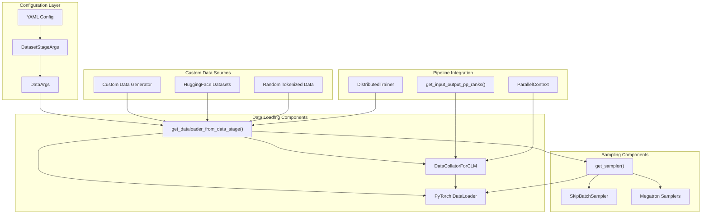
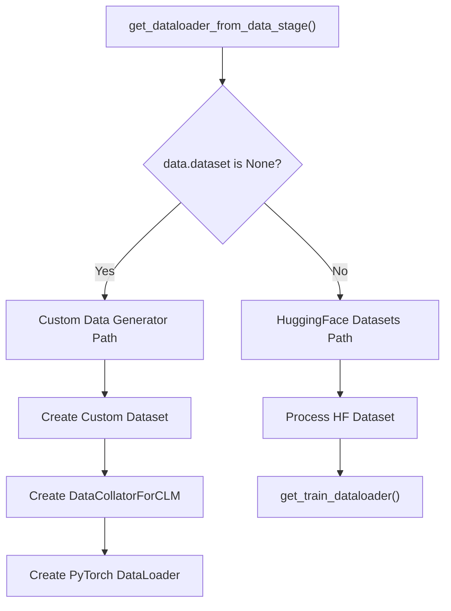
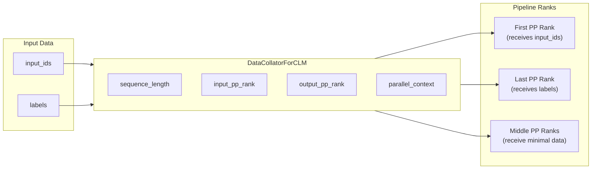
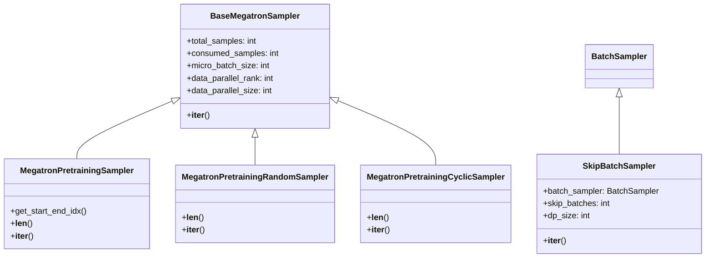
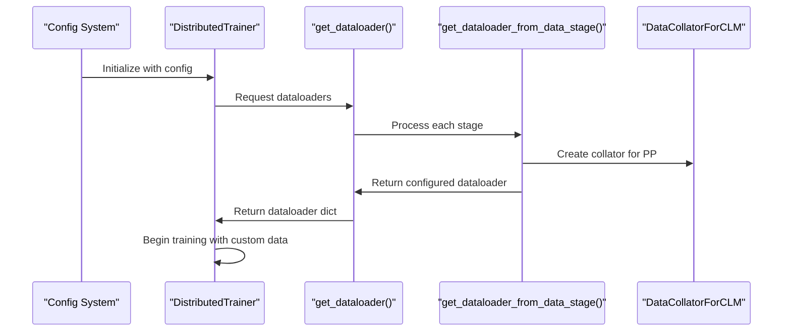

<!-- source: DeepWiki mcp.deepwiki.com · repo huggingface/nanotron · page 5.2 Custom Data Loading · fetched 2026-10-26 -->

# Custom Data Loading

<details>
<summary>Relevant source files</summary>

The following files were used as context for generating this wiki page:

- [.gitignore](.gitignore)
- [LICENSE](LICENSE)
- [examples/custom-dataloader/README.md](examples/custom-dataloader/README.md)
- [examples/custom-dataloader/config_custom_dl.yaml](examples/custom-dataloader/config_custom_dl.yaml)
- [examples/custom-dataloader/run_train.py](examples/custom-dataloader/run_train.py)
- [scripts/log_lighteval_to_wandb.py](scripts/log_lighteval_to_wandb.py)
- [src/nanotron/data/samplers.py](src/nanotron/data/samplers.py)

</details>


This document covers the implementation of custom data pipelines and samplers in Nanotron for specialized training scenarios. Custom data loading enables users to integrate their own data sources, implement domain-specific preprocessing, and create tailored sampling strategies that go beyond the standard Nanoset approach.

For information about the standard Nanoset dataset handling, see [Nanoset](#5.1). For DoReMi domain reweighting methodologies, see [DoReMi Training](#5.3).

## Overview

Custom data loading in Nanotron provides flexibility for users who need specialized data pipelines that cannot be handled by the standard dataset formats. This system integrates with the distributed training infrastructure while allowing complete control over data generation, sampling, and preprocessing.

### Custom Data Loading Architecture



Sources: [examples/custom-dataloader/run_train.py:51-166](), [src/nanotron/data/samplers.py:63-111]()

## Implementing Custom Dataloaders

### Basic Custom Dataloader Structure

The primary entry point for custom data loading is the `get_dataloader_from_data_stage()` function, which handles different data source types based on configuration.



Sources: [examples/custom-dataloader/run_train.py:51-166]()

### Custom Data Generator Implementation

When `data.dataset` is set to `null` in the configuration, the system uses a custom data generator. The example implementation creates random tokenized data:

Key components for custom data generation:
- **Dataset Creation**: Uses `datasets.Dataset.from_dict()` to create a dataset from custom data
- **Data Collator**: `DataCollatorForCLM` handles pipeline parallelism requirements
- **DataLoader Configuration**: Standard PyTorch DataLoader with custom settings

The custom data generator approach allows for:
- Real-time data generation
- Custom preprocessing pipelines  
- Integration with external data sources
- Domain-specific tokenization strategies

Sources: [examples/custom-dataloader/run_train.py:70-103]()

## Data Collators and Pipeline Parallelism

### DataCollatorForCLM Integration

The `DataCollatorForCLM` is essential for custom data loading as it handles the distribution of data across pipeline parallel ranks. It ensures that different pipeline stages receive the appropriate data components.



Sources: [examples/custom-dataloader/run_train.py:88-93](), [examples/custom-dataloader/README.md:6]()

### Pipeline Rank Determination

The system uses `get_input_output_pp_ranks()` to determine which pipeline parallel ranks need specific data components. This ensures efficient memory usage and correct data flow in multi-stage pipeline setups.

Sources: [examples/custom-dataloader/run_train.py:68]()

## Custom Samplers

### Sampler Types and Hierarchy



Sources: [src/nanotron/data/samplers.py:135-185](), [src/nanotron/data/samplers.py:187-239](), [src/nanotron/data/samplers.py:241-285](), [src/nanotron/data/samplers.py:287-369](), [src/nanotron/data/samplers.py:32-61]()

### Sampler Selection Logic

The `get_sampler()` function provides flexible sampler selection based on configuration parameters:

**Key Parameters:**
- `use_loop_to_round_batch_size`: Determines whether to use `DistributedSamplerWithLoop` or standard `DistributedSampler`
- `consumed_train_samples`: Enables checkpoint resumption with `SkipBatchSampler`
- `shuffle`: Controls data ordering for training

**Sampler Features:**
- **DistributedSamplerWithLoop**: Ensures each process has batch size multiple of `micro_batch_size`
- **SkipBatchSampler**: Skips already consumed batches for checkpoint resumption
- **EmptyInfiniteDataset**: Handles edge cases where dataset columns are removed

Sources: [src/nanotron/data/samplers.py:63-111](), [src/nanotron/data/samplers.py:114-133]()

## Configuration Requirements

### YAML Configuration Structure

Custom data loading requires specific configuration settings in the YAML file:

**Required Settings:**
```yaml
data_stages:
- data:
    dataset: null  # Enables custom dataloader
    num_loading_workers: 1
    seed: 42
  name: "Custom Training Stage"
  start_training_step: 1
```

**Multi-Stage Configuration:**
The system supports multiple data stages, allowing transitions between custom and standard datasets during training.

Sources: [examples/custom-dataloader/config_custom_dl.yaml:7-16]()

### Integration with Training Workflow



Sources: [examples/custom-dataloader/run_train.py:168-206](), [examples/custom-dataloader/run_train.py:219-224]()

## Advanced Use Cases

### Lazy Dataloader Initialization

The system supports lazy initialization of dataloaders for multi-stage training, where only the first stage dataloader is immediately created and subsequent stages are initialized as lambda functions.

### Checkpoint Resumption

Custom dataloaders integrate with Nanotron's checkpoint system through:
- `get_consumed_train_samples_of_a_data_stage_from_ckp()`: Retrieves consumed samples from checkpoints
- `compute_remain_train_steps_of_a_data_stage_from_ckp()`: Calculates remaining training steps
- `SkipBatchSampler`: Skips already processed batches during resumption

### Troubleshooting

**Common Issues:**
- **Vocabulary Size Mismatch**: Ensure custom data tokens don't exceed model vocabulary size
- **Pipeline Parallel Compatibility**: Use `DataCollatorForCLM` for proper data distribution
- **Distributed Sampling**: Account for data parallel size in sampling calculations

Sources: [examples/custom-dataloader/README.md:25-40](), [examples/custom-dataloader/run_train.py:174-182]()

---

