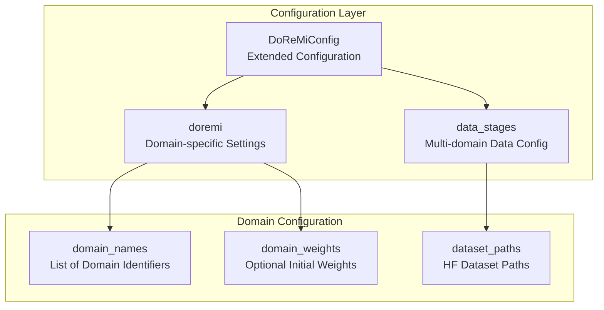
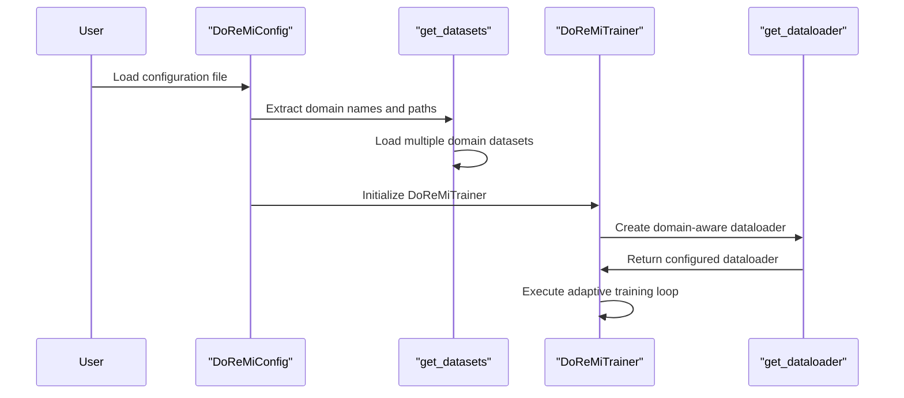
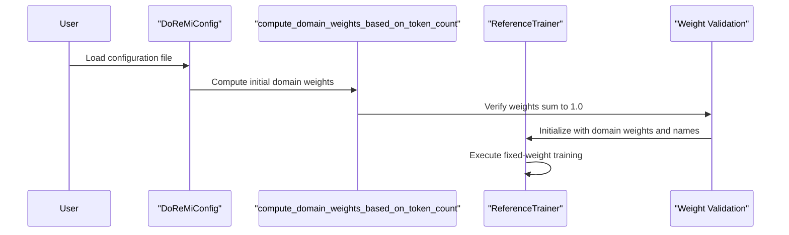
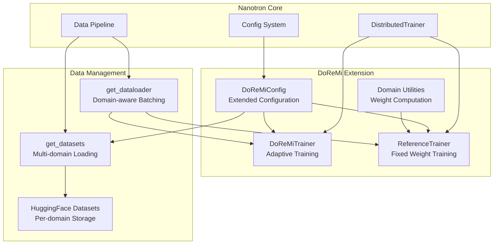

<!-- source: DeepWiki mcp.deepwiki.com · repo huggingface/nanotron · page 5.3 DoReMi Training · fetched 2026-10-26 -->

# DoReMi Training

<details>
<summary>Relevant source files</summary>

The following files were used as context for generating this wiki page:

- [examples/doremi/train_doremi.py](examples/doremi/train_doremi.py)
- [examples/doremi/train_reference.py](examples/doremi/train_reference.py)

</details>


DoReMi (Domain Reweighting with Minimax Optimization) is a domain reweighting methodology implemented in Nanotron for optimizing data mixing strategies during language model training. This system allows for dynamic adjustment of domain weights to improve model performance across different data domains.

For general data pipeline information, see [Data Pipeline](#5). For custom data loading approaches, see [Custom Data Loading](#5.2).

## Overview

DoReMi training enables adaptive domain weighting where the model learns to optimally weight different data domains during training. The system provides two main training modes: a reference trainer that uses fixed domain weights, and a DoReMi trainer that dynamically adjusts weights based on domain performance.

## Core Components

### DoReMi Configuration

The DoReMi system extends Nanotron's configuration system with specialized settings for domain reweighting:



Sources: [examples/doremi/train_doremi.py:13](), [examples/doremi/train_reference.py:13]()

### Training Components

The DoReMi system consists of two primary training modes with distinct responsibilities:

| Component | Purpose | Key Features |
|-----------|---------|--------------|
| `DoReMiTrainer` | Dynamic domain reweighting | Adaptive weight adjustment during training |
| `ReferenceTrainer` | Fixed domain weighting | Baseline training with static domain weights |
| Domain Weight Computation | Initial weight calculation | Token count-based weight initialization |

## Training Workflow

### DoReMi Training Flow



Sources: [examples/doremi/train_doremi.py:27-36]()

### Reference Training Flow



Sources: [examples/doremi/train_reference.py:37-47]()

## Implementation Details

### Dataset Configuration

DoReMi training requires multiple datasets corresponding to different domains. The system constructs dataset paths by combining the base dataset configuration with domain-specific names:

```python
# Example dataset path construction
dataset_paths = [
    f"{config.data_stages[0].data.dataset.hf_dataset_or_datasets}/{name}" 
    for name in config.doremi.domain_names
]
```

### Domain Weight Management

The reference trainer includes logic for handling domain weights:

- **Automatic Weight Calculation**: When `domain_weights` is `None`, weights are computed based on token count distribution
- **Manual Weight Specification**: Explicit weights can be provided in the configuration
- **Weight Validation**: The system ensures domain weights sum to 1.0 with tolerance checking

### Trainer Initialization

The system supports two distinct trainer initialization patterns:

**DoReMi Trainer:**
```python
trainer = DoReMiTrainer(config_file, config_class=DoReMiConfig)
```

**Reference Trainer:**
```python
trainer = ReferenceTrainer(
    initial_domain_weights, 
    domain_names, 
    config_file, 
    config_class=DoReMiConfig
)
```

## Integration with Nanotron

### Component Relationships



Sources: [examples/doremi/train_doremi.py:11-15](), [examples/doremi/train_reference.py:13-16]()

### Configuration Integration

DoReMi extends Nanotron's configuration system by:

1. **Extending Base Configuration**: `DoReMiConfig` inherits from Nanotron's configuration classes
2. **Domain-Specific Settings**: Adds `doremi` section with domain names and weights
3. **Multi-Stage Data Support**: Leverages existing `data_stages` configuration for multi-domain datasets

### Usage Examples

**Basic DoReMi Training:**
```bash
export CUDA_DEVICE_MAX_CONNECTIONS=1
torchrun --nproc_per_node=4 examples/doremi/train_doremi.py \
    --config-file examples/doremi/configs/config_280m_llama_proxy.yaml
```

**Reference Training:**
```bash
export CUDA_DEVICE_MAX_CONNECTIONS=1
torchrun --nproc_per_node=4 examples/doremi/train_reference.py \
    --config-file examples/doremi/configs/config_280m_llama.yaml
```

Sources: [examples/doremi/train_doremi.py:6-7](), [examples/doremi/train_reference.py:7]()

---

