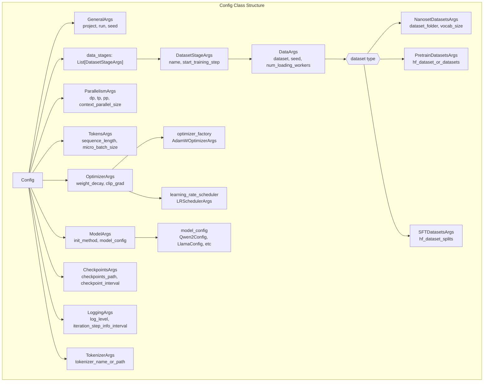
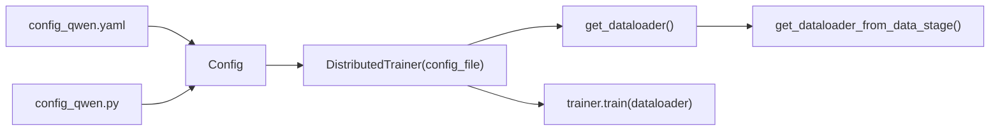
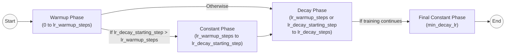
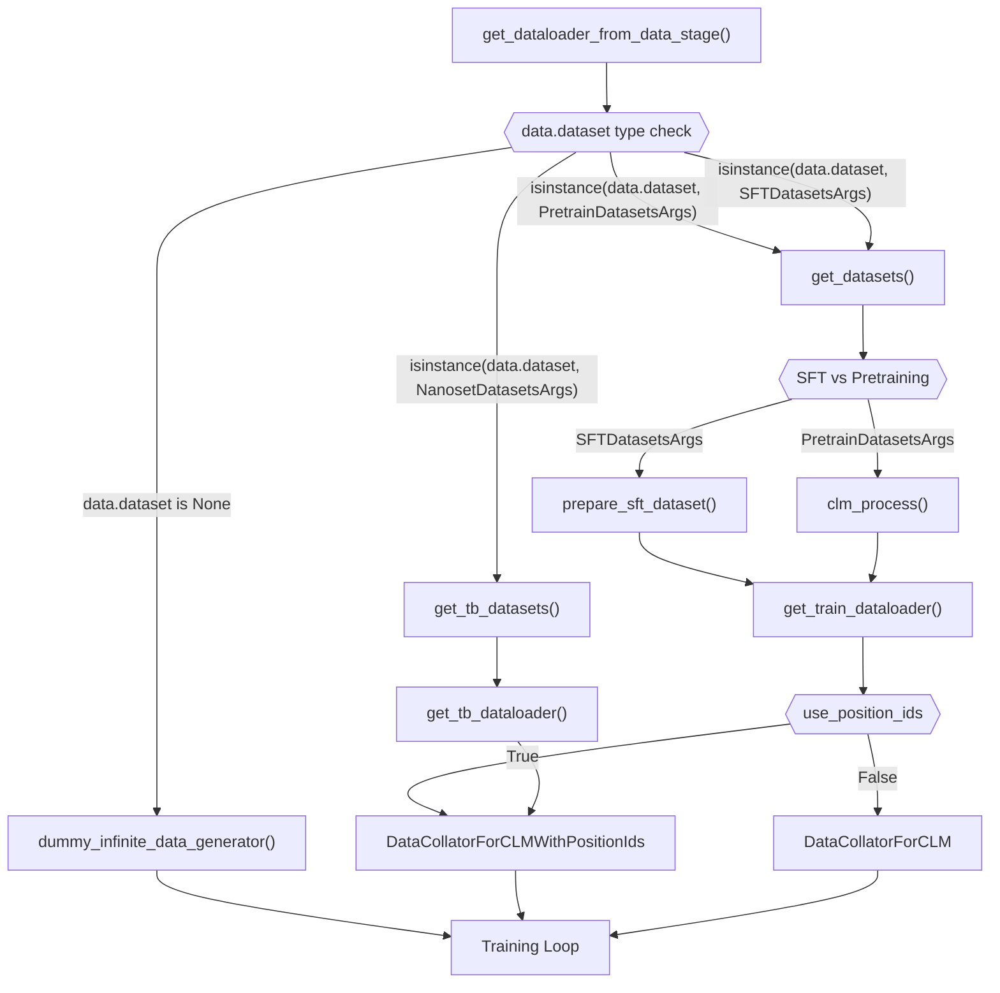
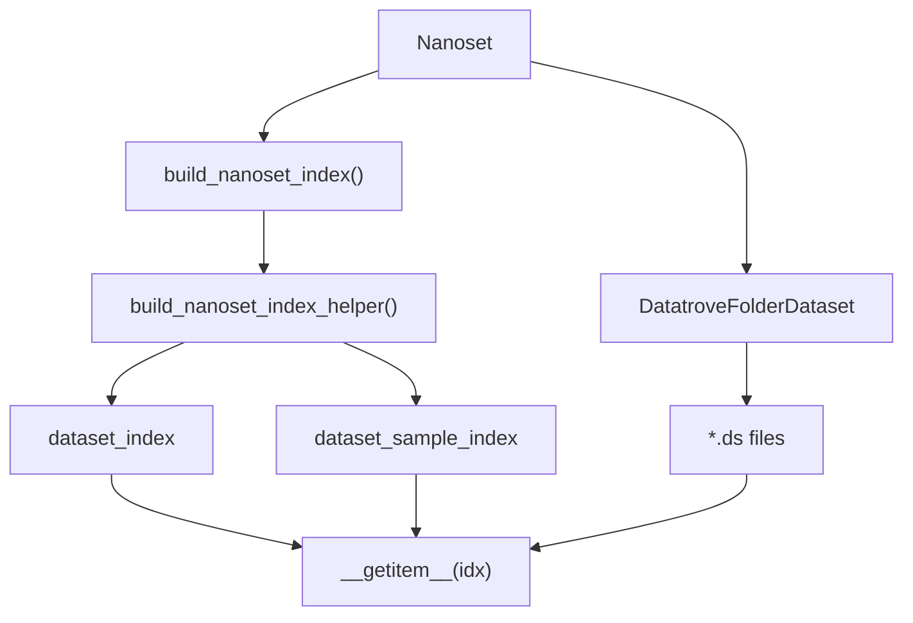
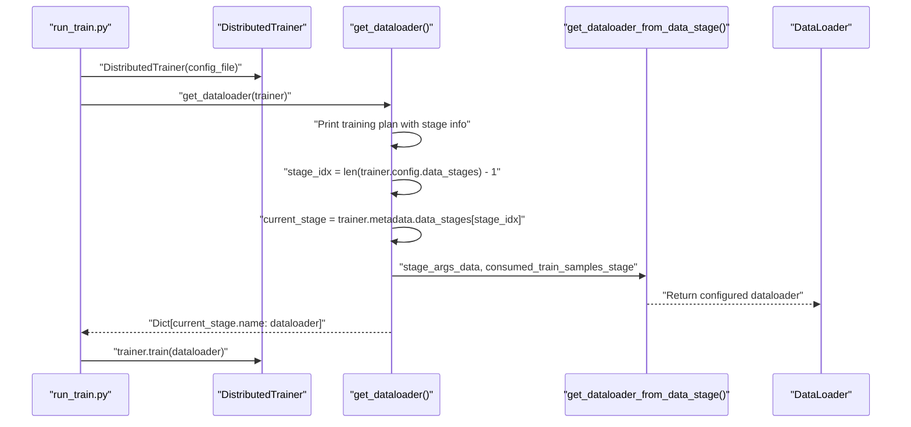
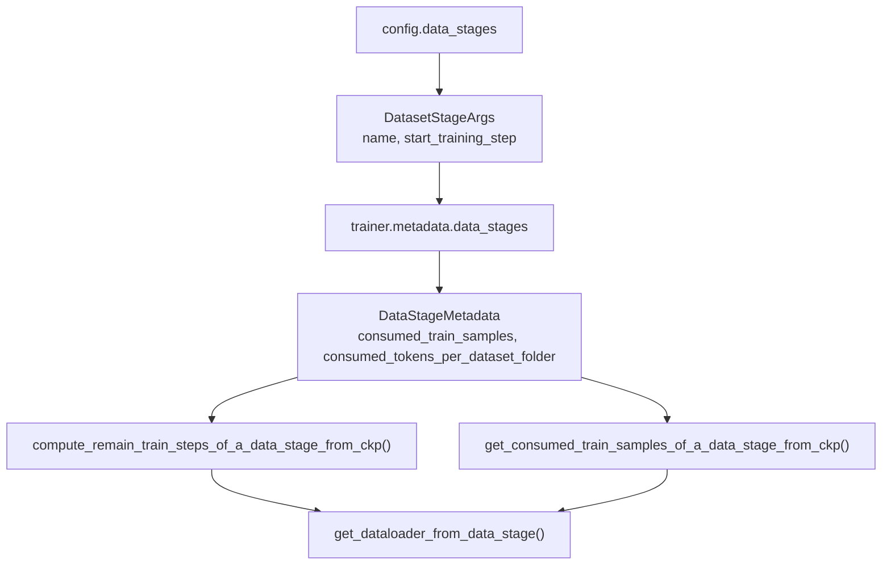

<!-- source: DeepWiki mcp.deepwiki.com · repo huggingface/nanotron · page 6 Training Configuration · fetched 2026-10-26 -->

# Training Configuration

<details>
<summary>Relevant source files</summary>

The following files were used as context for generating this wiki page:

- [examples/config_qwen.py](examples/config_qwen.py)
- [examples/config_qwen.yaml](examples/config_qwen.yaml)
- [run_train.py](run_train.py)
- [src/nanotron/data/clm_collator.py](src/nanotron/data/clm_collator.py)
- [src/nanotron/data/dataloader.py](src/nanotron/data/dataloader.py)
- [src/nanotron/data/dataloader_builder.py](src/nanotron/data/dataloader_builder.py)
- [src/nanotron/data/nanoset.py](src/nanotron/data/nanoset.py)

</details>


This page provides a comprehensive guide to configuring training runs in Nanotron. It covers the configuration system, training parameters, data loading, and optimization settings required for distributed training.

## Configuration System Overview

Nanotron uses a hierarchical configuration system built around the `Config` class in `src/nanotron/config/config.py`. Training configurations can be defined through YAML files or generated programmatically in Python scripts.

**Config Class Architecture:**



**Training Configuration to DistributedTrainer Flow:**



Sources:
- [run_train.py:411]()
- [examples/config_qwen.yaml:1-129]()
- [examples/config_qwen.py:197-220]()
- [run_train.py:312-390]()

## Creating Configuration Files

Nanotron supports two approaches for creating training configurations:

### YAML Configuration Files

Direct YAML definition using the structure defined in `Config` class:

```yaml
# examples/config_qwen.yaml structure
checkpoints:
  checkpoint_interval: 100000
  checkpoints_path: checkpoints

general:
  project: debug
  run: qwen_20250424_120835_16423158
  seed: 42

model:
  dtype: bfloat16
  model_config:
    hidden_size: 2048
    num_hidden_layers: 36
    # ... other model parameters
```

### Python Script Generation

Programmatic generation using configuration classes from `nanotron.config`:

```python
# From examples/config_qwen.py
from nanotron.config import Config, GeneralArgs, ModelArgs, Qwen2Config

config = create_config(model_config, args)
config.save_as_yaml(args.out)
```

The `examples/config_qwen.py` script includes predefined `MODEL_SIZES` configurations and command-line argument parsing for flexible config generation.

Training is initiated by loading the configuration file:

```python
# From run_train.py:411
trainer = DistributedTrainer(config_file)
```

Sources:
- [run_train.py:411]()
- [examples/config_qwen.yaml:1-129]()
- [examples/config_qwen.py:27-42]()
- [examples/config_qwen.py:197-220]()

## Key Configuration Components

### General Settings (`general`)

Basic information about the training run:

```yaml
general:
  project: "debug"           # Project name for logging/organization
  run: "my_model_%date_%jobid"  # Run name (with auto-substitution)
  seed: 42                   # Random seed
  ignore_sanity_checks: false # Whether to skip validation checks
```

Sources:
- [src/nanotron/config/config.py:259-286](src/nanotron/config/config.py:259-286)
- [examples/config_qwen.yaml:30-37](examples/config_qwen.yaml:30-37)

### Model Configuration (`model`)

Defines the model architecture and initialization:

```yaml
model:
  dtype: bfloat16            # Model precision
  init_method:               # Initialization strategy
    std: 0.025
  model_config:              # Architecture-specific parameters
    hidden_size: 2048
    num_hidden_layers: 32
    num_attention_heads: 16
    # ... other model parameters
```

Sources:
- [src/nanotron/config/config.py:304-324](src/nanotron/config/config.py:304-324)
- [examples/config_qwen.yaml:44-82](examples/config_qwen.yaml:44-82)
- [examples/config_tiny_llama.yaml:27-51](examples/config_tiny_llama.yaml:27-51)

### Parallelism Configuration (`parallelism`)

Controls distributed training strategies through the `ParallelismArgs` class:

```yaml
parallelism:
  dp: 4                                 # Data Parallel size
  tp: 2                                 # Tensor Parallel size  
  pp: 1                                 # Pipeline Parallel size
  context_parallel_size: 1              # Context Parallel size
  expert_parallel_size: 1               # Expert Parallel size (for MoE)
  tp_mode: "REDUCE_SCATTER"             # TP communication strategy
  pp_engine: "1f1b"                     # Pipeline schedule algorithm  
  tp_linear_async_communication: true   # Overlapping computations and communications
  tp_recompute_allgather: true          # Recompute all-gather for memory efficiency
  recompute_layer: false                # Layer-wise activation recomputation
  moe_layer_recompute: false            # MoE-specific recomputation
```

**Parallelism Constraint:**
The constraint `dp × tp × pp × context_parallel_size × expert_parallel_size = total_gpus` must be satisfied.

**Parallelism Configuration in Code:**
```python
# From examples/config_qwen.py:159-169
parallelism = ParallelismArgs(
    dp=args.dp,
    pp=args.pp, 
    tp=args.tp,
    context_parallel_size=args.cp,
    expert_parallel_size=args.ep,
    pp_engine="1f1b",
    tp_mode="REDUCE_SCATTER",
    tp_linear_async_communication=True,
    recompute_layer=False,
)
```

Sources:
- [examples/config_qwen.yaml:103-114]()
- [examples/config_qwen.py:159-169]()
- [examples/config_qwen.py:218-225]()

### Tokens and Batching (`tokens`)

Controls sequence length and batch sizes through the `TokensArgs` class:

```yaml
tokens:
  sequence_length: 4096                 # Maximum sequence length
  micro_batch_size: 3                   # Batch size per GPU
  batch_accumulation_per_replica: 1     # Gradient accumulation steps
  train_steps: 32000                    # Total number of training steps
  limit_test_batches: 0                 # Limit evaluation batches (0 = no limit)
  limit_val_batches: 0                  # Limit validation batches (0 = no limit)
  val_check_interval: -1                # Validation check interval (-1 = disabled)
```

**Batch Size Calculation:**
The effective global batch size is calculated as:
```
global_batch_size = micro_batch_size * batch_accumulation_per_replica * dp_size
```

**TokensArgs in Code:**
```python
# From examples/config_qwen.py:170-175
tokens = TokensArgs(
    sequence_length=args.seq,
    train_steps=args.steps,
    micro_batch_size=args.mbs,
    batch_accumulation_per_replica=args.acc,
)
```

**Training Steps Context:**
Total tokens processed = `train_steps × global_batch_size × sequence_length`

Sources:
- [examples/config_qwen.yaml:121-128]()
- [examples/config_qwen.py:170-175]()
- [examples/config_qwen.py:75-77]()

### Optimizer Configuration (`optimizer`)

Controls the optimization process:

```yaml
optimizer:
  accumulate_grad_in_fp32: true  # Accumulate gradients in FP32
  clip_grad: 1.0                 # Gradient clipping value
  weight_decay: 0.01             # Weight decay
  zero_stage: 0                  # ZeRO optimizer stage
  optimizer_factory:             # Optimizer settings
    name: "adamW"
    adam_beta1: 0.9
    adam_beta2: 0.95
    adam_eps: 1.0e-08
    torch_adam_is_fused: true
  learning_rate_scheduler:       # Learning rate schedule
    learning_rate: 0.0003
    lr_warmup_steps: 2
    lr_decay_steps: 31998
    lr_decay_style: "cosine"
    lr_warmup_style: "linear"
    min_decay_lr: 1.0e-05
```

Sources:
- [src/nanotron/config/config.py:386-417](src/nanotron/config/config.py:386-417)
- [examples/config_qwen.yaml:83-102](examples/config_qwen.yaml:83-102)
- [src/nanotron/helpers.py:79-183](src/nanotron/helpers.py:79-183)

### Learning Rate Schedule

The learning rate schedule can have up to four phases:



Supported decay styles:
- `linear`: Linear decay from initial LR to min_decay_lr
- `cosine`: Cosine decay from initial LR to min_decay_lr
- `1-sqrt`: (1-sqrt(t)) decay function

Sources:
- [src/nanotron/helpers.py:97-162](src/nanotron/helpers.py:97-162)
- [src/nanotron/config/config.py:349-384](src/nanotron/config/config.py:349-384)

### Data Stages Configuration (`data_stages`)

Multi-stage training with different datasets using `DatasetStageArgs`:

```yaml
data_stages:
- name: "Stable Training Stage"
  start_training_step: 1
  data:
    dataset:
      dataset_folder:
      - /fsx/loubna/datasets/llama_tokenized/fineweb-edu/merged
      dataset_max_tokens: null
      dataset_weights: null
      pad_samples_to_global_batch_size: false
      return_positions: true
      shuffle_files: false
      token_size_in_bytes: 4
      tokenizer_name: meta-llama/Llama-3.2-1B
      vocab_size: 128256
    num_loading_workers: 1
    seed: 42
```

The `data_stages` list allows switching between different datasets or configurations during training. Each stage defines when it starts (`start_training_step`) and its specific data configuration.

Sources:
- [examples/config_qwen.yaml:10-29]()
- [examples/config_qwen.py:130-156]()

### Checkpoint Configuration (`checkpoints`)

Controls how and when checkpoints are saved:

```yaml
checkpoints:
  checkpoints_path: "checkpoints"   # Where to save checkpoints 
  checkpoint_interval: 1000         # Save every N steps
  save_initial_state: false         # Save before training starts
  save_final_state: true            # Save after training completes
  resume_checkpoint_path: null      # Optional path to resume from
  load_optimizer: true              # Load optimizer state
  load_lr_scheduler: true           # Load scheduler state
```

The trainer can load from a previous checkpoint, continuing from where it left off.

Sources:
- [src/nanotron/config/config.py:234-257](src/nanotron/config/config.py:234-257)
- [examples/config_qwen.yaml:1-9](examples/config_qwen.yaml:1-9)
- [src/nanotron/serialize/main.py:49-122](src/nanotron/serialize/main.py:49-122)

### Logging Configuration (`logging` and `metrics_logging`)

Controls logging verbosity and metrics collection:

```yaml
logging:
  log_level: "info"                     # Main process log level
  log_level_replica: "info"             # Worker processes log level
  iteration_step_info_interval: 1       # Log every N steps

metrics_logging:
  log_level: 1                          # Metrics verbosity (0=basic, 1=full)
  log_detail_interval: 10               # Log detailed metrics every N steps
```

Sources:
- [src/nanotron/config/config.py:46-91](src/nanotron/config/config.py:46-91)
- [examples/config_qwen.yaml:38-43](examples/config_qwen.yaml:38-43)

## Dataset Configuration

Nanotron supports multiple dataset formats configured through `data_stages`. The `get_dataloader_from_data_stage` function in `run_train.py` handles dataset selection and processing:

**Dataset Processing Pipeline:**



**Nanoset Dataset Structure:**



### Dataset Types Implementation

**1. Dummy Data Generator** (`data.dataset is None`):
```python
# Generated by dummy_infinite_data_generator() in run_train.py:85-99
dataloader = dummy_infinite_data_generator(
    micro_batch_size=trainer.micro_batch_size,
    sequence_length=trainer.sequence_length,
    input_pp_rank=input_pp_rank,
    output_pp_rank=output_pp_rank,
    vocab_size=trainer.model_config.vocab_size,
    seed=data.seed,
    parallel_context=trainer.parallel_context,
    use_position_ids=isinstance(trainer.model_config, Qwen2Config),
    cp_pg=trainer.parallel_context.cp_pg,
)()
```

**2. HuggingFace Datasets** (`PretrainDatasetsArgs` or `SFTDatasetsArgs`):
```yaml
# For pretraining
dataset:
  hf_dataset_or_datasets: "trl-lib/tldr"
  text_column_name: "text"

# For SFT
dataset:
  hf_dataset_or_datasets: "trl-lib/tldr"
  hf_dataset_splits: "train"
  debug_max_samples: 1000
```

**3. Nanoset** (`NanosetDatasetsArgs`):
```yaml
dataset:
  dataset_folder:
    - "/fsx/loubna/datasets/llama_tokenized/fineweb-edu/merged"
  dataset_max_tokens: null
  dataset_weights: null
  pad_samples_to_global_batch_size: false
  return_positions: true
  shuffle_files: false
  token_size_in_bytes: 4
  tokenizer_name: meta-llama/Llama-3.2-1B
  vocab_size: 128256
```

Sources:
- [run_train.py:84-99]()
- [run_train.py:102-177]()
- [run_train.py:189-247]()
- [src/nanotron/data/nanoset.py:20-117]()
- [examples/config_qwen.yaml:10-29]()

## Training Flow with Data Stages

**Multi-Stage Training Workflow:**



**Data Stage State Management:**



Sources:
- [run_train.py:312-390]()
- [run_train.py:317-356]()
- [run_train.py:325-342]()

## Configuration Validation and Compatibility

Nanotron performs several validation checks on configurations, including:

1. **Model compatibility checks**:
   ```python
   assert (config.model.model_config.num_attention_heads % config.parallelism.tp == 0), 
       f"num_attention_heads must be divisible by tp"
   ```

2. **Dataset compatibility checks**:
   ```python
   assert (self.model.model_config.vocab_size == stage.data.dataset.vocab_size), 
       f"Model's vocab_size does not match dataset's vocab_size"
   ```

3. **Tokenizer compatibility checks**:
   ```python
   assert (self.tokenizer.tokenizer_name_or_path == stage.data.dataset.tokenizer_name),
       f"Tokenizer does not match dataset's tokenizer"
   ```

Sources:
- [src/nanotron/config/config.py:532-540](src/nanotron/config/config.py:532-540)
- [src/nanotron/config/config.py:509-518](src/nanotron/config/config.py:509-518)

## Advanced Configuration Options

### Parametrization Method

Nanotron supports different parameter initialization strategies:

- `StandardParametrizator`: Standard initialization
- `SpectralMupParametrizator`: Spectral µParameter initialization

```yaml
model:
  init_method:
    # For standard initialization
    std: 0.025
    
    # Or for µParameter initialization
    use_mup: true
```

Sources:
- [src/nanotron/scaling/parametrization.py:18-222](src/nanotron/scaling/parametrization.py:18-222)
- [src/nanotron/helpers.py:238-288](src/nanotron/helpers.py:238-288)

### S3 Integration for Checkpoints

Configurations can specify automatic S3 upload of checkpoints:

```yaml
s3_upload:
  upload_s3_path: "s3://mybucket/mymodel/"
  remove_after_upload: true
  s5cmd_numworkers: 96
  s5cmd_concurrency: 10
  s5cmd_path: "/path/to/s5cmd"
```

This allows efficient storage management for large distributed training jobs.

Sources:
- [src/nanotron/config/config.py:129-143](src/nanotron/config/config.py:129-143)
- [src/nanotron/trainer.py:306-316](src/nanotron/trainer.py:306-316)
- [src/nanotron/s3_checkpoints/s3_mover.py:22-194](src/nanotron/s3_checkpoints/s3_mover.py:22-194)

## Complete Configuration Example

### YAML Configuration Structure

The `examples/config_qwen.yaml` provides a complete training configuration:

| Section | Key Parameters | Purpose |
|---------|---------------|---------|
| `checkpoints` | `checkpoint_interval: 100000`, `checkpoints_path: checkpoints` | Checkpoint saving configuration |
| `data_stages` | `name: "Stable Training Stage"`, `start_training_step: 1` | Multi-stage training setup |
| `general` | `project: debug`, `seed: 42`, `ignore_sanity_checks: true` | General training parameters |
| `model` | `dtype: bfloat16`, `model_config: Qwen2Config` | Model architecture and precision |
| `optimizer` | `clip_grad: 1.0`, `learning_rate: 0.0003` | Optimization settings |
| `parallelism` | `dp: 2`, `tp: 2`, `pp: 1` | Distributed training strategy |
| `tokens` | `sequence_length: 4096`, `micro_batch_size: 3` | Batch and sequence configuration |
| `tokenizer` | `tokenizer_name_or_path: meta-llama/Llama-3.2-1B` | Tokenizer specification |

### Programmatic Configuration Generation

The `examples/config_qwen.py` script generates configurations programmatically:

**Model Size Presets:**
```python
# From examples/config_qwen.py:27-42
MODEL_SIZES: Dict[str, Tuple[int, int, int, int, int]] = {
    # (layers, hidden, heads, kv_heads, ffn_size)
    "160m": (12, 768, 12, 12, 3072),
    "1b": (16, 2048, 16, 16, 5632),
    "3b": (36, 2048, 16, 4, 11008),
    "7b": (32, 4096, 32, 32, 11008),
    "70b": (80, 8192, 64, 8, 28672),
}
```

**Configuration Factory Function:**
```python
# From examples/config_qwen.py:159-209
def create_config(model_config: Qwen2Config, args: argparse.Namespace) -> Config:
    learning_rate = LRSchedulerArgs(
        learning_rate=3e-4, lr_warmup_steps=2000, lr_warmup_style="linear", 
        lr_decay_style="cosine", min_decay_lr=0
    )
    parallelism = ParallelismArgs(
        dp=args.dp, pp=args.pp, tp=args.tp,
        context_parallel_size=args.cp, expert_parallel_size=args.ep,
        pp_engine="1f1b", tp_mode="REDUCE_SCATTER",
        tp_linear_async_communication=True, recompute_layer=False,
    )
    tokens = TokensArgs(
        sequence_length=args.seq, train_steps=args.steps,
        micro_batch_size=args.mbs, batch_accumulation_per_replica=args.acc,
    )
    return Config(
        general=GeneralArgs(project="debug", run=args.run, seed=seed, ignore_sanity_checks=args.no_sanity),
        checkpoints=CheckpointsArgs(checkpoints_path=checkpoints_path, checkpoint_interval=args.ckpt_save),
        parallelism=parallelism,
        model=ModelArgs(init_method=RandomInit(std=0.025), model_config=model_config),
        optimizer=optimizer, tokens=tokens, data_stages=data_stages,
    )
```

Sources:
- [examples/config_qwen.yaml:1-129]()
- [examples/config_qwen.py:27-42]()
- [examples/config_qwen.py:159-209]()
- [examples/config_qwen.py:130-156]()

## Generating Configuration Programmatically

You can also generate configuration files programmatically using Python:

```python
from nanotron.config import Config, GeneralArgs, ModelArgs, # ...

# Create config object
config = Config(
    general=GeneralArgs(project="debug", run="my_model", seed=42),
    model=ModelArgs(...),
    # Other configuration components
)

# Save as YAML
config.save_as_yaml("my_config.yaml")
```

This approach allows for programmatic generation of experiment configurations.

Sources:
- [examples/config_qwen.py:153-216](examples/config_qwen.py:153-216)
- [examples/config_tiny_llama.py:108-118](examples/config_tiny_llama.py:108-118)

## Training with the Configuration

Once you have a configuration file, you can start training with:

```bash
export CUDA_DEVICE_MAX_CONNECTIONS=1
torchrun --nproc_per_node=8 run_train.py --config-file my_config.yaml
```

The configuration file serves as the single source of truth for the entire training job.

Sources:
- [examples/train_tiny_llama.sh:13-24](examples/train_tiny_llama.sh:13-24)
- [run_train.py:374-382](run_train.py:374-382)

---

