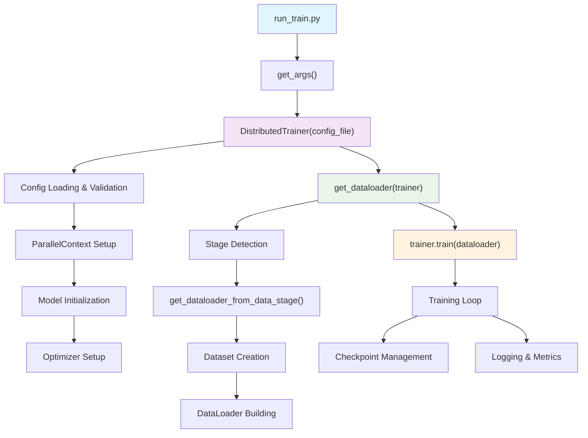
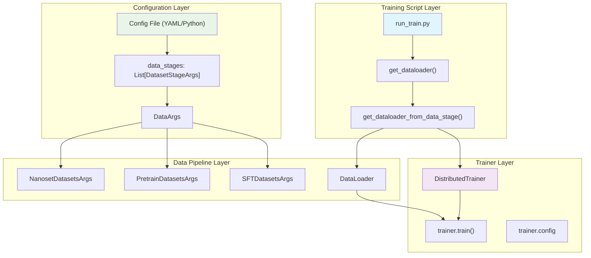
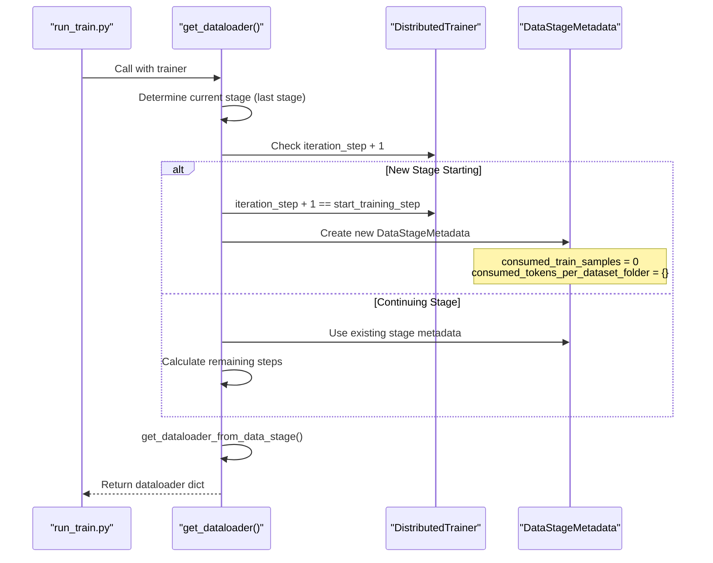
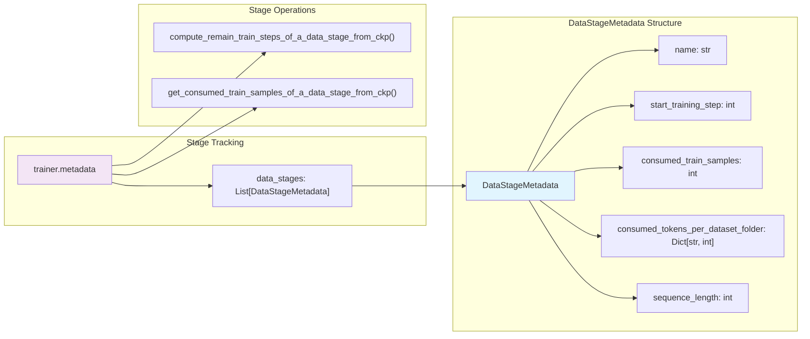
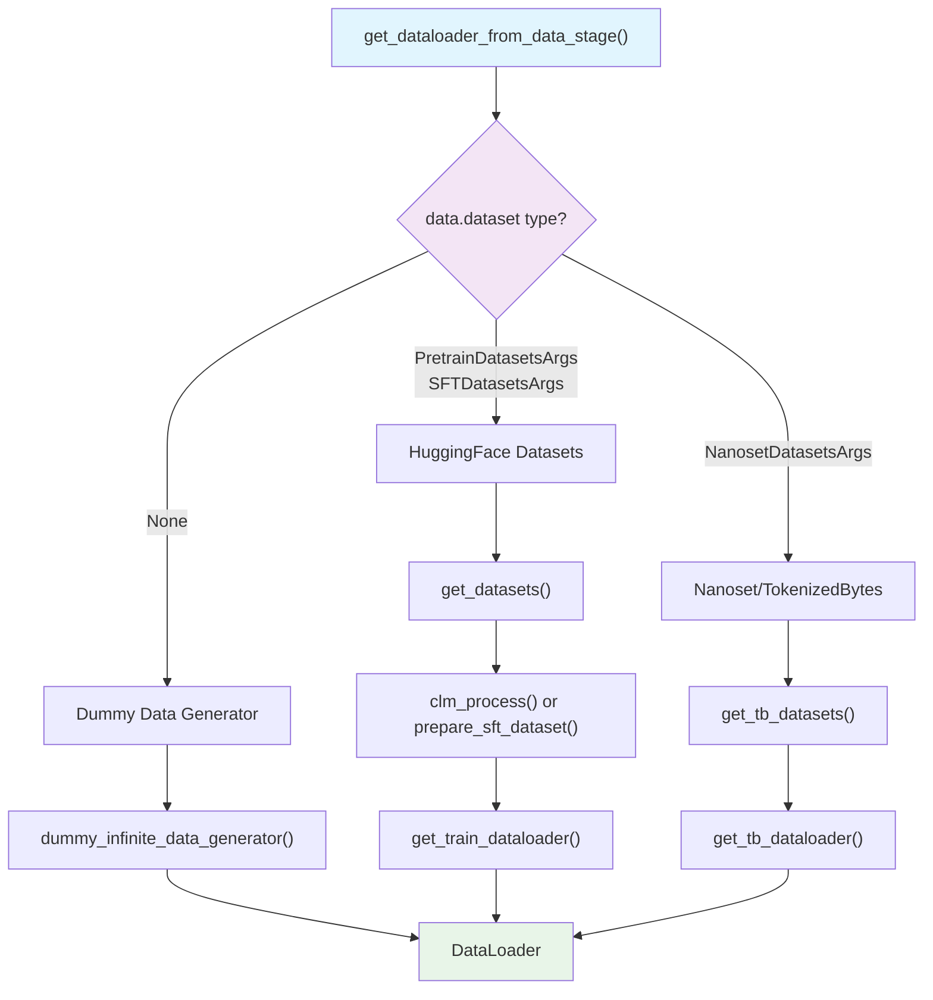
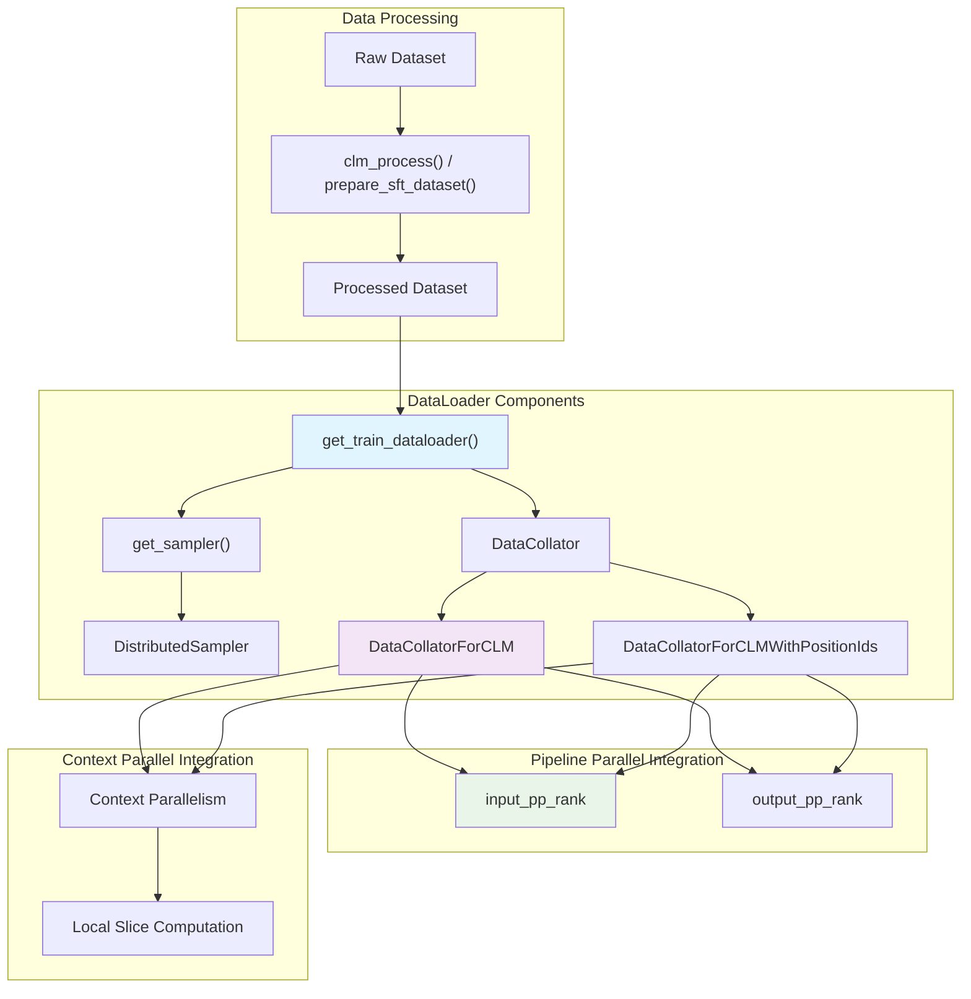
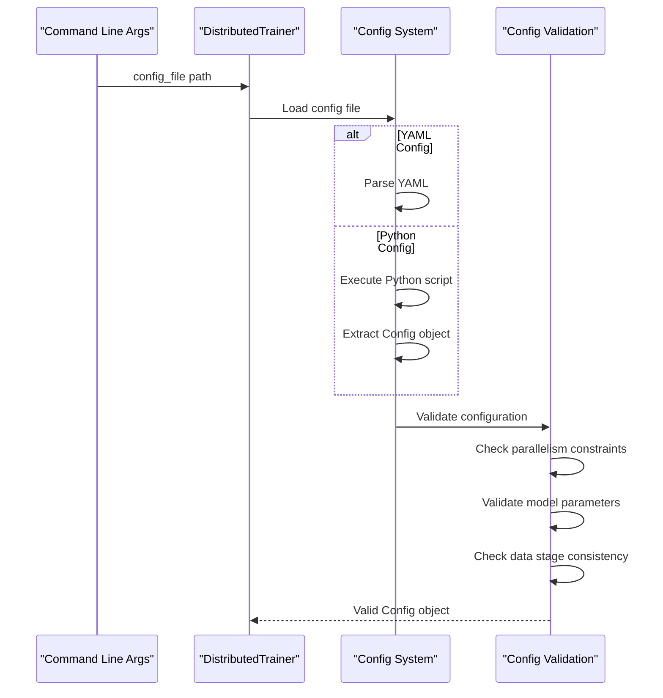
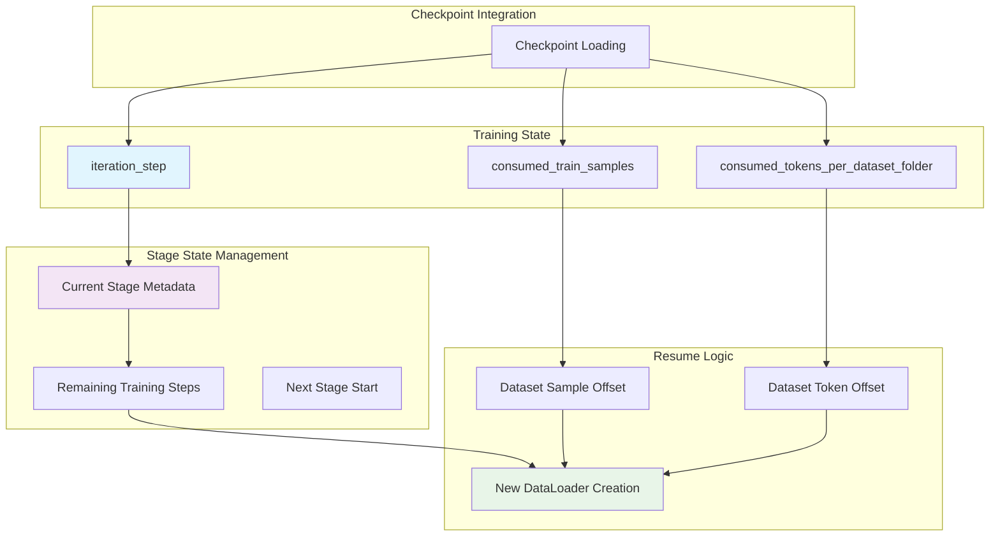
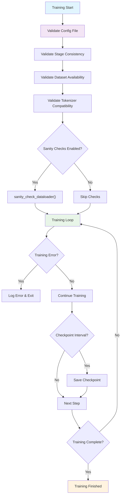

<!-- source: DeepWiki mcp.deepwiki.com · repo huggingface/nanotron · page 6.1 Training Workflow · fetched 2026-10-26 -->

# Training Workflow

<details>
<summary>Relevant source files</summary>

The following files were used as context for generating this wiki page:

- [examples/config_qwen.py](examples/config_qwen.py)
- [examples/config_qwen.yaml](examples/config_qwen.yaml)
- [run_train.py](run_train.py)
- [src/nanotron/data/clm_collator.py](src/nanotron/data/clm_collator.py)
- [src/nanotron/data/dataloader.py](src/nanotron/data/dataloader.py)
- [src/nanotron/data/dataloader_builder.py](src/nanotron/data/dataloader_builder.py)
- [src/nanotron/data/nanoset.py](src/nanotron/data/nanoset.py)

</details>


This document covers the end-to-end training execution flow in Nanotron, including multi-stage training, workflow orchestration, and configuration-driven execution. It explains how the training script coordinates between configuration, data pipeline, and distributed training components.

For information about model architectures, see [Supported Models](#3). For distributed training strategies, see [Distributed Training](#4). For data loading specifics, see [Data Pipeline](#5).

## Training Execution Overview

The training workflow in Nanotron is orchestrated by the main training script and follows a configuration-driven approach with support for multi-stage training.

### Main Training Flow



**Sources:** [run_train.py:406-416](), [run_train.py:394-403]()

### Core Training Components



**Sources:** [run_train.py:61-310](), [run_train.py:312-391](), [run_train.py:41]()

## Multi-Stage Training Workflow

Nanotron supports multi-stage training where different datasets or configurations can be used at different points during training.

### Stage Configuration Structure

The training stages are defined in the configuration using `data_stages`:

```yaml
data_stages:
- name: "Stable Training Stage"
  start_training_step: 1
  data:
    dataset:
      dataset_folder: ["/path/to/dataset"]
    seed: 42
```

**Sources:** [examples/config_qwen.yaml:10-29](), [examples/config_qwen.py:130-156]()

### Stage Transition Logic



**Sources:** [run_train.py:325-342](), [run_train.py:347-356]()

### Stage Metadata Management



**Sources:** [run_train.py:44](), [run_train.py:332-339](), [run_train.py:35-36]()

## Data Pipeline Integration

The training workflow integrates with different data sources through a unified interface.

### Dataset Type Resolution



**Sources:** [run_train.py:84-100](), [run_train.py:102-187](), [run_train.py:189-247]()

### DataLoader Creation Pipeline



**Sources:** [run_train.py:163-176](), [src/nanotron/data/dataloader.py:269-376](), [src/nanotron/data/clm_collator.py:12-135]()

## Configuration-Driven Execution

The training workflow is entirely driven by configuration files, supporting both YAML and Python configuration formats.

### Configuration Loading Flow



**Sources:** [run_train.py:411](), [examples/config_qwen.py:197-208]()

### Training Parameters Integration

| Configuration Section | Purpose | Key Parameters |
|----------------------|---------|----------------|
| `general` | Basic training settings | `project`, `run`, `seed` |
| `tokens` | Batch and sequence config | `micro_batch_size`, `sequence_length`, `train_steps` |
| `data_stages` | Multi-stage data config | `start_training_step`, `dataset`, `num_loading_workers` |
| `parallelism` | Distributed training | `dp`, `tp`, `pp`, `cp` |
| `optimizer` | Optimization settings | `learning_rate_scheduler`, `weight_decay` |
| `checkpoints` | State management | `checkpoint_interval`, `checkpoints_path` |

**Sources:** [examples/config_qwen.yaml:30-129](), [examples/config_qwen.py:159-208]()

## Training Lifecycle Management

### Checkpoint and Resume Integration



**Sources:** [run_train.py:347-349](), [run_train.py:343-345](), [run_train.py:374-378]()

### Error Handling and Validation

The training workflow includes comprehensive validation and error handling:



**Sources:** [run_train.py:302-308](), [run_train.py:133-135](), [run_train.py:195-197]()

---

