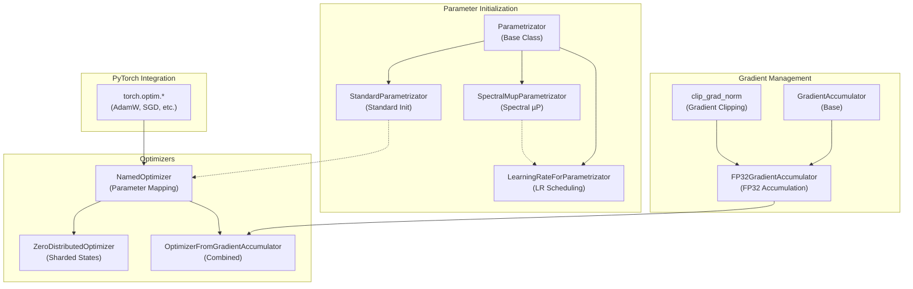
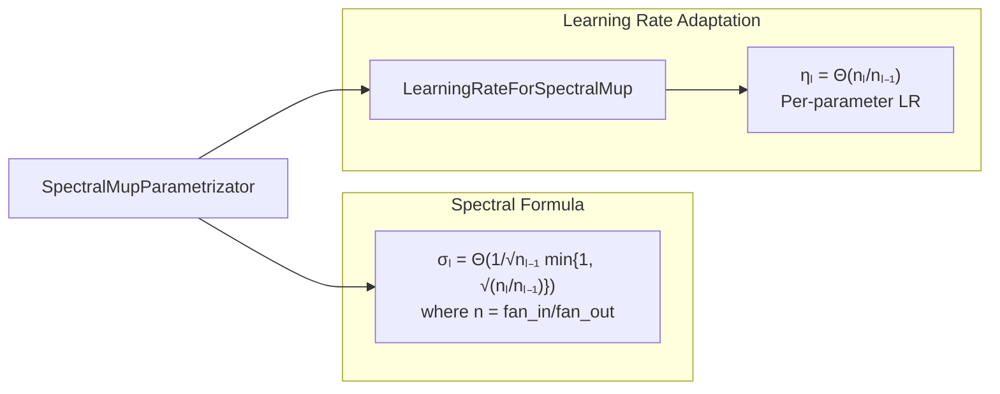
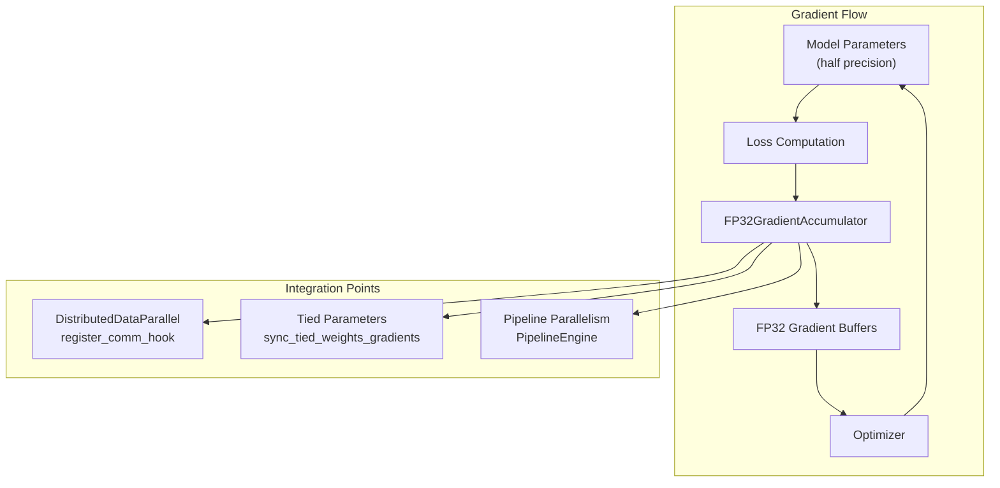
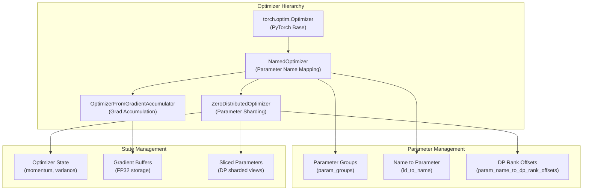
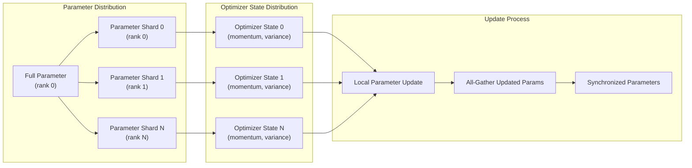
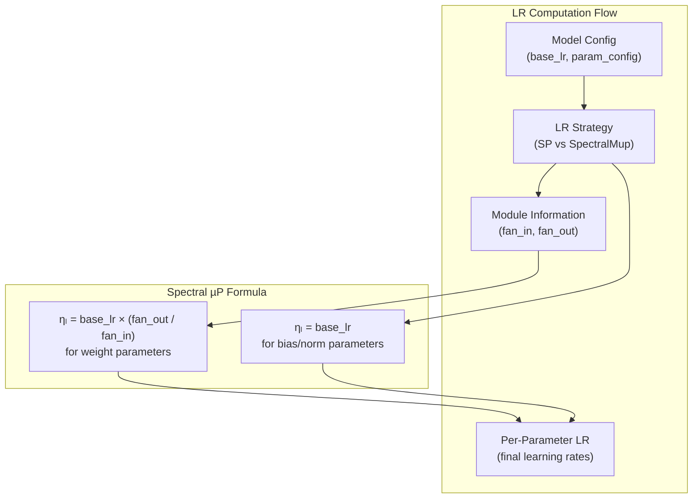
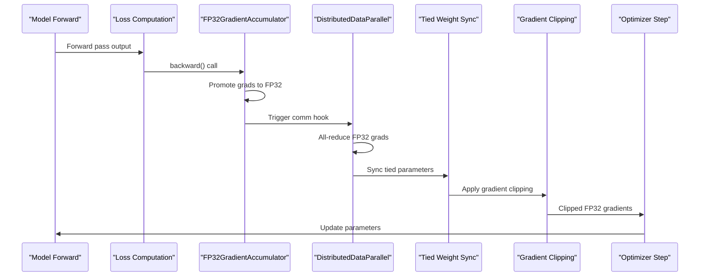
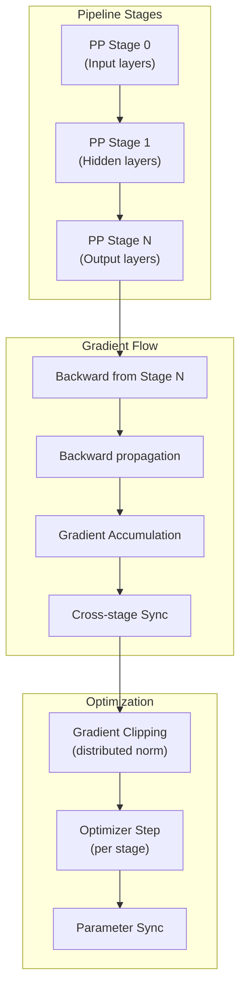

<!-- source: DeepWiki mcp.deepwiki.com · repo huggingface/nanotron · page 6.2 Optimization and Schedulers · fetched 2026-10-26 -->

# Optimization and Schedulers

Relevant source files

The following files were used as context for generating this wiki page:

- [src/nanotron/config/lighteval_config.py](src/nanotron/config/lighteval_config.py)
- [src/nanotron/eval/one_job_runner.py](src/nanotron/eval/one_job_runner.py)
- [src/nanotron/logging/__init__.py](src/nanotron/logging/__init__.py)
- [src/nanotron/logging/base.py](src/nanotron/logging/base.py)
- [src/nanotron/logging/timers.py](src/nanotron/logging/timers.py)
- [src/nanotron/parallel/pipeline_parallel/engine.py](src/nanotron/parallel/pipeline_parallel/engine.py)
- [src/nanotron/scaling/parametrization.py](src/nanotron/scaling/parametrization.py)
- [tests/test_clip_grads.py](tests/test_clip_grads.py)
- [tests/test_data_parallel.py](tests/test_data_parallel.py)
- [tests/test_p2p.py](tests/test_p2p.py)
- [tests/test_parameters_accumulate_gradient_in_fp32.py](tests/test_parameters_accumulate_gradient_in_fp32.py)
- [tests/test_pipeline_parallel.py](tests/test_pipeline_parallel.py)
- [tests/test_random_state.py](tests/test_random_state.py)
- [tests/test_serialize.py](tests/test_serialize.py)
- [tests/test_tensor_parallel.py](tests/test_tensor_parallel.py)
- [tests/test_tie_weights.py](tests/test_tie_weights.py)
- [tests/test_zero.py](tests/test_zero.py)

This document covers the optimization and scheduling systems in Nanotron, including parameter initialization strategies, gradient management, optimizer implementations, and learning rate scheduling. These components work together to provide efficient training workflows for large-scale distributed models.

For information about the overall training workflow and configuration, see [Training Workflow](#6.1). For details about model parameter management and distribution, see [Parameter Management](#4.6).

## Core Optimization Architecture

Nanotron's optimization system is built around several key components that handle parameter initialization, gradient processing, and parameter updates in a distributed training environment.

### Optimization Component Hierarchy

Sources: [src/nanotron/scaling/parametrization.py:24-249](), [tests/test_clip_grads.py:10-13](), [tests/test_zero.py:10-11](), [tests/test_serialize.py:14-19]()

## Parameter Initialization Strategies

Nanotron provides multiple parameter initialization strategies through the `Parametrizator` system, supporting both standard and advanced initialization methods.

### Standard Parametrization

The `StandardParametrizator` implements conventional initialization with optional scaling based on network depth:

```mermaid
graph TD
    StandardParam["StandardParametrizator"]
    
    subgraph "Scaling Methods"
        ScaleNone["InitScalingMethod.NONE<br/>(No Scaling)"]
        ScaleNumLayers["InitScalingMethod.NUM_LAYERS<br/>(Depth-based)"]
        ScaleLayerIndex["InitScalingMethod.LAYER_INDEX<br/>(Position-based)"]
    end
    
    subgraph "Module Support"
        ColLinear["TensorParallelColumnLinear<br/>_parametrize_column_linear"]
        RowLinear["TensorParallelRowLinear<br/>_parametrize_row_linear"]
        LayerNorm["RMSNorm modules<br/>_parametrize_layer_norm"]
        Embedding["TensorParallelEmbedding<br/>_parametrize_embedding"]
        GroupedMLP["GroupedMLP<br/>_parametrize_grouped_mlp"]
        Router["Router<br/>_parametrize_router"]
    end
    
    StandardParam --> ScaleNone
    StandardParam --> ScaleNumLayers
    StandardParam --> ScaleLayerIndex
    
    StandardParam --> ColLinear
    StandardParam --> RowLinear
    StandardParam --> LayerNorm
    StandardParam --> Embedding
    StandardParam --> GroupedMLP
    StandardParam --> Router
```

The scaling factor computation follows:
- **None**: `scaling = 1.0`
- **Num Layers**: `scaling = sqrt(2 * num_layers)`
- **Layer Index**: Not yet implemented

Sources: [src/nanotron/scaling/parametrization.py:35-98]()

### Spectral µP Parametrization

The `SpectralMupParametrizator` implements the spectral condition for feature learning, providing theoretically grounded initialization:

Sources: [src/nanotron/scaling/parametrization.py:125-184](), [src/nanotron/scaling/parametrization.py:203-249]()

## Gradient Management

### FP32 Gradient Accumulation

The `FP32GradientAccumulator` promotes gradients to FP32 precision for numerical stability during accumulation:

The accumulator maintains separate FP32 storage for gradients while keeping model parameters in lower precision.

Sources: [tests/test_parameters_accumulate_gradient_in_fp32.py:11](), [tests/test_parameters_accumulate_gradient_in_fp32.py:43-58]()

### Gradient Clipping

The `clip_grad_norm` function provides distributed gradient clipping with support for various parallelism modes:

| Parallelism Type | Implementation | Notes |
|------------------|----------------|-------|
| Pipeline Parallel | Cross-stage synchronization | Clips across PP boundaries |
| Tensor Parallel | Shard-aware clipping | Accounts for parameter sharding |
| Data Parallel | DDP integration | Works with gradient synchronization |
| Tied Parameters | Unified clipping | Consistent clipping for tied weights |

Sources: [tests/test_clip_grads.py:140-146](), [tests/test_clip_grads.py:310-316](), [tests/test_clip_grads.py:417-423]()

## Optimizer Architecture

### Core Optimizer Classes

Sources: [tests/test_serialize.py:105-108](), [tests/test_zero.py:33-40](), [tests/test_serialize.py:424-431]()

### ZeRO Distributed Optimizer

The `ZeroDistributedOptimizer` implements parameter sharding across data parallel ranks:

Each rank maintains:
- A slice of each parameter tensor
- Optimizer states only for its assigned slices
- Gradients corresponding to its parameter slices

Sources: [tests/test_zero.py:240-247](), [tests/test_zero.py:113-127]()

## Learning Rate Scheduling

### Per-Parameter Learning Rates

Nanotron supports sophisticated learning rate scheduling with per-parameter customization:

| Strategy | Implementation | Use Case |
|----------|----------------|----------|
| `LearningRateForSP` | Uniform LR across parameters | Standard training |
| `LearningRateForSpectralMup` | Fan-in/fan-out based LR | Spectral µP training |

Sources: [src/nanotron/scaling/parametrization.py:186-201](), [src/nanotron/scaling/parametrization.py:219-236]()

## Integration with Distributed Training

### Gradient Synchronization Flow

Sources: [tests/test_parameters_accumulate_gradient_in_fp32.py:190-204](), [tests/test_clip_grads.py:555-561]()

### Pipeline Integration

The optimization system integrates seamlessly with pipeline parallelism through the gradient accumulator:

Sources: [tests/test_clip_grads.py:99-101](), [src/nanotron/parallel/pipeline_parallel/engine.py:86-89]()

---

