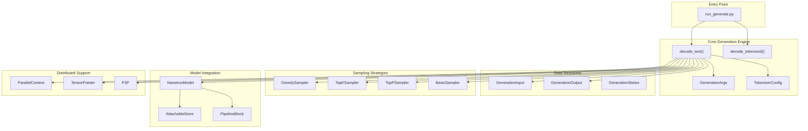
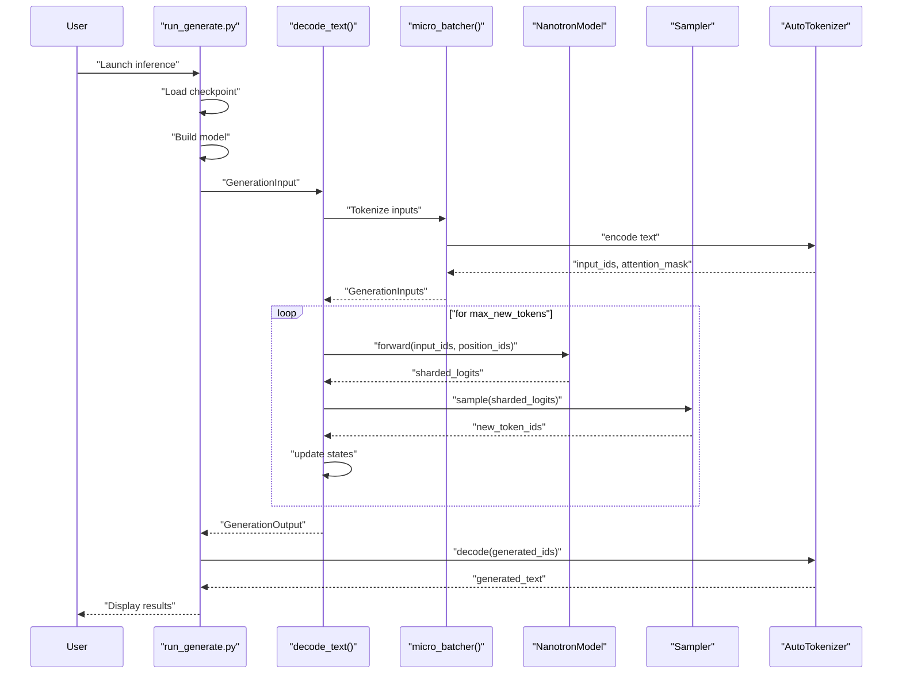
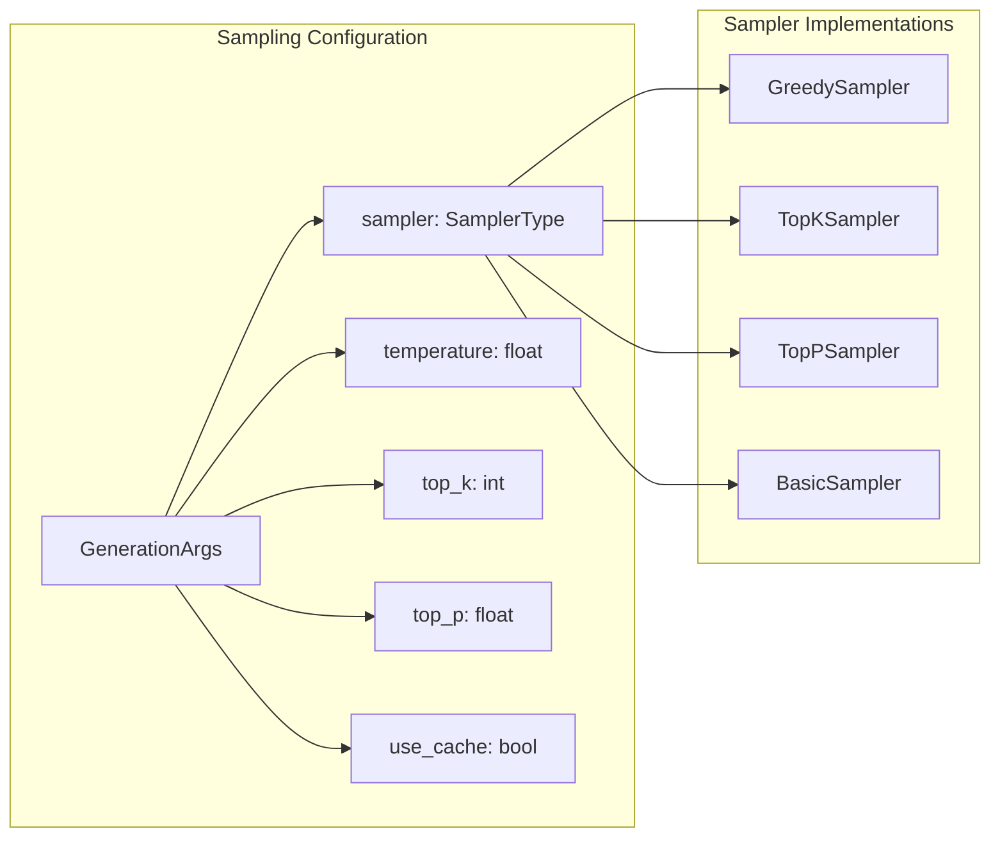
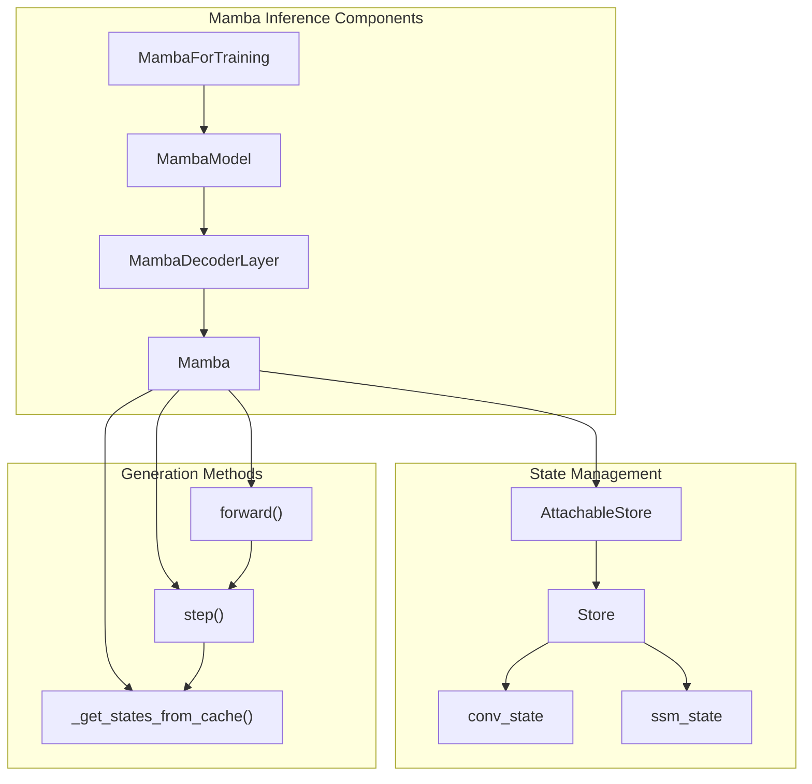
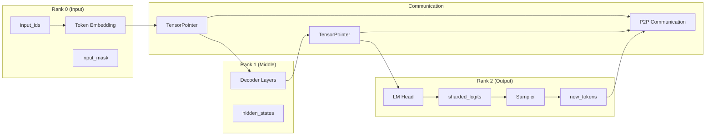

<!-- source: DeepWiki mcp.deepwiki.com · repo huggingface/nanotron · page 6.3 Inference and Generation · fetched 2026-10-26 -->

# Inference and Generation

<details>
<summary>Relevant source files</summary>

The following files were used as context for generating this wiki page:

- [examples/mamba/config.py](examples/mamba/config.py)
- [examples/mamba/convert_hf_to_nanotron.py](examples/mamba/convert_hf_to_nanotron.py)
- [examples/mamba/convert_nanotron_to_hf.py](examples/mamba/convert_nanotron_to_hf.py)
- [examples/mamba/mamba.py](examples/mamba/mamba.py)
- [examples/mamba/run_generate.py](examples/mamba/run_generate.py)
- [examples/mamba/selective_scan_interface.py](examples/mamba/selective_scan_interface.py)
- [run_generate.py](run_generate.py)
- [src/nanotron/config/lighteval_config.py](src/nanotron/config/lighteval_config.py)
- [src/nanotron/eval/one_job_runner.py](src/nanotron/eval/one_job_runner.py)
- [src/nanotron/generation/decode.py](src/nanotron/generation/decode.py)
- [src/nanotron/generation/generate_store.py](src/nanotron/generation/generate_store.py)
- [src/nanotron/logging/__init__.py](src/nanotron/logging/__init__.py)
- [src/nanotron/logging/base.py](src/nanotron/logging/base.py)
- [src/nanotron/logging/timers.py](src/nanotron/logging/timers.py)
- [src/nanotron/parallel/pipeline_parallel/engine.py](src/nanotron/parallel/pipeline_parallel/engine.py)
- [src/nanotron/scaling/parametrization.py](src/nanotron/scaling/parametrization.py)

</details>


This page covers Nanotron's inference and generation capabilities, including text generation workflows, distributed inference setups, and model-specific inference optimizations. The system supports both single-model inference and distributed inference across multiple GPUs with pipeline and tensor parallelism.

For training workflows, see [Training Workflow](#6.1). For model architecture details, see [Supported Models](#3).

## Inference Architecture

The inference system in Nanotron is built around a modular architecture that supports various model types and distributed setups. The main entry point is the `run_generate.py` script, which orchestrates model loading, tokenization, and generation.



Sources: [run_generate.py:1-256](), [src/nanotron/generation/decode.py:1-600]()

## Generation Workflow

The generation process follows a structured workflow that handles tokenization, model forward passes, sampling, and output formatting. The system supports both cached and non-cached generation modes.



Sources: [run_generate.py:171-219](), [src/nanotron/generation/decode.py:198-255](), [src/nanotron/generation/decode.py:280-433]()

## Generation Configuration

Generation behavior is controlled through several configuration classes that specify sampling strategies, generation limits, and inference parameters.

| Configuration Class | Purpose | Key Parameters |
|---------------------|---------|----------------|
| `GenerationArgs` | Sampling and generation control | `sampler`, `temperature`, `top_k`, `top_p`, `use_cache` |
| `TokenizerConfig` | Input processing configuration | `max_input_length`, `truncation`, `padding` |
| `ParallelismArgs` | Distributed inference setup | `dp`, `pp`, `tp`, `tp_mode` |

### GenerationArgs Configuration

The `GenerationArgs` class supports multiple sampling strategies:

- **Greedy**: Deterministic selection of highest probability tokens
- **Top-K**: Sample from K most likely tokens
- **Top-P**: Sample from tokens with cumulative probability P
- **Basic**: Multinomial sampling with temperature



Sources: [src/nanotron/config/lighteval_config.py:14-30](), [src/nanotron/generation/decode.py:348-359]()

## Model-Specific Inference Features

Different model architectures implement specialized inference features. The Mamba model demonstrates advanced state management and caching capabilities.

### Mamba Inference Implementation

Mamba models support stateful generation through the `AttachableStore` interface, enabling efficient incremental generation:



Sources: [examples/mamba/mamba.py:67-401](), [src/nanotron/generation/generate_store.py:21-51]()

### State Caching Mechanism

The Mamba model implements efficient state caching for autoregressive generation:

- **Conv State**: Maintains convolution history for causal convolution operations
- **SSM State**: Tracks selective scan state for sequence modeling
- **Store Management**: Handles state allocation and cleanup across generation steps

Sources: [examples/mamba/mamba.py:373-400](), [examples/mamba/mamba.py:210-228]()

## Distributed Inference

Nanotron supports distributed inference across multiple GPUs using pipeline parallelism, tensor parallelism, and data parallelism. The generation system handles communication between ranks transparently.

### Pipeline Parallel Generation



Sources: [src/nanotron/generation/decode.py:215-227](), [src/nanotron/generation/decode.py:372-433]()

### Rank-Specific Responsibilities

The distributed generation system assigns specific responsibilities to different pipeline ranks:

- **Input Rank** (`decoder_input_rank`): Handles tokenization and input preparation
- **Middle Ranks**: Process intermediate model layers
- **Output Rank** (`decoder_logit_rank`): Performs sampling and generates new tokens

Communication between ranks uses `TensorPointer` objects for efficient data transfer without explicit synchronization.

Sources: [src/nanotron/generation/decode.py:225-227](), [src/nanotron/generation/decode.py:396-433]()

## Inference Execution Examples

### Basic Text Generation

The main inference script supports both text-based and tokenized input modes:

```python
# Text-based generation (with tokenizer)
outputs = decode_text(
    input_iter=(GenerationInput(text=text) for text in dummy_inputs),
    tokenizer=tokenizer,
    model=model.model,
    parallel_context=parallel_context,
    max_new_tokens=args.max_new_tokens,
    generation_config=GenerationArgs(sampler="greedy", use_cache=args.use_cache)
)

# Tokenized generation (without tokenizer)
outputs = decode_tokenized(
    input_ids=torch.zeros(1, 1).to(dtype=torch.int64, device="cuda"),
    input_mask=torch.ones(1, 1).to(dtype=torch.bool, device="cuda"),
    model=model.model,
    parallel_context=parallel_context,
    generation_config=GenerationArgs(sampler="greedy", use_cache=True)
)
```

Sources: [run_generate.py:180-190](), [run_generate.py:220-229](), [examples/mamba/run_generate.py:172-184]()

### Model Conversion for Inference

Nanotron provides utilities to convert models between formats for inference compatibility:

- **HF to Nanotron**: Convert HuggingFace models to Nanotron format
- **Nanotron to HF**: Export trained models back to HuggingFace format

The conversion process handles weight mapping, tensor sharding, and configuration translation.

Sources: [examples/mamba/convert_hf_to_nanotron.py:1-287](), [examples/mamba/convert_nanotron_to_hf.py:1-210]()

---

