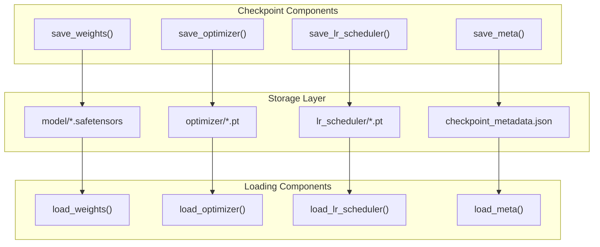
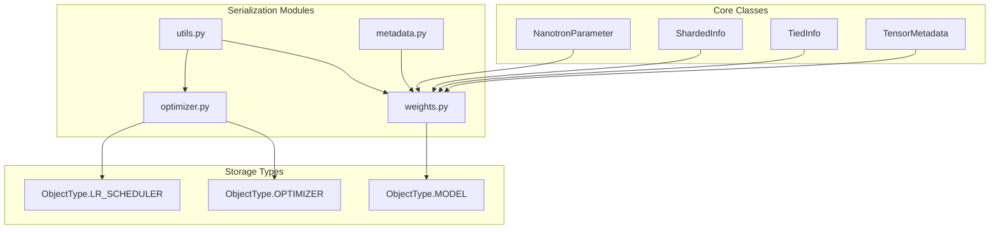
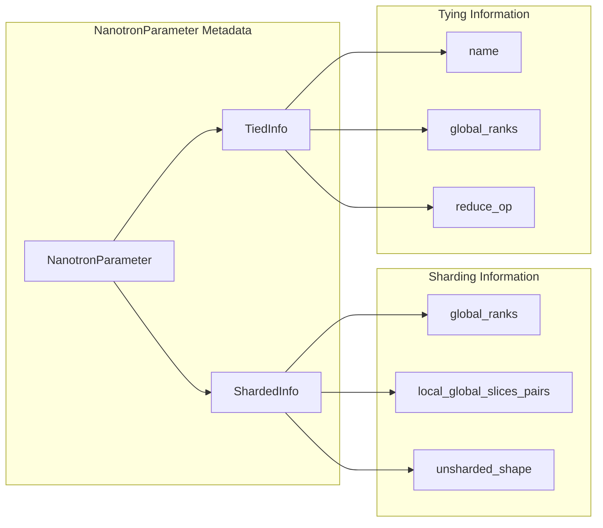
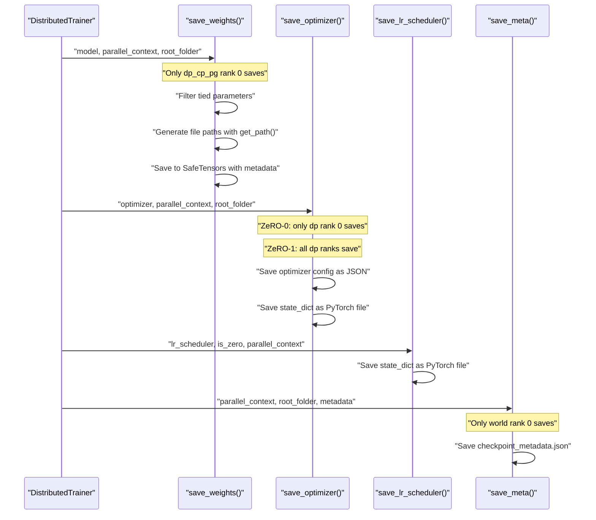
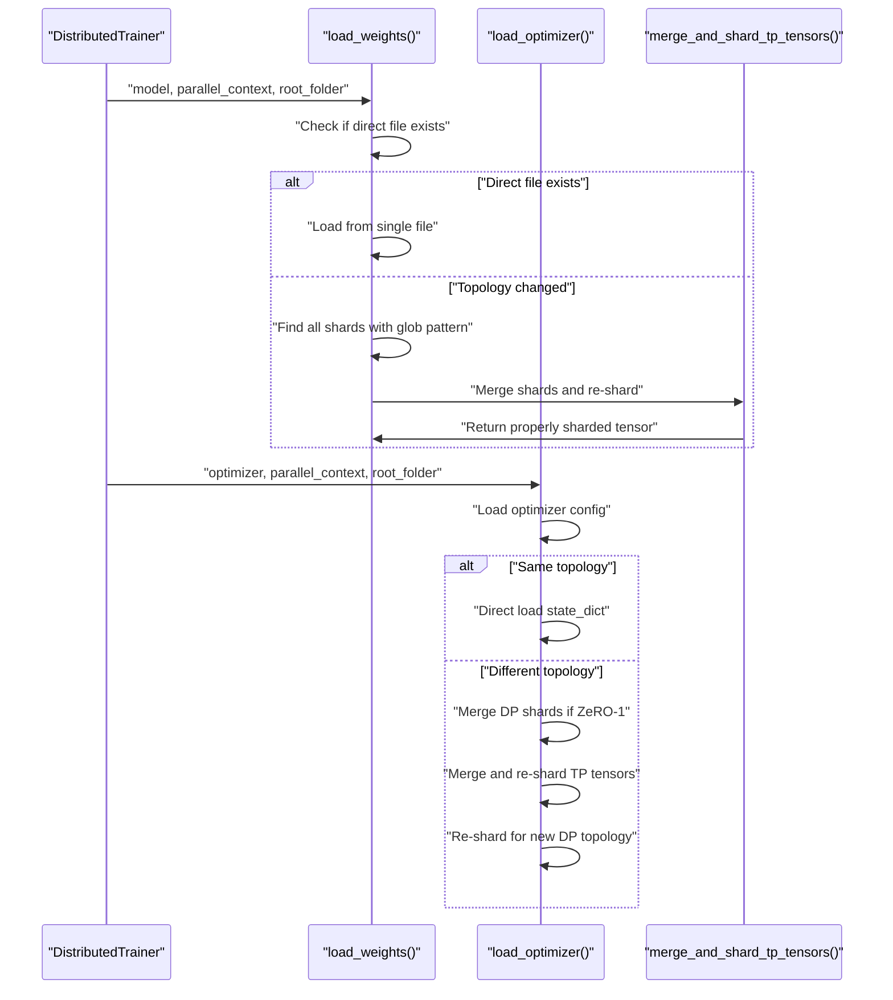
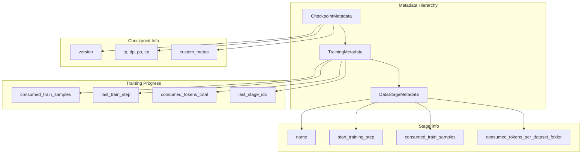

<!-- source: DeepWiki mcp.deepwiki.com · repo huggingface/nanotron · page 7 Checkpointing and Serialization · fetched 2026-10-26 -->

# Checkpointing and Serialization

Relevant source files

The following files were used as context for generating this wiki page:

- [src/nanotron/parallel/parameters.py](src/nanotron/parallel/parameters.py)
- [src/nanotron/parallel/tied_parameters.py](src/nanotron/parallel/tied_parameters.py)
- [src/nanotron/sanity_checks.py](src/nanotron/sanity_checks.py)
- [src/nanotron/serialize/metadata.py](src/nanotron/serialize/metadata.py)
- [src/nanotron/serialize/optimizer.py](src/nanotron/serialize/optimizer.py)
- [src/nanotron/serialize/utils.py](src/nanotron/serialize/utils.py)
- [src/nanotron/serialize/weights.py](src/nanotron/serialize/weights.py)

This document covers the checkpointing and serialization system in Nanotron, which handles saving and loading model weights, optimizer states, learning rate scheduler states, and training metadata. The system supports distributed training with 3D parallelism (tensor, pipeline, and data parallelism) and handles topology changes during resumption.

For information about the overall training workflow, see [Training Workflow](#6.1). For details about the distributed training setup, see [Distributed Training](#4).

## System Overview

The checkpointing system provides fault tolerance and training resumption capabilities for large-scale distributed training. It handles the complexity of saving and loading state across multiple parallel dimensions while maintaining consistency and supporting topology changes.

**Sources:** [src/nanotron/serialize/weights.py:30-109](), [src/nanotron/serialize/optimizer.py:41-107](), [src/nanotron/serialize/metadata.py:160-180]()

## Core Architecture

The serialization system is built around four main modules that handle different aspects of checkpointing:

**Sources:** [src/nanotron/parallel/parameters.py:95-189](), [src/nanotron/serialize/utils.py:13-17](), [src/nanotron/serialize/metadata.py:98-136]()

## Checkpoint File Structure

Checkpoints are organized hierarchically with separate directories for different component types:

| Component | Directory | File Pattern | Format |
|-----------|-----------|--------------|---------|
| Model Weights | `model/` | `model_{param_name}_pp-rank-{pp}-of-{pp_size}_tp-rank-{tp}-of-{tp_size}.safetensors` | SafeTensors |
| Optimizer States | `optimizer/` | `optimizer_pp-{pp}-of-{pp_size}_dp-{dp}-of-{dp_size}_tp-{tp}-of-{tp_size}.pt` | PyTorch |
| LR Scheduler | `lr_scheduler/` | `lr_scheduler_pp-{pp}-of-{pp_size}_dp-{dp}-of-{dp_size}_tp-{tp}-of-{tp_size}.pt` | PyTorch |
| Metadata | `.` | `checkpoint_metadata.json` | JSON |

The file naming convention encodes the parallel topology information, enabling the system to understand how data was sharded during saving.

**Sources:** [src/nanotron/serialize/utils.py:30-58](), [src/nanotron/serialize/optimizer.py:27-38]()

## Parameter Metadata System

The checkpoint system relies on `NanotronParameter` objects that carry metadata about sharding and tying:

**Sources:** [src/nanotron/parallel/parameters.py:95-189](), [src/nanotron/parallel/parameters.py:77-93](), [src/nanotron/parallel/parameters.py:58-75]()

## Saving Process

The saving process coordinates across all parallel dimensions to ensure consistency:

**Sources:** [src/nanotron/serialize/weights.py:30-109](), [src/nanotron/serialize/optimizer.py:41-107](), [src/nanotron/serialize/metadata.py:160-180]()

## Loading Process

The loading process handles topology changes and reconstructs the distributed state:

**Sources:** [src/nanotron/serialize/weights.py:189-320](), [src/nanotron/serialize/optimizer.py:149-358](), [src/nanotron/serialize/utils.py:67-84]()

## Topology Change Handling

The system supports resuming training with different parallel configurations:

| Change Type | Support Level | Implementation |
|-------------|---------------|----------------|
| Tensor Parallel Size | ✅ Full Support | `merge_and_shard_tp_tensors()` |
| Data Parallel Size | ✅ Full Support | ZeRO optimizer resharding |
| Pipeline Parallel Size | ⚠️ Limited | Warning issued, manual verification needed |
| Expert Parallel Size | ✅ Full Support | Expert-aware path generation |

The topology change logic uses parameter metadata to understand how tensors were originally sharded and reconstructs them for the new topology.

**Sources:** [src/nanotron/serialize/optimizer.py:167-180](), [src/nanotron/serialize/weights.py:271-314]()

## Metadata Management

Training metadata tracks progress across multi-stage training:

**Sources:** [src/nanotron/serialize/metadata.py:88-96](), [src/nanotron/serialize/metadata.py:42-86](), [src/nanotron/serialize/metadata.py:18-41]()

## ZeRO Optimizer Support

The system handles both ZeRO-0 (parameter replication) and ZeRO-1 (parameter sharding) optimizers:

| ZeRO Level | Saving Strategy | Loading Strategy |
|------------|-----------------|------------------|
| ZeRO-0 | Only DP rank 0 saves | All ranks load same state |
| ZeRO-1 | Each DP rank saves its shard | Merge shards then re-shard for new topology |

For ZeRO-1, the system stores additional metadata including `param_name_to_dp_rank_offsets` and `orig_param_shapes` to enable proper reconstruction during topology changes.

**Sources:** [src/nanotron/serialize/optimizer.py:77-98](), [src/nanotron/serialize/optimizer.py:186-196](), [src/nanotron/serialize/optimizer.py:340-356]()

---

