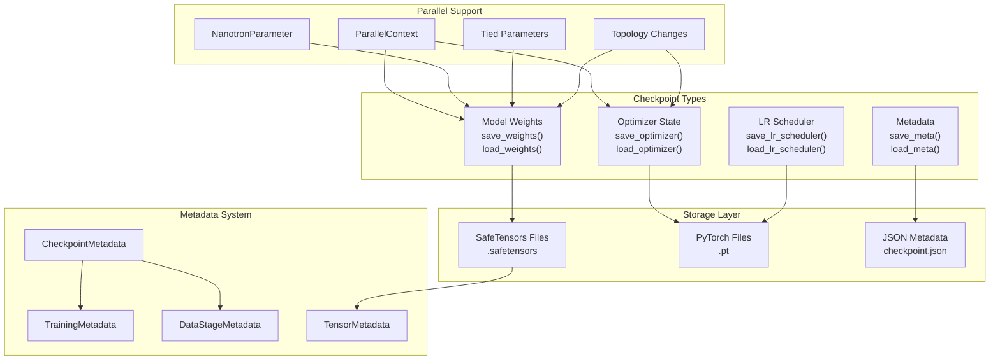
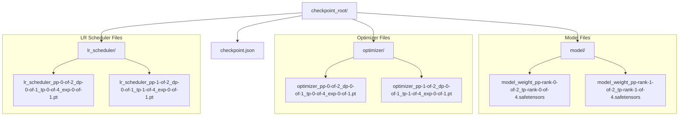
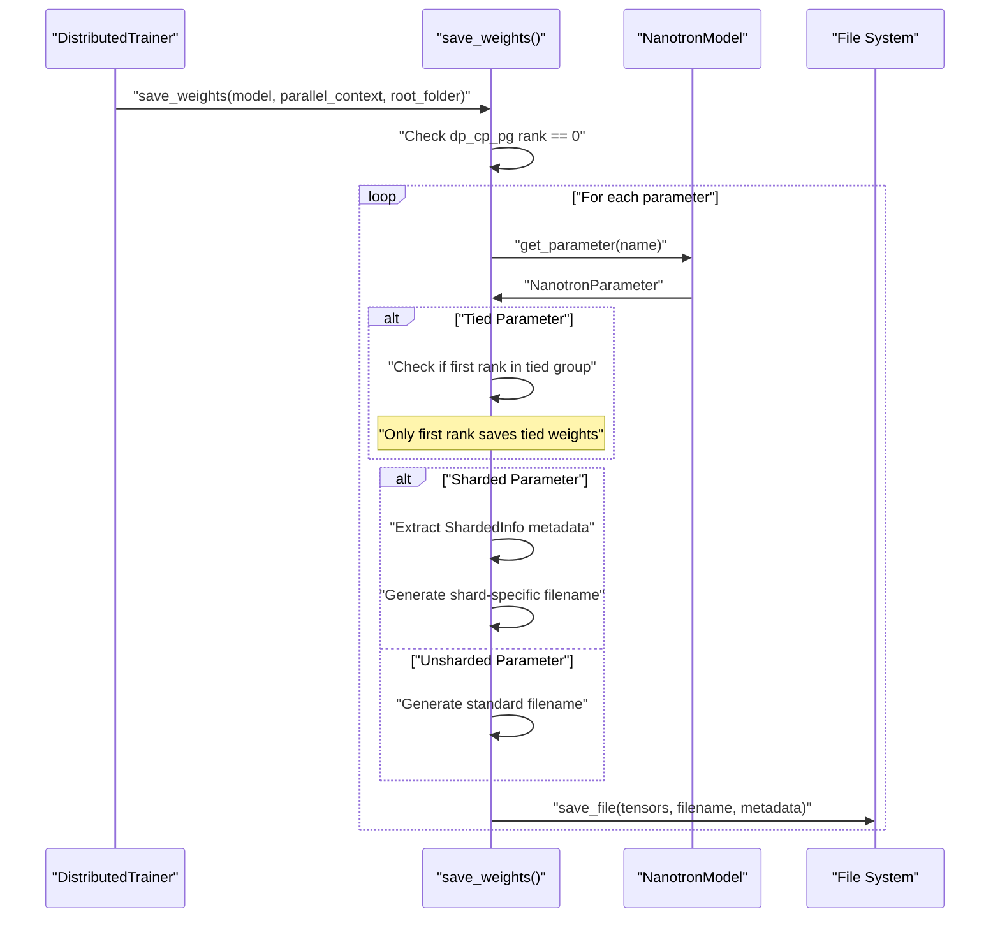
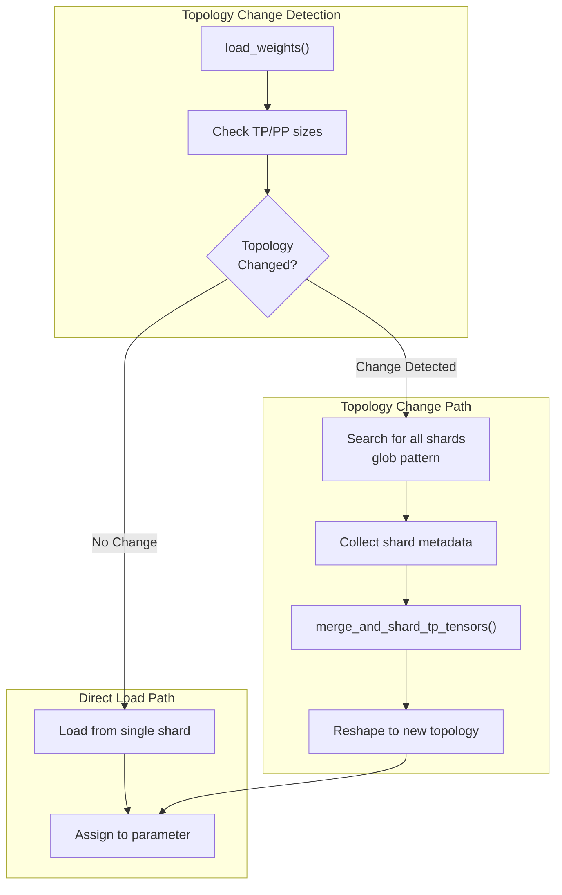
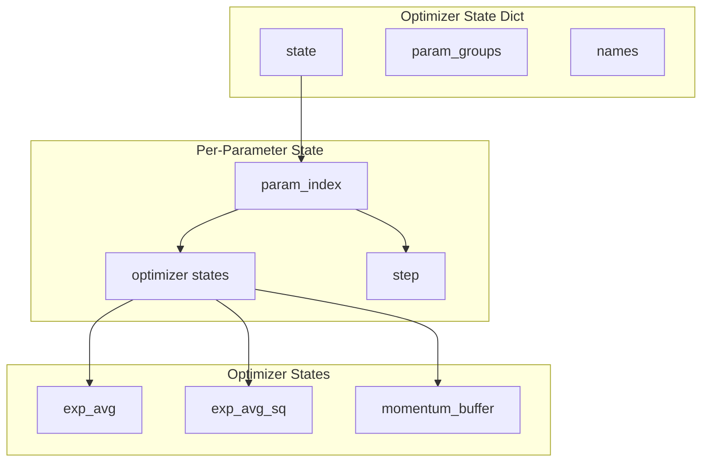
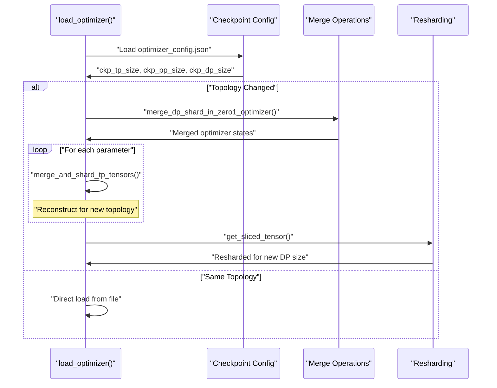
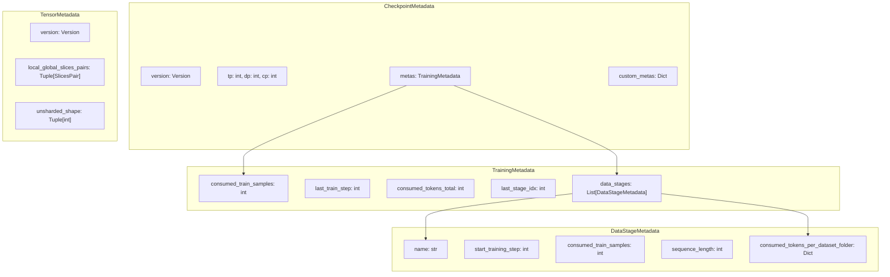
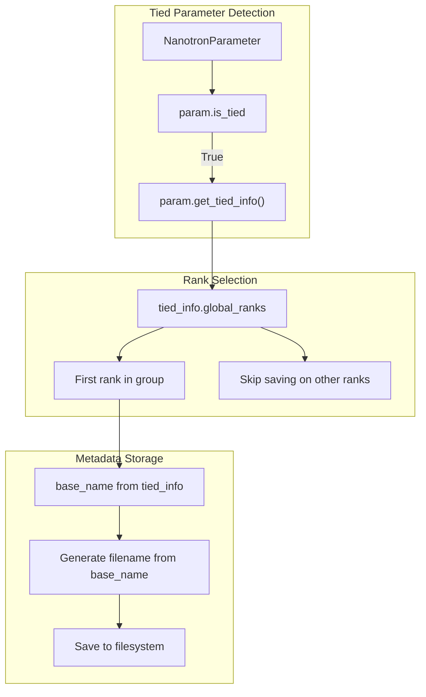
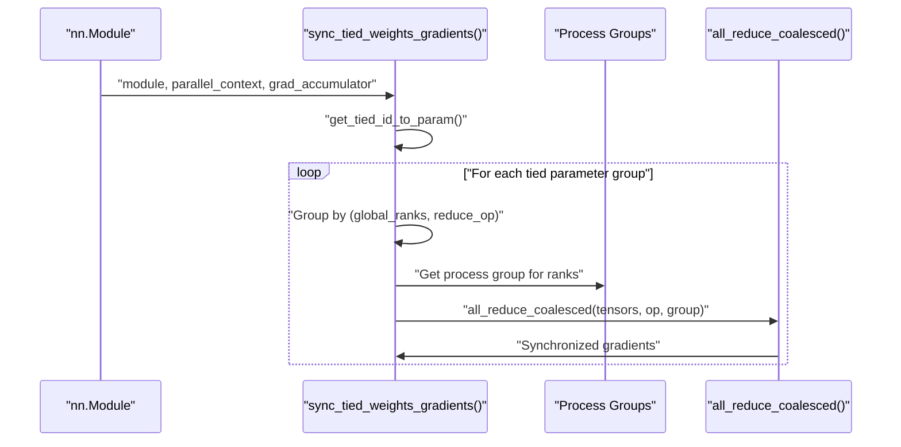
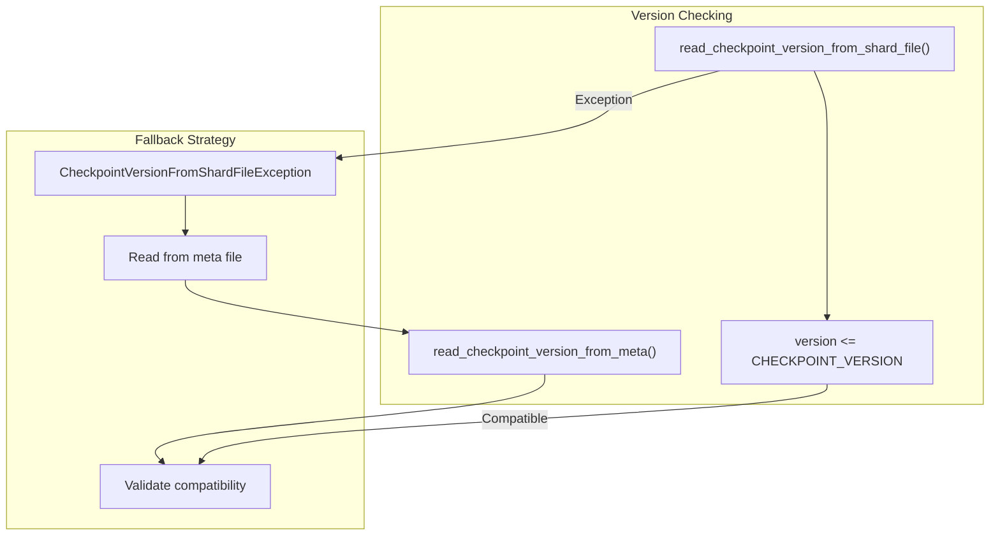

<!-- source: DeepWiki mcp.deepwiki.com · repo huggingface/nanotron · page 7.1 Checkpoint Management · fetched 2026-10-26 -->

# Checkpoint Management

Relevant source files

The following files were used as context for generating this wiki page:

- [src/nanotron/parallel/parameters.py](src/nanotron/parallel/parameters.py)
- [src/nanotron/parallel/tied_parameters.py](src/nanotron/parallel/tied_parameters.py)
- [src/nanotron/sanity_checks.py](src/nanotron/sanity_checks.py)
- [src/nanotron/serialize/metadata.py](src/nanotron/serialize/metadata.py)
- [src/nanotron/serialize/optimizer.py](src/nanotron/serialize/optimizer.py)
- [src/nanotron/serialize/utils.py](src/nanotron/serialize/utils.py)
- [src/nanotron/serialize/weights.py](src/nanotron/serialize/weights.py)

This document covers the checkpoint management system in Nanotron, which handles saving and loading of model weights, optimizer states, learning rate schedulers, and training metadata across distributed training environments. The system supports topology changes, enabling resumption of training with different parallelism configurations.

For cloud storage integration with checkpoints, see [S3 Integration](#7.2). For training workflow orchestration that uses checkpoints, see [Training Workflow](#6.1).

## System Architecture

The checkpoint management system consists of several interconnected components that handle different aspects of state persistence and recovery in distributed training.

### Core Components Overview

**Sources:** [src/nanotron/serialize/weights.py:30-109](), [src/nanotron/serialize/optimizer.py:41-107](), [src/nanotron/serialize/metadata.py:160-180]()

## File Organization and Naming

The checkpoint system uses a structured file hierarchy with specific naming conventions to support distributed training across multiple parallelism dimensions.

### Checkpoint Directory Structure

**Sources:** [src/nanotron/serialize/utils.py:30-58](), [src/nanotron/serialize/optimizer.py:27-38]()

### Filename Generation Functions

The system generates filenames that encode parallelism topology information:

| Component | Function | Format |
|-----------|----------|---------|
| Model weights | `get_path()` | `model_{param_name}_pp-rank-{pp_rank}-of-{pp_size}_tp-rank-{tp_rank}-of-{tp_size}.safetensors` |
| Optimizer | `optimizer_filename()` | `optimizer_pp-{pp_rank}-of-{pp_size}_dp-{dp_rank}-of-{dp_size}_tp-{tp_rank}-of-{tp_size}_exp-{exp_rank}-of-{exp_size}.pt` |
| LR Scheduler | `lr_scheduler_filename()` | `lr_scheduler_pp-{pp_rank}-of-{pp_size}_dp-{dp_rank}-of-{dp_size}_tp-{tp_rank}-of-{tp_size}_exp-{exp_rank}-of-{exp_size}.pt` |

**Sources:** [src/nanotron/serialize/utils.py:30-58](), [src/nanotron/serialize/optimizer.py:27-38]()

## Model Weights Management

Model weight checkpointing handles the complexities of distributed parameter storage, including sharded parameters, tied weights, and expert parallelism.

### Save Process

The `save_weights()` function coordinates distributed weight saving:

**Sources:** [src/nanotron/serialize/weights.py:30-109]()

### Load Process with Topology Changes

The loading process supports topology changes by reconstructing parameters from multiple shards:

**Sources:** [src/nanotron/serialize/weights.py:189-320](), [src/nanotron/serialize/utils.py:67-84]()

## Optimizer State Management

Optimizer checkpointing handles both ZeRO and non-ZeRO optimizers, with special considerations for distributed optimizer states.

### ZeRO vs Non-ZeRO Handling

| Optimizer Type | Storage Strategy | Loading Strategy |
|----------------|------------------|------------------|
| ZeRO-0 (Replicated) | Only DP rank 0 saves | All DP ranks load same state |
| ZeRO-1 (Sharded) | Each DP rank saves shard | Merge shards then reshard |

**Sources:** [src/nanotron/serialize/optimizer.py:41-107]()

### Optimizer State Structure

**Sources:** [src/nanotron/serialize/optimizer.py:149-358]()

### Topology-Agnostic Loading

The optimizer loading process handles topology changes by reconstructing optimizer states to match the new parameter distribution:

**Sources:** [src/nanotron/serialize/optimizer.py:149-358]()

## Metadata and Versioning

The checkpoint metadata system tracks training progress, data consumption, and checkpoint versions to ensure compatibility and enable proper resumption.

### Metadata Hierarchy

**Sources:** [src/nanotron/serialize/metadata.py:18-136]()

## Tied Parameters

Tied parameters require special handling during checkpointing to ensure only one rank saves the shared weights and all ranks load consistently.

### Tied Parameter Saving Logic

**Sources:** [src/nanotron/serialize/weights.py:56-68](), [src/nanotron/parallel/tied_parameters.py:104-118]()

### Tied Weight Synchronization

The `sync_tied_weights_gradients()` function ensures gradient consistency across tied parameters:

**Sources:** [src/nanotron/parallel/tied_parameters.py:120-168]()

## Error Handling and Validation

The checkpoint system includes comprehensive validation and error handling mechanisms.

### Checkpoint Version Compatibility

**Sources:** [src/nanotron/serialize/weights.py:111-146]()

### Sanity Checks

The system performs various sanity checks during checkpoint operations:

| Check Type | Function | Purpose |
|------------|----------|---------|
| Parameter Sync | `assert_tensor_synced_across_pg()` | Verify parameters are synchronized across process groups |
| Tied Weights | Validation in tied parameter functions | Ensure tied weights remain consistent |
| Optimizer States | `check_optim_state_in_sync()` | Verify optimizer states are synchronized |
| Gradient Flow | Parameter gradient validation | Ensure all parameters have gradients when expected |

**Sources:** [src/nanotron/sanity_checks.py:19-275]()

---

