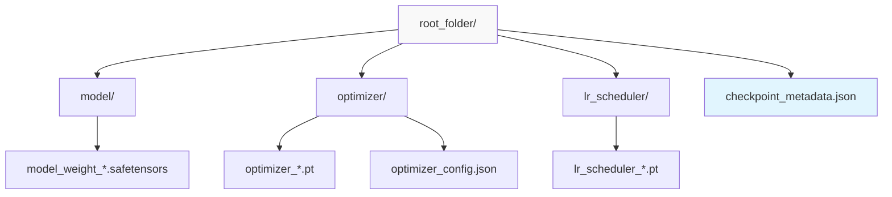
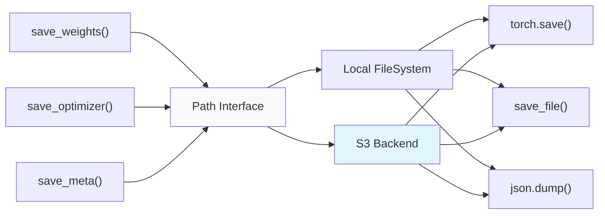
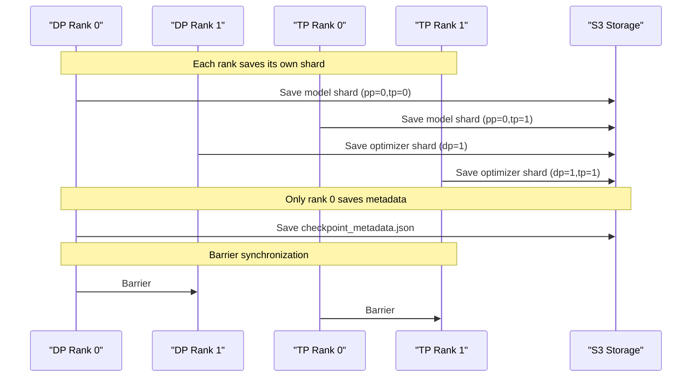
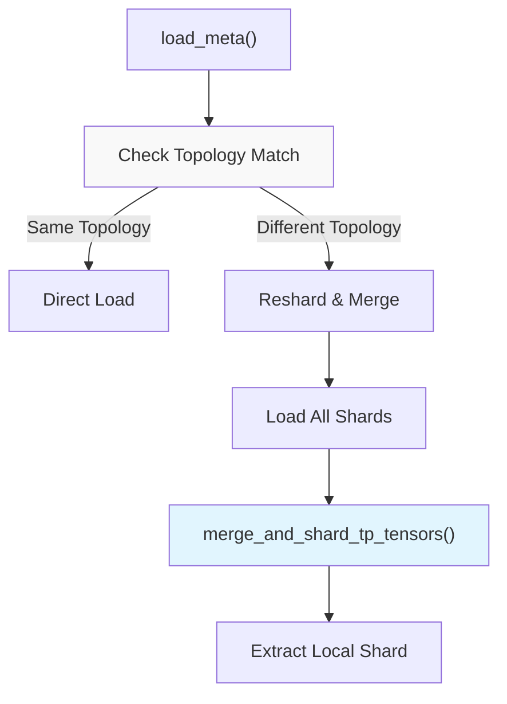
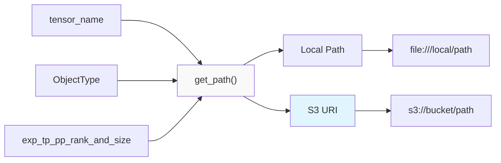
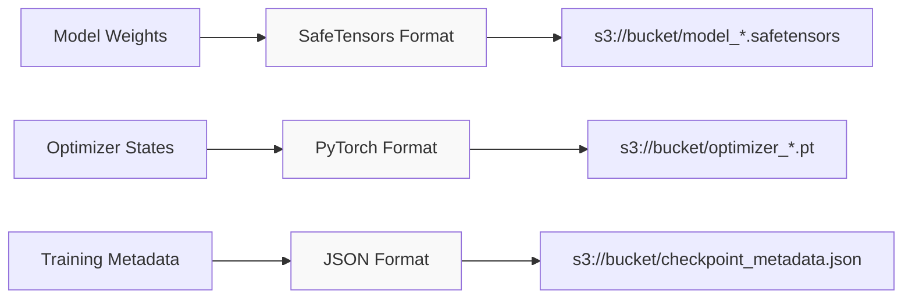
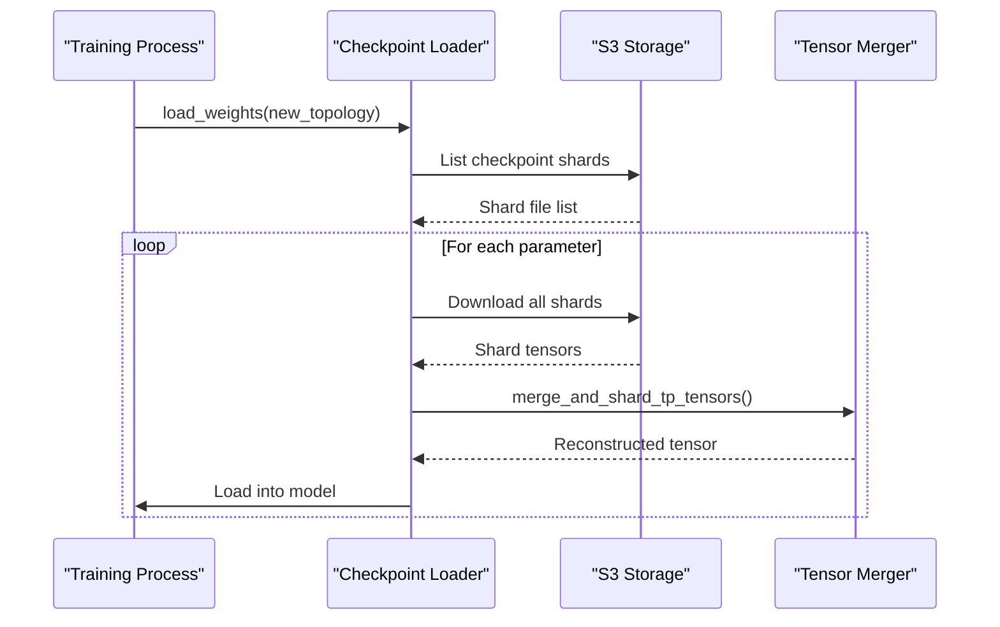
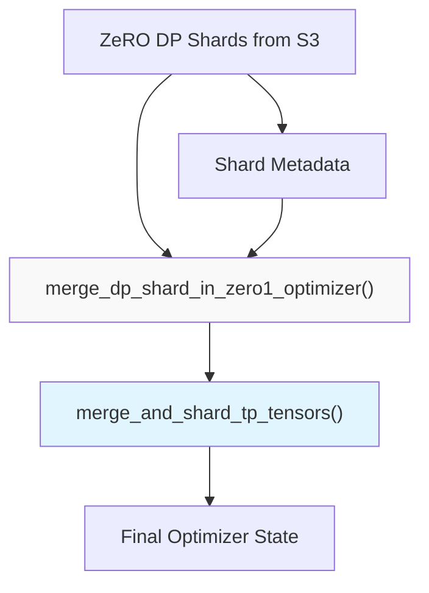
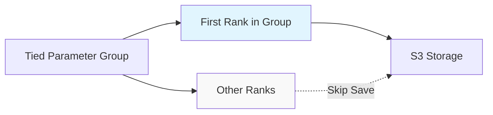

<!-- source: DeepWiki mcp.deepwiki.com · repo huggingface/nanotron · page 7.2 S3 Integration · fetched 2026-10-26 -->

# S3 Integration

Relevant source files

The following files were used as context for generating this wiki page:

- [src/nanotron/parallel/parameters.py](src/nanotron/parallel/parameters.py)
- [src/nanotron/parallel/tied_parameters.py](src/nanotron/parallel/tied_parameters.py)
- [src/nanotron/sanity_checks.py](src/nanotron/sanity_checks.py)
- [src/nanotron/serialize/metadata.py](src/nanotron/serialize/metadata.py)
- [src/nanotron/serialize/optimizer.py](src/nanotron/serialize/optimizer.py)
- [src/nanotron/serialize/utils.py](src/nanotron/serialize/utils.py)
- [src/nanotron/serialize/weights.py](src/nanotron/serialize/weights.py)

## Purpose and Scope

This document covers the cloud storage integration capabilities for Nanotron's checkpoint management system, specifically focusing on S3-compatible storage backends. The S3 integration enables distributed checkpoint storage and retrieval across cloud infrastructure for large-scale training workloads.

For basic checkpoint management and local file operations, see [Checkpoint Management](#7.1). For general serialization concepts, see [Checkpointing and Serialization](#7).

## Current Checkpoint Architecture

The Nanotron checkpoint system is built on a file-path-based architecture that provides the foundation for cloud storage integration. All checkpoint operations work through standardized path interfaces that can be extended to support remote storage backends.

### Checkpoint File Structure

The checkpoint system organizes files in a hierarchical structure suitable for distributed storage:

Sources: [src/nanotron/serialize/weights.py:30-109](), [src/nanotron/serialize/optimizer.py:41-107](), [src/nanotron/serialize/metadata.py:160-180]()

### Path Generation System

The checkpoint system uses a standardized path generation mechanism that creates consistent file naming across distributed ranks:

| Component | Path Pattern | Example |
|-----------|-------------|---------|
| Model weights | `model_{name}_pp-rank-{pp}-of-{pp_size}_tp-rank-{tp}-of-{tp_size}.safetensors` | `model_weight_pp-rank-0-of-4_tp-rank-1-of-2.safetensors` |
| Optimizer states | `optimizer_pp-{pp}-of-{pp_size}_dp-{dp}-of-{dp_size}_tp-{tp}-of-{tp_size}.pt` | `optimizer_pp-0-of-4_dp-1-of-8_tp-1-of-2.pt` |
| LR scheduler | `lr_scheduler_pp-{pp}-of-{pp_size}_dp-{dp}-of-{dp_size}_tp-{tp}-of-{tp_size}.pt` | `lr_scheduler_pp-0-of-4_dp-1-of-8_tp-1-of-2.pt` |

Sources: [src/nanotron/serialize/utils.py:30-58](), [src/nanotron/serialize/optimizer.py:27-38]()

## Storage Backend Architecture

The checkpoint system's design allows for pluggable storage backends through the path-based interface:

Sources: [src/nanotron/serialize/weights.py:96-99](), [src/nanotron/serialize/optimizer.py:102-106](), [src/nanotron/serialize/metadata.py:178-179]()

## Distributed Checkpoint Coordination

The checkpoint system coordinates across distributed ranks to ensure consistent storage operations:

### Rank-based Save Strategy

Sources: [src/nanotron/serialize/weights.py:33-35](), [src/nanotron/serialize/optimizer.py:50-52](), [src/nanotron/serialize/metadata.py:163-164]()

### Load Coordination

The load process handles topology changes and shard redistribution:

Sources: [src/nanotron/serialize/weights.py:189-319](), [src/nanotron/serialize/optimizer.py:149-357]()

## Integration Points for S3 Storage

The current architecture provides several integration points where S3 functionality can be seamlessly added:

### 1. Path Resolution Layer

The `get_path()` function in `serialize/utils.py` provides the primary integration point for custom storage backends:

Sources: [src/nanotron/serialize/utils.py:30-58]()

### 2. Metadata Management

The checkpoint metadata system stores topology information required for distributed S3 operations:

| Metadata Field | Purpose | S3 Relevance |
|----------------|---------|--------------|
| `version` | Checkpoint format version | Compatibility checking |
| `tp`, `dp`, `pp` | Parallelism dimensions | Shard distribution |
| `consumed_train_samples` | Training progress | Resume consistency |
| `data_stages` | Multi-stage training | Stage-aware storage |

Sources: [src/nanotron/serialize/metadata.py:89-96](), [src/nanotron/serialize/metadata.py:43-86]()

### 3. Tensor Serialization Formats

The system uses format-specific serialization that translates to S3 storage:

Sources: [src/nanotron/serialize/weights.py:97-98](), [src/nanotron/serialize/optimizer.py:102-106](), [src/nanotron/serialize/metadata.py:178-179]()

## Checkpoint Recovery with Cloud Storage

The checkpoint recovery system handles distributed loading from cloud storage with automatic shard reconstruction:

### Topology-Agnostic Loading

When loading checkpoints with different parallelism configurations, the system can reconstruct tensors from S3-stored shards:

Sources: [src/nanotron/serialize/weights.py:271-314](), [src/nanotron/serialize/utils.py:67-84]()

### Zero Optimizer Reconstruction

For ZeRO-sharded optimizers, the system merges data-parallel shards before tensor-parallel resharding:

Sources: [src/nanotron/serialize/optimizer.py:186-196](), [src/nanotron/serialize/optimizer.py:293-300]()

## Storage Efficiency Considerations

The checkpoint system's design optimizes for cloud storage efficiency:

### Selective Expert Saving

For Mixture of Experts models, only relevant expert parameters are saved per rank:

- `exp_rank=0`: Saves all weights
- `exp_rank>0`: Saves only expert-specific weights

This reduces redundant storage in distributed S3 buckets.

Sources: [src/nanotron/serialize/weights.py:44-47]()

### Tied Parameter Deduplication

Tied parameters are saved only once per tied group, preventing duplicate storage:

Sources: [src/nanotron/serialize/weights.py:58-66]()

---

