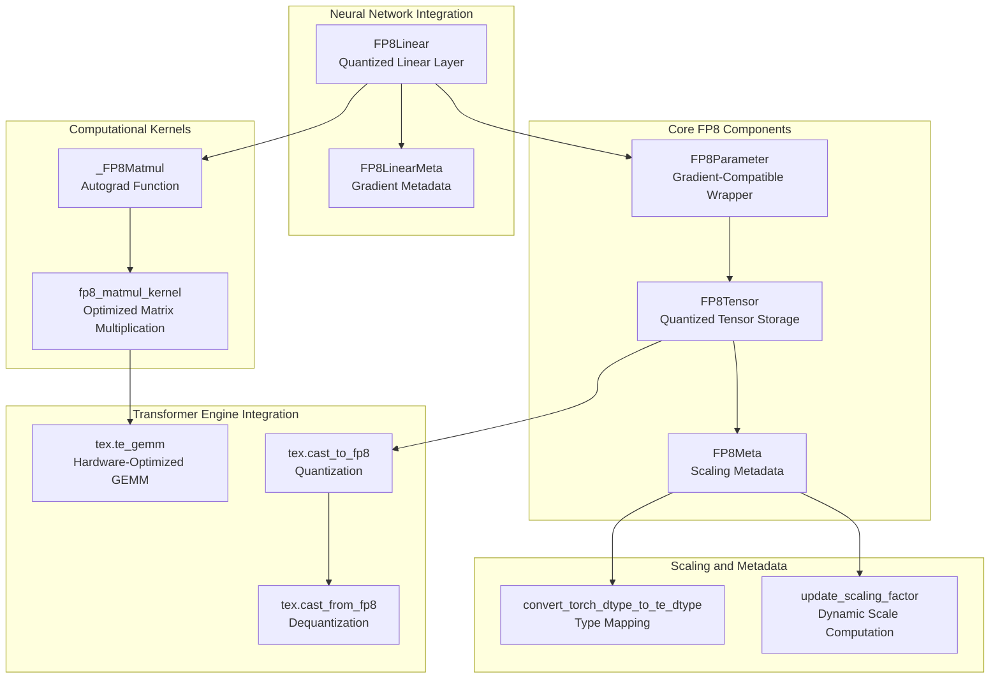
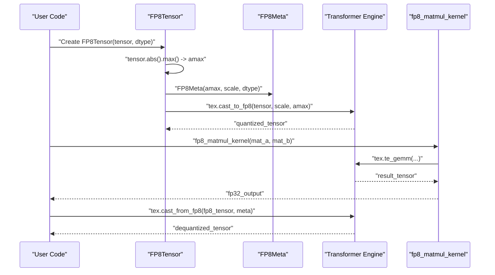
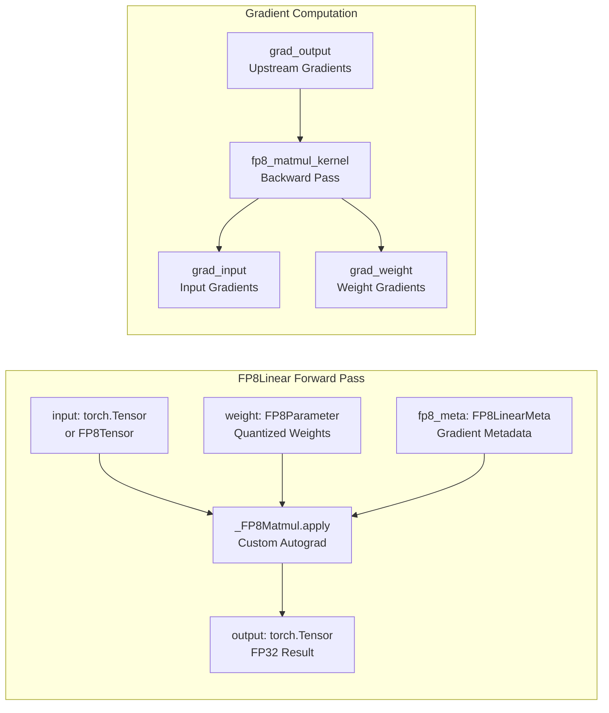

<!-- source: DeepWiki mcp.deepwiki.com · repo huggingface/nanotron · page 8 Performance Optimization · fetched 2026-10-26 -->

# Performance Optimization

Relevant source files

The following files were used as context for generating this wiki page:

- [src/nanotron/fp8/__init__.py](src/nanotron/fp8/__init__.py)
- [src/nanotron/fp8/constants.py](src/nanotron/fp8/constants.py)
- [src/nanotron/fp8/dtypes.py](src/nanotron/fp8/dtypes.py)
- [src/nanotron/fp8/kernel.py](src/nanotron/fp8/kernel.py)
- [src/nanotron/fp8/linear.py](src/nanotron/fp8/linear.py)
- [src/nanotron/fp8/meta.py](src/nanotron/fp8/meta.py)
- [src/nanotron/fp8/parameter.py](src/nanotron/fp8/parameter.py)
- [src/nanotron/fp8/tensor.py](src/nanotron/fp8/tensor.py)
- [src/nanotron/fp8/utils.py](src/nanotron/fp8/utils.py)
- [tests/fp8/test_fp8_parameter.py](tests/fp8/test_fp8_parameter.py)
- [tests/fp8/test_linear.py](tests/fp8/test_linear.py)
- [tests/fp8/test_tensor.py](tests/fp8/test_tensor.py)

## Purpose and Scope

This document covers performance optimization techniques implemented in Nanotron to maximize training efficiency and memory utilization for large language models. The primary focus is on FP8 (8-bit floating point) quantization as the core optimization strategy, along with supporting infrastructure for memory-efficient training.

For detailed coverage of specific optimization techniques, see [FP8 Quantization](#8.1), [Optimized Kernels](#8.2), and [Memory Optimization](#8.3). For distributed training optimizations, see [Distributed Training](#4).

## Overview of Performance Optimization

Nanotron implements several performance optimization strategies to reduce memory usage and increase computational throughput:

| Optimization Type | Primary Implementation | Memory Savings | Computational Benefits |
|-------------------|----------------------|----------------|----------------------|
| FP8 Quantization | `FP8Tensor`, `FP8Linear` | ~50% reduction | Faster matrix operations |
| Custom Kernels | `fp8_matmul_kernel` | Reduced overhead | Hardware-optimized operations |
| Parameter Management | `FP8Parameter` | Efficient storage | Gradient computation optimization |

The optimization system is designed around the Transformer Engine integration, providing hardware-accelerated FP8 operations on supported GPUs.

## FP8 Quantization System Architecture

The FP8 quantization system provides a complete infrastructure for 8-bit floating point training, centered around several key components:

### FP8 System Architecture

**Sources:** [src/nanotron/fp8/tensor.py:9-106](), [src/nanotron/fp8/linear.py:24-113](), [src/nanotron/fp8/kernel.py:9-71](), [src/nanotron/fp8/meta.py:12-41](), [src/nanotron/fp8/parameter.py:10-44]()

## FP8 Tensor Management

The `FP8Tensor` class provides the foundation for 8-bit quantized tensor operations:

### FP8 Tensor Lifecycle

**Sources:** [src/nanotron/fp8/tensor.py:12-36](), [src/nanotron/fp8/meta.py:26-41](), [src/nanotron/fp8/kernel.py:46-70]()

### Key FP8 Tensor Features

The `FP8Tensor` implementation provides several critical features:

- **Dynamic Scaling**: Uses `update_scaling_factor()` to compute optimal quantization scales based on tensor magnitude
- **Device Compatibility**: Requires CUDA devices for FP8 operations, with CPU fallback
- **Metadata Tracking**: Maintains `FP8Meta` objects containing `amax`, `scale`, and `inverse_scale` values
- **Type Safety**: Enforces proper dtype handling through `DTypes` enumeration

**Sources:** [src/nanotron/fp8/tensor.py:77-106](), [src/nanotron/fp8/dtypes.py:4-8](), [src/nanotron/fp8/constants.py:18-19]()

## FP8 Linear Operations

The `FP8Linear` class extends `torch.nn.Linear` to support FP8 quantized operations:

### FP8Linear Architecture

**Sources:** [src/nanotron/fp8/linear.py:51-66](), [src/nanotron/fp8/linear.py:88-112]()

### FP8Linear Implementation Details

The `FP8Linear` class implements several key optimizations:

- **Automatic Quantization**: Converts weights to `FP8Parameter` during initialization on CUDA devices
- **Metadata Management**: Maintains separate `FP8Meta` objects for input gradients, weight gradients, and output gradients
- **Custom Backward Pass**: Uses `_FP8Matmul` autograd function to compute gradients with FP8 precision
- **Bias Handling**: Applies bias in FP32 after FP8 matrix multiplication

**Sources:** [src/nanotron/fp8/linear.py:24-49](), [src/nanotron/fp8/linear.py:16-22]()

## Transformer Engine Integration

Nanotron integrates with NVIDIA's Transformer Engine for hardware-optimized FP8 operations:

### Transformer Engine Function Mapping

| Nanotron Function | Transformer Engine Function | Purpose |
|-------------------|----------------------------|---------|
| `convert_tensor_to_fp8()` | `tex.cast_to_fp8()` | Quantize tensors to FP8 |
| `convert_tensor_from_fp8()` | `tex.cast_from_fp8()` | Dequantize FP8 tensors |
| `fp8_matmul_kernel()` | `tex.te_gemm()` | Optimized matrix multiplication |
| `convert_torch_dtype_to_te_dtype()` | `tex.DType` mapping | Type system compatibility |

The integration handles device compatibility, dtype conversions, and hardware-specific optimizations transparently.

**Sources:** [src/nanotron/fp8/tensor.py:39-75](), [src/nanotron/fp8/kernel.py:46-70]()

## Performance Considerations

### Hardware Requirements

FP8 operations are optimized for specific GPU architectures:

- **Supported GPUs**: H100, RTX 4090 (defined in `FP8_GPU_NAMES`)
- **Device Validation**: `is_fp8_available()` checks GPU compatibility
- **Fallback Behavior**: CPU operations fall back to standard PyTorch implementations

### Memory and Computational Benefits

The FP8 system provides significant performance improvements:

- **Memory Reduction**: ~50% reduction in model parameter storage
- **Throughput Increase**: Hardware-accelerated FP8 matrix operations
- **Precision Management**: Dynamic scaling maintains numerical stability
- **Gradient Efficiency**: Custom autograd functions optimize backward passes

**Sources:** [src/nanotron/fp8/utils.py:7-14](), [src/nanotron/fp8/constants.py:5-8](), [tests/fp8/test_linear.py:66-84]()

---

