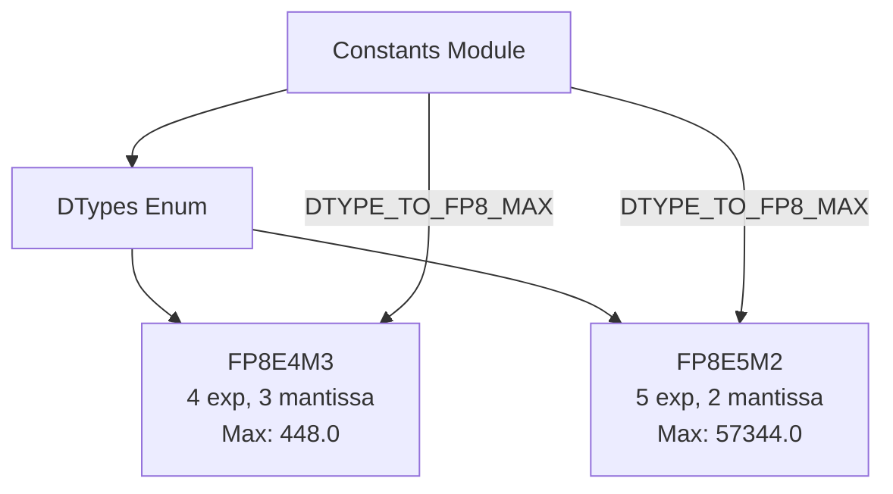
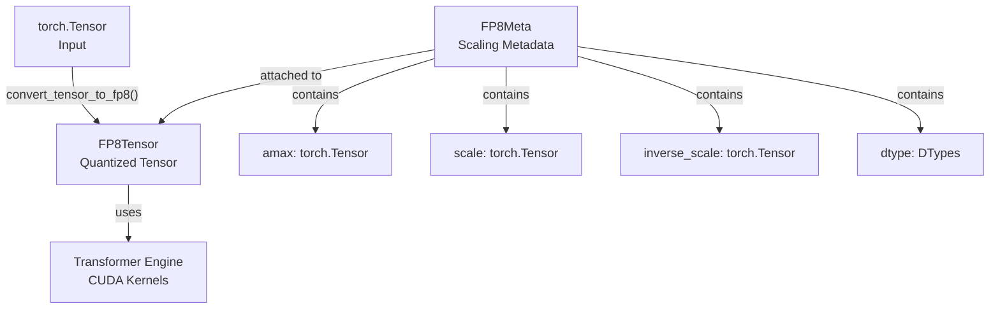
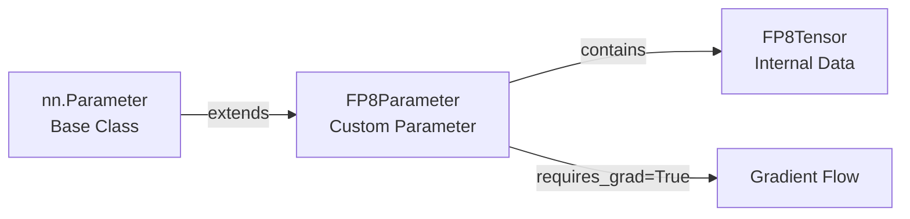
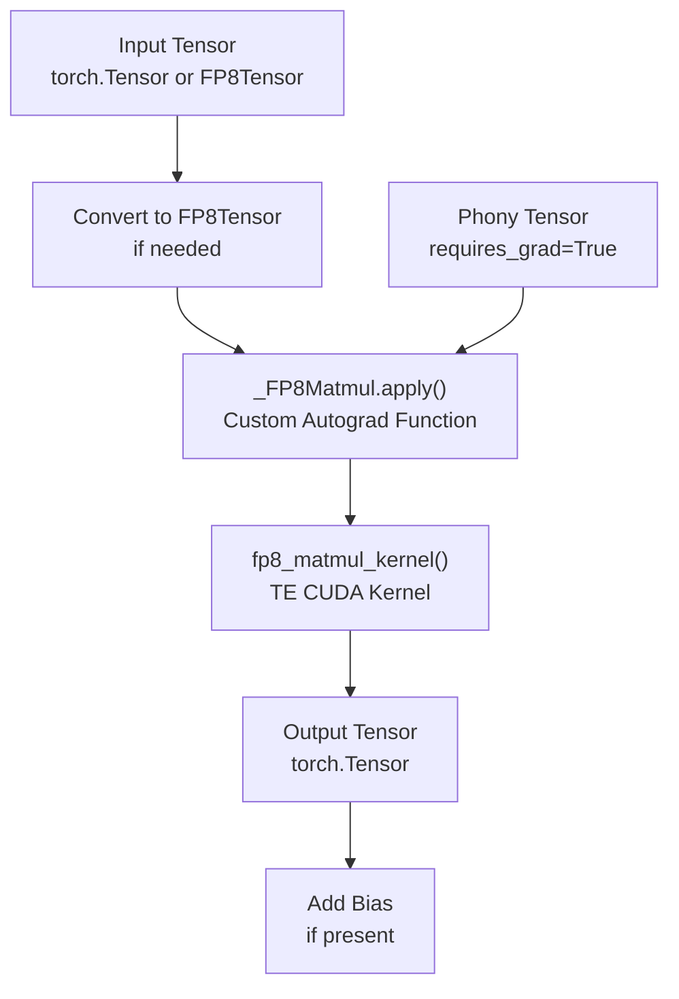
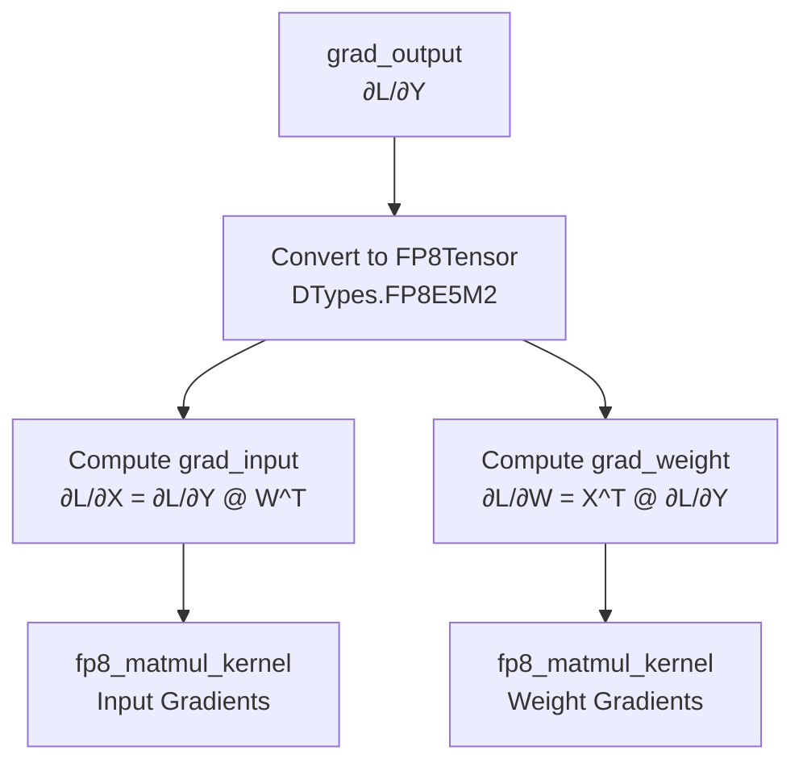
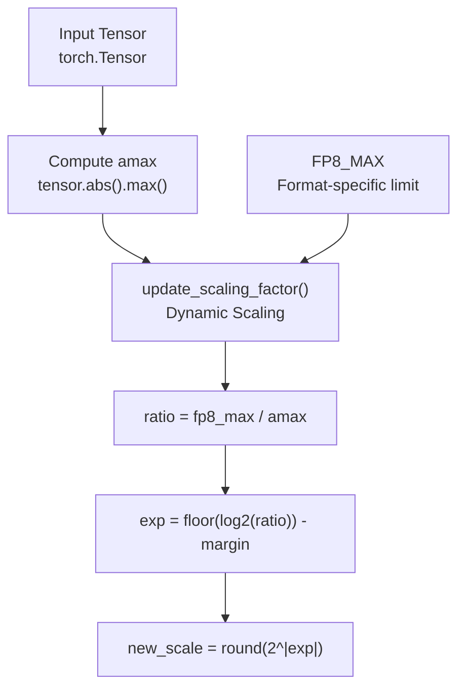
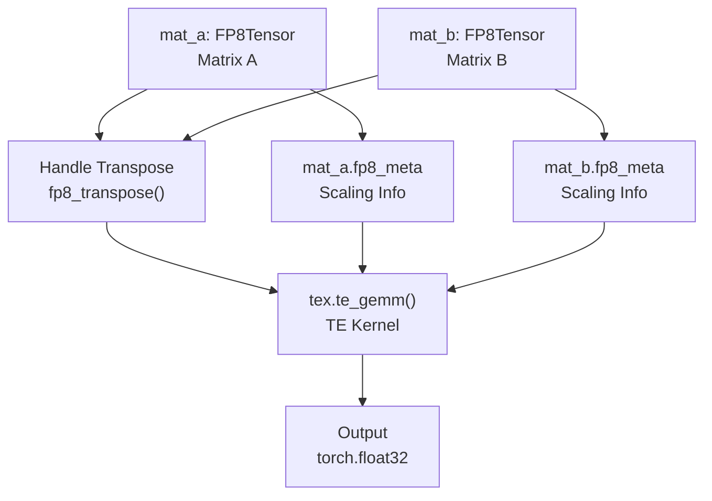
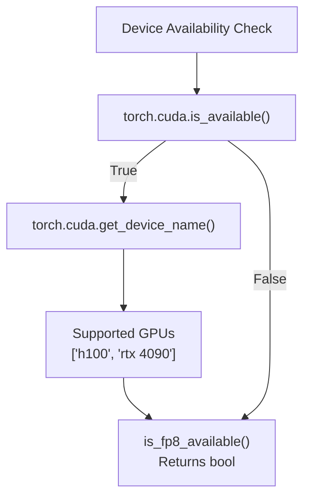
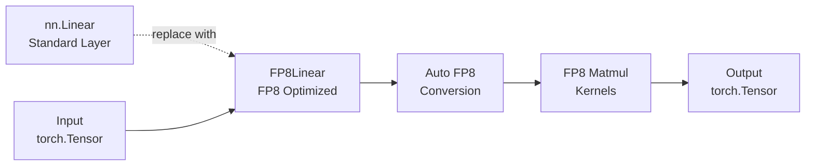
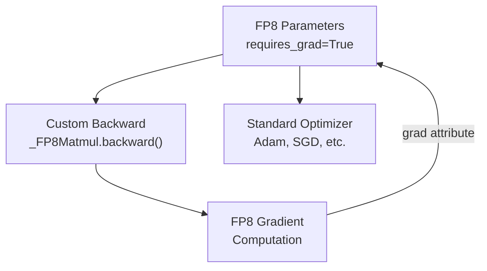

<!-- source: DeepWiki mcp.deepwiki.com · repo huggingface/nanotron · page 8.1 FP8 Quantization · fetched 2026-10-26 -->

# FP8 Quantization

Relevant source files

The following files were used as context for generating this wiki page:

- [src/nanotron/fp8/__init__.py](src/nanotron/fp8/__init__.py)
- [src/nanotron/fp8/constants.py](src/nanotron/fp8/constants.py)
- [src/nanotron/fp8/dtypes.py](src/nanotron/fp8/dtypes.py)
- [src/nanotron/fp8/kernel.py](src/nanotron/fp8/kernel.py)
- [src/nanotron/fp8/linear.py](src/nanotron/fp8/linear.py)
- [src/nanotron/fp8/meta.py](src/nanotron/fp8/meta.py)
- [src/nanotron/fp8/parameter.py](src/nanotron/fp8/parameter.py)
- [src/nanotron/fp8/tensor.py](src/nanotron/fp8/tensor.py)
- [src/nanotron/fp8/utils.py](src/nanotron/fp8/utils.py)
- [tests/fp8/test_fp8_parameter.py](tests/fp8/test_fp8_parameter.py)
- [tests/fp8/test_linear.py](tests/fp8/test_linear.py)
- [tests/fp8/test_tensor.py](tests/fp8/test_tensor.py)

This document covers Nanotron's FP8 (8-bit floating point) quantization system, which enables memory-efficient training by using 8-bit representations for tensors and parameters during forward and backward passes. The FP8 system provides significant memory savings while maintaining training stability through dynamic scaling mechanisms.

For general performance optimization techniques, see [Performance Optimization](#8). For memory-specific optimizations beyond FP8, see [Memory Optimization](#8.3).

## Overview

The FP8 quantization system in Nanotron provides a complete implementation for training with 8-bit floating point precision. It supports two FP8 formats (E4M3 and E5M2) and integrates with NVIDIA's Transformer Engine for optimized CUDA kernels. The system maintains training accuracy through dynamic scaling factors while reducing memory usage by approximately 50% compared to FP16 training.

## FP8 Data Types and Constants

The FP8 system supports two primary formats defined in the `DTypes` enumeration:

| Format | Exponent Bits | Mantissa Bits | Max Value | Use Case |
|--------|---------------|---------------|-----------|----------|
| FP8E4M3 | 4 | 3 | 448.0 | Weights and activations |
| FP8E5M2 | 5 | 2 | 57344.0 | Gradients |

Sources: [src/nanotron/fp8/dtypes.py:4-7](), [src/nanotron/fp8/constants.py:18]()

## Core FP8 Components

### FP8Tensor Architecture

The `FP8Tensor` class serves as the foundation for FP8 quantization, extending PyTorch's tensor functionality with quantization metadata:

Sources: [src/nanotron/fp8/tensor.py:9-37](), [src/nanotron/fp8/meta.py:12-41]()

### FP8Parameter Implementation

`FP8Parameter` extends PyTorch's `nn.Parameter` to support FP8 quantized parameters while maintaining gradient flow:

Sources: [src/nanotron/fp8/parameter.py:10-44]()

## FP8Linear Layer Implementation

### Forward Pass Architecture

The `FP8Linear` layer replaces standard linear operations with FP8-optimized implementations:

Sources: [src/nanotron/fp8/linear.py:51-66]()

### Custom Backward Pass

The backward pass implements custom gradient computation using FP8 kernels:

Sources: [src/nanotron/fp8/linear.py:88-112]()

## Scaling Factor Management

### Dynamic Scaling Algorithm

FP8 quantization requires careful scaling to prevent overflow and maintain precision:

The scaling function uses a JIT-compiled inner function for performance:

Sources: [src/nanotron/fp8/tensor.py:77-105]()

## Transformer Engine Integration

### Kernel Interface

Nanotron integrates with NVIDIA's Transformer Engine for optimized FP8 CUDA kernels:

Sources: [src/nanotron/fp8/kernel.py:9-70]()

### Data Type Conversion

The system maps internal data types to Transformer Engine equivalents:

| Nanotron Type | TE Type | Usage |
|---------------|---------|--------|
| `DTypes.FP8E4M3` | `kFloat8E4M3` | Weights, activations |
| `DTypes.FP8E5M2` | `kFloat8E5M2` | Gradients |
| `torch.float32` | `kFloat32` | Computation output |
| `torch.float16` | `kFloat16` | Mixed precision |

Sources: [src/nanotron/fp8/tensor.py:39-55]()

## Hardware Requirements and Availability

### Device Support

FP8 training requires specific hardware capabilities:

Sources: [src/nanotron/fp8/utils.py:7-13](), [src/nanotron/fp8/constants.py:5]()

## Training Integration

### FP8Linear Usage in Models

The FP8Linear layer can be used as a drop-in replacement for standard linear layers:

Sources: [src/nanotron/fp8/linear.py:24-50]()

### Gradient Flow and Optimization

FP8 parameters maintain proper gradient flow for optimization:

Sources: [tests/fp8/test_linear.py:66-84]()

## Testing and Validation

### Accuracy Validation

The FP8 system includes comprehensive tests to ensure numerical accuracy:

| Test Type | Tolerance | Purpose |
|-----------|-----------|---------|
| Forward Pass | `atol=0.1` | Output accuracy |
| Weight Gradients | `atol=0.1, rtol=0.1` | Gradient accuracy |
| Bias Gradients | `atol=0.1` | Bias gradient accuracy |
| Round-trip Conversion | `atol=1e-1, rtol=1e-1` | Quantization fidelity |

Sources: [tests/fp8/test_linear.py:25](), [tests/fp8/test_tensor.py:39]()

### Performance Testing

Multi-layer model testing validates end-to-end training performance:

Sources: [tests/fp8/test_linear.py:66-84]()

## Memory and Performance Benefits

FP8 quantization provides significant advantages:

- **Memory Reduction**: ~50% reduction in memory usage compared to FP16
- **Compute Efficiency**: Optimized CUDA kernels for FP8 operations
- **Training Stability**: Dynamic scaling maintains numerical stability
- **Hardware Acceleration**: Native support on H100 and newer GPUs

The system automatically falls back to standard precision on unsupported hardware or CPU execution.

Sources: [src/nanotron/fp8/linear.py:52-54](), [src/nanotron/fp8/tensor.py:22]()

---

