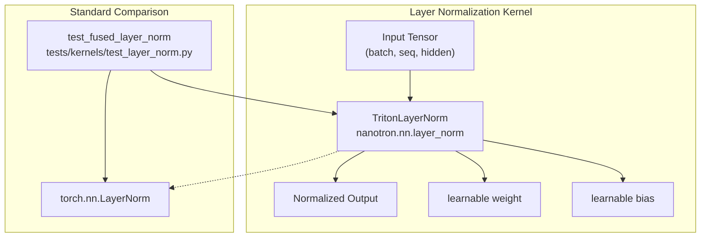
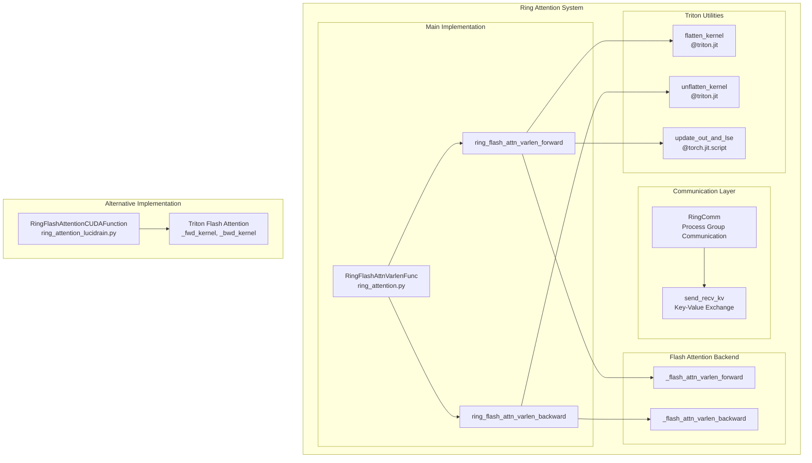
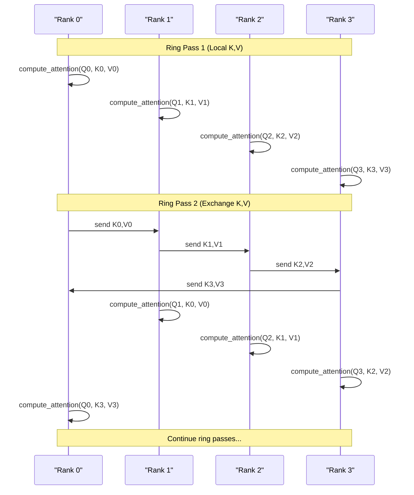
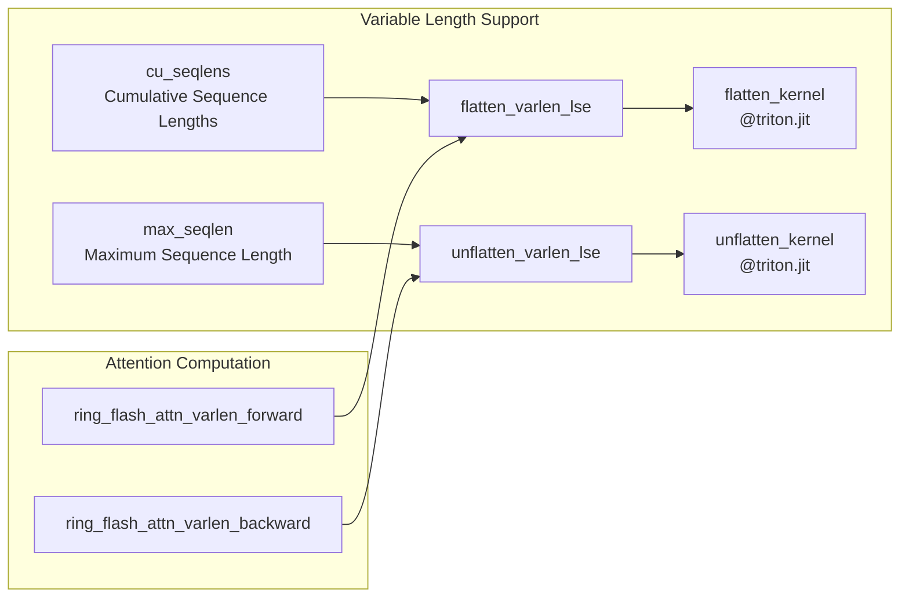
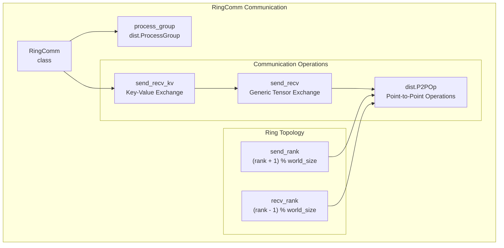
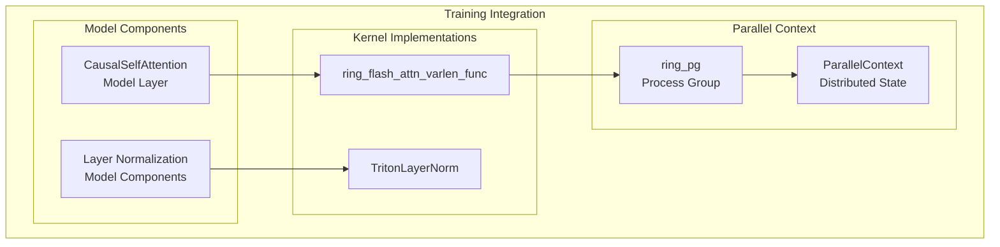

<!-- source: DeepWiki mcp.deepwiki.com · repo huggingface/nanotron · page 8.2 Optimized Kernels · fetched 2026-10-26 -->

# Optimized Kernels

Relevant source files

The following files were used as context for generating this wiki page:

- [src/nanotron/nn/ring_attention.py](src/nanotron/nn/ring_attention.py)
- [src/nanotron/nn/ring_attention_lucidrain.py](src/nanotron/nn/ring_attention_lucidrain.py)
- [tests/kernels/run_layer_norm_convergence.py](tests/kernels/run_layer_norm_convergence.py)
- [tests/kernels/test_layer_norm.py](tests/kernels/test_layer_norm.py)

This document covers the high-performance custom kernel implementations in Nanotron, focusing on Triton-based optimizations for layer normalization and ring attention. These kernels provide significant performance improvements over standard PyTorch implementations, particularly for large-scale distributed training scenarios.

For general performance optimization strategies, see [Memory Optimization](#8.3). For distributed training concepts that utilize these kernels, see [3D Parallelism](#4.2).

## Overview

Nanotron implements several optimized kernels to accelerate critical operations during large language model training:

- **Layer Normalization Kernels**: Triton-based implementations for efficient normalization operations
- **Ring Attention Kernels**: Distributed attention computation enabling training on sequences longer than what fits in memory
- **Utility Kernels**: Supporting operations for tensor manipulation and communication

## Layer Normalization Kernels

The `TritonLayerNorm` class provides a fused, memory-efficient implementation of layer normalization using Triton kernels.

### TritonLayerNorm Implementation

The `TritonLayerNorm` implementation provides:
- **Fused Operations**: Combines normalization, scaling, and bias addition in a single kernel
- **Memory Efficiency**: Reduces memory bandwidth requirements compared to separate operations
- **Gradient Support**: Implements efficient backward pass for training

**Sources**: [tests/kernels/test_layer_norm.py:1-39](), [tests/kernels/run_layer_norm_convergence.py:1-59]()

### Testing and Validation

The layer normalization kernels undergo comprehensive testing to ensure numerical accuracy:

| Test Type | Implementation | Purpose |
|-----------|----------------|---------|
| Forward Pass | `test_fused_layer_norm` | Validates output accuracy against `torch.nn.LayerNorm` |
| Backward Pass | Gradient computation | Ensures correct gradients for weight and bias |
| Convergence | `run_layer_norm_convergence.py` | Long-term training stability validation |

**Sources**: [tests/kernels/test_layer_norm.py:13-38]()

## Ring Attention Kernels

Ring attention enables distributed computation of attention across multiple devices, allowing training on sequences that exceed single-device memory capacity.

### Ring Attention Architecture

**Sources**: [src/nanotron/nn/ring_attention.py:1-593](), [src/nanotron/nn/ring_attention_lucidrain.py:1-1802]()

### Ring Communication Protocol

The ring attention implementation uses a sophisticated communication protocol to distribute key-value tensors across devices:

**Sources**: [src/nanotron/nn/ring_attention.py:24-85](), [src/nanotron/nn/ring_attention.py:528-578]()

### Triton Kernel Implementations

The ring attention system includes several Triton kernels for efficient tensor operations:

| Kernel | Purpose | Implementation |
|--------|---------|----------------|
| `flatten_kernel` | Convert variable-length LSE to flat format | [src/nanotron/nn/ring_attention.py:298-328]() |
| `unflatten_kernel` | Restore LSE to variable-length format | [src/nanotron/nn/ring_attention.py:364-394]() |
| `_fwd_kernel` | Flash attention forward pass | [src/nanotron/nn/ring_attention_lucidrain.py:752-983]() |
| `_bwd_kernel` | Flash attention backward pass | [src/nanotron/nn/ring_attention_lucidrain.py:1509-1659]() |

### Variable Length Sequence Support

Ring attention supports variable-length sequences through the `varlen` interface:

**Sources**: [src/nanotron/nn/ring_attention.py:330-432](), [src/nanotron/nn/ring_attention.py:508-525]()

## Communication Infrastructure

The ring attention kernels rely on efficient distributed communication primitives:

### RingComm Class

The `RingComm` class manages point-to-point communication between devices in the ring topology:

**Sources**: [src/nanotron/nn/ring_attention.py:528-578]()

### AllGather Communication

Alternative communication patterns support different distributed attention strategies:

| Class | Purpose | Usage |
|-------|---------|-------|
| `AllGatherComm` | Collective communication for attention | [src/nanotron/nn/ring_attention.py:580-593]() |
| `AllGatherFunction` | Autograd-compatible all-gather | [src/nanotron/nn/ring_attention_lucidrain.py:646-668]() |
| `RingComm` | Ring-based point-to-point communication | [src/nanotron/nn/ring_attention.py:528-578]() |

**Sources**: [src/nanotron/nn/ring_attention.py:580-593](), [src/nanotron/nn/ring_attention_lucidrain.py:646-692]()

## Performance Optimizations

### Memory Efficiency Features

The optimized kernels implement several memory efficiency techniques:

- **Fused Operations**: Layer normalization combines multiple operations in single kernels
- **In-Place Updates**: Ring attention updates accumulation buffers without additional allocations
- **Gradient Accumulation**: Efficient backward pass implementations minimize memory overhead

### Numerical Stability

Critical numerical stability features include:

| Feature | Implementation | Purpose |
|---------|----------------|---------|
| LSE Computation | `update_out_and_lse` | Numerically stable log-sum-exp updates |
| Softmax Scaling | `softmax_scale` parameter | Prevents overflow in attention computation |
| Gradient Clipping | Built-in bounds checking | Maintains training stability |

**Sources**: [src/nanotron/nn/ring_attention.py:465-504](), [src/nanotron/nn/ring_attention_lucidrain.py:985-1112]()

## Integration with Training Pipeline

The optimized kernels integrate seamlessly with Nanotron's distributed training infrastructure:

**Sources**: [src/nanotron/nn/ring_attention.py:253-289]()

---

