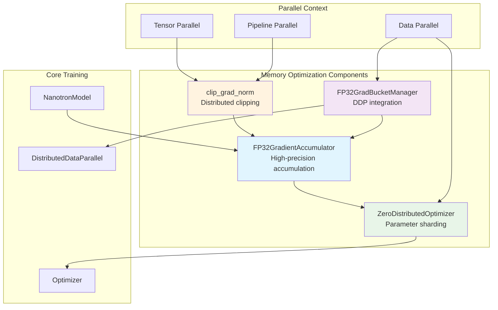
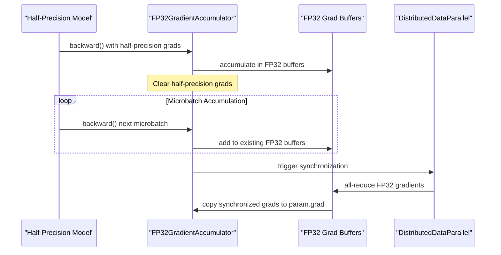
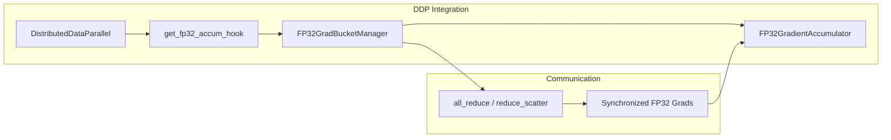
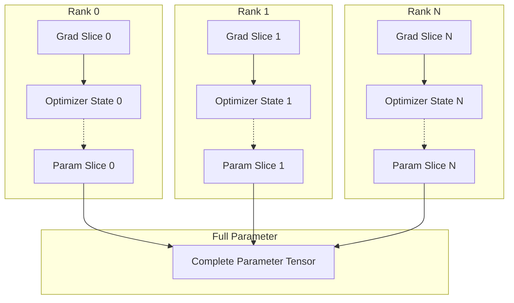
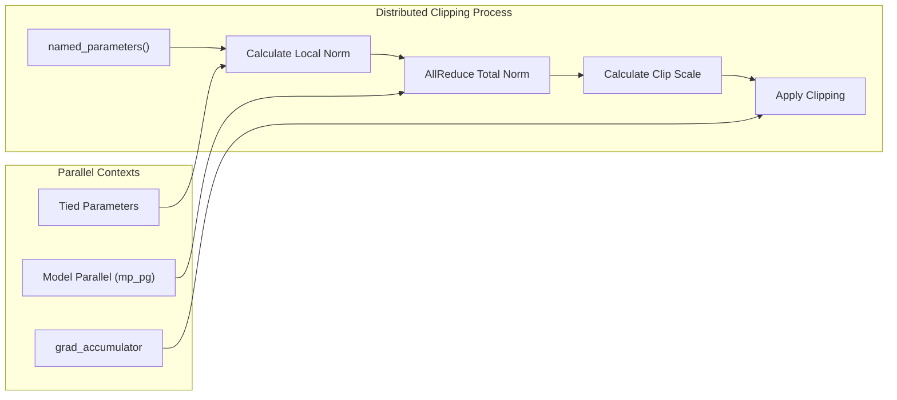
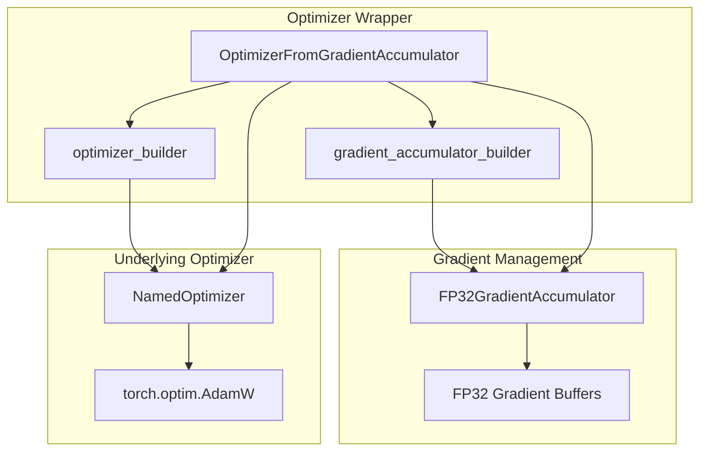

<!-- source: DeepWiki mcp.deepwiki.com · repo huggingface/nanotron · page 8.3 Memory Optimization · fetched 2026-10-26 -->

# Memory Optimization

<details>
<summary>Relevant source files</summary>

The following files were used as context for generating this wiki page:

- [tests/test_clip_grads.py](tests/test_clip_grads.py)
- [tests/test_data_parallel.py](tests/test_data_parallel.py)
- [tests/test_p2p.py](tests/test_p2p.py)
- [tests/test_parameters_accumulate_gradient_in_fp32.py](tests/test_parameters_accumulate_gradient_in_fp32.py)
- [tests/test_pipeline_parallel.py](tests/test_pipeline_parallel.py)
- [tests/test_random_state.py](tests/test_random_state.py)
- [tests/test_serialize.py](tests/test_serialize.py)
- [tests/test_tensor_parallel.py](tests/test_tensor_parallel.py)
- [tests/test_tie_weights.py](tests/test_tie_weights.py)
- [tests/test_zero.py](tests/test_zero.py)

</details>


This document covers memory optimization strategies and techniques used in Nanotron to enable efficient large-scale model training. The focus is on gradient accumulation, parameter sharding, and memory-efficient training patterns that reduce memory footprint while maintaining training stability.

For information about FP8 quantization and reduced precision training, see [FP8 Quantization](#8.1). For optimized kernel implementations, see [Optimized Kernels](#8.2).

## Overview

Nanotron provides several memory optimization strategies designed to work together in distributed training environments:

- **FP32 Gradient Accumulation**: Accumulates gradients in higher precision to improve numerical stability while training in half precision
- **ZeRO Distributed Optimizer**: Shards optimizer states across data parallel ranks to reduce per-device memory usage
- **Memory-efficient Gradient Clipping**: Performs gradient clipping in distributed settings without duplicating gradients
- **Gradient Bucket Management**: Optimizes gradient synchronization in data parallel training



Sources: [tests/test_parameters_accumulate_gradient_in_fp32.py:11-15](), [tests/test_zero.py:10-11](), [tests/test_clip_grads.py:10-13]()

## FP32 Gradient Accumulation

The `FP32GradientAccumulator` maintains gradient buffers in FP32 precision while the model parameters remain in half precision. This approach improves numerical stability during gradient accumulation across multiple microbatches.

### Core Components

| Component | Purpose | Location |
|-----------|---------|----------|
| `FP32GradientAccumulator` | Main accumulator class | `nanotron.optim.gradient_accumulator` |
| `FP32GradBucketManager` | DDP bucket management | `nanotron.optim.gradient_accumulator` |
| `get_fp32_accum_hook` | DDP communication hook | `nanotron.optim.gradient_accumulator` |

### Gradient Accumulation Flow



The accumulator automatically promotes half-precision gradients to FP32, accumulates them across microbatches, and handles synchronization in distributed training.

Sources: [tests/test_parameters_accumulate_gradient_in_fp32.py:37-91](), [tests/test_parameters_accumulate_gradient_in_fp32.py:145-301]()

### Integration with Distributed Data Parallel

The `FP32GradBucketManager` integrates FP32 gradient accumulation with PyTorch's DistributedDataParallel:



Sources: [tests/test_parameters_accumulate_gradient_in_fp32.py:192-204](), [tests/test_parameters_accumulate_gradient_in_fp32.py:427-434]()

## ZeRO Distributed Optimizer

The `ZeroDistributedOptimizer` implements parameter sharding across data parallel ranks, significantly reducing memory usage for optimizer states and gradients.

### Parameter Sharding Strategy



Each rank only stores optimizer states for its assigned parameter slice, reducing memory usage proportionally to the data parallel degree.

Sources: [tests/test_zero.py:31-198](), [tests/test_zero.py:240-247]()

### ZeRO Optimizer Implementation

The optimizer wraps existing optimizers and handles parameter slicing automatically:

| Method | Purpose |
|--------|---------|
| `param_name_to_dp_rank_offsets` | Maps parameter names to rank-specific slices |
| `param_groups[0]["params"]` | Contains sliced parameters for current rank |
| `state_dict()` | Includes parameter name mapping for serialization |

The optimizer ensures that:
1. Each rank only optimizes its assigned parameter slice
2. Parameter updates are synchronized across ranks after optimization
3. Gradient views point to the correct parameter slice

Sources: [tests/test_zero.py:110-141](), [tests/test_zero.py:378-414]()

## Gradient Clipping

The `clip_grad_norm` function performs gradient clipping in distributed environments, accounting for parameter sharding and parallel contexts.

### Distributed Gradient Clipping



The clipping process:
1. Computes local gradient norms on each rank
2. Synchronizes total norm across model parallel groups
3. Applies consistent clipping scale across all ranks
4. Handles both regular parameters and gradient accumulator buffers

Sources: [tests/test_clip_grads.py:139-146](), [tests/test_clip_grads.py:310-316](), [tests/test_clip_grads.py:417-423]()

### Integration with FP32 Accumulation

When used with `FP32GradientAccumulator`, gradient clipping operates on the FP32 gradient buffers:

```python
clip_grad_norm(
    mp_pg=parallel_context.mp_pg,
    named_parameters=model.named_parameters(),
    grad_accumulator=accumulator,  # FP32 buffers used for clipping
    max_norm=1.0,
    norm_type=2.0,
)
```

Sources: [tests/test_clip_grads.py:555-561](), [tests/test_clip_grads.py:417-423]()

## OptimizerFromGradientAccumulator

The `OptimizerFromGradientAccumulator` class bridges gradient accumulation with standard optimizers, enabling memory-efficient training with existing optimizer implementations.

### Architecture



This wrapper:
- Manages gradient accumulation lifecycle
- Provides `step()` and `zero_grad()` methods that operate on FP32 buffers
- Handles serialization of both optimizer states and accumulator states

Sources: [tests/test_parameters_accumulate_gradient_in_fp32.py:94-138](), [tests/test_serialize.py:424-431]()

## Memory Usage Patterns

### Training Loop Integration

The memory optimization components work together in the training loop:

1. **Forward Pass**: Model runs in half precision
2. **Backward Pass**: Gradients accumulated in FP32 buffers via `FP32GradientAccumulator`
3. **Gradient Sync**: DDP synchronizes FP32 gradients using `FP32GradBucketManager`
4. **Gradient Clipping**: `clip_grad_norm` operates on FP32 buffers
5. **Optimizer Step**: `ZeroDistributedOptimizer` updates parameter slices
6. **Parameter Sync**: Updated parameters synchronized across data parallel ranks

### Memory Benefits

| Optimization | Memory Reduction | Use Case |
|--------------|------------------|-----------|
| ZeRO Optimizer | `1/DP_SIZE` for optimizer states | Large models with high DP parallelism |
| FP32 Accumulation | Minimal overhead, numerical stability | Half-precision training |
| Gradient Clipping | No additional memory | Stable training |
| Bucket Management | Reduced peak memory during sync | Large gradient tensors |

Sources: [tests/test_parameters_accumulate_gradient_in_fp32.py:206-301](), [tests/test_zero.py:31-198]()

---

