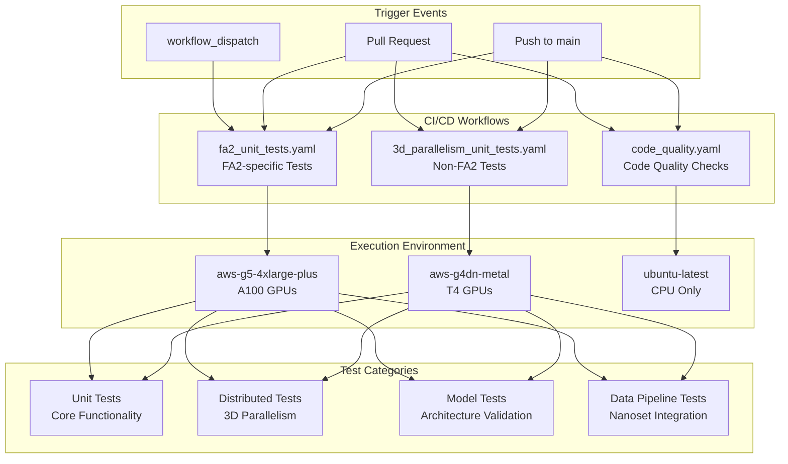
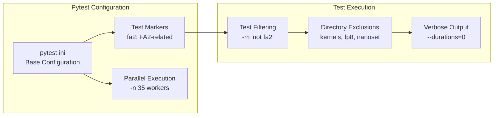
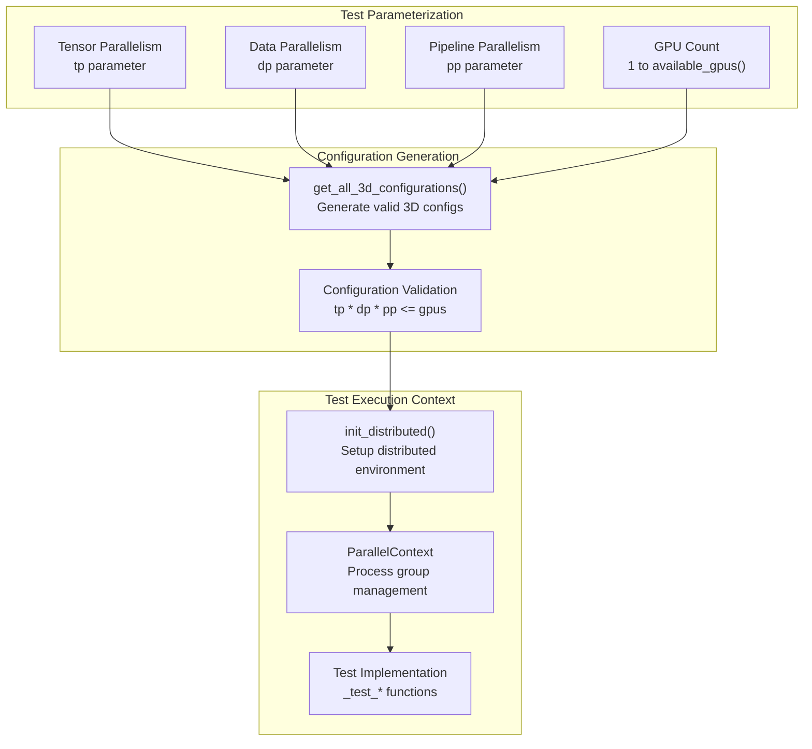
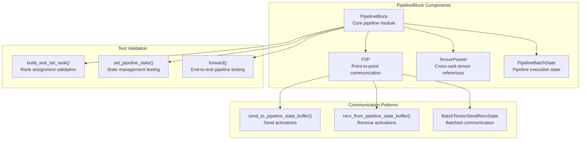

<!-- source: DeepWiki mcp.deepwiki.com · repo huggingface/nanotron · page 9 Development and Testing · fetched 2026-10-26 -->

# Development and Testing

<details>
<summary>Relevant source files</summary>

The following files were used as context for generating this wiki page:

- [.github/workflows/3d_parallelism_unit_tests.yaml](.github/workflows/3d_parallelism_unit_tests.yaml)
- [.github/workflows/code_quality.yaml](.github/workflows/code_quality.yaml)
- [.github/workflows/fa2_unit_tests.yaml](.github/workflows/fa2_unit_tests.yaml)
- [src/nanotron/parallel/pipeline_parallel/block.py](src/nanotron/parallel/pipeline_parallel/block.py)
- [tests/nanoset/test_build_nanoset_dataloader.py](tests/nanoset/test_build_nanoset_dataloader.py)
- [tests/pytest.ini](tests/pytest.ini)

</details>


This document covers the development workflows, testing infrastructure, and continuous integration systems that ensure code quality and reliability in the Nanotron framework. The testing system validates distributed training functionality, model architectures, and data pipeline components across various hardware configurations.

For information about the testing utilities and dummy implementations used during development, see [Dummy Models and Utilities](#9.2).

## CI/CD Infrastructure

The Nanotron project uses GitHub Actions to automate testing and code quality checks. The CI/CD system is designed to handle the complexities of distributed GPU training while providing comprehensive test coverage.

### Workflow Architecture



Sources: [.github/workflows/3d_parallelism_unit_tests.yaml:1-78](), [.github/workflows/fa2_unit_tests.yaml:1-60](), [.github/workflows/code_quality.yaml:1-27]()

### Test Infrastructure Components

The testing system separates concerns based on hardware requirements and test complexity:

| Workflow | Hardware | Purpose | Excluded Tests |
|----------|----------|---------|----------------|
| `3d_parallelism_unit_tests.yaml` | T4 GPUs | Main unit tests, 3D parallelism validation | FA2-related, kernels, fp8, nanoset |
| `fa2_unit_tests.yaml` | A100 GPUs | FlashAttention-2 specific functionality | fp8, nanoset |
| `code_quality.yaml` | CPU | Static analysis and code metrics | N/A |

The workflows use containerized environments with PyTorch 2.1.1 and CUDA 12.1.1 to ensure consistent testing environments.

Sources: [.github/workflows/3d_parallelism_unit_tests.yaml:21-28](), [.github/workflows/fa2_unit_tests.yaml:22-28](), [.github/workflows/code_quality.yaml:17-27]()

## Testing Framework

### Pytest Configuration

The test framework uses pytest with custom markers and parallel execution:



The `pytest.ini` configuration enables high-parallelism testing with 35 workers and defines the `fa2` marker for FlashAttention-2 related tests.

Sources: [tests/pytest.ini:1-5]()

### Distributed Testing Architecture

The testing framework supports complex distributed scenarios by parameterizing tests across different parallelism configurations:



Sources: [tests/nanoset/test_build_nanoset_dataloader.py:29-42](), [tests/nanoset/test_build_nanoset_dataloader.py:59-64]()

## Test Categories and Organization

### Data Pipeline Testing

The data pipeline tests validate the `Nanoset` and `DataLoader` functionality across distributed configurations:

```python
# Test matrix example from nanoset tests
@pytest.mark.parametrize("tp,dp,pp", [
    pytest.param(*all_3d_configs)
    for gpus in range(1, min(available_gpus(), 4) + 1)
    for all_3d_configs in get_all_3d_configurations(gpus)
])
@pytest.mark.parametrize("train_steps", [500, 10000])
@pytest.mark.parametrize("sequence_length", [512, 8192])
@pytest.mark.parametrize("tokenizer_name_or_path", ["openai-community/gpt2", "unsloth/llama-3-8b-bnb-4bit"])
```

The test implementation validates:
- Dataset creation and preprocessing with `datatrove`
- `Nanoset` synchronization across ranks using `assert_nanoset_sync_across_all_ranks`
- Dataloader recovery functionality for checkpoint resumption
- Batch consistency using `compute_batch_hash` for deterministic validation

Sources: [tests/nanoset/test_build_nanoset_dataloader.py:29-42](), [tests/nanoset/test_build_nanoset_dataloader.py:116-156]()

### Pipeline Parallelism Testing

Pipeline parallelism tests validate the `PipelineBlock` system and inter-stage communication:



The `PipelineBlock` system handles tensor communication between pipeline stages using `TensorPointer` objects for cross-rank references and `BatchTensorSendRecvState` for efficient batched communication.

Sources: [src/nanotron/parallel/pipeline_parallel/block.py:16-185]()

## Development Workflow

### Test Execution Strategy

The CI system implements a two-tier testing approach:

1. **Standard Tests** (`3d_parallelism_unit_tests.yaml`): Run on T4 hardware for basic functionality
2. **Advanced Tests** (`fa2_unit_tests.yaml`): Run on A100 hardware for memory-intensive operations

### Environment Setup

The testing environment setup follows this pattern:

```bash
# Base environment (from CI workflows)
python -m pip install --upgrade pip
pip install packaging wheel
pip install -e .
pip install -e .[dev]
pip install -e .[test]

# FA2-specific setup
pip install "flash-attn>=2.5.0" --no-build-isolation
```

### Test Execution Commands

Standard unit tests exclude specific categories:
```bash
pytest \
-m "not fa2" \
--color=yes \
--durations=0 \
--ignore tests/kernels \
--ignore tests/fp8 \
--ignore tests/nanoset \
--verbose \
tests/
```

FA2-specific tests target only marked tests:
```bash
pytest -m fa2 --color=yes --durations=0 --ignore tests/fp8 --ignore tests/nanoset --verbose tests/
```

Sources: [.github/workflows/3d_parallelism_unit_tests.yaml:41-66](), [.github/workflows/fa2_unit_tests.yaml:43-59]()

## Testing Best Practices

### Distributed Test Design

Distributed tests follow these patterns:

1. **Parameterization**: Use `@pytest.mark.parametrize` for 3D parallelism configurations
2. **Context Management**: Wrap test logic with `init_distributed()` decorator
3. **Cleanup**: Always call `parallel_context.destroy()` in test teardown
4. **Deterministic Testing**: Use fixed seeds and hash-based validation for reproducibility

### Error Handling

The testing framework includes robust error handling:

- `@rerun_if_address_is_in_use()` decorator for handling port conflicts
- `main_rank_first()` context manager for synchronized initialization
- Automatic retry mechanisms for transient distributed failures

### Validation Utilities

Key validation functions include:

- `assert_nanoset_sync_across_all_ranks()`: Validates dataset consistency
- `assert_batch_dataloader()`: Validates batch structure and content
- `compute_batch_hash()`: Provides deterministic batch comparison
- `count_dataset_indexes()`: Validates dataset sampling distribution

Sources: [tests/nanoset/test_build_nanoset_dataloader.py:12-26](), [tests/nanoset/test_build_nanoset_dataloader.py:192-282]()

---

