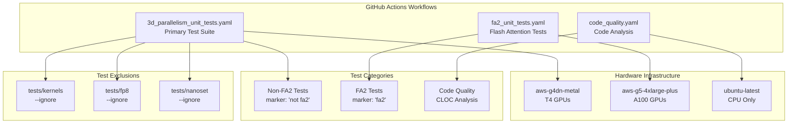
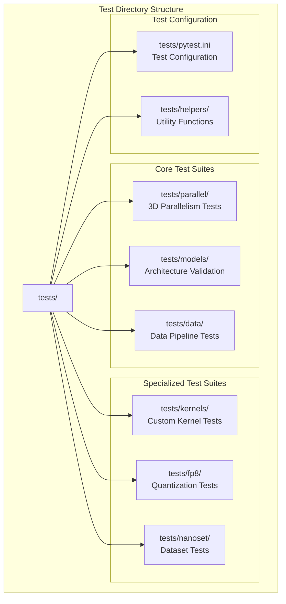
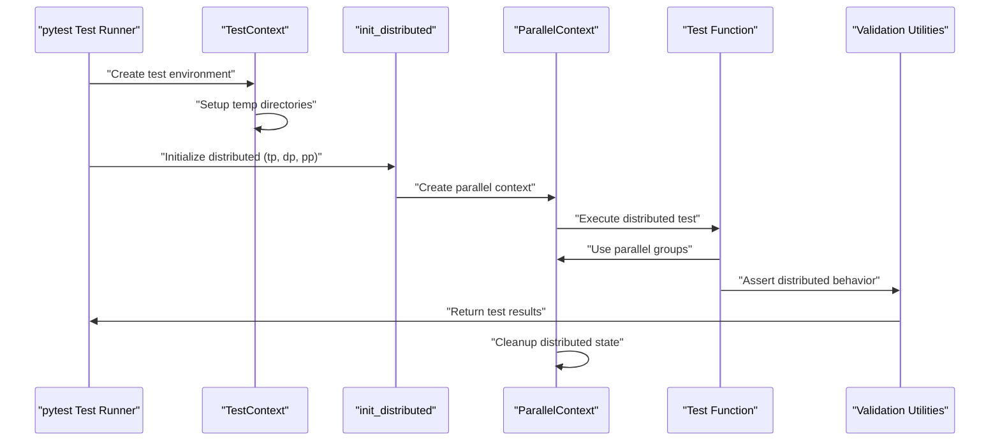
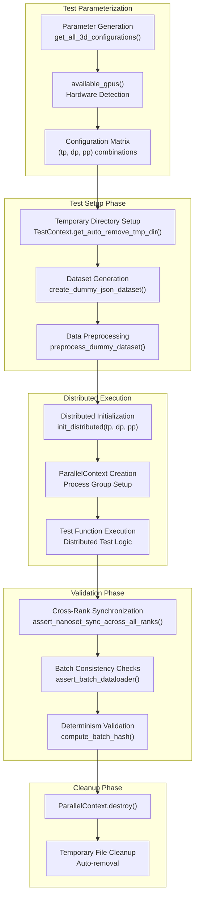
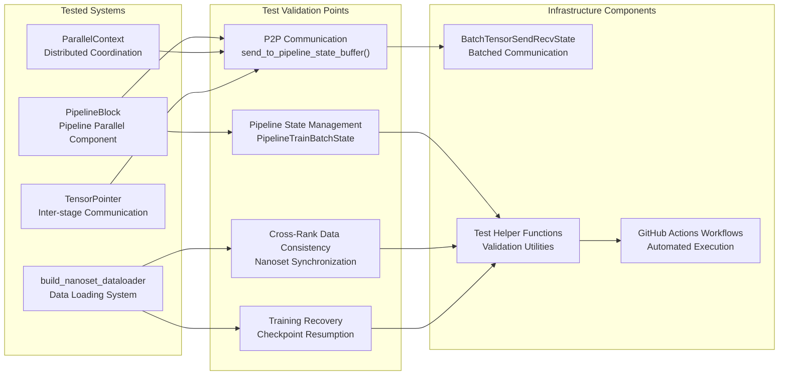

<!-- source: DeepWiki mcp.deepwiki.com · repo huggingface/nanotron · page 9.1 Testing Framework · fetched 2026-10-26 -->

# Testing Framework

Relevant source files

The following files were used as context for generating this wiki page:

- [.github/workflows/3d_parallelism_unit_tests.yaml](.github/workflows/3d_parallelism_unit_tests.yaml)
- [.github/workflows/code_quality.yaml](.github/workflows/code_quality.yaml)
- [.github/workflows/fa2_unit_tests.yaml](.github/workflows/fa2_unit_tests.yaml)
- [src/nanotron/parallel/pipeline_parallel/block.py](src/nanotron/parallel/pipeline_parallel/block.py)
- [tests/nanoset/test_build_nanoset_dataloader.py](tests/nanoset/test_build_nanoset_dataloader.py)
- [tests/pytest.ini](tests/pytest.ini)

## Purpose and Scope

The Nanotron testing framework provides comprehensive validation infrastructure for distributed deep learning systems, with specialized support for multi-GPU, multi-node training scenarios. The framework encompasses CI/CD pipelines, distributed test execution, and validation utilities specifically designed for 3D parallelism (tensor, pipeline, and data parallelism) testing.

For information about the development workflows that use this testing infrastructure, see [Development and Testing](#9). For details about the core training systems being tested, see [Core Architecture](#2) and [Distributed Training](#4).

## CI/CD Pipeline Architecture

The testing framework operates through multiple GitHub Actions workflows that target different hardware configurations and test categories:

**Primary Test Workflow (`3d_parallelism_unit_tests.yaml`)**
- Executes on T4 hardware with limited FA2 support
- Runs all tests except those marked with `fa2` marker
- Excludes resource-intensive test categories
- Triggered on pushes to main and pull requests affecting Python files

**Flash Attention Test Workflow (`fa2_unit_tests.yaml`)**
- Executes on A100 hardware with full FA2 support
- Runs only tests marked with `fa2` marker
- Manual trigger available via `workflow_dispatch`
- Requires FA2 installation and CUDA 12.1+ environment

Sources: [.github/workflows/3d_parallelism_unit_tests.yaml:1-78](), [.github/workflows/fa2_unit_tests.yaml:1-60](), [.github/workflows/code_quality.yaml:1-27]()

## Test Categories and Organization

The testing framework uses pytest markers and directory organization to categorize different types of tests:

| Test Category | Marker | Hardware Requirement | Purpose |
|---------------|--------|---------------------|---------|
| Standard Distributed | `not fa2` | T4 GPUs | Core 3D parallelism functionality |
| Flash Attention | `fa2` | A100 GPUs | FA2-dependent attention mechanisms |
| Kernel Tests | N/A | High-end GPUs | Custom CUDA kernel validation |
| FP8 Tests | N/A | FP8-capable hardware | 8-bit floating point operations |
| Nanoset Tests | N/A | Large memory | Dataset handling and preprocessing |

The `pytest.ini` configuration enables parallel test execution with 35 concurrent workers and defines the `fa2` marker for Flash Attention tests.

Sources: [tests/pytest.ini:1-5](), [.github/workflows/3d_parallelism_unit_tests.yaml:54-66]()

## Distributed Testing Infrastructure

The testing framework provides specialized utilities for validating distributed training functionality across multiple GPUs and nodes:

**Key Testing Components:**

**TestContext Class**
- Manages temporary directories and cleanup
- Provides auto-removal of test artifacts
- Ensures isolated test environments

**Distributed Initialization**
- `init_distributed(tp, dp, pp)` decorator for test functions
- Automatically configures 3D parallelism dimensions
- Creates `ParallelContext` for distributed operations

**Validation Utilities**
- `assert_nanoset_sync_across_all_ranks()` - Validates dataset consistency
- `assert_batch_dataloader()` - Verifies batch properties across ranks  
- `compute_batch_hash()` - Ensures deterministic batch generation

Sources: [tests/nanoset/test_build_nanoset_dataloader.py:41-65](), [tests/nanoset/test_build_nanoset_dataloader.py:117-156]()

## Test Execution Flow

The distributed test execution follows a structured pattern that accommodates the complexities of multi-GPU validation:

**Parameterized Testing Strategy**
Tests are automatically parameterized across all valid 3D parallelism configurations based on available GPU count. The `get_all_3d_configurations()` function generates valid combinations of tensor parallelism (tp), data parallelism (dp), and pipeline parallelism (pp) dimensions.

**Recovery and Fault Tolerance**
The testing framework includes specific tests for checkpoint recovery scenarios, validating that dataloaders can be correctly restored from intermediate training states using `consumed_train_samples` parameters.

Sources: [tests/nanoset/test_build_nanoset_dataloader.py:29-36](), [tests/nanoset/test_build_nanoset_dataloader.py:265-282]()

## Integration with Core Systems

The testing framework validates critical integration points between Nanotron's core components:

The testing framework specifically validates the `PipelineBlock` communication mechanisms, ensuring that `TensorPointer` objects correctly facilitate data transfer between pipeline stages and that `send_to_pipeline_state_buffer()` and `recv_from_pipeline_state_buffer()` functions maintain data integrity across distributed training scenarios.

Sources: [src/nanotron/parallel/pipeline_parallel/block.py:86-94](), [src/nanotron/parallel/pipeline_parallel/block.py:125-131](), [tests/nanoset/test_build_nanoset_dataloader.py:121-123]()

---

