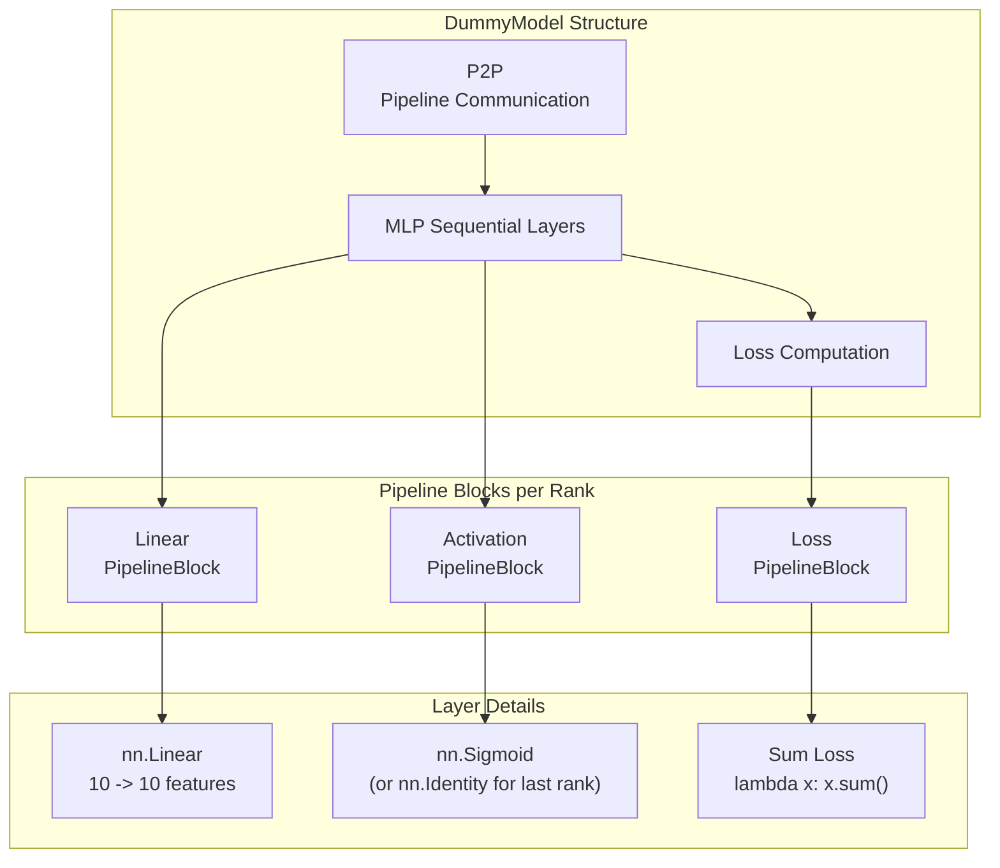
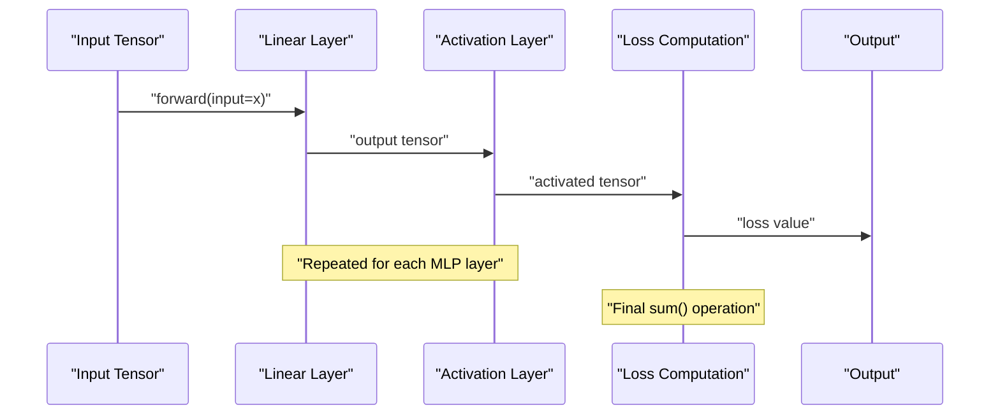
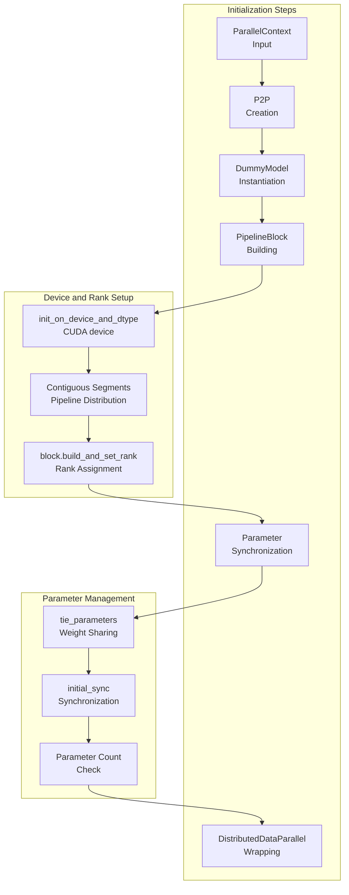
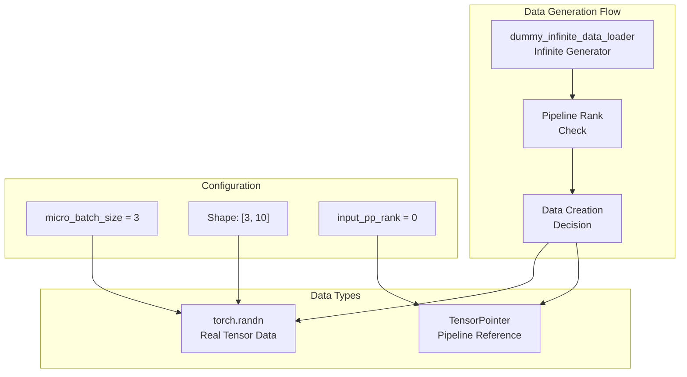
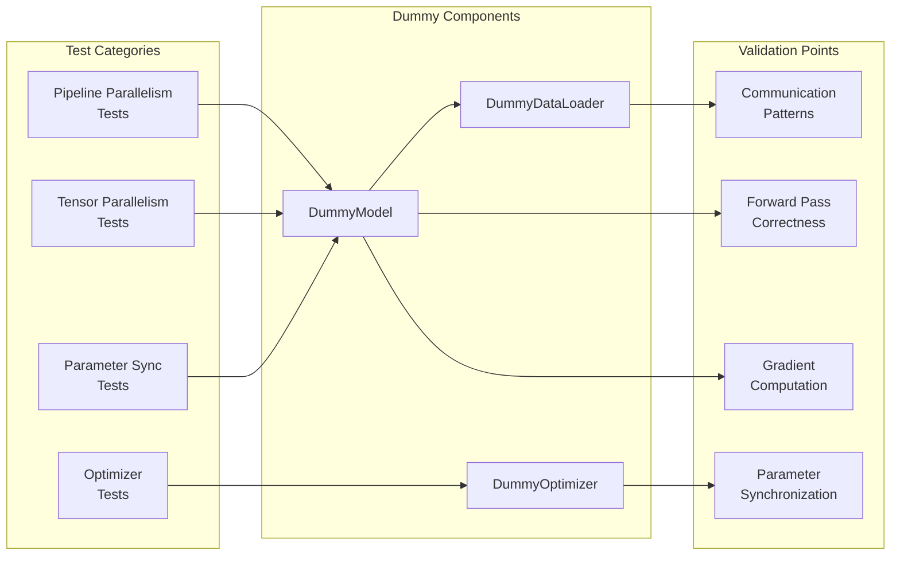

<!-- source: DeepWiki mcp.deepwiki.com · repo huggingface/nanotron · page 9.2 Dummy Models and Utilities · fetched 2026-10-26 -->

# Dummy Models and Utilities

Relevant source files

The following files were used as context for generating this wiki page:

- [tests/helpers/dummy.py](tests/helpers/dummy.py)

This document covers the testing utilities and dummy implementations used for development and validation in Nanotron. These utilities provide simplified models and data generators that enable testing of distributed training functionality without requiring full-scale models or real datasets.

For information about the core testing framework and distributed testing infrastructure, see [Testing Framework](#9.1). For details about actual model implementations, see [Supported Models](#3).

## Purpose and Overview

The dummy models and utilities serve as lightweight testing infrastructure that validates distributed training components including pipeline parallelism, tensor parallelism, and parameter synchronization. These utilities are primarily used in unit tests and integration tests to ensure the correctness of Nanotron's distributed training mechanisms.

The main components include:
- `DummyModel`: A simple neural network with pipeline parallel structure
- Initialization utilities for distributed model setup
- Dummy optimizer creation
- Synthetic data generation for testing

Sources: [tests/helpers/dummy.py:1-125]()

## DummyModel Architecture

The `DummyModel` class implements a simple multi-layer perceptron using Nanotron's pipeline parallelism infrastructure. It demonstrates how real models integrate with the framework's distributed training components.

### Model Structure

The model creates pipeline blocks distributed across ranks, with each rank handling specific layers. The activation function changes based on pipeline rank - intermediate ranks use `nn.Sigmoid` while the final rank uses `nn.Identity`.

Sources: [tests/helpers/dummy.py:20-65]()

### Forward Pass Implementation

The forward pass demonstrates tensor flow through pipeline stages:

Each pipeline block is called with dictionary-style inputs and outputs, following Nanotron's pipeline parallelism conventions.

Sources: [tests/helpers/dummy.py:59-64]()

## Model Initialization Process

The `init_dummy_model` function orchestrates the complete setup of a distributed dummy model, handling device placement, parameter synchronization, and distributed data parallel (DDP) wrapping.

### Initialization Flow

The initialization process ensures proper distributed setup:

1. **Pipeline Communication Setup**: Creates `P2P` object for inter-rank communication
2. **Device Placement**: Uses `init_on_device_and_dtype` context manager for CUDA placement
3. **Rank Distribution**: Distributes pipeline blocks across ranks using contiguous segments
4. **Parameter Synchronization**: Handles parameter tying and initial synchronization
5. **DDP Wrapping**: Applies DistributedDataParallel if model has parameters

Sources: [tests/helpers/dummy.py:67-102]()

## Optimizer Setup

The `init_dummy_optimizer` function creates a simple optimizer using Nanotron's `NamedOptimizer` wrapper around PyTorch's `AdamW`.

### Optimizer Configuration

| Component | Implementation | Purpose |
|-----------|---------------|---------|
| Base Optimizer | `torch.optim.AdamW` | Standard Adam optimizer with weight decay |
| Wrapper | `NamedOptimizer` | Nanotron's named parameter management |
| Parameters | `model.named_parameters()` | All trainable model parameters |
| Synchronization | Implicit | No explicit sync needed for deterministic initialization |

The optimizer setup is minimal since the dummy model has simple parameter requirements and doesn't need complex optimization strategies.

Sources: [tests/helpers/dummy.py:105-112]()

## Data Generation

The `dummy_infinite_data_loader` provides synthetic data for testing pipeline parallelism with proper tensor pointer handling.

### Data Loader Architecture

The data loader generates different outputs based on pipeline rank:
- **Input Rank (0)**: Creates actual tensor data using `torch.randn`
- **Other Ranks**: Creates `TensorPointer` objects referencing the input rank

This pattern simulates how real data flows through pipeline stages, where only the first stage receives actual data while subsequent stages receive tensor pointers.

Sources: [tests/helpers/dummy.py:115-124]()

## Integration with Testing Framework

The dummy utilities integrate with Nanotron's distributed testing infrastructure to validate core functionality:

### Testing Use Cases

The dummy implementations enable testing of:
- **Pipeline Parallelism**: Validates tensor flow across pipeline stages
- **Parameter Management**: Tests parameter tying and synchronization
- **Distributed Communication**: Verifies P2P communication patterns
- **Model Lifecycle**: Tests initialization, training steps, and cleanup

Sources: [tests/helpers/dummy.py:1-125]()

---

