# Page: Overview

# Overview

<details>
<summary>Relevant source files</summary>

The following files were used as context for generating this wiki page:

- [README.md](README.md)
- [docs/3d_parallelism.md](docs/3d_parallelism.md)
- [docs/docs.md](docs/docs.md)
- [pyproject.toml](pyproject.toml)
- [src/nanotron/__init__.py](src/nanotron/__init__.py)

</details>


## Purpose and Scope

Nanotron is a distributed training framework designed for pretraining large language models with advanced parallelism strategies. It provides a comprehensive system for training transformer-based models across multiple GPUs and nodes, supporting 3D parallelism (data parallel, tensor parallel, and pipeline parallel), multiple model architectures, and performance optimizations for large-scale training workloads.

This document provides a high-level overview of the Nanotron framework architecture, core components, and supported features. For specific implementation details of distributed training strategies, see [Distributed Training](#4). For model architecture specifics, see [Supported Models](#3). For configuration and workflow details, see [Training Configuration](#6).

## Core Architecture

Nanotron is built around a modular architecture that separates concerns between training orchestration, model implementations, data pipelines, and distributed communication. The framework enables efficient scaling from single-GPU training to multi-node clusters with thousands of GPUs.

### System Architecture Overview

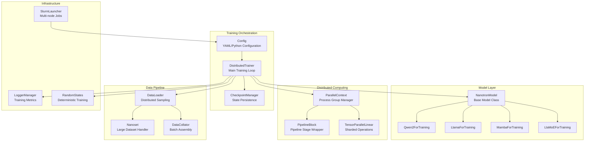

**Sources:** [README.md:29-33](), [src/nanotron/__init__.py](), [docs/docs.md:14-35]()

### Training Execution Flow

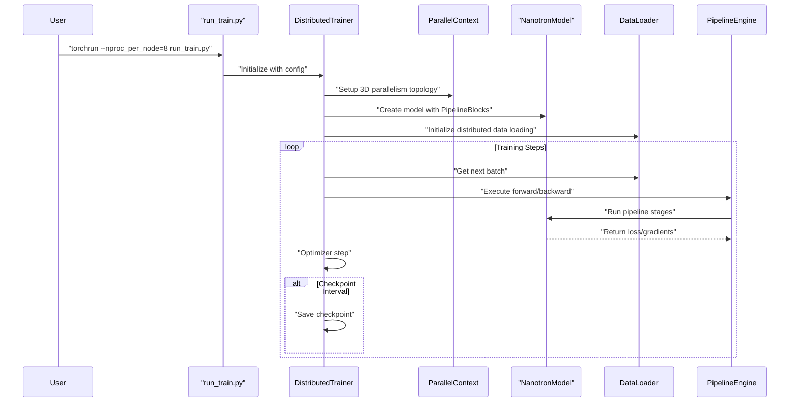

**Sources:** [README.md:94-98](), [docs/3d_parallelism.md:355-361]()

## Key Components

### DistributedTrainer

The `DistributedTrainer` class serves as the central orchestrator for training execution, managing the training loop, checkpointing, logging, and coordination between all system components. It handles the lifecycle from initialization through training completion.

**Sources:** [docs/3d_parallelism.md:302-326]()

### ParallelContext

The `ParallelContext` manages distributed process groups for 3D parallelism, providing access to tensor parallel (`tp_pg`), pipeline parallel (`pp_pg`), and data parallel (`dp_pg`) process groups. It maintains a 5D rank matrix that maps between local 3D coordinates and global ranks.

**Sources:** [docs/docs.md:14-35]()

### NanotronModel

The `NanotronModel` base class defines the interface for all model implementations, providing methods for parameter initialization, tied parameter management, and pipeline stage assignment. All supported model architectures inherit from this base class.

**Sources:** [docs/3d_parallelism.md:74-76]()

### PipelineBlock

`PipelineBlock` encapsulates computation stages for pipeline parallelism, handling lazy module instantiation, inter-stage communication via `TensorPointer` objects, and device-specific execution. It enables transparent distribution of model layers across multiple devices.

**Sources:** [docs/docs.md:144-191]()

## 3D Parallelism Implementation

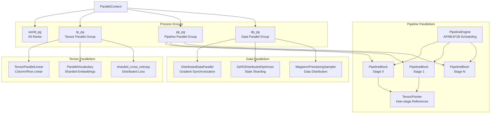

**Sources:** [docs/3d_parallelism.md:3-48](), [docs/docs.md:121-143](), [docs/3d_parallelism.md:99-205]()

## Supported Features

Nanotron provides comprehensive support for large-scale distributed training with the following key capabilities:

| Feature Category | Supported Components |
|------------------|---------------------|
| **Parallelism** | 3D Parallelism (DP+TP+PP), Expert Parallelism for MoEs |
| **Pipeline Scheduling** | AFAB (All Forward All Backward), 1F1B (One Forward One Backward) |
| **Model Architectures** | Llama, Qwen2, Mamba (State Space Models), Mixture of Experts |
| **Optimization** | ZeRO-1 Optimizer, FP32 Gradient Accumulation, Custom Optimizers |
| **Memory Management** | Parameter Tying/Sharding, Custom Module Checkpointing |
| **Performance** | FP8 Quantization, Flash Attention, Custom CUDA Kernels |
| **Data Pipeline** | Nanoset (Pre-tokenized), Custom DataLoaders, DoReMi Domain Reweighting |
| **Infrastructure** | SLURM Integration, S3 Checkpointing, Comprehensive Logging |

**Sources:** [README.md:166-185](), [pyproject.toml:16-26]()

### Model Support Matrix

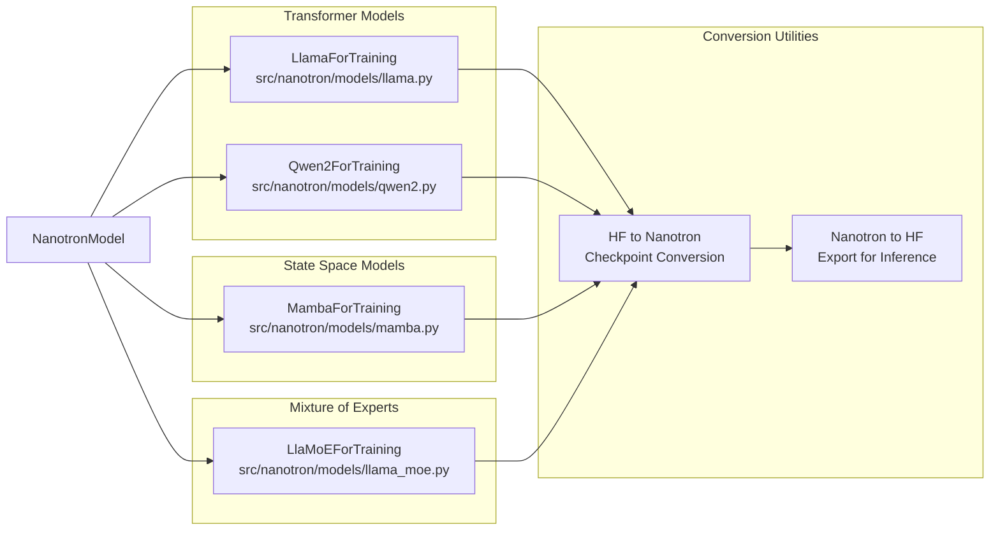

**Sources:** [README.md:144-153]()

## Getting Started

The framework provides multiple entry points for different use cases:

- **Training**: Use `run_train.py` with YAML or Python configuration files
- **Generation**: Use `run_generate.py` for inference from checkpoints  
- **Multi-node**: SLURM integration for cluster-scale training
- **Custom Data**: Extensible data pipeline for custom datasets

For detailed setup instructions, see [Getting Started](#1.1). For training your first model, see [Training Workflow](#6.1).

**Sources:** [README.md:90-105](), [README.md:38-89]()

---

# Page: Getting Started

# Getting Started

<details>
<summary>Relevant source files</summary>

The following files were used as context for generating this wiki page:

- [README.md](README.md)
- [docs/3d_parallelism.md](docs/3d_parallelism.md)
- [docs/docs.md](docs/docs.md)
- [examples/config_tiny_llama.py](examples/config_tiny_llama.py)
- [examples/config_tiny_llama.yaml](examples/config_tiny_llama.yaml)
- [examples/train_tiny_llama.sh](examples/train_tiny_llama.sh)
- [pyproject.toml](pyproject.toml)
- [src/nanotron/__init__.py](src/nanotron/__init__.py)

</details>


This document provides a quick start guide for training your first model with Nanotron. It covers installation, basic configuration setup, and running a training job. For detailed information about specific model architectures, see [Supported Models](#3). For advanced distributed training strategies, see [Distributed Training](#4).

## Overview

Nanotron is a distributed training framework for large language models that supports 3D parallelism (tensor, pipeline, and data parallelism). The getting started workflow involves three main steps: installation, configuration, and training execution.

### Training Workflow

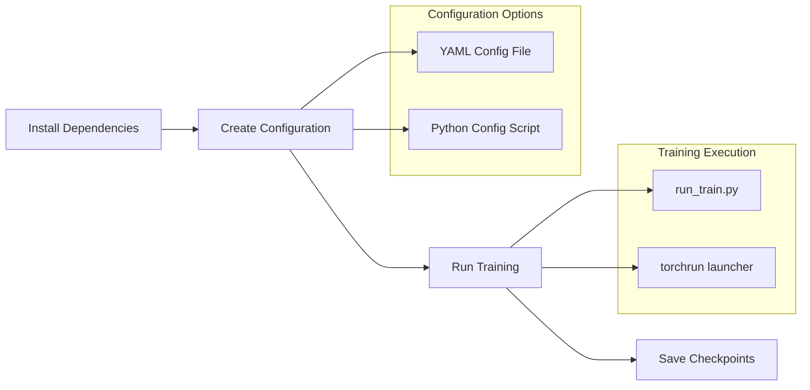

Sources: [README.md:90-105](), [examples/config_tiny_llama.py:1-128](), [examples/config_tiny_llama.yaml:1-93]()

## Installation

### Environment Setup

Create a Python virtual environment using `uv`:

```bash
uv venv nanotron --python 3.11 && source nanotron/bin/activate && uv pip install --upgrade pip
```

For Hugging Face cluster users, add `export UV_LINK_MODE=copy` to your `.bashrc` to suppress cache warnings.

### Core Dependencies

Install PyTorch with CUDA support:

```bash
uv pip install torch --index-url https://download.pytorch.org/whl/cu124
```

Install Nanotron core dependencies:

```bash
uv pip install -e .
```

### Optional Dependencies

For example scripts and advanced features:

```bash
uv pip install datasets transformers datatrove[io] numba wandb
# Fused kernels for performance optimization
uv pip install ninja triton "flash-attn>=2.5.0" --no-build-isolation
```

### Authentication Setup

Configure access to Hugging Face Hub and Weights & Biases:

```bash
huggingface-cli login
wandb login
```

Ensure Git LFS is installed for model/dataset handling:

```bash
git-lfs --version
# If not installed: sudo apt-get install git-lfs
```

Sources: [README.md:38-88](), [pyproject.toml:16-26](), [pyproject.toml:37-62]()

## Configuration System

Nanotron uses a hierarchical configuration system built around the `Config` class. Training parameters can be specified via YAML files or Python scripts.

### Configuration Architecture

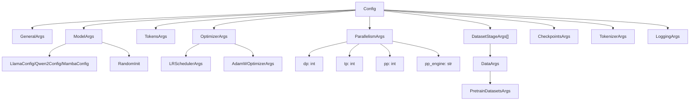

Sources: [src/nanotron/config/__init__.py](), [examples/config_tiny_llama.py:4-21]()

### Basic Configuration Example

Create a simple training configuration using Python:

```python
# Based on examples/config_tiny_llama.py
from nanotron.config import (
    Config, GeneralArgs, ModelArgs, LlamaConfig, 
    ParallelismArgs, TokensArgs, OptimizerArgs
)

# Define model architecture
model_config = LlamaConfig(
    hidden_size=2048,
    num_hidden_layers=28, 
    num_attention_heads=16,
    vocab_size=128256,
    max_position_embeddings=128256
)

# Configure 3D parallelism
parallelism = ParallelismArgs(
    dp=4,  # Data parallel size
    pp=1,  # Pipeline parallel size  
    tp=2,  # Tensor parallel size
    pp_engine="1f1b"
)

# Set training parameters
tokens = TokensArgs(
    sequence_length=4096,
    train_steps=2000,
    micro_batch_size=3
)
```

Sources: [examples/config_tiny_llama.py:24-84](), [examples/config_tiny_llama.yaml:27-92]()

### YAML Configuration

Alternatively, use YAML for configuration:

```yaml
# Key sections from examples/config_tiny_llama.yaml
model:
  model_config:
    hidden_size: 2048
    num_hidden_layers: 28
    num_attention_heads: 16
    vocab_size: 128256

parallelism:
  dp: 4
  pp: 1 
  tp: 2
  pp_engine: 1f1b

tokens:
  sequence_length: 4096
  train_steps: 2000
  micro_batch_size: 3
```

Sources: [examples/config_tiny_llama.yaml:27-92]()

## Running Your First Training Job

### Quick Start Training

Train a tiny Llama model on a single node with 8 H100s:

```bash
CUDA_DEVICE_MAX_CONNECTIONS=1 torchrun --nproc_per_node=8 run_train.py --config-file examples/config_tiny_llama.yaml
```

This command:
- Sets `CUDA_DEVICE_MAX_CONNECTIONS=1` for optimal performance
- Uses `torchrun` for distributed execution across 8 GPUs
- Executes `run_train.py` with the provided configuration file

The training process will:
1. Initialize the distributed environment
2. Load the model configuration and create the model
3. Set up 3D parallelism according to config specifications
4. Begin training with automatic checkpointing

Sources: [README.md:94-105](), [examples/train_tiny_llama.sh:15-24]()

### Training Execution Flow

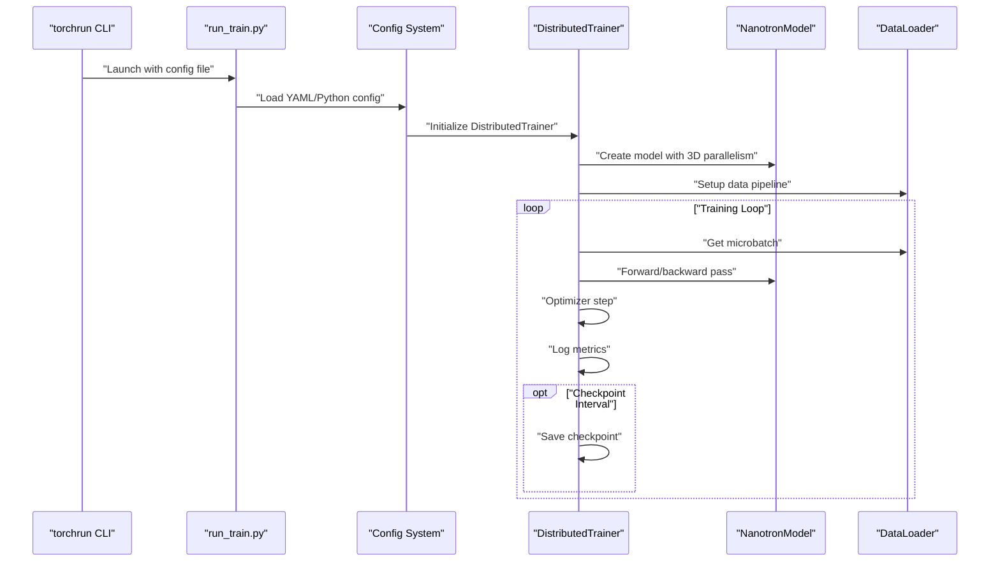

Sources: [README.md:94-105](), [docs/docs.md:355-361]()

### Generated Outputs

Training produces several outputs:

| Output Type | Location | Description |
|-------------|----------|-------------|
| Checkpoints | `checkpoints/` | Model weights, optimizer state, metadata |
| Logs | Console/wandb | Training metrics, loss curves, performance stats |
| Config | `examples/config_tiny_llama.yaml` | Generated/used configuration file |

The model is automatically saved in the `checkpoints` directory as specified in the configuration.

Sources: [examples/config_tiny_llama.yaml:1-6](), [README.md:100-101]()

## Generation and Inference

After training, run generation from your checkpoint:

```bash
torchrun --nproc_per_node=1 run_generate.py --ckpt-path checkpoints/{checkpoint_number}/ --tp 1 --pp 1
```

Scale generation performance by adjusting parallelism parameters:
- Increase `--tp` (tensor parallel) for multiple GPU acceleration
- Increase `--pp` (pipeline parallel) for very large models

Sources: [README.md:107-114]()

## Debugging Setup

For development and debugging with VSCode, configure `launch.json`:

```json
{
    "name": "run_train.py",
    "type": "python", 
    "request": "launch",
    "program": "torchrun",
    "args": [
        "--nproc_per_node=2",
        "run_train.py", 
        "--config-file=examples/config_tiny_llama.yaml"
    ],
    "env": {
        "CUDA_DEVICE_MAX_CONNECTIONS": "1",
        "WANDB_MODE": "disabled"
    }
}
```

Sources: [README.md:115-140]()

## Next Steps

Once you have successfully run your first training job, explore:

- **Model Architectures**: See [Supported Models](#3) for Llama, Qwen2, Mamba, and MoE implementations
- **Advanced Parallelism**: See [3D Parallelism](#4.2) for scaling to larger models and clusters  
- **Custom Data**: See [Data Pipeline](#5) for using your own datasets
- **Multi-Node Training**: See [Multi-Node Training](#4.5) for SLURM-based cluster training
- **Example Configurations**: Explore the `/examples` directory for specialized use cases

| Example Type | Description | Location |
|--------------|-------------|----------|
| Custom DataLoader | Plug custom data pipeline | `/examples/custom-dataloader` |
| Datatrove Integration | Use datatrove library | `/examples/datatrove` |
| DoReMi Training | Domain reweighting | `/examples/doremi` |
| Mamba Models | State space models | `/examples/mamba` |
| Mixture of Experts | MoE architecture | `/examples/moe` |

Sources: [README.md:141-154]()

---

# Page: Project Structure

# Project Structure

<details>
<summary>Relevant source files</summary>

The following files were used as context for generating this wiki page:

- [README.md](README.md)
- [docs/3d_parallelism.md](docs/3d_parallelism.md)
- [docs/docs.md](docs/docs.md)
- [pyproject.toml](pyproject.toml)
- [src/nanotron/__init__.py](src/nanotron/__init__.py)

</details>


This document provides an overview of the Nanotron repository structure, explaining the organization of key directories, entry points, and configuration files. For information about specific architectural components, see [Core Architecture](#2). For details about model implementations, see [Supported Models](#3).

## Repository Overview

Nanotron follows a standard Python package structure with the core library located under `src/nanotron/` and supporting materials organized in dedicated directories. The repository is designed to support distributed training workflows while maintaining clear separation between core functionality, examples, and generated artifacts.

```mermaid
graph TB
    subgraph "Repository Root"
        ROOT["/"]
        README["README.md"]
        PYPROJECT["pyproject.toml"]
        LICENSE["LICENSE"]
        GITIGNORE[".gitignore"]
    end
    
    subgraph "Entry Points"
        RUN_TRAIN["run_train.py"]
        RUN_GEN["run_generate.py"]  
        SLURM["slurm_launcher.py"]
    end
    
    subgraph "Core Package"
        SRC_DIR["src/"]
        NANOTRON_PKG["src/nanotron/"]
        INIT["src/nanotron/__init__.py"]
    end
    
    subgraph "Configuration & Examples" 
        EXAMPLES["examples/"]
        CONFIG_YAML["examples/config_*.yaml"]
        CONFIG_PY["examples/config_*.py"]
    end
    
    subgraph "Documentation & Scripts"
        DOCS["docs/"]
        SCRIPTS["scripts/"]
        LOG_SCRIPT["scripts/log_lighteval_to_wandb.py"]
    end
    
    subgraph "Testing"
        TESTS["tests/"]
    end
    
    subgraph "Generated/Runtime (gitignored)"
        CHECKPOINTS["checkpoints/"]
        WANDB["wandb/"]
        LOGS["logs/"]
        CACHE[".nanoset_cache/"]
    end
    
    ROOT --> README
    ROOT --> PYPROJECT
    ROOT --> LICENSE
    ROOT --> GITIGNORE
    ROOT --> RUN_TRAIN
    ROOT --> RUN_GEN
    ROOT --> SLURM
    ROOT --> SRC_DIR
    ROOT --> EXAMPLES
    ROOT --> DOCS
    ROOT --> SCRIPTS
    ROOT --> TESTS
    
    SRC_DIR --> NANOTRON_PKG
    NANOTRON_PKG --> INIT
    EXAMPLES --> CONFIG_YAML
    EXAMPLES --> CONFIG_PY
    SCRIPTS --> LOG_SCRIPT
    
    ROOT --> CHECKPOINTS
    ROOT --> WANDB
    ROOT --> LOGS
    ROOT --> CACHE
    
    style NANOTRON_PKG fill:#f9f9f9,stroke:#333,stroke-width:2px
    style RUN_TRAIN fill:#f9f9f9,stroke:#333,stroke-width:2px
    style EXAMPLES fill:#f9f9f9,stroke:#333,stroke-width:2px
```

**Sources:** [README.md:1-188](), [pyproject.toml:1-70](), [.gitignore:1-173](), [src/nanotron/__init__.py:1-2]()

## Core Package Structure

The main Nanotron library is organized under `src/nanotron/` with the package version defined in [src/nanotron/__init__.py:1]() as version `"0.4"`. The codebase is structured around major functional systems that implement distributed training capabilities.

### System-to-Code Mapping

```mermaid
graph TB
    subgraph "Core Training System"
        DT["DistributedTrainer"]
        Config["Config Classes"]
        NM["NanotronModel"]
        Checkpoint["Checkpoint System"]
    end
    
    subgraph "src/nanotron/ Structure"
        TRAINER["trainer/"]
        CONFIG_DIR["config/"]
        MODELS["models/"]
        SERIALIZE["serialize/"]
        PARALLEL["parallel/"]
        DATA["data/"]
        OPTIM["optim/"]
        LOGGING["logging/"]
    end
    
    subgraph "Model Implementations"
        LLAMA["LlamaForTraining"]
        QWEN2["Qwen2ForTraining"] 
        MAMBA["MambaForTraining"]
        MOE["LlaMoEForTraining"]
    end
    
    subgraph "Distributed Systems"
        PC["ParallelContext"]
        TP["TensorParallelLinear"]
        PP["PipelineBlock"]
        DP["DistributedDataParallel"]
    end
    
    DT --> TRAINER
    Config --> CONFIG_DIR
    NM --> MODELS
    Checkpoint --> SERIALIZE
    
    LLAMA --> MODELS
    QWEN2 --> MODELS
    MAMBA --> MODELS
    MOE --> MODELS
    
    PC --> PARALLEL
    TP --> PARALLEL
    PP --> PARALLEL
    DP --> PARALLEL
    
    TRAINER --> OPTIM
    TRAINER --> LOGGING
    TRAINER --> DATA
    
    style TRAINER fill:#f9f9f9,stroke:#333,stroke-width:2px
    style MODELS fill:#f9f9f9,stroke:#333,stroke-width:2px
    style PARALLEL fill:#f9f9f9,stroke:#333,stroke-width:2px
    style CONFIG_DIR fill:#f9f9f9,stroke:#333,stroke-width:2px
```

### Directory Structure and Components

| Directory | Core Classes | Purpose |
|-----------|-------------|---------|
| `trainer/` | `DistributedTrainer` | Main training orchestration and lifecycle management |
| `config/` | `Config`, `ModelConfig`, `ParallelismArgs` | Type-safe configuration system with YAML support |
| `models/` | `NanotronModel`, `LlamaForTraining`, `Qwen2ForTraining` | Model architectures and implementations |
| `parallel/` | `ParallelContext`, `TensorParallelLinear`, `PipelineBlock` | 3D parallelism implementation |
| `data/` | `Nanoset`, `NanosetDataloder`, `build_nanoset_dataloader` | Large-scale dataset handling and loading |
| `serialize/` | `Serializer`, `save_weights`, `load_weights` | Checkpoint management and distributed serialization |
| `optim/` | `NamedOptimizer`, `ZeroDistributedOptimizer` | Custom optimizers and ZeRO-1 implementation |
| `logging/` | `LogItem`, `HuggingFaceLogger`, `TensorBoardLogger` | Unified logging interface |

The package structure is configured in [pyproject.toml:27-28]() where the build system looks for packages under the `src/` directory.

**Sources:** [src/nanotron/__init__.py:1-2](), [pyproject.toml:27-28]()

## Entry Points and Execution

Nanotron provides three main entry points located at the repository root, each serving different aspects of the training workflow:

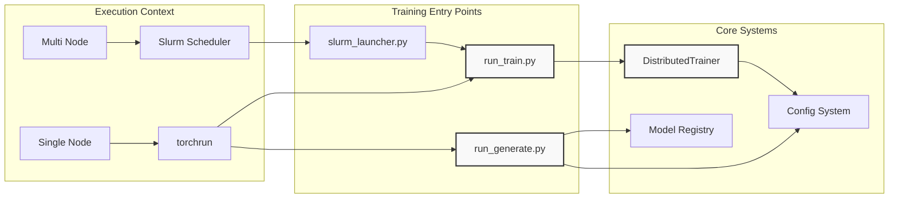

### Training Entry Point
`run_train.py` is the primary entry point that instantiates `DistributedTrainer` and orchestrates the full training workflow. As shown in [README.md:97](), it's designed to work with PyTorch's distributed launcher:
```bash
CUDA_DEVICE_MAX_CONNECTIONS=1 torchrun --nproc_per_node=8 run_train.py --config-file examples/config_tiny_llama.yaml
```

The script handles:
- Configuration loading via the `Config` system
- `ParallelContext` initialization for distributed setup
- Model instantiation using the appropriate `*ForTraining` classes
- Training loop execution through `DistributedTrainer.train()`

### Generation Entry Point  
`run_generate.py` handles model inference and text generation from saved checkpoints using the serialization system. The README shows it's used as [README.md:110]():
```bash
torchrun --nproc_per_node=1 run_generate.py --ckpt-path checkpoints/{checkpoint_number}/ --tp 1 --pp 1
```

This script leverages:
- Checkpoint loading via `load_weights()` functions
- Model reconstruction with specified tensor/pipeline parallel configurations
- Generation utilities for text sampling and inference

### Multi-Node Launcher
`slurm_launcher.py` provides integration with Slurm schedulers for multi-node distributed training, generating SLURM job scripts that wrap the main training script with cluster-specific configuration and environment setup.

**Sources:** [README.md:94-114]()

## Configuration System

Nanotron supports both YAML and Python-based configuration systems, with examples provided in the `examples/` directory. The configuration system is designed to handle complex distributed training setups with multiple parallelism strategies.

### Configuration Files
The examples directory contains various configuration templates:

| Configuration Type | Purpose | Example Files |
|-------------------|---------|---------------|
| YAML configs | Declarative training setup | `config_tiny_llama.yaml` |
| Python configs | Programmatic configuration | `config_tiny_llama.py` |
| S3 integration | Automatic checkpoint upload | `config_tiny_llama_with_s3_upload.yaml` |

As noted in [README.md:103](), Python configuration files can be used to generate YAML configs programmatically, providing flexibility for complex setups.

### Example Categories
The examples directory is organized by use case, as shown in the README table [README.md:144-152]():

- `custom-dataloader`: Custom data loading integration
- `datatrove`: Data preprocessing with datatrove library  
- `doremi`: DoReMi domain reweighting
- `mamba`: Mamba model training
- `moe`: Mixture of Experts training
- `mup`: Spectral μTransfer scaling

**Sources:** [README.md:103](), [README.md:144-152]()

## Dependency Management

The project uses modern Python packaging with dependencies organized by feature set in [pyproject.toml:16-61]():

### Core Dependencies
- `torch>=1.13.1`: PyTorch framework
- `datasets`: Dataset loading and processing
- `safetensors`: Safe tensor serialization
- `dacite`: Configuration parsing
- `tqdm`: Progress bars

### Optional Dependencies
- `fast-modeling`: Flash attention kernels (`flash-attn>=2.5.0`)
- `nanosets`: Data preprocessing (`datatrove`, `transformers`, `numba`)
- `s3`: Cloud storage integration (`boto3`, `s3fs`, `s5cmd`)
- `dev`: Development tools (`pre-commit`, `pylint`)
- `test`: Testing framework (`pytest`, `pytest-xdist`)

**Sources:** [pyproject.toml:16-61]()

## Generated and Runtime Directories

Several directories are created during training and operation, as specified in [.gitignore:164-172]():

| Directory | Purpose | Persistence |
|-----------|---------|-------------|
| `checkpoints/` | Model checkpoints and training state | Persistent |
| `wandb/` | Weights & Biases logging data | Local cache |
| `logs/` | Training logs and metrics | Local cache |
| `.nanoset_cache/` | Cached dataset indices | Cache |
| `eval_results/` | Evaluation results from lighteval | Results |
| `tb_logs/` | TensorBoard logs | Local cache |

These directories are excluded from version control but represent important runtime artifacts for training workflows.

**Sources:** [.gitignore:164-172]()

## Utility Scripts

The `scripts/` directory contains utility tools for training workflows. A key example is [scripts/log_lighteval_to_wandb.py:1-112](), which processes evaluation results and logs them to Weights & Biases. This script demonstrates the integration between Nanotron's evaluation system and external monitoring tools.

The script expects evaluation results in a structured format with directories named by training steps (e.g., `5000/`, `10000/`) containing JSON results files, as documented in [scripts/log_lighteval_to_wandb.py:7-12]().

**Sources:** [scripts/log_lighteval_to_wandb.py:1-112]()

---

# Page: Core Architecture

# Core Architecture

<details>
<summary>Relevant source files</summary>

The following files were used as context for generating this wiki page:

- [src/nanotron/config/config.py](src/nanotron/config/config.py)
- [src/nanotron/helpers.py](src/nanotron/helpers.py)
- [src/nanotron/models/base.py](src/nanotron/models/base.py)
- [src/nanotron/models/llama.py](src/nanotron/models/llama.py)
- [src/nanotron/s3_checkpoints/s3_mover.py](src/nanotron/s3_checkpoints/s3_mover.py)
- [src/nanotron/serialize/main.py](src/nanotron/serialize/main.py)
- [src/nanotron/trainer.py](src/nanotron/trainer.py)

</details>


This page provides an overview of Nanotron's core architectural components and design patterns. It covers the main orchestrating classes, system boundaries, and how the major subsystems integrate to enable large-scale distributed training of language models.

For details about specific model implementations, see [Supported Models](#3). For distributed training strategies, see [Distributed Training](#4). For data pipeline implementation, see [Data Pipeline](#5).

## System Overview

Nanotron is built around a modular architecture that separates concerns into distinct subsystems while maintaining tight integration for distributed training. The core design follows a centralized orchestration pattern with the `DistributedTrainer` class serving as the main coordinator.

### High-Level Architecture

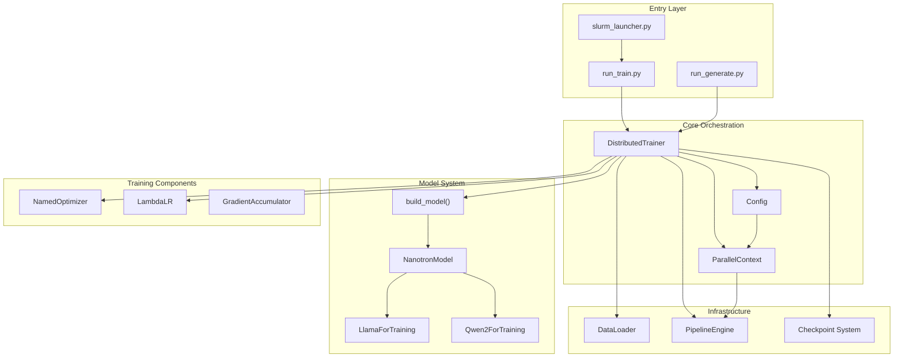

**Sources:** [src/nanotron/trainer.py:132-148](), [src/nanotron/config/config.py:438-454](), [src/nanotron/models/base.py:186-239]()

## Central Orchestrator: DistributedTrainer

The `DistributedTrainer` class serves as the primary orchestrator that coordinates all training subsystems. It manages the complete training lifecycle from initialization through execution to checkpointing.

### DistributedTrainer Architecture

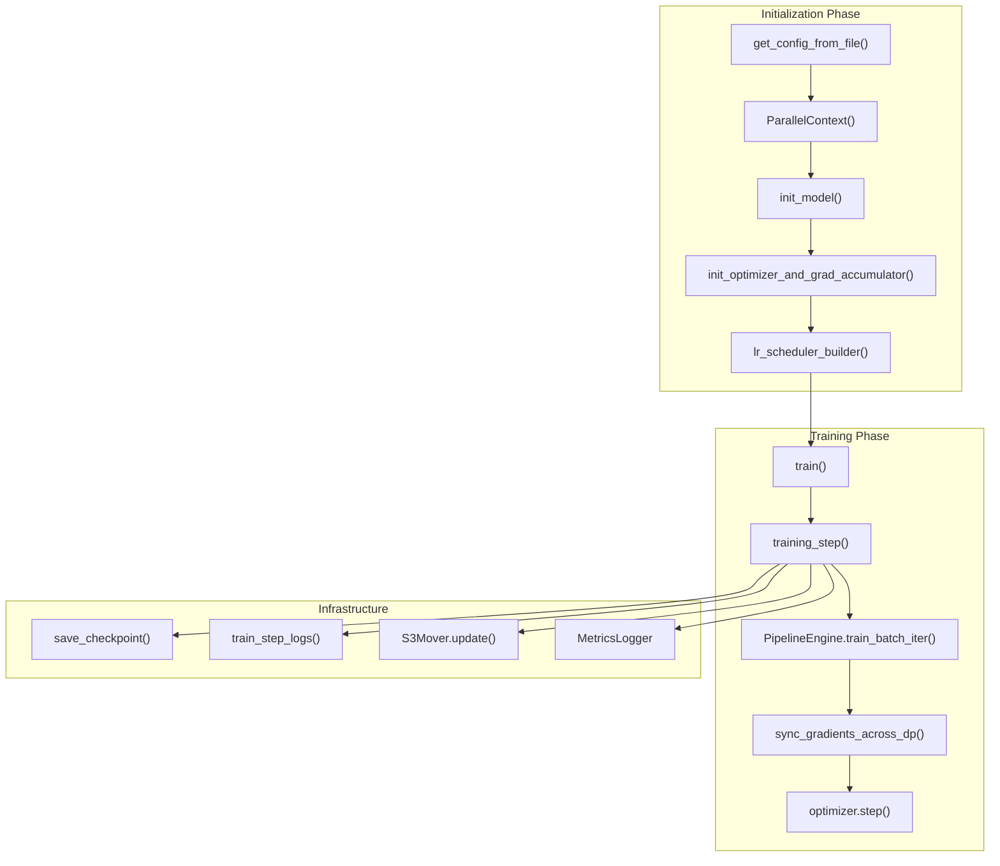

The `DistributedTrainer` constructor performs comprehensive system initialization including process group setup, model building, optimizer configuration, and learning rate scheduler creation. Key responsibilities include:

- **Configuration Management**: Loads and validates training configurations from YAML or Python files
- **Process Group Coordination**: Initializes `ParallelContext` for distributed communication
- **Model Instantiation**: Coordinates model building across pipeline parallel ranks
- **Training State Management**: Manages iteration counting, metadata tracking, and resume logic
- **Checkpointing**: Orchestrates model, optimizer, and scheduler state persistence

**Sources:** [src/nanotron/trainer.py:132-297](), [src/nanotron/trainer.py:530-612]()

## Configuration System Architecture

Nanotron uses a hierarchical configuration system built around dataclasses that provide type safety and validation. The `Config` class serves as the root configuration container.

### Configuration Hierarchy

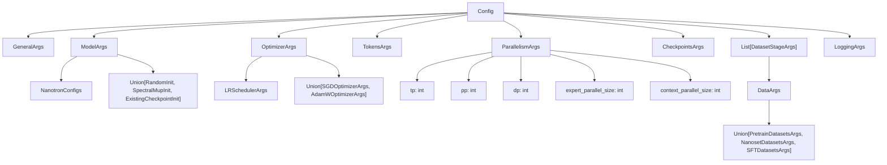

The configuration system enforces constraints across subsystems through post-initialization validation. For example, it ensures attention heads are divisible by tensor parallel size and validates pipeline parallel stage consistency.

**Sources:** [src/nanotron/config/config.py:438-597](), [src/nanotron/config/config.py:599-675]()

## Model Architecture System

Nanotron's model system is built around the abstract `NanotronModel` base class, which provides common functionality for distributed training while allowing concrete implementations for different architectures.

### Model System Components

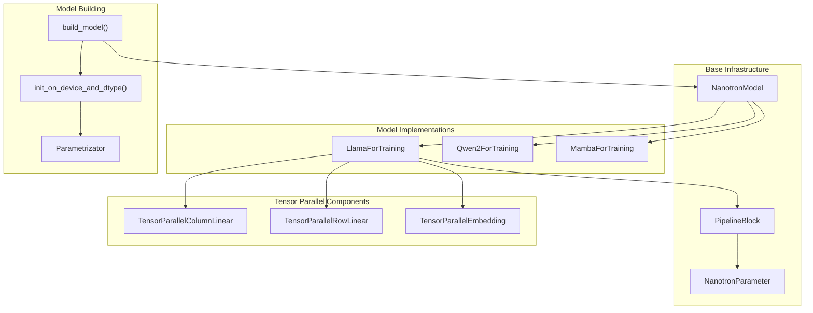

Key architectural features:

- **Pipeline Parallel Integration**: Models are automatically partitioned across pipeline parallel ranks using `PipelineBlock` components
- **Tensor Parallel Support**: Built-in support for tensor parallel layers that handle sharding and communication
- **Parameter Management**: Custom `NanotronParameter` class supports advanced features like parameter tying
- **Device/Dtype Management**: Centralized device and dtype initialization through context managers

**Sources:** [src/nanotron/models/base.py:23-133](), [src/nanotron/models/base.py:186-239](), [src/nanotron/models/llama.py:1-50]()

## Training Pipeline Flow

The training pipeline implements a sophisticated execution flow that coordinates data loading, forward/backward passes, gradient synchronization, and optimization across distributed processes.

### Training Execution Flow

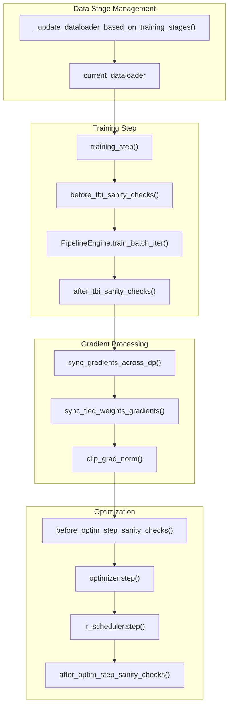

The training pipeline supports:

- **Multi-Stage Data Loading**: Dynamic dataloader switching based on training progress
- **Gradient Accumulation**: Micro-batch accumulation with optional FP32 gradient storage
- **Advanced Gradient Synchronization**: Support for tied parameters and various parallelism modes
- **Comprehensive Validation**: Extensive sanity checks before and after critical operations

**Sources:** [src/nanotron/trainer.py:613-735](), [src/nanotron/trainer.py:432-529](), [src/nanotron/helpers.py:316-465]()

## Parametrization and Initialization

Nanotron supports multiple parameter initialization strategies through a pluggable parametrization system. This enables advanced techniques like spectral µTransfer while maintaining compatibility with standard initialization.

### Parametrization Architecture

| Component | Standard Parametrization | Spectral µTransfer |
|-----------|-------------------------|-------------------|
| Linear Layers | `std` for all weights | Fan-in/fan-out dependent scaling |
| Learning Rates | Global learning rate | Per-parameter custom rates |
| Initialization | `StandardParametrizator` | `SpectralMupParametrizator` |
| LR Mapping | `LearningRateForSP` | `LearningRateForSpectralMup` |

The parametrization system integrates with the optimizer builder to create parameter groups with custom learning rates and weight decay settings. This enables sophisticated training regimes that scale effectively to large model sizes.

**Sources:** [src/nanotron/scaling/parametrization.py:18-222](), [src/nanotron/helpers.py:241-313]()

## Integration Points

The core architecture maintains clean separation of concerns while providing integration points for extensibility:

- **Model Registration**: New model architectures register through `CONFIG_TO_MODEL_CLASS` mapping
- **Optimizer Integration**: Pluggable optimizer factories support different optimization algorithms
- **Parallelism Modes**: Configurable parallelism strategies through `ParallelismArgs`
- **Checkpoint Compatibility**: Standardized serialization format across model types
- **Configuration Validation**: Cross-system constraint validation in config post-init

This modular design enables researchers to extend individual components without requiring changes to the core orchestration logic.

**Sources:** [src/nanotron/trainer.py:112-116](), [src/nanotron/config/config.py:460-545]()

---

# Page: Distributed Trainer

# Distributed Trainer

<details>
<summary>Relevant source files</summary>

The following files were used as context for generating this wiki page:

- [src/nanotron/config/config.py](src/nanotron/config/config.py)
- [src/nanotron/helpers.py](src/nanotron/helpers.py)
- [src/nanotron/models/base.py](src/nanotron/models/base.py)
- [src/nanotron/models/llama.py](src/nanotron/models/llama.py)
- [src/nanotron/s3_checkpoints/s3_mover.py](src/nanotron/s3_checkpoints/s3_mover.py)
- [src/nanotron/serialize/main.py](src/nanotron/serialize/main.py)
- [src/nanotron/trainer.py](src/nanotron/trainer.py)

</details>


The `DistributedTrainer` class serves as the central orchestrator for distributed training in Nanotron. It coordinates all aspects of the training process including model initialization, optimizer setup, data loading, the training loop execution, and checkpoint management across distributed environments with 3D parallelism support.

For information about the underlying parallel computation strategies, see [3D Parallelism](#4.2). For details about data pipeline configuration and management, see [Data Pipeline](#5). For checkpoint serialization mechanics, see [Checkpointing and Serialization](#7).

## Core Architecture

The `DistributedTrainer` follows a centralized orchestration pattern where a single class manages the entire distributed training lifecycle. It integrates with multiple subsystems through dependency injection and configuration-driven initialization.

### Class Structure and Dependencies

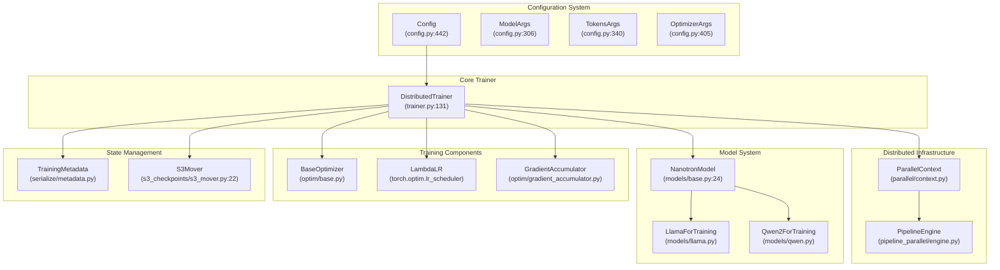

Sources: [src/nanotron/trainer.py:131-296](), [src/nanotron/config/config.py:442-585](), [src/nanotron/models/base.py:24-86]()

## Initialization Process

The `DistributedTrainer` initialization follows a multi-phase process that establishes the distributed environment, builds the model, and configures all training components.

### Initialization Sequence

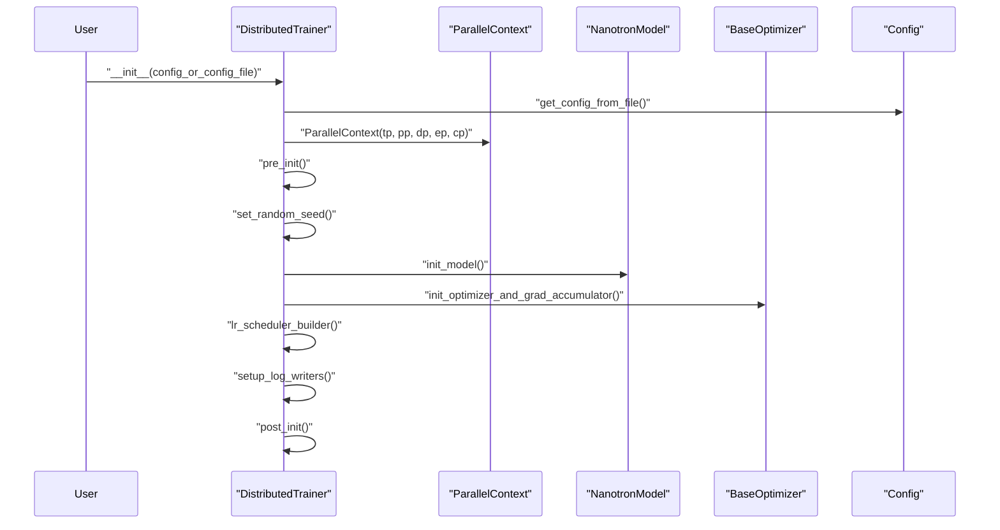

The initialization process occurs in [src/nanotron/trainer.py:132-296]() and involves several critical steps:

1. **Configuration Loading**: The trainer accepts either a `Config` object or a YAML file path and loads the configuration using `get_config_from_file()`
2. **Parallel Context Setup**: Creates a `ParallelContext` with tensor parallel (tp), pipeline parallel (pp), data parallel (dp), expert parallel (ep), and context parallel (cp) dimensions
3. **Random State Initialization**: Sets different random seeds per TP rank to ensure diversity during weight initialization
4. **Model Construction**: Builds the model using the configured architecture (Llama, Qwen2, etc.)
5. **Optimizer Setup**: Initializes the optimizer and gradient accumulator with proper parameter grouping
6. **Learning Rate Scheduler**: Configures the learning rate scheduler with custom lambda functions per parameter group

Sources: [src/nanotron/trainer.py:132-296](), [src/nanotron/helpers.py:315-464]()

## Training Loop Architecture

The core training loop is implemented in the `train()` method and orchestrates the execution of training steps across the distributed system.

### Training Flow Control

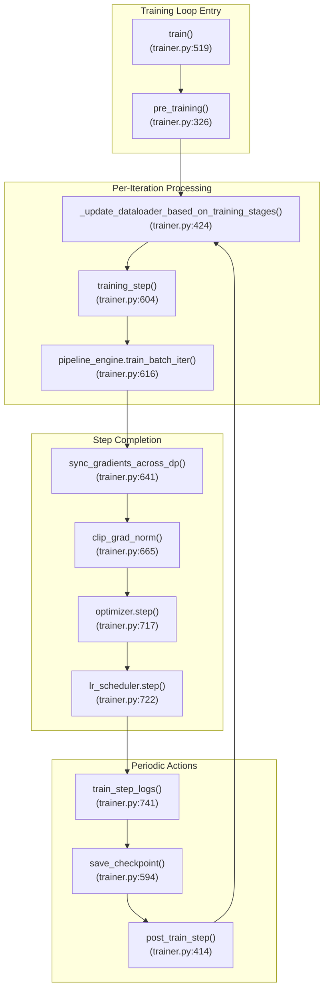

The training loop executes the following sequence for each iteration:

1. **Dataloader Management**: Updates the current dataloader based on training stages using `_update_dataloader_based_on_training_stages()`
2. **Forward/Backward Pass**: Executes the training step via `training_step()` which delegates to `pipeline_engine.train_batch_iter()`
3. **Gradient Synchronization**: Syncs gradients across data parallel groups and tied parameters
4. **Gradient Clipping**: Applies gradient clipping if configured via `clip_grad_norm()`
5. **Optimizer Step**: Updates model parameters using `optimizer.step()` and zeros gradients
6. **Learning Rate Update**: Steps the learning rate scheduler
7. **Logging and Checkpointing**: Performs periodic logging and checkpoint saving

Sources: [src/nanotron/trainer.py:519-602](), [src/nanotron/trainer.py:604-731]()

## Multi-Stage Training Support

The trainer supports multi-stage training where different stages can use different datasets, sequence lengths, and training configurations. This enables curriculum learning and progressive training strategies.

### Stage Management System

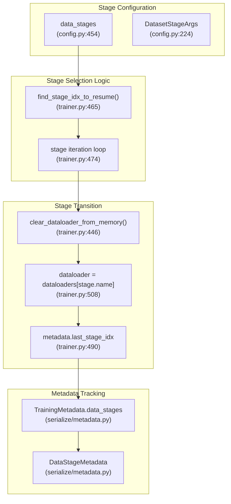

The stage management system works as follows:

1. **Stage Definition**: Stages are defined in the configuration with `start_training_step`, `name`, and `data` specifications
2. **Stage Detection**: The `find_stage_idx_to_resume()` function determines which stage to use based on the current training step
3. **Memory Management**: When transitioning stages, `clear_dataloader_from_memory()` releases the previous stage's dataloader and datasets
4. **Dataloader Instantiation**: New dataloaders are created (or called if they're lazy functions) for the new stage
5. **Metadata Updates**: The `TrainingMetadata` tracks the current stage index and consumption statistics per stage

Sources: [src/nanotron/trainer.py:424-518](), [src/nanotron/config/config.py:224-235]()

## Checkpoint Management Integration

The trainer integrates closely with the checkpoint system to provide fault tolerance and training resumption capabilities.

### Checkpoint Lifecycle

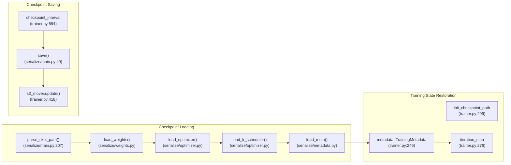

The checkpoint management handles:

1. **Initialization from Checkpoint**: During initialization, `parse_ckpt_path()` determines if there's a checkpoint to resume from
2. **State Loading**: Loads model weights, optimizer state, learning rate scheduler state, and training metadata
3. **Training Resumption**: Sets the iteration step and metadata to continue from the saved state
4. **Periodic Saving**: Saves checkpoints at configured intervals during training
5. **S3 Integration**: Optionally uploads checkpoints to S3 storage using the `S3Mover` component

Sources: [src/nanotron/trainer.py:299-300](), [src/nanotron/trainer.py:215-261](), [src/nanotron/serialize/main.py:49-205]()

## Distributed Coordination

The trainer coordinates training across multiple processes and devices through the `ParallelContext` and handles various aspects of distributed execution.

### Process Group Management

| Component | Purpose | Process Group |
|-----------|---------|---------------|
| **Tensor Parallel** | Shard tensors across devices | `tp_pg` |
| **Pipeline Parallel** | Stage model layers | `pp_pg` |
| **Data Parallel** | Replicate model across data | `dp_pg` |
| **Expert Parallel** | Distribute MoE experts | `expert_pg` |
| **Context Parallel** | Split sequence length | `cp_pg` |

The trainer uses different process groups for:

- **Gradient Synchronization**: Uses `dp_pg` for data parallel gradient reduction
- **Tied Parameter Sync**: Coordinates tied weights across relevant process groups
- **Loss Averaging**: Synchronizes loss values across `dp_cp_pg` for logging
- **Checkpoint Coordination**: Ensures all processes complete checkpoint operations

Sources: [src/nanotron/trainer.py:169-176](), [src/nanotron/trainer.py:641-662](), [src/nanotron/trainer.py:694-695]()

## Performance Monitoring and Logging

The trainer includes comprehensive monitoring and logging capabilities that track training performance, memory usage, and system metrics.

### Metrics Collection

```mermaid
graph TB
    subgraph "Performance Metrics"
        IterationTimer["iteration_timer<br/>(trainer.py:557)"]
        TokensPerSec["tokens_per_sec calculation<br/>(trainer.py:753)"]
        TFLOPs["model_tflops, hardware_tflops<br/>(trainer.py:756)"]
    end
    
    subgraph "Memory Monitoring"
        LogMemory["log_memory()<br/>(trainer.py:612)"]
        CPUMetrics["get_cpu_logitems()<br/>(trainer.py:788)"]
        GPUMemory["torch.cuda.max_memory_allocated()<br/>(trainer.py:643)"]
    end
    
    subgraph "Training Logs"
        TrainStepLogs["train_step_logs()<br/>(trainer.py:741)"]
        LoggerWriter["LoggerWriter<br/>(trainer.py:266)"]
        WandBLogging["wandb integration<br/>(trainer.py:350)"]
    end
    
    subgraph "System Monitoring"
        PSUtilMetrics["psutil memory/cpu metrics<br/>(trainer.py:790)"]
        ProcessMemory["process memory tracking<br/>(trainer.py:817)"]
    end
    
    IterationTimer --> TrainStepLogs
    TokensPerSec --> TrainStepLogs
    TFLOPs --> TrainStepLogs
    LogMemory --> TrainStepLogs
    CPUMetrics --> TrainStepLogs
    GPUMemory --> TrainStepLogs
    TrainStepLogs --> LoggerWriter
    TrainStepLogs --> WandBLogging
    PSUtilMetrics --> TrainStepLogs
    ProcessMemory --> TrainStepLogs
```

The monitoring system tracks:

1. **Training Performance**: Iteration time, tokens per second, model and hardware TFLOPs
2. **Memory Usage**: GPU memory allocation/reservation, CPU memory, swap usage
3. **Process Metrics**: RSS, shared memory, virtual memory for main and worker processes
4. **Training Progress**: Consumed tokens, remaining steps, learning rate, loss values

Sources: [src/nanotron/trainer.py:741-896](), [src/nanotron/logging/timers.py]()

## Configuration System Integration

The trainer seamlessly integrates with Nanotron's type-safe configuration system, allowing all training parameters to be specified declaratively.

### Configuration Flow

The trainer accepts configuration through multiple pathways:
- **YAML Files**: Loaded via `get_config_from_file()` with automatic type validation
- **Config Objects**: Direct instantiation with `Config` dataclass instances
- **Environment Integration**: Supports SLURM job ID and other environment variables in run names

Key configuration sections used by the trainer:
- `general`: Project name, run name, seed, sanity checks
- `parallelism`: TP/PP/DP/EP/CP sizes and modes
- `model`: Architecture, initialization method, dtype
- `tokens`: Batch sizes, sequence length, training steps
- `optimizer`: Optimizer type, learning rate, weight decay
- `checkpoints`: Save/load paths, intervals, S3 configuration
- `data_stages`: Multi-stage training configuration

Sources: [src/nanotron/trainer.py:150-163](), [src/nanotron/config/config.py:442-607]()

---

# Page: Configuration System

# Configuration System

<details>
<summary>Relevant source files</summary>

The following files were used as context for generating this wiki page:

- [examples/config_qwen.py](examples/config_qwen.py)
- [examples/config_qwen.yaml](examples/config_qwen.yaml)
- [run_train.py](run_train.py)
- [src/nanotron/config/config.py](src/nanotron/config/config.py)
- [src/nanotron/data/clm_collator.py](src/nanotron/data/clm_collator.py)
- [src/nanotron/data/dataloader.py](src/nanotron/data/dataloader.py)
- [src/nanotron/data/dataloader_builder.py](src/nanotron/data/dataloader_builder.py)
- [src/nanotron/data/nanoset.py](src/nanotron/data/nanoset.py)
- [src/nanotron/helpers.py](src/nanotron/helpers.py)
- [src/nanotron/models/base.py](src/nanotron/models/base.py)
- [src/nanotron/models/llama.py](src/nanotron/models/llama.py)
- [src/nanotron/s3_checkpoints/s3_mover.py](src/nanotron/s3_checkpoints/s3_mover.py)
- [src/nanotron/serialize/main.py](src/nanotron/serialize/main.py)
- [src/nanotron/trainer.py](src/nanotron/trainer.py)

</details>


The Configuration System in Nanotron provides a comprehensive, type-safe framework for managing all training parameters, from model architecture to distributed training settings. This system supports both YAML and Python configuration files, with automatic validation and serialization capabilities.

For information about specific model configurations, see [Supported Models](#3). For distributed training parameter details, see [Distributed Training](#4).

## Configuration Architecture Overview

The configuration system is built around a hierarchical dataclass structure that organizes all training parameters into logical sections.

```mermaid
graph TB
    subgraph "Configuration Sources"
        YAML_FILE["config.yaml"]
        PY_FILE["config.py"] 
        DICT["Python Dict"]
    end
    
    subgraph "Loading Functions"
        GET_CONFIG_FILE["get_config_from_file()"]
        GET_CONFIG_DICT["get_config_from_dict()"]
    end
    
    subgraph "Core Config Class"
        CONFIG["Config"]
    end
    
    subgraph "Configuration Sections"
        GENERAL["GeneralArgs"]
        MODEL["ModelArgs"]
        PARALLEL["ParallelismArgs"]
        TOKENS["TokensArgs"]
        OPTIMIZER["OptimizerArgs"]
        DATA_STAGES["DatasetStageArgs[]"]
        CHECKPOINTS["CheckpointsArgs"]
        LOGGING["LoggingArgs"]
    end
    
    subgraph "Consumers"
        TRAINER["DistributedTrainer"]
        MODEL_BUILDER["build_model()"]
        DATALOADER["get_dataloader()"]
    end
    
    YAML_FILE --> GET_CONFIG_FILE
    PY_FILE --> GET_CONFIG_FILE
    DICT --> GET_CONFIG_DICT
    
    GET_CONFIG_FILE --> CONFIG
    GET_CONFIG_DICT --> CONFIG
    
    CONFIG --> GENERAL
    CONFIG --> MODEL
    CONFIG --> PARALLEL
    CONFIG --> TOKENS
    CONFIG --> OPTIMIZER
    CONFIG --> DATA_STAGES
    CONFIG --> CHECKPOINTS
    CONFIG --> LOGGING
    
    CONFIG --> TRAINER
    CONFIG --> MODEL_BUILDER
    CONFIG --> DATALOADER
```

Sources: [src/nanotron/config/config.py:438-454](), [src/nanotron/config/config.py:641-674](), [src/nanotron/trainer.py:132-161]()

## Configuration Class Hierarchy

The configuration system uses a nested dataclass structure where each section manages related parameters with built-in validation.

```mermaid
graph TB
    subgraph "Main Config"
        CONFIG["Config"]
    end
    
    subgraph "Core Training Args"
        GENERAL["GeneralArgs<br/>• project<br/>• run<br/>• seed"]
        TOKENS["TokensArgs<br/>• sequence_length<br/>• train_steps<br/>• micro_batch_size"]
        OPTIMIZER["OptimizerArgs<br/>• zero_stage<br/>• weight_decay<br/>• learning_rate_scheduler"]
    end
    
    subgraph "Model Configuration"
        MODEL["ModelArgs<br/>• model_config<br/>• init_method<br/>• dtype"]
        MODEL_CONFIGS["NanotronConfigs<br/>• LlamaConfig<br/>• Qwen2Config<br/>• MambaConfig"]
        INIT_METHODS["Init Methods<br/>• RandomInit<br/>• SpectralMupInit<br/>• ExistingCheckpointInit"]
    end
    
    subgraph "Distributed Training"
        PARALLEL["ParallelismArgs<br/>• dp, tp, pp<br/>• tp_mode<br/>• pp_engine"]
    end
    
    subgraph "Data Pipeline"
        DATA_STAGES["DatasetStageArgs[]<br/>• name<br/>• start_training_step<br/>• data"]
        DATA_ARGS["DataArgs<br/>• dataset<br/>• seed<br/>• num_loading_workers"]
        DATASET_TYPES["Dataset Types<br/>• NanosetDatasetsArgs<br/>• PretrainDatasetsArgs<br/>• SFTDatasetsArgs"]
    end
    
    subgraph "Infrastructure"
        CHECKPOINTS["CheckpointsArgs<br/>• checkpoints_path<br/>• checkpoint_interval"]
        LOGGING["LoggingArgs<br/>• log_level<br/>• iteration_step_info_interval"]
        S3["S3UploadArgs<br/>• upload_s3_path<br/>• remove_after_upload"]
    end
    
    CONFIG --> GENERAL
    CONFIG --> TOKENS  
    CONFIG --> OPTIMIZER
    CONFIG --> MODEL
    CONFIG --> PARALLEL
    CONFIG --> DATA_STAGES
    CONFIG --> CHECKPOINTS
    CONFIG --> LOGGING
    CONFIG --> S3
    
    MODEL --> MODEL_CONFIGS
    MODEL --> INIT_METHODS
    DATA_STAGES --> DATA_ARGS
    DATA_ARGS --> DATASET_TYPES
```

Sources: [src/nanotron/config/config.py:438-454](), [src/nanotron/config/config.py:259-286](), [src/nanotron/config/config.py:305-324](), [src/nanotron/config/config.py:159-205]()

## Configuration Loading Process

Nanotron supports multiple ways to load and validate configurations, with automatic type checking and post-initialization validation.

### Loading from Files

The `get_config_from_file()` function handles both YAML and Python configuration files:

```mermaid
graph LR
    subgraph "Input Files"
        YAML["config.yaml"]
        PY["config.py"]
    end
    
    subgraph "Loading Process"
        LOAD_FILE["load file content"]
        PARSE_YAML["yaml.load()"]
        EXEC_PY["exec Python"]
        GET_DICT["get_config_from_dict()"]
    end
    
    subgraph "Validation"
        DACITE["dacite.from_dict()"]
        TYPE_HOOKS["type_hooks"]
        POST_INIT["__post_init__()"]
    end
    
    subgraph "Result"
        CONFIG_OBJ["Config instance"]
    end
    
    YAML --> LOAD_FILE
    PY --> LOAD_FILE
    LOAD_FILE --> PARSE_YAML
    LOAD_FILE --> EXEC_PY
    PARSE_YAML --> GET_DICT
    EXEC_PY --> GET_DICT
    GET_DICT --> DACITE
    DACITE --> TYPE_HOOKS
    TYPE_HOOKS --> POST_INIT
    POST_INIT --> CONFIG_OBJ
```

The loading process includes several type conversion hooks for complex types:

- `torch.dtype`: [src/nanotron/config/utils_config.py:cast_str_to_torch_dtype]()
- `PipelineEngine`: [src/nanotron/config/utils_config.py:cast_str_to_pipeline_engine]()
- `TensorParallelLinearMode`: Enum conversion from string
- `SamplerType`: Enum conversion for generation

Sources: [src/nanotron/config/config.py:641-674](), [src/nanotron/config/config.py:599-638](), [src/nanotron/config/config.py:622-637]()

### Configuration Validation

Each configuration class implements `__post_init__()` methods that perform cross-field validation and set defaults:

| Validation Type | Example Checks | Implementation |
|-----------------|----------------|----------------|
| **Model Constraints** | `num_attention_heads % tp == 0` | [src/nanotron/config/config.py:532-543]() |
| **Parallelism Limits** | `num_key_value_heads >= tp` | [src/nanotron/config/config.py:538-540]() |
| **Data Stage Order** | Stages sorted by `start_training_step` | [src/nanotron/config/config.py:486-525]() |
| **Vocab Size Matching** | Dataset vocab matches model vocab | [src/nanotron/config/config.py:509-511]() |

Sources: [src/nanotron/config/config.py:460-544]()

## Configuration File Formats

### YAML Configuration

YAML configurations provide a human-readable format with hierarchical structure:

```yaml
# Key sections from examples/config_qwen.yaml
general:
  project: "debug"
  run: "qwen_experiment"
  seed: 42

model:
  model_config:
    hidden_size: 256
    num_hidden_layers: 12
    num_attention_heads: 4
  dtype: "bfloat16"
  init_method:
    std: 0.025

parallelism:
  dp: 2
  tp: 1
  pp: 1
  tp_mode: "REDUCE_SCATTER"

tokens:
  sequence_length: 4096
  train_steps: 32000
  micro_batch_size: 3
```

Sources: [examples/config_qwen.yaml:30-127]()

### Python Configuration

Python configurations enable programmatic generation and complex logic:

```python
# From examples/config_qwen.py
def create_config(model_config: Qwen2Config, args: argparse.Namespace) -> Config:
    return Config(
        general=GeneralArgs(
            project="debug", 
            run=args.run, 
            seed=seed
        ),
        model=ModelArgs(
            init_method=RandomInit(std=0.025), 
            model_config=model_config
        ),
        parallelism=ParallelismArgs(
            dp=args.dp,
            tp=args.tp,
            pp=args.pp,
            tp_mode="REDUCE_SCATTER"
        ),
        # ... other sections
    )
```

Sources: [examples/config_qwen.py:155-204]()

## Key Configuration Sections

### ModelArgs and Model Configurations

The `ModelArgs` section defines model architecture and initialization:

- **`model_config`**: Architecture-specific configuration (LlamaConfig, Qwen2Config, etc.)
- **`init_method`**: Weight initialization strategy (RandomInit, SpectralMupInit, ExistingCheckpointInit)
- **`dtype`**: Model precision (torch.float16, torch.bfloat16, etc.)
- **`make_vocab_size_divisible_by`**: Vocabulary padding for tensor parallelism

Sources: [src/nanotron/config/config.py:304-324]()

### ParallelismArgs

Configures distributed training strategies:

| Parameter | Description | Constraint |
|-----------|-------------|------------|
| **`dp`** | Data parallel size | `dp * tp * pp * ep * cp = total_gpus` |
| **`tp`** | Tensor parallel size | Must divide attention heads |
| **`pp`** | Pipeline parallel size | Determines model sharding |
| **`tp_mode`** | ALL_REDUCE or REDUCE_SCATTER | Affects communication pattern |
| **`pp_engine`** | Pipeline execution engine | 1f1b, afab, etc. |

Sources: [src/nanotron/config/parallelism_config.py](), [src/nanotron/config/config.py:532-543]()

### DatasetStageArgs

Supports multi-stage training with different datasets:

```python
data_stages = [
    DatasetStageArgs(
        name="pretraining",
        start_training_step=1,
        data=DataArgs(
            dataset=NanosetDatasetsArgs(
                dataset_folder=["/path/to/tokenized/data"]
            )
        )
    ),
    DatasetStageArgs(
        name="finetuning", 
        start_training_step=1000,
        data=DataArgs(
            dataset=SFTDatasetsArgs(
                hf_dataset_or_datasets="instruction_dataset"
            )
        )
    )
]
```

Sources: [src/nanotron/config/config.py:222-233](), [src/nanotron/config/config.py:486-525]()

## Configuration Usage in Training

### DistributedTrainer Integration

The `DistributedTrainer` consumes configuration throughout the training lifecycle:

```mermaid
graph TB
    subgraph "Trainer Initialization"
        CONFIG_INPUT["config_or_config_file"]
        GET_CONFIG["get_config_from_file()"]
        TRAINER_INIT["DistributedTrainer.__init__()"]
    end
    
    subgraph "Component Initialization"
        PARALLEL_CTX["ParallelContext<br/>from config.parallelism"]
        MODEL_INIT["init_model()<br/>from config.model"]
        OPTIMIZER_INIT["init_optimizer()<br/>from config.optimizer"]
        DATA_INIT["get_dataloader()<br/>from config.data_stages"]
    end
    
    subgraph "Training Loop"
        TRAIN_STEP["training_step()"]
        CHECKPOINT["save_checkpoint()<br/>config.checkpoints"]
        LOGGING_OUT["logging<br/>config.logging"]
    end
    
    CONFIG_INPUT --> GET_CONFIG
    GET_CONFIG --> TRAINER_INIT
    
    TRAINER_INIT --> PARALLEL_CTX
    TRAINER_INIT --> MODEL_INIT
    TRAINER_INIT --> OPTIMIZER_INIT
    TRAINER_INIT --> DATA_INIT
    
    TRAINER_INIT --> TRAIN_STEP
    TRAIN_STEP --> CHECKPOINT
    TRAIN_STEP --> LOGGING_OUT
```

### Key Usage Patterns

1. **Model Building**: [src/nanotron/trainer.py:197]() uses `self.config.model` to initialize model architecture
2. **Parallelism Setup**: [src/nanotron/trainer.py:171-177]() creates `ParallelContext` from `self.config.parallelism`
3. **Data Loading**: [run_train.py:305-358]() uses `trainer.config.data_stages` for multi-stage data pipeline
4. **Checkpointing**: [src/nanotron/trainer.py:603-604]() uses `self.config.checkpoints.checkpoint_interval`

Sources: [src/nanotron/trainer.py:132-297](), [run_train.py:305-382]()

### Configuration Serialization

The system supports bidirectional serialization for reproducibility:

- **`save_as_yaml()`**: [src/nanotron/config/config.py:553-561]() saves current config to YAML
- **`as_dict()`**: [src/nanotron/config/config.py:572-573]() converts to dictionary format
- **`get_yaml()`**: [src/nanotron/config/config.py:563-565]() returns YAML string representation

This enables experiment tracking and configuration sharing across training runs.

Sources: [src/nanotron/config/config.py:553-573]()

---

# Page: Supported Models

# Supported Models

<details>
<summary>Relevant source files</summary>

The following files were used as context for generating this wiki page:

- [src/nanotron/config/models_config.py](src/nanotron/config/models_config.py)
- [src/nanotron/models/qwen.py](src/nanotron/models/qwen.py)
- [src/nanotron/nn/attention.py](src/nanotron/nn/attention.py)
- [src/nanotron/nn/flex_attention.py](src/nanotron/nn/flex_attention.py)
- [src/nanotron/nn/rotary.py](src/nanotron/nn/rotary.py)

</details>


This document provides a comprehensive overview of all model architectures supported by the Nanotron distributed training framework. It covers the implementation details, configuration options, and architectural components for each supported model type.

For model conversion utilities between Nanotron and HuggingFace formats, see [Model Conversion](#3.5). For detailed configuration management, see [Configuration System](#2.2).

## Model Architecture Overview

Nanotron supports multiple transformer-based architectures through a unified base class hierarchy. All models inherit from `NanotronModel` and implement standardized interfaces for distributed training, pipeline parallelism, and optimization.

### Model Hierarchy

```mermaid
graph TD
    NanotronModel["NanotronModel<br/>(Base Class)"]
    
    subgraph "Transformer Models"
        LlamaForTraining["LlamaForTraining"]
        Qwen2ForTraining["Qwen2ForTraining"] 
        Starcoder2ForTraining["Starcoder2ForTraining"]
    end
    
    subgraph "State Space Models"
        MambaForTraining["MambaForTraining"]
    end
    
    subgraph "Mixture of Experts"
        LlaMoEForTraining["LlaMoEForTraining"]
        Qwen2MoE["Qwen2ForTraining<br/>(with MoE layers)"]
    end
    
    subgraph "Core Components"
        DecoderLayer["DecoderLayer<br/>(Architecture-specific)"]
        Attention["Attention Module<br/>(Multi-implementation)"]
        MLP["MLP/MoE Layer"]
    end
    
    NanotronModel --> LlamaForTraining
    NanotronModel --> Qwen2ForTraining
    NanotronModel --> Starcoder2ForTraining
    NanotronModel --> MambaForTraining
    NanotronModel --> LlaMoEForTraining
    
    Qwen2ForTraining --> Qwen2MoE
    
    LlamaForTraining --> DecoderLayer
    Qwen2ForTraining --> DecoderLayer
    Starcoder2ForTraining --> DecoderLayer
    
    DecoderLayer --> Attention
    DecoderLayer --> MLP
```

**Sources:** [src/nanotron/models/qwen.py:680-812](), [src/nanotron/config/models_config.py:62-293]()

### Configuration Mapping

```mermaid
graph LR
    subgraph "Configuration Classes"
        LlamaConfig["LlamaConfig"]
        Qwen2Config["Qwen2Config"] 
        Starcoder2Config["Starcoder2Config"]
        MoEConfig["MoEConfig"]
    end
    
    subgraph "Model Implementations"
        LlamaModel["LlamaForTraining"]
        Qwen2Model["Qwen2ForTraining"]
        Starcoder2Model["Starcoder2ForTraining"]
        MoELayers["MoE Layer Integration"]
    end
    
    subgraph "Attention Implementations"
        FlashAttn["flash_attention_2"]
        FlexAttn["flex_attention"]
        SDPA["sdpa"]
        RingAttn["ring_flash_triton"]
        LlamaRing["llama3_ring_attention"]
    end
    
    LlamaConfig --> LlamaModel
    Qwen2Config --> Qwen2Model
    Starcoder2Config --> Starcoder2Model
    MoEConfig --> MoELayers
    
    LlamaModel --> FlashAttn
    Qwen2Model --> FlashAttn
    Qwen2Model --> FlexAttn
    Qwen2Model --> RingAttn
    Qwen2Model --> LlamaRing
    Starcoder2Model --> SDPA
    
    MoELayers --> Qwen2Model
```

**Sources:** [src/nanotron/config/models_config.py:8-293](), [src/nanotron/nn/attention.py:214-223]()

## Llama Models

The Llama model implementation supports the standard transformer architecture with RMSNorm, SwiGLU activation, and RoPE positional embeddings. Nanotron supports both Llama 2 and Llama 3 variants through configuration parameters.

### Key Features
- **Architecture**: Standard decoder-only transformer
- **Normalization**: RMSNorm with configurable epsilon
- **Activation**: SiLU (Swish) activation function
- **Positional Encoding**: Rotary Position Embedding (RoPE)
- **Attention**: Multi-head attention with optional grouped query attention (GQA)

### Configuration Options

| Parameter | Description | Default |
|-----------|-------------|---------|
| `hidden_size` | Model dimension | 4096 |
| `num_attention_heads` | Number of attention heads | 32 |
| `num_key_value_heads` | Number of KV heads for GQA | `num_attention_heads` |
| `intermediate_size` | FFN intermediate dimension | 11008 |
| `max_position_embeddings` | Maximum sequence length | 2048 |
| `rope_theta` | RoPE frequency base | 10000.0 |
| `rope_interleaved` | RoPE interleaving mode | False |

**Sources:** [src/nanotron/config/models_config.py:62-115]()

## Qwen2 Models

Qwen2 extends the Llama architecture with additional features including sliding window attention, flexible attention implementations, and MoE layer support. The implementation provides comprehensive attention mechanism options and optimized kernels.

### Architecture Components

```mermaid
graph TD
    subgraph "Qwen2Model Structure"
        Embedding["Embedding<br/>(TensorParallelEmbedding)"]
        DecoderLayers["Qwen2DecoderLayer[]<br/>(Multiple Layers)"]
        FinalNorm["Final LayerNorm<br/>(RMSNorm/TritonRMSNorm)"]
        LMHead["LM Head<br/>(TensorParallelColumnLinear)"]
    end
    
    subgraph "Qwen2DecoderLayer Components"
        InputNorm["Input LayerNorm"]
        Qwen2Attn["Qwen2Attention"]
        PostAttnNorm["Post Attention LayerNorm"]
        MLPorMoE["Qwen2MLP / Qwen2MoELayer"]
    end
    
    subgraph "Qwen2Attention Details"
        QKVProj["QKV Projection<br/>(TensorParallelColumnLinear)"]
        CoreAttn["CoreAttention<br/>(Multi-implementation)"]
        OProj["Output Projection<br/>(TensorParallelRowLinear)"]
        RotaryEmb["RotaryEmbedding<br/>(Standard/Flash)"]
    end
    
    Embedding --> DecoderLayers
    DecoderLayers --> FinalNorm
    FinalNorm --> LMHead
    
    DecoderLayers --> InputNorm
    InputNorm --> Qwen2Attn
    Qwen2Attn --> PostAttnNorm
    PostAttnNorm --> MLPorMoE
    
    Qwen2Attn --> QKVProj
    QKVProj --> CoreAttn
    CoreAttn --> OProj
    Qwen2Attn --> RotaryEmb
```

**Sources:** [src/nanotron/models/qwen.py:680-812](), [src/nanotron/models/qwen.py:569-660](), [src/nanotron/models/qwen.py:135-265]()

### Attention Implementations

Qwen2 supports multiple attention backends through the `CoreAttention` module:

| Implementation | Description | Use Case |
|----------------|-------------|----------|
| `flash_attention_2` | Optimized FlashAttention | Standard training |
| `flex_attention` | PyTorch FlexAttention | Advanced masking patterns |
| `ring_flash_triton` | Ring attention with Triton | Long sequences |
| `ring` | Varlen ring attention | Variable-length sequences |
| `llama3_ring_attention` | Llama3-style ring attention | Specific optimization patterns |

### Special Features

#### Sliding Window Attention
Qwen2 supports sliding window attention for efficient processing of long sequences:

```python
sliding_window_size: Optional[int] = None  # Window size for local attention
```

#### No-RoPE Layers
Selective RoPE application for certain layers:

```python
no_rope_layer: Optional[int] = None  # Skip RoPE every N layers
```

#### Packed QKV Optimization
Optimized QKV computation for better performance:

```python
_use_qkv_packed: bool = True  # Use packed QKV for efficiency
```

**Sources:** [src/nanotron/models/qwen.py:37-134](), [src/nanotron/config/models_config.py:117-217]()

## Mamba Models

Mamba implements state space models with selective scan mechanisms, providing an alternative to transformer architectures for sequence modeling. The implementation focuses on efficient long-range dependencies through structured state spaces.

### Key Features
- **Architecture**: State space model with selective scan
- **Efficiency**: Linear complexity in sequence length
- **Generation**: Specialized inference and generation capabilities
- **Memory**: Optimized memory usage for long sequences

**Sources:** Based on diagram references and model architecture overview

## Starcoder2 Models

Starcoder2 is optimized for code generation tasks with specialized attention patterns and tokenization strategies suitable for programming languages.

### Configuration Parameters

| Parameter | Description | Default |
|-----------|-------------|---------|
| `activation_function` | Activation function | "gelu_pytorch_tanh" |
| `grouped_query` | Enable grouped query attention | False |
| `multi_query` | Enable multi-query attention | False |
| `sliding_window_size` | Local attention window | None |
| `use_rotary_embeddings` | Enable RoPE | True |

**Sources:** [src/nanotron/config/models_config.py:220-291]()

## Mixture of Experts (MoE)

Nanotron provides comprehensive MoE support that can be integrated into existing model architectures, particularly Qwen2. The MoE implementation includes routing, expert parallelism, and load balancing.

### MoE Architecture

```mermaid
graph TD
    subgraph "MoE Layer Structure"
        Input["Hidden States Input"]
        Router["Router<br/>(TensorParallelColumnLinear)"]
        TopK["Top-K Selection<br/>(Expert Routing)"]
        Experts["Expert MLPs<br/>(Local Experts)"]
        SharedExpert["Shared Expert<br/>(Optional)"]
        Combiner["Output Combiner<br/>(Weighted Sum)"]
    end
    
    subgraph "Expert Details"
        Expert1["Expert 1<br/>(Qwen2MLP)"]
        Expert2["Expert 2<br/>(Qwen2MLP)"] 
        ExpertN["Expert N<br/>(Qwen2MLP)"]
        SharedMLP["Shared MLP<br/>(Qwen2MLP)"]
        SharedGate["Shared Gate<br/>(Linear)"]
    end
    
    Input --> Router
    Router --> TopK
    TopK --> Experts
    Input --> SharedExpert
    
    Experts --> Expert1
    Experts --> Expert2
    Experts --> ExpertN
    
    SharedExpert --> SharedMLP
    SharedExpert --> SharedGate
    
    Expert1 --> Combiner
    Expert2 --> Combiner
    ExpertN --> Combiner
    SharedMLP --> Combiner
    
    Combiner --> Output["Final Output"]
```

**Sources:** [src/nanotron/models/qwen.py:392-567](), [src/nanotron/config/models_config.py:36-59]()

### MoE Configuration

The `MoEConfig` class provides comprehensive configuration for MoE layers:

```python
@dataclass
class MoEConfig:
    num_experts: int = 8                    # Total number of experts
    top_k: int = 2                         # Experts per token
    moe_intermediate_size: int = 1408       # Expert FFN size
    shared_expert_intermediate_size: int = 5632  # Shared expert size
    router_aux_loss_coef: float = 0.01     # Router loss coefficient
    layers: List[int] = [-1]               # MoE layer indices
    enable_shared_expert: bool = False     # Shared expert usage
    token_dispatcher_type: str = "alltoall" # Communication pattern
```

### Expert Parallelism
- **Distribution**: Experts distributed across devices
- **Communication**: AllToAll or AllGather patterns
- **Load Balancing**: Router auxiliary loss for balanced expert usage
- **Memory Efficiency**: Gradient checkpointing support

**Sources:** [src/nanotron/config/models_config.py:36-59](), [src/nanotron/models/qwen.py:392-567]()

## Attention Implementation System

All models share a unified attention system that supports multiple backends through the `ALL_ATTENTION_FUNCTIONS` registry. This allows seamless switching between different attention implementations based on requirements.

### Attention Backend Registry

```mermaid
graph LR
    subgraph "Attention Registry"
        Registry["ALL_ATTENTION_FUNCTIONS"]
    end
    
    subgraph "Implementation Functions"
        FlashAttn2["flash_attention_forward"]
        FlexAttn["flex_attention_forward"]
        SDPA["sdpa_attention_forward"]
        RingTriton["ring_flash_attn_cuda"]
        RingVarlen["ring_flash_attn_varlen_func"]
        Llama3Ring["llama3_flash_attn_varlen_qkvpacked_func"]
    end
    
    subgraph "Configuration Keys"
        Key1["'flash_attention_2'"]
        Key2["'flex_attention'"]
        Key3["'sdpa'"]
        Key4["'ring_flash_triton'"]
        Key5["'ring'"]
        Key6["'llama3_ring_attention'"]
    end
    
    Registry --> Key1
    Registry --> Key2
    Registry --> Key3
    Registry --> Key4
    Registry --> Key5
    Registry --> Key6
    
    Key1 --> FlashAttn2
    Key2 --> FlexAttn
    Key3 --> SDPA
    Key4 --> RingTriton
    Key5 --> RingVarlen
    Key6 --> Llama3Ring
```

**Sources:** [src/nanotron/nn/attention.py:214-223](), [src/nanotron/nn/attention.py:42-178]()

### Advanced Attention Features

#### FlexAttention Masking
The FlexAttention implementation supports sophisticated masking patterns:

- **Document Masking**: Prevent attention across document boundaries
- **Sliding Window**: Local attention patterns for efficiency
- **Custom Masks**: User-defined attention patterns

#### Ring Attention
For ultra-long sequences, ring attention distributes computation across devices:

- **Memory Efficiency**: Reduces peak memory usage
- **Scalability**: Supports sequences longer than single-device memory
- **Communication Optimization**: Overlapped computation and communication

**Sources:** [src/nanotron/nn/flex_attention.py:220-404](), [src/nanotron/nn/attention.py:42-138]()

## Performance and Optimization Features

### Fused Operations
- **Fused RMSNorm**: `TritonRMSNorm` for optimized layer normalization
- **Fused RoPE**: `FlashRotaryEmbedding` for efficient positional encoding
- **Packed QKV**: Combined query, key, value computation

### Memory Optimization
- **Gradient Checkpointing**: Configurable per layer via `recompute_layer`
- **Tensor Parallelism**: Automatic sharding across devices
- **ZeRO Integration**: Memory-efficient optimizer states

### Communication Optimization
- **Async Communication**: `tp_linear_async_communication` for overlapped compute
- **AllGather Recomputation**: `tp_recompute_allgather` for memory-compute tradeoff

**Sources:** [src/nanotron/models/qwen.py:580-584](), [src/nanotron/models/qwen.py:196-213](), [src/nanotron/models/qwen.py:168-187]()

---

# Page: Llama Models

# Llama Models

<details>
<summary>Relevant source files</summary>

The following files were used as context for generating this wiki page:

- [examples/llama/README.md](examples/llama/README.md)
- [examples/llama/__init__.py](examples/llama/__init__.py)
- [examples/llama/convert_hf_to_nanotron.py](examples/llama/convert_hf_to_nanotron.py)
- [examples/llama/convert_nanotron_to_hf.py](examples/llama/convert_nanotron_to_hf.py)
- [examples/llama/convert_weights.py](examples/llama/convert_weights.py)
- [examples/llama/tests/test_conversion.py](examples/llama/tests/test_conversion.py)
- [examples/llama/tests/test_conversion.py.orig](examples/llama/tests/test_conversion.py.orig)
- [examples/llama/tests/utils.py](examples/llama/tests/utils.py)

</details>


This document covers the Llama model implementation in Nanotron, including the core architecture, configuration system, and conversion utilities for interoperating with HuggingFace models. For information about other model architectures, see [Qwen Models](#3.2), [Mamba Models](#3.3), and [Mixture of Experts (MoE)](#3.4). For general model conversion utilities, see [Model Conversion](#3.5).

## Overview

The Llama model implementation in Nanotron provides a distributed training-optimized version of the Llama architecture with full compatibility for converting weights between Nanotron and HuggingFace formats. The implementation supports tensor parallelism, pipeline parallelism, and maintains mathematical equivalence with reference implementations.

## Model Architecture

The Nanotron Llama implementation follows the standard transformer decoder architecture with the following key components:

```mermaid
graph TB
    subgraph "LlamaForTraining"
        Model[LlamaModel]
        Loss[Loss Computation]
    end
    
    subgraph "LlamaModel Structure"
        TokenEmbed["token_position_embeddings<br/>Token Embedding Layer"]
        Decoder["decoder<br/>Transformer Decoder Layers"]
        FinalNorm["final_layer_norm<br/>RMS Normalization"]
        LMHead["lm_head<br/>Language Model Head"]
    end
    
    subgraph "LlamaDecoderLayer"
        InputNorm["input_layernorm<br/>RMS Normalization"]
        Attention["attn<br/>CausalSelfAttention"]
        PostAttnNorm["post_attention_layernorm<br/>RMS Normalization"] 
        MLP["mlp<br/>Multi-Layer Perceptron"]
    end
    
    subgraph "CausalSelfAttention"
        QKVProj["qkv_proj<br/>Bundled Q,K,V Projection"]
        OProj["o_proj<br/>Output Projection"]
    end
    
    subgraph "MLP"
        GateUpProj["gate_up_proj<br/>Bundled Gate & Up Projection"]
        DownProj["down_proj<br/>Down Projection"]
    end
    
    Model --> TokenEmbed
    TokenEmbed --> Decoder
    Decoder --> FinalNorm
    FinalNorm --> LMHead
    
    Decoder --> InputNorm
    InputNorm --> Attention
    Attention --> PostAttnNorm
    PostAttnNorm --> MLP
    
    Attention --> QKVProj
    Attention --> OProj
    
    MLP --> GateUpProj
    MLP --> DownProj
```

**Sources:** [examples/llama/convert_weights.py:20-60](), [examples/llama/tests/test_conversion.py:94-112]()

## Configuration System

The Llama model uses `NanotronLlamaConfig` for configuration, which maintains compatibility with HuggingFace's `LlamaConfig` through mapping functions:

| Nanotron Parameter | HuggingFace Parameter | Description |
|---|---|---|
| `hidden_size` | `hidden_size` | Model dimension |
| `num_attention_heads` | `num_attention_heads` | Number of attention heads |
| `num_key_value_heads` | `num_key_value_heads` | Number of KV heads (for GQA) |
| `intermediate_size` | `intermediate_size` | MLP hidden dimension |
| `num_hidden_layers` | `num_hidden_layers` | Number of transformer layers |
| `vocab_size` | `vocab_size` | Vocabulary size |
| `max_position_embeddings` | `max_position_embeddings` | Maximum sequence length |
| `rms_norm_eps` | `rms_norm_eps` | RMS normalization epsilon |

```mermaid
graph LR
    subgraph "Configuration Mapping"
        HFConfig["HFLlamaConfig<br/>HuggingFace Configuration"]
        NTConfig["NanotronLlamaConfig<br/>Nanotron Configuration"]
        
        HFConfig -->|get_nanotron_config| NTConfig
        NTConfig -->|get_hf_config| HFConfig
    end
    
    subgraph "Config Functions"
        GetConfigMapping["get_config_mapping()<br/>Bidirectional parameter mapping"]
        GetNanotronConfig["get_nanotron_config()<br/>HF to Nanotron conversion"]
        GetHFConfig["get_hf_config()<br/>Nanotron to HF conversion"]
    end
    
    GetConfigMapping --> GetNanotronConfig
    GetConfigMapping --> GetHFConfig
```

**Sources:** [examples/llama/convert_weights.py:63-91](), [examples/llama/convert_hf_to_nanotron.py:94-98](), [examples/llama/convert_nanotron_to_hf.py:109-113]()

## Weight Conversion System

The weight conversion system handles the structural differences between Nanotron and HuggingFace implementations, particularly for attention and MLP projections:

### Parameter Mapping

```mermaid
graph TB
    subgraph "HuggingFace Format"
        HFEmbed["model.embed_tokens.weight"]
        HFNorm["model.norm.weight"]
        HFQProj["layers.{i}.self_attn.q_proj.weight"]
        HFKProj["layers.{i}.self_attn.k_proj.weight"]  
        HFVProj["layers.{i}.self_attn.v_proj.weight"]
        HFOProj["layers.{i}.self_attn.o_proj.weight"]
        HFGateProj["layers.{i}.mlp.gate_proj.weight"]
        HFUpProj["layers.{i}.mlp.up_proj.weight"]
        HFDownProj["layers.{i}.mlp.down_proj.weight"]
        HFLMHead["lm_head.weight"]
    end
    
    subgraph "Nanotron Format"
        NTEmbed["token_position_embeddings.pp_block.token_embedding.weight"]
        NTNorm["final_layer_norm.pp_block.weight"]
        NTQKVProj["decoder.{i}.pp_block.attn.qkv_proj.weight"]
        NTOProj["decoder.{i}.pp_block.attn.o_proj.weight"]
        NTGateUpProj["decoder.{i}.pp_block.mlp.gate_up_proj.weight"]
        NTDownProj["decoder.{i}.pp_block.mlp.down_proj.weight"]
        NTLMHead["lm_head.pp_block.weight"]
    end
    
    HFEmbed --> NTEmbed
    HFNorm --> NTNorm
    HFQProj --> NTQKVProj
    HFKProj --> NTQKVProj
    HFVProj --> NTQKVProj
    HFOProj --> NTOProj
    HFGateProj --> NTGateUpProj
    HFUpProj --> NTGateUpProj
    HFDownProj --> NTDownProj
    HFLMHead --> NTLMHead
```

**Sources:** [examples/llama/convert_weights.py:20-60]()

### Attention Block Conversion

The attention conversion handles the bundling/unbundling of Q, K, V projections and rotary embedding dimension reordering:

```mermaid
graph TB
    subgraph "HF to Nanotron Conversion"
        HFQ["q_proj.weight<br/>[n_q_heads * d_qk, hidden_size]"]
        HFK["k_proj.weight<br/>[n_kv_heads * d_qk, hidden_size]"]
        HFV["v_proj.weight<br/>[n_kv_heads * d_qk, hidden_size]"]
        
        HandleAttn["_handle_attention_block()<br/>Concatenate + Interleave"]
        
        NTQKV["qkv_proj.weight<br/>[total_qkv_size, hidden_size]"]
    end
    
    subgraph "Nanotron to HF Conversion"
        NTQKVSplit["qkv_proj.weight"]
        
        HandleAttnBlock["_handle_attention_block()<br/>Split + Deinterleave"]
        
        HFQSplit["q_proj.weight"]
        HFKSplit["k_proj.weight"] 
        HFVSplit["v_proj.weight"]
    end
    
    HFQ --> HandleAttn
    HFK --> HandleAttn
    HFV --> HandleAttn
    HandleAttn --> NTQKV
    
    NTQKVSplit --> HandleAttnBlock
    HandleAttnBlock --> HFQSplit
    HandleAttnBlock --> HFKSplit
    HandleAttnBlock --> HFVSplit
```

**Sources:** [examples/llama/convert_hf_to_nanotron.py:23-49](), [examples/llama/convert_nanotron_to_hf.py:25-58]()

### MLP Conversion

The MLP conversion handles the bundling/unbundling of gate and up projections:

```mermaid
graph LR
    subgraph "HF to Nanotron"
        HFGate["gate_proj.weight"]
        HFUp["up_proj.weight"]
        
        ConcatGateUp["torch.cat([gate, up])"]
        
        NTGateUp["gate_up_proj.weight"]
    end
    
    subgraph "Nanotron to HF"
        NTGateUpSplit["gate_up_proj.weight"]
        
        HandleGateUp["_handle_gate_up_proj()<br/>Split by weight_size"]
        
        HFGateSplit["gate_proj.weight"]
        HFUpSplit["up_proj.weight"]
    end
    
    HFGate --> ConcatGateUp
    HFUp --> ConcatGateUp
    ConcatGateUp --> NTGateUp
    
    NTGateUpSplit --> HandleGateUp
    HandleGateUp --> HFGateSplit
    HandleGateUp --> HFUpSplit
```

**Sources:** [examples/llama/convert_hf_to_nanotron.py:79-84](), [examples/llama/convert_nanotron_to_hf.py:60-69]()

## Conversion Utilities

The conversion system provides both programmatic APIs and command-line tools:

### Core Conversion Functions

| Function | Purpose | Input | Output |
|---|---|---|---|
| `convert_hf_to_nt()` | In-memory HF to Nanotron conversion | `LlamaForCausalLM`, `LlamaForTraining` | Modified Nanotron model |
| `convert_nt_to_hf()` | In-memory Nanotron to HF conversion | `LlamaForTraining`, `LlamaForCausalLM` | Modified HF model |
| `convert_checkpoint_and_save()` | File-based conversion with serialization | Checkpoint path | Saved model directory |
| `load_nanotron_model()` | Load Nanotron model from checkpoint | Config + checkpoint path | `LlamaForTraining` |

### Command-Line Interface

```bash
# Convert HF to Nanotron
torchrun --nproc_per_node=1 examples/llama/convert_hf_to_nanotron.py \
    --checkpoint_path=hf_weights --save_path=nanotron_weights

# Convert Nanotron to HF  
torchrun --nproc_per_node=1 examples/llama/convert_nanotron_to_hf.py \
    --checkpoint_path=nanotron_weights --save_path=hf_weights \
    --tokenizer_name=meta-llama/Llama-2-7b-chat-hf
```

**Sources:** [examples/llama/convert_hf_to_nanotron.py:123-131](), [examples/llama/convert_nanotron_to_hf.py:160-183]()

## Model Creation and Integration

The Llama model integrates with the broader Nanotron training system through standardized interfaces:

```mermaid
graph TB
    subgraph "Model Creation Flow"
        Config["NanotronLlamaConfig<br/>Model Configuration"]
        ParallelContext["ParallelContext<br/>Distributed Setup"]
        ParallelConfig["ParallelismArgs<br/>3D Parallelism Config"]
        
        BuildModel["nanotron.models.build_model()<br/>Model Factory"]
        LlamaForTraining["LlamaForTraining<br/>Training Wrapper"]
        
        MarkTied["mark_tied_parameters()<br/>Parameter Tying"]
        
        DistributedTrainer["DistributedTrainer<br/>Training Orchestrator"]
    end
    
    Config --> BuildModel
    ParallelContext --> BuildModel  
    ParallelConfig --> BuildModel
    BuildModel --> LlamaForTraining
    LlamaForTraining --> MarkTied
    MarkTied --> DistributedTrainer
```

**Sources:** [examples/llama/tests/test_conversion.py:94-112](), [examples/llama/convert_weights.py:112-167]()

## Testing Framework

The testing framework validates conversion correctness through multiple test scenarios:

### Test Categories

| Test Function | Purpose | Validation Method |
|---|---|---|---|
| `test_nt_to_hf()` | In-memory Nanotron to HF conversion | Logits comparison with tolerance |
| `test_hf_to_nt()` | In-memory HF to Nanotron conversion | Logits comparison with tolerance |
| `test_nt_to_hf_with_files()` | File-based Nanotron to HF conversion | End-to-end checkpoint conversion |
| `test_hf_to_nt_with_files()` | File-based HF to Nanotron conversion | End-to-end checkpoint conversion |
| `test_composed_conversion()` | Bidirectional conversion stability | State dict preservation |
| `test_tensor_parallel_conversion()` | Tensor parallel model conversion | Distributed logits comparison |

### Validation Parameters

```python
BATCH_SIZE = 6
SEQUENCE_LENGTH = 5  
ATOL = 0.03  # Absolute tolerance for logits comparison
```

The tests validate mathematical equivalence by comparing forward pass outputs between converted models using random input tensors and ensuring differences remain within acceptable tolerance bounds.

**Sources:** [examples/llama/tests/test_conversion.py:36-40](), [examples/llama/tests/test_conversion.py:154-268]()

---

# Page: Qwen Models

# Qwen Models

<details>
<summary>Relevant source files</summary>

The following files were used as context for generating this wiki page:

- [src/nanotron/config/models_config.py](src/nanotron/config/models_config.py)
- [src/nanotron/models/qwen.py](src/nanotron/models/qwen.py)
- [src/nanotron/nn/attention.py](src/nanotron/nn/attention.py)
- [src/nanotron/nn/flex_attention.py](src/nanotron/nn/flex_attention.py)
- [src/nanotron/nn/rotary.py](src/nanotron/nn/rotary.py)

</details>


This document covers the implementation of Qwen2 transformer models in Nanotron, including the core architecture, attention mechanisms, MLP layers, and advanced features like Mixture of Experts (MoE). The Qwen implementation provides a comprehensive transformer model with support for various attention implementations, sliding window attention, and distributed training optimizations.

For information about model conversion between Nanotron and HuggingFace formats, see [Model Conversion](#3.5). For details about distributed training strategies, see [3D Parallelism](#4.2).

## Architecture Overview

The Qwen2 model implementation follows a standard transformer decoder architecture with several key components that work together to provide efficient training and inference capabilities.

### Overall Model Structure

```mermaid
graph TB
    subgraph "Qwen2ForTraining"
        QFT["Qwen2ForTraining<br/>Main Training Wrapper"]
        QM["Qwen2Model<br/>Core Model Implementation"]
    end
    
    subgraph "Core Components"
        EMB["Embedding<br/>Token + Position Embeddings"]
        DEC["Decoder Layers<br/>N x Qwen2DecoderLayer"]
        LN["Final Layer Norm<br/>RMSNorm/TritonRMSNorm"]
        HEAD["LM Head<br/>TensorParallelColumnLinear"]
    end
    
    subgraph "Qwen2DecoderLayer"
        ATTN["Qwen2Attention<br/>Multi-Head Attention"]
        MLP["Qwen2MLP or Qwen2MoELayer<br/>Feed-Forward Network"]
        LN1["Input LayerNorm"]
        LN2["Post-Attention LayerNorm"]
    end
    
    subgraph "Attention System"
        CORE["CoreAttention<br/>Attention Implementation Hub"]
        QKV["QKV Projection<br/>TensorParallelColumnLinear"]
        ROPE["RotaryEmbedding<br/>Position Encoding"]
        OPROJ["Output Projection<br/>TensorParallelRowLinear"]
    end
    
    QFT --> QM
    QM --> EMB
    QM --> DEC
    QM --> LN
    QM --> HEAD
    
    DEC --> ATTN
    DEC --> MLP
    DEC --> LN1
    DEC --> LN2
    
    ATTN --> CORE
    ATTN --> QKV
    ATTN --> ROPE
    ATTN --> OPROJ
```

Sources: [src/nanotron/models/qwen.py:680-826](), [src/nanotron/models/qwen.py:569-660](), [src/nanotron/models/qwen.py:135-331]()

### Configuration System

The Qwen2 model is configured through the `Qwen2Config` class, which provides comprehensive control over model architecture and behavior:

| Configuration Category | Key Parameters | Description |
|------------------------|---------------|-------------|
| **Model Architecture** | `hidden_size`, `num_hidden_layers`, `num_attention_heads` | Core model dimensions |
| **Attention** | `num_key_value_heads`, `attention_bias`, `_attn_implementation` | Attention mechanism configuration |
| **Positional Encoding** | `rope_theta`, `rope_interleaved`, `max_position_embeddings` | RoPE settings |
| **Advanced Features** | `sliding_window_size`, `flex_attention_mask`, `moe_config` | Sliding window and MoE |
| **Optimization** | `_fused_rms_norm`, `_use_qkv_packed`, `_fused_rotary_emb` | Performance optimizations |

Sources: [src/nanotron/config/models_config.py:117-217]()

## Core Components

### Attention Mechanism

The Qwen2 attention system is built around a modular design that supports multiple attention implementations through the `CoreAttention` class:

```mermaid
graph TB
    subgraph "Qwen2Attention Flow"
        INPUT["Hidden States<br/>[b*s, hidden_size]"]
        QKV["QKV Projection<br/>TensorParallelColumnLinear"]
        SPLIT["Split Q, K, V<br/>or Packed QKV"]
        ROPE["Rotary Embedding<br/>Position Encoding"]
        CORE["CoreAttention<br/>Implementation Selection"]
        OPROJ["Output Projection<br/>TensorParallelRowLinear"]
        OUTPUT["Attention Output<br/>[b*s, hidden_size]"]
    end
    
    subgraph "Attention Implementations"
        FLASH["flash_attention_2<br/>FlashAttention"]
        FLEX["flex_attention<br/>PyTorch FlexAttention"]
        RING["ring<br/>Ring Attention"]
        SDPA["sdpa<br/>Scaled Dot Product"]
        LLAMA3["llama3_ring_attention<br/>Llama3 Ring Attention"]
    end
    
    INPUT --> QKV
    QKV --> SPLIT
    SPLIT --> ROPE
    ROPE --> CORE
    CORE --> FLASH
    CORE --> FLEX
    CORE --> RING
    CORE --> SDPA
    CORE --> LLAMA3
    FLASH --> OPROJ
    FLEX --> OPROJ
    RING --> OPROJ
    SDPA --> OPROJ
    LLAMA3 --> OPROJ
    OPROJ --> OUTPUT
```

The `CoreAttention` class serves as a hub that routes to different attention implementations based on the `_attn_implementation` configuration:

- **Flash Attention 2**: Optimized attention for training efficiency
- **Flex Attention**: PyTorch's flexible attention with custom masking
- **Ring Attention**: Distributed attention for very long sequences
- **Scaled Dot Product Attention**: PyTorch's built-in SDPA
- **Llama3 Ring Attention**: Specialized ring attention variant

Sources: [src/nanotron/models/qwen.py:37-134](), [src/nanotron/models/qwen.py:135-331](), [src/nanotron/nn/attention.py:214-221]()

### MLP and MoE Architecture

The feed-forward component can be either a standard MLP or a Mixture of Experts (MoE) layer based on configuration:

```mermaid
graph TB
    subgraph "Feed-Forward Selection"
        LAYER["Qwen2DecoderLayer"]
        CHECK{"Is layer in<br/>moe_config.layers?"}
        STDMLP["Qwen2MLP<br/>Standard Feed-Forward"]
        MOEMLP["Qwen2MoELayer<br/>Mixture of Experts"]
    end
    
    subgraph "Standard MLP Structure"
        GATE_UP["gate_up_proj<br/>TensorParallelColumnLinear<br/>2 * intermediate_size"]
        SPLIT_GU["Split gate & up"]
        ACT["Activation Function<br/>SiLU"]
        MUL["Element-wise Multiply"]
        DOWN["down_proj<br/>TensorParallelRowLinear"]
    end
    
    subgraph "MoE Structure"
        ROUTER["Router<br/>TensorParallelColumnLinear<br/>num_experts"]
        TOPK["Top-K Selection<br/>Expert Routing"]
        EXPERTS["Local Experts<br/>N x Qwen2MLP"]
        SHARED["Shared Expert<br/>(Optional)"]
        COMBINE["Combine Outputs<br/>Weighted Sum"]
    end
    
    LAYER --> CHECK
    CHECK -->|No| STDMLP
    CHECK -->|Yes| MOEMLP
    
    STDMLP --> GATE_UP
    GATE_UP --> SPLIT_GU
    SPLIT_GU --> ACT
    SPLIT_GU --> MUL
    ACT --> MUL
    MUL --> DOWN
    
    MOEMLP --> ROUTER
    ROUTER --> TOPK
    TOPK --> EXPERTS
    MOEMLP --> SHARED
    EXPERTS --> COMBINE
    SHARED --> COMBINE
```

Sources: [src/nanotron/models/qwen.py:333-390](), [src/nanotron/models/qwen.py:392-567](), [src/nanotron/models/qwen.py:594-610]()

## Advanced Features

### Sliding Window Attention

Qwen2 supports sliding window attention for efficient processing of long sequences. This feature limits attention to a local window around each token while maintaining causal masking:

```mermaid
graph LR
    subgraph "Sliding Window Configuration"
        CONFIG["Qwen2Config<br/>sliding_window_size"]
        IMPL["Attention Implementation<br/>flash_attention_2, flex_attention,<br/>llama3_ring_attention"]
        MASK["Window Masking<br/>Causal + Window Constraints"]
    end
    
    CONFIG --> IMPL
    IMPL --> MASK
```

The sliding window is implemented differently across attention mechanisms:
- **Flash Attention 2**: Uses `window_size` parameter in `flash_attn_func`
- **Flex Attention**: Custom block mask with sliding window logic
- **Llama3 Ring Attention**: Distributed sliding window across devices

Sources: [src/nanotron/models/qwen.py:161-189](), [src/nanotron/nn/attention.py:161-164](), [src/nanotron/nn/flex_attention.py:213-217]()

### Mixture of Experts (MoE)

The MoE implementation provides scalable model capacity through expert routing:

| MoE Component | Implementation | Purpose |
|---------------|----------------|---------|
| **Router** | `TensorParallelColumnLinear` | Routes tokens to experts |
| **Expert Selection** | Top-K routing with softmax | Selects active experts per token |
| **Local Experts** | Multiple `Qwen2MLP` instances | Specialized feed-forward networks |
| **Shared Expert** | Optional `Qwen2MLP` | Global knowledge across all tokens |
| **Token Dispatcher** | AllToAll or AllGather | Distributes tokens to expert devices |

Key MoE configuration parameters:
- `num_experts`: Total number of experts
- `top_k`: Number of experts activated per token
- `layers`: Which decoder layers use MoE
- `enable_shared_expert`: Whether to include a shared expert
- `token_dispatcher_type`: Communication pattern for expert parallelism

Sources: [src/nanotron/models/qwen.py:392-567](), [src/nanotron/config/models_config.py:36-59]()

### Positional Encoding

Qwen2 uses Rotary Position Embedding (RoPE) with several optimization options:

```mermaid
graph TB
    subgraph "RoPE Configuration"
        PACKED["_use_qkv_packed<br/>Enable packed QKV"]
        FUSED["_fused_rotary_emb<br/>Use fused implementation"]
        INTERLEAVED["rope_interleaved<br/>Interleaving strategy"]
        SCALING["rope_seq_len_interpolation_factor<br/>Length scaling"]
    end
    
    subgraph "RoPE Implementation Selection"
        CHECK{"_use_qkv_packed?"}
        FLASH_ROPE["FlashRotaryEmbedding<br/>Optimized for packed QKV"]
        STD_ROPE["RotaryEmbedding<br/>Standard implementation"]
    end
    
    PACKED --> CHECK
    CHECK -->|Yes| FLASH_ROPE
    CHECK -->|No| STD_ROPE
    FUSED --> STD_ROPE
    INTERLEAVED --> FLASH_ROPE
    INTERLEAVED --> STD_ROPE
    SCALING --> FLASH_ROPE
```

Sources: [src/nanotron/models/qwen.py:196-212](), [src/nanotron/nn/rotary.py:11-148](), [src/nanotron/nn/rotary.py:149-221]()

## Integration with Distributed Training

The Qwen2 implementation is designed for distributed training with full support for 3D parallelism:

### Tensor Parallelism Integration

All linear layers use tensor parallel implementations:
- `TensorParallelColumnLinear` for QKV projections and MLP gate/up projections
- `TensorParallelRowLinear` for attention output and MLP down projections
- `TensorParallelEmbedding` for token embeddings

### Pipeline Parallelism Support

The model is structured using `PipelineBlock` wrappers that enable automatic pipeline parallelism:
- Each component (embeddings, decoder layers, final norm, LM head) is wrapped in `PipelineBlock`
- Supports automatic stage assignment and inter-stage communication
- Handles `TensorPointer` objects for pipeline communication

### Context Parallelism

Qwen2 supports context parallelism for processing very long sequences:
- Ring attention implementations distribute attention computation across devices
- Sequence length is automatically divided across context parallel groups
- Position IDs and cumulative sequence lengths are handled appropriately

Sources: [src/nanotron/models/qwen.py:701-756](), [src/nanotron/models/qwen.py:232-233](), [src/nanotron/models/qwen.py:273-276]()

## Performance Optimizations

The Qwen2 implementation includes several performance optimizations:

| Optimization | Configuration | Impact |
|-------------|---------------|---------|
| **Fused RMSNorm** | `_fused_rms_norm` | Reduced memory bandwidth for normalization |
| **Packed QKV** | `_use_qkv_packed` | Optimized attention computation |
| **Fused Rotary** | `_fused_rotary_emb` | Efficient positional encoding |
| **Gradient Checkpointing** | `recompute_layer` | Memory-efficient training |
| **Async Communication** | `tp_linear_async_communication` | Overlapped computation and communication |

These optimizations are automatically applied based on configuration and can significantly improve training throughput and memory efficiency.

Sources: [src/nanotron/models/qwen.py:581-584](), [src/nanotron/models/qwen.py:196-216](), [src/nanotron/models/qwen.py:168-171]()

---

# Page: Mamba Models

# Mamba Models

<details>
<summary>Relevant source files</summary>

The following files were used as context for generating this wiki page:

- [examples/mamba/config.py](examples/mamba/config.py)
- [examples/mamba/convert_hf_to_nanotron.py](examples/mamba/convert_hf_to_nanotron.py)
- [examples/mamba/convert_nanotron_to_hf.py](examples/mamba/convert_nanotron_to_hf.py)
- [examples/mamba/mamba.py](examples/mamba/mamba.py)
- [examples/mamba/run_generate.py](examples/mamba/run_generate.py)
- [examples/mamba/selective_scan_interface.py](examples/mamba/selective_scan_interface.py)
- [run_generate.py](run_generate.py)
- [src/nanotron/generation/decode.py](src/nanotron/generation/decode.py)
- [src/nanotron/generation/generate_store.py](src/nanotron/generation/generate_store.py)

</details>


This document covers Nanotron's implementation of Mamba models, which are state-space sequence models that use selective scan mechanisms for efficient long-sequence modeling. Mamba models provide an alternative to transformer architectures by replacing attention mechanisms with structured state-space models (SSMs) that scale linearly with sequence length.

For information about other model architectures supported by Nanotron, see [Supported Models](#3). For details on distributed training strategies that apply to Mamba models, see [Distributed Training](#4).

## Architecture Overview

Nanotron's Mamba implementation follows a hierarchical structure where the top-level `MambaForTraining` class wraps the core `MambaModel`, which consists of multiple `MambaDecoderLayer` blocks, each containing a `Mamba` SSM block.

**Mamba Model Component Hierarchy**

```mermaid
graph TD
    MambaForTraining["MambaForTraining<br/>(NanotronModel)"]
    MambaModel["MambaModel<br/>(nn.Module)"]
    Loss["Loss<br/>(PipelineBlock)"]
    
    TokenPosEmb["token_position_embeddings<br/>(PipelineBlock[Embedding])"]
    Decoder["decoder<br/>(nn.ModuleList[PipelineBlock[MambaDecoderLayer]])"]
    FinalNorm["final_layer_norm<br/>(PipelineBlock[RMSNorm])"]
    LMHead["lm_head<br/>(PipelineBlock[TensorParallelColumnLinear])"]
    
    MambaBlock["mixer<br/>(Mamba)"]
    LayerNorm["norm<br/>(RMSNorm/LayerNorm)"]
    
    InProj["in_proj<br/>(TensorParallelColumnLinear)"]
    Conv1D["conv1d<br/>(nn.Conv1d)"]
    XProj["x_proj<br/>(TensorParallelRowLinear)"]
    DtProj["dt_proj<br/>(nn.Linear)"]
    OutProj["out_proj<br/>(TensorParallelRowLinear)"]
    ALog["A_log<br/>(NanotronParameter)"]
    D["D<br/>(NanotronParameter)"]
    
    MambaForTraining --> MambaModel
    MambaForTraining --> Loss
    
    MambaModel --> TokenPosEmb
    MambaModel --> Decoder
    MambaModel --> FinalNorm
    MambaModel --> LMHead
    
    Decoder --> MambaBlock
    Decoder --> LayerNorm
    
    MambaBlock --> InProj
    MambaBlock --> Conv1D
    MambaBlock --> XProj
    MambaBlock --> DtProj
    MambaBlock --> OutProj
    MambaBlock --> ALog
    MambaBlock --> D
```

Sources: [examples/mamba/mamba.py:757-789](), [examples/mamba/mamba.py:515-598](), [examples/mamba/mamba.py:438-512](), [examples/mamba/mamba.py:67-202]()

**Mamba Forward Pass Data Flow**

```mermaid
graph LR
    InputIds["input_ids<br/>[B, L]"]
    InputMask["input_mask<br/>[B, L]"]
    TokenEmb["self.token_embedding(input_ids)<br/>[B, L, D]"]
    Hidden["hidden_states<br/>[B, L, D]"]
    
    InProj["self.in_proj(hidden_states)<br/>[B, L, 2*d_inner]"]
    XZ["xz.transpose(1,2)<br/>[B, 2*d_inner, L]"]
    XZSplit["x, z = xz.chunk(2, dim=2)<br/>[B, d_inner, L]"]
    Conv["self.conv1d(x)<br/>[B, d_inner, L]"]
    XProj["self.x_proj(x)<br/>[B, L, dt_rank+2*d_state]"]
    DtProj["self.dt_proj(dt)<br/>[B, d_inner, L]"]
    SelectiveScan["selective_scan_fn(x,dt,A,B,C,D,z)<br/>[B, d_inner, L]"]
    OutProj["self.out_proj(y)<br/>[B, L, D]"]
    
    InputIds --> TokenEmb
    InputMask --> TokenEmb
    TokenEmb --> Hidden
    Hidden --> InProj
    InProj --> XZ
    XZ --> XZSplit
    XZSplit --> Conv
    Conv --> XProj
    XProj --> DtProj
    DtProj --> SelectiveScan
    SelectiveScan --> OutProj
    OutProj --> Hidden
```

Sources: [examples/mamba/mamba.py:203-303](), [examples/mamba/mamba.py:229-302](), [examples/mamba/selective_scan_interface.py:103-119]()

## Core Components

### MambaForTraining

The `MambaForTraining` class serves as the top-level model interface, inheriting from `NanotronModel`. It wraps the core model and adds loss computation for training.

| Component | Type | Purpose |
|-----------|------|---------|
| `model` | `MambaModel` | Core Mamba model implementation |
| `loss` | `PipelineBlock[Loss]` | Sharded cross-entropy loss computation |

**Key Methods:**

| Method | Signature | Purpose |
|--------|-----------|---------|
| `forward()` | `(input_ids, input_mask, label_ids, label_mask) -> Dict[str, Tensor]` | Computes model output and loss |
| `get_named_params_without_weight_decay()` | `() -> List[str]` | Returns SSM parameters (`A_log`, `D`) that shouldn't use weight decay |
| `init_model_randomly()` | `(config) -> None` | Initializes model parameters using Mamba-specific initialization |

The loss computation uses `sharded_cross_entropy` from `nanotron.parallel.tensor_parallel.functional` and applies `masked_mean` for proper sequence-level normalization.

Sources: [examples/mamba/mamba.py:757-815](), [examples/mamba/mamba.py:790-806](), [examples/mamba/mamba.py:808-814](), [examples/mamba/mamba.py:816-923]()

### Mamba Block

The `Mamba` class implements the core state-space model block. It performs the selective scan operation that is central to Mamba's efficiency.

**Initialization Parameters:**

| Parameter | Type | Default | Description |
|-----------|------|---------|-------------|
| `d_model` | `int` | - | Model dimension |
| `d_state` | `int` | 16 | State dimension for SSM |
| `d_conv` | `int` | 4 | Convolution kernel size |
| `expand` | `int` | 2 | Expansion factor for inner dimension |
| `dt_rank` | `str` | "auto" | Rank of the delta projection |
| `dt_min` | `float` | 0.001 | Minimum delta value |
| `dt_max` | `float` | 0.1 | Maximum delta value |
| `use_fast_path` | `bool` | True | Use fused kernel implementation |

**Core Components:**

| Component | Type | Shape | Purpose |
|-----------|------|-------|---------|
| `in_proj` | `TensorParallelColumnLinear` | `[d_model, d_inner*2]` | Expands input to x and z branches |
| `conv1d` | `nn.Conv1d` | `[d_inner//tp_size, d_conv]` | Causal 1D convolution for local dependencies |
| `x_proj` | `TensorParallelRowLinear` | `[d_inner, dt_rank+2*d_state]` | Projects to dt, B, and C parameters |
| `dt_proj` | `nn.Linear` | `[dt_rank, d_inner//tp_size]` | Projects delta rank to inner dimension |
| `A_log` | `NanotronParameter` | `[d_inner//tp_size, d_state]` | Log of A matrix (learnable) |
| `D` | `NanotronParameter` | `[d_inner//tp_size]` | Skip connection parameter |
| `out_proj` | `TensorParallelRowLinear` | `[d_inner, d_model]` | Projects back to model dimension |

Sources: [examples/mamba/mamba.py:67-202](), [examples/mamba/mamba.py:112-201](), [examples/mamba/mamba.py:174-190]()

### Selective Scan Mechanism

The selective scan is implemented through optimized CUDA kernels in `selective_scan_interface.py`. The mechanism allows the model to selectively focus on relevant parts of the input sequence.

**Core Functions:**

| Function | Signature | Purpose |
|----------|-----------|---------|
| `selective_scan_fn()` | `(u, delta, A, B, C, D, z, delta_bias, delta_softplus, return_last_state)` | Main selective scan function with optional state return |
| `mamba_inner_fn()` | `(d_inner, tp_pg, xz, conv1d_weight, conv1d_bias, x_proj_weight, delta_proj_weight, A, B, C, D, delta_bias, delta_softplus)` | Fused implementation combining convolution and selective scan |
| `SelectiveScanFn.apply()` | Auto-differentiable function | Custom forward/backward passes with CUDA kernel integration |

**Selective Scan Recurrence:**

The core SSM operation follows the discretized recurrence:
```
h_t = A_discrete * h_{t-1} + B_discrete * x_t
y_t = C * h_t + D * x_t
```

Where:
- `A_discrete = exp(delta * A)` (discretized A matrix)
- `B_discrete = delta * B` (discretized B matrix)  
- `delta`, `B`, `C` are input-dependent (selective)
- `A`, `D` are learned parameters

**Fast Path Implementation:**

When `use_fast_path=True` and not in generation mode, the model uses `mamba_inner_fn()` which fuses:
1. Causal convolution (`causal_conv1d_cuda.causal_conv1d_fwd`)
2. Linear projections for `delta`, `B`, `C`
3. Selective scan operation (`selective_scan_cuda.fwd`)

Sources: [examples/mamba/selective_scan_interface.py:103-119](), [examples/mamba/selective_scan_interface.py:434-467](), [examples/mamba/selective_scan_interface.py:12-101](), [examples/mamba/mamba.py:234-250]()

## Configuration

### MambaModelConfig

The `MambaModelConfig` dataclass defines the model architecture parameters:

| Parameter | Type | Default | Description |
|-----------|------|---------|-------------|
| `d_model` | `int` | 2560 | Model dimension |
| `num_hidden_layers` | `int` | 64 | Number of decoder layers |
| `vocab_size` | `int` | 50277 | Vocabulary size |
| `ssm_cfg` | `Optional[dict]` | None | SSM-specific configuration |
| `rms_norm` | `bool` | True | Use RMS normalization |
| `fused_add_norm` | `bool` | True | Use fused add+norm operations |
| `residual_in_fp32` | `bool` | True | Keep residuals in FP32 |

The `ssm_cfg` dictionary can contain additional SSM parameters like `d_state`, `d_conv`, `expand`, `dt_rank`, etc.

Sources: [examples/mamba/config.py:43-63]()

### Training Configuration

Mamba models use specialized initialization that differs from transformer models:

- **A_log and D parameters**: No weight decay applied
- **dt_proj initialization**: Special initialization for time step parameters
- **Residual scaling**: Prenorm residual rescaling for deeper models

Sources: [examples/mamba/mamba.py:808-814](), [examples/mamba/mamba.py:899-910]()

## Distributed Training Support

Mamba models in Nanotron support distributed training with specific considerations:

**Tensor Parallelism**: Only `ALL_REDUCE` mode is supported. The model implements custom tensor parallel layers:
- `TensorParallelColumnLinear` for input/output projections
- `TensorParallelRowLinear` for dimension reduction
- Custom sharding for Conv1D weights and SSM parameters

**Pipeline Parallelism**: Supported through `PipelineBlock` wrappers around each component.

**Memory Optimization**: Custom handling of SSM states and optimized kernel usage for reduced memory footprint.

Sources: [examples/mamba/mamba.py:100-102](), [examples/mamba/mamba.py:134-172]()

## Generation and Inference

Mamba models support efficient text generation through the standard Nanotron generation interface. The implementation includes:

**Stateful Generation**: Maintains convolution and SSM states between generation steps for efficiency.

**Store Mechanism**: Uses `AttachableStore` to cache states during generation:

| State | Type | Shape | Purpose |
|-------|------|-------|---------|
| `conv_state` | `torch.Tensor` | `[B, d_inner//tp_size, d_conv]` | Convolution state for causal conv1d |
| `ssm_state` | `torch.Tensor` | `[B, d_inner//tp_size, d_state]` | SSM hidden state |
| `seqlen_offset` | `int` | - | Tracks generation progress |

**Generation Methods:**

| Method | Purpose | State Updates |
|--------|---------|---------------|
| `forward()` | Full sequence processing | Initializes states if store attached |
| `step()` | Single-token generation | Updates `conv_state` and `ssm_state` in-place |
| `_get_states_from_cache()` | State management | Allocates or retrieves cached states |

**Generation Flow:**
1. First call: Process full prompt with `forward()`, cache states
2. Subsequent calls: Use `step()` with cached states for efficient generation
3. States automatically managed through `Store` and `AttachableStore` interfaces

The generation system integrates with `decode_text()` and `decode_tokenized()` functions in the decode module for batched inference.

Sources: [examples/mamba/mamba.py:305-400](), [examples/mamba/mamba.py:373-400](), [examples/mamba/mamba.py:212-228](), [examples/mamba/run_generate.py:172-184](), [src/nanotron/generation/generate_store.py:21-36]()

## Model Conversion

Nanotron provides bidirectional conversion between HuggingFace and Nanotron Mamba formats:

### HuggingFace to Nanotron

The conversion handles weight reshaping for tensor parallelism compatibility, particularly for the `in_proj` weights which require interleaving to match Nanotron's tensor parallel implementation.

**Key Conversion Steps**:
1. Load HuggingFace model and configuration
2. Create equivalent Nanotron model structure
3. Apply interleaving pattern to `in_proj` weights
4. Copy remaining weights with appropriate tensor parallel sharding

Sources: [examples/mamba/convert_hf_to_nanotron.py:49-95](), [examples/mamba/convert_hf_to_nanotron.py:196-255]()

### Nanotron to HuggingFace

The reverse conversion undoes the interleaving and creates a standard HuggingFace model:

**Key Conversion Steps**:
1. Load Nanotron checkpoint and configuration
2. Create HuggingFace model structure
3. Reverse interleaving pattern for `in_proj` weights
4. Copy weights to HuggingFace format

Sources: [examples/mamba/convert_nanotron_to_hf.py:30-175](), [examples/mamba/convert_nanotron_to_hf.py:133-158]()

## Performance Considerations

Mamba models offer several performance advantages:

**Linear Scaling**: Computational complexity scales linearly with sequence length, unlike quadratic attention mechanisms.

**Optimized Kernels**: Uses custom CUDA kernels for selective scan operations (`selective_scan_cuda`, `causal_conv1d_cuda`).

**Memory Efficiency**: Reduced memory usage compared to attention-based models for long sequences.

**FLOPS Calculation**: Custom FLOPS computation accounting for selective scan operations and linear projections.

Sources: [examples/mamba/mamba.py:662-721](), [examples/mamba/selective_scan_interface.py:283-285]()

---

# Page: Mixture of Experts (MoE)

# Mixture of Experts (MoE)

<details>
<summary>Relevant source files</summary>

The following files were used as context for generating this wiki page:

- [examples/moe/README.md](examples/moe/README.md)
- [examples/moe/config_llamoe.py](examples/moe/config_llamoe.py)
- [examples/moe/config_llamoe.yaml](examples/moe/config_llamoe.yaml)
- [examples/moe/llamoe.py](examples/moe/llamoe.py)
- [examples/moe/moe.py](examples/moe/moe.py)
- [examples/moe/requirements.txt](examples/moe/requirements.txt)
- [examples/moe/train_moe.py](examples/moe/train_moe.py)
- [src/nanotron/models/starcoder2.py](src/nanotron/models/starcoder2.py)

</details>


This document covers the Mixture of Experts (MoE) implementation in Nanotron, which enables scaling model capacity while maintaining computational efficiency through sparse expert routing. The MoE system allows training large models where only a subset of parameters (experts) are activated for each token, reducing the computational cost per forward pass.

For information about general model architectures, see [Supported Models](#3). For distributed training strategies, see [Distributed Training](#4).

## Overview

The MoE implementation in Nanotron replaces traditional feed-forward network (FFN) layers with a sparse MoE block that routes tokens to a subset of expert networks. This approach allows models to scale to much larger parameter counts while keeping computational costs manageable.

The system consists of three main components:
- **Router**: Determines which experts should process each token
- **Experts**: Individual FFN networks that specialize in different aspects of the data
- **Expert Parallelism**: Distributed execution strategy for scaling across multiple devices

```mermaid
graph TD
    Input["Input Tokens"] --> Router["LearnedRouter"]
    Router --> Expert1["Expert 1<br/>(MLP)"]
    Router --> Expert2["Expert 2<br/>(MLP)"] 
    Router --> Expert3["Expert 3<br/>(MLP)"]
    Router --> ExpertN["Expert N<br/>(MLP)"]
    Expert1 --> Combiner["Weight & Combine"]
    Expert2 --> Combiner
    Expert3 --> Combiner
    ExpertN --> Combiner
    Combiner --> Output["Output"]
    
    RouterWeights["Router Weights<br/>(learned)"] --> Router
```

**Sources:** [examples/moe/moe.py:35-77](), [examples/moe/llamoe.py:548-553]()

## Core Architecture

The MoE system integrates into the standard transformer architecture by replacing MLP layers with `dMoE` modules. Each decoder layer contains both attention and MoE components.

```mermaid
graph TB
    subgraph "LlaMoEDecoderLayer"
        InputLN["input_layernorm<br/>(TritonRMSNorm)"]
        Attn["attn<br/>(CausalSelfAttention)"]
        PostLN["post_attention_layernorm<br/>(TritonRMSNorm)"]
        MoE["block_sparse_moe<br/>(dMoE)"]
    end
    
    HiddenIn["hidden_states"] --> InputLN
    InputLN --> Attn
    Attn --> Add1["+"]
    HiddenIn --> Add1
    Add1 --> PostLN
    PostLN --> MoE
    MoE --> Add2["+"]
    Add1 --> Add2
    Add2 --> HiddenOut["hidden_states"]
```

**Sources:** [examples/moe/llamoe.py:528-575]()

## Key Components

### dMoE Module

The `dMoE` class is the central MoE implementation that coordinates token routing and expert computation.

| Component | Class | Purpose |
|-----------|-------|---------|
| Router | `LearnedRouter` | Routes tokens to appropriate experts |
| Expert Computer | `ParallelDroplessMLP` | Handles distributed expert computation |
| Gate | `torch.nn.Linear` | Learned routing weights |

```mermaid
graph LR
    subgraph "dMoE Forward Pass"
        TokensIn["x: [seq_len, batch, hidden]"] --> Reshape["reshape to [seq*batch, hidden]"]
        Reshape --> Gate["gate (LearnedRouter)"]
        Gate --> Scores["scores, weights, expert_indices"]
        Scores --> Experts["experts (ParallelDroplessMLP)"]
        Experts --> Reshape2["reshape back"]
        Reshape2 --> TokensOut["output: [seq_len, batch, hidden]"]
    end
```

**Sources:** [examples/moe/moe.py:35-77]()

### LearnedRouter

The router determines which experts should process each token using a learned linear transformation followed by softmax scoring.

```python
# Key parameters from LlaMoEConfig
moe_num_experts: int = 4        # Total number of experts
num_experts_per_tok: int = 1    # How many experts process each token
```

The router supports both top-1 and top-k routing strategies:
- **Top-1**: Each token is processed by the highest-scoring expert
- **Top-k**: Each token is processed by the k highest-scoring experts

**Sources:** [examples/moe/moe.py:80-97](), [examples/moe/config_llamoe.py:52-57]()

### Expert Networks

Expert computation is handled by the `ParallelDroplessMLP` class, which supports two modes:

| Mode | Class | Use Case |
|------|-------|----------|
| Single Expert | `MLP` | One expert per device rank |
| Multiple Experts | `SparseMLP` | Multiple experts per device rank |

```mermaid
graph TD
    subgraph "Expert Architecture"
        W1["w1: Linear<br/>(hidden → intermediate)"]
        Act["Activation<br/>(GELU)"]
        W2["w2: Linear<br/>(intermediate → hidden)"]
        
        Input --> W1
        W1 --> Act
        Act --> W2
        W2 --> Output
    end
    
    subgraph "Expert Parallelism"
        EP["ExpertParallel<br/>(gradient scaling)"]
        EP --> W1
        EP --> W2
    end
```

**Sources:** [examples/moe/moe.py:459-509](), [examples/moe/moe.py:412-457]()

## Configuration

MoE models are configured using the `LlaMoEConfig` class, which extends the base Llama configuration with MoE-specific parameters.

### Core MoE Parameters

| Parameter | Type | Description | Default |
|-----------|------|-------------|---------|
| `moe_num_experts` | `int` | Total number of expert networks | 1 |
| `num_experts_per_tok` | `int` | Number of experts activated per token | 1 |
| `moe_capacity_factor` | `int` | Controls expert load balancing | 1 |

### Expert Parallelism Configuration

Expert parallelism is configured through the `ParallelismArgs`:

```yaml
parallelism:
  dp: 1                    # Data parallelism
  pp: 1                    # Pipeline parallelism  
  tp: 2                    # Tensor parallelism
  expert_parallel_size: 2  # Expert parallelism degree
```

The number of experts must be divisible by `expert_parallel_size` to ensure proper load distribution.

**Sources:** [examples/moe/config_llamoe.py:26-67](), [examples/moe/config_llamoe.yaml:92-99]()

## Expert Parallelism

Expert parallelism distributes experts across multiple devices to enable scaling beyond single-device memory limits. The system supports two execution modes:

### Local Execution (Single Device)

When `expert_parallel_size = 1`, all experts reside on a single device and computation is purely local.

### Distributed Execution (Multi-Device)

When `expert_parallel_size > 1`, experts are distributed across devices with coordinated communication:

```mermaid
graph TB
    subgraph "Device 0"
        E1["Expert 1"]
        E2["Expert 2"]
    end
    
    subgraph "Device 1"
        E3["Expert 3"] 
        E4["Expert 4"]
    end
    
    Tokens["Input Tokens"] --> AllToAll1["all_to_all<br/>(route to experts)"]
    AllToAll1 --> E1
    AllToAll1 --> E2
    AllToAll1 --> E3
    AllToAll1 --> E4
    
    E1 --> AllToAll2["all_to_all<br/>(gather results)"]
    E2 --> AllToAll2
    E3 --> AllToAll2
    E4 --> AllToAll2
    AllToAll2 --> Output["Combined Output"]
```

### Gradient Scaling

The `ExpertParallel` wrapper ensures proper gradient scaling for expert parameters, as gradients are not automatically averaged across the expert parallel group like in data parallelism.

**Sources:** [examples/moe/moe.py:202-293](), [examples/moe/moe.py:394-410]()

## Training and Usage

### Dependencies

MoE training requires additional dependencies:

```txt
stanford-stk>=0.0.6    # Sparse tensor operations
megablocks==0.5.1      # MoE building blocks
```

### Training Script

The training process uses the standard Nanotron training pipeline with MoE-specific model classes:

```python
# Key classes for MoE training
trainer = DistributedTrainer(
    config_file, 
    model_config_class=LlaMoEConfig,
    model_class=LlaMoEForTraining
)
```

### Environment Setup

MoE training requires specific environment configuration:

```bash
export CUDA_DEVICE_MAX_CONNECTIONS=1  # Required for distributed operations
```

**Sources:** [examples/moe/train_moe.py:36](), [examples/moe/requirements.txt:1-3](), [examples/moe/README.md:19]()

## Performance Considerations

### Memory Efficiency

MoE achieves memory efficiency through:
- **Sparse Activation**: Only `num_experts_per_tok` experts are active per token
- **Parameter Sharing**: Expert parameters can be distributed across devices
- **Gradient Scaling**: Proper handling of gradients in expert parallel groups

### Load Balancing

The router learns to balance load across experts, though additional load balancing mechanisms may be needed for optimal performance in production scenarios.

**Sources:** [examples/moe/moe.py:115-117](), [examples/moe/moe.py:421-423]()

---

# Page: Model Conversion

# Model Conversion

<details>
<summary>Relevant source files</summary>

The following files were used as context for generating this wiki page:

- [examples/llama/README.md](examples/llama/README.md)
- [examples/llama/__init__.py](examples/llama/__init__.py)
- [examples/llama/convert_hf_to_nanotron.py](examples/llama/convert_hf_to_nanotron.py)
- [examples/llama/convert_nanotron_to_hf.py](examples/llama/convert_nanotron_to_hf.py)
- [examples/llama/convert_weights.py](examples/llama/convert_weights.py)
- [examples/llama/tests/test_conversion.py](examples/llama/tests/test_conversion.py)
- [examples/llama/tests/test_conversion.py.orig](examples/llama/tests/test_conversion.py.orig)
- [examples/llama/tests/utils.py](examples/llama/tests/utils.py)

</details>


This document covers the model conversion utilities that enable bidirectional conversion between Nanotron and HuggingFace model formats. The conversion system handles weight transformations, configuration mapping, and preserves model functionality across different distributed training setups.

For information about the specific model architectures that can be converted, see [Llama Models](#3.1), [Qwen Models](#3.2), and [Mamba Models](#3.3). For details about checkpoint management and serialization, see [Checkpoint Management](#7.1).

## Overview

The model conversion system provides utilities to transform models between Nanotron's distributed training format and HuggingFace's standard format. This enables users to:

- Convert pre-trained HuggingFace models for use in Nanotron training
- Export Nanotron-trained models back to HuggingFace format for inference or deployment
- Maintain numerical equivalence between model formats
- Handle complex weight transformations like QKV bundling and attention interleaving

## Core Conversion Architecture

```mermaid
graph TB
    subgraph "HuggingFace Format"
        HFModel["LlamaForCausalLM"]
        HFConfig["HFLlamaConfig"]
        HFWeights["Separate Q/K/V Weights<br/>Separate Gate/Up Weights"]
    end
    
    subgraph "Nanotron Format"
        NTModel["LlamaForTraining"]
        NTConfig["NanotronLlamaConfig"]
        NTWeights["Bundled QKV Weights<br/>Bundled Gate/Up Weights"]
    end
    
    subgraph "Conversion Layer"
        HF2NT["convert_hf_to_nt()"]
        NT2HF["convert_nt_to_hf()"]
        WeightMapping["get_weight_mapping()"]
        ConfigMapping["get_config_mapping()"]
        AttentionHandler["_handle_attention_block()"]
        MLPHandler["_handle_gate_up_proj()"]
    end
    
    HFModel --> HF2NT
    HF2NT --> NTModel
    NTModel --> NT2HF
    NT2HF --> HFModel
    
    WeightMapping --> HF2NT
    WeightMapping --> NT2HF
    ConfigMapping --> HF2NT
    ConfigMapping --> NT2HF
    
    AttentionHandler --> HF2NT
    AttentionHandler --> NT2HF
    MLPHandler --> HF2NT
    MLPHandler --> NT2HF
    
    HFConfig -.-> ConfigMapping
    NTConfig -.-> ConfigMapping
    HFWeights -.-> AttentionHandler
    NTWeights -.-> AttentionHandler
```

Sources: [examples/llama/convert_hf_to_nanotron.py:52-92](), [examples/llama/convert_nanotron_to_hf.py:71-107](), [examples/llama/convert_weights.py:20-91]()

## Weight Mapping System

The conversion system uses a comprehensive mapping between HuggingFace and Nanotron parameter names to handle the different weight organization schemes.

### Parameter Name Mapping

```mermaid
graph LR
    subgraph "HuggingFace Parameters"
        HF_Embed["model.embed_tokens.weight"]
        HF_Q["model.layers.{i}.self_attn.q_proj.weight"]
        HF_K["model.layers.{i}.self_attn.k_proj.weight"]
        HF_V["model.layers.{i}.self_attn.v_proj.weight"]
        HF_Gate["model.layers.{i}.mlp.gate_proj.weight"]
        HF_Up["model.layers.{i}.mlp.up_proj.weight"]
    end
    
    subgraph "Nanotron Parameters"
        NT_Embed["model.token_position_embeddings.pp_block.token_embedding.weight"]
        NT_QKV["model.decoder.{i}.pp_block.attn.qkv_proj.weight"]
        NT_GateUp["model.decoder.{i}.pp_block.mlp.gate_up_proj.weight"]
    end
    
    HF_Embed --> NT_Embed
    HF_Q --> NT_QKV
    HF_K --> NT_QKV
    HF_V --> NT_QKV
    HF_Gate --> NT_GateUp
    HF_Up --> NT_GateUp
```

### Key Mapping Functions

| Function | Purpose | Location |
|----------|---------|----------|
| `get_weight_mapping()` | Maps parameter names between formats | [examples/llama/convert_weights.py:20-60]() |
| `get_config_mapping()` | Maps configuration attributes | [examples/llama/convert_weights.py:63-90]() |
| `_handle_attention_block()` | Processes QKV weight bundling/unbundling | [examples/llama/convert_nanotron_to_hf.py:25-58]() |
| `_handle_gate_up_proj()` | Processes gate/up projection bundling | [examples/llama/convert_nanotron_to_hf.py:60-68]() |

Sources: [examples/llama/convert_weights.py:20-91](), [examples/llama/convert_nanotron_to_hf.py:25-68]()

## Attention Weight Transformation

One of the most complex aspects of conversion is handling attention weights, which are organized differently between formats and require rotary embedding interleaving adjustments.

### QKV Weight Bundling

```mermaid
flowchart TD
    subgraph "HuggingFace Format"
        HF_Q["Q Projection<br/>shape: [hidden_size, hidden_size]"]
        HF_K["K Projection<br/>shape: [hidden_size, kv_hidden_size]"]
        HF_V["V Projection<br/>shape: [hidden_size, kv_hidden_size]"]
    end
    
    subgraph "Nanotron Format"
        NT_QKV["QKV Projection<br/>shape: [hidden_size, qkv_total_size]"]
    end
    
    subgraph "Conversion Process"
        Interleave["Rotary Interleaving<br/>GPT-J → GPT-NeoX style"]
        Concat["Concatenation<br/>torch.cat([q, k, v])"]
        Split["Split by dimensions<br/>q: [:n_q*d_qk]<br/>k: [n_q*d_qk:n_q*d_qk+n_kv*d_qk]<br/>v: [n_q*d_qk+n_kv*d_qk:]"]
    end
    
    HF_Q --> Interleave
    HF_K --> Interleave
    HF_V --> Concat
    Interleave --> Concat
    Concat --> NT_QKV
    
    NT_QKV --> Split
    Split --> Interleave
    Interleave --> HF_Q
    Interleave --> HF_K
    Split --> HF_V
```

Sources: [examples/llama/convert_hf_to_nanotron.py:23-49](), [examples/llama/convert_nanotron_to_hf.py:25-58]()

## Conversion Functions

### HuggingFace to Nanotron Conversion

The `convert_hf_to_nt()` function transfers weights from a HuggingFace model to a Nanotron model:

```mermaid
sequenceDiagram
    participant HF as "HuggingFace Model"
    participant Converter as "convert_hf_to_nt()"
    participant Mapping as "Weight Mapping"
    participant Handlers as "Special Handlers"
    participant NT as "Nanotron Model"
    
    Converter->>HF: Get state_dict()
    Converter->>Mapping: get_weight_mapping(nt_to_hf=True)
    
    loop For each Nanotron parameter
        Converter->>Mapping: Get HF parameter name(s)
        
        alt QKV Projection
            Converter->>HF: Get Q, K, V weights
            Converter->>Handlers: _handle_attention_block()
            Handlers-->>Converter: Bundled QKV weight
        else Gate/Up Projection
            Converter->>HF: Get gate, up weights
            Converter->>Handlers: torch.cat([gate, up])
            Handlers-->>Converter: Bundled gate_up weight
        else Standard Parameter
            Converter->>HF: Get parameter directly
        end
        
        Converter->>NT: Copy weight to parameter
    end
```

### Nanotron to HuggingFace Conversion

The `convert_nt_to_hf()` function performs the reverse transformation:

```mermaid
sequenceDiagram
    participant NT as "Nanotron Model"
    participant Converter as "convert_nt_to_hf()"
    participant Mapping as "Weight Mapping"
    participant Handlers as "Special Handlers"
    participant HF as "HuggingFace Model"
    
    Converter->>NT: Get state_dict()
    Converter->>Mapping: get_weight_mapping(nt_to_hf=False)
    
    loop For each HuggingFace parameter
        Converter->>Mapping: Get Nanotron parameter name
        Converter->>NT: Get bundled weight
        
        alt QKV Projection
            Converter->>Handlers: _handle_attention_block(qkv, part)
            Handlers-->>Converter: Split Q/K/V weight
        else Gate/Up Projection
            Converter->>Handlers: _handle_gate_up_proj(gate_up, gate)
            Handlers-->>Converter: Split gate or up weight
        else Standard Parameter
            Note over Converter: Use weight directly
        end
        
        Converter->>HF: Copy weight to parameter
    end
```

Sources: [examples/llama/convert_hf_to_nanotron.py:52-92](), [examples/llama/convert_nanotron_to_hf.py:71-107]()

## File-Based Conversion

The system provides command-line utilities for converting saved models:

### Conversion Scripts

| Script | Purpose | Key Function |
|--------|---------|--------------|
| `convert_hf_to_nanotron.py` | HF checkpoint → Nanotron format | `convert_checkpoint_and_save()` |
| `convert_nanotron_to_hf.py` | Nanotron checkpoint → HF format | `convert_checkpoint_and_save()` |

### Conversion Workflow

```mermaid
flowchart TD
    subgraph "HF to Nanotron"
        HF_Load["Load HuggingFace Model<br/>LlamaForCausalLM.from_pretrained()"]
        HF_Config["Extract Configuration<br/>get_nanotron_config()"]
        NT_Create["Create Nanotron Model<br/>load_nanotron_model()"]
        HF_Convert["Convert Weights<br/>convert_hf_to_nt()"]
        NT_Save["Save Nanotron Checkpoint<br/>nanotron.serialize.save_weights()"]
    end
    
    subgraph "Nanotron to HF"
        NT_Load["Load Nanotron Model<br/>load_nanotron_model()"]
        NT_Config["Extract Configuration<br/>get_hf_config()"]
        HF_Create["Create HuggingFace Model<br/>LlamaForCausalLM._from_config()"]
        NT_Convert["Convert Weights<br/>convert_nt_to_hf()"]
        HF_Save["Save HuggingFace Model<br/>model.save_pretrained()"]
    end
    
    HF_Load --> HF_Config
    HF_Config --> NT_Create
    NT_Create --> HF_Convert
    HF_Convert --> NT_Save
    
    NT_Load --> NT_Config
    NT_Config --> HF_Create
    HF_Create --> NT_Convert
    NT_Convert --> HF_Save
```

Sources: [examples/llama/convert_hf_to_nanotron.py:100-121](), [examples/llama/convert_nanotron_to_hf.py:115-144]()

## Tensor Parallel Conversion Support

The conversion system handles models trained with tensor parallelism, automatically reconstructing the full model from distributed shards.

### Parallel Model Handling

```mermaid
graph TB
    subgraph "Tensor Parallel Nanotron Model"
        TP_Shard0["TP Rank 0<br/>Vocab Shard [0:N/2]"]
        TP_Shard1["TP Rank 1<br/>Vocab Shard [N/2:N]"]
        TP_Weights["Distributed Weights<br/>Automatically Gathered"]
    end
    
    subgraph "Conversion Process"
        Gather["All-Gather Tensors<br/>dist.all_gather_into_tensor()"]
        Reconstruct["Reconstruct Full Model<br/>Concatenate Shards"]
        Convert["Convert to HuggingFace<br/>convert_nt_to_hf_and_save()"]
    end
    
    subgraph "Output HuggingFace Model"
        HF_Full["Complete Model<br/>Full Vocabulary"]
        HF_Weights["Unified Weights"]
    end
    
    TP_Shard0 --> Gather
    TP_Shard1 --> Gather
    TP_Weights --> Gather
    Gather --> Reconstruct
    Reconstruct --> Convert
    Convert --> HF_Full
    Convert --> HF_Weights
```

Sources: [examples/llama/tests/test_conversion.py:271-333](), [nanotron/serialize.py]()

## Testing and Validation

The conversion system includes comprehensive tests to ensure correctness:

### Test Categories

| Test Type | Purpose | Key Functions |
|-----------|---------|---------------|
| Bidirectional | Tests both conversion directions | `test_nt_to_hf()`, `test_hf_to_nt()` |
| File-based | Tests checkpoint conversion | `test_nt_to_hf_with_files()`, `test_hf_to_nt_with_files()` |
| Round-trip | Tests conversion reversibility | `test_composed_conversion()` |
| Tensor Parallel | Tests distributed model conversion | `test_tensor_parallel_conversion()` |

### Validation Process

```mermaid
sequenceDiagram
    participant Test as "Test Framework"
    participant Original as "Original Model"
    participant Converted as "Converted Model"
    participant Validator as "Validation Logic"
    
    Test->>Original: Generate random inputs
    Test->>Original: Get logits_original
    Test->>Original: Convert to other format
    Test->>Converted: Get logits_converted
    Test->>Validator: torch.testing.assert_allclose()
    
    Note over Validator: ATOL = 0.03<br/>Ensures numerical equivalence
    
    alt Round-trip Test
        Test->>Converted: Convert back to original format
        Test->>Original: Compare state_dicts
        Test->>Validator: Assert exact equality
    end
```

Sources: [examples/llama/tests/test_conversion.py:136-333]()

## Supported Model Types

The conversion system currently supports:

- **Llama models**: Full conversion support with all architectural features
- **Qwen2 models**: Complete support including attention mechanisms
- **Configuration classes**: `NanotronLlamaConfig`, `NanotronQwen2Config`

### Model-Specific Considerations

| Model Type | Special Handling | Configuration Class |
|------------|------------------|-------------------|
| Llama | Standard QKV bundling, RMSNorm | `NanotronLlamaConfig` |
| Qwen2 | Position IDs handling, SDPA attention | `NanotronQwen2Config` |

Sources: [examples/llama/tests/test_conversion.py:41-92](), [nanotron/config.py]()

---

# Page: Distributed Training

# Distributed Training

<details>
<summary>Relevant source files</summary>

The following files were used as context for generating this wiki page:

- [src/nanotron/distributed.py](src/nanotron/distributed.py)
- [src/nanotron/parallel/context.py](src/nanotron/parallel/context.py)
- [tests/helpers/utils.py](tests/helpers/utils.py)
- [tests/test_distributed.py](tests/test_distributed.py)

</details>


This document covers Nanotron's distributed training architecture, which enables efficient large-scale model training across multiple GPUs and nodes using 3D parallelism (tensor, pipeline, and data parallelism). The distributed training system manages process groups, communication patterns, and coordination between different parallelism strategies.

For specific parallelism implementation details, see [Tensor Parallelism](#4.3), [Pipeline Parallelism](#4.4), and [3D Parallelism](#4.2). For cluster deployment, see [Multi-Node Training](#4.5). For process group management, see [Parallel Context](#4.1).

## Architecture Overview

Nanotron's distributed training system is built around the `ParallelContext` class, which acts as the central coordinator for all distributed operations. The system supports multiple forms of parallelism simultaneously and manages the complex process group topology required for efficient communication.

### Distributed Training System Architecture

```mermaid
graph TB
    subgraph "Initialization Layer"
        ENV["Environment Variables<br/>WORLD_SIZE, RANK, LOCAL_RANK"]
        InitTorch["initialize_torch_distributed()"]
        SetupDist["setup_dist_env()"]
    end
    
    subgraph "Core Coordination"
        PC["ParallelContext<br/>Central Coordinator"]
        WorldPG["world_pg<br/>Global Process Group"]
        RankMatrix["world_rank_matrix<br/>5D Rank Mapping"]
    end
    
    subgraph "Process Groups"
        TPPG["tp_pg<br/>Tensor Parallel"]
        PPPG["pp_pg<br/>Pipeline Parallel"]
        DPPG["dp_pg<br/>Data Parallel"]
        CPPG["cp_pg<br/>Context Parallel"]
        EPPG["ep_pg<br/>Expert Parallel"]
    end
    
    subgraph "Communication Primitives"
        ReduceScatter["reduce_scatter_tensor()"]
        AllGather["all_gather_into_tensor()"]
        AllReduce["all_reduce_coalesced()"]
        NewGroup["new_group()"]
    end
    
    ENV --> InitTorch
    InitTorch --> PC
    SetupDist --> PC
    PC --> WorldPG
    PC --> RankMatrix
    RankMatrix --> TPPG
    RankMatrix --> PPPG
    RankMatrix --> DPPG
    RankMatrix --> CPPG
    RankMatrix --> EPPG
    
    PC --> ReduceScatter
    PC --> AllGather
    PC --> AllReduce
    PC --> NewGroup
```

Sources: [src/nanotron/parallel/context.py:12-183](), [src/nanotron/distributed.py:249-279](), [tests/helpers/utils.py:246-276]()

## ParallelContext Core Components

The `ParallelContext` class manages the initialization and coordination of all distributed training components. It creates and maintains process groups for different parallelism strategies and provides utilities for rank mapping and communication.

### ParallelContext Initialization Flow

```mermaid
sequenceDiagram
    participant Init as "Initialization"
    participant PC as "ParallelContext.__init__()"
    participant Env as "Environment Setup"
    participant PG as "Process Group Creation"
    participant Matrix as "Rank Matrix Setup"
    
    Init->>PC: "tensor_parallel_size=tp<br/>pipeline_parallel_size=pp<br/>data_parallel_size=dp"
    PC->>Env: "Read WORLD_SIZE, RANK<br/>Assert tp*pp*dp == world_size"
    PC->>PC: "set_device()<br/>Set CUDA device"
    PC->>PG: "initialize_torch_distributed()<br/>Init base process group"
    PC->>Matrix: "_init_parallel_groups()<br/>Create 5D rank matrix"
    Matrix->>PG: "create_new_group()<br/>tp_pg, pp_pg, dp_pg, etc."
    PG->>PC: "Return initialized context"
```

Sources: [src/nanotron/parallel/context.py:13-58](), [src/nanotron/parallel/context.py:59-122]()

## Process Group Management

The distributed training system uses a 5-dimensional rank matrix to organize processes across different parallelism dimensions. This matrix enables efficient creation of process groups for various communication patterns.

### Process Group Topology

```mermaid
graph TB
    subgraph "5D Rank Matrix Organization"
        Matrix["world_rank_matrix[ep, pp, dp, cp, tp]<br/>Shape: (expert_parallel_size,<br/>pipeline_parallel_size,<br/>data_parallel_size,<br/>context_parallel_size,<br/>tensor_parallel_size)"]
    end
    
    subgraph "Primary Process Groups"
        TP["tp_pg<br/>Tensor Parallel Group<br/>ranks.transpose((0,1,2,3,4))"]
        CP["cp_pg<br/>Context Parallel Group<br/>ranks.transpose((4,0,1,2,3))"]
        DP["dp_pg<br/>Data Parallel Group<br/>ranks.transpose((3,4,0,1,2))"]
        PP["pp_pg<br/>Pipeline Parallel Group<br/>ranks.transpose((2,3,4,0,1))"]
        EP["ep_pg<br/>Expert Parallel Group<br/>ranks.transpose((1,2,3,4,0))"]
    end
    
    subgraph "Composite Process Groups"
        MP["mp_pg<br/>Model Parallel<br/>(TP + PP + EP)"]
        DPCP["dp_cp_pg<br/>Data + Context Parallel"]
        TPEP["tp_and_ep_pg<br/>Tensor + Expert Parallel"]
    end
    
    Matrix --> TP
    Matrix --> CP
    Matrix --> DP  
    Matrix --> PP
    Matrix --> EP
    
    TP --> MP
    PP --> MP
    EP --> MP
    
    DP --> DPCP
    CP --> DPCP
    
    TP --> TPEP
    EP --> TPEP
```

Sources: [src/nanotron/parallel/context.py:62-122](), [src/nanotron/parallel/context.py:123-141]()

## Communication Primitives

Nanotron provides optimized communication primitives that wrap PyTorch's distributed operations with additional functionality for version compatibility and error handling.

| Function | Purpose | Key Features |
|----------|---------|--------------|
| `reduce_scatter_tensor()` | Reduce and scatter tensors | PyTorch 1.12+ compatibility |
| `all_gather_into_tensor()` | Gather tensors from all ranks | Memory-efficient gathering |
| `reduce_scatter_coalesced()` | Batch reduce-scatter operations | Coalesced for efficiency |
| `all_gather_coalesced()` | Batch all-gather operations | NCCL-compatible implementation |
| `all_reduce_coalesced()` | Batch all-reduce operations | Single-rank optimization |
| `new_group()` | Create process groups | Timeout and validation |

Sources: [src/nanotron/distributed.py:21-153](), [src/nanotron/distributed.py:225-247]()

## Rank Management and Utilities

The system provides utilities for converting between local ranks in different parallelism dimensions and global ranks, enabling flexible communication patterns.

### Rank Conversion System

```mermaid
graph LR
    subgraph "Rank Conversion"
        LocalRanks["Local Ranks<br/>{ep: 0, pp: 1, dp: 0, cp: 0, tp: 1}"]
        GlobalRank["Global Rank<br/>get_global_rank()"]
        WorldMatrix["world_rank_matrix<br/>5D Array Lookup"]
    end
    
    subgraph "Process Group Utilities"
        GetRank["get_rank(group)<br/>Safe rank retrieval"]
        GetGlobalRanks["get_global_ranks(group)<br/>All ranks in group"]
        CreateGroup["create_new_group()<br/>Distributed group creation"]
    end
    
    LocalRanks --> WorldMatrix
    WorldMatrix --> GlobalRank
    GlobalRank --> GetRank
    GetRank --> GetGlobalRanks
    GetGlobalRanks --> CreateGroup
```

Sources: [src/nanotron/parallel/context.py:151-182](), [src/nanotron/distributed.py:225-247]()

## Testing and Development Support

The distributed training system includes comprehensive testing utilities that support various GPU configurations and automatically handle common distributed training issues.

### Testing Infrastructure

```mermaid
graph TB
    subgraph "Test Configuration"
        AllConfigs["get_all_3d_configurations()<br/>Generate all valid (tp,pp,dp) combinations"]
        AvailableGPUs["available_gpus()<br/>Detect usable GPU devices"]
        RerunDecorator["@rerun_if_address_is_in_use<br/>Handle port conflicts"]
    end
    
    subgraph "Test Execution"
        InitDist["@init_distributed(tp,dp,pp)<br/>Setup distributed environment"]
        GlobalWrapper["global_wrapper()<br/>Per-process setup"]
        MPSpawn["mp.spawn()<br/>Multi-process execution"]
    end
    
    subgraph "Test Validation"
        ValidatePC["_test_init_parallel_context()<br/>Verify ParallelContext setup"]
        ValidatePG["isinstance(pg, ProcessGroup)<br/>Check process group types"]
        ValidateRanks["Assert global_rank == dist.get_rank()<br/>Verify rank consistency"]
    end
    
    AllConfigs --> InitDist
    AvailableGPUs --> InitDist
    RerunDecorator --> InitDist
    
    InitDist --> GlobalWrapper
    GlobalWrapper --> MPSpawn
    MPSpawn --> ValidatePC
    ValidatePC --> ValidatePG
    ValidatePG --> ValidateRanks
```

Sources: [tests/helpers/utils.py:110-276](), [tests/test_distributed.py:14-46]()

## Environment Setup Requirements

Distributed training requires specific environment variables to be set for proper initialization:

| Environment Variable | Purpose | Example |
|---------------------|---------|---------|
| `WORLD_SIZE` | Total number of processes | `8` |
| `RANK` | Global rank of current process | `0-7` |
| `LOCAL_RANK` | Local rank on current node | `0-7` |
| `LOCAL_WORLD_SIZE` | Processes per node | `8` |
| `MASTER_ADDR` | Master node address | `"localhost"` |
| `MASTER_PORT` | Master node port | `29500` |

The system automatically validates that the parallelism configuration matches the available world size: `tensor_parallel_size * pipeline_parallel_size * data_parallel_size * context_parallel_size * expert_parallel_size == WORLD_SIZE`.

Sources: [src/nanotron/parallel/context.py:23-28](), [src/nanotron/distributed.py:249-279](), [tests/helpers/utils.py:247-258]()

---

# Page: Parallel Context

# Parallel Context

<details>
<summary>Relevant source files</summary>

The following files were used as context for generating this wiki page:

- [src/nanotron/distributed.py](src/nanotron/distributed.py)
- [src/nanotron/parallel/context.py](src/nanotron/parallel/context.py)
- [tests/helpers/utils.py](tests/helpers/utils.py)
- [tests/test_distributed.py](tests/test_distributed.py)

</details>


The Parallel Context system provides the foundational distributed computing infrastructure for Nanotron's 3D parallelism architecture. It manages process group creation, rank mapping, and distributed environment setup across tensor parallel (TP), pipeline parallel (PP), data parallel (DP), context parallel (CP), and expert parallel (EP) dimensions.

For information about how these parallelism strategies work together, see [3D Parallelism](#4.2). For specific implementation details of individual parallelism types, see [Tensor Parallelism](#4.3) and [Pipeline Parallelism](#4.4).

## System Architecture

The `ParallelContext` class serves as the central coordinator for all distributed process groups in Nanotron. It establishes a 5-dimensional rank matrix that maps global ranks to their positions across all parallelism dimensions and creates the necessary process groups for efficient communication patterns.

### Process Group Hierarchy

```mermaid
graph TB
    subgraph "ParallelContext Class"
        PC["ParallelContext<br/>__init__()"]
        Matrix["world_rank_matrix<br/>5D numpy array"]
        Groups["world_ranks_to_pg<br/>Process group cache"]
    end
    
    subgraph "Core Process Groups"
        WorldPG["world_pg<br/>Global process group"]
        LocalPG["local_pg<br/>Node-local processes"]
        TPPG["tp_pg<br/>Tensor parallel group"]
        PPPG["pp_pg<br/>Pipeline parallel group"] 
        DPPG["dp_pg<br/>Data parallel group"]
    end
    
    subgraph "Extended Process Groups"
        CPPG["cp_pg<br/>Context parallel group"]
        EPPG["ep_pg<br/>Expert parallel group"]
        MPPG["mp_pg<br/>Model parallel group"]
        DPCPPG["dp_cp_pg<br/>Data+Context parallel"]
        TPEPPG["tp_and_ep_pg<br/>Tensor+Expert parallel"]
    end
    
    PC --> Matrix
    PC --> Groups
    PC --> WorldPG
    PC --> LocalPG
    
    Matrix --> TPPG
    Matrix --> PPPG
    Matrix --> DPPG
    Matrix --> CPPG
    Matrix --> EPPG
    
    Groups --> MPPG
    Groups --> DPCPPG
    Groups --> TPEPPG
```

Sources: [src/nanotron/parallel/context.py:12-183](), [src/nanotron/parallel/context.py:59-122]()

## Initialization Process

The `ParallelContext` initialization follows a structured sequence that validates parallelism configuration, sets up the distributed environment, and creates all necessary process groups.

### Initialization Flow

```mermaid
sequenceDiagram
    participant Client
    participant ParallelContext as "ParallelContext.__init__()"
    participant DistEnv as "Distributed Environment"
    participant Groups as "_init_parallel_groups()"
    participant Matrix as "world_rank_matrix"
    
    Client->>ParallelContext: "tensor_parallel_size, pipeline_parallel_size, data_parallel_size, etc."
    ParallelContext->>ParallelContext: "Validate TP*PP*DP*CP*EP == WORLD_SIZE"
    ParallelContext->>ParallelContext: "set_device() - Configure CUDA device"
    ParallelContext->>DistEnv: "initialize_torch_distributed()"
    ParallelContext->>ParallelContext: "Create world_pg process group"
    ParallelContext->>Groups: "_init_parallel_groups()"
    Groups->>Matrix: "Create 5D rank matrix (EP, PP, DP, CP, TP)"
    Groups->>Groups: "create_new_group() for each parallelism type"
    Groups->>ParallelContext: "Process groups created"
    ParallelContext->>Client: "Initialized ParallelContext"
```

Sources: [src/nanotron/parallel/context.py:13-57](), [src/nanotron/parallel/context.py:59-122]()

## Rank Matrix and Coordinate System

The core innovation of `ParallelContext` is its 5-dimensional rank matrix that provides a systematic way to map between global ranks and local coordinates across all parallelism dimensions.

### Rank Matrix Structure

| Dimension | Index | Purpose | Size Variable |
|-----------|-------|---------|---------------|
| 0 | EP | Expert Parallel | `expert_parallel_size` |
| 1 | PP | Pipeline Parallel | `pipeline_parallel_size` |
| 2 | DP | Data Parallel | `data_parallel_size` |  
| 3 | CP | Context Parallel | `context_parallel_size` |
| 4 | TP | Tensor Parallel | `tensor_parallel_size` |

The matrix is constructed using numpy reshaping: `ranks.reshape((expert_parallel_size, pipeline_parallel_size, data_parallel_size, context_parallel_size, tensor_parallel_size))`.

Sources: [src/nanotron/parallel/context.py:62-70](), [src/nanotron/parallel/context.py:120-121]()

### Key Methods

- **`get_global_rank(ep_rank, pp_rank, dp_rank, cp_rank, tp_rank)`**: Converts 5D coordinates to global rank using `world_rank_matrix[ep_rank, pp_rank, dp_rank, cp_rank, tp_rank]`
- **`get_local_ranks(world_rank)`**: Converts global rank to 5D coordinates using `np.where(world_rank_matrix == world_rank)`
- **`create_new_group(all_groups_ranks)`**: Creates process groups with caching via `world_ranks_to_pg` dictionary

Sources: [src/nanotron/parallel/context.py:163-183](), [src/nanotron/parallel/context.py:151-155](), [src/nanotron/parallel/context.py:123-141]()

## Process Group Creation Patterns

Each parallelism type requires specific communication patterns, implemented through targeted process group creation using matrix transpositions.

### Process Group Creation Logic

```mermaid
graph LR
    subgraph "Matrix Transposition Strategy"
        Matrix["world_rank_matrix<br/>[EP, PP, DP, CP, TP]"]
        
        TPTranspose["transpose(0,1,2,3,4)<br/>Group by TP dimension"]
        CPTranspose["transpose(4,0,1,2,3)<br/>Group by CP dimension"] 
        DPTranspose["transpose(3,4,0,1,2)<br/>Group by DP dimension"]
        PPTranspose["transpose(2,3,4,0,1)<br/>Group by PP dimension"]
        EPTranspose["transpose(1,2,3,4,0)<br/>Group by EP dimension"]
    end
    
    subgraph "Process Groups"
        TPPG["tp_pg<br/>Tensor parallel communication"]
        CPPG["cp_pg<br/>Context parallel communication"]
        DPPG["dp_pg<br/>Data parallel communication"] 
        PPPG["pp_pg<br/>Pipeline parallel communication"]
        EPPG["ep_pg<br/>Expert parallel communication"]
    end
    
    Matrix --> TPTranspose
    Matrix --> CPTranspose
    Matrix --> DPTranspose
    Matrix --> PPTranspose
    Matrix --> EPTranspose
    
    TPTranspose --> TPPG
    CPTranspose --> CPPG
    DPTranspose --> DPPG
    PPTranspose --> PPPG
    EPTranspose --> EPPG
```

Sources: [src/nanotron/parallel/context.py:76-82]()

## Device Management

The `ParallelContext` handles CUDA device assignment automatically based on the local rank within each node.

### Device Setup Process

```python
def set_device(self):
    local_rank = int(os.getenv("LOCAL_RANK", "0"))
    device_id = local_rank
    torch.cuda.set_device(torch.cuda.device(device_id))
```

The system assumes homogeneous nodes (same number of GPUs per node) and maps `LOCAL_RANK` directly to CUDA device ID. This coordination happens before distributed initialization to ensure each process binds to the correct GPU.

Sources: [src/nanotron/parallel/context.py:142-149]()

## Usage Patterns

### Basic Initialization

```python
parallel_context = ParallelContext(
    tensor_parallel_size=2,
    pipeline_parallel_size=2, 
    data_parallel_size=4,
    context_parallel_size=1,
    expert_parallel_size=1
)
```

### Accessing Process Groups

Process groups are accessed as attributes:
- `parallel_context.tp_pg` - Tensor parallel group
- `parallel_context.pp_pg` - Pipeline parallel group  
- `parallel_context.dp_pg` - Data parallel group
- `parallel_context.world_pg` - Global process group

### Cleanup

The `destroy()` method properly tears down all process groups:
```python
parallel_context.destroy()
```

Sources: [src/nanotron/parallel/context.py:156-161](), [tests/helpers/utils.py:258-259]()

## Integration with Distributed Training

The `ParallelContext` is typically initialized early in the training process and passed to other components that need distributed coordination. The testing infrastructure in [tests/helpers/utils.py:246-276]() demonstrates the standard initialization pattern used throughout the framework.

Sources: [src/nanotron/parallel/context.py:12-183](), [tests/helpers/utils.py:246-276](), [tests/test_distributed.py:14-34]()

---

# Page: 3D Parallelism

# 3D Parallelism

<details>
<summary>Relevant source files</summary>

The following files were used as context for generating this wiki page:

- [README.md](README.md)
- [docs/3d_parallelism.md](docs/3d_parallelism.md)
- [docs/docs.md](docs/docs.md)
- [pyproject.toml](pyproject.toml)
- [src/nanotron/__init__.py](src/nanotron/__init__.py)
- [tests/test_clip_grads.py](tests/test_clip_grads.py)
- [tests/test_data_parallel.py](tests/test_data_parallel.py)
- [tests/test_p2p.py](tests/test_p2p.py)
- [tests/test_parameters_accumulate_gradient_in_fp32.py](tests/test_parameters_accumulate_gradient_in_fp32.py)
- [tests/test_pipeline_parallel.py](tests/test_pipeline_parallel.py)
- [tests/test_random_state.py](tests/test_random_state.py)
- [tests/test_serialize.py](tests/test_serialize.py)
- [tests/test_tensor_parallel.py](tests/test_tensor_parallel.py)
- [tests/test_tie_weights.py](tests/test_tie_weights.py)
- [tests/test_zero.py](tests/test_zero.py)

</details>


This document explains how Nanotron implements 3D parallelism by combining tensor parallelism (TP), pipeline parallelism (PP), and data parallelism (DP) to enable training of large language models across multiple GPUs and nodes. 

For details on individual parallelism strategies, see [Tensor Parallelism](#4.3), [Pipeline Parallelism](#4.4), and [Parameter Management](#4.6). For the central coordination system, see [Parallel Context](#4.1).

## Overview

3D parallelism allows scaling model training across three orthogonal dimensions simultaneously. Each dimension addresses different bottlenecks:

- **Tensor Parallelism (TP)**: Shards individual operations (like matrix multiplications) across multiple devices
- **Pipeline Parallelism (PP)**: Splits the model into sequential stages across different devices  
- **Data Parallelism (DP)**: Replicates the model across multiple devices, each processing different data

### 3D Parallelism Architecture

```mermaid
graph TB
    subgraph "Data Parallel Dimension"
        subgraph "Replica 0"
            subgraph "Pipeline Stage 0"
                TP00["TP Rank 0"] 
                TP01["TP Rank 1"]
            end
            subgraph "Pipeline Stage 1"
                TP10["TP Rank 0"]
                TP11["TP Rank 1"] 
            end
        end
        subgraph "Replica 1"
            subgraph "Pipeline Stage 0"
                TP20["TP Rank 0"]
                TP21["TP Rank 1"]
            end
            subgraph "Pipeline Stage 1" 
                TP30["TP Rank 0"]
                TP31["TP Rank 1"]
            end
        end
    end
    
    TP00 -.->|"Tensor Parallel Communication"| TP01
    TP10 -.-> TP11
    TP20 -.-> TP21
    TP30 -.-> TP31
    
    TP00 -->|"Pipeline Communication"| TP10
    TP01 --> TP11
    TP20 --> TP30
    TP21 --> TP31
    
    TP00 ===|"Data Parallel Communication"| TP20
    TP01 === TP21
    TP10 === TP30
    TP11 === TP31
```

Sources: [README.md:168](), [docs/3d_parallelism.md:1-400]()

## ParallelContext: Central Coordination

The `ParallelContext` class serves as the central coordinator for all three parallelism dimensions, managing the process groups required for distributed communication.

### Process Group Management

```mermaid
graph TB
    PC["ParallelContext"]
    WPG["world_pg<br/>Global Process Group"]
    Matrix["world_rank_matrix<br/>5D Rank Mapping"]
    
    subgraph "3D Process Groups"
        TPPG["tp_pg<br/>Tensor Parallel Group"]
        PPPG["pp_pg<br/>Pipeline Parallel Group"] 
        DPPG["dp_pg<br/>Data Parallel Group"]
    end
    
    subgraph "Extended Groups"
        MPPG["mp_pg<br/>Model Parallel Group<br/>(TP + PP)"]
        EPPG["ep_pg<br/>Expert Parallel Group"]
        CPPG["cp_pg<br/>Context Parallel Group"]
    end
    
    PC --> WPG
    PC --> Matrix
    PC --> TPPG
    PC --> PPPG  
    PC --> DPPG
    PC --> MPPG
    PC --> EPPG
    PC --> CPPG
    
    Matrix --> TPPG
    Matrix --> PPPG
    Matrix --> DPPG
```

The `ParallelContext` provides process groups for each parallelism dimension:

| Process Group | Purpose | Communication Pattern |
|---------------|---------|----------------------|
| `tp_pg` | Tensor parallel operations | All-reduce, All-gather, Reduce-scatter |
| `pp_pg` | Pipeline stage communication | Point-to-point send/recv |
| `dp_pg` | Data parallel gradient sync | All-reduce |
| `mp_pg` | Combined model parallel (TP+PP) | Mixed patterns |

Sources: [tests/test_clip_grads.py:14](), [tests/test_tensor_parallel.py:8](), [tests/test_pipeline_parallel.py:9]()

## Tensor Parallelism Integration

Tensor parallelism in 3D parallelism shards individual operations across the `tp_pg` process group while maintaining consistency with pipeline and data parallelism.

### Tensor Parallel Operations

```mermaid
graph LR
    Input["Input Tensor"]
    
    subgraph "TP Group"
        TPCol0["TensorParallelColumnLinear<br/>Rank 0"]
        TPCol1["TensorParallelColumnLinear<br/>Rank 1"] 
    end
    
    subgraph "Sharded Outputs"
        Out0["Output Shard 0"]
        Out1["Output Shard 1"]
    end
    
    subgraph "Next TP Layer"
        TPRow0["TensorParallelRowLinear<br/>Rank 0"]
        TPRow1["TensorParallelRowLinear<br/>Rank 1"]
    end
    
    FinalOut["Final Output"]
    
    Input --> TPCol0
    Input --> TPCol1
    TPCol0 --> Out0
    TPCol1 --> Out1
    Out0 --> TPRow0
    Out1 --> TPRow1
    TPRow0 --> FinalOut
    TPRow1 --> FinalOut
```

Key tensor parallel components:
- `TensorParallelColumnLinear`: Shards output features across TP ranks
- `TensorParallelRowLinear`: Shards input features across TP ranks  
- `TensorParallelEmbedding`: Shards vocabulary across TP ranks

Sources: [tests/test_tensor_parallel.py:10-14](), [tests/test_clip_grads.py:20-24]()

## Pipeline Parallelism Integration

Pipeline parallelism divides the model into sequential stages across the `pp_pg` process group, with each stage potentially using tensor parallelism internally.

### Pipeline Stage Communication

```mermaid
graph TB
    subgraph "Pipeline Stage 0 (PP Rank 0)"
        PB0["PipelineBlock"]
        subgraph "TP Group 0"
            TP00["TP Rank 0"]
            TP01["TP Rank 1"]
        end
        PB0 --> TP00
        PB0 --> TP01
    end
    
    subgraph "Pipeline Stage 1 (PP Rank 1)"  
        PB1["PipelineBlock"]
        subgraph "TP Group 1"
            TP10["TP Rank 0"] 
            TP11["TP Rank 1"]
        end
        PB1 --> TP10
        PB1 --> TP11
    end
    
    subgraph "Communication Layer"
        P2P["P2P Communication"]
        TP0["TensorPointer<br/>group_rank=0"]
        TP1["TensorPointer<br/>group_rank=1"]
    end
    
    TP00 --> P2P
    TP01 --> P2P
    P2P --> TP0
    P2P --> TP1
    TP0 --> TP10
    TP1 --> TP11
```

Pipeline parallelism uses:
- `PipelineBlock`: Wraps model layers for pipeline execution
- `TensorPointer`: References tensors on other pipeline ranks
- `P2P`: Handles point-to-point communication between pipeline stages
- `PipelineEngine`: Orchestrates forward/backward scheduling (AFAB, 1F1B)

Sources: [tests/test_pipeline_parallel.py:10-17](), [docs/3d_parallelism.md:99-243]()

## Data Parallelism Integration

Data parallelism replicates the entire model (including its TP and PP structure) across multiple `dp_pg` groups, with each replica processing different data.

### Gradient Synchronization

```mermaid
graph TB
    subgraph "DP Rank 0"
        Model0["Model Replica 0<br/>(TP + PP)"]
        Grad0["Gradients 0"]
        Model0 --> Grad0
    end
    
    subgraph "DP Rank 1"
        Model1["Model Replica 1<br/>(TP + PP)"]
        Grad1["Gradients 1"] 
        Model1 --> Grad1
    end
    
    subgraph "Gradient Synchronization"
        AllReduce["All-Reduce<br/>across dp_pg"]
        SyncGrad["Synchronized<br/>Gradients"]
    end
    
    Grad0 --> AllReduce
    Grad1 --> AllReduce
    AllReduce --> SyncGrad
    
    SyncGrad --> Model0
    SyncGrad --> Model1
```

Data parallelism features:
- Standard DDP-style gradient synchronization
- ZeRO-1 optimizer for memory efficiency
- Support for gradient accumulation with FP32 precision

Sources: [tests/test_parameters_accumulate_gradient_in_fp32.py:140-301](), [tests/test_zero.py:25-198]()

## Training Workflow

The complete 3D parallelism training workflow coordinates all three dimensions:

### Forward Pass Flow

```mermaid
sequenceDiagram
    participant Data as "DataLoader"
    participant PE as "PipelineEngine"  
    participant PB as "PipelineBlock"
    participant TP as "TensorParallel<br/>Operations"
    participant P2P as "P2P Communication"
    
    Data->>PE: "Batch with TensorPointers"
    PE->>PB: "Forward microbatch"
    PB->>P2P: "Receive input tensors"
    P2P-->>PB: "Actual tensors"
    PB->>TP: "Execute TP operations"
    TP-->>PB: "TP results"
    PB->>P2P: "Send output tensors"
    PB-->>PE: "TensorPointers to outputs"
    PE-->>Data: "Pipeline stage complete"
```

### Gradient Synchronization Flow

```mermaid
sequenceDiagram
    participant Model as "Model Parameters"
    participant TiedSync as "sync_tied_weights_gradients" 
    participant DPSync as "Data Parallel Sync"
    participant Optimizer as "Optimizer"
    
    Model->>TiedSync: "Raw gradients"
    TiedSync->>TiedSync: "Sync tied parameters<br/>across tied groups" 
    TiedSync->>DPSync: "Tied-synced gradients"
    DPSync->>DPSync: "All-reduce across dp_pg"
    DPSync->>Optimizer: "DP-synced gradients"
    Optimizer->>Model: "Updated parameters"
```

Key integration points:
1. `ParallelContext` coordinates all process groups
2. `PipelineEngine` manages scheduling across pipeline stages
3. Tensor parallel operations execute within each pipeline stage
4. Data parallel synchronization happens after backward pass
5. Tied parameters are synchronized across their specific groups

Sources: [tests/test_clip_grads.py:36-192](), [tests/test_serialize.py:312-614](), [docs/3d_parallelism.md:182-400]()

## Memory and Communication Optimization

3D parallelism enables several memory and communication optimizations:

- **FP32 Gradient Accumulation**: Higher precision gradients stored separately from FP16 model weights
- **ZeRO-1 Optimizer**: Shards optimizer states across data parallel ranks
- **Asynchronous Communication**: Overlaps computation with communication in tensor parallel operations
- **Gradient Clipping**: Coordinated across all parallelism dimensions

The combination of these three parallelism strategies allows Nanotron to scale efficiently across large GPU clusters while maintaining training stability and convergence properties.

Sources: [tests/test_parameters_accumulate_gradient_in_fp32.py:36-138](), [pyproject.toml:1-71](), [README.md:166-185]()

---

# Page: Tensor Parallelism

# Tensor Parallelism

<details>
<summary>Relevant source files</summary>

The following files were used as context for generating this wiki page:

- [src/nanotron/config/parallelism_config.py](src/nanotron/config/parallelism_config.py)
- [src/nanotron/parallel/tensor_parallel/distributed_differentiable_primitives.py](src/nanotron/parallel/tensor_parallel/distributed_differentiable_primitives.py)
- [src/nanotron/parallel/tensor_parallel/functional.py](src/nanotron/parallel/tensor_parallel/functional.py)
- [src/nanotron/parallel/utils.py](src/nanotron/parallel/utils.py)
- [src/nanotron/utils.py](src/nanotron/utils.py)

</details>


This page covers the tensor parallelism implementation in Nanotron, including sharded linear operations, cross-entropy computation, and distributed communication primitives. Tensor parallelism enables splitting model parameters across multiple devices to handle larger models than would fit on a single device.

For information about pipeline parallelism, see [Pipeline Parallelism](#4.4). For the overall 3D parallelism strategy, see [3D Parallelism](#4.2). For parallel context management, see [Parallel Context](#4.1).

## Overview

Nanotron implements tensor parallelism (TP) by sharding model parameters across multiple devices within the same pipeline stage. The framework supports two primary modes of operation and provides optimized implementations for both column-wise and row-wise linear layer sharding.

```mermaid
graph TB
    subgraph "Tensor Parallel Group"
        GPU0["GPU 0<br/>Shard 0"]
        GPU1["GPU 1<br/>Shard 1"] 
        GPU2["GPU 2<br/>Shard 2"]
        GPU3["GPU 3<br/>Shard 3"]
    end
    
    subgraph "Operations"
        ColumnLinear["column_linear<br/>Weight sharding"]
        RowLinear["row_linear<br/>Output reduction"]
        CrossEntropy["sharded_cross_entropy<br/>Vocabulary sharding"]
    end
    
    subgraph "Communication Primitives"
        AllReduce["differentiable_all_reduce_sum"]
        AllGather["differentiable_all_gather"]
        ReduceScatter["differentiable_reduce_scatter_sum"]
    end
    
    GPU0 -.-> ColumnLinear
    GPU1 -.-> ColumnLinear
    GPU2 -.-> ColumnLinear
    GPU3 -.-> ColumnLinear
    
    ColumnLinear --> AllGather
    RowLinear --> AllReduce
    RowLinear --> ReduceScatter
    CrossEntropy --> AllReduce
```

**Sources:** [src/nanotron/parallel/tensor_parallel/functional.py:1-719](), [src/nanotron/parallel/tensor_parallel/distributed_differentiable_primitives.py:1-147]()

## Tensor Parallel Modes

Nanotron supports two tensor parallel modes defined in `TensorParallelLinearMode`:

| Mode | Description | Communication Pattern | Use Case |
|------|-------------|----------------------|----------|
| `ALL_REDUCE` | Standard tensor parallelism | AllReduce on outputs | Normal TP without sequence parallelism |
| `REDUCE_SCATTER` | Sequence parallelism enabled | ReduceScatter/AllGather | Memory-efficient long sequences |

```mermaid
graph LR
    subgraph "ALL_REDUCE Mode"
        AR_Input["Input<br/>[B, S, H]"]
        AR_Shard0["Shard 0<br/>W0"]
        AR_Shard1["Shard 1<br/>W1"]
        AR_AllReduce["AllReduce"]
        AR_Output["Output<br/>[B, S, H_out]"]
        
        AR_Input --> AR_Shard0
        AR_Input --> AR_Shard1
        AR_Shard0 --> AR_AllReduce
        AR_Shard1 --> AR_AllReduce
        AR_AllReduce --> AR_Output
    end
    
    subgraph "REDUCE_SCATTER Mode"
        RS_Input["Input<br/>[B/N, S, H]"]
        RS_AllGather["AllGather"]
        RS_Gathered["Gathered<br/>[B, S, H]"]
        RS_Shard0["Shard 0<br/>W0"]
        RS_Shard1["Shard 1<br/>W1"]
        RS_ReduceScatter["ReduceScatter"]
        RS_Output["Output<br/>[B/N, S, H_out]"]
        
        RS_Input --> RS_AllGather
        RS_AllGather --> RS_Gathered
        RS_Gathered --> RS_Shard0
        RS_Gathered --> RS_Shard1
        RS_Shard0 --> RS_ReduceScatter
        RS_Shard1 --> RS_ReduceScatter
        RS_ReduceScatter --> RS_Output
    end
```

**Sources:** [src/nanotron/parallel/tensor_parallel/enum.py](), [src/nanotron/config/parallelism_config.py:11-54]()

## Core Distributed Primitives

The tensor parallel operations rely on differentiable distributed primitives that maintain gradient flow during backpropagation:

```mermaid
graph TB
    subgraph "Differentiable Primitives"
        Identity["DifferentiableIdentity<br/>Identity forward, AllReduce backward"]
        AllReduce["DifferentiableAllReduceSum<br/>AllReduce forward, Identity backward"]
        AllGather["DifferentiableAllGather<br/>AllGather forward, ReduceScatter backward"]
        ReduceScatter["DifferentiableReduceScatterSum<br/>ReduceScatter forward, AllGather backward"]
    end
    
    subgraph "Usage in Linear Layers"
        ColumnLinear["column_linear"]
        RowLinear["row_linear"]
    end
    
    subgraph "Helper Functions"
        Helper1["differentiable_identity"]
        Helper2["differentiable_all_reduce_sum"]
        Helper3["differentiable_all_gather"]
        Helper4["differentiable_reduce_scatter_sum"]
    end
    
    Identity --> Helper1
    AllReduce --> Helper2
    AllGather --> Helper3
    ReduceScatter --> Helper4
    
    Helper1 --> ColumnLinear
    Helper2 --> RowLinear
    Helper4 --> RowLinear
```

**Sources:** [src/nanotron/parallel/tensor_parallel/distributed_differentiable_primitives.py:24-147]()

## Linear Layer Operations

### Column Linear Operations

Column linear operations shard the weight matrix along the output dimension. The `column_linear` function supports both synchronous and asynchronous communication:

```mermaid
graph TB
    subgraph "Column Linear Flow"
        Input["Input Tensor<br/>[B, S, H_in]"]
        
        subgraph "Async Communication Path"
            AsyncGather["AllGather Input<br/>async_communication=True"]
            AsyncCompute["Overlapped Computation"]
            AsyncClass["_ColumnLinearAsyncCommunication"]
        end
        
        subgraph "Sync Communication Path"
            SyncGather["AllGather Input<br/>async_communication=False"]
            SyncCompute["Linear Computation"]
            SyncClass["_ColumnLinearNoAsyncCommunicationReduceScatterMode"]
        end
        
        WeightShard["Weight Shard<br/>[H_out/N, H_in]"]
        Output["Output<br/>[B, S, H_out] or [B/N, S, H_out]"]
    end
    
    Input --> AsyncGather
    Input --> SyncGather
    AsyncGather --> AsyncCompute
    SyncGather --> SyncCompute
    WeightShard --> AsyncCompute
    WeightShard --> SyncCompute
    AsyncCompute --> Output
    SyncCompute --> Output
```

**Sources:** [src/nanotron/parallel/tensor_parallel/functional.py:237-566]()

### Row Linear Operations

Row linear operations shard the weight matrix along the input dimension and require output reduction:

```mermaid
graph TB
    subgraph "Row Linear Flow"
        Input["Input Tensor<br/>[B, S, H_in/N]"]
        WeightShard["Weight Shard<br/>[H_out, H_in/N]"]
        LocalOutput["Local Output<br/>[B, S, H_out]"]
        
        subgraph "Reduction"
            AllReduceOp["AllReduce<br/>tp_mode=ALL_REDUCE"]
            ReduceScatterOp["ReduceScatter<br/>tp_mode=REDUCE_SCATTER"]
        end
        
        FinalOutput["Final Output<br/>[B, S, H_out] or [B/N, S, H_out]"]
    end
    
    Input --> LocalOutput
    WeightShard --> LocalOutput
    LocalOutput --> AllReduceOp
    LocalOutput --> ReduceScatterOp
    AllReduceOp --> FinalOutput
    ReduceScatterOp --> FinalOutput
```

**Sources:** [src/nanotron/parallel/tensor_parallel/functional.py:569-719]()

## Sharded Cross Entropy

The framework provides optimized cross-entropy computation for sharded vocabularies, supporting both standard and z-loss regularized versions:

```mermaid
graph TB
    subgraph "Sharded Cross Entropy"
        LogitsShards["Logits Shards<br/>Each GPU: [*, vocab_size/N]"]
        Targets["Targets [*]"]
        
        subgraph "Forward Pass"
            MaxReduce["AllReduce Max<br/>Numerical stability"]
            PredictedLogits["Extract Predicted Logits<br/>Cross-shard gathering"]
            SoftmaxSum["AllReduce Softmax<br/>Normalization across shards"]
        end
        
        subgraph "Loss Variants"
            StandardLoss["_ShardedCrossEntropy<br/>Standard cross entropy"]
            ZLoss["_ShardedCrossEntropyWithZLoss<br/>With z-loss regularization"]
        end
        
        FinalLoss["Loss Output"]
    end
    
    LogitsShards --> MaxReduce
    Targets --> PredictedLogits
    MaxReduce --> PredictedLogits
    PredictedLogits --> SoftmaxSum
    SoftmaxSum --> StandardLoss
    SoftmaxSum --> ZLoss
    StandardLoss --> FinalLoss
    ZLoss --> FinalLoss
```

**Sources:** [src/nanotron/parallel/tensor_parallel/functional.py:31-235]()

## Configuration

Tensor parallelism configuration is managed through `ParallelismArgs`:

| Parameter | Type | Description |
|-----------|------|-------------|
| `tp` | `int` | Number of tensor parallel replicas |
| `tp_mode` | `TensorParallelLinearMode` | TP mode (ALL_REDUCE or REDUCE_SCATTER) |
| `tp_linear_async_communication` | `bool` | Enable async communication in linear layers |
| `tp_recompute_allgather` | `bool` | Recompute allgather in backward pass for memory |

```mermaid
graph LR
    subgraph "Configuration Flow"
        YAMLConfig["YAML Configuration"]
        ParallelismArgs["ParallelismArgs"]
        TPMode["tp_mode:<br/>TensorParallelLinearMode"]
        AsyncComm["tp_linear_async_communication"]
        RecomputeFlag["tp_recompute_allgather"]
    end
    
    subgraph "Runtime Usage"
        ColumnLinear["column_linear"]
        RowLinear["row_linear"]
    end
    
    YAMLConfig --> ParallelismArgs
    ParallelismArgs --> TPMode
    ParallelismArgs --> AsyncComm
    ParallelismArgs --> RecomputeFlag
    
    TPMode --> ColumnLinear
    AsyncComm --> ColumnLinear
    RecomputeFlag --> ColumnLinear
    TPMode --> RowLinear
```

**Sources:** [src/nanotron/config/parallelism_config.py:14-54]()

## Memory Management

Nanotron uses a global memory buffer system to optimize memory usage during tensor parallel operations:

```mermaid
graph TB
    subgraph "Memory Buffer System"
        Singleton["MemoryBuffer<br/>Singleton Pattern"]
        BufferDict["buffer: dict<br/>(name, dtype) -> Tensor"]
        
        subgraph "Buffer Usage"
            AllGatherBuf["allgather buffer<br/>Column linear operations"]
            AllGatherBuf2["allgather2 buffer<br/>Row linear operations"]
        end
        
        subgraph "Operations Using Buffers"
            AsyncColumn["_ColumnLinearAsyncCommunication"]
            SyncColumn["_ColumnLinearNoAsyncCommunicationReduceScatterMode"]
            AsyncRow["_RowLinearAsyncCommunication"]
        end
    end
    
    Singleton --> BufferDict
    BufferDict --> AllGatherBuf
    BufferDict --> AllGatherBuf2
    AllGatherBuf --> AsyncColumn
    AllGatherBuf --> SyncColumn
    AllGatherBuf2 --> AsyncRow
```

**Sources:** [src/nanotron/parallel/utils.py:13-28](), [src/nanotron/parallel/tensor_parallel/functional.py:272-274](), [src/nanotron/parallel/tensor_parallel/functional.py:605-607]()

## Asynchronous Communication Patterns

For performance optimization, tensor parallel operations can overlap communication with computation:

```mermaid
sequenceDiagram
    participant GPU0
    participant GPU1
    participant GPU2
    participant GPU3
    
    Note over GPU0,GPU3: Async Column Linear Example
    
    GPU0->>GPU0: Start AllGather (async)
    GPU1->>GPU1: Start AllGather (async)
    GPU2->>GPU2: Start AllGather (async)
    GPU3->>GPU3: Start AllGather (async)
    
    Note over GPU0,GPU3: Overlap: Compute local shard
    
    GPU0->>GPU0: Compute local weight shard
    GPU1->>GPU1: Compute local weight shard
    GPU2->>GPU2: Compute local weight shard
    GPU3->>GPU3: Compute local weight shard
    
    GPU0->>GPU0: Wait AllGather completion
    GPU1->>GPU1: Wait AllGather completion
    GPU2->>GPU2: Wait AllGather completion
    GPU3->>GPU3: Wait AllGather completion
    
    Note over GPU0,GPU3: Compute remaining shards
    
    GPU0->>GPU0: Compute other shards
    GPU1->>GPU1: Compute other shards
    GPU2->>GPU2: Compute other shards
    GPU3->>GPU3: Compute other shards
```

**Sources:** [src/nanotron/parallel/tensor_parallel/functional.py:285-380](), [src/nanotron/parallel/tensor_parallel/functional.py:615-678]()

---

# Page: Pipeline Parallelism

# Pipeline Parallelism

<details>
<summary>Relevant source files</summary>

The following files were used as context for generating this wiki page:

- [.github/workflows/3d_parallelism_unit_tests.yaml](.github/workflows/3d_parallelism_unit_tests.yaml)
- [.github/workflows/code_quality.yaml](.github/workflows/code_quality.yaml)
- [.github/workflows/fa2_unit_tests.yaml](.github/workflows/fa2_unit_tests.yaml)
- [src/nanotron/parallel/pipeline_parallel/block.py](src/nanotron/parallel/pipeline_parallel/block.py)
- [tests/nanoset/test_build_nanoset_dataloader.py](tests/nanoset/test_build_nanoset_dataloader.py)
- [tests/pytest.ini](tests/pytest.ini)

</details>


Pipeline parallelism is one of the three core parallelization strategies in Nanotron's 3D parallelism system, enabling efficient training of large models by partitioning them across multiple pipeline stages. This document covers the implementation of pipeline blocks, inter-stage communication mechanisms, and scheduling strategies.

For information about the broader 3D parallelism coordination, see [3D Parallelism](#4.2). For tensor-level parallelization within stages, see [Tensor Parallelism](#4.3). For parallel process group management, see [Parallel Context](#4.1).

## Core Architecture

Pipeline parallelism in Nanotron is built around the concept of `PipelineBlock` - the most granular unit of pipeline computation. Each block encapsulates a module that executes on a specific pipeline rank, with sophisticated communication mechanisms to pass activations between stages.

```mermaid
graph TB
    subgraph "Pipeline Parallel System"
        PB["PipelineBlock<br/>Granular Stage Unit"]
        P2P["P2P<br/>Point-to-Point Communication"]
        PS["PipelineBatchState<br/>Execution State Management"]
        TP["TensorPointer<br/>Cross-Rank Tensor References"]
    end
    
    subgraph "Communication Layer" 
        BTSR["BatchTensorSendRecvState<br/>Batched Communication"]
        SendBuf["send_to_pipeline_state_buffer<br/>State Buffer Sender"]
        RecvBuf["recv_from_pipeline_state_buffer<br/>State Buffer Receiver"]
    end
    
    subgraph "Scheduling States"
        PBS["PipelineBatchState<br/>Base State"]
        PTBS["PipelineTrainBatchState<br/>Training-Specific State"]
    end
    
    PB --> P2P
    PB --> PS
    PB --> TP
    P2P --> BTSR
    PS --> SendBuf
    PS --> RecvBuf
    PBS --> PTBS
    PS --> PBS
```

Sources: [src/nanotron/parallel/pipeline_parallel/block.py:1-185]()

## PipelineBlock Implementation

The `PipelineBlock` class serves as the fundamental building block for pipeline parallelism, wrapping modules with distributed execution capabilities.

### Block Construction and Rank Assignment

```mermaid
graph LR
    subgraph "PipelineBlock Lifecycle"
        Init["__init__<br/>module_builder, module_kwargs<br/>module_input_keys, module_output_keys"]
        Build["build_and_set_rank<br/>pp_rank assignment"]
        SetState["set_pipeline_state<br/>PipelineBatchState"]
        Forward["forward<br/>Distributed execution"]
    end
    
    Init --> Build
    Build --> SetState
    SetState --> Forward
    
    subgraph "Key Components"
        MB["module_builder<br/>Callable factory"]
        MK["module_kwargs<br/>Construction parameters"]
        MIK["module_input_keys<br/>Expected input keys"]
        MOK["module_output_keys<br/>Expected output keys"]
    end
    
    Init --> MB
    Init --> MK
    Init --> MIK
    Init --> MOK
```

Sources: [src/nanotron/parallel/pipeline_parallel/block.py:27-58]()

### Forward Pass Communication Protocol

The forward pass implements a sophisticated protocol for handling tensors and tensor pointers across pipeline ranks:

```mermaid
sequenceDiagram
    participant "Sender Rank" as SR
    participant "Compute Rank" as CR
    participant "Pipeline State" as PS
    participant "BatchTensorSendRecvState" as BTSR
    
    Note over SR,CR: Forward pass begins
    
    alt Current rank != compute rank
        SR->>BTSR: "add_send(tensor, to_rank)"
        SR->>BTSR: "flush()"
        SR->>CR: "Send tensor data"
        Note over SR: "Return TensorPointer references"
    else Current rank == compute rank
        CR->>PS: "Check microbatches_activations_to_send"
        alt Has pending activations
            CR->>PS: "popleft() and execute send_activation"
        end
        CR->>PS: "recv_from_pipeline_state_buffer"  
        CR->>BTSR: "add_recv(from_rank)"
        CR->>BTSR: "flush()"
        Note over CR: "Execute pp_block(**new_kwargs)"
    end
```

Sources: [src/nanotron/parallel/pipeline_parallel/block.py:60-163]()

## Tensor Pointer System

The `TensorPointer` mechanism enables efficient cross-rank tensor referencing without copying data until needed.

```mermaid
graph TB
    subgraph "Tensor Management"
        T["torch.Tensor<br/>Local tensor data"]
        TP["TensorPointer<br/>group_rank reference"]
        Decision{"isinstance(tensor, TensorPointer)"}
    end
    
    subgraph "Communication Paths"
        DirectSend["Direct tensor send<br/>BatchTensorSendRecvState"]
        StateBuffer["Pipeline state buffer<br/>send_to_pipeline_state_buffer"]
        DirectRecv["Direct tensor recv<br/>BatchTensorSendRecvState"]
        StateRecv["Pipeline state recv<br/>recv_from_pipeline_state_buffer"]
    end
    
    T --> Decision
    TP --> Decision
    Decision -->|"Not TensorPointer<br/>& rank != compute_rank"| DirectSend
    Decision -->|"Not TensorPointer<br/>& pipeline_state exists"| StateBuffer
    Decision -->|"TensorPointer<br/>& pipeline_state exists"| StateRecv
    Decision -->|"TensorPointer<br/>& no pipeline_state"| DirectRecv
```

Sources: [src/nanotron/parallel/pipeline_parallel/block.py:112-149]()

## State Management

Pipeline execution state is managed through specialized state classes that coordinate micro-batch scheduling and activation buffering.

### State Class Hierarchy

| State Class | Purpose | Key Features |
|-------------|---------|--------------|
| `PipelineBatchState` | Base execution state | Buffer management, basic coordination |
| `PipelineTrainBatchState` | Training-specific state | Micro-batch scheduling, activation queuing |

### Activation Scheduling

For interleaved pipeline schedules, the system manages activation sending through queued operations:

```mermaid
graph LR
    subgraph "PipelineTrainBatchState"
        Queue["microbatches_activations_to_send<br/>deque of send operations"]
        Pop["popleft()<br/>Get next send operation"]
        Execute["send_activation()<br/>Execute queued send"]
    end
    
    subgraph "Execution Flow"
        Check{"len(microbatches_activations_to_send) > 0"}
        Loop["for _ in range(len(...))"]
    end
    
    Check -->|"True"| Loop
    Loop --> Pop
    Pop --> Execute
    Execute --> Queue
```

Sources: [src/nanotron/parallel/pipeline_parallel/block.py:119-124]()

## Integration with 3D Parallelism

Pipeline parallelism coordinates with tensor and data parallelism through the parallel context system:

```mermaid
graph TB
    subgraph "ParallelContext Integration"
        PC["ParallelContext<br/>Coordination layer"]
        PPPG["pp_pg<br/>Pipeline parallel process group"]
        WorldMatrix["world_rank_matrix<br/>5D rank mapping"]
    end
    
    subgraph "Pipeline Components"
        PB["PipelineBlock<br/>Stage computation"]
        P2P["P2P<br/>Inter-stage communication"]
        MinMax["get_min_max_rank<br/>Pipeline span calculation"]
    end
    
    subgraph "Communication Patterns"
        SortKey["get_sort_key<br/>Communication ordering"]
        BatchComm["BatchTensorSendRecvState<br/>Efficient batching"]
    end
    
    PC --> PPPG
    PC --> WorldMatrix
    PPPG --> P2P
    P2P --> PB
    PB --> MinMax
    PB --> SortKey
    SortKey --> BatchComm
```

Sources: [src/nanotron/parallel/pipeline_parallel/block.py:166-184]()

## Error Handling and Validation

The pipeline system includes comprehensive validation to ensure correct configuration and execution:

### Input/Output Key Validation

The system enforces strict contracts on module interfaces:

```python
# Input validation
assert self.module_input_keys == set(kwargs.keys())

# Output validation  
assert self.module_output_keys == set(output.keys())
```

### Gradient Requirement Checks

When pipeline engines are not configured, the system prevents invalid gradient flows:

```python
if tensor.requires_grad is True:
    raise ValueError(
        f"Pipeline engine is None and tensor requires grad. "
        f"Usually that means that your model is pipeline sharded "
        f"and you haven't chosen a specific pipeline engine."
    )
```

Sources: [src/nanotron/parallel/pipeline_parallel/block.py:69-71](), [src/nanotron/parallel/pipeline_parallel/block.py:96-99](), [src/nanotron/parallel/pipeline_parallel/block.py:145-148](), [src/nanotron/parallel/pipeline_parallel/block.py:158-161]()

## Communication Optimization

The system optimizes communication through several mechanisms:

### Batched Communication

`BatchTensorSendRecvState` aggregates multiple tensor operations to reduce communication overhead.

### Early Rank Release

The `get_sort_key` function implements a strategy to free earlier ranks first, optimizing memory usage:

```mermaid
graph LR
    subgraph "Communication Ordering"
        CurrentRank["current_rank<br/>Reference rank"]
        SortKey["sort_key function<br/>rank, name tuple"]
        EarlyRelease["Early rank release<br/>Memory optimization"]
    end
    
    subgraph "Tensor Types"
        LocalTensor["torch.Tensor<br/>Use current_rank"]
        RemoteTensor["TensorPointer<br/>Use tensor.group_rank"]
    end
    
    CurrentRank --> SortKey
    LocalTensor --> SortKey
    RemoteTensor --> SortKey
    SortKey --> EarlyRelease
```

Sources: [src/nanotron/parallel/pipeline_parallel/block.py:172-184]()

## Testing and Validation

Pipeline parallelism is extensively tested across different configurations and scenarios:

### Multi-Configuration Testing

The test suite validates pipeline parallelism across various 3D parallelism configurations:

```python
@pytest.mark.parametrize("tp,dp,pp", [
    pytest.param(*all_3d_configs)
    for gpus in range(1, min(available_gpus(), 4) + 1)
    for all_3d_configs in get_all_3d_configurations(gpus)
])
```

### Recovery and Fault Tolerance

Tests validate dataloader recovery with pipeline parallelism, ensuring consistent behavior across failures.

Sources: [tests/nanoset/test_build_nanoset_dataloader.py:29-42](), [tests/nanoset/test_build_nanoset_dataloader.py:158-189]()

---

# Page: Multi-Node Training

# Multi-Node Training

<details>
<summary>Relevant source files</summary>

The following files were used as context for generating this wiki page:

- [docs/multi-node-training.md](docs/multi-node-training.md)
- [slurm_launcher.py](slurm_launcher.py)
- [src/nanotron/config/__init__.py](src/nanotron/config/__init__.py)
- [src/nanotron/metrics_logging.py](src/nanotron/metrics_logging.py)

</details>


This page covers Nanotron's multi-node training orchestration system, which manages the setup and execution of distributed training jobs across multiple compute nodes using Slurm workload manager. This includes job submission, resource allocation, environment configuration, and process coordination.

For information about the underlying parallelism strategies (data, tensor, pipeline), see [3D Parallelism](#4.2), [Tensor Parallelism](#4.3), and [Pipeline Parallelism](#4.4). For the core distributed training concepts and ParallelContext, see [Parallel Context](#4.1).

## Architecture Overview

Multi-node training in Nanotron follows a hierarchical orchestration pattern where the Slurm launcher manages cluster-level resources and process coordination, while the underlying parallelism engines handle the actual distributed computation.

### Multi-Node Training Architecture

```mermaid
graph TB
    subgraph "Cluster Management Layer"
        SLURM_LAUNCHER["slurm_launcher.py"]
        SLURM_SCHEDULER["Slurm Scheduler"]
        JOB_SCRIPT["Generated Job Script"]
    end
    
    subgraph "Node Coordination Layer"
        MASTER_NODE["Master Node (rank 0)"]
        WORKER_NODES["Worker Nodes (rank 1+)"]
        TORCHRUN["torchrun launcher"]
    end
    
    subgraph "Process Management Layer"
        ENV_SETUP["Environment Setup"]
        PROCESS_GROUPS["Process Group Init"]
        PARALLEL_CONTEXT["ParallelContext"]
    end
    
    subgraph "Training Execution Layer"
        DISTRIBUTED_TRAINER["DistributedTrainer"]
        MODEL_PARALLEL["Model Parallelism"]
        DATA_PARALLEL["Data Parallelism"]
    end
    
    SLURM_LAUNCHER --> SLURM_SCHEDULER
    SLURM_SCHEDULER --> JOB_SCRIPT
    JOB_SCRIPT --> TORCHRUN
    TORCHRUN --> MASTER_NODE
    TORCHRUN --> WORKER_NODES
    
    MASTER_NODE --> ENV_SETUP
    WORKER_NODES --> ENV_SETUP
    ENV_SETUP --> PROCESS_GROUPS
    PROCESS_GROUPS --> PARALLEL_CONTEXT
    
    PARALLEL_CONTEXT --> DISTRIBUTED_TRAINER
    DISTRIBUTED_TRAINER --> MODEL_PARALLEL
    DISTRIBUTED_TRAINER --> DATA_PARALLEL
    
    style SLURM_LAUNCHER fill:#f9f,stroke:#333,stroke-width:2px
    style PARALLEL_CONTEXT fill:#bbf,stroke:#333,stroke-width:2px
    style DISTRIBUTED_TRAINER fill:#bfb,stroke:#333,stroke-width:2px
```

Sources: [slurm_launcher.py:1-667]()

## Slurm Launcher System

The `slurm_launcher.py` script serves as the primary entry point for multi-node training, providing a unified interface for configuration generation, resource allocation, and job submission.

### Core Components

```mermaid
graph LR
    subgraph "Input Processing"
        ARGS["parse_args()"]
        MODEL_CONFIG["generate_model_config()"]
        NANO_CONFIG["create_nanotron_config()"]
    end
    
    subgraph "Script Generation"
        SLURM_SCRIPT["create_slurm_script()"]
        JOB_SUBMISSION["launch_slurm_job()"]
    end
    
    subgraph "Resource Calculation"
        PARALLELISM["ParallelismArgs"]
        GPU_ALLOCATION["GPU per Node Calculation"]
        NODE_COUNT["Node Count Calculation"]
    end
    
    ARGS --> MODEL_CONFIG
    MODEL_CONFIG --> NANO_CONFIG
    NANO_CONFIG --> PARALLELISM
    PARALLELISM --> GPU_ALLOCATION
    GPU_ALLOCATION --> NODE_COUNT
    NODE_COUNT --> SLURM_SCRIPT
    SLURM_SCRIPT --> JOB_SUBMISSION
    
    style NANO_CONFIG fill:#f9f,stroke:#333,stroke-width:2px
    style SLURM_SCRIPT fill:#bbf,stroke:#333,stroke-width:2px
```

The launcher handles three main responsibilities:

1. **Configuration Generation**: Creates Nanotron `Config` objects from command-line arguments
2. **Resource Planning**: Calculates node and GPU requirements based on parallelism settings
3. **Job Orchestration**: Generates and submits Slurm batch scripts

Sources: [slurm_launcher.py:82-204](), [slurm_launcher.py:441-591]()

### Resource Allocation Logic

The launcher calculates resource requirements using the parallelism constraint:

```
total_gpus = dp × pp × tp × cp × ep
nodes = total_gpus ÷ gpus_per_node
```

This calculation is implemented in the `create_slurm_script()` function:

| Parameter | Description | Code Reference |
|-----------|-------------|----------------|
| `dp` | Data parallelism degree | [slurm_launcher.py:327-337]() |
| `pp` | Pipeline parallelism degree | [slurm_launcher.py:327-337]() |
| `tp` | Tensor parallelism degree | [slurm_launcher.py:327-337]() |
| `cp` | Context parallelism degree | [slurm_launcher.py:331]() |
| `ep` | Expert parallelism degree | [slurm_launcher.py:332]() |

Sources: [slurm_launcher.py:465-467](), [slurm_launcher.py:327-337]()

## Configuration Management

The launcher generates comprehensive Nanotron configurations through the `create_nanotron_config()` function, which assembles multiple configuration components.

### Configuration Flow

```mermaid
graph TD
    subgraph "Model Configuration"
        MODEL_SIZES["MODEL_SIZES dict"]
        LLAMA_CONFIG["LlamaConfig"]
        MODEL_ARGS["ModelArgs"]
    end
    
    subgraph "Training Configuration"
        TOKENS_ARGS["TokensArgs"]
        OPTIMIZER_ARGS["OptimizerArgs"]
        LR_SCHEDULER["LRSchedulerArgs"]
    end
    
    subgraph "Parallelism Configuration"
        PARALLELISM_ARGS["ParallelismArgs"]
        DP_CONFIG["dp, pp, tp, cp, ep"]
    end
    
    subgraph "Final Configuration"
        CONFIG["Config object"]
        YAML_OUTPUT["YAML file output"]
    end
    
    MODEL_SIZES --> LLAMA_CONFIG
    LLAMA_CONFIG --> MODEL_ARGS
    MODEL_ARGS --> CONFIG
    
    TOKENS_ARGS --> CONFIG
    OPTIMIZER_ARGS --> CONFIG
    LR_SCHEDULER --> OPTIMIZER_ARGS
    
    DP_CONFIG --> PARALLELISM_ARGS
    PARALLELISM_ARGS --> CONFIG
    
    CONFIG --> YAML_OUTPUT
    
    style CONFIG fill:#f9f,stroke:#333,stroke-width:2px
    style PARALLELISM_ARGS fill:#bbf,stroke:#333,stroke-width:2px
```

### Predefined Model Configurations

The launcher includes predefined model architectures in the `MODEL_SIZES` dictionary:

| Model Size | Layers | Hidden Size | Attention Heads | KV Heads | FFN Size |
|------------|--------|-------------|-----------------|----------|----------|
| `160m` | 12 | 768 | 12 | 12 | 3072 |
| `1b` | 16 | 2048 | 16 | 16 | 5632 |
| `7b` | 32 | 4096 | 32 | 32 | 11008 |
| `70b` | 80 | 8192 | 64 | 8 | 28672 |

Sources: [slurm_launcher.py:64-79](), [slurm_launcher.py:292-438]()

## Job Submission and Execution

The Slurm job execution follows a structured process involving environment setup, process coordination, and distributed launch.

### Slurm Job Script Structure

```mermaid
graph TD
    subgraph "Slurm Directives"
        JOB_NAME["#SBATCH --job-name"]
        NODES["#SBATCH --nodes"]
        GPUS["#SBATCH --gpus-per-node"]
        PARTITION["#SBATCH --partition"]
    end
    
    subgraph "Environment Setup"
        HOSTNAMES["HOSTNAMES extraction"]
        MASTER_ADDR["MASTER_ADDR setup"]
        MASTER_PORT["MASTER_PORT=6000"]
        CUDA_ENV["CUDA_DEVICE_MAX_CONNECTIONS=1"]
    end
    
    subgraph "Distributed Launch"
        TORCHRUN_CMD["torchrun command"]
        NPROC_PER_NODE["--nproc_per_node"]
        NNODES["--nnodes"]
        RDZV_ENDPOINT["--rdzv_endpoint"]
    end
    
    subgraph "Training Execution"
        RUN_TRAIN["run_train.py"]
        CONFIG_FILE["--config-file"]
    end
    
    JOB_NAME --> HOSTNAMES
    NODES --> HOSTNAMES
    GPUS --> HOSTNAMES
    PARTITION --> HOSTNAMES
    
    HOSTNAMES --> MASTER_ADDR
    MASTER_ADDR --> MASTER_PORT
    MASTER_PORT --> CUDA_ENV
    
    CUDA_ENV --> TORCHRUN_CMD
    TORCHRUN_CMD --> NPROC_PER_NODE
    NPROC_PER_NODE --> NNODES
    NNODES --> RDZV_ENDPOINT
    
    RDZV_ENDPOINT --> RUN_TRAIN
    RUN_TRAIN --> CONFIG_FILE
    
    style TORCHRUN_CMD fill:#f9f,stroke:#333,stroke-width:2px
    style MASTER_ADDR fill:#bbf,stroke:#333,stroke-width:2px
```

### Environment Variables

The job script sets up critical environment variables for distributed coordination:

| Variable | Purpose | Value Source |
|----------|---------|--------------|
| `HOSTNAMES` | List of allocated nodes | `scontrol show hostnames` |
| `MASTER_ADDR` | Primary node for coordination | First hostname |
| `MASTER_PORT` | Communication port | Fixed at 6000 |
| `CUDA_DEVICE_MAX_CONNECTIONS` | GPU connection limit | Set to 1 |
| `WORLD_SIZE` | Total number of processes | `NNODES × GPUS_PER_NODE` |

Sources: [slurm_launcher.py:506-521](), [slurm_launcher.py:571-582]()

### Torchrun Integration

The distributed launch uses `torchrun` with specific parameters for multi-node coordination:

```bash
torchrun \
    --nproc_per_node {gpus_per_node} \
    --nnodes $COUNT_NODE \
    --rdzv_backend c10d \
    --rdzv_endpoint $MASTER_ADDR:$MASTER_PORT \
    --max_restarts 0 \
    --tee 3 \
    run_train.py --config-file {config_path}
```

Sources: [slurm_launcher.py:571-582]()

## Monitoring and Management

The launcher provides several mechanisms for job monitoring and management during execution.

### Logging and Output Management

```mermaid
graph LR
    subgraph "Log Generation"
        SLURM_OUTPUT["Slurm stdout/stderr"]
        TIMESTAMP["Timestamp formatting"]
        LOG_PATH["logs/slurm_logs/{run_name}/"]
    end
    
    subgraph "Monitoring Options"
        SHOW_LOGS["--show-logs flag"]
        TAIL_OUTPUT["tail_output_file()"]
        REAL_TIME["Real-time monitoring"]
    end
    
    subgraph "Job Information"
        JOB_ID["Slurm job ID"]
        JOB_STATUS["Job status tracking"]
        EMAIL_NOTIFY["Email notifications"]
    end
    
    SLURM_OUTPUT --> TIMESTAMP
    TIMESTAMP --> LOG_PATH
    LOG_PATH --> SHOW_LOGS
    SHOW_LOGS --> TAIL_OUTPUT
    TAIL_OUTPUT --> REAL_TIME
    
    JOB_ID --> JOB_STATUS
    JOB_STATUS --> EMAIL_NOTIFY
    
    style LOG_PATH fill:#f9f,stroke:#333,stroke-width:2px
    style REAL_TIME fill:#bbf,stroke:#333,stroke-width:2px
```

### System Information Logging

The job script includes comprehensive system information logging for debugging:

- CUDA version verification
- PyTorch version and configuration
- Environment variables
- GPU status via `nvidia-smi`
- Python package inventory

Sources: [slurm_launcher.py:539-568](), [slurm_launcher.py:593-599]()

### Job Control Features

| Feature | Command Line Flag | Description |
|---------|------------------|-------------|
| Dry Run | `--dry-run` | Generate configs without submission |
| Log Monitoring | `--show-logs` | Real-time output display |
| Email Notifications | `--email` | Job status email alerts |
| Script Saving | `--slurm-scripts-dir` | Save generated Slurm scripts |

Sources: [slurm_launcher.py:202-203](), [slurm_launcher.py:487-490](), [slurm_launcher.py:639-644]()

---

# Page: Parameter Management

# Parameter Management

<details>
<summary>Relevant source files</summary>

The following files were used as context for generating this wiki page:

- [tests/test_clip_grads.py](tests/test_clip_grads.py)
- [tests/test_data_parallel.py](tests/test_data_parallel.py)
- [tests/test_p2p.py](tests/test_p2p.py)
- [tests/test_parameters_accumulate_gradient_in_fp32.py](tests/test_parameters_accumulate_gradient_in_fp32.py)
- [tests/test_pipeline_parallel.py](tests/test_pipeline_parallel.py)
- [tests/test_random_state.py](tests/test_random_state.py)
- [tests/test_serialize.py](tests/test_serialize.py)
- [tests/test_tensor_parallel.py](tests/test_tensor_parallel.py)
- [tests/test_tie_weights.py](tests/test_tie_weights.py)
- [tests/test_zero.py](tests/test_zero.py)

</details>


Parameter Management in Nanotron handles the complex requirements of distributed training at scale, including parameter sharing across devices, gradient accumulation in mixed precision, parameter sharding strategies, and synchronization protocols. This system ensures efficient memory usage and correct gradient computation across tensor parallel, pipeline parallel, and data parallel configurations.

For information about the distributed training context and parallel strategies, see [Distributed Training](#4). For optimizer implementations that work with these parameter management features, see [Optimization and Schedulers](#6.2).

## NanotronParameter System

The `NanotronParameter` class extends PyTorch's standard `Parameter` to support distributed training requirements including parameter tying, sharding, and gradient accumulation hooks.

```mermaid
graph TB
    subgraph "Parameter Types"
        TP["torch.nn.Parameter<br/>Base PyTorch Parameter"]
        NP["NanotronParameter<br/>Enhanced Parameter"]
        SP["Sharded Parameter<br/>TP/ZeRO Sharding"]
        TiedP["Tied Parameter<br/>Cross-Device Sharing"]
    end
    
    subgraph "Parameter Properties"
        ITied["is_tied<br/>Cross-rank sharing flag"]
        ISharded["is_sharded<br/>Distributed storage flag"]
        TiedInfo["TiedInfo<br/>Rank mapping & reduce_op"]
        ShardedInfo["ShardedInfo<br/>Local/global slice pairs"]
    end
    
    subgraph "Gradient Management"
        GradHooks["Gradient Hooks<br/>FP32 accumulation"]
        GradSync["Gradient Sync<br/>Cross-rank coordination"]
        GradClip["Gradient Clipping<br/>Distributed norm computation"]
    end
    
    TP --> NP
    NP --> SP
    NP --> TiedP
    
    NP --> ITied
    NP --> ISharded
    TiedP --> TiedInfo
    SP --> ShardedInfo
    
    NP --> GradHooks
    NP --> GradSync
    NP --> GradClip
```

**Core Parameter Features:**
- **Tied Parameters**: Parameters shared across multiple devices with automatic synchronization
- **Sharded Parameters**: Parameters split across ranks for memory efficiency
- **Gradient Hooks**: Custom backward hooks for FP32 accumulation and synchronization
- **Metadata Tracking**: Rich information about parameter distribution and sharing

Sources: [tests/test_clip_grads.py:69-71](), [tests/test_tie_weights.py:94-97](), [tests/test_zero.py:272](), [tests/test_parameters_accumulate_gradient_in_fp32.py:41]()

## Tied Parameters

Tied parameters enable weight sharing across different devices and pipeline stages, crucial for embeddings and output layers that need to remain synchronized.

### Tied Parameter Configuration

```mermaid
graph TB
    subgraph "Parameter Tying Process"
        Root["Root Module<br/>Model container"]
        TieSpec["Tie Specification<br/>[(param_name, ranks)]"]
        PC["ParallelContext<br/>Rank coordination"]
        
        TieFunc["tie_parameters()<br/>Setup sharing"]
        SyncFunc["sync_tied_weights_gradients()<br/>Gradient sync"]
        
        Root --> TieFunc
        TieSpec --> TieFunc
        PC --> TieFunc
        TieFunc --> NParam["NanotronParameter<br/>with tied=True"]
        
        NParam --> SyncFunc
        PC --> SyncFunc
    end
    
    subgraph "Synchronization Strategy"
        GradAccum["Gradient Accumulation<br/>Local computation"]
        AllReduce["All-Reduce Operation<br/>Cross-rank sync"]
        ReduceOp["Reduce Operation<br/>SUM/AVG strategy"]
        
        GradAccum --> AllReduce
        ReduceOp --> AllReduce
        SyncFunc --> AllReduce
    end
```

**Tied Parameter Workflow:**
1. **Setup Phase**: `tie_parameters()` creates parameter sharing relationships
2. **Forward Pass**: Each rank computes with its local copy
3. **Backward Pass**: Gradients accumulate locally
4. **Synchronization**: `sync_tied_weights_gradients()` synchronizes gradients across tied ranks
5. **Update**: All tied copies receive the same parameter updates

Sources: [tests/test_tie_weights.py:25-36](), [tests/test_tie_weights.py:179-190](), [tests/test_tie_weights.py:221-222]()

### Tied Parameter Constraints

The system enforces important constraints on parameter tying:
- **Same DP Group**: Tied parameters must be within the same data parallel group
- **Cross-PP Allowed**: Parameters can be tied across pipeline parallel stages
- **Gradient Synchronization**: Automatic gradient sync ensures consistency

Sources: [tests/test_tie_weights.py:141-147](), [tests/test_tie_weights.py:164-232]()

## Gradient Management

The gradient management system handles mixed precision training, accumulation, and distributed synchronization with specialized components for different precision requirements.

### FP32 Gradient Accumulation

```mermaid
graph TB
    subgraph "Mixed Precision Training Flow"
        HalfModel["Half Precision Model<br/>float16/bfloat16"]
        FP32Accum["FP32GradientAccumulator<br/>High precision gradients"]
        
        Forward["Forward Pass<br/>Half precision computation"]
        Backward["Backward Hook<br/>Gradient capture"]
        Promote["Gradient Promotion<br/>Half → FP32"]
        Accumulate["Gradient Accumulation<br/>FP32 precision"]
        
        HalfModel --> Forward
        Forward --> Backward
        Backward --> Promote
        Promote --> FP32Accum
        FP32Accum --> Accumulate
    end
    
    subgraph "Distributed Gradient Handling"
        DDP["DistributedDataParallel<br/>Communication hook"]
        GradBucket["GradBucket<br/>Communication buffer"]
        Hook["FP32 Accumulation Hook<br/>Custom communication"]
        AllReduce["All-Reduce<br/>Gradient synchronization"]
        
        FP32Accum --> DDP
        DDP --> GradBucket
        GradBucket --> Hook
        Hook --> AllReduce
    end
```

**FP32 Accumulation Benefits:**
- **Numerical Stability**: Prevents gradient underflow in half precision
- **Accurate Accumulation**: Maintains precision across multiple micro-batches
- **Memory Efficiency**: Only promotes gradients, not activations
- **Distributed Compatibility**: Works with DDP communication hooks

Sources: [tests/test_parameters_accumulate_gradient_in_fp32.py:37-58](), [tests/test_parameters_accumulate_gradient_in_fp32.py:145-301]()

### Gradient Clipping

The distributed gradient clipping system computes norms across all model parameters regardless of their distribution strategy.

```mermaid
graph TB
    subgraph "Distributed Gradient Clipping"
        ModelParams["Model Parameters<br/>Distributed across ranks"]
        GradAccum["Gradient Accumulator<br/>FP32 buffers (optional)"]
        ClipFunc["clip_grad_norm()<br/>Distributed norm computation"]
        
        LocalNorm["Local Norm Computation<br/>Per-rank gradient norms"]
        GlobalNorm["Global Norm Reduction<br/>All-reduce across MP group"]
        Scaling["Gradient Scaling<br/>Apply clip factor"]
        
        ModelParams --> ClipFunc
        GradAccum --> ClipFunc
        ClipFunc --> LocalNorm
        LocalNorm --> GlobalNorm
        GlobalNorm --> Scaling
    end
    
    subgraph "Parallelism Support"
        TP["Tensor Parallel<br/>Sharded parameters"]
        PP["Pipeline Parallel<br/>Stage-local parameters"]
        DP["Data Parallel<br/>Replicated parameters"]
        TiedParams["Tied Parameters<br/>Cross-stage sharing"]
        
        TP --> ClipFunc
        PP --> ClipFunc
        DP --> ClipFunc
        TiedParams --> ClipFunc
    end
```

**Clipping Process:**
1. **Local Norm**: Each rank computes norm of its local parameters
2. **Global Reduction**: Norms are reduced across the model parallel group
3. **Clip Factor**: Global norm determines scaling factor
4. **Application**: All gradients scaled by the same factor
5. **Consistency**: Ensures identical clipping across all parallelism dimensions

Sources: [tests/test_clip_grads.py:140-146](), [tests/test_clip_grads.py:310-316](), [tests/test_clip_grads.py:417-423]()

## Parameter Sharding Strategies

Parameter sharding distributes model parameters across multiple devices to reduce memory requirements and enable larger model training.

### ZeRO Optimizer Sharding

```mermaid
graph TB
    subgraph "ZeRO Parameter Distribution"
        FullParam["Full Parameter<br/>Complete tensor"]
        ShardCalc["Shard Calculation<br/>DP rank assignment"]
        LocalShard["Local Parameter Shard<br/>Rank-specific slice"]
        OffsetMap["Parameter Offsets<br/>param_name_to_dp_rank_offsets"]
        
        FullParam --> ShardCalc
        ShardCalc --> LocalShard
        ShardCalc --> OffsetMap
    end
    
    subgraph "Optimizer State Management"
        LocalOptim["Local Optimizer<br/>Shard-specific states"]
        StateSharding["State Distribution<br/>exp_avg, exp_avg_sq"]
        GradSlicing["Gradient Slicing<br/>Matching parameter shards"]
        
        LocalShard --> LocalOptim
        LocalOptim --> StateSharding
        LocalShard --> GradSlicing
    end
    
    subgraph "Parameter Updates"
        LocalUpdate["Local Parameter Update<br/>Shard-only computation"]
        AllGather["Parameter All-Gather<br/>Reconstruct full parameter"]
        ParamSync["Parameter Synchronization<br/>Cross-DP consistency"]
        
        LocalOptim --> LocalUpdate
        LocalUpdate --> AllGather
        AllGather --> ParamSync
    end
```

**ZeRO Sharding Features:**
- **Memory Efficiency**: Only store 1/DP_SIZE of parameters per rank
- **Gradient Alignment**: Gradients automatically sliced to match parameter shards
- **State Partitioning**: Optimizer states distributed alongside parameters
- **Reconstruction**: Parameters gathered when needed for computation

Sources: [tests/test_zero.py:112-140](), [tests/test_zero.py:240-246](), [tests/test_zero.py:378-414]()

### Tensor Parallel Sharding

Tensor parallel sharding distributes individual tensors across ranks within layers for computational parallelism.

```mermaid
graph TB
    subgraph "Tensor Parallel Parameter Layout"
        FullWeight["Full Weight Matrix<br/>[in_features, out_features]"]
        ColShard["Column Parallel<br/>Split output dimension"]
        RowShard["Row Parallel<br/>Split input dimension"]
        
        FullWeight --> ColShard
        FullWeight --> RowShard
    end
    
    subgraph "Sharded Operations"
        LocalCompute["Local Computation<br/>Rank-specific slice"]
        CommPattern["Communication Pattern<br/>All-reduce or reduce-scatter"]
        GradFlow["Gradient Flow<br/>Backward communication"]
        
        ColShard --> LocalCompute
        RowShard --> LocalCompute
        LocalCompute --> CommPattern
        CommPattern --> GradFlow
    end
    
    subgraph "Parameter Synchronization"
        ShardedGrad["Sharded Gradients<br/>Local gradient slices"]
        GradReduce["Gradient Reduction<br/>Appropriate communication"]
        WeightUpdate["Weight Updates<br/>Synchronized across TP"]
        
        GradFlow --> ShardedGrad
        ShardedGrad --> GradReduce
        GradReduce --> WeightUpdate
    end
```

**Tensor Parallel Features:**
- **Layer-Level Sharding**: Individual layers split across TP ranks
- **Communication Optimization**: Minimal communication with overlapped compute
- **Gradient Correctness**: Automatic gradient routing for sharded parameters
- **Memory Scaling**: Linear memory reduction with TP size

Sources: [tests/test_tensor_parallel.py:53-61](), [tests/test_tensor_parallel.py:200-207](), [tests/test_tensor_parallel.py:326-332]()

## Parameter Serialization

The serialization system handles saving and loading of distributed parameters with support for topology changes and metadata preservation.

### Distributed Checkpoint Format

```mermaid
graph TB
    subgraph "Checkpoint Structure"
        RootDir["Root Checkpoint Directory<br/>Organized by component"]
        ModelDir["Model Parameters<br/>model/ subdirectory"]
        OptimizerDir["Optimizer States<br/>optimizer/ subdirectory"]
        MetadataDir["Metadata<br/>Tensor shapes and sharding info"]
        
        RootDir --> ModelDir
        RootDir --> OptimizerDir
        RootDir --> MetadataDir
    end
    
    subgraph "Parameter Storage"
        ShardedFile["Per-Rank Files<br/>rank_XX.safetensors"]
        TensorMeta["TensorMetadata<br/>Sharding information"]
        GlobalShape["Global Shape<br/>Unsharded dimensions"]
        LocalSlices["Local Slices<br/>Rank-specific views"]
        
        ModelDir --> ShardedFile
        ShardedFile --> TensorMeta
        TensorMeta --> GlobalShape
        TensorMeta --> LocalSlices
    end
    
    subgraph "Loading Process"
        TopologyCheck["Topology Validation<br/>Rank count verification"]
        ShardReconstruct["Shard Reconstruction<br/>Map saved to current topology"]
        ParamRestore["Parameter Restoration<br/>Load into current model"]
        
        ShardedFile --> TopologyCheck
        TopologyCheck --> ShardReconstruct
        ShardReconstruct --> ParamRestore
    end
```

**Serialization Features:**
- **Topology Independence**: Support for different save/load configurations
- **Metadata Preservation**: Complete sharding information stored
- **Efficient Storage**: Only save local parameter shards
- **Recovery Support**: Robust loading with validation

Sources: [tests/test_serialize.py:63-64](), [tests/test_serialize.py:125-126](), [tests/test_serialize.py:564-576]()

## Integration with Distributed Training

Parameter management integrates seamlessly with Nanotron's 3D parallelism, providing a unified interface for complex distributed training scenarios.

### Multi-Dimensional Parameter Handling

```mermaid
graph TB
    subgraph "3D Parallelism Integration"
        TPParam["Tensor Parallel<br/>Parameter sharding"]
        PPParam["Pipeline Parallel<br/>Stage distribution"]
        DPParam["Data Parallel<br/>Replica coordination"]
        
        ZeroSharding["ZeRO Sharding<br/>DP parameter distribution"]
        TiedSharing["Tied Parameters<br/>Cross-PP sharing"]
        GradSync["Gradient Sync<br/>Multi-dimensional coordination"]
    end
    
    subgraph "Unified Parameter Interface"
        NanotronParam["NanotronParameter<br/>Unified parameter type"]
        ParamContext["Parameter Context<br/>Distributed metadata"]
        SyncProtocols["Sync Protocols<br/>Coordinate across dimensions"]
        
        TPParam --> NanotronParam
        PPParam --> NanotronParam
        DPParam --> NanotronParam
        
        NanotronParam --> ParamContext
        ParamContext --> SyncProtocols
        
        ZeroSharding --> SyncProtocols
        TiedSharing --> SyncProtocols
        GradSync --> SyncProtocols
    end
```

**Integration Benefits:**
- **Unified Interface**: Single parameter type handles all parallelism strategies
- **Automatic Coordination**: Parameters self-manage their distributed properties
- **Flexible Composition**: Mix and match different parallelism strategies
- **Transparent Operation**: Complex distributed logic hidden behind simple interface

Sources: [tests/test_parameters_accumulate_gradient_in_fp32.py:318-543](), [tests/test_zero.py:215-498](), [tests/test_clip_grads.py:351-434]()

---

# Page: Data Pipeline

# Data Pipeline

<details>
<summary>Relevant source files</summary>

The following files were used as context for generating this wiki page:

- [examples/config_qwen.py](examples/config_qwen.py)
- [examples/config_qwen.yaml](examples/config_qwen.yaml)
- [run_train.py](run_train.py)
- [src/nanotron/data/clm_collator.py](src/nanotron/data/clm_collator.py)
- [src/nanotron/data/dataloader.py](src/nanotron/data/dataloader.py)
- [src/nanotron/data/dataloader_builder.py](src/nanotron/data/dataloader_builder.py)
- [src/nanotron/data/nanoset.py](src/nanotron/data/nanoset.py)

</details>


The Data Pipeline system manages data loading, preprocessing, and distribution for large-scale distributed training in nanotron. It handles multiple data sources including HuggingFace datasets, pre-tokenized Nanosets, and custom data generators, while ensuring efficient distribution across tensor, pipeline, and data parallel processes.

For information about specific dataset implementations like Nanoset, see [Nanoset](#5.1). For custom data loading patterns, see [Custom Data Loading](#5.2). For multi-stage training workflows, see [Training Workflow](#6.1).

## Architecture Overview

The data pipeline operates as a multi-layered system that transforms raw data into distributed training batches. The architecture supports three primary data sources and handles the complexity of 3D parallelism through specialized collators and samplers.

```mermaid
graph TB
    subgraph "Data Sources"
        HF["HuggingFace Datasets<br/>PretrainDatasetsArgs"]
        NS["Nanoset<br/>NanosetDatasetsArgs"] 
        DG["Dummy Generator<br/>dummy_infinite_data_generator"]
        SFT["SFT Datasets<br/>SFTDatasetsArgs"]
    end
    
    subgraph "Processing Layer"
        CLM["clm_process<br/>Tokenization & CLM Processing"]
        SFTP["prepare_sft_dataset<br/>SFT-specific Processing"]
        TB["TokenizedBytes<br/>get_tb_datasets"]
    end
    
    subgraph "DataLoader Construction"
        GTD["get_train_dataloader<br/>HF Dataset Loader"]
        BTB["get_tb_dataloader<br/>TokenizedBytes Loader"]
        BND["build_nanoset_dataloader<br/>Nanoset Loader"]
    end
    
    subgraph "Collation & Distribution"
        DCLM["DataCollatorForCLM<br/>Basic Collation"]
        DCLMP["DataCollatorForCLMWithPositionIds<br/>Position-aware Collation"]
        TP["TensorPointer<br/>Inter-PP Communication"]
    end
    
    subgraph "Parallel Distribution"
        SAMP["get_sampler<br/>Distributed Sampling"]
        DPSG["Data Parallel Sharding"]
        PPSG["Pipeline Parallel Sharding"]
        CPSG["Context Parallel Sharding"]
    end
    
    HF --> CLM
    SFT --> SFTP
    NS --> TB
    CLM --> GTD
    SFTP --> GTD
    TB --> BTB
    NS --> BND
    
    GTD --> DCLM
    GTD --> DCLMP
    BTB --> DCLMP
    BND --> DCLMP
    
    DCLM --> TP
    DCLMP --> TP
    
    SAMP --> DPSG
    SAMP --> PPSG
    SAMP --> CPSG
```

**Sources:** [run_train.py:61-309](), [src/nanotron/data/dataloader.py:269-376](), [src/nanotron/data/dataloader_builder.py:20-82]()

## Data Source Types

The pipeline supports four distinct data source types, each with specific use cases and processing requirements:

| Data Source Type | Configuration Class | Primary Use Case | Processing Method |
|------------------|-------------------|------------------|-------------------|
| HuggingFace Pretraining | `PretrainDatasetsArgs` | General pretraining from text | `clm_process` tokenization |
| SFT Training | `SFTDatasetsArgs` | Supervised fine-tuning | `prepare_sft_dataset` |
| Nanoset | `NanosetDatasetsArgs` | Large-scale pre-tokenized data | Direct binary loading |
| Dummy Generator | `None` | Testing and benchmarking | Runtime random generation |

### HuggingFace Dataset Loading

For HuggingFace datasets, the pipeline performs tokenization and causal language modeling preparation:

```mermaid
sequenceDiagram
    participant Config as "DataArgs"
    participant Loader as "get_dataloader_from_data_stage"
    participant HF as "get_datasets"
    participant Tokenizer as "AutoTokenizer"
    participant CLM as "clm_process"
    participant DataLoader as "get_train_dataloader"
    
    Config->>Loader: PretrainDatasetsArgs
    Loader->>HF: Load raw dataset
    Loader->>Tokenizer: Load tokenizer
    HF->>CLM: Raw text data
    Tokenizer->>CLM: Tokenization
    CLM->>DataLoader: Processed dataset
    DataLoader->>Loader: Configured DataLoader
```

**Sources:** [run_train.py:102-176](), [src/nanotron/data/processing.py](), [src/nanotron/data/dataloader.py:269-376]()

### Nanoset Integration

Nanoset provides optimized access to pre-tokenized datasets stored in binary format:

```mermaid
graph LR
    subgraph "Nanoset Components"
        NDS["Nanoset<br/>Main Dataset Class"]
        DTD["DatatroveFolderDataset<br/>Binary File Reader"]
        IDX["build_nanoset_index<br/>Weighted Sampling Index"]
        CACHE["Cache System<br/>.nanoset_cache"]
    end
    
    subgraph "Configuration"
        FOLDER["dataset_folder<br/>List of Paths"]
        WEIGHTS["dataset_weights<br/>Sampling Weights"]
        SEQLEN["sequence_length<br/>Token Sequence Length"]
    end
    
    subgraph "TokenizedBytes Alternative"
        TB["get_tb_datasets<br/>Alternative Implementation"]
        TBL["get_tb_dataloader<br/>DataLoader Builder"]
    end
    
    FOLDER --> NDS
    WEIGHTS --> NDS
    SEQLEN --> NDS
    NDS --> DTD
    NDS --> IDX
    IDX --> CACHE
    
    FOLDER --> TB
    TB --> TBL
```

**Sources:** [src/nanotron/data/nanoset.py:20-262](), [run_train.py:189-246]()

## Data Collation and Distribution

Data collators handle the transformation of dataset samples into distributed training batches, managing the complexity of pipeline parallelism through `TensorPointer` objects.

### Pipeline Parallel Distribution

The collators distribute data across pipeline parallel ranks using `TensorPointer` objects for efficient inter-stage communication:

```mermaid
graph TB
    subgraph "Pipeline Stages"
        INPUT["input_pp_rank<br/>First PP Stage"]
        MIDDLE["intermediate ranks<br/>Middle PP Stages"]
        OUTPUT["output_pp_rank<br/>Last PP Stage"]
    end
    
    subgraph "Data Distribution"
        INPUT_DATA["input_ids: Tensor<br/>input_mask: Tensor"]
        POINTER_DATA["input_ids: TensorPointer<br/>label_ids: TensorPointer"]
        OUTPUT_DATA["label_ids: Tensor<br/>label_mask: Tensor"]
    end
    
    subgraph "Collator Logic"
        DCLM_CHECK["current_pp_rank check"]
        TENSOR_CREATE["Create actual tensors"]
        POINTER_CREATE["Create TensorPointers"]
    end
    
    INPUT --> INPUT_DATA
    MIDDLE --> POINTER_DATA
    OUTPUT --> OUTPUT_DATA
    
    DCLM_CHECK --> TENSOR_CREATE
    DCLM_CHECK --> POINTER_CREATE
```

**Sources:** [src/nanotron/data/clm_collator.py:29-134](), [src/nanotron/data/clm_collator.py:154-282]()

### Context Parallel Slicing

When context parallelism is enabled, sequences are divided across context parallel ranks:

```python
# Context parallel slicing logic from DataCollatorForCLMWithPositionIds
cp_rank, cp_size = dist.get_rank(self.parallel_context.cp_pg), self.parallel_context.context_parallel_size
local_slice = slice(
    cp_rank * self.sequence_length // cp_size, (cp_rank + 1) * self.sequence_length // cp_size
)
result["input_ids"] = result["input_ids"][:, local_slice]  # (b, s/cp_size)
```

**Sources:** [src/nanotron/data/clm_collator.py:216-223](), [src/nanotron/data/clm_collator.py:100-105]()

## Multi-Stage Training Support

The data pipeline supports multi-stage training where different stages can use different datasets, allowing for curriculum learning and dataset transitions:

```mermaid
graph LR
    subgraph "Configuration"
        DS["data_stages<br/>List[DatasetStageArgs]"]
        DSA["DatasetStageArgs<br/>name, start_training_step, data"]
        DA["DataArgs<br/>dataset, seed, num_loading_workers"]
    end
    
    subgraph "Stage Management"
        TRAINER["DistributedTrainer"]
        META["DataStageMetadata<br/>consumed_train_samples"]
        CONSUME["consumed_tokens_per_dataset_folder"]
    end
    
    subgraph "Stage Selection"
        CURRENT["current_stage<br/>Active DataStageMetadata"]
        REMAINING["num_remaining_train_steps<br/>Steps left in stage"]
        RESUME["Resume Logic<br/>Handle checkpointing"]
    end
    
    DS --> DSA
    DSA --> DA
    TRAINER --> META
    META --> CONSUME
    TRAINER --> CURRENT
    CURRENT --> REMAINING
    REMAINING --> RESUME
```

**Sources:** [run_train.py:312-391](), [examples/config_qwen.yaml:10-29]()

## Data Loading Workflow

The complete data loading workflow integrates all components from configuration to distributed batch creation:

```mermaid
sequenceDiagram
    participant Config as "Config File"
    participant Trainer as "DistributedTrainer"
    participant Loader as "get_dataloader"
    participant Stage as "get_dataloader_from_data_stage"
    participant Source as "Data Source"
    participant Collator as "DataCollator"
    participant Sampler as "DistributedSampler"
    
    Config->>Trainer: data_stages configuration
    Trainer->>Loader: Request dataloader
    Loader->>Stage: Current stage data args
    Stage->>Source: Load/process dataset
    Source->>Collator: Raw dataset
    Collator->>Sampler: Distributed sampling
    Sampler->>Stage: PyTorch DataLoader
    Stage->>Loader: Configured dataloader
    Loader->>Trainer: Ready for training
```

**Sources:** [run_train.py:61-309](), [run_train.py:312-391]()

## Configuration Examples

### Nanoset Configuration

```yaml
data_stages:
- data:
    dataset:
      dataset_folder:
      - /path/to/tokenized/dataset
      dataset_weights: null
      return_positions: true
      shuffle_files: false
      token_size_in_bytes: 4
      tokenizer_name: meta-llama/Llama-3.2-1B
      vocab_size: 128256
    num_loading_workers: 1
    seed: 42
  name: Stable Training Stage
  start_training_step: 1
```

**Sources:** [examples/config_qwen.yaml:10-29](), [examples/config_qwen.py:130-156]()

### HuggingFace Dataset Configuration

```python
# PretrainDatasetsArgs example
dataset=PretrainDatasetsArgs(
    hf_dataset_or_datasets="trl-lib/tldr",
    text_column_name="text",
)

# SFTDatasetsArgs example  
dataset=SFTDatasetsArgs(
    hf_dataset_or_datasets="trl-lib/tldr",
    hf_dataset_splits="train", 
    debug_max_samples=1000,
)
```

**Sources:** [examples/config_qwen.py:136-152](), [run_train.py:102-151]()

---

# Page: Nanoset

# Nanoset

<details>
<summary>Relevant source files</summary>

The following files were used as context for generating this wiki page:

- [examples/config_qwen.py](examples/config_qwen.py)
- [examples/config_qwen.yaml](examples/config_qwen.yaml)
- [run_train.py](run_train.py)
- [src/nanotron/data/clm_collator.py](src/nanotron/data/clm_collator.py)
- [src/nanotron/data/dataloader.py](src/nanotron/data/dataloader.py)
- [src/nanotron/data/dataloader_builder.py](src/nanotron/data/dataloader_builder.py)
- [src/nanotron/data/nanoset.py](src/nanotron/data/nanoset.py)

</details>


## Purpose and Scope

Nanoset is a specialized dataset implementation designed for efficient loading of large-scale pre-tokenized datasets in distributed training environments. It provides optimized data access patterns, weighted dataset blending, and advanced caching mechanisms to support high-throughput training of large language models.

This document covers the Nanoset dataset class, its configuration, indexing strategies, and integration with the broader training pipeline. For information about other data loading approaches, see [Custom Data Loading](#5.2). For details about the overall data pipeline architecture, see [Data Pipeline](#5).

## Overview

Nanoset is a PyTorch `Dataset` implementation that specializes in handling pre-tokenized datasets stored in the DataTrove format. It is designed to efficiently serve data for large-scale distributed training by providing deterministic sampling, dataset blending with configurable weights, and sophisticated caching mechanisms.

### Key Features

| Feature | Description |
|---------|-------------|
| **Pre-tokenized Data** | Works with datasets already processed and tokenized using DataTrove format |
| **Weighted Blending** | Supports mixing multiple datasets with configurable weights |
| **Distributed Sampling** | Deterministic data access across distributed training processes |
| **Advanced Caching** | Index caching for faster initialization on repeated runs |
| **Memory Efficient** | Sequential access patterns optimized for large datasets |

Sources: [src/nanotron/data/nanoset.py:20-97]()

## Core Architecture

The Nanoset system consists of several key components working together to provide efficient data access:

### Class Structure

```mermaid
graph TB
    subgraph "Nanoset Core"
        Nanoset["Nanoset<br/>torch.utils.data.Dataset"]
        DatatroveFolderDataset["DatatroveFolderDataset<br/>from datatrove"]
        IndexBuilder["build_nanoset_index_helper<br/>@jit compiled function"]
    end
    
    subgraph "Configuration"
        NanosetDatasetsArgs["NanosetDatasetsArgs<br/>Configuration class"]
        DatasetStageArgs["DatasetStageArgs<br/>Stage configuration"]
    end
    
    subgraph "Integration"
        DataLoader["build_nanoset_dataloader<br/>DataLoader factory"]
        Collator["DataCollatorForCLMWithPositionIds<br/>Batch processing"]
        Sampler["get_sampler<br/>Distributed sampling"]
    end
    
    subgraph "Storage"
        DatasetFolders["Dataset Folders<br/>*.ds files"]
        CacheDir[".nanoset_cache<br/>Index cache"]
    end
    
    Nanoset --> DatatroveFolderDataset
    Nanoset --> IndexBuilder
    NanosetDatasetsArgs --> Nanoset
    DatasetStageArgs --> NanosetDatasetsArgs
    DataLoader --> Nanoset
    DataLoader --> Collator
    DataLoader --> Sampler
    DatatroveFolderDataset --> DatasetFolders
    Nanoset --> CacheDir
```

Sources: [src/nanotron/data/nanoset.py:20-97](), [src/nanotron/data/dataloader_builder.py:20-82](), [src/nanotron/config.py]()

## Configuration

Nanoset is configured through the `NanosetDatasetsArgs` class, which is typically embedded within dataset stage configurations:

### Configuration Parameters

```mermaid
graph LR
    subgraph "NanosetDatasetsArgs"
        DatasetFolder["dataset_folder<br/>List[str]"]
        DatasetWeights["dataset_weights<br/>Optional[List[float]]"]
        TokenSize["token_size_in_bytes<br/>int (2 or 4)"]
        ReturnPositions["return_positions<br/>bool"]
        ShuffleFiles["shuffle_files<br/>bool"]
        VocabSize["vocab_size<br/>int"]
    end
    
    subgraph "Runtime Parameters"
        TrainSamples["train_split_num_samples<br/>Computed from train_steps"]
        SequenceLength["sequence_length<br/>From tokens config"]
        RandomSeed["random_seed<br/>From data config"]
    end
    
    DatasetFolder --> TrainSamples
    DatasetWeights --> TrainSamples
    TokenSize --> SequenceLength
    ReturnPositions --> RandomSeed
```

### Example Configuration

The configuration is typically defined in YAML format and processed through the config system:

| Parameter | Purpose | Example |
|-----------|---------|---------|
| `dataset_folder` | List of paths containing tokenized datasets | `["/path/to/dataset1", "/path/to/dataset2"]` |
| `dataset_weights` | Relative sampling weights for each dataset | `[0.7, 0.3]` or `null` for equal weighting |
| `token_size_in_bytes` | Bytes per token (2 for vocab < 65535, 4 otherwise) | `4` |
| `return_positions` | Whether to include position IDs for document boundaries | `true` |
| `shuffle_files` | Whether to shuffle files within datasets | `false` |

Sources: [examples/config_qwen.yaml:12-26](), [examples/config_qwen.py:141-146]()

## Index Building and Caching

Nanoset uses a sophisticated indexing system to provide deterministic access to samples across multiple datasets while respecting dataset weights:

### Index Building Process

```mermaid
graph TD
    subgraph "Index Construction"
        Params["Configuration Parameters<br/>folders, weights, samples"]
        CacheKey["MD5 Hash<br/>Deterministic cache key"]
        CheckCache{"Cache Exists?"}
        LoadCache["Load from Cache<br/>.nanoset_cache/index_*.npz"]
        BuildIndex["build_nanoset_index_helper<br/>@jit compiled"]
        SaveCache["Save to Cache<br/>numpy arrays"]
    end
    
    subgraph "Index Arrays"
        DatasetIndex["dataset_index<br/>np.ndarray[int]"]
        SampleIndex["dataset_sample_index<br/>np.ndarray[int]"]
    end
    
    Params --> CacheKey
    CacheKey --> CheckCache
    CheckCache -->|Yes| LoadCache
    CheckCache -->|No| BuildIndex
    BuildIndex --> DatasetIndex
    BuildIndex --> SampleIndex
    BuildIndex --> SaveCache
    LoadCache --> DatasetIndex
    LoadCache --> SampleIndex
```

### Index Algorithm

The index building algorithm ensures proper dataset weighting while maintaining deterministic sample ordering:

1. **Weight Calculation**: Convert dataset weights to exact sample counts per dataset
2. **Sequential Assignment**: Use a greedy algorithm to assign samples maintaining weight ratios
3. **Shuffling**: Apply deterministic shuffling based on random seed
4. **Wrapping**: Handle datasets smaller than required samples through modulo indexing

Sources: [src/nanotron/data/nanoset.py:118-183](), [src/nanotron/data/nanoset.py:226-261]()

## Data Access Pattern

Nanoset provides efficient data access through a carefully designed pattern that minimizes memory overhead while supporting large-scale training:

### Sample Retrieval Flow

```mermaid
sequenceDiagram
    participant T as "Training Loop"
    participant N as "Nanoset.__getitem__"
    participant DI as "dataset_index"
    participant SI as "dataset_sample_index"
    participant DD as "DatatroveFolderDataset"
    participant FS as "File System"
    
    T->>N: Request sample[idx]
    N->>DI: Get dataset_id = dataset_index[idx]
    N->>SI: Get sample_id = dataset_sample_index[idx]
    N->>N: actual_sample = sample_id % dataset_length[dataset_id]
    N->>DD: datatrove_datasets[dataset_id][actual_sample]
    DD->>FS: Read from .ds file
    FS-->>DD: Raw tokenized data
    DD-->>N: {"input_ids": np.ndarray, "positions": np.ndarray}
    N-->>T: Sample dictionary
```

### Memory Efficiency

The Nanoset design optimizes memory usage through several strategies:

- **Lazy Loading**: Data is loaded only when requested, not preloaded into memory
- **Sequential Access**: DataTrove datasets use memory-mapped files for efficient access
- **Index Caching**: Pre-computed indices avoid repeated expensive calculations
- **Modulo Wrapping**: Allows infinite sampling from finite datasets without duplication

Sources: [src/nanotron/data/nanoset.py:106-116]()

## Integration with Training Pipeline

Nanoset integrates with the broader Nanotron training system through standardized interfaces:

### DataLoader Construction

```mermaid
graph TB
    subgraph "Training Script"
        GetDataloader["get_dataloader_from_data_stage"]
        NanosetArgs["NanosetDatasetsArgs"]
    end
    
    subgraph "Nanoset Creation"
        GetTBDatasets["get_tb_datasets<br/>Nanoset factory"]
        NanosetInstance["Nanoset instance"]
        GetTBDataloader["get_tb_dataloader<br/>DataLoader factory"]
    end
    
    subgraph "Pipeline Integration"
        PPRanks["get_input_output_pp_ranks<br/>Pipeline parallel setup"]
        DataCollator["DataCollatorForCLMWithPositionIds"]
        DistributedSampler["get_sampler<br/>Distributed sampling"]
        PyTorchDataLoader["torch.utils.data.DataLoader"]
    end
    
    GetDataloader --> NanosetArgs
    NanosetArgs --> GetTBDatasets
    GetTBDatasets --> NanosetInstance
    NanosetInstance --> GetTBDataloader
    GetTBDataloader --> PPRanks
    GetTBDataloader --> DataCollator
    GetTBDataloader --> DistributedSampler
    GetTBDataloader --> PyTorchDataLoader
```

### Pipeline Parallel Integration

Nanoset works seamlessly with pipeline parallelism by coordinating with the data collator to ensure proper data distribution:

- **Input Ranks**: Receive actual tokenized data for forward pass
- **Output Ranks**: Receive label data for loss computation  
- **Intermediate Ranks**: Receive `TensorPointer` objects pointing to data locations
- **Context Parallelism**: Data is automatically sliced for distributed attention computation

Sources: [run_train.py:188-246](), [src/nanotron/data/dataloader_builder.py:20-82]()

## Comparison with Other Data Loading Approaches

Nanoset is one of three primary data loading strategies in Nanotron:

| Approach | Use Case | Data Format | Performance | Flexibility |
|----------|----------|-------------|-------------|-------------|
| **Nanoset** | Large-scale pre-tokenized datasets | DataTrove .ds files | High throughput, optimized access | Medium (pre-tokenized only) |
| **HuggingFace Datasets** | Research, prototyping, smaller datasets | Raw text, various formats | Moderate (tokenization overhead) | High (any HF dataset) |
| **Dummy Generator** | Testing, benchmarking | Generated on-the-fly | Very high (no I/O) | Low (synthetic only) |

### When to Use Nanoset

Nanoset is optimal for:
- **Production Training**: Large-scale models requiring maximum throughput
- **Multi-Dataset Training**: Blending multiple datasets with specific weight ratios
- **Repeated Experiments**: Datasets used across multiple training runs (benefits from caching)
- **Memory-Constrained Environments**: Large datasets that don't fit in memory

Sources: [run_train.py:84-301]()

## Performance Considerations

### Optimization Strategies

1. **Index Caching**: Reduces initialization time for repeated runs
2. **JIT Compilation**: Index building uses Numba JIT for performance
3. **Memory Mapping**: DataTrove uses memory-mapped files for efficient access
4. **Deterministic Shuffling**: Enables reproducible training across restarts

### Scaling Characteristics

- **Dataset Size**: Scales to arbitrarily large datasets through memory mapping
- **Number of Datasets**: Efficiently handles dozens of blended datasets
- **Distributed Training**: Deterministic sampling ensures consistency across all processes
- **Multi-Node**: Works seamlessly with SLURM and multi-node training setups

Sources: [src/nanotron/data/nanoset.py:226-261](), [src/nanotron/data/nanoset.py:118-183]()

---

# Page: Custom Data Loading

# Custom Data Loading

<details>
<summary>Relevant source files</summary>

The following files were used as context for generating this wiki page:

- [.gitignore](.gitignore)
- [LICENSE](LICENSE)
- [examples/custom-dataloader/README.md](examples/custom-dataloader/README.md)
- [examples/custom-dataloader/config_custom_dl.yaml](examples/custom-dataloader/config_custom_dl.yaml)
- [examples/custom-dataloader/run_train.py](examples/custom-dataloader/run_train.py)
- [scripts/log_lighteval_to_wandb.py](scripts/log_lighteval_to_wandb.py)
- [src/nanotron/data/samplers.py](src/nanotron/data/samplers.py)

</details>


This document covers the implementation of custom data pipelines and samplers in Nanotron for specialized training scenarios. Custom data loading enables users to integrate their own data sources, implement domain-specific preprocessing, and create tailored sampling strategies that go beyond the standard Nanoset approach.

For information about the standard Nanoset dataset handling, see [Nanoset](#5.1). For DoReMi domain reweighting methodologies, see [DoReMi Training](#5.3).

## Overview

Custom data loading in Nanotron provides flexibility for users who need specialized data pipelines that cannot be handled by the standard dataset formats. This system integrates with the distributed training infrastructure while allowing complete control over data generation, sampling, and preprocessing.

### Custom Data Loading Architecture

```mermaid
graph TB
    subgraph "Configuration Layer"
        YAMLConfig["YAML Config"]
        DataStage["DatasetStageArgs"]
        DataArgs["DataArgs"]
    end
    
    subgraph "Custom Data Sources"
        CustomGen["Custom Data Generator"]
        HFDatasets["HuggingFace Datasets"]
        RandomData["Random Tokenized Data"]
    end
    
    subgraph "Data Loading Components"
        GetDataloader["get_dataloader_from_data_stage()"]
        DataCollator["DataCollatorForCLM"]
        PyTorchDataLoader["PyTorch DataLoader"]
    end
    
    subgraph "Sampling Components"
        GetSampler["get_sampler()"]
        SkipBatchSampler["SkipBatchSampler"]
        MegatronSamplers["Megatron Samplers"]
    end
    
    subgraph "Pipeline Integration"
        PPRanks["get_input_output_pp_ranks()"]
        DistributedTrainer["DistributedTrainer"]
        ParallelContext["ParallelContext"]
    end
    
    YAMLConfig --> DataStage
    DataStage --> DataArgs
    DataArgs --> GetDataloader
    
    CustomGen --> GetDataloader
    HFDatasets --> GetDataloader
    RandomData --> GetDataloader
    
    GetDataloader --> DataCollator
    GetDataloader --> PyTorchDataLoader
    GetDataloader --> GetSampler
    
    GetSampler --> SkipBatchSampler
    GetSampler --> MegatronSamplers
    
    PPRanks --> DataCollator
    DistributedTrainer --> GetDataloader
    ParallelContext --> DataCollator
    
    DataCollator --> PyTorchDataLoader
    GetSampler --> PyTorchDataLoader
```

Sources: [examples/custom-dataloader/run_train.py:51-166](), [src/nanotron/data/samplers.py:63-111]()

## Implementing Custom Dataloaders

### Basic Custom Dataloader Structure

The primary entry point for custom data loading is the `get_dataloader_from_data_stage()` function, which handles different data source types based on configuration.

```mermaid
flowchart TD
    GetDataloader["get_dataloader_from_data_stage()"]
    CheckDataset{"data.dataset is None?"}
    CustomPath["Custom Data Generator Path"]
    HFPath["HuggingFace Datasets Path"]
    
    CreateCustomDataset["Create Custom Dataset"]
    CreateDataCollator["Create DataCollatorForCLM"]
    CreateDataLoader["Create PyTorch DataLoader"]
    
    ProcessHFDataset["Process HF Dataset"]
    CreateTrainDataloader["get_train_dataloader()"]
    
    GetDataloader --> CheckDataset
    CheckDataset -->|"Yes"| CustomPath
    CheckDataset -->|"No"| HFPath
    
    CustomPath --> CreateCustomDataset
    CreateCustomDataset --> CreateDataCollator
    CreateDataCollator --> CreateDataLoader
    
    HFPath --> ProcessHFDataset
    ProcessHFDataset --> CreateTrainDataloader
```

Sources: [examples/custom-dataloader/run_train.py:51-166]()

### Custom Data Generator Implementation

When `data.dataset` is set to `null` in the configuration, the system uses a custom data generator. The example implementation creates random tokenized data:

Key components for custom data generation:
- **Dataset Creation**: Uses `datasets.Dataset.from_dict()` to create a dataset from custom data
- **Data Collator**: `DataCollatorForCLM` handles pipeline parallelism requirements
- **DataLoader Configuration**: Standard PyTorch DataLoader with custom settings

The custom data generator approach allows for:
- Real-time data generation
- Custom preprocessing pipelines  
- Integration with external data sources
- Domain-specific tokenization strategies

Sources: [examples/custom-dataloader/run_train.py:70-103]()

## Data Collators and Pipeline Parallelism

### DataCollatorForCLM Integration

The `DataCollatorForCLM` is essential for custom data loading as it handles the distribution of data across pipeline parallel ranks. It ensures that different pipeline stages receive the appropriate data components.

```mermaid
graph LR
    subgraph "Input Data"
        InputIds["input_ids"]
        Labels["labels"]
    end
    
    subgraph "DataCollatorForCLM"
        SequenceLength["sequence_length"]
        InputPPRank["input_pp_rank"] 
        OutputPPRank["output_pp_rank"]
        ParallelContext["parallel_context"]
    end
    
    subgraph "Pipeline Ranks"
        FirstPPRank["First PP Rank<br/>(receives input_ids)"]
        LastPPRank["Last PP Rank<br/>(receives labels)"]
        MiddlePPRanks["Middle PP Ranks<br/>(receive minimal data)"]
    end
    
    InputIds --> DataCollatorForCLM
    Labels --> DataCollatorForCLM
    
    DataCollatorForCLM --> FirstPPRank
    DataCollatorForCLM --> LastPPRank  
    DataCollatorForCLM --> MiddlePPRanks
```

Sources: [examples/custom-dataloader/run_train.py:88-93](), [examples/custom-dataloader/README.md:6]()

### Pipeline Rank Determination

The system uses `get_input_output_pp_ranks()` to determine which pipeline parallel ranks need specific data components. This ensures efficient memory usage and correct data flow in multi-stage pipeline setups.

Sources: [examples/custom-dataloader/run_train.py:68]()

## Custom Samplers

### Sampler Types and Hierarchy

```mermaid
classDiagram
    class BaseMegatronSampler {
        +total_samples: int
        +consumed_samples: int
        +micro_batch_size: int
        +data_parallel_rank: int
        +data_parallel_size: int
        +__iter__()
    }
    
    class MegatronPretrainingSampler {
        +get_start_end_idx()
        +__len__()
        +__iter__()
    }
    
    class MegatronPretrainingRandomSampler {
        +__len__()
        +__iter__()
    }
    
    class MegatronPretrainingCyclicSampler {
        +__len__()
        +__iter__()
    }
    
    class SkipBatchSampler {
        +batch_sampler: BatchSampler
        +skip_batches: int
        +dp_size: int
        +__iter__()
    }
    
    BaseMegatronSampler <|-- MegatronPretrainingSampler
    BaseMegatronSampler <|-- MegatronPretrainingRandomSampler
    BaseMegatronSampler <|-- MegatronPretrainingCyclicSampler
    
    BatchSampler <|-- SkipBatchSampler
```

Sources: [src/nanotron/data/samplers.py:135-185](), [src/nanotron/data/samplers.py:187-239](), [src/nanotron/data/samplers.py:241-285](), [src/nanotron/data/samplers.py:287-369](), [src/nanotron/data/samplers.py:32-61]()

### Sampler Selection Logic

The `get_sampler()` function provides flexible sampler selection based on configuration parameters:

**Key Parameters:**
- `use_loop_to_round_batch_size`: Determines whether to use `DistributedSamplerWithLoop` or standard `DistributedSampler`
- `consumed_train_samples`: Enables checkpoint resumption with `SkipBatchSampler`
- `shuffle`: Controls data ordering for training

**Sampler Features:**
- **DistributedSamplerWithLoop**: Ensures each process has batch size multiple of `micro_batch_size`
- **SkipBatchSampler**: Skips already consumed batches for checkpoint resumption
- **EmptyInfiniteDataset**: Handles edge cases where dataset columns are removed

Sources: [src/nanotron/data/samplers.py:63-111](), [src/nanotron/data/samplers.py:114-133]()

## Configuration Requirements

### YAML Configuration Structure

Custom data loading requires specific configuration settings in the YAML file:

**Required Settings:**
```yaml
data_stages:
- data:
    dataset: null  # Enables custom dataloader
    num_loading_workers: 1
    seed: 42
  name: "Custom Training Stage"
  start_training_step: 1
```

**Multi-Stage Configuration:**
The system supports multiple data stages, allowing transitions between custom and standard datasets during training.

Sources: [examples/custom-dataloader/config_custom_dl.yaml:7-16]()

### Integration with Training Workflow

```mermaid
sequenceDiagram
    participant Config as "Config System"
    participant Trainer as "DistributedTrainer"
    participant GetDataloader as "get_dataloader()"
    participant CustomLoader as "get_dataloader_from_data_stage()"
    participant DataCollator as "DataCollatorForCLM"
    
    Config->>Trainer: Initialize with config
    Trainer->>GetDataloader: Request dataloaders
    GetDataloader->>CustomLoader: Process each stage
    CustomLoader->>DataCollator: Create collator for PP
    CustomLoader->>GetDataloader: Return configured dataloader
    GetDataloader->>Trainer: Return dataloader dict
    Trainer->>Trainer: Begin training with custom data
```

Sources: [examples/custom-dataloader/run_train.py:168-206](), [examples/custom-dataloader/run_train.py:219-224]()

## Advanced Use Cases

### Lazy Dataloader Initialization

The system supports lazy initialization of dataloaders for multi-stage training, where only the first stage dataloader is immediately created and subsequent stages are initialized as lambda functions.

### Checkpoint Resumption

Custom dataloaders integrate with Nanotron's checkpoint system through:
- `get_consumed_train_samples_of_a_data_stage_from_ckp()`: Retrieves consumed samples from checkpoints
- `compute_remain_train_steps_of_a_data_stage_from_ckp()`: Calculates remaining training steps
- `SkipBatchSampler`: Skips already processed batches during resumption

### Troubleshooting

**Common Issues:**
- **Vocabulary Size Mismatch**: Ensure custom data tokens don't exceed model vocabulary size
- **Pipeline Parallel Compatibility**: Use `DataCollatorForCLM` for proper data distribution
- **Distributed Sampling**: Account for data parallel size in sampling calculations

Sources: [examples/custom-dataloader/README.md:25-40](), [examples/custom-dataloader/run_train.py:174-182]()

---

# Page: DoReMi Training

# DoReMi Training

<details>
<summary>Relevant source files</summary>

The following files were used as context for generating this wiki page:

- [examples/doremi/train_doremi.py](examples/doremi/train_doremi.py)
- [examples/doremi/train_reference.py](examples/doremi/train_reference.py)

</details>


DoReMi (Domain Reweighting with Minimax Optimization) is a domain reweighting methodology implemented in Nanotron for optimizing data mixing strategies during language model training. This system allows for dynamic adjustment of domain weights to improve model performance across different data domains.

For general data pipeline information, see [Data Pipeline](#5). For custom data loading approaches, see [Custom Data Loading](#5.2).

## Overview

DoReMi training enables adaptive domain weighting where the model learns to optimally weight different data domains during training. The system provides two main training modes: a reference trainer that uses fixed domain weights, and a DoReMi trainer that dynamically adjusts weights based on domain performance.

## Core Components

### DoReMi Configuration

The DoReMi system extends Nanotron's configuration system with specialized settings for domain reweighting:

```mermaid
graph TB
    subgraph "Configuration Layer"
        DoReMiConfig["DoReMiConfig<br/>Extended Configuration"]
        DataStages["data_stages<br/>Multi-domain Data Config"]
        DoReMiSettings["doremi<br/>Domain-specific Settings"]
    end
    
    subgraph "Domain Configuration"
        DomainNames["domain_names<br/>List of Domain Identifiers"]
        DomainWeights["domain_weights<br/>Optional Initial Weights"]
        DatasetPaths["dataset_paths<br/>HF Dataset Paths"]
    end
    
    DoReMiConfig --> DataStages
    DoReMiConfig --> DoReMiSettings
    DoReMiSettings --> DomainNames
    DoReMiSettings --> DomainWeights
    DataStages --> DatasetPaths
```

Sources: [examples/doremi/train_doremi.py:13](), [examples/doremi/train_reference.py:13]()

### Training Components

The DoReMi system consists of two primary training modes with distinct responsibilities:

| Component | Purpose | Key Features |
|-----------|---------|--------------|
| `DoReMiTrainer` | Dynamic domain reweighting | Adaptive weight adjustment during training |
| `ReferenceTrainer` | Fixed domain weighting | Baseline training with static domain weights |
| Domain Weight Computation | Initial weight calculation | Token count-based weight initialization |

## Training Workflow

### DoReMi Training Flow

```mermaid
sequenceDiagram
    participant User
    participant Config as "DoReMiConfig"
    participant Datasets as "get_datasets"
    participant Trainer as "DoReMiTrainer"
    participant DataLoader as "get_dataloader"
    
    User->>Config: Load configuration file
    Config->>Datasets: Extract domain names and paths
    Datasets->>Datasets: Load multiple domain datasets
    Config->>Trainer: Initialize DoReMiTrainer
    Trainer->>DataLoader: Create domain-aware dataloader
    DataLoader->>Trainer: Return configured dataloader
    Trainer->>Trainer: Execute adaptive training loop
```

Sources: [examples/doremi/train_doremi.py:27-36]()

### Reference Training Flow

```mermaid
sequenceDiagram
    participant User
    participant Config as "DoReMiConfig"
    participant Utils as "compute_domain_weights_based_on_token_count"
    participant Trainer as "ReferenceTrainer"
    participant Validation as "Weight Validation"
    
    User->>Config: Load configuration file
    Config->>Utils: Compute initial domain weights
    Utils->>Validation: Verify weights sum to 1.0
    Validation->>Trainer: Initialize with domain weights and names
    Trainer->>Trainer: Execute fixed-weight training
```

Sources: [examples/doremi/train_reference.py:37-47]()

## Implementation Details

### Dataset Configuration

DoReMi training requires multiple datasets corresponding to different domains. The system constructs dataset paths by combining the base dataset configuration with domain-specific names:

```python
# Example dataset path construction
dataset_paths = [
    f"{config.data_stages[0].data.dataset.hf_dataset_or_datasets}/{name}" 
    for name in config.doremi.domain_names
]
```

### Domain Weight Management

The reference trainer includes logic for handling domain weights:

- **Automatic Weight Calculation**: When `domain_weights` is `None`, weights are computed based on token count distribution
- **Manual Weight Specification**: Explicit weights can be provided in the configuration
- **Weight Validation**: The system ensures domain weights sum to 1.0 with tolerance checking

### Trainer Initialization

The system supports two distinct trainer initialization patterns:

**DoReMi Trainer:**
```python
trainer = DoReMiTrainer(config_file, config_class=DoReMiConfig)
```

**Reference Trainer:**
```python
trainer = ReferenceTrainer(
    initial_domain_weights, 
    domain_names, 
    config_file, 
    config_class=DoReMiConfig
)
```

## Integration with Nanotron

### Component Relationships

```mermaid
graph TB
    subgraph "Nanotron Core"
        NanotronConfig["Config System"]
        BaseTrainer["DistributedTrainer"]
        DataPipeline["Data Pipeline"]
    end
    
    subgraph "DoReMi Extension"
        DoReMiConfig["DoReMiConfig<br/>Extended Configuration"]
        DoReMiTrainer["DoReMiTrainer<br/>Adaptive Training"]
        ReferenceTrainer["ReferenceTrainer<br/>Fixed Weight Training"]
        DomainUtils["Domain Utilities<br/>Weight Computation"]
    end
    
    subgraph "Data Management"
        GetDatasets["get_datasets<br/>Multi-domain Loading"]
        GetDataloader["get_dataloader<br/>Domain-aware Batching"]
        HFDatasets["HuggingFace Datasets<br/>Per-domain Storage"]
    end
    
    NanotronConfig --> DoReMiConfig
    BaseTrainer --> DoReMiTrainer
    BaseTrainer --> ReferenceTrainer
    DataPipeline --> GetDatasets
    DataPipeline --> GetDataloader
    
    DoReMiConfig --> DoReMiTrainer
    DoReMiConfig --> ReferenceTrainer
    DoReMiConfig --> GetDatasets
    DomainUtils --> ReferenceTrainer
    GetDatasets --> HFDatasets
    GetDataloader --> DoReMiTrainer
    GetDataloader --> ReferenceTrainer
```

Sources: [examples/doremi/train_doremi.py:11-15](), [examples/doremi/train_reference.py:13-16]()

### Configuration Integration

DoReMi extends Nanotron's configuration system by:

1. **Extending Base Configuration**: `DoReMiConfig` inherits from Nanotron's configuration classes
2. **Domain-Specific Settings**: Adds `doremi` section with domain names and weights
3. **Multi-Stage Data Support**: Leverages existing `data_stages` configuration for multi-domain datasets

### Usage Examples

**Basic DoReMi Training:**
```bash
export CUDA_DEVICE_MAX_CONNECTIONS=1
torchrun --nproc_per_node=4 examples/doremi/train_doremi.py \
    --config-file examples/doremi/configs/config_280m_llama_proxy.yaml
```

**Reference Training:**
```bash
export CUDA_DEVICE_MAX_CONNECTIONS=1
torchrun --nproc_per_node=4 examples/doremi/train_reference.py \
    --config-file examples/doremi/configs/config_280m_llama.yaml
```

Sources: [examples/doremi/train_doremi.py:6-7](), [examples/doremi/train_reference.py:7]()

---

# Page: Training Configuration

# Training Configuration

<details>
<summary>Relevant source files</summary>

The following files were used as context for generating this wiki page:

- [examples/config_qwen.py](examples/config_qwen.py)
- [examples/config_qwen.yaml](examples/config_qwen.yaml)
- [run_train.py](run_train.py)
- [src/nanotron/data/clm_collator.py](src/nanotron/data/clm_collator.py)
- [src/nanotron/data/dataloader.py](src/nanotron/data/dataloader.py)
- [src/nanotron/data/dataloader_builder.py](src/nanotron/data/dataloader_builder.py)
- [src/nanotron/data/nanoset.py](src/nanotron/data/nanoset.py)

</details>


This page provides a comprehensive guide to configuring training runs in Nanotron. It covers the configuration system, training parameters, data loading, and optimization settings required for distributed training.

## Configuration System Overview

Nanotron uses a hierarchical configuration system built around the `Config` class in `src/nanotron/config/config.py`. Training configurations can be defined through YAML files or generated programmatically in Python scripts.

**Config Class Architecture:**

```mermaid
graph TD
    subgraph "Config Class Structure"
        Config["Config"]
        Config --> GeneralArgs["GeneralArgs\nproject, run, seed"]
        Config --> ModelArgs["ModelArgs\ninit_method, model_config"]
        Config --> ParallelismArgs["ParallelismArgs\ndp, tp, pp, context_parallel_size"]
        Config --> TokensArgs["TokensArgs\nsequence_length, micro_batch_size"]
        Config --> DataStages["data_stages: List[DatasetStageArgs]"]
        Config --> OptimizerArgs["OptimizerArgs\nweight_decay, clip_grad"]
        Config --> CheckpointsArgs["CheckpointsArgs\ncheckpoints_path, checkpoint_interval"]
        Config --> LoggingArgs["LoggingArgs\nlog_level, iteration_step_info_interval"]
        Config --> TokenizerArgs["TokenizerArgs\ntokenizer_name_or_path"]
        
        DataStages --> DatasetStageArgs["DatasetStageArgs\nname, start_training_step"]
        DatasetStageArgs --> DataArgs["DataArgs\ndataset, seed, num_loading_workers"]
        
        DataArgs --> DatasetType{{"dataset type"}}
        DatasetType --> NanosetDatasetsArgs["NanosetDatasetsArgs\ndataset_folder, vocab_size"]
        DatasetType --> PretrainDatasetsArgs["PretrainDatasetsArgs\nhf_dataset_or_datasets"]
        DatasetType --> SFTDatasetsArgs["SFTDatasetsArgs\nhf_dataset_splits"]
        
        OptimizerArgs --> OptimizerFactory["optimizer_factory\nAdamWOptimizerArgs"]
        OptimizerArgs --> LRSchedulerArgs["learning_rate_scheduler\nLRSchedulerArgs"]
        
        ModelArgs --> ModelConfig["model_config\nQwen2Config, LlamaConfig, etc"]
    end
```

**Training Configuration to DistributedTrainer Flow:**

```mermaid
graph LR
    ConfigYAML["config_qwen.yaml"]
    ConfigPython["config_qwen.py"]
    
    ConfigYAML --> Config["Config"]
    ConfigPython --> Config
    
    Config --> DistributedTrainer["DistributedTrainer(config_file)"]
    
    DistributedTrainer --> get_dataloader["get_dataloader()"]
    get_dataloader --> get_dataloader_from_data_stage["get_dataloader_from_data_stage()"]
    
    DistributedTrainer --> train["trainer.train(dataloader)"]
```

Sources:
- [run_train.py:411]()
- [examples/config_qwen.yaml:1-129]()
- [examples/config_qwen.py:197-220]()
- [run_train.py:312-390]()

## Creating Configuration Files

Nanotron supports two approaches for creating training configurations:

### YAML Configuration Files

Direct YAML definition using the structure defined in `Config` class:

```yaml
# examples/config_qwen.yaml structure
checkpoints:
  checkpoint_interval: 100000
  checkpoints_path: checkpoints

general:
  project: debug
  run: qwen_20250424_120835_16423158
  seed: 42

model:
  dtype: bfloat16
  model_config:
    hidden_size: 2048
    num_hidden_layers: 36
    # ... other model parameters
```

### Python Script Generation

Programmatic generation using configuration classes from `nanotron.config`:

```python
# From examples/config_qwen.py
from nanotron.config import Config, GeneralArgs, ModelArgs, Qwen2Config

config = create_config(model_config, args)
config.save_as_yaml(args.out)
```

The `examples/config_qwen.py` script includes predefined `MODEL_SIZES` configurations and command-line argument parsing for flexible config generation.

Training is initiated by loading the configuration file:

```python
# From run_train.py:411
trainer = DistributedTrainer(config_file)
```

Sources:
- [run_train.py:411]()
- [examples/config_qwen.yaml:1-129]()
- [examples/config_qwen.py:27-42]()
- [examples/config_qwen.py:197-220]()

## Key Configuration Components

### General Settings (`general`)

Basic information about the training run:

```yaml
general:
  project: "debug"           # Project name for logging/organization
  run: "my_model_%date_%jobid"  # Run name (with auto-substitution)
  seed: 42                   # Random seed
  ignore_sanity_checks: false # Whether to skip validation checks
```

Sources:
- [src/nanotron/config/config.py:259-286](src/nanotron/config/config.py:259-286)
- [examples/config_qwen.yaml:30-37](examples/config_qwen.yaml:30-37)

### Model Configuration (`model`)

Defines the model architecture and initialization:

```yaml
model:
  dtype: bfloat16            # Model precision
  init_method:               # Initialization strategy
    std: 0.025
  model_config:              # Architecture-specific parameters
    hidden_size: 2048
    num_hidden_layers: 32
    num_attention_heads: 16
    # ... other model parameters
```

Sources:
- [src/nanotron/config/config.py:304-324](src/nanotron/config/config.py:304-324)
- [examples/config_qwen.yaml:44-82](examples/config_qwen.yaml:44-82)
- [examples/config_tiny_llama.yaml:27-51](examples/config_tiny_llama.yaml:27-51)

### Parallelism Configuration (`parallelism`)

Controls distributed training strategies through the `ParallelismArgs` class:

```yaml
parallelism:
  dp: 4                                 # Data Parallel size
  tp: 2                                 # Tensor Parallel size  
  pp: 1                                 # Pipeline Parallel size
  context_parallel_size: 1              # Context Parallel size
  expert_parallel_size: 1               # Expert Parallel size (for MoE)
  tp_mode: "REDUCE_SCATTER"             # TP communication strategy
  pp_engine: "1f1b"                     # Pipeline schedule algorithm  
  tp_linear_async_communication: true   # Overlapping computations and communications
  tp_recompute_allgather: true          # Recompute all-gather for memory efficiency
  recompute_layer: false                # Layer-wise activation recomputation
  moe_layer_recompute: false            # MoE-specific recomputation
```

**Parallelism Constraint:**
The constraint `dp × tp × pp × context_parallel_size × expert_parallel_size = total_gpus` must be satisfied.

**Parallelism Configuration in Code:**
```python
# From examples/config_qwen.py:159-169
parallelism = ParallelismArgs(
    dp=args.dp,
    pp=args.pp, 
    tp=args.tp,
    context_parallel_size=args.cp,
    expert_parallel_size=args.ep,
    pp_engine="1f1b",
    tp_mode="REDUCE_SCATTER",
    tp_linear_async_communication=True,
    recompute_layer=False,
)
```

Sources:
- [examples/config_qwen.yaml:103-114]()
- [examples/config_qwen.py:159-169]()
- [examples/config_qwen.py:218-225]()

### Tokens and Batching (`tokens`)

Controls sequence length and batch sizes through the `TokensArgs` class:

```yaml
tokens:
  sequence_length: 4096                 # Maximum sequence length
  micro_batch_size: 3                   # Batch size per GPU
  batch_accumulation_per_replica: 1     # Gradient accumulation steps
  train_steps: 32000                    # Total number of training steps
  limit_test_batches: 0                 # Limit evaluation batches (0 = no limit)
  limit_val_batches: 0                  # Limit validation batches (0 = no limit)
  val_check_interval: -1                # Validation check interval (-1 = disabled)
```

**Batch Size Calculation:**
The effective global batch size is calculated as:
```
global_batch_size = micro_batch_size * batch_accumulation_per_replica * dp_size
```

**TokensArgs in Code:**
```python
# From examples/config_qwen.py:170-175
tokens = TokensArgs(
    sequence_length=args.seq,
    train_steps=args.steps,
    micro_batch_size=args.mbs,
    batch_accumulation_per_replica=args.acc,
)
```

**Training Steps Context:**
Total tokens processed = `train_steps × global_batch_size × sequence_length`

Sources:
- [examples/config_qwen.yaml:121-128]()
- [examples/config_qwen.py:170-175]()
- [examples/config_qwen.py:75-77]()

### Optimizer Configuration (`optimizer`)

Controls the optimization process:

```yaml
optimizer:
  accumulate_grad_in_fp32: true  # Accumulate gradients in FP32
  clip_grad: 1.0                 # Gradient clipping value
  weight_decay: 0.01             # Weight decay
  zero_stage: 0                  # ZeRO optimizer stage
  optimizer_factory:             # Optimizer settings
    name: "adamW"
    adam_beta1: 0.9
    adam_beta2: 0.95
    adam_eps: 1.0e-08
    torch_adam_is_fused: true
  learning_rate_scheduler:       # Learning rate schedule
    learning_rate: 0.0003
    lr_warmup_steps: 2
    lr_decay_steps: 31998
    lr_decay_style: "cosine"
    lr_warmup_style: "linear"
    min_decay_lr: 1.0e-05
```

Sources:
- [src/nanotron/config/config.py:386-417](src/nanotron/config/config.py:386-417)
- [examples/config_qwen.yaml:83-102](examples/config_qwen.yaml:83-102)
- [src/nanotron/helpers.py:79-183](src/nanotron/helpers.py:79-183)

### Learning Rate Schedule

The learning rate schedule can have up to four phases:

```mermaid
graph LR
    Start((Start)) --> Warmup["Warmup Phase\n(0 to lr_warmup_steps)"]
    Warmup --> |"If lr_decay_starting_step > lr_warmup_steps"| Constant["Constant Phase\n(lr_warmup_steps to lr_decay_starting_step)"]
    Warmup --> |"Otherwise"| Decay["Decay Phase\n(lr_warmup_steps or lr_decay_starting_step\nto lr_decay_steps)"]
    Constant --> Decay
    Decay --> |"If training continues"| Final["Final Constant Phase\n(min_decay_lr)"]
    Final --> End((End))
    
    style Start fill:#f9f9f9,stroke:#666
    style End fill:#f9f9f9,stroke:#666
```

Supported decay styles:
- `linear`: Linear decay from initial LR to min_decay_lr
- `cosine`: Cosine decay from initial LR to min_decay_lr
- `1-sqrt`: (1-sqrt(t)) decay function

Sources:
- [src/nanotron/helpers.py:97-162](src/nanotron/helpers.py:97-162)
- [src/nanotron/config/config.py:349-384](src/nanotron/config/config.py:349-384)

### Data Stages Configuration (`data_stages`)

Multi-stage training with different datasets using `DatasetStageArgs`:

```yaml
data_stages:
- name: "Stable Training Stage"
  start_training_step: 1
  data:
    dataset:
      dataset_folder:
      - /fsx/loubna/datasets/llama_tokenized/fineweb-edu/merged
      dataset_max_tokens: null
      dataset_weights: null
      pad_samples_to_global_batch_size: false
      return_positions: true
      shuffle_files: false
      token_size_in_bytes: 4
      tokenizer_name: meta-llama/Llama-3.2-1B
      vocab_size: 128256
    num_loading_workers: 1
    seed: 42
```

The `data_stages` list allows switching between different datasets or configurations during training. Each stage defines when it starts (`start_training_step`) and its specific data configuration.

Sources:
- [examples/config_qwen.yaml:10-29]()
- [examples/config_qwen.py:130-156]()

### Checkpoint Configuration (`checkpoints`)

Controls how and when checkpoints are saved:

```yaml
checkpoints:
  checkpoints_path: "checkpoints"   # Where to save checkpoints 
  checkpoint_interval: 1000         # Save every N steps
  save_initial_state: false         # Save before training starts
  save_final_state: true            # Save after training completes
  resume_checkpoint_path: null      # Optional path to resume from
  load_optimizer: true              # Load optimizer state
  load_lr_scheduler: true           # Load scheduler state
```

The trainer can load from a previous checkpoint, continuing from where it left off.

Sources:
- [src/nanotron/config/config.py:234-257](src/nanotron/config/config.py:234-257)
- [examples/config_qwen.yaml:1-9](examples/config_qwen.yaml:1-9)
- [src/nanotron/serialize/main.py:49-122](src/nanotron/serialize/main.py:49-122)

### Logging Configuration (`logging` and `metrics_logging`)

Controls logging verbosity and metrics collection:

```yaml
logging:
  log_level: "info"                     # Main process log level
  log_level_replica: "info"             # Worker processes log level
  iteration_step_info_interval: 1       # Log every N steps

metrics_logging:
  log_level: 1                          # Metrics verbosity (0=basic, 1=full)
  log_detail_interval: 10               # Log detailed metrics every N steps
```

Sources:
- [src/nanotron/config/config.py:46-91](src/nanotron/config/config.py:46-91)
- [examples/config_qwen.yaml:38-43](examples/config_qwen.yaml:38-43)

## Dataset Configuration

Nanotron supports multiple dataset formats configured through `data_stages`. The `get_dataloader_from_data_stage` function in `run_train.py` handles dataset selection and processing:

**Dataset Processing Pipeline:**

```mermaid
graph TD
    get_dataloader_from_data_stage["get_dataloader_from_data_stage()"]
    get_dataloader_from_data_stage --> DatasetTypeCheck{{"data.dataset type check"}}
    
    DatasetTypeCheck -->|"data.dataset is None"| dummy_infinite_data_generator["dummy_infinite_data_generator()"]
    DatasetTypeCheck -->|"isinstance(data.dataset, PretrainDatasetsArgs)"| get_datasets["get_datasets()"]
    DatasetTypeCheck -->|"isinstance(data.dataset, SFTDatasetsArgs)"| get_datasets
    DatasetTypeCheck -->|"isinstance(data.dataset, NanosetDatasetsArgs)"| get_tb_datasets["get_tb_datasets()"]
    
    get_datasets --> ProcessingBranch{{"SFT vs Pretraining"}}
    ProcessingBranch -->|"SFTDatasetsArgs"| prepare_sft_dataset["prepare_sft_dataset()"]
    ProcessingBranch -->|"PretrainDatasetsArgs"| clm_process["clm_process()"]
    
    prepare_sft_dataset --> get_train_dataloader["get_train_dataloader()"]
    clm_process --> get_train_dataloader
    
    get_tb_datasets --> get_tb_dataloader["get_tb_dataloader()"]
    
    get_train_dataloader --> CollatorChoice{{"use_position_ids"}}
    CollatorChoice -->|"True"| DataCollatorForCLMWithPositionIds["DataCollatorForCLMWithPositionIds"]
    CollatorChoice -->|"False"| DataCollatorForCLM["DataCollatorForCLM"]
    
    get_tb_dataloader --> DataCollatorForCLMWithPositionIds
    
    dummy_infinite_data_generator --> TrainingLoop["Training Loop"]
    DataCollatorForCLMWithPositionIds --> TrainingLoop
    DataCollatorForCLM --> TrainingLoop
```

**Nanoset Dataset Structure:**

```mermaid
graph TD
    Nanoset["Nanoset"]
    Nanoset --> DatatroveFolderDataset["DatatroveFolderDataset"]
    Nanoset --> build_nanoset_index["build_nanoset_index()"]
    
    build_nanoset_index --> build_nanoset_index_helper["build_nanoset_index_helper()"]
    build_nanoset_index_helper --> dataset_index["dataset_index"]
    build_nanoset_index_helper --> dataset_sample_index["dataset_sample_index"]
    
    DatatroveFolderDataset --> ds_files["*.ds files"]
    
    dataset_index --> getitem["__getitem__(idx)"]
    dataset_sample_index --> getitem
    ds_files --> getitem
```

### Dataset Types Implementation

**1. Dummy Data Generator** (`data.dataset is None`):
```python
# Generated by dummy_infinite_data_generator() in run_train.py:85-99
dataloader = dummy_infinite_data_generator(
    micro_batch_size=trainer.micro_batch_size,
    sequence_length=trainer.sequence_length,
    input_pp_rank=input_pp_rank,
    output_pp_rank=output_pp_rank,
    vocab_size=trainer.model_config.vocab_size,
    seed=data.seed,
    parallel_context=trainer.parallel_context,
    use_position_ids=isinstance(trainer.model_config, Qwen2Config),
    cp_pg=trainer.parallel_context.cp_pg,
)()
```

**2. HuggingFace Datasets** (`PretrainDatasetsArgs` or `SFTDatasetsArgs`):
```yaml
# For pretraining
dataset:
  hf_dataset_or_datasets: "trl-lib/tldr"
  text_column_name: "text"

# For SFT
dataset:
  hf_dataset_or_datasets: "trl-lib/tldr"
  hf_dataset_splits: "train"
  debug_max_samples: 1000
```

**3. Nanoset** (`NanosetDatasetsArgs`):
```yaml
dataset:
  dataset_folder:
    - "/fsx/loubna/datasets/llama_tokenized/fineweb-edu/merged"
  dataset_max_tokens: null
  dataset_weights: null
  pad_samples_to_global_batch_size: false
  return_positions: true
  shuffle_files: false
  token_size_in_bytes: 4
  tokenizer_name: meta-llama/Llama-3.2-1B
  vocab_size: 128256
```

Sources:
- [run_train.py:84-99]()
- [run_train.py:102-177]()
- [run_train.py:189-247]()
- [src/nanotron/data/nanoset.py:20-117]()
- [examples/config_qwen.yaml:10-29]()

## Training Flow with Data Stages

**Multi-Stage Training Workflow:**

```mermaid
sequenceDiagram
    participant RunTrain as "run_train.py"
    participant DistributedTrainer as "DistributedTrainer"
    participant get_dataloader as "get_dataloader()"
    participant get_dataloader_from_data_stage as "get_dataloader_from_data_stage()"
    participant DataLoader as "DataLoader"
    
    RunTrain->>DistributedTrainer: "DistributedTrainer(config_file)"
    RunTrain->>get_dataloader: "get_dataloader(trainer)"
    
    get_dataloader->>get_dataloader: "Print training plan with stage info"
    get_dataloader->>get_dataloader: "stage_idx = len(trainer.config.data_stages) - 1"
    get_dataloader->>get_dataloader: "current_stage = trainer.metadata.data_stages[stage_idx]"
    
    get_dataloader->>get_dataloader_from_data_stage: "stage_args_data, consumed_train_samples_stage"
    get_dataloader_from_data_stage-->>DataLoader: "Return configured dataloader"
    
    get_dataloader-->>RunTrain: "Dict[current_stage.name: dataloader]"
    RunTrain->>DistributedTrainer: "trainer.train(dataloader)"
```

**Data Stage State Management:**

```mermaid
graph TD
    ConfigDataStages["config.data_stages"]
    ConfigDataStages --> DatasetStageArgs["DatasetStageArgs\nname, start_training_step"]
    
    DatasetStageArgs --> MetadataDataStages["trainer.metadata.data_stages"]
    MetadataDataStages --> DataStageMetadata["DataStageMetadata\nconsumed_train_samples, consumed_tokens_per_dataset_folder"]
    
    DataStageMetadata --> compute_remain_train_steps["compute_remain_train_steps_of_a_data_stage_from_ckp()"]
    DataStageMetadata --> get_consumed_train_samples["get_consumed_train_samples_of_a_data_stage_from_ckp()"]
    
    compute_remain_train_steps --> get_dataloader_from_data_stage["get_dataloader_from_data_stage()"]
    get_consumed_train_samples --> get_dataloader_from_data_stage
```

Sources:
- [run_train.py:312-390]()
- [run_train.py:317-356]()
- [run_train.py:325-342]()

## Configuration Validation and Compatibility

Nanotron performs several validation checks on configurations, including:

1. **Model compatibility checks**:
   ```python
   assert (config.model.model_config.num_attention_heads % config.parallelism.tp == 0), 
       f"num_attention_heads must be divisible by tp"
   ```

2. **Dataset compatibility checks**:
   ```python
   assert (self.model.model_config.vocab_size == stage.data.dataset.vocab_size), 
       f"Model's vocab_size does not match dataset's vocab_size"
   ```

3. **Tokenizer compatibility checks**:
   ```python
   assert (self.tokenizer.tokenizer_name_or_path == stage.data.dataset.tokenizer_name),
       f"Tokenizer does not match dataset's tokenizer"
   ```

Sources:
- [src/nanotron/config/config.py:532-540](src/nanotron/config/config.py:532-540)
- [src/nanotron/config/config.py:509-518](src/nanotron/config/config.py:509-518)

## Advanced Configuration Options

### Parametrization Method

Nanotron supports different parameter initialization strategies:

- `StandardParametrizator`: Standard initialization
- `SpectralMupParametrizator`: Spectral µParameter initialization

```yaml
model:
  init_method:
    # For standard initialization
    std: 0.025
    
    # Or for µParameter initialization
    use_mup: true
```

Sources:
- [src/nanotron/scaling/parametrization.py:18-222](src/nanotron/scaling/parametrization.py:18-222)
- [src/nanotron/helpers.py:238-288](src/nanotron/helpers.py:238-288)

### S3 Integration for Checkpoints

Configurations can specify automatic S3 upload of checkpoints:

```yaml
s3_upload:
  upload_s3_path: "s3://mybucket/mymodel/"
  remove_after_upload: true
  s5cmd_numworkers: 96
  s5cmd_concurrency: 10
  s5cmd_path: "/path/to/s5cmd"
```

This allows efficient storage management for large distributed training jobs.

Sources:
- [src/nanotron/config/config.py:129-143](src/nanotron/config/config.py:129-143)
- [src/nanotron/trainer.py:306-316](src/nanotron/trainer.py:306-316)
- [src/nanotron/s3_checkpoints/s3_mover.py:22-194](src/nanotron/s3_checkpoints/s3_mover.py:22-194)

## Complete Configuration Example

### YAML Configuration Structure

The `examples/config_qwen.yaml` provides a complete training configuration:

| Section | Key Parameters | Purpose |
|---------|---------------|---------|
| `checkpoints` | `checkpoint_interval: 100000`, `checkpoints_path: checkpoints` | Checkpoint saving configuration |
| `data_stages` | `name: "Stable Training Stage"`, `start_training_step: 1` | Multi-stage training setup |
| `general` | `project: debug`, `seed: 42`, `ignore_sanity_checks: true` | General training parameters |
| `model` | `dtype: bfloat16`, `model_config: Qwen2Config` | Model architecture and precision |
| `optimizer` | `clip_grad: 1.0`, `learning_rate: 0.0003` | Optimization settings |
| `parallelism` | `dp: 2`, `tp: 2`, `pp: 1` | Distributed training strategy |
| `tokens` | `sequence_length: 4096`, `micro_batch_size: 3` | Batch and sequence configuration |
| `tokenizer` | `tokenizer_name_or_path: meta-llama/Llama-3.2-1B` | Tokenizer specification |

### Programmatic Configuration Generation

The `examples/config_qwen.py` script generates configurations programmatically:

**Model Size Presets:**
```python
# From examples/config_qwen.py:27-42
MODEL_SIZES: Dict[str, Tuple[int, int, int, int, int]] = {
    # (layers, hidden, heads, kv_heads, ffn_size)
    "160m": (12, 768, 12, 12, 3072),
    "1b": (16, 2048, 16, 16, 5632),
    "3b": (36, 2048, 16, 4, 11008),
    "7b": (32, 4096, 32, 32, 11008),
    "70b": (80, 8192, 64, 8, 28672),
}
```

**Configuration Factory Function:**
```python
# From examples/config_qwen.py:159-209
def create_config(model_config: Qwen2Config, args: argparse.Namespace) -> Config:
    learning_rate = LRSchedulerArgs(
        learning_rate=3e-4, lr_warmup_steps=2000, lr_warmup_style="linear", 
        lr_decay_style="cosine", min_decay_lr=0
    )
    parallelism = ParallelismArgs(
        dp=args.dp, pp=args.pp, tp=args.tp,
        context_parallel_size=args.cp, expert_parallel_size=args.ep,
        pp_engine="1f1b", tp_mode="REDUCE_SCATTER",
        tp_linear_async_communication=True, recompute_layer=False,
    )
    tokens = TokensArgs(
        sequence_length=args.seq, train_steps=args.steps,
        micro_batch_size=args.mbs, batch_accumulation_per_replica=args.acc,
    )
    return Config(
        general=GeneralArgs(project="debug", run=args.run, seed=seed, ignore_sanity_checks=args.no_sanity),
        checkpoints=CheckpointsArgs(checkpoints_path=checkpoints_path, checkpoint_interval=args.ckpt_save),
        parallelism=parallelism,
        model=ModelArgs(init_method=RandomInit(std=0.025), model_config=model_config),
        optimizer=optimizer, tokens=tokens, data_stages=data_stages,
    )
```

Sources:
- [examples/config_qwen.yaml:1-129]()
- [examples/config_qwen.py:27-42]()
- [examples/config_qwen.py:159-209]()
- [examples/config_qwen.py:130-156]()

## Generating Configuration Programmatically

You can also generate configuration files programmatically using Python:

```python
from nanotron.config import Config, GeneralArgs, ModelArgs, # ...

# Create config object
config = Config(
    general=GeneralArgs(project="debug", run="my_model", seed=42),
    model=ModelArgs(...),
    # Other configuration components
)

# Save as YAML
config.save_as_yaml("my_config.yaml")
```

This approach allows for programmatic generation of experiment configurations.

Sources:
- [examples/config_qwen.py:153-216](examples/config_qwen.py:153-216)
- [examples/config_tiny_llama.py:108-118](examples/config_tiny_llama.py:108-118)

## Training with the Configuration

Once you have a configuration file, you can start training with:

```bash
export CUDA_DEVICE_MAX_CONNECTIONS=1
torchrun --nproc_per_node=8 run_train.py --config-file my_config.yaml
```

The configuration file serves as the single source of truth for the entire training job.

Sources:
- [examples/train_tiny_llama.sh:13-24](examples/train_tiny_llama.sh:13-24)
- [run_train.py:374-382](run_train.py:374-382)

---

# Page: Training Workflow

# Training Workflow

<details>
<summary>Relevant source files</summary>

The following files were used as context for generating this wiki page:

- [examples/config_qwen.py](examples/config_qwen.py)
- [examples/config_qwen.yaml](examples/config_qwen.yaml)
- [run_train.py](run_train.py)
- [src/nanotron/data/clm_collator.py](src/nanotron/data/clm_collator.py)
- [src/nanotron/data/dataloader.py](src/nanotron/data/dataloader.py)
- [src/nanotron/data/dataloader_builder.py](src/nanotron/data/dataloader_builder.py)
- [src/nanotron/data/nanoset.py](src/nanotron/data/nanoset.py)

</details>


This document covers the end-to-end training execution flow in Nanotron, including multi-stage training, workflow orchestration, and configuration-driven execution. It explains how the training script coordinates between configuration, data pipeline, and distributed training components.

For information about model architectures, see [Supported Models](#3). For distributed training strategies, see [Distributed Training](#4). For data loading specifics, see [Data Pipeline](#5).

## Training Execution Overview

The training workflow in Nanotron is orchestrated by the main training script and follows a configuration-driven approach with support for multi-stage training.

### Main Training Flow

```mermaid
flowchart TD
    A[run_train.py] --> B["get_args()"]
    B --> C["DistributedTrainer(config_file)"]
    C --> D["get_dataloader(trainer)"]
    D --> E["trainer.train(dataloader)"]
    
    C --> F["Config Loading & Validation"]
    F --> G["ParallelContext Setup"]
    G --> H["Model Initialization"]
    H --> I["Optimizer Setup"]
    
    D --> J["Stage Detection"]
    J --> K["get_dataloader_from_data_stage()"]
    K --> L["Dataset Creation"]
    L --> M["DataLoader Building"]
    
    E --> N["Training Loop"]
    N --> O["Checkpoint Management"]
    N --> P["Logging & Metrics"]
    
    style A fill:#e1f5fe
    style C fill:#f3e5f5
    style D fill:#e8f5e8
    style E fill:#fff3e0
```

**Sources:** [run_train.py:406-416](), [run_train.py:394-403]()

### Core Training Components

```mermaid
graph TB
    subgraph "Training Script Layer"
        RT["run_train.py"]
        GDFS["get_dataloader_from_data_stage()"]
        GDL["get_dataloader()"]
    end
    
    subgraph "Trainer Layer"
        DT["DistributedTrainer"]
        TM["trainer.train()"]
        TCF["trainer.config"]
    end
    
    subgraph "Configuration Layer"
        CF["Config File (YAML/Python)"]
        DS["data_stages: List[DatasetStageArgs]"]
        DA["DataArgs"]
    end
    
    subgraph "Data Pipeline Layer"
        NSET["NanosetDatasetsArgs"]
        PRET["PretrainDatasetsArgs"]
        SFT["SFTDatasetsArgs"]
        DLD["DataLoader"]
    end
    
    RT --> GDL
    GDL --> GDFS
    GDFS --> DT
    DT --> TM
    
    CF --> DS
    DS --> DA
    DA --> NSET
    DA --> PRET
    DA --> SFT
    
    GDFS --> DLD
    DLD --> TM
    
    style RT fill:#e1f5fe
    style DT fill:#f3e5f5
    style CF fill:#e8f5e8
```

**Sources:** [run_train.py:61-310](), [run_train.py:312-391](), [run_train.py:41]()

## Multi-Stage Training Workflow

Nanotron supports multi-stage training where different datasets or configurations can be used at different points during training.

### Stage Configuration Structure

The training stages are defined in the configuration using `data_stages`:

```yaml
data_stages:
- name: "Stable Training Stage"
  start_training_step: 1
  data:
    dataset:
      dataset_folder: ["/path/to/dataset"]
    seed: 42
```

**Sources:** [examples/config_qwen.yaml:10-29](), [examples/config_qwen.py:130-156]()

### Stage Transition Logic

```mermaid
sequenceDiagram
    participant Main as "run_train.py"
    participant GDL as "get_dataloader()"
    participant Trainer as "DistributedTrainer"
    participant Metadata as "DataStageMetadata"
    
    Main->>GDL: Call with trainer
    GDL->>GDL: Determine current stage (last stage)
    GDL->>Trainer: Check iteration_step + 1
    
    alt New Stage Starting
        GDL->>Trainer: iteration_step + 1 == start_training_step
        GDL->>Metadata: Create new DataStageMetadata
        Note over Metadata: consumed_train_samples = 0<br/>consumed_tokens_per_dataset_folder = {}
    else Continuing Stage
        GDL->>Metadata: Use existing stage metadata
        GDL->>GDL: Calculate remaining steps
    end
    
    GDL->>GDL: get_dataloader_from_data_stage()
    GDL-->>Main: Return dataloader dict
```

**Sources:** [run_train.py:325-342](), [run_train.py:347-356]()

### Stage Metadata Management

```mermaid
graph LR
    subgraph "DataStageMetadata Structure"
        DSM["DataStageMetadata"]
        DSM --> N["name: str"]
        DSM --> STS["start_training_step: int"]
        DSM --> CTS["consumed_train_samples: int"]
        DSM --> CTPDF["consumed_tokens_per_dataset_folder: Dict[str, int]"]
        DSM --> SL["sequence_length: int"]
    end
    
    subgraph "Stage Tracking"
        TM["trainer.metadata"]
        TM --> DSL["data_stages: List[DataStageMetadata]"]
        DSL --> DSM
    end
    
    subgraph "Stage Operations"
        CRTSOS["compute_remain_train_steps_of_a_data_stage_from_ckp()"]
        GCTSADFCKP["get_consumed_train_samples_of_a_data_stage_from_ckp()"]
    end
    
    TM --> CRTSOS
    TM --> GCTSADFCKP
    
    style DSM fill:#e1f5fe
    style TM fill:#f3e5f5
```

**Sources:** [run_train.py:44](), [run_train.py:332-339](), [run_train.py:35-36]()

## Data Pipeline Integration

The training workflow integrates with different data sources through a unified interface.

### Dataset Type Resolution

```mermaid
flowchart TD
    GDFS["get_dataloader_from_data_stage()"] --> DC{"data.dataset type?"}
    
    DC -->|None| DD["Dummy Data Generator"]
    DC -->|PretrainDatasetsArgs<br/>SFTDatasetsArgs| HF["HuggingFace Datasets"]
    DC -->|NanosetDatasetsArgs| NS["Nanoset/TokenizedBytes"]
    
    DD --> DIG["dummy_infinite_data_generator()"]
    
    HF --> GD["get_datasets()"]
    GD --> CLMP["clm_process() or prepare_sft_dataset()"]
    CLMP --> GTDL["get_train_dataloader()"]
    
    NS --> GTB["get_tb_datasets()"]
    GTB --> GTBDL["get_tb_dataloader()"]
    
    DIG --> DL["DataLoader"]
    GTDL --> DL
    GTBDL --> DL
    
    style GDFS fill:#e1f5fe
    style DC fill:#f3e5f5
    style DL fill:#e8f5e8
```

**Sources:** [run_train.py:84-100](), [run_train.py:102-187](), [run_train.py:189-247]()

### DataLoader Creation Pipeline

```mermaid
graph TB
    subgraph "Data Processing"
        RD["Raw Dataset"]
        RD --> CLMP["clm_process() / prepare_sft_dataset()"]
        CLMP --> PD["Processed Dataset"]
    end
    
    subgraph "DataLoader Components"
        PD --> GTDL["get_train_dataloader()"]
        GTDL --> GS["get_sampler()"]
        GTDL --> DC["DataCollator"]
        GS --> DLS["DistributedSampler"]
        DC --> DCLM["DataCollatorForCLM"]
        DC --> DCLMPI["DataCollatorForCLMWithPositionIds"]
    end
    
    subgraph "Pipeline Parallel Integration"
        IPR["input_pp_rank"]
        OPR["output_pp_rank"]
        DCLM --> IPR
        DCLM --> OPR
        DCLMPI --> IPR
        DCLMPI --> OPR
    end
    
    subgraph "Context Parallel Integration"
        CP["Context Parallelism"]
        DCLM --> CP
        DCLMPI --> CP
        CP --> LS["Local Slice Computation"]
    end
    
    style GTDL fill:#e1f5fe
    style DCLM fill:#f3e5f5
    style IPR fill:#e8f5e8
```

**Sources:** [run_train.py:163-176](), [src/nanotron/data/dataloader.py:269-376](), [src/nanotron/data/clm_collator.py:12-135]()

## Configuration-Driven Execution

The training workflow is entirely driven by configuration files, supporting both YAML and Python configuration formats.

### Configuration Loading Flow

```mermaid
sequenceDiagram
    participant Args as "Command Line Args"
    participant DT as "DistributedTrainer"
    participant Config as "Config System"
    participant Validation as "Config Validation"
    
    Args->>DT: config_file path
    DT->>Config: Load config file
    
    alt YAML Config
        Config->>Config: Parse YAML
    else Python Config
        Config->>Config: Execute Python script
        Config->>Config: Extract Config object
    end
    
    Config->>Validation: Validate configuration
    Validation->>Validation: Check parallelism constraints
    Validation->>Validation: Validate model parameters
    Validation->>Validation: Check data stage consistency
    
    Validation-->>DT: Valid Config object
```

**Sources:** [run_train.py:411](), [examples/config_qwen.py:197-208]()

### Training Parameters Integration

| Configuration Section | Purpose | Key Parameters |
|----------------------|---------|----------------|
| `general` | Basic training settings | `project`, `run`, `seed` |
| `tokens` | Batch and sequence config | `micro_batch_size`, `sequence_length`, `train_steps` |
| `data_stages` | Multi-stage data config | `start_training_step`, `dataset`, `num_loading_workers` |
| `parallelism` | Distributed training | `dp`, `tp`, `pp`, `cp` |
| `optimizer` | Optimization settings | `learning_rate_scheduler`, `weight_decay` |
| `checkpoints` | State management | `checkpoint_interval`, `checkpoints_path` |

**Sources:** [examples/config_qwen.yaml:30-129](), [examples/config_qwen.py:159-208]()

## Training Lifecycle Management

### Checkpoint and Resume Integration

```mermaid
graph TD
    subgraph "Training State"
        IS["iteration_step"]
        CTS["consumed_train_samples"]
        CTPDF["consumed_tokens_per_dataset_folder"]
    end
    
    subgraph "Stage State Management"
        CSM["Current Stage Metadata"]
        RTS["Remaining Training Steps"]
        NSS["Next Stage Start"]
    end
    
    subgraph "Resume Logic"
        IS --> CSM
        CSM --> RTS
        RTS --> NDL["New DataLoader Creation"]
        
        CTS --> DSO["Dataset Sample Offset"]
        CTPDF --> DTO["Dataset Token Offset"]
        DSO --> NDL
        DTO --> NDL
    end
    
    subgraph "Checkpoint Integration"
        CKP["Checkpoint Loading"]
        CKP --> IS
        CKP --> CTS
        CKP --> CTPDF
    end
    
    style IS fill:#e1f5fe
    style CSM fill:#f3e5f5
    style NDL fill:#e8f5e8
```

**Sources:** [run_train.py:347-349](), [run_train.py:343-345](), [run_train.py:374-378]()

### Error Handling and Validation

The training workflow includes comprehensive validation and error handling:

```mermaid
flowchart TD
    START["Training Start"] --> VCF["Validate Config File"]
    VCF --> VSC["Validate Stage Consistency"]
    VSC --> VDS["Validate Dataset Availability"]
    VDS --> VTS["Validate Tokenizer Compatibility"]
    
    VTS --> STCHK{"Sanity Checks Enabled?"}
    STCHK -->|Yes| SCIDL["sanity_check_dataloader()"]
    STCHK -->|No| SKPCHK["Skip Checks"]
    
    SCIDL --> TL["Training Loop"]
    SKPCHK --> TL
    
    TL --> ERRCHK{"Training Error?"}
    ERRCHK -->|Yes| ERRLOG["Log Error & Exit"]
    ERRCHK -->|No| CONT["Continue Training"]
    
    CONT --> CKPCHK{"Checkpoint Interval?"}
    CKPCHK -->|Yes| SAVECKP["Save Checkpoint"]
    CKPCHK -->|No| NXTSTEP["Next Step"]
    
    SAVECKP --> NXTSTEP
    NXTSTEP --> DONE{"Training Complete?"}
    DONE -->|No| TL
    DONE -->|Yes| FINISH["Training Finished"]
    
    style START fill:#e1f5fe
    style VCF fill:#f3e5f5
    style TL fill:#e8f5e8
    style FINISH fill:#fff3e0
```

**Sources:** [run_train.py:302-308](), [run_train.py:133-135](), [run_train.py:195-197]()

---

# Page: Optimization and Schedulers

# Optimization and Schedulers

<details>
<summary>Relevant source files</summary>

The following files were used as context for generating this wiki page:

- [src/nanotron/config/lighteval_config.py](src/nanotron/config/lighteval_config.py)
- [src/nanotron/eval/one_job_runner.py](src/nanotron/eval/one_job_runner.py)
- [src/nanotron/logging/__init__.py](src/nanotron/logging/__init__.py)
- [src/nanotron/logging/base.py](src/nanotron/logging/base.py)
- [src/nanotron/logging/timers.py](src/nanotron/logging/timers.py)
- [src/nanotron/parallel/pipeline_parallel/engine.py](src/nanotron/parallel/pipeline_parallel/engine.py)
- [src/nanotron/scaling/parametrization.py](src/nanotron/scaling/parametrization.py)
- [tests/test_clip_grads.py](tests/test_clip_grads.py)
- [tests/test_data_parallel.py](tests/test_data_parallel.py)
- [tests/test_p2p.py](tests/test_p2p.py)
- [tests/test_parameters_accumulate_gradient_in_fp32.py](tests/test_parameters_accumulate_gradient_in_fp32.py)
- [tests/test_pipeline_parallel.py](tests/test_pipeline_parallel.py)
- [tests/test_random_state.py](tests/test_random_state.py)
- [tests/test_serialize.py](tests/test_serialize.py)
- [tests/test_tensor_parallel.py](tests/test_tensor_parallel.py)
- [tests/test_tie_weights.py](tests/test_tie_weights.py)
- [tests/test_zero.py](tests/test_zero.py)

</details>


This document covers the optimization and scheduling systems in Nanotron, including parameter initialization strategies, gradient management, optimizer implementations, and learning rate scheduling. These components work together to provide efficient training workflows for large-scale distributed models.

For information about the overall training workflow and configuration, see [Training Workflow](#6.1). For details about model parameter management and distribution, see [Parameter Management](#4.6).

## Core Optimization Architecture

Nanotron's optimization system is built around several key components that handle parameter initialization, gradient processing, and parameter updates in a distributed training environment.

### Optimization Component Hierarchy

```mermaid
graph TB
    subgraph "Parameter Initialization"
        Parametrizator["Parametrizator<br/>(Base Class)"]
        StandardParam["StandardParametrizator<br/>(Standard Init)"]
        SpectralParam["SpectralMupParametrizator<br/>(Spectral µP)"]
        LRParam["LearningRateForParametrizator<br/>(LR Scheduling)"]
    end
    
    subgraph "Gradient Management"
        GradAccum["GradientAccumulator<br/>(Base)"]
        FP32GradAccum["FP32GradientAccumulator<br/>(FP32 Accumulation)"]
        ClipGrads["clip_grad_norm<br/>(Gradient Clipping)"]
    end
    
    subgraph "Optimizers"
        NamedOpt["NamedOptimizer<br/>(Parameter Mapping)"]
        ZeroOpt["ZeroDistributedOptimizer<br/>(Sharded States)"]
        OptFromGrad["OptimizerFromGradientAccumulator<br/>(Combined)"]
    end
    
    subgraph "PyTorch Integration"
        TorchOpt["torch.optim.*<br/>(AdamW, SGD, etc.)"]
    end
    
    Parametrizator --> StandardParam
    Parametrizator --> SpectralParam
    Parametrizator --> LRParam
    
    GradAccum --> FP32GradAccum
    FP32GradAccum --> OptFromGrad
    NamedOpt --> ZeroOpt
    NamedOpt --> OptFromGrad
    TorchOpt --> NamedOpt
    
    ClipGrads --> FP32GradAccum
    
    StandardParam -.-> NamedOpt
    SpectralParam -.-> LRParam
```

Sources: [src/nanotron/scaling/parametrization.py:24-249](), [tests/test_clip_grads.py:10-13](), [tests/test_zero.py:10-11](), [tests/test_serialize.py:14-19]()

## Parameter Initialization Strategies

Nanotron provides multiple parameter initialization strategies through the `Parametrizator` system, supporting both standard and advanced initialization methods.

### Standard Parametrization

The `StandardParametrizator` implements conventional initialization with optional scaling based on network depth:

```mermaid
graph TD
    StandardParam["StandardParametrizator"]
    
    subgraph "Scaling Methods"
        ScaleNone["InitScalingMethod.NONE<br/>(No Scaling)"]
        ScaleNumLayers["InitScalingMethod.NUM_LAYERS<br/>(Depth-based)"]
        ScaleLayerIndex["InitScalingMethod.LAYER_INDEX<br/>(Position-based)"]
    end
    
    subgraph "Module Support"
        ColLinear["TensorParallelColumnLinear<br/>_parametrize_column_linear"]
        RowLinear["TensorParallelRowLinear<br/>_parametrize_row_linear"]
        LayerNorm["RMSNorm modules<br/>_parametrize_layer_norm"]
        Embedding["TensorParallelEmbedding<br/>_parametrize_embedding"]
        GroupedMLP["GroupedMLP<br/>_parametrize_grouped_mlp"]
        Router["Router<br/>_parametrize_router"]
    end
    
    StandardParam --> ScaleNone
    StandardParam --> ScaleNumLayers
    StandardParam --> ScaleLayerIndex
    
    StandardParam --> ColLinear
    StandardParam --> RowLinear
    StandardParam --> LayerNorm
    StandardParam --> Embedding
    StandardParam --> GroupedMLP
    StandardParam --> Router
```

The scaling factor computation follows:
- **None**: `scaling = 1.0`
- **Num Layers**: `scaling = sqrt(2 * num_layers)`
- **Layer Index**: Not yet implemented

Sources: [src/nanotron/scaling/parametrization.py:35-98]()

### Spectral µP Parametrization

The `SpectralMupParametrizator` implements the spectral condition for feature learning, providing theoretically grounded initialization:

```mermaid
graph LR
    SpectralMup["SpectralMupParametrizator"]
    
    subgraph "Spectral Formula"
        Formula["σₗ = Θ(1/√nₗ₋₁ min{1, √(nₗ/nₗ₋₁)})<br/>where n = fan_in/fan_out"]
    end
    
    subgraph "Learning Rate Adaptation"
        LRFormula["ηₗ = Θ(nₗ/nₗ₋₁)<br/>Per-parameter LR"]
        LRForSpectral["LearningRateForSpectralMup"]
    end
    
    SpectralMup --> Formula
    SpectralMup --> LRForSpectral
    LRForSpectral --> LRFormula
```

Sources: [src/nanotron/scaling/parametrization.py:125-184](), [src/nanotron/scaling/parametrization.py:203-249]()

## Gradient Management

### FP32 Gradient Accumulation

The `FP32GradientAccumulator` promotes gradients to FP32 precision for numerical stability during accumulation:

```mermaid
graph TB
    subgraph "Gradient Flow"
        ModelParams["Model Parameters<br/>(half precision)"]
        Loss["Loss Computation"]
        GradAccum["FP32GradientAccumulator"]
        FP32Grads["FP32 Gradient Buffers"]
        Optimizer["Optimizer"]
    end
    
    subgraph "Integration Points"
        DDP["DistributedDataParallel<br/>register_comm_hook"]
        TiedWeights["Tied Parameters<br/>sync_tied_weights_gradients"]
        Pipeline["Pipeline Parallelism<br/>PipelineEngine"]
    end
    
    ModelParams --> Loss
    Loss --> GradAccum
    GradAccum --> FP32Grads
    FP32Grads --> Optimizer
    
    GradAccum --> DDP
    GradAccum --> TiedWeights
    GradAccum --> Pipeline
    
    Optimizer --> ModelParams
```

The accumulator maintains separate FP32 storage for gradients while keeping model parameters in lower precision.

Sources: [tests/test_parameters_accumulate_gradient_in_fp32.py:11](), [tests/test_parameters_accumulate_gradient_in_fp32.py:43-58]()

### Gradient Clipping

The `clip_grad_norm` function provides distributed gradient clipping with support for various parallelism modes:

| Parallelism Type | Implementation | Notes |
|------------------|----------------|-------|
| Pipeline Parallel | Cross-stage synchronization | Clips across PP boundaries |
| Tensor Parallel | Shard-aware clipping | Accounts for parameter sharding |
| Data Parallel | DDP integration | Works with gradient synchronization |
| Tied Parameters | Unified clipping | Consistent clipping for tied weights |

Sources: [tests/test_clip_grads.py:140-146](), [tests/test_clip_grads.py:310-316](), [tests/test_clip_grads.py:417-423]()

## Optimizer Architecture

### Core Optimizer Classes

```mermaid
graph TB
    subgraph "Optimizer Hierarchy"
        TorchOpt["torch.optim.Optimizer<br/>(PyTorch Base)"]
        NamedOpt["NamedOptimizer<br/>(Parameter Name Mapping)"]
        ZeroOpt["ZeroDistributedOptimizer<br/>(Parameter Sharding)"]
        OptFromGrad["OptimizerFromGradientAccumulator<br/>(Grad Accumulation)"]
    end
    
    subgraph "Parameter Management"
        ParamGroups["Parameter Groups<br/>(param_groups)"]
        ParamMapping["Name to Parameter<br/>(id_to_name)"]
        DPSharding["DP Rank Offsets<br/>(param_name_to_dp_rank_offsets)"]
    end
    
    subgraph "State Management"
        OptState["Optimizer State<br/>(momentum, variance)"]
        GradBuffers["Gradient Buffers<br/>(FP32 storage)"]
        SlicedParams["Sliced Parameters<br/>(DP sharded views)"]
    end
    
    TorchOpt --> NamedOpt
    NamedOpt --> ZeroOpt
    NamedOpt --> OptFromGrad
    
    NamedOpt --> ParamGroups
    NamedOpt --> ParamMapping
    ZeroOpt --> DPSharding
    
    ZeroOpt --> OptState
    OptFromGrad --> GradBuffers
    ZeroOpt --> SlicedParams
```

Sources: [tests/test_serialize.py:105-108](), [tests/test_zero.py:33-40](), [tests/test_serialize.py:424-431]()

### ZeRO Distributed Optimizer

The `ZeroDistributedOptimizer` implements parameter sharding across data parallel ranks:

```mermaid
graph LR
    subgraph "Parameter Distribution"
        FullParam["Full Parameter<br/>(rank 0)"]
        Shard0["Parameter Shard 0<br/>(rank 0)"]
        Shard1["Parameter Shard 1<br/>(rank 1)"]
        ShardN["Parameter Shard N<br/>(rank N)"]
    end
    
    subgraph "Optimizer State Distribution"
        State0["Optimizer State 0<br/>(momentum, variance)"]
        State1["Optimizer State 1<br/>(momentum, variance)"]
        StateN["Optimizer State N<br/>(momentum, variance)"]
    end
    
    subgraph "Update Process"
        LocalUpdate["Local Parameter Update"]
        AllGather["All-Gather Updated Params"]
        SyncParams["Synchronized Parameters"]
    end
    
    FullParam --> Shard0
    FullParam --> Shard1
    FullParam --> ShardN
    
    Shard0 --> State0
    Shard1 --> State1
    ShardN --> StateN
    
    State0 --> LocalUpdate
    State1 --> LocalUpdate
    StateN --> LocalUpdate
    
    LocalUpdate --> AllGather
    AllGather --> SyncParams
```

Each rank maintains:
- A slice of each parameter tensor
- Optimizer states only for its assigned slices
- Gradients corresponding to its parameter slices

Sources: [tests/test_zero.py:240-247](), [tests/test_zero.py:113-127]()

## Learning Rate Scheduling

### Per-Parameter Learning Rates

Nanotron supports sophisticated learning rate scheduling with per-parameter customization:

| Strategy | Implementation | Use Case |
|----------|----------------|----------|
| `LearningRateForSP` | Uniform LR across parameters | Standard training |
| `LearningRateForSpectralMup` | Fan-in/fan-out based LR | Spectral µP training |

```mermaid
graph TD
    subgraph "LR Computation Flow"
        Config["Model Config<br/>(base_lr, param_config)"]
        LRStrategy["LR Strategy<br/>(SP vs SpectralMup)"]
        ModuleInfo["Module Information<br/>(fan_in, fan_out)"]
        ParamLR["Per-Parameter LR<br/>(final learning rates)"]
    end
    
    subgraph "Spectral µP Formula"
        Formula["ηₗ = base_lr × (fan_out / fan_in)<br/>for weight parameters"]
        GlobalLR["ηₗ = base_lr<br/>for bias/norm parameters"]
    end
    
    Config --> LRStrategy
    LRStrategy --> ModuleInfo
    ModuleInfo --> Formula
    Formula --> ParamLR
    LRStrategy --> GlobalLR
    GlobalLR --> ParamLR
```

Sources: [src/nanotron/scaling/parametrization.py:186-201](), [src/nanotron/scaling/parametrization.py:219-236]()

## Integration with Distributed Training

### Gradient Synchronization Flow

```mermaid
sequenceDiagram
    participant Model as "Model Forward"
    participant Loss as "Loss Computation"
    participant GradAccum as "FP32GradientAccumulator"
    participant DDP as "DistributedDataParallel"
    participant TiedSync as "Tied Weight Sync"
    participant ClipGrad as "Gradient Clipping"
    participant Optimizer as "Optimizer Step"
    
    Model->>Loss: Forward pass output
    Loss->>GradAccum: backward() call
    GradAccum->>GradAccum: Promote grads to FP32
    GradAccum->>DDP: Trigger comm hook
    DDP->>DDP: All-reduce FP32 grads
    DDP->>TiedSync: Sync tied parameters
    TiedSync->>ClipGrad: Apply gradient clipping
    ClipGrad->>Optimizer: Clipped FP32 gradients
    Optimizer->>Model: Update parameters
```

Sources: [tests/test_parameters_accumulate_gradient_in_fp32.py:190-204](), [tests/test_clip_grads.py:555-561]()

### Pipeline Integration

The optimization system integrates seamlessly with pipeline parallelism through the gradient accumulator:

```mermaid
graph TB
    subgraph "Pipeline Stages"
        Stage0["PP Stage 0<br/>(Input layers)"]
        Stage1["PP Stage 1<br/>(Hidden layers)"]
        StageN["PP Stage N<br/>(Output layers)"]
    end
    
    subgraph "Gradient Flow"
        BackwardN["Backward from Stage N"]
        BackwardChain["Backward propagation"]
        GradAccum["Gradient Accumulation"]
        Sync["Cross-stage Sync"]
    end
    
    subgraph "Optimization"
        ClipNorm["Gradient Clipping<br/>(distributed norm)"]
        OptStep["Optimizer Step<br/>(per stage)"]
        ParamSync["Parameter Sync"]
    end
    
    Stage0 --> Stage1
    Stage1 --> StageN
    
    StageN --> BackwardN
    BackwardN --> BackwardChain
    BackwardChain --> GradAccum
    GradAccum --> Sync
    
    Sync --> ClipNorm
    ClipNorm --> OptStep
    OptStep --> ParamSync
```

Sources: [tests/test_clip_grads.py:99-101](), [src/nanotron/parallel/pipeline_parallel/engine.py:86-89]()

---

# Page: Inference and Generation

# Inference and Generation

<details>
<summary>Relevant source files</summary>

The following files were used as context for generating this wiki page:

- [examples/mamba/config.py](examples/mamba/config.py)
- [examples/mamba/convert_hf_to_nanotron.py](examples/mamba/convert_hf_to_nanotron.py)
- [examples/mamba/convert_nanotron_to_hf.py](examples/mamba/convert_nanotron_to_hf.py)
- [examples/mamba/mamba.py](examples/mamba/mamba.py)
- [examples/mamba/run_generate.py](examples/mamba/run_generate.py)
- [examples/mamba/selective_scan_interface.py](examples/mamba/selective_scan_interface.py)
- [run_generate.py](run_generate.py)
- [src/nanotron/config/lighteval_config.py](src/nanotron/config/lighteval_config.py)
- [src/nanotron/eval/one_job_runner.py](src/nanotron/eval/one_job_runner.py)
- [src/nanotron/generation/decode.py](src/nanotron/generation/decode.py)
- [src/nanotron/generation/generate_store.py](src/nanotron/generation/generate_store.py)
- [src/nanotron/logging/__init__.py](src/nanotron/logging/__init__.py)
- [src/nanotron/logging/base.py](src/nanotron/logging/base.py)
- [src/nanotron/logging/timers.py](src/nanotron/logging/timers.py)
- [src/nanotron/parallel/pipeline_parallel/engine.py](src/nanotron/parallel/pipeline_parallel/engine.py)
- [src/nanotron/scaling/parametrization.py](src/nanotron/scaling/parametrization.py)

</details>


This page covers Nanotron's inference and generation capabilities, including text generation workflows, distributed inference setups, and model-specific inference optimizations. The system supports both single-model inference and distributed inference across multiple GPUs with pipeline and tensor parallelism.

For training workflows, see [Training Workflow](#6.1). For model architecture details, see [Supported Models](#3).

## Inference Architecture

The inference system in Nanotron is built around a modular architecture that supports various model types and distributed setups. The main entry point is the `run_generate.py` script, which orchestrates model loading, tokenization, and generation.

```mermaid
graph TB
    subgraph "Entry Point"
        RunGenerate["run_generate.py"]
    end
    
    subgraph "Core Generation Engine"
        DecodeText["decode_text()"]
        DecodeTokenized["decode_tokenized()"]
        GenerationArgs["GenerationArgs"]
        TokenizerConfig["TokenizerConfig"]
    end
    
    subgraph "Data Structures"
        GenerationInput["GenerationInput"]
        GenerationOutput["GenerationOutput"]
        GenerationStates["GenerationStates"]
    end
    
    subgraph "Sampling Strategies"
        GreedySampler["GreedySampler"]
        TopKSampler["TopKSampler"]
        TopPSampler["TopPSampler"]
        BasicSampler["BasicSampler"]
    end
    
    subgraph "Model Integration"
        NanotronModel["NanotronModel"]
        AttachableStore["AttachableStore"]
        PipelineBlock["PipelineBlock"]
    end
    
    subgraph "Distributed Support"
        ParallelContext["ParallelContext"]
        TensorPointer["TensorPointer"]
        P2P["P2P"]
    end
    
    RunGenerate --> DecodeText
    RunGenerate --> DecodeTokenized
    DecodeText --> GenerationArgs
    DecodeText --> TokenizerConfig
    DecodeText --> GenerationInput
    DecodeText --> GenerationOutput
    DecodeText --> GreedySampler
    DecodeText --> TopKSampler
    DecodeText --> TopPSampler
    DecodeText --> BasicSampler
    
    DecodeText --> NanotronModel
    NanotronModel --> AttachableStore
    NanotronModel --> PipelineBlock
    
    DecodeText --> ParallelContext
    DecodeText --> TensorPointer
    DecodeText --> P2P
```

Sources: [run_generate.py:1-256](), [src/nanotron/generation/decode.py:1-600]()

## Generation Workflow

The generation process follows a structured workflow that handles tokenization, model forward passes, sampling, and output formatting. The system supports both cached and non-cached generation modes.

```mermaid
sequenceDiagram
    participant User
    participant RunGenerate as "run_generate.py"
    participant DecodeText as "decode_text()"
    participant MicroBatcher as "micro_batcher()"
    participant Model as "NanotronModel"
    participant Sampler as "Sampler"
    participant Tokenizer as "AutoTokenizer"
    
    User->>RunGenerate: "Launch inference"
    RunGenerate->>RunGenerate: "Load checkpoint"
    RunGenerate->>RunGenerate: "Build model"
    RunGenerate->>DecodeText: "GenerationInput"
    
    DecodeText->>MicroBatcher: "Tokenize inputs"
    MicroBatcher->>Tokenizer: "encode text"
    Tokenizer-->>MicroBatcher: "input_ids, attention_mask"
    MicroBatcher-->>DecodeText: "GenerationInputs"
    
    loop "for max_new_tokens"
        DecodeText->>Model: "forward(input_ids, position_ids)"
        Model-->>DecodeText: "sharded_logits"
        DecodeText->>Sampler: "sample(sharded_logits)"
        Sampler-->>DecodeText: "new_token_ids"
        DecodeText->>DecodeText: "update states"
    end
    
    DecodeText-->>RunGenerate: "GenerationOutput"
    RunGenerate->>Tokenizer: "decode(generated_ids)"
    Tokenizer-->>RunGenerate: "generated_text"
    RunGenerate-->>User: "Display results"
```

Sources: [run_generate.py:171-219](), [src/nanotron/generation/decode.py:198-255](), [src/nanotron/generation/decode.py:280-433]()

## Generation Configuration

Generation behavior is controlled through several configuration classes that specify sampling strategies, generation limits, and inference parameters.

| Configuration Class | Purpose | Key Parameters |
|---------------------|---------|----------------|
| `GenerationArgs` | Sampling and generation control | `sampler`, `temperature`, `top_k`, `top_p`, `use_cache` |
| `TokenizerConfig` | Input processing configuration | `max_input_length`, `truncation`, `padding` |
| `ParallelismArgs` | Distributed inference setup | `dp`, `pp`, `tp`, `tp_mode` |

### GenerationArgs Configuration

The `GenerationArgs` class supports multiple sampling strategies:

- **Greedy**: Deterministic selection of highest probability tokens
- **Top-K**: Sample from K most likely tokens
- **Top-P**: Sample from tokens with cumulative probability P
- **Basic**: Multinomial sampling with temperature

```mermaid
graph LR
    subgraph "Sampling Configuration"
        GenArgs["GenerationArgs"]
        Sampler["sampler: SamplerType"]
        Temp["temperature: float"]
        TopK["top_k: int"]
        TopP["top_p: float"]
        UseCache["use_cache: bool"]
    end
    
    subgraph "Sampler Implementations"
        GreedyImpl["GreedySampler"]
        TopKImpl["TopKSampler"]
        TopPImpl["TopPSampler"]
        BasicImpl["BasicSampler"]
    end
    
    GenArgs --> Sampler
    GenArgs --> Temp
    GenArgs --> TopK
    GenArgs --> TopP
    GenArgs --> UseCache
    
    Sampler --> GreedyImpl
    Sampler --> TopKImpl
    Sampler --> TopPImpl
    Sampler --> BasicImpl
```

Sources: [src/nanotron/config/lighteval_config.py:14-30](), [src/nanotron/generation/decode.py:348-359]()

## Model-Specific Inference Features

Different model architectures implement specialized inference features. The Mamba model demonstrates advanced state management and caching capabilities.

### Mamba Inference Implementation

Mamba models support stateful generation through the `AttachableStore` interface, enabling efficient incremental generation:

```mermaid
graph TB
    subgraph "Mamba Inference Components"
        MambaForTraining["MambaForTraining"]
        MambaModel["MambaModel"]
        MambaLayer["MambaDecoderLayer"]
        MambaMixer["Mamba"]
    end
    
    subgraph "State Management"
        AttachableStore["AttachableStore"]
        Store["Store"]
        ConvState["conv_state"]
        SSMState["ssm_state"]
    end
    
    subgraph "Generation Methods"
        ForwardMethod["forward()"]
        StepMethod["step()"]
        GetStates["_get_states_from_cache()"]
    end
    
    MambaForTraining --> MambaModel
    MambaModel --> MambaLayer
    MambaLayer --> MambaMixer
    MambaMixer --> AttachableStore
    
    AttachableStore --> Store
    Store --> ConvState
    Store --> SSMState
    
    MambaMixer --> ForwardMethod
    MambaMixer --> StepMethod
    MambaMixer --> GetStates
    
    ForwardMethod --> StepMethod
    StepMethod --> GetStates
```

Sources: [examples/mamba/mamba.py:67-401](), [src/nanotron/generation/generate_store.py:21-51]()

### State Caching Mechanism

The Mamba model implements efficient state caching for autoregressive generation:

- **Conv State**: Maintains convolution history for causal convolution operations
- **SSM State**: Tracks selective scan state for sequence modeling
- **Store Management**: Handles state allocation and cleanup across generation steps

Sources: [examples/mamba/mamba.py:373-400](), [examples/mamba/mamba.py:210-228]()

## Distributed Inference

Nanotron supports distributed inference across multiple GPUs using pipeline parallelism, tensor parallelism, and data parallelism. The generation system handles communication between ranks transparently.

### Pipeline Parallel Generation

```mermaid
graph LR
    subgraph "Rank 0 (Input)"
        TokenEmbed["Token Embedding"]
        InputIds["input_ids"]
        InputMask["input_mask"]
    end
    
    subgraph "Rank 1 (Middle)"
        DecoderLayers["Decoder Layers"]
        HiddenStates["hidden_states"]
    end
    
    subgraph "Rank 2 (Output)"
        LMHead["LM Head"]
        Logits["sharded_logits"]
        Sampler["Sampler"]
        NewTokens["new_tokens"]
    end
    
    subgraph "Communication"
        TensorPointer1["TensorPointer"]
        TensorPointer2["TensorPointer"]
        P2PComm["P2P Communication"]
    end
    
    InputIds --> TokenEmbed
    TokenEmbed --> TensorPointer1
    TensorPointer1 --> DecoderLayers
    DecoderLayers --> TensorPointer2
    TensorPointer2 --> LMHead
    LMHead --> Logits
    Logits --> Sampler
    Sampler --> NewTokens
    
    TensorPointer1 --> P2PComm
    TensorPointer2 --> P2PComm
    NewTokens --> P2PComm
```

Sources: [src/nanotron/generation/decode.py:215-227](), [src/nanotron/generation/decode.py:372-433]()

### Rank-Specific Responsibilities

The distributed generation system assigns specific responsibilities to different pipeline ranks:

- **Input Rank** (`decoder_input_rank`): Handles tokenization and input preparation
- **Middle Ranks**: Process intermediate model layers
- **Output Rank** (`decoder_logit_rank`): Performs sampling and generates new tokens

Communication between ranks uses `TensorPointer` objects for efficient data transfer without explicit synchronization.

Sources: [src/nanotron/generation/decode.py:225-227](), [src/nanotron/generation/decode.py:396-433]()

## Inference Execution Examples

### Basic Text Generation

The main inference script supports both text-based and tokenized input modes:

```python
# Text-based generation (with tokenizer)
outputs = decode_text(
    input_iter=(GenerationInput(text=text) for text in dummy_inputs),
    tokenizer=tokenizer,
    model=model.model,
    parallel_context=parallel_context,
    max_new_tokens=args.max_new_tokens,
    generation_config=GenerationArgs(sampler="greedy", use_cache=args.use_cache)
)

# Tokenized generation (without tokenizer)
outputs = decode_tokenized(
    input_ids=torch.zeros(1, 1).to(dtype=torch.int64, device="cuda"),
    input_mask=torch.ones(1, 1).to(dtype=torch.bool, device="cuda"),
    model=model.model,
    parallel_context=parallel_context,
    generation_config=GenerationArgs(sampler="greedy", use_cache=True)
)
```

Sources: [run_generate.py:180-190](), [run_generate.py:220-229](), [examples/mamba/run_generate.py:172-184]()

### Model Conversion for Inference

Nanotron provides utilities to convert models between formats for inference compatibility:

- **HF to Nanotron**: Convert HuggingFace models to Nanotron format
- **Nanotron to HF**: Export trained models back to HuggingFace format

The conversion process handles weight mapping, tensor sharding, and configuration translation.

Sources: [examples/mamba/convert_hf_to_nanotron.py:1-287](), [examples/mamba/convert_nanotron_to_hf.py:1-210]()

---

# Page: Checkpointing and Serialization

# Checkpointing and Serialization

<details>
<summary>Relevant source files</summary>

The following files were used as context for generating this wiki page:

- [src/nanotron/parallel/parameters.py](src/nanotron/parallel/parameters.py)
- [src/nanotron/parallel/tied_parameters.py](src/nanotron/parallel/tied_parameters.py)
- [src/nanotron/sanity_checks.py](src/nanotron/sanity_checks.py)
- [src/nanotron/serialize/metadata.py](src/nanotron/serialize/metadata.py)
- [src/nanotron/serialize/optimizer.py](src/nanotron/serialize/optimizer.py)
- [src/nanotron/serialize/utils.py](src/nanotron/serialize/utils.py)
- [src/nanotron/serialize/weights.py](src/nanotron/serialize/weights.py)

</details>


This document covers the checkpointing and serialization system in Nanotron, which handles saving and loading model weights, optimizer states, learning rate scheduler states, and training metadata. The system supports distributed training with 3D parallelism (tensor, pipeline, and data parallelism) and handles topology changes during resumption.

For information about the overall training workflow, see [Training Workflow](#6.1). For details about the distributed training setup, see [Distributed Training](#4).

## System Overview

The checkpointing system provides fault tolerance and training resumption capabilities for large-scale distributed training. It handles the complexity of saving and loading state across multiple parallel dimensions while maintaining consistency and supporting topology changes.

```mermaid
graph TB
    subgraph "Checkpoint Components"
        Weights["save_weights()"]
        Optimizer["save_optimizer()"]
        LRScheduler["save_lr_scheduler()"]
        Metadata["save_meta()"]
    end
    
    subgraph "Storage Layer"
        ModelFiles["model/*.safetensors"]
        OptimizerFiles["optimizer/*.pt"]
        LRFiles["lr_scheduler/*.pt"]
        MetaFile["checkpoint_metadata.json"]
    end
    
    subgraph "Loading Components"
        LoadWeights["load_weights()"]
        LoadOptimizer["load_optimizer()"]
        LoadLRScheduler["load_lr_scheduler()"]
        LoadMetadata["load_meta()"]
    end
    
    Weights --> ModelFiles
    Optimizer --> OptimizerFiles
    LRScheduler --> LRFiles
    Metadata --> MetaFile
    
    ModelFiles --> LoadWeights
    OptimizerFiles --> LoadOptimizer
    LRFiles --> LoadLRScheduler
    MetaFile --> LoadMetadata
```

**Sources:** [src/nanotron/serialize/weights.py:30-109](), [src/nanotron/serialize/optimizer.py:41-107](), [src/nanotron/serialize/metadata.py:160-180]()

## Core Architecture

The serialization system is built around four main modules that handle different aspects of checkpointing:

```mermaid
graph TB
    subgraph "Core Classes"
        NanotronParam["NanotronParameter"]
        ShardedInfo["ShardedInfo"]
        TiedInfo["TiedInfo"]
        TensorMeta["TensorMetadata"]
    end
    
    subgraph "Serialization Modules"
        WeightsModule["weights.py"]
        OptimizerModule["optimizer.py"]
        UtilsModule["utils.py"]
        MetadataModule["metadata.py"]
    end
    
    subgraph "Storage Types"
        ObjectType["ObjectType.MODEL"]
        ObjectType2["ObjectType.OPTIMIZER"] 
        ObjectType3["ObjectType.LR_SCHEDULER"]
    end
    
    NanotronParam --> WeightsModule
    ShardedInfo --> WeightsModule
    TiedInfo --> WeightsModule
    TensorMeta --> WeightsModule
    
    WeightsModule --> ObjectType
    OptimizerModule --> ObjectType2
    OptimizerModule --> ObjectType3
    
    UtilsModule --> WeightsModule
    UtilsModule --> OptimizerModule
    MetadataModule --> WeightsModule
```

**Sources:** [src/nanotron/parallel/parameters.py:95-189](), [src/nanotron/serialize/utils.py:13-17](), [src/nanotron/serialize/metadata.py:98-136]()

## Checkpoint File Structure

Checkpoints are organized hierarchically with separate directories for different component types:

| Component | Directory | File Pattern | Format |
|-----------|-----------|--------------|---------|
| Model Weights | `model/` | `model_{param_name}_pp-rank-{pp}-of-{pp_size}_tp-rank-{tp}-of-{tp_size}.safetensors` | SafeTensors |
| Optimizer States | `optimizer/` | `optimizer_pp-{pp}-of-{pp_size}_dp-{dp}-of-{dp_size}_tp-{tp}-of-{tp_size}.pt` | PyTorch |
| LR Scheduler | `lr_scheduler/` | `lr_scheduler_pp-{pp}-of-{pp_size}_dp-{dp}-of-{dp_size}_tp-{tp}-of-{tp_size}.pt` | PyTorch |
| Metadata | `.` | `checkpoint_metadata.json` | JSON |

The file naming convention encodes the parallel topology information, enabling the system to understand how data was sharded during saving.

**Sources:** [src/nanotron/serialize/utils.py:30-58](), [src/nanotron/serialize/optimizer.py:27-38]()

## Parameter Metadata System

The checkpoint system relies on `NanotronParameter` objects that carry metadata about sharding and tying:

```mermaid
graph LR
    subgraph "NanotronParameter Metadata"
        Param["NanotronParameter"]
        ShardMeta["ShardedInfo"]
        TiedMeta["TiedInfo"]
    end
    
    subgraph "Sharding Information"
        GlobalRanks["global_ranks"]
        SlicesPairs["local_global_slices_pairs"]
        UnshardedShape["unsharded_shape"]
    end
    
    subgraph "Tying Information"
        TiedName["name"]
        TiedRanks["global_ranks"]
        ReduceOp["reduce_op"]
    end
    
    Param --> ShardMeta
    Param --> TiedMeta
    
    ShardMeta --> GlobalRanks
    ShardMeta --> SlicesPairs
    ShardMeta --> UnshardedShape
    
    TiedMeta --> TiedName
    TiedMeta --> TiedRanks
    TiedMeta --> ReduceOp
```

**Sources:** [src/nanotron/parallel/parameters.py:95-189](), [src/nanotron/parallel/parameters.py:77-93](), [src/nanotron/parallel/parameters.py:58-75]()

## Saving Process

The saving process coordinates across all parallel dimensions to ensure consistency:

```mermaid
sequenceDiagram
    participant DT as "DistributedTrainer"
    participant SW as "save_weights()"
    participant SO as "save_optimizer()"
    participant SL as "save_lr_scheduler()"
    participant SM as "save_meta()"
    
    DT->>SW: "model, parallel_context, root_folder"
    Note over SW: "Only dp_cp_pg rank 0 saves"
    SW->>SW: "Filter tied parameters"
    SW->>SW: "Generate file paths with get_path()"
    SW->>SW: "Save to SafeTensors with metadata"
    
    DT->>SO: "optimizer, parallel_context, root_folder"
    Note over SO: "ZeRO-0: only dp rank 0 saves"
    Note over SO: "ZeRO-1: all dp ranks save"
    SO->>SO: "Save optimizer config as JSON"
    SO->>SO: "Save state_dict as PyTorch file"
    
    DT->>SL: "lr_scheduler, is_zero, parallel_context"
    SL->>SL: "Save state_dict as PyTorch file"
    
    DT->>SM: "parallel_context, root_folder, metadata"
    Note over SM: "Only world rank 0 saves"
    SM->>SM: "Save checkpoint_metadata.json"
```

**Sources:** [src/nanotron/serialize/weights.py:30-109](), [src/nanotron/serialize/optimizer.py:41-107](), [src/nanotron/serialize/metadata.py:160-180]()

## Loading Process

The loading process handles topology changes and reconstructs the distributed state:

```mermaid
sequenceDiagram
    participant DT as "DistributedTrainer"
    participant LW as "load_weights()"
    participant LO as "load_optimizer()"
    participant Utils as "merge_and_shard_tp_tensors()"
    
    DT->>LW: "model, parallel_context, root_folder"
    LW->>LW: "Check if direct file exists"
    
    alt "Direct file exists"
        LW->>LW: "Load from single file"
    else "Topology changed"
        LW->>LW: "Find all shards with glob pattern"
        LW->>Utils: "Merge shards and re-shard"
        Utils->>LW: "Return properly sharded tensor"
    end
    
    DT->>LO: "optimizer, parallel_context, root_folder"
    LO->>LO: "Load optimizer config"
    
    alt "Same topology"
        LO->>LO: "Direct load state_dict"
    else "Different topology"
        LO->>LO: "Merge DP shards if ZeRO-1"
        LO->>LO: "Merge and re-shard TP tensors"
        LO->>LO: "Re-shard for new DP topology"
    end
```

**Sources:** [src/nanotron/serialize/weights.py:189-320](), [src/nanotron/serialize/optimizer.py:149-358](), [src/nanotron/serialize/utils.py:67-84]()

## Topology Change Handling

The system supports resuming training with different parallel configurations:

| Change Type | Support Level | Implementation |
|-------------|---------------|----------------|
| Tensor Parallel Size | ✅ Full Support | `merge_and_shard_tp_tensors()` |
| Data Parallel Size | ✅ Full Support | ZeRO optimizer resharding |
| Pipeline Parallel Size | ⚠️ Limited | Warning issued, manual verification needed |
| Expert Parallel Size | ✅ Full Support | Expert-aware path generation |

The topology change logic uses parameter metadata to understand how tensors were originally sharded and reconstructs them for the new topology.

**Sources:** [src/nanotron/serialize/optimizer.py:167-180](), [src/nanotron/serialize/weights.py:271-314]()

## Metadata Management

Training metadata tracks progress across multi-stage training:

```mermaid
graph TB
    subgraph "Metadata Hierarchy"
        CheckpointMeta["CheckpointMetadata"]
        TrainingMeta["TrainingMetadata"]
        DataStageMeta["DataStageMetadata"]
    end
    
    subgraph "Checkpoint Info"
        Version["version"]
        ParallelSizes["tp, dp, pp, cp"]
        CustomMeta["custom_metas"]
    end
    
    subgraph "Training Progress"
        TotalSamples["consumed_train_samples"]
        LastStep["last_train_step"]
        TotalTokens["consumed_tokens_total"]
        StageIdx["last_stage_idx"]
    end
    
    subgraph "Stage Info"
        StageName["name"]
        StageStep["start_training_step"]
        StageSamples["consumed_train_samples"]
        StageTokens["consumed_tokens_per_dataset_folder"]
    end
    
    CheckpointMeta --> Version
    CheckpointMeta --> ParallelSizes
    CheckpointMeta --> CustomMeta
    CheckpointMeta --> TrainingMeta
    
    TrainingMeta --> TotalSamples
    TrainingMeta --> LastStep
    TrainingMeta --> TotalTokens
    TrainingMeta --> StageIdx
    TrainingMeta --> DataStageMeta
    
    DataStageMeta --> StageName
    DataStageMeta --> StageStep
    DataStageMeta --> StageSamples
    DataStageMeta --> StageTokens
```

**Sources:** [src/nanotron/serialize/metadata.py:88-96](), [src/nanotron/serialize/metadata.py:42-86](), [src/nanotron/serialize/metadata.py:18-41]()

## ZeRO Optimizer Support

The system handles both ZeRO-0 (parameter replication) and ZeRO-1 (parameter sharding) optimizers:

| ZeRO Level | Saving Strategy | Loading Strategy |
|------------|-----------------|------------------|
| ZeRO-0 | Only DP rank 0 saves | All ranks load same state |
| ZeRO-1 | Each DP rank saves its shard | Merge shards then re-shard for new topology |

For ZeRO-1, the system stores additional metadata including `param_name_to_dp_rank_offsets` and `orig_param_shapes` to enable proper reconstruction during topology changes.

**Sources:** [src/nanotron/serialize/optimizer.py:77-98](), [src/nanotron/serialize/optimizer.py:186-196](), [src/nanotron/serialize/optimizer.py:340-356]()

---

# Page: Checkpoint Management

# Checkpoint Management

<details>
<summary>Relevant source files</summary>

The following files were used as context for generating this wiki page:

- [src/nanotron/parallel/parameters.py](src/nanotron/parallel/parameters.py)
- [src/nanotron/parallel/tied_parameters.py](src/nanotron/parallel/tied_parameters.py)
- [src/nanotron/sanity_checks.py](src/nanotron/sanity_checks.py)
- [src/nanotron/serialize/metadata.py](src/nanotron/serialize/metadata.py)
- [src/nanotron/serialize/optimizer.py](src/nanotron/serialize/optimizer.py)
- [src/nanotron/serialize/utils.py](src/nanotron/serialize/utils.py)
- [src/nanotron/serialize/weights.py](src/nanotron/serialize/weights.py)

</details>


This document covers the checkpoint management system in Nanotron, which handles saving and loading of model weights, optimizer states, learning rate schedulers, and training metadata across distributed training environments. The system supports topology changes, enabling resumption of training with different parallelism configurations.

For cloud storage integration with checkpoints, see [S3 Integration](#7.2). For training workflow orchestration that uses checkpoints, see [Training Workflow](#6.1).

## System Architecture

The checkpoint management system consists of several interconnected components that handle different aspects of state persistence and recovery in distributed training.

### Core Components Overview

```mermaid
graph TB
    subgraph "Checkpoint Types"
        MW["Model Weights<br/>save_weights()<br/>load_weights()"]
        OS["Optimizer State<br/>save_optimizer()<br/>load_optimizer()"]
        LRS["LR Scheduler<br/>save_lr_scheduler()<br/>load_lr_scheduler()"]
        META["Metadata<br/>save_meta()<br/>load_meta()"]
    end
    
    subgraph "Storage Layer"
        SF["SafeTensors Files<br/>.safetensors"]
        PT["PyTorch Files<br/>.pt"]
        JSON["JSON Metadata<br/>checkpoint.json"]
    end
    
    subgraph "Metadata System"
        CM["CheckpointMetadata"]
        TM["TrainingMetadata"]
        DSM["DataStageMetadata"]
        TENMETA["TensorMetadata"]
    end
    
    subgraph "Parallel Support"
        PC["ParallelContext"]
        NP["NanotronParameter"]
        TP["Tied Parameters"]
        TOPO["Topology Changes"]
    end
    
    MW --> SF
    OS --> PT
    LRS --> PT
    META --> JSON
    
    CM --> TM
    CM --> DSM
    SF --> TENMETA
    
    PC --> MW
    PC --> OS
    NP --> MW
    TP --> MW
    TOPO --> MW
    TOPO --> OS
```

**Sources:** [src/nanotron/serialize/weights.py:30-109](), [src/nanotron/serialize/optimizer.py:41-107](), [src/nanotron/serialize/metadata.py:160-180]()

## File Organization and Naming

The checkpoint system uses a structured file hierarchy with specific naming conventions to support distributed training across multiple parallelism dimensions.

### Checkpoint Directory Structure

```mermaid
graph TB
    ROOT["checkpoint_root/"]
    MODEL["model/"]
    OPTIM["optimizer/"]
    LR["lr_scheduler/"]
    META["checkpoint.json"]
    
    ROOT --> MODEL
    ROOT --> OPTIM  
    ROOT --> LR
    ROOT --> META
    
    subgraph "Model Files"
        MW1["model_weight_pp-rank-0-of-2_tp-rank-0-of-4.safetensors"]
        MW2["model_weight_pp-rank-1-of-2_tp-rank-1-of-4.safetensors"]
        MODEL --> MW1
        MODEL --> MW2
    end
    
    subgraph "Optimizer Files"
        OPT1["optimizer_pp-0-of-2_dp-0-of-1_tp-0-of-4_exp-0-of-1.pt"]
        OPT2["optimizer_pp-1-of-2_dp-0-of-1_tp-1-of-4_exp-0-of-1.pt"]
        OPTIM --> OPT1
        OPTIM --> OPT2
    end
    
    subgraph "LR Scheduler Files"
        LR1["lr_scheduler_pp-0-of-2_dp-0-of-1_tp-0-of-4_exp-0-of-1.pt"]
        LR2["lr_scheduler_pp-1-of-2_dp-0-of-1_tp-1-of-4_exp-0-of-1.pt"]
        LR --> LR1
        LR --> LR2
    end
```

**Sources:** [src/nanotron/serialize/utils.py:30-58](), [src/nanotron/serialize/optimizer.py:27-38]()

### Filename Generation Functions

The system generates filenames that encode parallelism topology information:

| Component | Function | Format |
|-----------|----------|---------|
| Model weights | `get_path()` | `model_{param_name}_pp-rank-{pp_rank}-of-{pp_size}_tp-rank-{tp_rank}-of-{tp_size}.safetensors` |
| Optimizer | `optimizer_filename()` | `optimizer_pp-{pp_rank}-of-{pp_size}_dp-{dp_rank}-of-{dp_size}_tp-{tp_rank}-of-{tp_size}_exp-{exp_rank}-of-{exp_size}.pt` |
| LR Scheduler | `lr_scheduler_filename()` | `lr_scheduler_pp-{pp_rank}-of-{pp_size}_dp-{dp_rank}-of-{dp_size}_tp-{tp_rank}-of-{tp_size}_exp-{exp_rank}-of-{exp_size}.pt` |

**Sources:** [src/nanotron/serialize/utils.py:30-58](), [src/nanotron/serialize/optimizer.py:27-38]()

## Model Weights Management

Model weight checkpointing handles the complexities of distributed parameter storage, including sharded parameters, tied weights, and expert parallelism.

### Save Process

The `save_weights()` function coordinates distributed weight saving:

```mermaid
sequenceDiagram
    participant Trainer as "DistributedTrainer"
    participant SW as "save_weights()"
    participant Model as "NanotronModel"
    participant FS as "File System"
    
    Trainer->>SW: "save_weights(model, parallel_context, root_folder)"
    SW->>SW: "Check dp_cp_pg rank == 0"
    
    loop "For each parameter"
        SW->>Model: "get_parameter(name)"
        Model->>SW: "NanotronParameter"
        
        alt "Tied Parameter"
            SW->>SW: "Check if first rank in tied group"
            Note over SW: "Only first rank saves tied weights"
        end
        
        alt "Sharded Parameter"
            SW->>SW: "Extract ShardedInfo metadata"
            SW->>SW: "Generate shard-specific filename"
        else "Unsharded Parameter"
            SW->>SW: "Generate standard filename" 
        end
        
        SW->>FS: "save_file(tensors, filename, metadata)"
    end
```

**Sources:** [src/nanotron/serialize/weights.py:30-109]()

### Load Process with Topology Changes

The loading process supports topology changes by reconstructing parameters from multiple shards:

```mermaid
graph TB
    subgraph "Topology Change Detection"
        LOAD["load_weights()"]
        CHECK["Check TP/PP sizes"]
        DECISION{"Topology<br/>Changed?"}
    end
    
    subgraph "Direct Load Path"
        DIRECT["Load from single shard"]
        ASSIGN["Assign to parameter"]
    end
    
    subgraph "Topology Change Path"
        SEARCH["Search for all shards<br/>glob pattern"]
        COLLECT["Collect shard metadata"]
        MERGE["merge_and_shard_tp_tensors()"]
        RESHAPE["Reshape to new topology"]
    end
    
    LOAD --> CHECK
    CHECK --> DECISION
    DECISION -->|"No Change"| DIRECT
    DECISION -->|"Change Detected"| SEARCH
    
    DIRECT --> ASSIGN
    SEARCH --> COLLECT
    COLLECT --> MERGE
    MERGE --> RESHAPE
    RESHAPE --> ASSIGN
```

**Sources:** [src/nanotron/serialize/weights.py:189-320](), [src/nanotron/serialize/utils.py:67-84]()

## Optimizer State Management

Optimizer checkpointing handles both ZeRO and non-ZeRO optimizers, with special considerations for distributed optimizer states.

### ZeRO vs Non-ZeRO Handling

| Optimizer Type | Storage Strategy | Loading Strategy |
|----------------|------------------|------------------|
| ZeRO-0 (Replicated) | Only DP rank 0 saves | All DP ranks load same state |
| ZeRO-1 (Sharded) | Each DP rank saves shard | Merge shards then reshard |

**Sources:** [src/nanotron/serialize/optimizer.py:41-107]()

### Optimizer State Structure

```mermaid
graph TB
    subgraph "Optimizer State Dict"
        STATE["state"]
        GROUPS["param_groups"]
        NAMES["names"]
    end
    
    subgraph "Per-Parameter State"
        PARAMID["param_index"]
        STATES["optimizer states"]
        STEP["step"]
    end
    
    subgraph "Optimizer States"
        EXP_AVG["exp_avg"]
        EXP_AVG_SQ["exp_avg_sq"]
        MOMENTUM["momentum_buffer"]
    end
    
    STATE --> PARAMID
    PARAMID --> STATES
    PARAMID --> STEP
    STATES --> EXP_AVG
    STATES --> EXP_AVG_SQ
    STATES --> MOMENTUM
```

**Sources:** [src/nanotron/serialize/optimizer.py:149-358]()

### Topology-Agnostic Loading

The optimizer loading process handles topology changes by reconstructing optimizer states to match the new parameter distribution:

```mermaid
sequenceDiagram
    participant LO as "load_optimizer()"
    participant CONFIG as "Checkpoint Config"
    participant MERGE as "Merge Operations"
    participant SHARD as "Resharding"
    
    LO->>CONFIG: "Load optimizer_config.json"
    CONFIG->>LO: "ckp_tp_size, ckp_pp_size, ckp_dp_size"
    
    alt "Topology Changed"
        LO->>MERGE: "merge_dp_shard_in_zero1_optimizer()"
        MERGE->>LO: "Merged optimizer states"
        
        loop "For each parameter"
            LO->>LO: "merge_and_shard_tp_tensors()"
            Note over LO: "Reconstruct for new topology"
        end
        
        LO->>SHARD: "get_sliced_tensor()"
        SHARD->>LO: "Resharded for new DP size"
    else "Same Topology"
        LO->>LO: "Direct load from file"
    end
```

**Sources:** [src/nanotron/serialize/optimizer.py:149-358]()

## Metadata and Versioning

The checkpoint metadata system tracks training progress, data consumption, and checkpoint versions to ensure compatibility and enable proper resumption.

### Metadata Hierarchy

```mermaid
graph TB
    subgraph "CheckpointMetadata"
        VERSION["version: Version"]
        PARALLEL["tp: int, dp: int, cp: int"]
        METAS["metas: TrainingMetadata"]
        CUSTOM["custom_metas: Dict"]
    end
    
    subgraph "TrainingMetadata"
        SAMPLES["consumed_train_samples: int"]
        STEP["last_train_step: int"]
        TOKENS["consumed_tokens_total: int"]
        STAGEIDX["last_stage_idx: int"]
        STAGES["data_stages: List[DataStageMetadata]"]
    end
    
    subgraph "DataStageMetadata"
        STAGENAME["name: str"]
        STAGESTART["start_training_step: int"]
        STAGESAMPLES["consumed_train_samples: int"]
        SEQLEN["sequence_length: int"]
        TOKENSMAP["consumed_tokens_per_dataset_folder: Dict"]
    end
    
    subgraph "TensorMetadata"
        TENSORVER["version: Version"]
        SLICES["local_global_slices_pairs: Tuple[SlicesPair]"]
        UNSHARDED["unsharded_shape: Tuple[int]"]
    end
    
    METAS --> SAMPLES
    METAS --> STAGES
    STAGES --> STAGENAME
    STAGES --> TOKENSMAP
```

**Sources:** [src/nanotron/serialize/metadata.py:18-136]()

## Tied Parameters

Tied parameters require special handling during checkpointing to ensure only one rank saves the shared weights and all ranks load consistently.

### Tied Parameter Saving Logic

```mermaid
graph TB
    subgraph "Tied Parameter Detection"
        PARAM["NanotronParameter"]
        CHECK["param.is_tied"]
        TIEDINFO["param.get_tied_info()"]
    end
    
    subgraph "Rank Selection"
        GLOBALRANKS["tied_info.global_ranks"]
        FIRSTRANK["First rank in group"]
        SKIP["Skip saving on other ranks"]
    end
    
    subgraph "Metadata Storage"
        BASENAME["base_name from tied_info"]
        FILENAME["Generate filename from base_name"]
        SAVE["Save to filesystem"]
    end
    
    PARAM --> CHECK
    CHECK -->|"True"| TIEDINFO
    TIEDINFO --> GLOBALRANKS
    GLOBALRANKS --> FIRSTRANK
    FIRSTRANK --> BASENAME
    BASENAME --> FILENAME
    FILENAME --> SAVE
    
    GLOBALRANKS --> SKIP
```

**Sources:** [src/nanotron/serialize/weights.py:56-68](), [src/nanotron/parallel/tied_parameters.py:104-118]()

### Tied Weight Synchronization

The `sync_tied_weights_gradients()` function ensures gradient consistency across tied parameters:

```mermaid
sequenceDiagram
    participant Module as "nn.Module"
    participant Sync as "sync_tied_weights_gradients()"
    participant Groups as "Process Groups"
    participant AllReduce as "all_reduce_coalesced()"
    
    Module->>Sync: "module, parallel_context, grad_accumulator"
    Sync->>Sync: "get_tied_id_to_param()"
    
    loop "For each tied parameter group"
        Sync->>Sync: "Group by (global_ranks, reduce_op)"
        Sync->>Groups: "Get process group for ranks"
        Sync->>AllReduce: "all_reduce_coalesced(tensors, op, group)"
        AllReduce->>Sync: "Synchronized gradients"
    end
```

**Sources:** [src/nanotron/parallel/tied_parameters.py:120-168]()

## Error Handling and Validation

The checkpoint system includes comprehensive validation and error handling mechanisms.

### Checkpoint Version Compatibility

```mermaid
graph TB
    subgraph "Version Checking"
        READ["read_checkpoint_version_from_shard_file()"]
        META["read_checkpoint_version_from_meta()"]
        COMPARE["version <= CHECKPOINT_VERSION"]
    end
    
    subgraph "Fallback Strategy"
        SHARDFAIL["CheckpointVersionFromShardFileException"]
        METAFALLBACK["Read from meta file"]
        VALIDATE["Validate compatibility"]
    end
    
    READ --> COMPARE
    READ -->|"Exception"| SHARDFAIL
    SHARDFAIL --> METAFALLBACK
    METAFALLBACK --> META
    META --> VALIDATE
    COMPARE -->|"Compatible"| VALIDATE
```

**Sources:** [src/nanotron/serialize/weights.py:111-146]()

### Sanity Checks

The system performs various sanity checks during checkpoint operations:

| Check Type | Function | Purpose |
|------------|----------|---------|
| Parameter Sync | `assert_tensor_synced_across_pg()` | Verify parameters are synchronized across process groups |
| Tied Weights | Validation in tied parameter functions | Ensure tied weights remain consistent |
| Optimizer States | `check_optim_state_in_sync()` | Verify optimizer states are synchronized |
| Gradient Flow | Parameter gradient validation | Ensure all parameters have gradients when expected |

**Sources:** [src/nanotron/sanity_checks.py:19-275]()

---

# Page: S3 Integration

# S3 Integration

<details>
<summary>Relevant source files</summary>

The following files were used as context for generating this wiki page:

- [src/nanotron/parallel/parameters.py](src/nanotron/parallel/parameters.py)
- [src/nanotron/parallel/tied_parameters.py](src/nanotron/parallel/tied_parameters.py)
- [src/nanotron/sanity_checks.py](src/nanotron/sanity_checks.py)
- [src/nanotron/serialize/metadata.py](src/nanotron/serialize/metadata.py)
- [src/nanotron/serialize/optimizer.py](src/nanotron/serialize/optimizer.py)
- [src/nanotron/serialize/utils.py](src/nanotron/serialize/utils.py)
- [src/nanotron/serialize/weights.py](src/nanotron/serialize/weights.py)

</details>


## Purpose and Scope

This document covers the cloud storage integration capabilities for Nanotron's checkpoint management system, specifically focusing on S3-compatible storage backends. The S3 integration enables distributed checkpoint storage and retrieval across cloud infrastructure for large-scale training workloads.

For basic checkpoint management and local file operations, see [Checkpoint Management](#7.1). For general serialization concepts, see [Checkpointing and Serialization](#7).

## Current Checkpoint Architecture

The Nanotron checkpoint system is built on a file-path-based architecture that provides the foundation for cloud storage integration. All checkpoint operations work through standardized path interfaces that can be extended to support remote storage backends.

### Checkpoint File Structure

The checkpoint system organizes files in a hierarchical structure suitable for distributed storage:

```mermaid
graph TB
    Root["root_folder/"]
    Model["model/"]
    Optimizer["optimizer/"]
    LRScheduler["lr_scheduler/"]
    Meta["checkpoint_metadata.json"]
    
    ModelShards["model_weight_*.safetensors"]
    OptimShards["optimizer_*.pt"] 
    LRShards["lr_scheduler_*.pt"]
    OptimConfig["optimizer_config.json"]
    
    Root --> Model
    Root --> Optimizer  
    Root --> LRScheduler
    Root --> Meta
    
    Model --> ModelShards
    Optimizer --> OptimShards
    Optimizer --> OptimConfig
    LRScheduler --> LRShards
    
    style Root fill:#f9f9f9
    style Meta fill:#e1f5fe
```

Sources: [src/nanotron/serialize/weights.py:30-109](), [src/nanotron/serialize/optimizer.py:41-107](), [src/nanotron/serialize/metadata.py:160-180]()

### Path Generation System

The checkpoint system uses a standardized path generation mechanism that creates consistent file naming across distributed ranks:

| Component | Path Pattern | Example |
|-----------|-------------|---------|
| Model weights | `model_{name}_pp-rank-{pp}-of-{pp_size}_tp-rank-{tp}-of-{tp_size}.safetensors` | `model_weight_pp-rank-0-of-4_tp-rank-1-of-2.safetensors` |
| Optimizer states | `optimizer_pp-{pp}-of-{pp_size}_dp-{dp}-of-{dp_size}_tp-{tp}-of-{tp_size}.pt` | `optimizer_pp-0-of-4_dp-1-of-8_tp-1-of-2.pt` |
| LR scheduler | `lr_scheduler_pp-{pp}-of-{pp_size}_dp-{dp}-of-{dp_size}_tp-{tp}-of-{tp_size}.pt` | `lr_scheduler_pp-0-of-4_dp-1-of-8_tp-1-of-2.pt` |

Sources: [src/nanotron/serialize/utils.py:30-58](), [src/nanotron/serialize/optimizer.py:27-38]()

## Storage Backend Architecture

The checkpoint system's design allows for pluggable storage backends through the path-based interface:

```mermaid
graph LR
    SaveWeights["save_weights()"]
    SaveOptimizer["save_optimizer()"]
    SaveMeta["save_meta()"]
    
    PathInterface["Path Interface"]
    LocalFS["Local FileSystem"]
    S3Backend["S3 Backend"]
    
    TorchSave["torch.save()"]
    SafeTensors["save_file()"]
    JSONSave["json.dump()"]
    
    SaveWeights --> PathInterface
    SaveOptimizer --> PathInterface  
    SaveMeta --> PathInterface
    
    PathInterface --> LocalFS
    PathInterface --> S3Backend
    
    LocalFS --> TorchSave
    LocalFS --> SafeTensors
    LocalFS --> JSONSave
    
    S3Backend --> TorchSave
    S3Backend --> SafeTensors  
    S3Backend --> JSONSave
    
    style PathInterface fill:#f9f9f9
    style S3Backend fill:#e1f5fe
```

Sources: [src/nanotron/serialize/weights.py:96-99](), [src/nanotron/serialize/optimizer.py:102-106](), [src/nanotron/serialize/metadata.py:178-179]()

## Distributed Checkpoint Coordination

The checkpoint system coordinates across distributed ranks to ensure consistent storage operations:

### Rank-based Save Strategy

```mermaid
sequenceDiagram
    participant DP0 as "DP Rank 0"
    participant DP1 as "DP Rank 1"
    participant TP0 as "TP Rank 0" 
    participant TP1 as "TP Rank 1"
    participant Storage as "S3 Storage"
    
    Note over DP0,TP1: Each rank saves its own shard
    
    DP0->>Storage: Save model shard (pp=0,tp=0)
    TP0->>Storage: Save model shard (pp=0,tp=1)
    DP1->>Storage: Save optimizer shard (dp=1)
    TP1->>Storage: Save optimizer shard (dp=1,tp=1)
    
    Note over DP0,Storage: Only rank 0 saves metadata
    DP0->>Storage: Save checkpoint_metadata.json
    
    Note over DP0,TP1: Barrier synchronization
    DP0->>DP1: Barrier
    TP0->>TP1: Barrier
```

Sources: [src/nanotron/serialize/weights.py:33-35](), [src/nanotron/serialize/optimizer.py:50-52](), [src/nanotron/serialize/metadata.py:163-164]()

### Load Coordination

The load process handles topology changes and shard redistribution:

```mermaid
graph TB
    LoadMeta["load_meta()"]
    CheckTopology["Check Topology Match"]
    DirectLoad["Direct Load"]
    ReshardLoad["Reshard & Merge"]
    
    LoadShards["Load All Shards"]
    MergeShards["merge_and_shard_tp_tensors()"]
    ExtractShard["Extract Local Shard"]
    
    LoadMeta --> CheckTopology
    CheckTopology -->|"Same Topology"| DirectLoad
    CheckTopology -->|"Different Topology"| ReshardLoad
    
    ReshardLoad --> LoadShards
    LoadShards --> MergeShards
    MergeShards --> ExtractShard
    
    style CheckTopology fill:#f9f9f9
    style MergeShards fill:#e1f5fe
```

Sources: [src/nanotron/serialize/weights.py:189-319](), [src/nanotron/serialize/optimizer.py:149-357]()

## Integration Points for S3 Storage

The current architecture provides several integration points where S3 functionality can be seamlessly added:

### 1. Path Resolution Layer

The `get_path()` function in `serialize/utils.py` provides the primary integration point for custom storage backends:

```mermaid
graph LR
    GetPath["get_path()"]
    LocalPath["Local Path"]
    S3Path["S3 URI"]
    
    TensorName["tensor_name"]
    ObjectType["ObjectType"]
    RankInfo["exp_tp_pp_rank_and_size"]
    
    TensorName --> GetPath
    ObjectType --> GetPath
    RankInfo --> GetPath
    
    GetPath --> LocalPath
    GetPath --> S3Path
    
    LocalPath --> LocalFile["file:///local/path"]
    S3Path --> S3URI["s3://bucket/path"]
    
    style GetPath fill:#f9f9f9
    style S3Path fill:#e1f5fe
```

Sources: [src/nanotron/serialize/utils.py:30-58]()

### 2. Metadata Management

The checkpoint metadata system stores topology information required for distributed S3 operations:

| Metadata Field | Purpose | S3 Relevance |
|----------------|---------|--------------|
| `version` | Checkpoint format version | Compatibility checking |
| `tp`, `dp`, `pp` | Parallelism dimensions | Shard distribution |
| `consumed_train_samples` | Training progress | Resume consistency |
| `data_stages` | Multi-stage training | Stage-aware storage |

Sources: [src/nanotron/serialize/metadata.py:89-96](), [src/nanotron/serialize/metadata.py:43-86]()

### 3. Tensor Serialization Formats

The system uses format-specific serialization that translates to S3 storage:

```mermaid
graph LR
    ModelWeights["Model Weights"]
    OptimizerStates["Optimizer States"]
    Metadata["Training Metadata"]
    
    SafeTensors["SafeTensors Format"]
    TorchSave["PyTorch Format"]
    JSONFormat["JSON Format"]
    
    S3Object1["s3://bucket/model_*.safetensors"]
    S3Object2["s3://bucket/optimizer_*.pt"]
    S3Object3["s3://bucket/checkpoint_metadata.json"]
    
    ModelWeights --> SafeTensors
    OptimizerStates --> TorchSave
    Metadata --> JSONFormat
    
    SafeTensors --> S3Object1
    TorchSave --> S3Object2
    JSONFormat --> S3Object3
    
    style SafeTensors fill:#f9f9f9
    style TorchSave fill:#f9f9f9
    style JSONFormat fill:#f9f9f9
```

Sources: [src/nanotron/serialize/weights.py:97-98](), [src/nanotron/serialize/optimizer.py:102-106](), [src/nanotron/serialize/metadata.py:178-179]()

## Checkpoint Recovery with Cloud Storage

The checkpoint recovery system handles distributed loading from cloud storage with automatic shard reconstruction:

### Topology-Agnostic Loading

When loading checkpoints with different parallelism configurations, the system can reconstruct tensors from S3-stored shards:

```mermaid
sequenceDiagram
    participant Client as "Training Process"
    participant Loader as "Checkpoint Loader"
    participant S3 as "S3 Storage"
    participant Merger as "Tensor Merger"
    
    Client->>Loader: load_weights(new_topology)
    Loader->>S3: List checkpoint shards
    S3-->>Loader: Shard file list
    
    loop For each parameter
        Loader->>S3: Download all shards
        S3-->>Loader: Shard tensors
        Loader->>Merger: merge_and_shard_tp_tensors()
        Merger-->>Loader: Reconstructed tensor
        Loader->>Client: Load into model
    end
```

Sources: [src/nanotron/serialize/weights.py:271-314](), [src/nanotron/serialize/utils.py:67-84]()

### Zero Optimizer Reconstruction

For ZeRO-sharded optimizers, the system merges data-parallel shards before tensor-parallel resharding:

```mermaid
graph TB
    ZeroShards["ZeRO DP Shards from S3"]
    MergeDP["merge_dp_shard_in_zero1_optimizer()"]
    MergeTP["merge_and_shard_tp_tensors()"]
    FinalShard["Final Optimizer State"]
    
    ZeroShards --> MergeDP
    MergeDP --> MergeTP
    MergeTP --> FinalShard
    
    ZeroShards --> ShardMetadata["Shard Metadata"]
    ShardMetadata --> MergeDP
    
    style MergeDP fill:#f9f9f9
    style MergeTP fill:#e1f5fe
```

Sources: [src/nanotron/serialize/optimizer.py:186-196](), [src/nanotron/serialize/optimizer.py:293-300]()

## Storage Efficiency Considerations

The checkpoint system's design optimizes for cloud storage efficiency:

### Selective Expert Saving

For Mixture of Experts models, only relevant expert parameters are saved per rank:

- `exp_rank=0`: Saves all weights
- `exp_rank>0`: Saves only expert-specific weights

This reduces redundant storage in distributed S3 buckets.

Sources: [src/nanotron/serialize/weights.py:44-47]()

### Tied Parameter Deduplication

Tied parameters are saved only once per tied group, preventing duplicate storage:

```mermaid
graph LR
    TiedGroup["Tied Parameter Group"]
    FirstRank["First Rank in Group"]
    OtherRanks["Other Ranks"]
    S3Storage["S3 Storage"]
    
    TiedGroup --> FirstRank
    TiedGroup --> OtherRanks
    
    FirstRank --> S3Storage
    OtherRanks -.->|"Skip Save"| S3Storage
    
    style FirstRank fill:#e1f5fe
    style OtherRanks fill:#f9f9f9
```

Sources: [src/nanotron/serialize/weights.py:58-66]()

---

# Page: Performance Optimization

# Performance Optimization

<details>
<summary>Relevant source files</summary>

The following files were used as context for generating this wiki page:

- [src/nanotron/fp8/__init__.py](src/nanotron/fp8/__init__.py)
- [src/nanotron/fp8/constants.py](src/nanotron/fp8/constants.py)
- [src/nanotron/fp8/dtypes.py](src/nanotron/fp8/dtypes.py)
- [src/nanotron/fp8/kernel.py](src/nanotron/fp8/kernel.py)
- [src/nanotron/fp8/linear.py](src/nanotron/fp8/linear.py)
- [src/nanotron/fp8/meta.py](src/nanotron/fp8/meta.py)
- [src/nanotron/fp8/parameter.py](src/nanotron/fp8/parameter.py)
- [src/nanotron/fp8/tensor.py](src/nanotron/fp8/tensor.py)
- [src/nanotron/fp8/utils.py](src/nanotron/fp8/utils.py)
- [tests/fp8/test_fp8_parameter.py](tests/fp8/test_fp8_parameter.py)
- [tests/fp8/test_linear.py](tests/fp8/test_linear.py)
- [tests/fp8/test_tensor.py](tests/fp8/test_tensor.py)

</details>


## Purpose and Scope

This document covers performance optimization techniques implemented in Nanotron to maximize training efficiency and memory utilization for large language models. The primary focus is on FP8 (8-bit floating point) quantization as the core optimization strategy, along with supporting infrastructure for memory-efficient training.

For detailed coverage of specific optimization techniques, see [FP8 Quantization](#8.1), [Optimized Kernels](#8.2), and [Memory Optimization](#8.3). For distributed training optimizations, see [Distributed Training](#4).

## Overview of Performance Optimization

Nanotron implements several performance optimization strategies to reduce memory usage and increase computational throughput:

| Optimization Type | Primary Implementation | Memory Savings | Computational Benefits |
|-------------------|----------------------|----------------|----------------------|
| FP8 Quantization | `FP8Tensor`, `FP8Linear` | ~50% reduction | Faster matrix operations |
| Custom Kernels | `fp8_matmul_kernel` | Reduced overhead | Hardware-optimized operations |
| Parameter Management | `FP8Parameter` | Efficient storage | Gradient computation optimization |

The optimization system is designed around the Transformer Engine integration, providing hardware-accelerated FP8 operations on supported GPUs.

## FP8 Quantization System Architecture

The FP8 quantization system provides a complete infrastructure for 8-bit floating point training, centered around several key components:

### FP8 System Architecture

```mermaid
graph TB
    subgraph "Core FP8 Components"
        FP8Tensor["FP8Tensor<br/>Quantized Tensor Storage"]
        FP8Meta["FP8Meta<br/>Scaling Metadata"]
        FP8Parameter["FP8Parameter<br/>Gradient-Compatible Wrapper"]
    end
    
    subgraph "Neural Network Integration"
        FP8Linear["FP8Linear<br/>Quantized Linear Layer"]
        FP8LinearMeta["FP8LinearMeta<br/>Gradient Metadata"]
    end
    
    subgraph "Computational Kernels"
        fp8_matmul_kernel["fp8_matmul_kernel<br/>Optimized Matrix Multiplication"]
        _FP8Matmul["_FP8Matmul<br/>Autograd Function"]
    end
    
    subgraph "Transformer Engine Integration"
        tex_cast_to_fp8["tex.cast_to_fp8<br/>Quantization"]
        tex_cast_from_fp8["tex.cast_from_fp8<br/>Dequantization"]
        tex_te_gemm["tex.te_gemm<br/>Hardware-Optimized GEMM"]
    end
    
    subgraph "Scaling and Metadata"
        update_scaling_factor["update_scaling_factor<br/>Dynamic Scale Computation"]
        convert_torch_dtype_to_te_dtype["convert_torch_dtype_to_te_dtype<br/>Type Mapping"]
    end
    
    FP8Tensor --> FP8Meta
    FP8Parameter --> FP8Tensor
    FP8Linear --> FP8Parameter
    FP8Linear --> FP8LinearMeta
    FP8Linear --> _FP8Matmul
    _FP8Matmul --> fp8_matmul_kernel
    fp8_matmul_kernel --> tex_te_gemm
    
    FP8Tensor --> tex_cast_to_fp8
    FP8Meta --> update_scaling_factor
    FP8Meta --> convert_torch_dtype_to_te_dtype
    
    tex_cast_to_fp8 --> tex_cast_from_fp8
```

**Sources:** [src/nanotron/fp8/tensor.py:9-106](), [src/nanotron/fp8/linear.py:24-113](), [src/nanotron/fp8/kernel.py:9-71](), [src/nanotron/fp8/meta.py:12-41](), [src/nanotron/fp8/parameter.py:10-44]()

## FP8 Tensor Management

The `FP8Tensor` class provides the foundation for 8-bit quantized tensor operations:

### FP8 Tensor Lifecycle

```mermaid
sequenceDiagram
    participant User as "User Code"
    participant FP8Tensor as "FP8Tensor"
    participant FP8Meta as "FP8Meta"
    participant TE as "Transformer Engine"
    participant Kernel as "fp8_matmul_kernel"
    
    User->>FP8Tensor: "Create FP8Tensor(tensor, dtype)"
    FP8Tensor->>FP8Tensor: "tensor.abs().max() -> amax"
    FP8Tensor->>FP8Meta: "FP8Meta(amax, scale, dtype)"
    FP8Tensor->>TE: "tex.cast_to_fp8(tensor, scale, amax)"
    TE-->>FP8Tensor: "quantized_tensor"
    
    User->>Kernel: "fp8_matmul_kernel(mat_a, mat_b)"
    Kernel->>TE: "tex.te_gemm(...)"
    TE-->>Kernel: "result_tensor"
    Kernel-->>User: "fp32_output"
    
    User->>TE: "tex.cast_from_fp8(fp8_tensor, meta)"
    TE-->>User: "dequantized_tensor"
```

**Sources:** [src/nanotron/fp8/tensor.py:12-36](), [src/nanotron/fp8/meta.py:26-41](), [src/nanotron/fp8/kernel.py:46-70]()

### Key FP8 Tensor Features

The `FP8Tensor` implementation provides several critical features:

- **Dynamic Scaling**: Uses `update_scaling_factor()` to compute optimal quantization scales based on tensor magnitude
- **Device Compatibility**: Requires CUDA devices for FP8 operations, with CPU fallback
- **Metadata Tracking**: Maintains `FP8Meta` objects containing `amax`, `scale`, and `inverse_scale` values
- **Type Safety**: Enforces proper dtype handling through `DTypes` enumeration

**Sources:** [src/nanotron/fp8/tensor.py:77-106](), [src/nanotron/fp8/dtypes.py:4-8](), [src/nanotron/fp8/constants.py:18-19]()

## FP8 Linear Operations

The `FP8Linear` class extends `torch.nn.Linear` to support FP8 quantized operations:

### FP8Linear Architecture

```mermaid
graph LR
    subgraph "FP8Linear Forward Pass"
        Input["input: torch.Tensor<br/>or FP8Tensor"]
        Weight["weight: FP8Parameter<br/>Quantized Weights"]
        FP8LinearMeta["fp8_meta: FP8LinearMeta<br/>Gradient Metadata"]
        _FP8Matmul_apply["_FP8Matmul.apply<br/>Custom Autograd"]
        Output["output: torch.Tensor<br/>FP32 Result"]
    end
    
    subgraph "Gradient Computation"
        grad_output["grad_output<br/>Upstream Gradients"]
        grad_input["grad_input<br/>Input Gradients"] 
        grad_weight["grad_weight<br/>Weight Gradients"]
        fp8_matmul_kernel_bwd["fp8_matmul_kernel<br/>Backward Pass"]
    end
    
    Input --> _FP8Matmul_apply
    Weight --> _FP8Matmul_apply
    FP8LinearMeta --> _FP8Matmul_apply
    _FP8Matmul_apply --> Output
    
    grad_output --> fp8_matmul_kernel_bwd
    fp8_matmul_kernel_bwd --> grad_input
    fp8_matmul_kernel_bwd --> grad_weight
```

**Sources:** [src/nanotron/fp8/linear.py:51-66](), [src/nanotron/fp8/linear.py:88-112]()

### FP8Linear Implementation Details

The `FP8Linear` class implements several key optimizations:

- **Automatic Quantization**: Converts weights to `FP8Parameter` during initialization on CUDA devices
- **Metadata Management**: Maintains separate `FP8Meta` objects for input gradients, weight gradients, and output gradients
- **Custom Backward Pass**: Uses `_FP8Matmul` autograd function to compute gradients with FP8 precision
- **Bias Handling**: Applies bias in FP32 after FP8 matrix multiplication

**Sources:** [src/nanotron/fp8/linear.py:24-49](), [src/nanotron/fp8/linear.py:16-22]()

## Transformer Engine Integration

Nanotron integrates with NVIDIA's Transformer Engine for hardware-optimized FP8 operations:

### Transformer Engine Function Mapping

| Nanotron Function | Transformer Engine Function | Purpose |
|-------------------|----------------------------|---------|
| `convert_tensor_to_fp8()` | `tex.cast_to_fp8()` | Quantize tensors to FP8 |
| `convert_tensor_from_fp8()` | `tex.cast_from_fp8()` | Dequantize FP8 tensors |
| `fp8_matmul_kernel()` | `tex.te_gemm()` | Optimized matrix multiplication |
| `convert_torch_dtype_to_te_dtype()` | `tex.DType` mapping | Type system compatibility |

The integration handles device compatibility, dtype conversions, and hardware-specific optimizations transparently.

**Sources:** [src/nanotron/fp8/tensor.py:39-75](), [src/nanotron/fp8/kernel.py:46-70]()

## Performance Considerations

### Hardware Requirements

FP8 operations are optimized for specific GPU architectures:

- **Supported GPUs**: H100, RTX 4090 (defined in `FP8_GPU_NAMES`)
- **Device Validation**: `is_fp8_available()` checks GPU compatibility
- **Fallback Behavior**: CPU operations fall back to standard PyTorch implementations

### Memory and Computational Benefits

The FP8 system provides significant performance improvements:

- **Memory Reduction**: ~50% reduction in model parameter storage
- **Throughput Increase**: Hardware-accelerated FP8 matrix operations
- **Precision Management**: Dynamic scaling maintains numerical stability
- **Gradient Efficiency**: Custom autograd functions optimize backward passes

**Sources:** [src/nanotron/fp8/utils.py:7-14](), [src/nanotron/fp8/constants.py:5-8](), [tests/fp8/test_linear.py:66-84]()

---

# Page: FP8 Quantization

# FP8 Quantization

<details>
<summary>Relevant source files</summary>

The following files were used as context for generating this wiki page:

- [src/nanotron/fp8/__init__.py](src/nanotron/fp8/__init__.py)
- [src/nanotron/fp8/constants.py](src/nanotron/fp8/constants.py)
- [src/nanotron/fp8/dtypes.py](src/nanotron/fp8/dtypes.py)
- [src/nanotron/fp8/kernel.py](src/nanotron/fp8/kernel.py)
- [src/nanotron/fp8/linear.py](src/nanotron/fp8/linear.py)
- [src/nanotron/fp8/meta.py](src/nanotron/fp8/meta.py)
- [src/nanotron/fp8/parameter.py](src/nanotron/fp8/parameter.py)
- [src/nanotron/fp8/tensor.py](src/nanotron/fp8/tensor.py)
- [src/nanotron/fp8/utils.py](src/nanotron/fp8/utils.py)
- [tests/fp8/test_fp8_parameter.py](tests/fp8/test_fp8_parameter.py)
- [tests/fp8/test_linear.py](tests/fp8/test_linear.py)
- [tests/fp8/test_tensor.py](tests/fp8/test_tensor.py)

</details>


This document covers Nanotron's FP8 (8-bit floating point) quantization system, which enables memory-efficient training by using 8-bit representations for tensors and parameters during forward and backward passes. The FP8 system provides significant memory savings while maintaining training stability through dynamic scaling mechanisms.

For general performance optimization techniques, see [Performance Optimization](#8). For memory-specific optimizations beyond FP8, see [Memory Optimization](#8.3).

## Overview

The FP8 quantization system in Nanotron provides a complete implementation for training with 8-bit floating point precision. It supports two FP8 formats (E4M3 and E5M2) and integrates with NVIDIA's Transformer Engine for optimized CUDA kernels. The system maintains training accuracy through dynamic scaling factors while reducing memory usage by approximately 50% compared to FP16 training.

## FP8 Data Types and Constants

The FP8 system supports two primary formats defined in the `DTypes` enumeration:

| Format | Exponent Bits | Mantissa Bits | Max Value | Use Case |
|--------|---------------|---------------|-----------|----------|
| FP8E4M3 | 4 | 3 | 448.0 | Weights and activations |
| FP8E5M2 | 5 | 2 | 57344.0 | Gradients |

```mermaid
graph TD
    DTypes["DTypes Enum"]
    FP8E4M3["FP8E4M3<br/>4 exp, 3 mantissa<br/>Max: 448.0"]
    FP8E5M2["FP8E5M2<br/>5 exp, 2 mantissa<br/>Max: 57344.0"]
    Constants["Constants Module"]
    
    DTypes --> FP8E4M3
    DTypes --> FP8E5M2
    Constants --> DTypes
    
    Constants --> |"DTYPE_TO_FP8_MAX"| FP8E4M3
    Constants --> |"DTYPE_TO_FP8_MAX"| FP8E5M2
```

Sources: [src/nanotron/fp8/dtypes.py:4-7](), [src/nanotron/fp8/constants.py:18]()

## Core FP8 Components

### FP8Tensor Architecture

The `FP8Tensor` class serves as the foundation for FP8 quantization, extending PyTorch's tensor functionality with quantization metadata:

```mermaid
graph TB
    TorchTensor["torch.Tensor<br/>Input"]
    FP8Tensor["FP8Tensor<br/>Quantized Tensor"]
    FP8Meta["FP8Meta<br/>Scaling Metadata"]
    TEKernels["Transformer Engine<br/>CUDA Kernels"]
    
    TorchTensor --> |"convert_tensor_to_fp8()"| FP8Tensor
    FP8Meta --> |"attached to"| FP8Tensor
    FP8Tensor --> |"uses"| TEKernels
    
    FP8Meta --> |"contains"| Amax["amax: torch.Tensor"]
    FP8Meta --> |"contains"| Scale["scale: torch.Tensor"] 
    FP8Meta --> |"contains"| InverseScale["inverse_scale: torch.Tensor"]
    FP8Meta --> |"contains"| DType["dtype: DTypes"]
```

Sources: [src/nanotron/fp8/tensor.py:9-37](), [src/nanotron/fp8/meta.py:12-41]()

### FP8Parameter Implementation

`FP8Parameter` extends PyTorch's `nn.Parameter` to support FP8 quantized parameters while maintaining gradient flow:

```mermaid
graph LR
    Parameter["nn.Parameter<br/>Base Class"]
    FP8Parameter["FP8Parameter<br/>Custom Parameter"]
    FP8TensorData["FP8Tensor<br/>Internal Data"]
    
    Parameter --> |"extends"| FP8Parameter
    FP8Parameter --> |"contains"| FP8TensorData
    FP8Parameter --> |"requires_grad=True"| GradFlow["Gradient Flow"]
```

Sources: [src/nanotron/fp8/parameter.py:10-44]()

## FP8Linear Layer Implementation

### Forward Pass Architecture

The `FP8Linear` layer replaces standard linear operations with FP8-optimized implementations:

```mermaid
graph TD
    Input["Input Tensor<br/>torch.Tensor or FP8Tensor"]
    ConvertInput["Convert to FP8Tensor<br/>if needed"]
    FP8Matmul["_FP8Matmul.apply()<br/>Custom Autograd Function"]
    Kernel["fp8_matmul_kernel()<br/>TE CUDA Kernel"]
    Output["Output Tensor<br/>torch.Tensor"]
    AddBias["Add Bias<br/>if present"]
    
    Input --> ConvertInput
    ConvertInput --> FP8Matmul
    FP8Matmul --> Kernel
    Kernel --> Output
    Output --> AddBias
    
    PhonyTensor["Phony Tensor<br/>requires_grad=True"] --> FP8Matmul
```

Sources: [src/nanotron/fp8/linear.py:51-66]()

### Custom Backward Pass

The backward pass implements custom gradient computation using FP8 kernels:

```mermaid
graph TB
    GradOutput["grad_output<br/>∂L/∂Y"]
    ConvertGradOutput["Convert to FP8Tensor<br/>DTypes.FP8E5M2"]
    
    ComputeGradInput["Compute grad_input<br/>∂L/∂X = ∂L/∂Y @ W^T"]
    ComputeGradWeight["Compute grad_weight<br/>∂L/∂W = X^T @ ∂L/∂Y"]
    
    KernelInput["fp8_matmul_kernel<br/>Input Gradients"]
    KernelWeight["fp8_matmul_kernel<br/>Weight Gradients"]
    
    GradOutput --> ConvertGradOutput
    ConvertGradOutput --> ComputeGradInput
    ConvertGradOutput --> ComputeGradWeight
    
    ComputeGradInput --> KernelInput
    ComputeGradWeight --> KernelWeight
```

Sources: [src/nanotron/fp8/linear.py:88-112]()

## Scaling Factor Management

### Dynamic Scaling Algorithm

FP8 quantization requires careful scaling to prevent overflow and maintain precision:

```mermaid
graph TD
    InputTensor["Input Tensor<br/>torch.Tensor"]
    ComputeAmax["Compute amax<br/>tensor.abs().max()"]
    UpdateScale["update_scaling_factor()<br/>Dynamic Scaling"]
    FP8Max["FP8_MAX<br/>Format-specific limit"]
    
    Ratio["ratio = fp8_max / amax"]
    Exponent["exp = floor(log2(ratio)) - margin"]
    NewScale["new_scale = round(2^|exp|)"]
    
    InputTensor --> ComputeAmax
    ComputeAmax --> UpdateScale
    FP8Max --> UpdateScale
    
    UpdateScale --> Ratio
    Ratio --> Exponent
    Exponent --> NewScale
```

The scaling function uses a JIT-compiled inner function for performance:

Sources: [src/nanotron/fp8/tensor.py:77-105]()

## Transformer Engine Integration

### Kernel Interface

Nanotron integrates with NVIDIA's Transformer Engine for optimized FP8 CUDA kernels:

```mermaid
graph TB
    FP8MatA["mat_a: FP8Tensor<br/>Matrix A"]
    FP8MatB["mat_b: FP8Tensor<br/>Matrix B"]
    MetaA["mat_a.fp8_meta<br/>Scaling Info"]
    MetaB["mat_b.fp8_meta<br/>Scaling Info"]
    
    Transpose["Handle Transpose<br/>fp8_transpose()"]
    TEGemm["tex.te_gemm()<br/>TE Kernel"]
    Output["Output<br/>torch.float32"]
    
    FP8MatA --> MetaA
    FP8MatB --> MetaB
    FP8MatA --> Transpose
    FP8MatB --> Transpose
    
    Transpose --> TEGemm
    MetaA --> TEGemm
    MetaB --> TEGemm
    TEGemm --> Output
```

Sources: [src/nanotron/fp8/kernel.py:9-70]()

### Data Type Conversion

The system maps internal data types to Transformer Engine equivalents:

| Nanotron Type | TE Type | Usage |
|---------------|---------|--------|
| `DTypes.FP8E4M3` | `kFloat8E4M3` | Weights, activations |
| `DTypes.FP8E5M2` | `kFloat8E5M2` | Gradients |
| `torch.float32` | `kFloat32` | Computation output |
| `torch.float16` | `kFloat16` | Mixed precision |

Sources: [src/nanotron/fp8/tensor.py:39-55]()

## Hardware Requirements and Availability

### Device Support

FP8 training requires specific hardware capabilities:

```mermaid
graph TD
    DeviceCheck["Device Availability Check"]
    CUDAAvail["torch.cuda.is_available()"]
    GetDeviceName["torch.cuda.get_device_name()"]
    SupportedGPUs["Supported GPUs<br/>['h100', 'rtx 4090']"]
    
    FP8Available["is_fp8_available()<br/>Returns bool"]
    
    DeviceCheck --> CUDAAvail
    CUDAAvail --> |"True"| GetDeviceName
    GetDeviceName --> SupportedGPUs
    SupportedGPUs --> FP8Available
    CUDAAvail --> |"False"| FP8Available
```

Sources: [src/nanotron/fp8/utils.py:7-13](), [src/nanotron/fp8/constants.py:5]()

## Training Integration

### FP8Linear Usage in Models

The FP8Linear layer can be used as a drop-in replacement for standard linear layers:

```mermaid
graph LR
    StandardLinear["nn.Linear<br/>Standard Layer"]
    FP8LinearLayer["FP8Linear<br/>FP8 Optimized"]
    
    InputTensor["Input<br/>torch.Tensor"]
    FP8Conversion["Auto FP8<br/>Conversion"]
    FP8Computation["FP8 Matmul<br/>Kernels"]
    OutputTensor["Output<br/>torch.Tensor"]
    
    StandardLinear -.-> |"replace with"| FP8LinearLayer
    
    InputTensor --> FP8LinearLayer
    FP8LinearLayer --> FP8Conversion
    FP8Conversion --> FP8Computation
    FP8Computation --> OutputTensor
```

Sources: [src/nanotron/fp8/linear.py:24-50]()

### Gradient Flow and Optimization

FP8 parameters maintain proper gradient flow for optimization:

```mermaid
graph TD
    FP8Params["FP8 Parameters<br/>requires_grad=True"]
    CustomBackward["Custom Backward<br/>_FP8Matmul.backward()"]
    GradComputation["FP8 Gradient<br/>Computation"]
    Optimizer["Standard Optimizer<br/>Adam, SGD, etc."]
    
    FP8Params --> CustomBackward
    CustomBackward --> GradComputation
    GradComputation --> |"grad attribute"| FP8Params
    FP8Params --> Optimizer
```

Sources: [tests/fp8/test_linear.py:66-84]()

## Testing and Validation

### Accuracy Validation

The FP8 system includes comprehensive tests to ensure numerical accuracy:

| Test Type | Tolerance | Purpose |
|-----------|-----------|---------|
| Forward Pass | `atol=0.1` | Output accuracy |
| Weight Gradients | `atol=0.1, rtol=0.1` | Gradient accuracy |
| Bias Gradients | `atol=0.1` | Bias gradient accuracy |
| Round-trip Conversion | `atol=1e-1, rtol=1e-1` | Quantization fidelity |

Sources: [tests/fp8/test_linear.py:25](), [tests/fp8/test_tensor.py:39]()

### Performance Testing

Multi-layer model testing validates end-to-end training performance:

Sources: [tests/fp8/test_linear.py:66-84]()

## Memory and Performance Benefits

FP8 quantization provides significant advantages:

- **Memory Reduction**: ~50% reduction in memory usage compared to FP16
- **Compute Efficiency**: Optimized CUDA kernels for FP8 operations
- **Training Stability**: Dynamic scaling maintains numerical stability
- **Hardware Acceleration**: Native support on H100 and newer GPUs

The system automatically falls back to standard precision on unsupported hardware or CPU execution.

Sources: [src/nanotron/fp8/linear.py:52-54](), [src/nanotron/fp8/tensor.py:22]()

---

# Page: Optimized Kernels

# Optimized Kernels

<details>
<summary>Relevant source files</summary>

The following files were used as context for generating this wiki page:

- [src/nanotron/nn/ring_attention.py](src/nanotron/nn/ring_attention.py)
- [src/nanotron/nn/ring_attention_lucidrain.py](src/nanotron/nn/ring_attention_lucidrain.py)
- [tests/kernels/run_layer_norm_convergence.py](tests/kernels/run_layer_norm_convergence.py)
- [tests/kernels/test_layer_norm.py](tests/kernels/test_layer_norm.py)

</details>


This document covers the high-performance custom kernel implementations in Nanotron, focusing on Triton-based optimizations for layer normalization and ring attention. These kernels provide significant performance improvements over standard PyTorch implementations, particularly for large-scale distributed training scenarios.

For general performance optimization strategies, see [Memory Optimization](#8.3). For distributed training concepts that utilize these kernels, see [3D Parallelism](#4.2).

## Overview

Nanotron implements several optimized kernels to accelerate critical operations during large language model training:

- **Layer Normalization Kernels**: Triton-based implementations for efficient normalization operations
- **Ring Attention Kernels**: Distributed attention computation enabling training on sequences longer than what fits in memory
- **Utility Kernels**: Supporting operations for tensor manipulation and communication

## Layer Normalization Kernels

The `TritonLayerNorm` class provides a fused, memory-efficient implementation of layer normalization using Triton kernels.

### TritonLayerNorm Implementation

```mermaid
graph TB
    subgraph "Layer Normalization Kernel"
        Input["Input Tensor<br/>(batch, seq, hidden)"]
        TritonLN["TritonLayerNorm<br/>nanotron.nn.layer_norm"]
        Output["Normalized Output"]
        
        Input --> TritonLN
        TritonLN --> Output
        
        TritonLN --> Weight["learnable weight"]
        TritonLN --> Bias["learnable bias"]
    end
    
    subgraph "Standard Comparison"
        TorchLN["torch.nn.LayerNorm"]
        TestSuite["test_fused_layer_norm<br/>tests/kernels/test_layer_norm.py"]
    end
    
    TritonLN -.-> TorchLN
    TestSuite --> TritonLN
    TestSuite --> TorchLN
```

The `TritonLayerNorm` implementation provides:
- **Fused Operations**: Combines normalization, scaling, and bias addition in a single kernel
- **Memory Efficiency**: Reduces memory bandwidth requirements compared to separate operations
- **Gradient Support**: Implements efficient backward pass for training

**Sources**: [tests/kernels/test_layer_norm.py:1-39](), [tests/kernels/run_layer_norm_convergence.py:1-59]()

### Testing and Validation

The layer normalization kernels undergo comprehensive testing to ensure numerical accuracy:

| Test Type | Implementation | Purpose |
|-----------|----------------|---------|
| Forward Pass | `test_fused_layer_norm` | Validates output accuracy against `torch.nn.LayerNorm` |
| Backward Pass | Gradient computation | Ensures correct gradients for weight and bias |
| Convergence | `run_layer_norm_convergence.py` | Long-term training stability validation |

**Sources**: [tests/kernels/test_layer_norm.py:13-38]()

## Ring Attention Kernels

Ring attention enables distributed computation of attention across multiple devices, allowing training on sequences that exceed single-device memory capacity.

### Ring Attention Architecture

```mermaid
graph TB
    subgraph "Ring Attention System"
        subgraph "Main Implementation"
            RingFlashFunc["RingFlashAttnVarlenFunc<br/>ring_attention.py"]
            RingForward["ring_flash_attn_varlen_forward"]
            RingBackward["ring_flash_attn_varlen_backward"]
            
            RingFlashFunc --> RingForward
            RingFlashFunc --> RingBackward
        end
        
        subgraph "Communication Layer"
            RingComm["RingComm<br/>Process Group Communication"]
            SendRecv["send_recv_kv<br/>Key-Value Exchange"]
            
            RingComm --> SendRecv
        end
        
        subgraph "Flash Attention Backend"
            FlashForward["_flash_attn_varlen_forward"]
            FlashBackward["_flash_attn_varlen_backward"]
            
            RingForward --> FlashForward
            RingBackward --> FlashBackward
        end
        
        subgraph "Triton Utilities"
            FlattenKernel["flatten_kernel<br/>@triton.jit"]
            UnflattenKernel["unflatten_kernel<br/>@triton.jit"]
            UpdateLSE["update_out_and_lse<br/>@torch.jit.script"]
        end
        
        RingForward --> FlattenKernel
        RingBackward --> UnflattenKernel
        RingForward --> UpdateLSE
    end
    
    subgraph "Alternative Implementation"
        LucidrainImpl["RingFlashAttentionCUDAFunction<br/>ring_attention_lucidrain.py"]
        TritonFlash["Triton Flash Attention<br/>_fwd_kernel, _bwd_kernel"]
        
        LucidrainImpl --> TritonFlash
    end
```

**Sources**: [src/nanotron/nn/ring_attention.py:1-593](), [src/nanotron/nn/ring_attention_lucidrain.py:1-1802]()

### Ring Communication Protocol

The ring attention implementation uses a sophisticated communication protocol to distribute key-value tensors across devices:

```mermaid
sequenceDiagram
    participant R0 as "Rank 0"
    participant R1 as "Rank 1" 
    participant R2 as "Rank 2"
    participant R3 as "Rank 3"
    
    Note over R0,R3: Ring Pass 1 (Local K,V)
    R0->>R0: compute_attention(Q0, K0, V0)
    R1->>R1: compute_attention(Q1, K1, V1)
    R2->>R2: compute_attention(Q2, K2, V2)
    R3->>R3: compute_attention(Q3, K3, V3)
    
    Note over R0,R3: Ring Pass 2 (Exchange K,V)
    R0->>R1: send K0,V0
    R1->>R2: send K1,V1
    R2->>R3: send K2,V2
    R3->>R0: send K3,V3
    
    R1->>R1: compute_attention(Q1, K0, V0)
    R2->>R2: compute_attention(Q2, K1, V1)
    R3->>R3: compute_attention(Q3, K2, V2)
    R0->>R0: compute_attention(Q0, K3, V3)
    
    Note over R0,R3: Continue ring passes...
```

**Sources**: [src/nanotron/nn/ring_attention.py:24-85](), [src/nanotron/nn/ring_attention.py:528-578]()

### Triton Kernel Implementations

The ring attention system includes several Triton kernels for efficient tensor operations:

| Kernel | Purpose | Implementation |
|--------|---------|----------------|
| `flatten_kernel` | Convert variable-length LSE to flat format | [src/nanotron/nn/ring_attention.py:298-328]() |
| `unflatten_kernel` | Restore LSE to variable-length format | [src/nanotron/nn/ring_attention.py:364-394]() |
| `_fwd_kernel` | Flash attention forward pass | [src/nanotron/nn/ring_attention_lucidrain.py:752-983]() |
| `_bwd_kernel` | Flash attention backward pass | [src/nanotron/nn/ring_attention_lucidrain.py:1509-1659]() |

### Variable Length Sequence Support

Ring attention supports variable-length sequences through the `varlen` interface:

```mermaid
graph LR
    subgraph "Variable Length Support"
        CuSeqlens["cu_seqlens<br/>Cumulative Sequence Lengths"]
        MaxSeqlen["max_seqlen<br/>Maximum Sequence Length"]
        
        CuSeqlens --> FlattenFunc["flatten_varlen_lse"]
        MaxSeqlen --> UnflattenFunc["unflatten_varlen_lse"]
        
        FlattenFunc --> TritonFlatten["flatten_kernel<br/>@triton.jit"]
        UnflattenFunc --> TritonUnflatten["unflatten_kernel<br/>@triton.jit"]
    end
    
    subgraph "Attention Computation"
        VarlenForward["ring_flash_attn_varlen_forward"]
        VarlenBackward["ring_flash_attn_varlen_backward"]
        
        VarlenForward --> FlattenFunc
        VarlenBackward --> UnflattenFunc
    end
```

**Sources**: [src/nanotron/nn/ring_attention.py:330-432](), [src/nanotron/nn/ring_attention.py:508-525]()

## Communication Infrastructure

The ring attention kernels rely on efficient distributed communication primitives:

### RingComm Class

The `RingComm` class manages point-to-point communication between devices in the ring topology:

```mermaid
graph TB
    subgraph "RingComm Communication"
        RingComm["RingComm<br/>class"]
        ProcessGroup["process_group<br/>dist.ProcessGroup"]
        
        RingComm --> ProcessGroup
        
        subgraph "Communication Operations"
            SendRecvKV["send_recv_kv<br/>Key-Value Exchange"]
            SendRecv["send_recv<br/>Generic Tensor Exchange"]
            P2POp["dist.P2POp<br/>Point-to-Point Operations"]
            
            SendRecvKV --> SendRecv
            SendRecv --> P2POp
        end
        
        subgraph "Ring Topology"
            SendRank["send_rank<br/>(rank + 1) % world_size"]
            RecvRank["recv_rank<br/>(rank - 1) % world_size"]
            
            SendRank --> P2POp
            RecvRank --> P2POp
        end
        
        RingComm --> SendRecvKV
    end
```

**Sources**: [src/nanotron/nn/ring_attention.py:528-578]()

### AllGather Communication

Alternative communication patterns support different distributed attention strategies:

| Class | Purpose | Usage |
|-------|---------|-------|
| `AllGatherComm` | Collective communication for attention | [src/nanotron/nn/ring_attention.py:580-593]() |
| `AllGatherFunction` | Autograd-compatible all-gather | [src/nanotron/nn/ring_attention_lucidrain.py:646-668]() |
| `RingComm` | Ring-based point-to-point communication | [src/nanotron/nn/ring_attention.py:528-578]() |

**Sources**: [src/nanotron/nn/ring_attention.py:580-593](), [src/nanotron/nn/ring_attention_lucidrain.py:646-692]()

## Performance Optimizations

### Memory Efficiency Features

The optimized kernels implement several memory efficiency techniques:

- **Fused Operations**: Layer normalization combines multiple operations in single kernels
- **In-Place Updates**: Ring attention updates accumulation buffers without additional allocations
- **Gradient Accumulation**: Efficient backward pass implementations minimize memory overhead

### Numerical Stability

Critical numerical stability features include:

| Feature | Implementation | Purpose |
|---------|----------------|---------|
| LSE Computation | `update_out_and_lse` | Numerically stable log-sum-exp updates |
| Softmax Scaling | `softmax_scale` parameter | Prevents overflow in attention computation |
| Gradient Clipping | Built-in bounds checking | Maintains training stability |

**Sources**: [src/nanotron/nn/ring_attention.py:465-504](), [src/nanotron/nn/ring_attention_lucidrain.py:985-1112]()

## Integration with Training Pipeline

The optimized kernels integrate seamlessly with Nanotron's distributed training infrastructure:

```mermaid
graph TB
    subgraph "Training Integration"
        subgraph "Model Components"
            Attention["CausalSelfAttention<br/>Model Layer"]
            LayerNorm["Layer Normalization<br/>Model Components"]
        end
        
        subgraph "Kernel Implementations"
            RingAttn["ring_flash_attn_varlen_func"]
            TritonLN["TritonLayerNorm"]
        end
        
        subgraph "Parallel Context"
            RingPG["ring_pg<br/>Process Group"]
            ParallelCtx["ParallelContext<br/>Distributed State"]
        end
        
        Attention --> RingAttn
        LayerNorm --> TritonLN
        
        RingAttn --> RingPG
        RingPG --> ParallelCtx
    end
```

**Sources**: [src/nanotron/nn/ring_attention.py:253-289]()

---

# Page: Memory Optimization

# Memory Optimization

<details>
<summary>Relevant source files</summary>

The following files were used as context for generating this wiki page:

- [tests/test_clip_grads.py](tests/test_clip_grads.py)
- [tests/test_data_parallel.py](tests/test_data_parallel.py)
- [tests/test_p2p.py](tests/test_p2p.py)
- [tests/test_parameters_accumulate_gradient_in_fp32.py](tests/test_parameters_accumulate_gradient_in_fp32.py)
- [tests/test_pipeline_parallel.py](tests/test_pipeline_parallel.py)
- [tests/test_random_state.py](tests/test_random_state.py)
- [tests/test_serialize.py](tests/test_serialize.py)
- [tests/test_tensor_parallel.py](tests/test_tensor_parallel.py)
- [tests/test_tie_weights.py](tests/test_tie_weights.py)
- [tests/test_zero.py](tests/test_zero.py)

</details>


This document covers memory optimization strategies and techniques used in Nanotron to enable efficient large-scale model training. The focus is on gradient accumulation, parameter sharding, and memory-efficient training patterns that reduce memory footprint while maintaining training stability.

For information about FP8 quantization and reduced precision training, see [FP8 Quantization](#8.1). For optimized kernel implementations, see [Optimized Kernels](#8.2).

## Overview

Nanotron provides several memory optimization strategies designed to work together in distributed training environments:

- **FP32 Gradient Accumulation**: Accumulates gradients in higher precision to improve numerical stability while training in half precision
- **ZeRO Distributed Optimizer**: Shards optimizer states across data parallel ranks to reduce per-device memory usage
- **Memory-efficient Gradient Clipping**: Performs gradient clipping in distributed settings without duplicating gradients
- **Gradient Bucket Management**: Optimizes gradient synchronization in data parallel training

```mermaid
graph TB
    subgraph "Memory Optimization Components"
        FP32GA["FP32GradientAccumulator<br/>High-precision accumulation"]
        ZeroDO["ZeroDistributedOptimizer<br/>Parameter sharding"]
        ClipGrad["clip_grad_norm<br/>Distributed clipping"]
        BucketMgr["FP32GradBucketManager<br/>DDP integration"]
    end
    
    subgraph "Core Training"
        Model["NanotronModel"]
        Optimizer["Optimizer"]
        DDP["DistributedDataParallel"]
    end
    
    subgraph "Parallel Context"
        DP["Data Parallel"]
        TP["Tensor Parallel"] 
        PP["Pipeline Parallel"]
    end
    
    Model --> FP32GA
    FP32GA --> ZeroDO
    ZeroDO --> Optimizer
    ClipGrad --> FP32GA
    BucketMgr --> DDP
    BucketMgr --> FP32GA
    
    DP --> ZeroDO
    DP --> BucketMgr
    TP --> ClipGrad
    PP --> ClipGrad
    
    style FP32GA fill:#e1f5fe
    style ZeroDO fill:#e8f5e8
    style ClipGrad fill:#fff3e0
    style BucketMgr fill:#f3e5f5
```

Sources: [tests/test_parameters_accumulate_gradient_in_fp32.py:11-15](), [tests/test_zero.py:10-11](), [tests/test_clip_grads.py:10-13]()

## FP32 Gradient Accumulation

The `FP32GradientAccumulator` maintains gradient buffers in FP32 precision while the model parameters remain in half precision. This approach improves numerical stability during gradient accumulation across multiple microbatches.

### Core Components

| Component | Purpose | Location |
|-----------|---------|----------|
| `FP32GradientAccumulator` | Main accumulator class | `nanotron.optim.gradient_accumulator` |
| `FP32GradBucketManager` | DDP bucket management | `nanotron.optim.gradient_accumulator` |
| `get_fp32_accum_hook` | DDP communication hook | `nanotron.optim.gradient_accumulator` |

### Gradient Accumulation Flow

```mermaid
sequenceDiagram
    participant Model as "Half-Precision Model"
    participant GA as "FP32GradientAccumulator"
    participant Bucket as "FP32 Grad Buffers"
    participant DDP as "DistributedDataParallel"
    
    Model->>GA: backward() with half-precision grads
    GA->>Bucket: accumulate in FP32 buffers
    Note over GA: Clear half-precision grads
    
    loop Microbatch Accumulation
        Model->>GA: backward() next microbatch
        GA->>Bucket: add to existing FP32 buffers
    end
    
    GA->>DDP: trigger synchronization
    DDP->>Bucket: all-reduce FP32 gradients
    Bucket->>GA: copy synchronized grads to param.grad
```

The accumulator automatically promotes half-precision gradients to FP32, accumulates them across microbatches, and handles synchronization in distributed training.

Sources: [tests/test_parameters_accumulate_gradient_in_fp32.py:37-91](), [tests/test_parameters_accumulate_gradient_in_fp32.py:145-301]()

### Integration with Distributed Data Parallel

The `FP32GradBucketManager` integrates FP32 gradient accumulation with PyTorch's DistributedDataParallel:

```mermaid
graph LR
    subgraph "DDP Integration"
        DDPModel["DistributedDataParallel"]
        Hook["get_fp32_accum_hook"]
        BucketMgr["FP32GradBucketManager"]
        Accumulator["FP32GradientAccumulator"]
    end
    
    subgraph "Communication"
        AllReduce["all_reduce / reduce_scatter"]
        SyncGrads["Synchronized FP32 Grads"]
    end
    
    DDPModel --> Hook
    Hook --> BucketMgr
    BucketMgr --> Accumulator
    BucketMgr --> AllReduce
    AllReduce --> SyncGrads
    SyncGrads --> Accumulator
```

Sources: [tests/test_parameters_accumulate_gradient_in_fp32.py:192-204](), [tests/test_parameters_accumulate_gradient_in_fp32.py:427-434]()

## ZeRO Distributed Optimizer

The `ZeroDistributedOptimizer` implements parameter sharding across data parallel ranks, significantly reducing memory usage for optimizer states and gradients.

### Parameter Sharding Strategy

```mermaid
graph TB
    subgraph "Rank 0"
        P0["Param Slice 0"]
        S0["Optimizer State 0"]
        G0["Grad Slice 0"]
    end
    
    subgraph "Rank 1" 
        P1["Param Slice 1"]
        S1["Optimizer State 1"]
        G1["Grad Slice 1"]
    end
    
    subgraph "Rank N"
        PN["Param Slice N"]
        SN["Optimizer State N"]
        GN["Grad Slice N"]
    end
    
    subgraph "Full Parameter"
        FullParam["Complete Parameter Tensor"]
    end
    
    P0 --> FullParam
    P1 --> FullParam
    PN --> FullParam
    
    S0 -.-> P0
    S1 -.-> P1
    SN -.-> PN
    
    G0 --> S0
    G1 --> S1
    GN --> SN
```

Each rank only stores optimizer states for its assigned parameter slice, reducing memory usage proportionally to the data parallel degree.

Sources: [tests/test_zero.py:31-198](), [tests/test_zero.py:240-247]()

### ZeRO Optimizer Implementation

The optimizer wraps existing optimizers and handles parameter slicing automatically:

| Method | Purpose |
|--------|---------|
| `param_name_to_dp_rank_offsets` | Maps parameter names to rank-specific slices |
| `param_groups[0]["params"]` | Contains sliced parameters for current rank |
| `state_dict()` | Includes parameter name mapping for serialization |

The optimizer ensures that:
1. Each rank only optimizes its assigned parameter slice
2. Parameter updates are synchronized across ranks after optimization
3. Gradient views point to the correct parameter slice

Sources: [tests/test_zero.py:110-141](), [tests/test_zero.py:378-414]()

## Gradient Clipping

The `clip_grad_norm` function performs gradient clipping in distributed environments, accounting for parameter sharding and parallel contexts.

### Distributed Gradient Clipping

```mermaid
graph LR
    subgraph "Distributed Clipping Process"
        Params["named_parameters()"]
        NormCalc["Calculate Local Norm"]
        AllReduce["AllReduce Total Norm"]
        ClipScale["Calculate Clip Scale"]
        ApplyClip["Apply Clipping"]
    end
    
    subgraph "Parallel Contexts"
        MP["Model Parallel (mp_pg)"]
        GradAcc["grad_accumulator"]
        TiedParams["Tied Parameters"]
    end
    
    Params --> NormCalc
    NormCalc --> AllReduce
    MP --> AllReduce
    AllReduce --> ClipScale
    ClipScale --> ApplyClip
    GradAcc --> ApplyClip
    TiedParams --> NormCalc
```

The clipping process:
1. Computes local gradient norms on each rank
2. Synchronizes total norm across model parallel groups
3. Applies consistent clipping scale across all ranks
4. Handles both regular parameters and gradient accumulator buffers

Sources: [tests/test_clip_grads.py:139-146](), [tests/test_clip_grads.py:310-316](), [tests/test_clip_grads.py:417-423]()

### Integration with FP32 Accumulation

When used with `FP32GradientAccumulator`, gradient clipping operates on the FP32 gradient buffers:

```python
clip_grad_norm(
    mp_pg=parallel_context.mp_pg,
    named_parameters=model.named_parameters(),
    grad_accumulator=accumulator,  # FP32 buffers used for clipping
    max_norm=1.0,
    norm_type=2.0,
)
```

Sources: [tests/test_clip_grads.py:555-561](), [tests/test_clip_grads.py:417-423]()

## OptimizerFromGradientAccumulator

The `OptimizerFromGradientAccumulator` class bridges gradient accumulation with standard optimizers, enabling memory-efficient training with existing optimizer implementations.

### Architecture

```mermaid
graph TB
    subgraph "Optimizer Wrapper"
        OptFromGA["OptimizerFromGradientAccumulator"]
        GradAccBuilder["gradient_accumulator_builder"]
        OptBuilder["optimizer_builder"]
    end
    
    subgraph "Gradient Management"
        FP32GA["FP32GradientAccumulator"]
        GradBuffers["FP32 Gradient Buffers"]
    end
    
    subgraph "Underlying Optimizer"
        NamedOpt["NamedOptimizer"]
        BaseOpt["torch.optim.AdamW"]
    end
    
    OptFromGA --> GradAccBuilder
    OptFromGA --> OptBuilder
    GradAccBuilder --> FP32GA
    FP32GA --> GradBuffers
    OptBuilder --> NamedOpt
    NamedOpt --> BaseOpt
    
    OptFromGA --> FP32GA
    OptFromGA --> NamedOpt
```

This wrapper:
- Manages gradient accumulation lifecycle
- Provides `step()` and `zero_grad()` methods that operate on FP32 buffers
- Handles serialization of both optimizer states and accumulator states

Sources: [tests/test_parameters_accumulate_gradient_in_fp32.py:94-138](), [tests/test_serialize.py:424-431]()

## Memory Usage Patterns

### Training Loop Integration

The memory optimization components work together in the training loop:

1. **Forward Pass**: Model runs in half precision
2. **Backward Pass**: Gradients accumulated in FP32 buffers via `FP32GradientAccumulator`
3. **Gradient Sync**: DDP synchronizes FP32 gradients using `FP32GradBucketManager`
4. **Gradient Clipping**: `clip_grad_norm` operates on FP32 buffers
5. **Optimizer Step**: `ZeroDistributedOptimizer` updates parameter slices
6. **Parameter Sync**: Updated parameters synchronized across data parallel ranks

### Memory Benefits

| Optimization | Memory Reduction | Use Case |
|--------------|------------------|-----------|
| ZeRO Optimizer | `1/DP_SIZE` for optimizer states | Large models with high DP parallelism |
| FP32 Accumulation | Minimal overhead, numerical stability | Half-precision training |
| Gradient Clipping | No additional memory | Stable training |
| Bucket Management | Reduced peak memory during sync | Large gradient tensors |

Sources: [tests/test_parameters_accumulate_gradient_in_fp32.py:206-301](), [tests/test_zero.py:31-198]()

---

# Page: Development and Testing

# Development and Testing

<details>
<summary>Relevant source files</summary>

The following files were used as context for generating this wiki page:

- [.github/workflows/3d_parallelism_unit_tests.yaml](.github/workflows/3d_parallelism_unit_tests.yaml)
- [.github/workflows/code_quality.yaml](.github/workflows/code_quality.yaml)
- [.github/workflows/fa2_unit_tests.yaml](.github/workflows/fa2_unit_tests.yaml)
- [src/nanotron/parallel/pipeline_parallel/block.py](src/nanotron/parallel/pipeline_parallel/block.py)
- [tests/nanoset/test_build_nanoset_dataloader.py](tests/nanoset/test_build_nanoset_dataloader.py)
- [tests/pytest.ini](tests/pytest.ini)

</details>


This document covers the development workflows, testing infrastructure, and continuous integration systems that ensure code quality and reliability in the Nanotron framework. The testing system validates distributed training functionality, model architectures, and data pipeline components across various hardware configurations.

For information about the testing utilities and dummy implementations used during development, see [Dummy Models and Utilities](#9.2).

## CI/CD Infrastructure

The Nanotron project uses GitHub Actions to automate testing and code quality checks. The CI/CD system is designed to handle the complexities of distributed GPU training while providing comprehensive test coverage.

### Workflow Architecture

```mermaid
graph TB
    subgraph "Trigger Events"
        Push["Push to main"]
        PR["Pull Request"]
        Manual["workflow_dispatch"]
    end
    
    subgraph "CI/CD Workflows"
        MainTests["3d_parallelism_unit_tests.yaml<br/>Non-FA2 Tests"]
        FA2Tests["fa2_unit_tests.yaml<br/>FA2-specific Tests"]
        Quality["code_quality.yaml<br/>Code Quality Checks"]
    end
    
    subgraph "Execution Environment"
        T4["aws-g4dn-metal<br/>T4 GPUs"]
        A100["aws-g5-4xlarge-plus<br/>A100 GPUs"]
        CPU["ubuntu-latest<br/>CPU Only"]
    end
    
    subgraph "Test Categories"
        UnitTests["Unit Tests<br/>Core Functionality"]
        DistTests["Distributed Tests<br/>3D Parallelism"]
        ModelTests["Model Tests<br/>Architecture Validation"]
        DataTests["Data Pipeline Tests<br/>Nanoset Integration"]
    end
    
    Push --> MainTests
    Push --> FA2Tests
    Push --> Quality
    PR --> MainTests
    PR --> FA2Tests
    PR --> Quality
    Manual --> FA2Tests
    
    MainTests --> T4
    FA2Tests --> A100
    Quality --> CPU
    
    T4 --> UnitTests
    T4 --> DistTests
    T4 --> ModelTests
    T4 --> DataTests
    
    A100 --> UnitTests
    A100 --> DistTests
    A100 --> ModelTests
    A100 --> DataTests
```

Sources: [.github/workflows/3d_parallelism_unit_tests.yaml:1-78](), [.github/workflows/fa2_unit_tests.yaml:1-60](), [.github/workflows/code_quality.yaml:1-27]()

### Test Infrastructure Components

The testing system separates concerns based on hardware requirements and test complexity:

| Workflow | Hardware | Purpose | Excluded Tests |
|----------|----------|---------|----------------|
| `3d_parallelism_unit_tests.yaml` | T4 GPUs | Main unit tests, 3D parallelism validation | FA2-related, kernels, fp8, nanoset |
| `fa2_unit_tests.yaml` | A100 GPUs | FlashAttention-2 specific functionality | fp8, nanoset |
| `code_quality.yaml` | CPU | Static analysis and code metrics | N/A |

The workflows use containerized environments with PyTorch 2.1.1 and CUDA 12.1.1 to ensure consistent testing environments.

Sources: [.github/workflows/3d_parallelism_unit_tests.yaml:21-28](), [.github/workflows/fa2_unit_tests.yaml:22-28](), [.github/workflows/code_quality.yaml:17-27]()

## Testing Framework

### Pytest Configuration

The test framework uses pytest with custom markers and parallel execution:

```mermaid
graph LR
    subgraph "Pytest Configuration"
        Config["pytest.ini<br/>Base Configuration"]
        Markers["Test Markers<br/>fa2: FA2-related"]
        Parallel["Parallel Execution<br/>-n 35 workers"]
    end
    
    subgraph "Test Execution"
        Filter["Test Filtering<br/>-m 'not fa2'"]
        Exclude["Directory Exclusions<br/>kernels, fp8, nanoset"]
        Verbose["Verbose Output<br/>--durations=0"]
    end
    
    Config --> Parallel
    Config --> Markers
    Markers --> Filter
    Filter --> Exclude
    Exclude --> Verbose
```

The `pytest.ini` configuration enables high-parallelism testing with 35 workers and defines the `fa2` marker for FlashAttention-2 related tests.

Sources: [tests/pytest.ini:1-5]()

### Distributed Testing Architecture

The testing framework supports complex distributed scenarios by parameterizing tests across different parallelism configurations:

```mermaid
graph TB
    subgraph "Test Parameterization"
        TPConfig["Tensor Parallelism<br/>tp parameter"]
        DPConfig["Data Parallelism<br/>dp parameter"] 
        PPConfig["Pipeline Parallelism<br/>pp parameter"]
        GPUCount["GPU Count<br/>1 to available_gpus()"]
    end
    
    subgraph "Configuration Generation"
        Configs["get_all_3d_configurations()<br/>Generate valid 3D configs"]
        Validation["Configuration Validation<br/>tp * dp * pp <= gpus"]
    end
    
    subgraph "Test Execution Context"
        InitDist["init_distributed()<br/>Setup distributed environment"]
        ParallelContext["ParallelContext<br/>Process group management"]
        TestFunction["Test Implementation<br/>_test_* functions"]
    end
    
    TPConfig --> Configs
    DPConfig --> Configs
    PPConfig --> Configs
    GPUCount --> Configs
    
    Configs --> Validation
    Validation --> InitDist
    InitDist --> ParallelContext
    ParallelContext --> TestFunction
```

Sources: [tests/nanoset/test_build_nanoset_dataloader.py:29-42](), [tests/nanoset/test_build_nanoset_dataloader.py:59-64]()

## Test Categories and Organization

### Data Pipeline Testing

The data pipeline tests validate the `Nanoset` and `DataLoader` functionality across distributed configurations:

```python
# Test matrix example from nanoset tests
@pytest.mark.parametrize("tp,dp,pp", [
    pytest.param(*all_3d_configs)
    for gpus in range(1, min(available_gpus(), 4) + 1)
    for all_3d_configs in get_all_3d_configurations(gpus)
])
@pytest.mark.parametrize("train_steps", [500, 10000])
@pytest.mark.parametrize("sequence_length", [512, 8192])
@pytest.mark.parametrize("tokenizer_name_or_path", ["openai-community/gpt2", "unsloth/llama-3-8b-bnb-4bit"])
```

The test implementation validates:
- Dataset creation and preprocessing with `datatrove`
- `Nanoset` synchronization across ranks using `assert_nanoset_sync_across_all_ranks`
- Dataloader recovery functionality for checkpoint resumption
- Batch consistency using `compute_batch_hash` for deterministic validation

Sources: [tests/nanoset/test_build_nanoset_dataloader.py:29-42](), [tests/nanoset/test_build_nanoset_dataloader.py:116-156]()

### Pipeline Parallelism Testing

Pipeline parallelism tests validate the `PipelineBlock` system and inter-stage communication:

```mermaid
graph TB
    subgraph "PipelineBlock Components"
        Block["PipelineBlock<br/>Core pipeline module"]
        P2P["P2P<br/>Point-to-point communication"]
        TensorPointer["TensorPointer<br/>Cross-rank tensor references"]
        BatchState["PipelineBatchState<br/>Pipeline execution state"]
    end
    
    subgraph "Communication Patterns"
        Send["send_to_pipeline_state_buffer()<br/>Send activations"]
        Recv["recv_from_pipeline_state_buffer()<br/>Receive activations"]
        BatchSendRecv["BatchTensorSendRecvState<br/>Batched communication"]
    end
    
    subgraph "Test Validation"
        RankAssignment["build_and_set_rank()<br/>Rank assignment validation"]
        StateManagement["set_pipeline_state()<br/>State management testing"]
        ForwardPass["forward()<br/>End-to-end pipeline testing"]
    end
    
    Block --> P2P
    Block --> TensorPointer
    Block --> BatchState
    
    P2P --> Send
    P2P --> Recv
    P2P --> BatchSendRecv
    
    Block --> RankAssignment
    Block --> StateManagement
    Block --> ForwardPass
```

The `PipelineBlock` system handles tensor communication between pipeline stages using `TensorPointer` objects for cross-rank references and `BatchTensorSendRecvState` for efficient batched communication.

Sources: [src/nanotron/parallel/pipeline_parallel/block.py:16-185]()

## Development Workflow

### Test Execution Strategy

The CI system implements a two-tier testing approach:

1. **Standard Tests** (`3d_parallelism_unit_tests.yaml`): Run on T4 hardware for basic functionality
2. **Advanced Tests** (`fa2_unit_tests.yaml`): Run on A100 hardware for memory-intensive operations

### Environment Setup

The testing environment setup follows this pattern:

```bash
# Base environment (from CI workflows)
python -m pip install --upgrade pip
pip install packaging wheel
pip install -e .
pip install -e .[dev]
pip install -e .[test]

# FA2-specific setup
pip install "flash-attn>=2.5.0" --no-build-isolation
```

### Test Execution Commands

Standard unit tests exclude specific categories:
```bash
pytest \
-m "not fa2" \
--color=yes \
--durations=0 \
--ignore tests/kernels \
--ignore tests/fp8 \
--ignore tests/nanoset \
--verbose \
tests/
```

FA2-specific tests target only marked tests:
```bash
pytest -m fa2 --color=yes --durations=0 --ignore tests/fp8 --ignore tests/nanoset --verbose tests/
```

Sources: [.github/workflows/3d_parallelism_unit_tests.yaml:41-66](), [.github/workflows/fa2_unit_tests.yaml:43-59]()

## Testing Best Practices

### Distributed Test Design

Distributed tests follow these patterns:

1. **Parameterization**: Use `@pytest.mark.parametrize` for 3D parallelism configurations
2. **Context Management**: Wrap test logic with `init_distributed()` decorator
3. **Cleanup**: Always call `parallel_context.destroy()` in test teardown
4. **Deterministic Testing**: Use fixed seeds and hash-based validation for reproducibility

### Error Handling

The testing framework includes robust error handling:

- `@rerun_if_address_is_in_use()` decorator for handling port conflicts
- `main_rank_first()` context manager for synchronized initialization
- Automatic retry mechanisms for transient distributed failures

### Validation Utilities

Key validation functions include:

- `assert_nanoset_sync_across_all_ranks()`: Validates dataset consistency
- `assert_batch_dataloader()`: Validates batch structure and content
- `compute_batch_hash()`: Provides deterministic batch comparison
- `count_dataset_indexes()`: Validates dataset sampling distribution

Sources: [tests/nanoset/test_build_nanoset_dataloader.py:12-26](), [tests/nanoset/test_build_nanoset_dataloader.py:192-282]()

---

# Page: Testing Framework

# Testing Framework

<details>
<summary>Relevant source files</summary>

The following files were used as context for generating this wiki page:

- [.github/workflows/3d_parallelism_unit_tests.yaml](.github/workflows/3d_parallelism_unit_tests.yaml)
- [.github/workflows/code_quality.yaml](.github/workflows/code_quality.yaml)
- [.github/workflows/fa2_unit_tests.yaml](.github/workflows/fa2_unit_tests.yaml)
- [src/nanotron/parallel/pipeline_parallel/block.py](src/nanotron/parallel/pipeline_parallel/block.py)
- [tests/nanoset/test_build_nanoset_dataloader.py](tests/nanoset/test_build_nanoset_dataloader.py)
- [tests/pytest.ini](tests/pytest.ini)

</details>


## Purpose and Scope

The Nanotron testing framework provides comprehensive validation infrastructure for distributed deep learning systems, with specialized support for multi-GPU, multi-node training scenarios. The framework encompasses CI/CD pipelines, distributed test execution, and validation utilities specifically designed for 3D parallelism (tensor, pipeline, and data parallelism) testing.

For information about the development workflows that use this testing infrastructure, see [Development and Testing](#9). For details about the core training systems being tested, see [Core Architecture](#2) and [Distributed Training](#4).

## CI/CD Pipeline Architecture

The testing framework operates through multiple GitHub Actions workflows that target different hardware configurations and test categories:

```mermaid
graph TB
    subgraph "GitHub Actions Workflows"
        MainTests["3d_parallelism_unit_tests.yaml<br/>Primary Test Suite"]
        FA2Tests["fa2_unit_tests.yaml<br/>Flash Attention Tests"]
        CodeQuality["code_quality.yaml<br/>Code Analysis"]
    end
    
    subgraph "Hardware Infrastructure"
        T4Hardware["aws-g4dn-metal<br/>T4 GPUs"]
        A100Hardware["aws-g5-4xlarge-plus<br/>A100 GPUs"]
        CPUHardware["ubuntu-latest<br/>CPU Only"]
    end
    
    subgraph "Test Categories"
        NonFA2["Non-FA2 Tests<br/>marker: 'not fa2'"]
        FA2Only["FA2 Tests<br/>marker: 'fa2'"]
        QualityChecks["Code Quality<br/>CLOC Analysis"]
    end
    
    subgraph "Test Exclusions"
        KernelTests["tests/kernels<br/>--ignore"]
        FP8Tests["tests/fp8<br/>--ignore"]
        NanosetTests["tests/nanoset<br/>--ignore"]
    end
    
    MainTests --> T4Hardware
    FA2Tests --> A100Hardware
    CodeQuality --> CPUHardware
    
    MainTests --> NonFA2
    FA2Tests --> FA2Only
    CodeQuality --> QualityChecks
    
    MainTests --> KernelTests
    MainTests --> FP8Tests
    MainTests --> NanosetTests
```

**Primary Test Workflow (`3d_parallelism_unit_tests.yaml`)**
- Executes on T4 hardware with limited FA2 support
- Runs all tests except those marked with `fa2` marker
- Excludes resource-intensive test categories
- Triggered on pushes to main and pull requests affecting Python files

**Flash Attention Test Workflow (`fa2_unit_tests.yaml`)**
- Executes on A100 hardware with full FA2 support
- Runs only tests marked with `fa2` marker
- Manual trigger available via `workflow_dispatch`
- Requires FA2 installation and CUDA 12.1+ environment

Sources: [.github/workflows/3d_parallelism_unit_tests.yaml:1-78](), [.github/workflows/fa2_unit_tests.yaml:1-60](), [.github/workflows/code_quality.yaml:1-27]()

## Test Categories and Organization

The testing framework uses pytest markers and directory organization to categorize different types of tests:

| Test Category | Marker | Hardware Requirement | Purpose |
|---------------|--------|---------------------|---------|
| Standard Distributed | `not fa2` | T4 GPUs | Core 3D parallelism functionality |
| Flash Attention | `fa2` | A100 GPUs | FA2-dependent attention mechanisms |
| Kernel Tests | N/A | High-end GPUs | Custom CUDA kernel validation |
| FP8 Tests | N/A | FP8-capable hardware | 8-bit floating point operations |
| Nanoset Tests | N/A | Large memory | Dataset handling and preprocessing |

```mermaid
graph TD
    subgraph "Test Directory Structure"
        TestsRoot["tests/"]
        
        subgraph "Core Test Suites"
            ParallelTests["tests/parallel/<br/>3D Parallelism Tests"]
            ModelTests["tests/models/<br/>Architecture Validation"]
            DataTests["tests/data/<br/>Data Pipeline Tests"]
        end
        
        subgraph "Specialized Test Suites"
            KernelTests["tests/kernels/<br/>Custom Kernel Tests"]
            FP8Tests["tests/fp8/<br/>Quantization Tests"]
            NanosetTests["tests/nanoset/<br/>Dataset Tests"]
        end
        
        subgraph "Test Configuration"
            PytestIni["tests/pytest.ini<br/>Test Configuration"]
            TestHelpers["tests/helpers/<br/>Utility Functions"]
        end
    end
    
    TestsRoot --> ParallelTests
    TestsRoot --> ModelTests
    TestsRoot --> DataTests
    TestsRoot --> KernelTests
    TestsRoot --> FP8Tests
    TestsRoot --> NanosetTests
    TestsRoot --> PytestIni
    TestsRoot --> TestHelpers
```

The `pytest.ini` configuration enables parallel test execution with 35 concurrent workers and defines the `fa2` marker for Flash Attention tests.

Sources: [tests/pytest.ini:1-5](), [.github/workflows/3d_parallelism_unit_tests.yaml:54-66]()

## Distributed Testing Infrastructure

The testing framework provides specialized utilities for validating distributed training functionality across multiple GPUs and nodes:

```mermaid
sequenceDiagram
    participant TestRunner as "pytest Test Runner"
    participant TestContext as "TestContext"
    participant DistInit as "init_distributed"
    participant ParallelContext as "ParallelContext"
    participant TestFunc as "Test Function"
    participant Validation as "Validation Utilities"
    
    TestRunner->>TestContext: "Create test environment"
    TestContext->>TestContext: "Setup temp directories"
    TestRunner->>DistInit: "Initialize distributed (tp, dp, pp)"
    DistInit->>ParallelContext: "Create parallel context"
    ParallelContext->>TestFunc: "Execute distributed test"
    TestFunc->>ParallelContext: "Use parallel groups"
    TestFunc->>Validation: "Assert distributed behavior"
    Validation->>TestRunner: "Return test results"
    ParallelContext->>ParallelContext: "Cleanup distributed state"
```

**Key Testing Components:**

**TestContext Class**
- Manages temporary directories and cleanup
- Provides auto-removal of test artifacts
- Ensures isolated test environments

**Distributed Initialization**
- `init_distributed(tp, dp, pp)` decorator for test functions
- Automatically configures 3D parallelism dimensions
- Creates `ParallelContext` for distributed operations

**Validation Utilities**
- `assert_nanoset_sync_across_all_ranks()` - Validates dataset consistency
- `assert_batch_dataloader()` - Verifies batch properties across ranks  
- `compute_batch_hash()` - Ensures deterministic batch generation

Sources: [tests/nanoset/test_build_nanoset_dataloader.py:41-65](), [tests/nanoset/test_build_nanoset_dataloader.py:117-156]()

## Test Execution Flow

The distributed test execution follows a structured pattern that accommodates the complexities of multi-GPU validation:

```mermaid
graph TD
    subgraph "Test Parameterization"
        ParamGen["Parameter Generation<br/>get_all_3d_configurations()"]
        GPUCheck["available_gpus()<br/>Hardware Detection"]
        ConfigMatrix["Configuration Matrix<br/>(tp, dp, pp) combinations"]
    end
    
    subgraph "Test Setup Phase"
        TempDirs["Temporary Directory Setup<br/>TestContext.get_auto_remove_tmp_dir()"]
        DatasetGen["Dataset Generation<br/>create_dummy_json_dataset()"]
        Preprocessing["Data Preprocessing<br/>preprocess_dummy_dataset()"]
    end
    
    subgraph "Distributed Execution"
        DistSetup["Distributed Initialization<br/>init_distributed(tp, dp, pp)"]
        ParallelCtx["ParallelContext Creation<br/>Process Group Setup"]
        TestExec["Test Function Execution<br/>Distributed Test Logic"]
    end
    
    subgraph "Validation Phase"
        SyncValidation["Cross-Rank Synchronization<br/>assert_nanoset_sync_across_all_ranks()"]
        BatchValidation["Batch Consistency Checks<br/>assert_batch_dataloader()"]
        HashValidation["Determinism Validation<br/>compute_batch_hash()"]
    end
    
    subgraph "Cleanup Phase"
        ContextCleanup["ParallelContext.destroy()"]
        TempCleanup["Temporary File Cleanup<br/>Auto-removal"]
    end
    
    ParamGen --> GPUCheck
    GPUCheck --> ConfigMatrix
    ConfigMatrix --> TempDirs
    TempDirs --> DatasetGen
    DatasetGen --> Preprocessing
    Preprocessing --> DistSetup
    DistSetup --> ParallelCtx
    ParallelCtx --> TestExec
    TestExec --> SyncValidation
    SyncValidation --> BatchValidation
    BatchValidation --> HashValidation
    HashValidation --> ContextCleanup
    ContextCleanup --> TempCleanup
```

**Parameterized Testing Strategy**
Tests are automatically parameterized across all valid 3D parallelism configurations based on available GPU count. The `get_all_3d_configurations()` function generates valid combinations of tensor parallelism (tp), data parallelism (dp), and pipeline parallelism (pp) dimensions.

**Recovery and Fault Tolerance**
The testing framework includes specific tests for checkpoint recovery scenarios, validating that dataloaders can be correctly restored from intermediate training states using `consumed_train_samples` parameters.

Sources: [tests/nanoset/test_build_nanoset_dataloader.py:29-36](), [tests/nanoset/test_build_nanoset_dataloader.py:265-282]()

## Integration with Core Systems

The testing framework validates critical integration points between Nanotron's core components:

```mermaid
graph LR
    subgraph "Tested Systems"
        PipelineBlock["PipelineBlock<br/>Pipeline Parallel Component"]
        NanosetDataLoader["build_nanoset_dataloader<br/>Data Loading System"]
        ParallelContext["ParallelContext<br/>Distributed Coordination"]
        TensorPointer["TensorPointer<br/>Inter-stage Communication"]
    end
    
    subgraph "Test Validation Points"
        P2PComm["P2P Communication<br/>send_to_pipeline_state_buffer()"]
        StateManagement["Pipeline State Management<br/>PipelineTrainBatchState"]
        DataConsistency["Cross-Rank Data Consistency<br/>Nanoset Synchronization"]
        RecoveryMechanism["Training Recovery<br/>Checkpoint Resumption"]
    end
    
    subgraph "Infrastructure Components"
        BatchSendRecv["BatchTensorSendRecvState<br/>Batched Communication"]
        TestHelpers["Test Helper Functions<br/>Validation Utilities"]
        CIWorkflows["GitHub Actions Workflows<br/>Automated Execution"]
    end
    
    PipelineBlock --> P2PComm
    PipelineBlock --> StateManagement
    NanosetDataLoader --> DataConsistency
    NanosetDataLoader --> RecoveryMechanism
    ParallelContext --> P2PComm
    TensorPointer --> P2PComm
    
    P2PComm --> BatchSendRecv
    StateManagement --> TestHelpers
    DataConsistency --> TestHelpers
    RecoveryMechanism --> TestHelpers
    
    TestHelpers --> CIWorkflows
```

The testing framework specifically validates the `PipelineBlock` communication mechanisms, ensuring that `TensorPointer` objects correctly facilitate data transfer between pipeline stages and that `send_to_pipeline_state_buffer()` and `recv_from_pipeline_state_buffer()` functions maintain data integrity across distributed training scenarios.

Sources: [src/nanotron/parallel/pipeline_parallel/block.py:86-94](), [src/nanotron/parallel/pipeline_parallel/block.py:125-131](), [tests/nanoset/test_build_nanoset_dataloader.py:121-123]()

---

# Page: Dummy Models and Utilities

# Dummy Models and Utilities

<details>
<summary>Relevant source files</summary>

The following files were used as context for generating this wiki page:

- [tests/helpers/dummy.py](tests/helpers/dummy.py)

</details>


This document covers the testing utilities and dummy implementations used for development and validation in Nanotron. These utilities provide simplified models and data generators that enable testing of distributed training functionality without requiring full-scale models or real datasets.

For information about the core testing framework and distributed testing infrastructure, see [Testing Framework](#9.1). For details about actual model implementations, see [Supported Models](#3).

## Purpose and Overview

The dummy models and utilities serve as lightweight testing infrastructure that validates distributed training components including pipeline parallelism, tensor parallelism, and parameter synchronization. These utilities are primarily used in unit tests and integration tests to ensure the correctness of Nanotron's distributed training mechanisms.

The main components include:
- `DummyModel`: A simple neural network with pipeline parallel structure
- Initialization utilities for distributed model setup
- Dummy optimizer creation
- Synthetic data generation for testing

Sources: [tests/helpers/dummy.py:1-125]()

## DummyModel Architecture

The `DummyModel` class implements a simple multi-layer perceptron using Nanotron's pipeline parallelism infrastructure. It demonstrates how real models integrate with the framework's distributed training components.

### Model Structure

```mermaid
graph TD
    subgraph "DummyModel Structure"
        P2P["P2P<br/>Pipeline Communication"]
        MLP["MLP Sequential Layers"]
        Loss["Loss Computation"]
    end
    
    subgraph "Pipeline Blocks per Rank"
        PB1["Linear<br/>PipelineBlock"]
        PB2["Activation<br/>PipelineBlock"] 
        PB3["Loss<br/>PipelineBlock"]
    end
    
    subgraph "Layer Details"
        Linear["nn.Linear<br/>10 -> 10 features"]
        Sigmoid["nn.Sigmoid<br/>(or nn.Identity for last rank)"]
        SumLoss["Sum Loss<br/>lambda x: x.sum()"]
    end
    
    P2P --> MLP
    MLP --> Loss
    MLP --> PB1
    MLP --> PB2
    Loss --> PB3
    PB1 --> Linear
    PB2 --> Sigmoid
    PB3 --> SumLoss
```

The model creates pipeline blocks distributed across ranks, with each rank handling specific layers. The activation function changes based on pipeline rank - intermediate ranks use `nn.Sigmoid` while the final rank uses `nn.Identity`.

Sources: [tests/helpers/dummy.py:20-65]()

### Forward Pass Implementation

The forward pass demonstrates tensor flow through pipeline stages:

```mermaid
sequenceDiagram
    participant Input as "Input Tensor"
    participant Linear as "Linear Layer"
    participant Activation as "Activation Layer" 
    participant Loss as "Loss Computation"
    participant Output as "Output"
    
    Input->>Linear: "forward(input=x)"
    Linear->>Activation: "output tensor"
    Activation->>Loss: "activated tensor"
    Loss->>Output: "loss value"
    
    Note over Linear,Activation: "Repeated for each MLP layer"
    Note over Loss: "Final sum() operation"
```

Each pipeline block is called with dictionary-style inputs and outputs, following Nanotron's pipeline parallelism conventions.

Sources: [tests/helpers/dummy.py:59-64]()

## Model Initialization Process

The `init_dummy_model` function orchestrates the complete setup of a distributed dummy model, handling device placement, parameter synchronization, and distributed data parallel (DDP) wrapping.

### Initialization Flow

```mermaid
graph TD
    subgraph "Initialization Steps"
        PC["ParallelContext<br/>Input"]
        P2P_Create["P2P<br/>Creation"]
        Model_Create["DummyModel<br/>Instantiation"]
        Pipeline_Build["PipelineBlock<br/>Building"]
        Param_Sync["Parameter<br/>Synchronization"]
        DDP_Wrap["DistributedDataParallel<br/>Wrapping"]
    end
    
    subgraph "Device and Rank Setup"
        Device["init_on_device_and_dtype<br/>CUDA device"]
        Contiguous["Contiguous Segments<br/>Pipeline Distribution"]
        Rank_Assignment["block.build_and_set_rank<br/>Rank Assignment"]
    end
    
    subgraph "Parameter Management"
        Tie_Params["tie_parameters<br/>Weight Sharing"]
        Initial_Sync["initial_sync<br/>Synchronization"]
        DDP_Check["Parameter Count<br/>Check"]
    end
    
    PC --> P2P_Create
    P2P_Create --> Model_Create
    Model_Create --> Pipeline_Build
    Pipeline_Build --> Device
    Device --> Contiguous
    Contiguous --> Rank_Assignment
    Rank_Assignment --> Param_Sync
    Param_Sync --> Tie_Params
    Tie_Params --> Initial_Sync
    Initial_Sync --> DDP_Check
    DDP_Check --> DDP_Wrap
```

The initialization process ensures proper distributed setup:

1. **Pipeline Communication Setup**: Creates `P2P` object for inter-rank communication
2. **Device Placement**: Uses `init_on_device_and_dtype` context manager for CUDA placement
3. **Rank Distribution**: Distributes pipeline blocks across ranks using contiguous segments
4. **Parameter Synchronization**: Handles parameter tying and initial synchronization
5. **DDP Wrapping**: Applies DistributedDataParallel if model has parameters

Sources: [tests/helpers/dummy.py:67-102]()

## Optimizer Setup

The `init_dummy_optimizer` function creates a simple optimizer using Nanotron's `NamedOptimizer` wrapper around PyTorch's `AdamW`.

### Optimizer Configuration

| Component | Implementation | Purpose |
|-----------|---------------|---------|
| Base Optimizer | `torch.optim.AdamW` | Standard Adam optimizer with weight decay |
| Wrapper | `NamedOptimizer` | Nanotron's named parameter management |
| Parameters | `model.named_parameters()` | All trainable model parameters |
| Synchronization | Implicit | No explicit sync needed for deterministic initialization |

The optimizer setup is minimal since the dummy model has simple parameter requirements and doesn't need complex optimization strategies.

Sources: [tests/helpers/dummy.py:105-112]()

## Data Generation

The `dummy_infinite_data_loader` provides synthetic data for testing pipeline parallelism with proper tensor pointer handling.

### Data Loader Architecture

```mermaid
graph TD
    subgraph "Data Generation Flow"
        Generator["dummy_infinite_data_loader<br/>Infinite Generator"]
        Rank_Check["Pipeline Rank<br/>Check"]
        Data_Creation["Data Creation<br/>Decision"]
    end
    
    subgraph "Data Types"
        Real_Tensor["torch.randn<br/>Real Tensor Data"]
        Tensor_Pointer["TensorPointer<br/>Pipeline Reference"]
    end
    
    subgraph "Configuration"
        Batch_Size["micro_batch_size = 3"]
        Tensor_Shape["Shape: [3, 10]"]
        Input_Rank["input_pp_rank = 0"]
    end
    
    Generator --> Rank_Check
    Rank_Check --> Data_Creation
    Data_Creation --> Real_Tensor
    Data_Creation --> Tensor_Pointer
    Batch_Size --> Real_Tensor
    Tensor_Shape --> Real_Tensor
    Input_Rank --> Tensor_Pointer
```

The data loader generates different outputs based on pipeline rank:
- **Input Rank (0)**: Creates actual tensor data using `torch.randn`
- **Other Ranks**: Creates `TensorPointer` objects referencing the input rank

This pattern simulates how real data flows through pipeline stages, where only the first stage receives actual data while subsequent stages receive tensor pointers.

Sources: [tests/helpers/dummy.py:115-124]()

## Integration with Testing Framework

The dummy utilities integrate with Nanotron's distributed testing infrastructure to validate core functionality:

### Testing Use Cases

```mermaid
graph LR
    subgraph "Test Categories"
        PP_Tests["Pipeline Parallelism<br/>Tests"]
        TP_Tests["Tensor Parallelism<br/>Tests"]
        Param_Tests["Parameter Sync<br/>Tests"]
        Optim_Tests["Optimizer<br/>Tests"]
    end
    
    subgraph "Dummy Components"
        DM["DummyModel"]
        DO["DummyOptimizer"]
        DDL["DummyDataLoader"]
    end
    
    subgraph "Validation Points"
        Forward["Forward Pass<br/>Correctness"]
        Backward["Gradient<br/>Computation"]
        Sync["Parameter<br/>Synchronization"]
        Comm["Communication<br/>Patterns"]
    end
    
    PP_Tests --> DM
    TP_Tests --> DM
    Param_Tests --> DM
    Optim_Tests --> DO
    DM --> DDL
    
    DM --> Forward
    DM --> Backward
    DO --> Sync
    DDL --> Comm
```

The dummy implementations enable testing of:
- **Pipeline Parallelism**: Validates tensor flow across pipeline stages
- **Parameter Management**: Tests parameter tying and synchronization
- **Distributed Communication**: Verifies P2P communication patterns
- **Model Lifecycle**: Tests initialization, training steps, and cleanup

Sources: [tests/helpers/dummy.py:1-125]()

---

# Page: Examples and Configuration Templates

# Examples and Configuration Templates

<details>
<summary>Relevant source files</summary>

The following files were used as context for generating this wiki page:

- [examples/config_tiny_llama.py](examples/config_tiny_llama.py)
- [examples/config_tiny_llama.yaml](examples/config_tiny_llama.yaml)
- [examples/train_tiny_llama.sh](examples/train_tiny_llama.sh)

</details>


This document provides practical examples and configuration templates for training models with nanotron. It covers the complete workflow from configuration generation to training execution, with ready-to-use examples that demonstrate key features and best practices.

For detailed information about the configuration system internals, see [Configuration System](#2.2). For model-specific configuration details, see [Supported Models](#3).

## Purpose and Scope

This page focuses on practical, executable examples that demonstrate how to:
- Create and structure configuration files for different training scenarios
- Generate configurations programmatically using Python
- Execute training runs with proper distributed setup
- Configure key training parameters for optimal performance

The examples use the tiny Llama model as a reference implementation that can be easily modified for other architectures and training scenarios.

## Configuration File Structure Overview

Nanotron uses a hierarchical configuration structure that can be defined in YAML format or generated programmatically in Python. The configuration encompasses all aspects of distributed training.

**Configuration Structure Diagram**
```mermaid
graph TB
    Config["Config (Root)"]
    
    Config --> General["general: GeneralArgs"]
    Config --> Model["model: ModelArgs"]
    Config --> Tokens["tokens: TokensArgs"]
    Config --> Optimizer["optimizer: OptimizerArgs"]
    Config --> Parallelism["parallelism: ParallelismArgs"]
    Config --> DataStages["data_stages: List[DatasetStageArgs]"]
    Config --> Checkpoints["checkpoints: CheckpointsArgs"]
    Config --> Logging["logging: LoggingArgs"]
    Config --> Tokenizer["tokenizer: TokenizerArgs"]
    Config --> Profiler["profiler: ProfilerArgs"]
    
    Model --> ModelConfig["model_config: LlamaConfig"]
    Model --> InitMethod["init_method: RandomInit"]
    Model --> DType["dtype: bfloat16"]
    
    Optimizer --> LRScheduler["learning_rate_scheduler: LRSchedulerArgs"]
    Optimizer --> OptimizerFactory["optimizer_factory: AdamWOptimizerArgs"]
    Optimizer --> ZeroStage["zero_stage: int"]
    
    Parallelism --> DP["dp: int"]
    Parallelism --> PP["pp: int"]  
    Parallelism --> TP["tp: int"]
    Parallelism --> PPEngine["pp_engine: str"]
    
    DataStages --> DataStage1["DatasetStageArgs"]
    DataStages --> DataStage2["DatasetStageArgs"]
    DataStage1 --> DataArgs1["data: DataArgs"]
    DataStage2 --> DataArgs2["data: DataArgs"]
```

Sources: [examples/config_tiny_llama.yaml:1-93](), [examples/config_tiny_llama.py:4-21]()

## Tiny Llama Example Walkthrough

The tiny Llama example demonstrates a complete training configuration with minimal parameters suitable for development and testing. This example showcases multi-stage training and 3D parallelism configuration.

### Model Architecture Configuration

The tiny Llama model uses a compact architecture for demonstration purposes:

| Parameter | Value | Description |
|-----------|-------|-------------|
| `hidden_size` | 16 | Transformer hidden dimension |
| `num_hidden_layers` | 2 | Number of transformer layers |
| `num_attention_heads` | 4 | Multi-head attention heads |
| `intermediate_size` | 64 | Feed-forward network size |
| `vocab_size` | 256 | Vocabulary size |
| `max_position_embeddings` | 256 | Maximum sequence length |

**Python Model Configuration**
```python
model_config = LlamaConfig(
    bos_token_id=1,
    eos_token_id=2,
    hidden_act="silu",
    hidden_size=16,
    intermediate_size=64,
    max_position_embeddings=256,
    num_attention_heads=4,
    num_hidden_layers=2,
    vocab_size=256,
)
```

Sources: [examples/config_tiny_llama.py:24-42]()

### Parallelism Configuration

The example demonstrates 3D parallelism with conservative settings suitable for development:

| Parallelism Type | Value | Purpose |
|-----------------|--------|---------|
| Data Parallel (`dp`) | 2 | Distribute data across 2 replicas |
| Pipeline Parallel (`pp`) | 2 | Split model across 2 pipeline stages |
| Tensor Parallel (`tp`) | 2 | Shard tensors across 2 devices |
| PP Engine | `1f1b` | Use 1F1B pipeline scheduling |
| TP Mode | `REDUCE_SCATTER` | Tensor parallel communication strategy |

Sources: [examples/config_tiny_llama.py:75-82](), [examples/config_tiny_llama.yaml:71-78]()

### Multi-Stage Data Configuration

The example demonstrates curriculum learning with two training stages:

**Training Stages Flow**
```mermaid
graph LR
    Start["Training Start"]
    Stage1["Stable Training Stage<br/>Steps 1-9"]
    Stage2["Annealing Phase<br/>Steps 10-15"]
    End["Training Complete"]
    
    Start --> Stage1
    Stage1 --> Stage2
    Stage2 --> End
    
    Stage1Data["Dataset: stas/openwebtext-10k<br/>Seed: 42"]
    Stage2Data["Dataset: stas/openwebtext-10k<br/>Seed: 42"]
    
    Stage1 --> Stage1Data
    Stage2 --> Stage2Data
```

Sources: [examples/config_tiny_llama.py:86-103]()

## Configuration Generation Methods

Nanotron supports two primary methods for creating configurations: YAML files and Python generation scripts.

### YAML Configuration Files

Direct YAML configuration provides a declarative approach suitable for production deployments and CI/CD pipelines. The YAML structure mirrors the Python configuration classes:

```yaml
general:
  project: debug
  run: tiny_llama_%date_%jobid
  seed: 42

model:
  dtype: bfloat16
  model_config:
    hidden_size: 2048
    num_hidden_layers: 28
    num_attention_heads: 16
```

Sources: [examples/config_tiny_llama.yaml:14-51]()

### Python Configuration Generation

Python scripts enable programmatic configuration generation with parameter calculations and validation:

**Configuration Generation Workflow**
```mermaid
graph TD
    PythonScript["config_tiny_llama.py"]
    ConfigClasses["Import Config Classes"]
    ModelConfig["Create LlamaConfig"]
    ParamCalc["Calculate Parameters"]
    OptimizerConfig["Configure OptimizerArgs"]
    ParallelismConfig["Configure ParallelismArgs"]
    DataStagesConfig["Configure DatasetStageArgs"]
    FinalConfig["Assemble Config Object"]
    YAMLOutput["Save as YAML"]
    
    PythonScript --> ConfigClasses
    ConfigClasses --> ModelConfig
    ModelConfig --> ParamCalc
    ParamCalc --> OptimizerConfig
    OptimizerConfig --> ParallelismConfig
    ParallelismConfig --> DataStagesConfig
    DataStagesConfig --> FinalConfig
    FinalConfig --> YAMLOutput
```

The Python approach enables parameter validation and automatic calculations:

```python
num_params = human_format(
    model_config.vocab_size * model_config.hidden_size * 2
    + model_config.num_hidden_layers * (
        3 * model_config.hidden_size * model_config.intermediate_size
        + 4 * model_config.hidden_size * model_config.hidden_size
    )
)
```

Sources: [examples/config_tiny_llama.py:44-51](), [examples/config_tiny_llama.py:121-128]()

## Key Configuration Sections

### Optimization Configuration

The optimizer configuration combines learning rate scheduling with gradient management:

| Component | Configuration | Purpose |
|-----------|---------------|---------|
| `OptimizerArgs` | Main optimizer container | Orchestrates optimization strategy |
| `LRSchedulerArgs` | Learning rate scheduling | Implements warmup and decay |
| `AdamWOptimizerArgs` | AdamW-specific parameters | Configures AdamW optimizer |
| `zero_stage` | ZeRO optimization level | Memory optimization strategy |

**Optimizer Configuration Structure**
```mermaid
graph TB
    OptimizerArgs["OptimizerArgs"]
    
    OptimizerArgs --> ZeroStage["zero_stage: 0"]
    OptimizerArgs --> WeightDecay["weight_decay: 0.01"]
    OptimizerArgs --> ClipGrad["clip_grad: 1.0"]
    OptimizerArgs --> AccumGrad["accumulate_grad_in_fp32: true"]
    
    OptimizerArgs --> LRScheduler["learning_rate_scheduler"]
    LRScheduler --> LearningRate["learning_rate: 3e-4"]
    LRScheduler --> WarmupSteps["lr_warmup_steps: 2"]
    LRScheduler --> DecayStyle["lr_decay_style: cosine"]
    LRScheduler --> MinLR["min_decay_lr: 1e-5"]
    
    OptimizerArgs --> OptimizerFactory["optimizer_factory"]
    OptimizerFactory --> AdamBeta1["adam_beta1: 0.9"]
    OptimizerFactory --> AdamBeta2["adam_beta2: 0.95"]
    OptimizerFactory --> AdamEps["adam_eps: 1e-08"]
    OptimizerFactory --> TorchFused["torch_adam_is_fused: true"]
```

Sources: [examples/config_tiny_llama.py:57-73](), [examples/config_tiny_llama.yaml:52-70]()

### Token and Batch Configuration

Training token management balances memory efficiency with training throughput:

| Parameter | Value | Impact |
|-----------|--------|--------|
| `sequence_length` | 4096 | Maximum sequence length per sample |
| `micro_batch_size` | 3 | Batch size per GPU before accumulation |
| `batch_accumulation_per_replica` | 1 | Gradient accumulation steps |
| `train_steps` | 2000 | Total training steps |

Sources: [examples/config_tiny_llama.yaml:85-91](), [examples/config_tiny_llama.py:84]()

### Checkpointing Configuration

Checkpoint management ensures training persistence and recovery:

```yaml
checkpoints:
  checkpoint_interval: 1000
  checkpoints_path: checkpoints
  checkpoints_path_is_shared_file_system: false
  resume_checkpoint_path: null
  save_initial_state: false
```

Sources: [examples/config_tiny_llama.yaml:1-6]()

## Training Execution Examples

### Shell Script Execution

The training shell script demonstrates the complete execution workflow from configuration generation to distributed training:

**Training Execution Flow**
```mermaid
graph TD
    ShellScript["train_tiny_llama.sh"]
    ConfigGen["python config_tiny_llama.py"]
    EnvSetup["Environment Setup"]
    TorchRun["torch.distributed.run"]
    TrainingExecution["run_train.py"]
    
    ShellScript --> ConfigGen
    ConfigGen --> EnvSetup
    EnvSetup --> TorchRun
    TorchRun --> TrainingExecution
    
    EnvSetup --> CudaConnections["CUDA_DEVICE_MAX_CONNECTIONS=1"]
    EnvSetup --> FIProvider["FI_PROVIDER=efa"]
    
    TorchRun --> NprocPerNode["--nproc_per_node 8"]
    TorchRun --> Nnodes["--nnodes 1"]
    TorchRun --> Backend["--rdzv_backend c10d"]
    
    TrainingExecution --> ConfigFile["--config-file config_tiny_llama.yaml"]
```

### Distributed Training Parameters

The `torch.distributed.run` command configures the distributed training environment:

| Parameter | Value | Purpose |
|-----------|--------|---------|
| `--nproc_per_node` | 8 | Number of processes per node |
| `--nnodes` | 1 | Number of nodes in the cluster |
| `--rdzv_backend` | c10d | Rendezvous backend for coordination |
| `--max_restarts` | 0 | Maximum restart attempts |
| `--tee` | 3 | Output redirection level |

Sources: [examples/train_tiny_llama.sh:1-25]()

### Environment Configuration

Critical environment variables for optimal training performance:

```bash
export CUDA_DEVICE_MAX_CONNECTIONS=1
export FI_PROVIDER="efa"
```

These settings optimize CUDA device management and network fabric communication for distributed training scenarios.

Sources: [examples/train_tiny_llama.sh:15-16]()