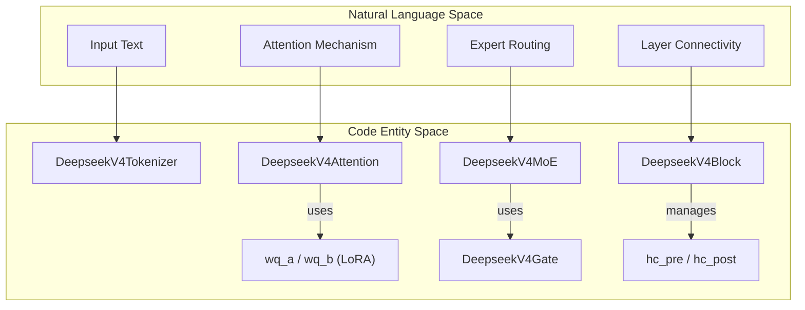
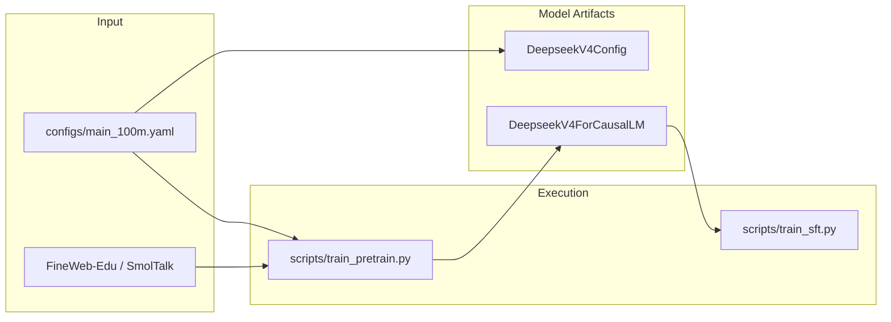

<!-- source: DeepWiki mcp.deepwiki.com · repo huggingface/nanowhale · page 1 Overview · fetched 2026-10-26 -->

# Overview

Relevant source files

The following files were used as context for generating this wiki page:

- [README.md](README.md)
- [SUMMARY.md](SUMMARY.md)

The `nanowhale` repository provides a complete implementation, training pipeline, and evaluation suite for a ~110M parameter language model based on the **DeepSeek-V4** architecture [README.md:1-3](). This project serves as a research demonstration of advanced architectural features—including Mixture-of-Experts (MoE), Multi-Head Latent Attention (MLA), and Hyper-Connections—at a miniature scale suitable for experimentation on consumer-grade hardware or single-GPU instances [README.md:12-19]().

## Project Purpose

The primary goal of `nanowhale` is to replicate the structural innovations of the DeepSeek-V4 model within a constrained parameter budget (~110M total parameters) [SUMMARY.md:3-5](). This allows for rapid iteration on training techniques like Multi-Token Prediction (MTP) and Sinkhorn-based routing without the massive compute requirements of full-scale LLMs.

For a detailed breakdown of the research motivations and known scaling limitations (such as the high embedding-to-parameter ratio), see **[Project Background & Goals](#1.1)**.

## Key Architectural Innovations

The model implements the full DeepSeek-V4 feature set as defined in `modeling_deepseek_v4.py` [README.md:32]():

*   **Multi-Head Latent Attention (MLA):** A compressed attention mechanism utilizing low-rank projections for KV states to reduce memory overhead [README.md:16]().
*   **Mixture-of-Experts (MoE):** Employs 4 routed experts and 1 shared expert with top-2 routing and SwiGLU activations [README.md:17]().
*   **Hyper-Connections:** A novel connectivity pattern using Sinkhorn routing to manage hidden state flow across layers [README.md:18]().
*   **Multi-Token Prediction (MTP):** Includes a specialized layer designed to predict the next $n$ tokens simultaneously to improve sample efficiency [README.md:19]().

### Code Entity Space: Architecture Mapping

The following diagram illustrates how high-level architectural concepts map to specific classes and parameters within the codebase.

**Model Component Mapping**

Sources: [modeling_deepseek_v4.py:12-25](), [README.md:14-19]()

## Repository Organization

The repository is structured to separate model definitions, training logic, and utility scripts:

| Directory/File | Description |
| :--- | :--- |
| `modeling_deepseek_v4.py` | Core PyTorch implementation of the DeepSeek-V4 architecture [README.md:32](). |
| `configuration_deepseek_v4.py` | Configuration class handling hyperparameters and Hub integration [README.md:33](). |
| `configs/` | YAML files defining model scales (e.g., `main_100m.yaml`, `debug.yaml`) [README.md:35-38](). |
| `scripts/` | Execution scripts for pretraining, SFT, chat, and evaluation [README.md:39-47](). |
| `tokenizer/` | Artifacts for the 129,280-token DeepSeek-V4 tokenizer [README.md:48-50](). |

### System Interaction Diagram

This diagram shows the relationship between the configuration system, the training scripts, and the resulting model artifacts.

**System Workflow**

Sources: [README.md:31-51](), [SUMMARY.md:65-77]()

## Getting Started

To begin using `nanowhale`, you must install the dependencies listed in `requirements.txt` and can then proceed to run the interactive chat CLI or initiate a training run [README.md:53-77]().

For a step-by-step setup guide and verification instructions, see **[Getting Started](#1.2)**.

Sources: [README.md:1-121](), [SUMMARY.md:1-132]()

---

