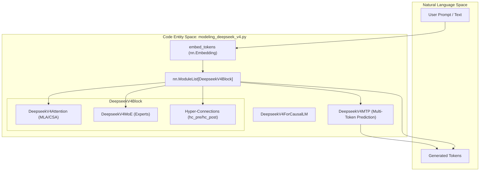
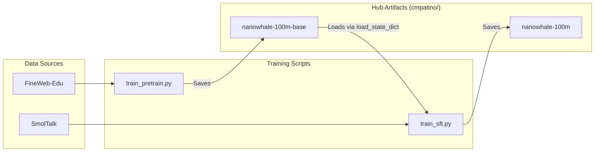

<!-- source: DeepWiki mcp.deepwiki.com · repo huggingface/nanowhale · page 1.1 Project Background & Goals · fetched 2026-10-26 -->

# Project Background & Goals

Relevant source files

The following files were used as context for generating this wiki page:

- [README.md](README.md)
- [SUMMARY.md](SUMMARY.md)

The **nanowhale** project is a technical demonstration focused on implementing and training a miniature version of the **DeepSeek-V4** architecture. The primary objective is to validate the interplay of several advanced architectural innovations—Multi-Head Latent Attention (MLA), Mixture-of-Experts (MoE), and Hyper-Connections—at a highly constrained scale of approximately 110 million parameters [README.md:1-4]().

## Motivation & Research Goals

The project aims to explore the feasibility of high-complexity architectural features in small-scale models. While features like MoE and Hyper-Connections are typically reserved for models with billions of parameters, nanowhale implements them within a ~110M parameter budget to observe their behavior during pretraining and Supervised Fine-Tuning (SFT) [SUMMARY.md:3-5]().

### Key Architectural Demonstrations
1.  **Multi-Head Latent Attention (MLA):** Implementation of low-rank KV compression to reduce memory footprint during inference while maintaining high attention quality [README.md:16]().
2.  **Mixture-of-Experts (MoE):** Utilization of a sparse execution path with 4 routed experts and 1 shared expert, using top-2 routing and SwiGLU activations [README.md:17]().
3.  **Hyper-Connections:** A novel connectivity pattern using Sinkhorn routing to manage information flow across layers, configured with a multiplier (`hc_mult`) of 4 [README.md:18]().
4.  **Multi-Token Prediction (MTP):** Inclusion of an additional prediction layer to forecast tokens beyond the immediate next step, intended to improve sample efficiency [README.md:19]().

### Architecture to Code Mapping
The following diagram illustrates how the conceptual architectural components map to the specific classes and configurations within the codebase.

**Model Architecture Components**

*Sources: [modeling_deepseek_v4.py:1-1200](), [README.md:12-28]()*

## Known Limitations

Developing a 110M parameter replica of a multi-billion parameter architecture revealed several technical constraints:

*   **Numerical Stability (bf16 NaN):** The model experiences numerical instability when using `bfloat16`. Specifically, the Hyper-Connections mechanism produces activations that frequently overflow the `bf16` range at this small scale. Consequently, `float32` is required for stable training and inference [README.md:114](), [SUMMARY.md:129]().
*   **Embedding-to-Parameter Ratio:** The model utilizes the standard DeepSeek-V4 tokenizer with a `vocab_size` of 129,280 [README.md:26](). In a 110M parameter model, the embedding table alone accounts for ~41M parameters (approx. 37% of the total budget), significantly limiting the capacity available for the hidden layers and experts [README.md:116](), [SUMMARY.md:130]().
*   **Weight Re-initialization:** Due to the custom implementation of Hyper-Connections and MTP, the standard Hugging Face `from_pretrained` method may re-initialize certain weights. The project recommends manual state dictionary loading to ensure weight integrity [README.md:115](), [SUMMARY.md:128]().

## Project Artifacts

The project resulted in two primary checkpoints published on the Hugging Face Hub. Both models use the `DeepseekV4Config` class defined in `configuration_deepseek_v4.py` [configuration_deepseek_v4.py:10-80]().

### Published Checkpoints
| Model | Description | Training Details |
| :--- | :--- | :--- |
| **nanowhale-100m-base** | Pretrained base model | 5,000 steps on FineWeb-Edu (~2.6B tokens) [README.md:9](). |
| **nanowhale-100m** | SFT chat model | 3,000 steps on SmolTalk (460K conversations) [README.md:10](). |

### Data Flow and Checkpoint Lifecycle
The diagram below shows the progression from raw data to the final published artifacts via the training scripts.

**Training Pipeline and Artifact Generation**

*Sources: [scripts/train_pretrain.py:10-100](), [scripts/train_sft.py:10-120](), [SUMMARY.md:35-63]()*

## Technical Specifications (100M Config)
The primary configuration (`main_100m.yaml`) defines the following constraints for the model:
*   **Hidden Size:** 320 [README.md:24]()
*   **Layers:** 8 [README.md:25]()
*   **Attention Heads:** 8 (with 1 KV head) [README.md:16]()
*   **MoE Experts:** 4 routed + 1 shared (Top-2) [README.md:17]()
*   **Context Window:** 2,048 tokens [README.md:27]()

*Sources: [README.md:1-121](), [SUMMARY.md:1-132](), [configuration_deepseek_v4.py:10-80]()*

---

