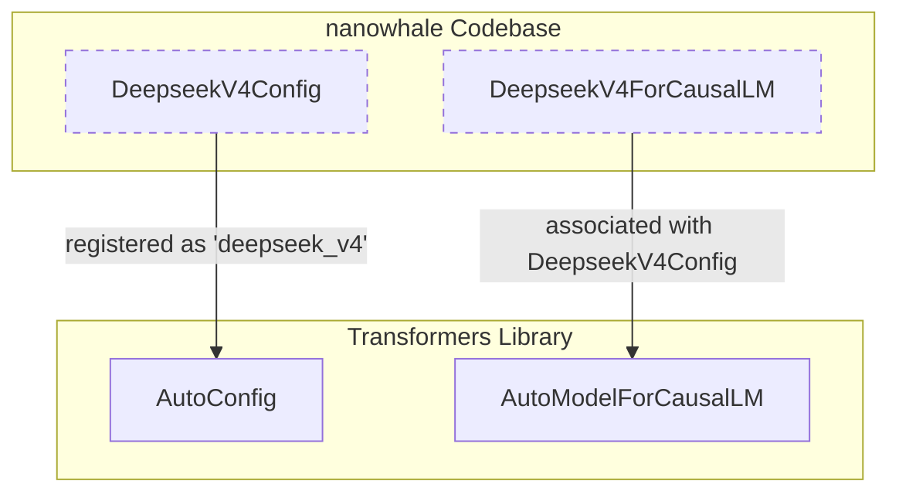
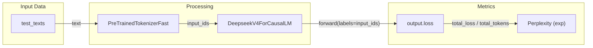

<!-- source: DeepWiki mcp.deepwiki.com · repo huggingface/nanowhale · page 1.2 Getting Started · fetched 2026-10-26 -->

# Getting Started

<details>
<summary>Relevant source files</summary>

The following files were used as context for generating this wiki page:

- [requirements.txt](requirements.txt)
- [scripts/chat.py](scripts/chat.py)
- [scripts/eval_smoke.py](scripts/eval_smoke.py)

</details>


This page provides a technical guide for setting up the `nanowhale` environment, installing necessary dependencies, and verifying the installation using the provided diagnostic and interactive scripts.

## Environment Setup

The `nanowhale` project requires a modern Python environment with specific versions of the Hugging Face ecosystem and PyTorch. The dependencies are managed via a standard `requirements.txt` file.

### Installation Steps

1. **Install Dependencies**: Use `pip` to install the core libraries, including `torch` (>= 2.6.0), `transformers` (>= 5.0.0), and the `trl` / `accelerate` stack.
   ```bash
   pip install -r requirements.txt
   ```
2. **Register Custom Architectures**: Because `DeepseekV4ForCausalLM` and `DeepseekV4Config` are custom classes, they must be registered with the Hugging Face `Auto` classes if you are not using `trust_remote_code=True`. The scripts provided in the repository handle this registration locally.

### Dependency Breakdown
| Package | Version | Role |
| :--- | :--- | :--- |
| `torch` | >=2.6.0 | Core tensor operations and autograd engine [requirements.txt:1]() |
| `transformers` | >=5.0.0 | Model loading and tokenizer management [requirements.txt:2]() |
| `trl` | >=1.0.0 | SFT and Trainer utilities [requirements.txt:5]() |
| `trackio` | N/A | Experiment tracking and logging [requirements.txt:6]() |
| `safetensors` | N/A | Secure weight serialization [requirements.txt:7]() |

**Sources:**
- [requirements.txt:1-10]()

---

## Model Loading and Registration

The `nanowhale` codebase uses a custom implementation of the DeepSeek-V4 architecture. To interact with these models using standard Hugging Face APIs, the repository manually registers the configuration and model classes.

### Code-to-Entity Mapping: Registration Flow
The following diagram illustrates how the custom classes in the codebase are linked to the `transformers` library's factory methods.

**Model Registration Architecture**


This registration occurs at the beginning of the execution scripts:
- `AutoConfig.register("deepseek_v4", DeepseekV4Config)` [scripts/chat.py:13]() [scripts/eval_smoke.py:13]()
- `AutoModelForCausalLM.register(DeepseekV4Config, DeepseekV4ForCausalLM)` [scripts/chat.py:14]() [scripts/eval_smoke.py:14]()

**Sources:**
- [scripts/chat.py:13-14]()
- [scripts/eval_smoke.py:13-14]()
- [configuration_deepseek_v4.py:1-50]() (referenced for class definitions)
- [modeling_deepseek_v4.py:1-50]() (referenced for class definitions)

---

## Interactive Chat CLI

The `scripts/chat.py` utility allows for interactive testing of the model's conversational capabilities. It handles the chat template application, bfloat16 casting, and iterative generation.

### Execution
```bash
python scripts/chat.py --model_path /path/to/model_checkpoint --device cuda
```

### Implementation Details
1. **Model Loading**: The model is loaded in `torch.bfloat16` to maintain consistency with the training precision [scripts/chat.py:28]().
2. **Chat Template**: The script checks for a `tokenizer.chat_template`. If absent, it falls back to a manual role-based string concatenation [scripts/chat.py:43-46]().
3. **Generation Loop**: It uses `model.generate` with sampling parameters (`temperature`, `top_p`) and ensures the `pad_token_id` is correctly set to the `eos_token_id` [scripts/chat.py:50-57]().

**Sources:**
- [scripts/chat.py:17-62]()

---

## Verification via Smoke Test

The `scripts/eval_smoke.py` script is a comprehensive validation pipeline designed to ensure the environment and model weights are functioning correctly.

### Smoke Test Stages
The script executes six distinct validation phases:

| Stage | Logic | Purpose |
| :--- | :--- | :--- |
| **1. Tokenizer** | Loads `PreTrainedTokenizerFast` | Verify vocab size and special tokens [scripts/eval_smoke.py:28-33]() |
| **2. Config** | Loads `DeepseekV4Config` | Validate hyperparameter parsing [scripts/eval_smoke.py:36-41]() |
| **3. Model** | Loads `DeepseekV4ForCausalLM` | Verify weight loading and parameter count [scripts/eval_smoke.py:44-49]() |
| **4. Generation** | Runs `model.generate` | Ensure forward pass and sampling work [scripts/eval_smoke.py:52-68]() |
| **5. Chat** | `apply_chat_template` | Validate conversation formatting [scripts/eval_smoke.py:71-83]() |
| **6. Perplexity** | Cross-Entropy calculation | Verify numerical stability and basic sanity [scripts/eval_smoke.py:88-106]() |

### Code-to-Entity Mapping: Smoke Test Data Flow
This diagram shows how data flows through the `eval_smoke.py` components during the final perplexity check.

**Perplexity Calculation Flow**


**Sources:**
- [scripts/eval_smoke.py:27-110]()
- [scripts/eval_smoke.py:99-104]() (Perplexity logic)

---

