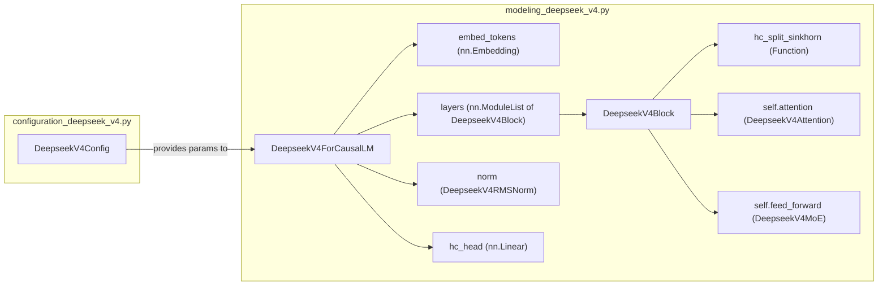

<!-- source: DeepWiki mcp.deepwiki.com · repo huggingface/nanowhale · page 2 Model Architecture · fetched 2026-10-26 -->

# Model Architecture

Relevant source files

The following files were used as context for generating this wiki page:

- [configuration_deepseek_v4.py](configuration_deepseek_v4.py)
- [modeling_deepseek_v4.py](modeling_deepseek_v4.py)

The DeepSeek-V4 architecture, as implemented in `nanowhale`, represents a highly efficient Transformer variant designed for high throughput and dense knowledge representation. It is characterized by three core architectural innovations: **Hyper-Connections (HC)**, **Multi-Head Latent Attention (MLA)** (also referred to as Compressed Sparse Attention), and a **Mixture-of-Experts (MoE)** feed-forward system.

The model is defined in [modeling_deepseek_v4.py:1-15](), providing a pure PyTorch implementation compatible with the Hugging Face ecosystem.

### System Overview

The model follows a standard decoder-only Transformer structure but replaces traditional residual connections and attention mechanisms with more sophisticated routing and compression logic.

| Component | Code Entity | Description |
| :--- | :--- | :--- |
| **Configuration** | `DeepseekV4Config` | Manages hyperparameters for HC, MLA, and MoE. |
| **Core Block** | `DeepseekV4Block` | Orchestrates the HC lifecycle around Attention and MoE. |
| **Attention** | `DeepseekV4Attention` | Implements MLA with low-rank projections and RoPE. |
| **Feed-Forward** | `DeepseekV4MoE` | Mixture-of-Experts with `sqrtsoftplus` routing. |
| **Next-Token** | `DeepseekV4ForCausalLM` | The top-level model wrapper for generation. |

**Sources:** [modeling_deepseek_v4.py:130-141](), [modeling_deepseek_v4.py:438-442](), [configuration_deepseek_v4.py:18-22]()

---

### Core Innovations

#### 1. Hyper-Connections (HC)
Unlike standard residual connections ($x + f(x)$), Hyper-Connections maintain multiple copies of the hidden state (defined by `hc_mult`). These copies are mixed using a combination matrix normalized via **Sinkhorn iterations**. This allows the model to dynamically route information across different "lanes" of the hidden state.

*   **Key Logic:** The `hc_split_sinkhorn` function generates `pre`, `post`, and `comb` weights.
*   **Lifecycle:** Within each `DeepseekV4Block`, `hc_pre` is applied before the sub-layer, and `hc_post` is applied after, while the `comb` matrix manages the cross-copy mixing.
*   **Details:** For more information on Sinkhorn normalization and the multi-copy state, see [Hyper-Connections](#2.2).

**Sources:** [modeling_deepseek_v4.py:85-123](), [configuration_deepseek_v4.py:54-57]()

#### 2. Multi-Head Latent Attention (MLA / CSA)
MLA reduces the KV cache footprint by using low-rank latent projections. In `nanowhale`, this is implemented as **Compressed Sparse Attention**.

*   **Q Projection:** Uses a low-rank bottleneck (`wq_a` to `wq_b`) with `DeepseekV4RMSNorm`.
*   **KV Projection:** Uses a direct projection `wkv` to a latent space.
*   **Hybrid RoPE:** Splits the head dimension into `nope_head_dim` (non-rotary) and `qk_rope_head_dim` (rotary) for positional encoding.
*   **Details:** For details on grouped output projections and sliding windows, see [Multi-Head Latent Attention (MLA / CSA)](#2.3).

**Sources:** [modeling_deepseek_v4.py:130-171](), [configuration_deepseek_v4.py:40-53]()

#### 3. Mixture-of-Experts (MoE)
The feed-forward network uses a Mixture-of-Experts strategy where most parameters are partitioned into "experts," and only a subset are activated per token.

*   **Routing:** Uses `DeepseekV4Gate` with `sqrtsoftplus` scoring and `noaux_tc` (no-auxiliary loss top-k) routing.
*   **Experts:** Combines `n_shared_experts` (always active) with `n_routed_experts` (top-k active).
*   **Details:** For details on SwiGLU expert layers and hash-based routing, see [Mixture-of-Experts (MoE)](#2.4).

**Sources:** [modeling_deepseek_v4.py:334-360](), [configuration_deepseek_v4.py:29-39]()

---

### Architecture Data Flow

The following diagram illustrates how a single token's hidden state propagates through the `DeepseekV4Block`, emphasizing the "Code Entity Space" identifiers.

**DeepSeek-V4 Block Data Flow**

```mermaid
graph TD
    subgraph Block ["DeepseekV4Block"]
        INPUT["hidden_states (hc_mult copies)"] --> HC_PRE["hc_pre weights"]
        HC_PRE --> ATTN_NORM["DeepseekV4RMSNorm"]
        ATTN_NORM --> MLA["DeepseekV4Attention (MLA)"]
        MLA --> HC_POST["hc_post weights"]
        HC_POST --> COMB["Sinkhorn comb matrix"]
        COMB --> MOE_NORM["DeepseekV4RMSNorm"]
        MOE_NORM --> MOE["DeepseekV4MoE"]
        MOE --> OUTPUT["hidden_states (updated)"]
    end
    
    subgraph Attention ["DeepseekV4Attention"]
        MLA_IN["Input"] --> WQ_A["wq_a (Linear)"]
        WQ_A --> Q_NORM["q_norm (RMSNorm)"]
        Q_NORM --> WQ_B["wq_b (Linear)"]
        MLA_IN --> WKV["wkv (Linear)"]
        WKV --> KV_NORM["kv_norm (RMSNorm)"]
    end
```

**Sources:** [modeling_deepseek_v4.py:438-480](), [modeling_deepseek_v4.py:155-162]()

---

### Configuration and Model Setup

The architecture is dynamically sized based on the `DeepseekV4Config`. This configuration drives the initialization of the `DeepseekV4Model` and its constituent layers.

**Model Hierarchy and Code Mapping**

**Sources:** [modeling_deepseek_v4.py:535-570](), [configuration_deepseek_v4.py:76-133]()

### Child Pages

*   **[Configuration System (DeepseekV4Config)](#2.1)**: Deep dive into the parameters and `auto_map` logic.
*   **[Hyper-Connections](#2.2)**: Technical breakdown of multi-copy states and Sinkhorn normalization.
*   **[Multi-Head Latent Attention (MLA / CSA)](#2.3)**: Low-rank KV compression and hybrid RoPE implementation.
*   **[Mixture-of-Experts (MoE)](#2.4)**: Expert routing, shared experts, and SwiGLU layers.
*   **[Multi-Token Prediction (MTP)](#2.5)**: Prediction of $t+n$ tokens for improved training efficiency.

---

