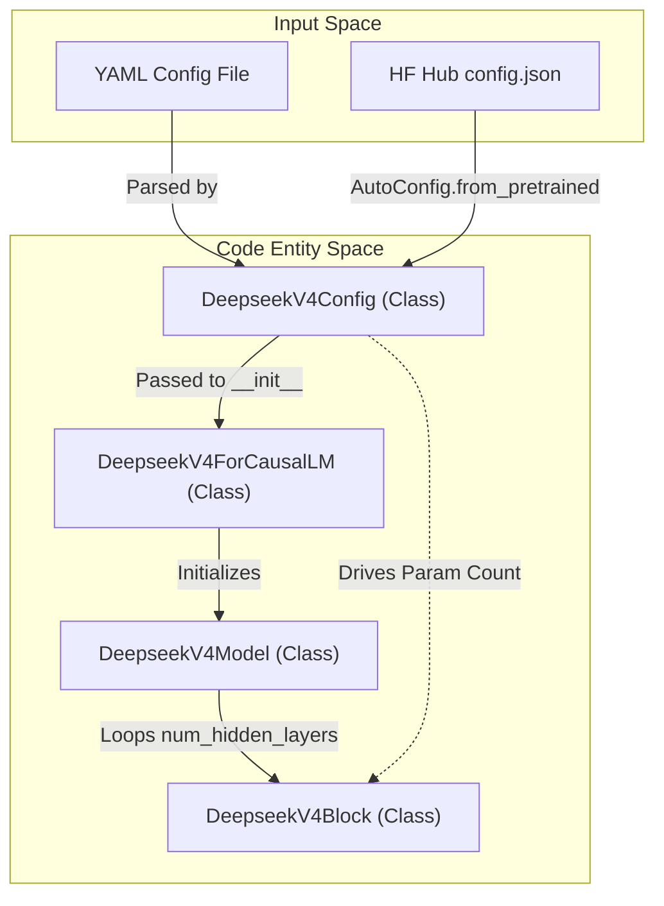
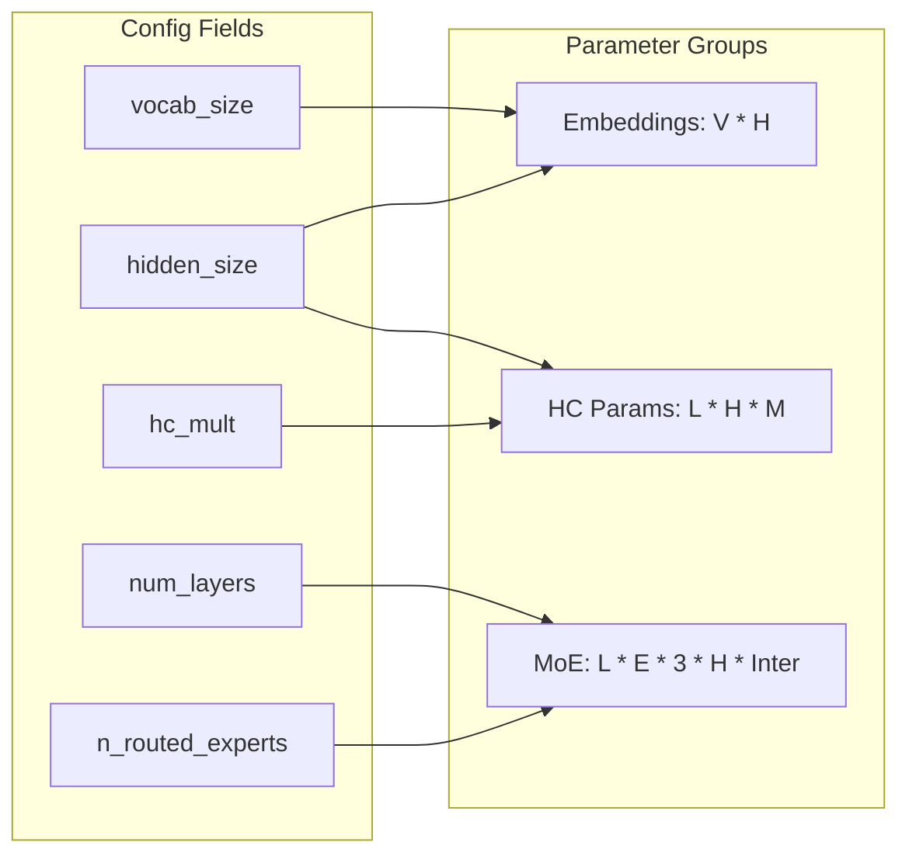

<!-- source: DeepWiki mcp.deepwiki.com · repo huggingface/nanowhale · page 2.1 Configuration System (DeepseekV4Config) · fetched 2026-10-26 -->

# Configuration System (DeepseekV4Config)

Relevant source files

The following files were used as context for generating this wiki page:

- [configuration_deepseek_v4.py](configuration_deepseek_v4.py)
- [scripts/count_params.py](scripts/count_params.py)

The configuration system in `nanowhale` is centered around the `DeepseekV4Config` class. This system manages the hyperparameters required to instantiate the complex DeepSeek-V4 architecture, including Multi-Head Latent Attention (MLA), Mixture-of-Experts (MoE), and Hyper-Connections (HC). It is designed to be fully compatible with the Hugging Face `transformers` ecosystem while implementing specific structural changes introduced in the V4 architecture.

## The DeepseekV4Config Class

The `DeepseekV4Config` class inherits from `PretrainedConfig` [configuration_deepseek_v4.py:18](). It defines the `model_type` as `"deepseek_v4"` [configuration_deepseek_v4.py:19](), which allows the Hugging Face `AutoConfig` and `AutoModel` machinery to correctly identify and load the custom architecture.

### Key Configuration Categories

The configuration is divided into several functional blocks that drive model instantiation:

1.  **Model Dimensions**: Basic transformer parameters like `hidden_size`, `num_hidden_layers`, and `vocab_size`.
2.  **Attention (MLA/CSA)**: Parameters for compressed attention, including LoRA ranks for queries and grouped output projections.
3.  **Mixture-of-Experts (MoE)**: Expert counts, routing methods (including hash-based routing), and scoring functions.
4.  **Hyper-Connections (HC)**: Multiplier for hidden state copies and Sinkhorn normalization iterations.
5.  **Multi-Token Prediction (MTP)**: Configuration for the additional prediction layers used during training.

### Data Flow: Config to Model
The following diagram illustrates how the `DeepseekV4Config` entity flows through the system to create a functional model.

**Configuration Initialization and Model Binding**

Sources: [configuration_deepseek_v4.py:18-141](), [scripts/count_params.py:9-11]()

---

## Hyperparameter Fields

### Comparison: DeepSeek-V4 vs. DeepSeek-V3
The `nanowhale` implementation highlights several key differences in the configuration compared to the previous V3 iteration:

| Feature | DeepSeek-V3 | DeepSeek-V4 | Code Reference |
| :--- | :--- | :--- | :--- |
| **Attention** | `kv_lora_rank` | `compress_ratios` | [configuration_deepseek_v4.py:11]() |
| **Head Dim** | `qk_nope_head_dim` | `head_dim` (Unified) | [configuration_deepseek_v4.py:12]() |
| **Routing** | Softmax | `sqrtsoftplus` | [configuration_deepseek_v4.py:35]() |
| **Connections** | Residual | Hyper-Connections (`hc_mult`) | [configuration_deepseek_v4.py:55]() |
| **Output** | Single Projection | `o_groups` / `o_lora_rank` | [configuration_deepseek_v4.py:44-45]() |

### Detailed Field Definitions

#### MoE Settings
*   `n_routed_experts`: Total number of experts available for routing [configuration_deepseek_v4.py:31]().
*   `num_experts_per_tok`: The 'k' in top-k routing [configuration_deepseek_v4.py:33]().
*   `scoring_func`: Set to `"sqrtsoftplus"` by default for V4 routing [configuration_deepseek_v4.py:35]().
*   `num_hash_layers`: Number of initial layers using hash-based routing instead of learned routers [configuration_deepseek_v4.py:38]().
*   `swiglu_limit`: A value used to clip SwiGLU activations for stability [configuration_deepseek_v4.py:39]().

#### Attention (MLA) Settings
*   `q_lora_rank`: Rank for the query compression [configuration_deepseek_v4.py:41]().
*   `qk_rope_head_dim`: Dimension allocated for RoPE (Rotary Positional Embeddings) [configuration_deepseek_v4.py:43]().
*   `nope_head_dim`: Calculated as `head_dim - qk_rope_head_dim` for non-positional embeddings [configuration_deepseek_v4.py:98]().
*   `o_groups`: Number of groups for the grouped output projection [configuration_deepseek_v4.py:44]().

#### Hyper-Connections (HC) Settings
*   `hc_mult`: The expansion factor for hidden states (e.g., 4x) [configuration_deepseek_v4.py:55]().
*   `hc_sinkhorn_iters`: Iterations for the Sinkhorn normalization algorithm [configuration_deepseek_v4.py:56]().

Sources: [configuration_deepseek_v4.py:22-75](), [configuration_deepseek_v4.py:76-133]()

---

## Configuration Impact on Parameter Budget

The configuration directly dictates the parameter distribution across the model. In `nanowhale`, the high `vocab_size` (129,280) relative to the `hidden_size` (320-512) causes embeddings to consume a significant portion of the budget.

**Parameter Distribution Logic**

Sources: [scripts/count_params.py:12-13](), [scripts/count_params.py:39-48](), [scripts/count_params.py:64-66]()

The `count_params` utility uses the `DeepseekV4Config` to instantiate a model and calculate these breakdowns [scripts/count_params.py:9-11](). For a 100M parameter model, the experts (FFN/MoE) and embeddings are the primary drivers of size, while Hyper-Connections (HC) add a smaller overhead based on the `hc_mult` factor [scripts/count_params.py:45-48]().

## Hugging Face Hub Compatibility

To ensure the model can be loaded via `AutoModel.from_pretrained()`, `nanowhale` utilizes the `auto_map` feature. When uploading to the Hub, the `config.json` is injected with pointers to the local implementation files:

*   `AutoConfig`: `configuration_deepseek_v4.DeepseekV4Config`
*   `AutoModelForCausalLM`: `modeling_deepseek_v4.DeepseekV4ForCausalLM`

This allows users to load the model without having the `nanowhale` repository installed locally, provided they use `trust_remote_code=True`.

Sources: [configuration_deepseek_v4.py:18-19](), [scripts/upload_to_hub.py]()

---

